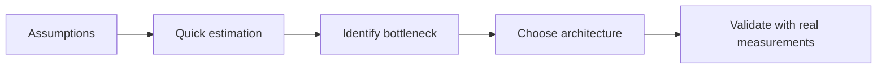
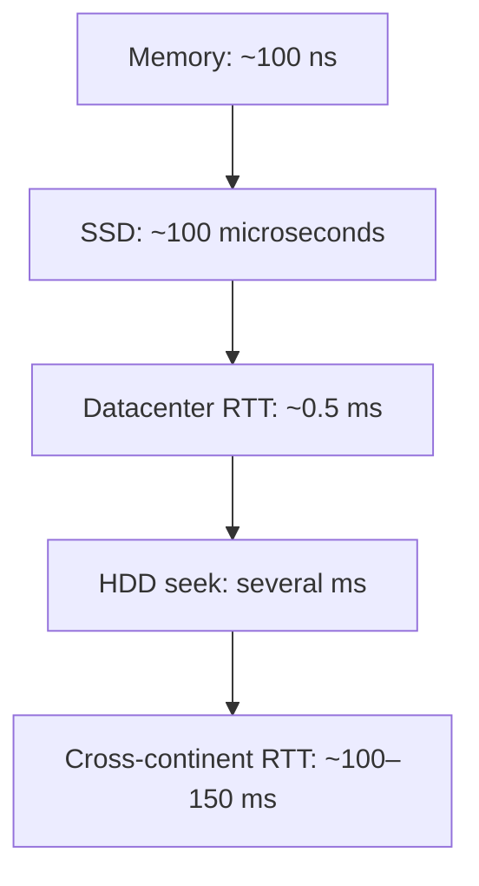
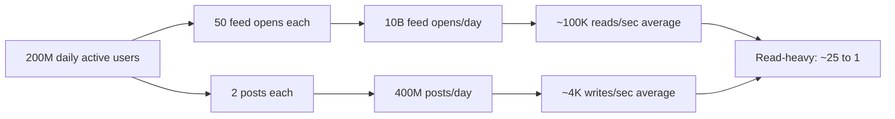
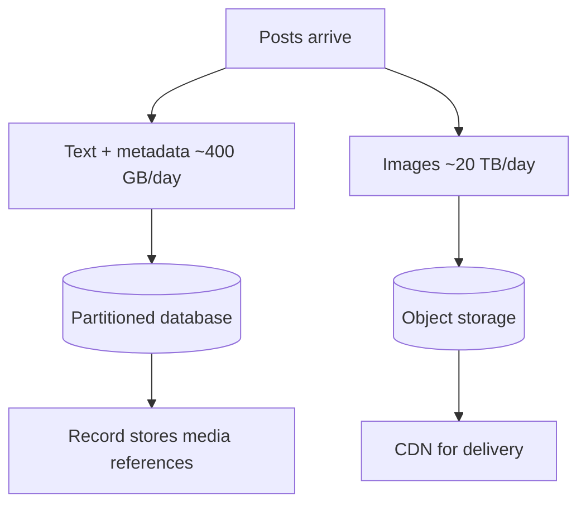
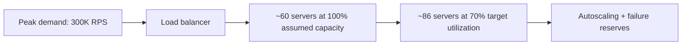

# Back-of-the-Envelope Estimation for System Design

**Simple maths, memorable numbers, and practical capacity planning**

> These are original study notes based on the supplied capacity-estimation lesson transcript. The examples use illustrative assumptions; they are not measured production benchmarks. Equations and decisions are explained in fresh wording rather than reproducing the narration.

## Contents

1. [Why estimate?](#1-why-estimate)
2. [Numbers worth memorizing](#2-numbers-worth-memorizing)
3. [Quick QPS calculations](#3-quick-qps-calculations)
4. [Latency intuition](#4-latency-intuition)
5. [Record and media sizes](#5-record-and-media-sizes)
6. [Component-capacity rules of thumb](#6-component-capacity-rules-of-thumb)
7. [Complete worked example: social platform](#7-complete-worked-example-social-platform)
8. [Storage and replication](#8-storage-and-replication)
9. [Bandwidth](#9-bandwidth)
10. [Cache memory](#10-cache-memory)
11. [Number of application servers](#11-number-of-application-servers)
12. [Interview approach and common mistakes](#12-interview-approach-and-common-mistakes)
13. [One-page cheat sheet](#13-one-page-cheat-sheet)

---

## 1. Why estimate?

Capacity estimation turns vague words such as *huge traffic* into quantities that help with design choices.

- **Requests per second (RPS/QPS):** Can the application and database keep up?
- **Storage:** Does data fit on one machine, or do we need distributed storage?
- **Bandwidth:** Can one network connection serve all content?
- **Memory:** How many cache nodes might we need?
- **Peak load:** How much capacity do we need when demand rises?

**The most important interview question:** *Which architectural decision will this calculation change?* Skip estimates that do not influence the design.



## 2. Numbers worth memorizing

### Large numbers: learn the pattern 3 → 6 → 9 → 12 → 15

| Name | Number | Power of ten | Zeros | Memory hint |
|---|---:|---:|---:|---|
| Thousand | 1,000 | 10³ | 3 | K |
| Million | 1,000,000 | 10⁶ | 6 | M |
| Billion | 1,000,000,000 | 10⁹ | 9 | B |
| Trillion | 1,000,000,000,000 | 10¹² | 12 | T |
| Quadrillion | 1,000,000,000,000,000 | 10¹⁵ | 15 | Q |

**Memory trick:** Every step adds **three zeros**, or multiplies by **1,000**.

### Storage: decimal units for easy estimates

| Unit | Bytes (decimal) | Relationship |
|---|---:|---|
| 1 KB | 10³ | 1 thousand bytes |
| 1 MB | 10⁶ | 1,000 KB |
| 1 GB | 10⁹ | 1,000 MB |
| 1 TB | 10¹² | 1,000 GB |
| 1 PB | 10¹⁵ | 1,000 TB |

**Memory trick:** KB → MB → GB → TB → PB. Move one column to the right: **× 1,000**.

**Binary units are different:** 1 KiB = 1,024 bytes, 1 MiB = 1,024 KiB, and 1 GiB = 1,024 MiB. For rough interview math, state that you are using decimal units.

### Powers-of-ten shortcut

**1 billion records × 1 KB each**

= 10⁹ records × 10³ bytes

= 10¹² bytes

= **1 TB**

You **add exponents when multiplying powers of ten**. That makes large figures manageable.

### Time conversions

| Duration | Actual | Easy mental model |
|---|---:|---|
| 1 minute | 60 seconds | 60 |
| 1 hour | 3,600 seconds | ~4,000 |
| 1 day | 86,400 seconds | **~100,000 = 10⁵** |
| 1 year | 365 days (usually) | **~400 days** for a conservative rough estimate |

**Important distinction:** Using 100,000 seconds/day **underestimates RPS by about 14%** compared with using 86,400. Using 400 days/year **overestimates annual storage by about 10%**. State which approximation you use.

### Bits vs bytes

- **8 bits = 1 byte**
- **1 MB/s = 8 Mb/s**
- **1 GB/s = 8 Gb/s**

Capital **B** = bytes; lowercase **b** = bits. Network throughput is often quoted in bits per second, while data storage uses bytes.

---

## 3. Quick QPS calculations

**Formula:**

```text
Average RPS = requests per day / 86,400

Mental-math RPS ≈ requests per day / 100,000
```

| Daily requests | Exact-ish average (÷86,400) | Fast estimate (÷100,000) |
|---:|---:|---:|
| 1 million | ~12 RPS | 10 RPS |
| 10 million | ~116 RPS | 100 RPS |
| 100 million | ~1,157 RPS | 1,000 RPS |
| 1 billion | ~11,574 RPS | 10,000 RPS |
| 10 billion | ~115,741 RPS | 100,000 RPS |

**Memory trick:** With the 100,000 shortcut, **drop five zeros**.

Example: **1,000,000,000 requests/day → 10,000 RPS**.

### Peak RPS

A simple starting assumption from the lesson is **peak = 2–3 × average**. This is illustrative; real burst factors vary greatly.

If average is 10,000 RPS and peak multiplier is 3:

**Peak = 10,000 × 3 = 30,000 RPS.**

---

## 4. Latency intuition

These are broad illustrative orders of magnitude, not promises for any particular hardware or application.

| Operation | Rough latency | Memory hint |
|---|---:|---|
| Main-memory access | ~100 ns | **100 nano** |
| Random SSD read | ~100 μs | **100 micro** |
| Datacenter round trip | ~0.5 ms | **Half a milli** |
| HDD seek | Several ms | **Several milli** |
| Intercontinental network round trip | ~100–150 ms | **Hundreds of milli** |

Unit reminders: **1 ms = 1,000 μs = 1,000,000 ns**.

So 100 μs ÷ 100 ns = **1,000×**. Under these assumptions, a random SSD access takes roughly a thousand times longer than the memory access.

**Design implication:** Use caches when repeated expensive reads justify them; use CDNs or regional deployment to reduce long-distance round trips. Real end-to-end cache and database query latencies include networks and processing, not just media-access time.



---

## 5. Record and media sizes

### Common building blocks

| Value | Rough storage |
|---|---:|
| ASCII character in UTF-8 | 1 byte |
| Non-ASCII Unicode character in UTF-8 | Often 2–4 bytes |
| 32-bit integer | 4 bytes |
| 64-bit integer | 8 bytes |
| 64-bit timestamp | 8 bytes |
| UUID, binary representation | 16 bytes |
| UUID, canonical text form | 36 characters / usually 36 ASCII bytes |

Actual database storage includes row headers, indexes, alignment, object overhead, replication, and other metadata.

### A text-post estimate

Suppose a post has an ID, author ID, timestamp, body, and metadata. The payload may take hundreds of bytes. For quick sizing, **round it to 1 KB/post** as a working assumption.

### Photos and video

- A compressed photo may be **hundreds of KB to several MB**.
- At **5 megabits/second**, a 60-second video uses:

```text
5 Mb/s × 60 s = 300 megabits
300 megabits ÷ 8 = 37.5 MB ≈ 40 MB
```

**Memory trick:** For video, **megabits ÷ 8 = megabytes** over the same time interval. Multiple resolutions and replicas increase storage.

---

## 6. Component-capacity rules of thumb

These are **starting estimates from the lesson**, not capacity guarantees. Benchmark your workload before choosing infrastructure.

| Component | Illustrative capacity | Important caveat |
|---|---|---|
| Application server | Thousands to tens of thousands of *simple* requests/sec | Business logic and downstream calls change this |
| Relational DB instance | Thousands to tens of thousands of simple queries/sec | Indexes, transactions and writes matter |
| Redis instance | ~100,000 simple operations/sec | Command size, pipelining and network matter |
| Kafka broker | Potentially hundreds of MB/sec | Message size, disks, acknowledgments and replicas matter |
| Network interface | Often 10–25 Gb/s on modern servers | Actual throughput and setup vary |

**Do not memorize these as hard limits.** They are rough scales for discussing when a system may need horizontal scaling.

---

## 7. Complete worked example: social platform

Assume a fictional large social network:

| Input | Assumption |
|---|---:|
| Daily active users (DAU) | **200 million** |
| New posts per active user/day | **2** |
| Feed opens per active user/day | **50** |
| Stored text record | **1 KB/post** |
| Peak multiplier | **3×** |

### Step A — Writes per day

200 million users × 2 posts

= **400 million new posts/day**

### Step B — Average write RPS

400,000,000 ÷ 100,000

= **4,000 posts/sec** (quick estimate)

For comparison, using the actual 86,400 seconds gives about **4,630 posts/sec**.

### Step C — Feed reads per day

200 million × 50

= **10 billion feed opens/day**

### Step D — Average read RPS

10,000,000,000 ÷ 100,000

= **100,000 feed requests/sec** (quick estimate)

Using the actual day length gives about **115,700 RPS**.

### Step E — Peak load

- Peak writes ≈ 4,000 × 3 = **12,000 posts/sec**
- Peak feed reads ≈ 100,000 × 3 = **300,000 requests/sec**

### Step F — Read/write ratio

100,000 ÷ 4,000 = **25:1**

That makes feed delivery a **read-heavy workload**.

**Architecture insight:** Consider precomputed feed lists, efficient read paths, caching and read-serving scale. Writes still need durable storage and careful processing.



> Consistency note: The formulas above deliberately use 100,000 seconds/day for easy mental maths. Actual RPS figures are higher; choose a convention and use it consistently.

---

## 8. Storage and replication

### Text posts: daily storage

400 million posts/day × 1 KB/post

= 400 × 10⁶ × 10³ bytes

= **400 GB/day** (decimal)

### Five-year storage — quick conservative estimate

Using 400 days/year:

400 GB/day × 400 days/year = **160 TB/year**

160 TB/year × 5 years = **800 TB** of logical text-post data

If there are **3 full copies**:

800 TB × 3 = **2,400 TB = 2.4 PB** of raw replicated text data

### Using 365 days instead

400 GB/day × 365 × 5 = **730 TB logical**

730 TB × 3 = **2.19 PB replicated**

This illustrates why approximations should be labelled.

### Images

Assume **10% of new posts include one image**, and average stored image size is **500 KB**.

400 million × 10% = **40 million images/day**

40 million × 500 KB = **20 TB/day**

5 years, using 400 days/year:

20 TB × 400 × 5 = **40 PB logical image data**

With three full copies it would be **120 PB**, before metadata and extra variants. The source lesson's 40 PB image figure is **not** the three-replica total.

**Architecture insight:** Large media belongs in object storage, while the application database commonly holds IDs, metadata and file references.



---

## 9. Bandwidth

**Formula:**

```text
Bandwidth (bytes/sec) = requests/sec × bytes per request

Multiply by 8 to convert bytes/sec to bits/sec
```

### Incoming image uploads

20 TB/day ÷ 100,000 seconds/day

= 20 × 10¹² ÷ 10⁵ bytes/sec

= **200 MB/sec**, or **1.6 Gb/sec**

This excludes protocol overhead and burstiness.

### Outgoing image views

Assume:

- **100,000 feed requests/sec**
- **10 loaded images per request**
- **50 KB transferred per image** after resizing/compression

100,000 × 10 × 50 KB

= 50,000,000 KB/sec

= **50 GB/sec** = **400 Gb/sec**

This is an illustrative *aggregate delivery demand*, not necessarily the origin-server load. Browser caching and a CDN can serve most repeated images.

**Memory trick:** First calculate *items per request × size per item*, then multiply by **RPS**. Convert **GB/sec × 8 = Gb/sec**.

---

## 10. Cache memory

Suppose each of the **200 million active users** has a cached feed containing **500 post IDs**, each **8 bytes**.

### One user

500 IDs × 8 bytes = 4,000 bytes ≈ **4 KB**

### All users

200 million users × 4 KB

= **800 GB** raw ID data

Allowing for keys, allocation overhead, internal structures and a planning buffer, an illustrative budget is **1–1.5 TB**. Actual in-memory overhead can differ significantly.

If each primary cache node provides **100 GB usable memory**:

- 1 TB ÷ 100 GB = **10 primary nodes**
- 1.5 TB ÷ 100 GB = **15 primary nodes**

Additional replicas and failover capacity increase total nodes.

**Ways to reduce cost:** Cache feeds only for recently active users; store fewer IDs; compress or optimize representation; use TTLs.

### A useful check: 200 IDs instead of 500

200 × 8 = **1,600 bytes/user**

200 million × 1,600 bytes = **320 GB raw**

That is a **60% reduction** from the 800 GB raw estimate, before overhead.

---

## 11. Number of application servers

**Formula:**

```text
Servers needed = peak requests/sec ÷ measured requests/sec per server
```

Assume **300,000 feed RPS** at peak and **5,000 RPS per server** from a load test.

300,000 ÷ 5,000 = **60 servers** at theoretical full utilization.

### Two different ways people describe headroom

**Method A — add spare servers:** 60 × 1.3 to 1.5 = **78–90 servers**. This corresponds to adding 30–50% on top of a full-load count.

**Method B — limit utilization:** If your target is 70% utilization, usable per-server throughput is 5,000 × 0.7 = 3,500 RPS.

300,000 ÷ 3,500 ≈ **86 servers**.

**Important:** These are different ways to specify reserve capacity. Do not assume “30% extra servers” equals “30% spare utilization.”



---

## 12. Interview approach and common mistakes

### A five-step estimation process

1. **State assumptions:** Active users, operations per user, record sizes, retention and peak factor.
2. **Compute only what matters:** RPS, storage, network, cache or server count.
3. **Round deliberately:** Say when you use 100,000 seconds/day or 400 days/year.
4. **Include overhead:** Peaks, copies, indexes, metadata, network overhead and spare capacity.
5. **Link numbers to design:** Explain why results suggest caching, sharding, CDN, queues, object storage or more servers.

### Frequent mistakes

| Mistake | Better approach |
|---|---|
| Confuse Mb with MB | Remember **8 bits = 1 byte** |
| Design for average RPS only | Include an estimated peak factor |
| Ignore replicas | Multiply logical data by copy count where appropriate |
| Treat textbook throughput as guaranteed | Benchmark actual queries and request patterns |
| Mix 86,400 and 100,000 silently | Label exact vs quick estimates |
| Claim falsely precise results | Use rounded figures and disclose assumptions |
| Count every stored byte but ignore media | Estimate the largest cost driver first |

---

## 13. One-page cheat sheet

| Remember this | Shortcut | Typical design use |
|---|---|---|
| K / M / B / T | 10³ / 10⁶ / 10⁹ / 10¹² | Large numbers |
| KB / MB / GB / TB / PB | Each is 1,000× larger (decimal) | Storage |
| Day | 86,400 sec, round to **100K** | Daily events → RPS |
| 1M/day | ~10 fast / ~12 actual RPS | Traffic |
| 100M/day | ~1K fast / ~1.16K actual RPS | Traffic |
| 1B/day | ~10K fast / ~11.6K actual RPS | Traffic |
| Peak | Try **2–3×** average as a hypothesis | Headroom |
| Text post | Assume **1 KB** for a rough example | Data storage |
| Image | Assume size explicitly (e.g. **500 KB**) | Object storage |
| Video | **5 Mb/s × 60 ÷ 8 ≈ 40 MB/min** | Media storage |
| Feed cache entry | **500 IDs × 8 B = 4 KB** | Redis sizing |
| Bandwidth | **RPS × bytes/response** | CDN and network |
| App servers | **Peak RPS ÷ tested per-server RPS** | Server count |
| Copies | **Logical data × replica count** | Physical storage |

### The fastest memory story

**“3-6-9-12; 100K seconds; times three at peak; times eight for bits; times copies for storage.”**

- **3-6-9-12** → Thousand, million, billion, trillion.
- **100K seconds** → Quick daily RPS math.
- **×3 peak** → Illustrative burst planning.
- **×8 bits** → Bytes to bits.
- **×copies** → Replicated physical storage.

### What the worked example tells us

| Result | Quick estimate | Design consequence |
|---|---:|---|
| Feed traffic | 100K average / 300K peak RPS | Strong read-serving tier |
| New posts | 400M/day | Durable write pipeline |
| Text growth | ~400 GB/day | Database partitioning planning |
| Image growth | ~20 TB/day | Object storage and CDN |
| Image delivery | ~50 GB/sec aggregate | Distributed edge serving |
| Feed ID cache | ~800 GB raw | Distributed cache |
| Feed servers | ~86 at 70% target | Load balancing and scale-out |

---

*Adapted and substantially rewritten from the user-provided system-design capacity-estimation transcript. Numerical examples are teaching assumptions, not production SLAs or universal hardware performance ratings.*