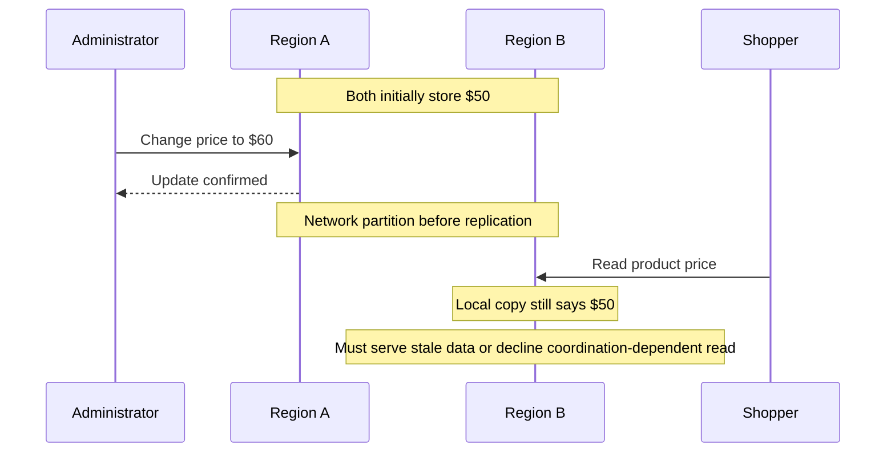
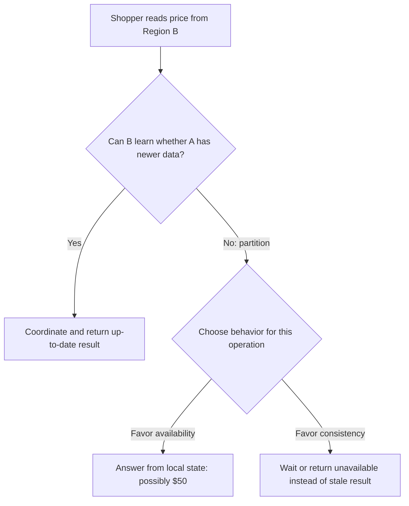
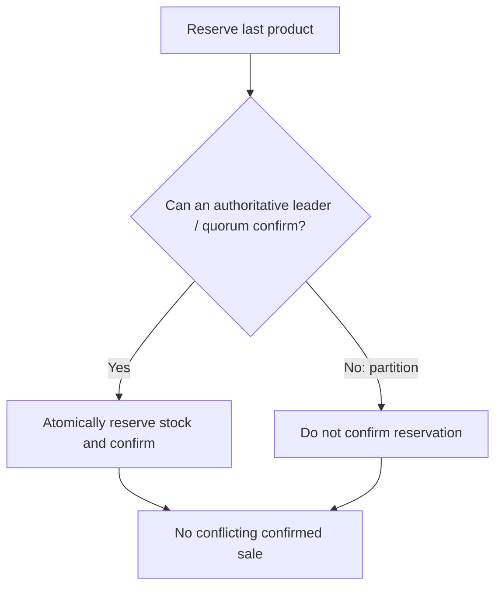
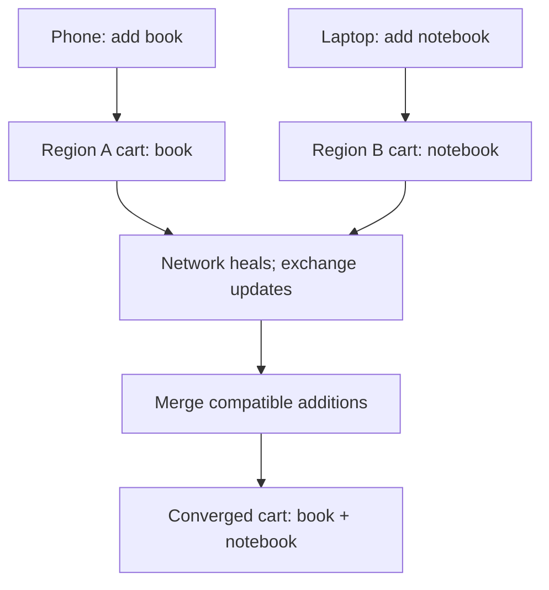
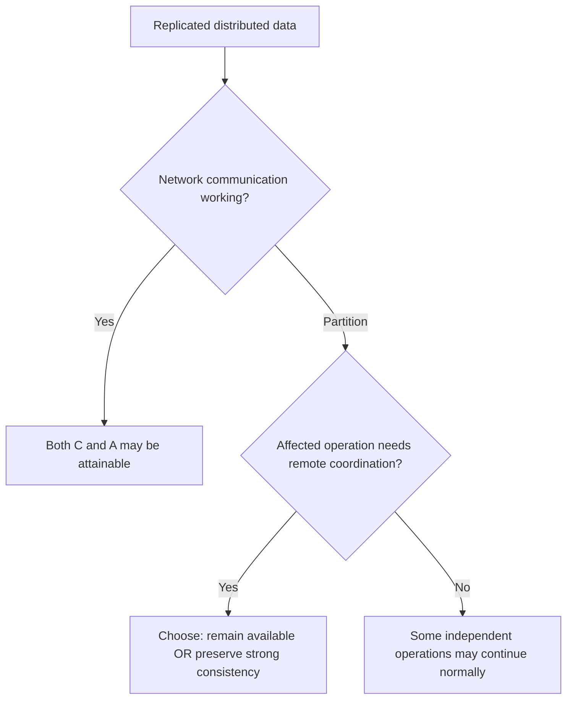
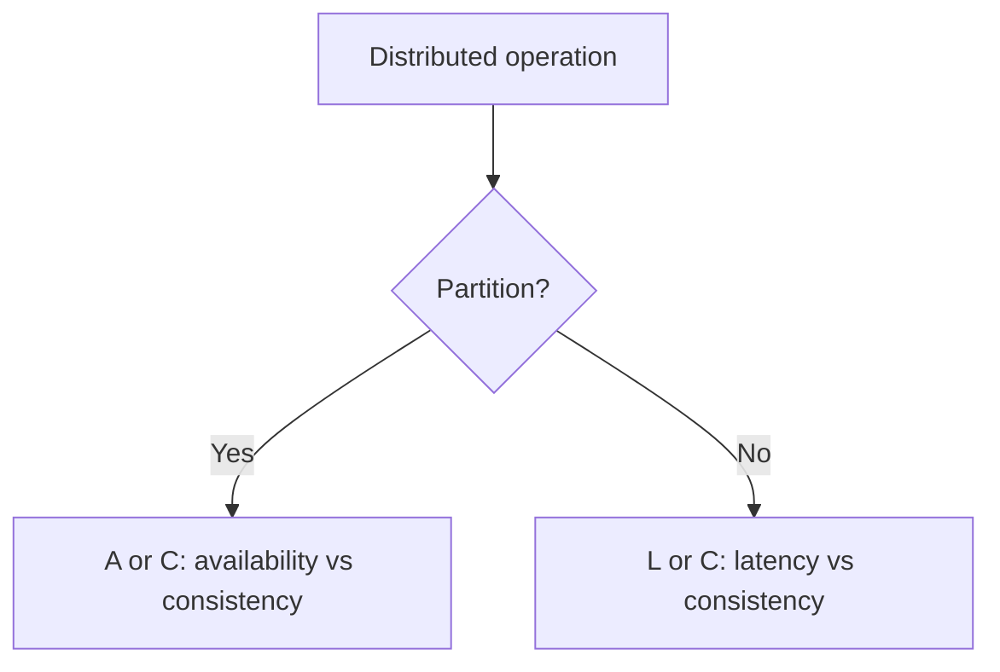

# CAP Theorem and PACELC — Explained with an Online Store

**Simple definitions, realistic decisions, easy maths and original architecture diagrams**

> This guide is an independently written adaptation of the user-provided CAP lesson transcript. Explanations, diagrams, comparisons and exercises are newly organized and worded rather than transcribed. The region names and product-price scenario are illustrative.

## Contents

1. [The online store problem](#1-the-online-store-problem)
2. [What C, A and P really mean](#2-what-c-a-and-p-really-mean)
3. [What actually happens during a partition](#3-what-actually-happens-during-a-partition)
4. [CP: preserve consistency](#4-cp-preserve-consistency)
5. [AP: preserve availability](#5-ap-preserve-availability)
6. [Why “choose any two” is misleading](#6-why-choose-any-two-is-misleading)
7. [CAP consistency vs ACID consistency](#7-cap-consistency-vs-acid-consistency)
8. [PACELC: what happens when there is no partition?](#8-pacelc-what-happens-when-there-is-no-partition)
9. [Decide per operation](#9-decide-per-operation)
10. [Practical engineering safeguards](#10-practical-engineering-safeguards)
11. [Cheat sheet and interview questions](#11-cheat-sheet-and-interview-questions)

---

## 1. The online store problem

Imagine a shop deployed in **Region A** and **Region B**. Both hold a copy of a product record.

Initially, each region has the same price: **$50**.

1. An administrator updates the price to **$60** in Region A.
2. Region A confirms the update.
3. Before Region B receives the new value, the link between regions breaks.
4. A shopper asks Region B for the product price.

Region B still knows only **$50**. It cannot contact Region A while the network is partitioned.

What can Region B do?

- **Return $50:** The request receives a value, but that value is stale.
- **Refuse or wait for coordination:** The system avoids returning an older value as current, but the shopper cannot get the requested value at that moment.

This is the central question behind the CAP theorem.

**Remember:** A network partition can leave **both regions running** but unable to exchange the information needed to agree.

---

## 2. What C, A and P really mean

| CAP letter | Name | Meaning during this discussion | Simple reminder |
|---|---|---|---|
| **C** | Consistency | Operations behave like a **single up-to-date copy** of the data | **Correct latest view** |
| **A** | Availability | Every request to a **non-failing node** eventually receives a successful, valid response | **Answers keep coming** |
| **P** | Partition tolerance | The system must contend with nodes that cannot communicate across a network cut | **Link can break** |

### C — Consistency means linearizable behavior

For this theorem, consistency is commonly formalized as **linearizability**.

Once the change from $50 to $60 has **completed successfully**, a later read should return **$60 or a newer value**, not the old $50.

This does **not** require every replica to update in the same instant. A lagging replica can coordinate with an authoritative node, or stop serving a read that it cannot answer correctly.

### A — Availability means an actual response

CAP availability is stronger than “the server process is alive.” An eligible request to a non-failing node must eventually receive a valid response.

Returning a local, older value may preserve CAP availability while giving up linearizable consistency.

Returning an error instead of the requested result **does not count as CAP availability for that operation**. “Eventually” does not itself specify a small response-time limit.

### P — Partitions mean missing communication

A partition can result from routing failures, a network outage, a broken link or misconfiguration.

The theorem addresses what guarantees are possible **when the network cannot deliver the needed messages**. We cannot simply assume away network failures in a real distributed deployment.

---

## 3. What actually happens during a partition

The two-region price example produces a meaningful trade-off for a request whose correct answer depends on information across the broken link.

### The core impossibility, in everyday English

**A disconnected replica cannot guarantee it knows about updates that happened elsewhere.**

It cannot simultaneously promise both:

1. “I will always return the latest confirmed value,” and
2. “I will always successfully answer this affected request.”

This is about **guarantees under a partition**, not the claim that every request on every node must fail.

---

## 4. CP: preserve consistency

**CP** describes a design that protects a strongly consistent answer during a partition, even if some requests cannot complete.

### Example: last unit of inventory

Suppose only **one item remains**, but both regions have a replica of the inventory count.

Two shoppers attempt to reserve the last item during a partition.

If both replicas independently read “1” and confirm a reservation, the store could promise **two items when only one exists**.

A coordination-based design can require a reservation to be approved by an authorized leader or quorum. A disconnected region that cannot get that agreement must **wait or reject the reservation**.

| What CP prioritizes | What it can sacrifice |
|---|---|
| No conflicting confirmed inventory reservation | Some shoppers cannot reserve while disconnected |
| A single coherent order of authoritative updates | Higher coordination overhead |

**Important nuance:** CP does **not** mean every node becomes unavailable. A group that still has a functioning quorum may keep processing requests, while the isolated side refuses coordination-dependent operations.

**Memory cue:** **CP = Correctness before completing the affected request.**

---

## 5. AP: preserve availability

**AP** designs favor continuing useful operations on reachable replicas during a partition, even if replicas temporarily disagree.

### Example: shopping-cart additions

A customer uses a phone connected to Region A to add a **book** and a laptop connected to Region B to add a **notebook**. The regions cannot communicate.

An availability-oriented implementation may accept both changes locally.

While disconnected, the devices may show different views. After communication returns, the system can reconcile the updates.

**Important:** “Both items remain” depends on the cart's **merge rules**. A naive last-write-wins overwrite might discard one update. Real designs may use operation logs, versioning or conflict-free replicated data types (CRDTs) when suitable.

| What AP prioritizes | What it can sacrifice |
|---|---|
| Local operations can continue | Two regions may temporarily disagree |
| Better responsiveness during some partitions | Conflict detection and merge complexity |

**Memory cue:** **AP = Answer now; reconcile later.**

AP does **not** mean values are permanently inconsistent. An AP design may aim for **eventual consistency** once communication is restored.

---

## 6. Why “choose any two” is misleading

CAP is sometimes summarized as “choose two out of three.” That makes it sound as though a distributed system can select two permanent properties and ignore the third.

A more accurate description is:

**If a network partition affects operations that require cross-partition coordination, the system cannot guarantee both CAP consistency and CAP availability for those operations.**

When the network is healthy, a distributed system may be able to deliver **both** consistent data and successful responses, subject to its normal failure and performance limitations.

### What about “CA”?

A single-node store may provide both strong consistency and availability while that node is healthy, without cross-node coordination.

However, a replicated distributed system whose nodes can become separated **cannot avoid the partition trade-off by calling itself CA**.

**Remember:** The critical choice happens **during broken communication**—not necessarily on every request at all times.

---

## 7. CAP consistency vs ACID consistency

The word *consistency* refers to different things in two familiar acronyms:

| Term | What “C” means | Example |
|---|---|---|
| **CAP consistency** | Linearizable behavior: operations appear to act on one current copy | A later read sees the confirmed new price |
| **ACID consistency** | Database transactions preserve declared integrity rules and constraints | A transaction cannot violate a required constraint |

A database can enforce its ACID constraints **while** using a replication scheme whose reads are not linearizable.

**Interview trap:** Do not use CAP's “C” as a synonym for valid database constraints.

---

## 8. PACELC: what happens when there is no partition?

The transcript extends CAP with **PACELC**.

Pronounce the idea as:

- **P**: If a **Partition** happens, choose between **A**vailability and **C**onsistency.
- **EL**: **Else**, when the network is working, consider the trade-off between **L**atency and **C**onsistency.

### Why consistency can increase latency

For example:

- A **local replica read** can be fast but may return a slightly old value.
- A **coordinated read** can check the authoritative state but may need one or more network round trips.
- A **multi-replica acknowledged write** can offer stronger guarantees but may require additional waiting.

The strength and speed of these options depend on the actual replication and quorum protocol.

| Situation | Example design choice | Possible downside |
|---|---|---|
| Network partition | Let a cart accept local additions | Divergent cart views |
| Network partition | Refuse isolated inventory reservations | Some checkout requests fail |
| Healthy network | Read local replica | Potentially stale information |
| Healthy network | Coordinate on each critical read | Extra latency |

**Memory cue:** **PACELC = Partition: Availability/Consistency; Else: Latency/Consistency.**

---

## 9. Decide per operation

CAP is most useful when applied to **concrete business operations**, rather than assigning one label to an entire product.

| Online-store operation | What matters most? | Sensible direction |
|---|---|---|
| View product description | Responding quickly; modest staleness may be tolerable | Local cache or AP-style read when acceptable |
| Read displayed price | Depends on pricing requirements | Define allowed staleness and user-facing behavior |
| Reserve final inventory unit | Prevent conflicting confirmed reservations | Coordinated, consistency-first operation |
| Add independent cart item | Keep shopping possible | Locally accept and merge safely |
| Charge a payment | Avoid duplicate or incorrect financial effects | Durable, coordinated state and idempotency |

A system may combine **different consistency policies for different data and workflows**.

### A memorable contrast

**Product description:** “Showing yesterday's spelling update may be acceptable.”

**Last item in stock:** “Confirming two buyers for one unit may not be acceptable.”

That is why architecture decisions should begin with **business invariants and recovery requirements**.

---

## 10. Practical engineering safeguards

The following are supplementary implementation considerations that make the CAP choices concrete.

### A. Define which operations can use stale data

Decide what “stale” means: a few seconds, a minute or “never after confirmation.” Make the rule explicit.

### B. Use versions or logical clocks when needed

Replication metadata can help detect changes and conflicts; timestamps alone may not safely represent causality across machines.

### C. Design reconciliation deliberately

A cart's “add item” events may be mergeable. Financial balances and inventory deductions usually need more careful coordination.

### D. Avoid ambiguous confirmation

For important writes, do not tell a customer an operation is committed if it is only queued locally and could be lost. Clearly distinguish **accepted for processing** from **confirmed complete**.

### E. Test actual failure behavior

Simulate:

- Region-to-region communication loss
- Replica lag and delayed propagation
- Conflicting concurrent updates
- Reconnection after a partition
- Retrying requests whose responses were lost

### F. Understand that CAP isn't a full architecture blueprint

CAP alone does not settle latency budgets, durability, throughput, conflict resolution, security, replication factor or the usability of degraded modes.

---

## 11. Cheat sheet and interview questions

### Quick comparison

| Model | During a relevant network partition | Simple example |
|---|---|---|
| **CP** | Preserve a current, single-copy view; some operations wait/fail | Confirming final-stock reservation |
| **AP** | Keep handling operations locally; replicas may differ temporarily | Accepting mergeable cart additions |
| **CA (healthy/no partition)** | Both successful responses and strong consistency may be attainable | A functioning single-node store |
| **PACELC** | Adds the latency/consistency question when links work normally | Nearby stale read vs slower coordinated read |

### Easy-to-remember phrases

- **CAP:** **C**urrent answer, **A**nswer available, **P**artitioned network.
- **CP:** **Correct first; otherwise wait.**
- **AP:** **Answer locally; merge later.**
- **PACELC:** **If P, A or C; Else L or C.**

### Mini quiz

1. Region A confirms a price of $60. Region B has only $50 after disconnection. What choices does B have?
2. Does CAP availability mean a request must be fast?
3. Does CAP consistency require all replicas to update simultaneously?
4. Why is an inventory reservation different from adding a cart item?
5. Why is the phrase “choose any two” an oversimplification?
6. How does the “C” in CAP differ from the “C” in ACID?
7. Why does coordination sometimes raise latency even without a partition?
8. Can the quorum side of a CP system continue serving requests during a partition?
9. What could go wrong if disconnected cart replicas use only last-write-wins?
10. What must happen after two AP replicas reconnect?

### Short interview answer

CAP explains a limitation of replicated distributed data during a communication partition: an operation that requires coordination cannot be guaranteed both a strongly consistent result and a successful response from every non-failing node. A consistency-first operation may stop on the isolated side; an availability-first operation may accept local, possibly divergent results. PACELC adds the normal-operation trade-off between latency and consistency.

**Final takeaway:** **Choose consistency behavior based on the business operation and what goes wrong if nodes disagree—not on a slogan about databases.**

---

*Source basis: user-supplied CAP/PACELC transcript. This learning chapter is newly written and organized, with independent diagrams and explicitly labeled supplementary engineering considerations. It does not reproduce extended passages from the transcript.*
