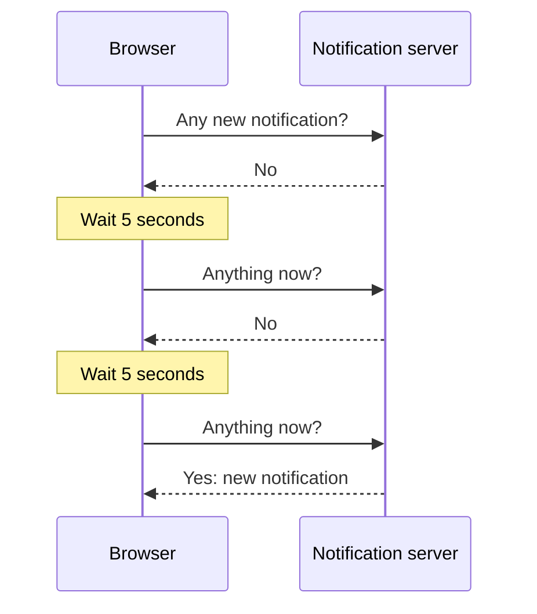
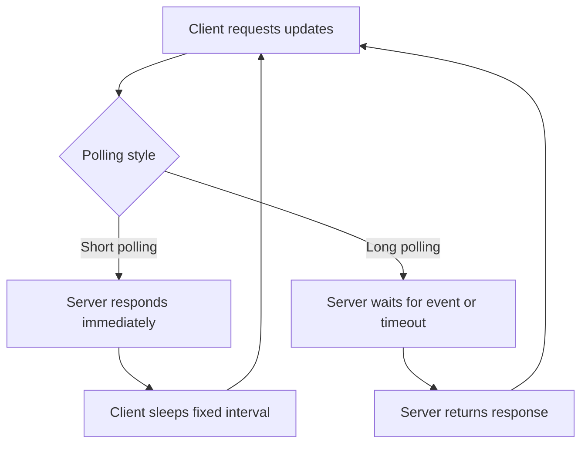
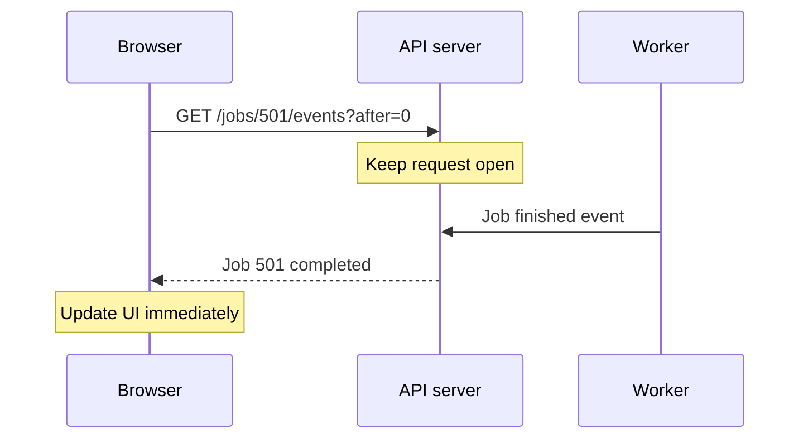
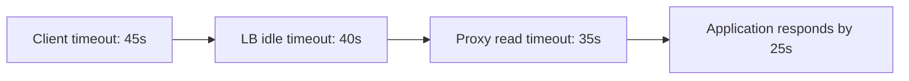
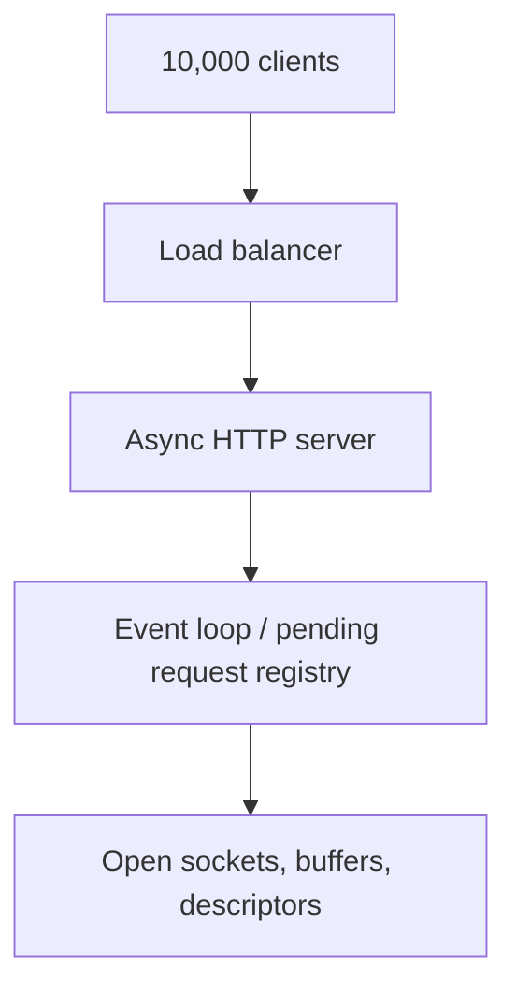
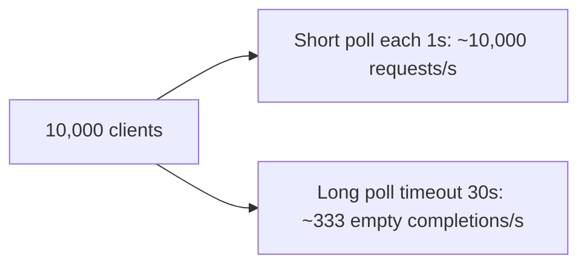
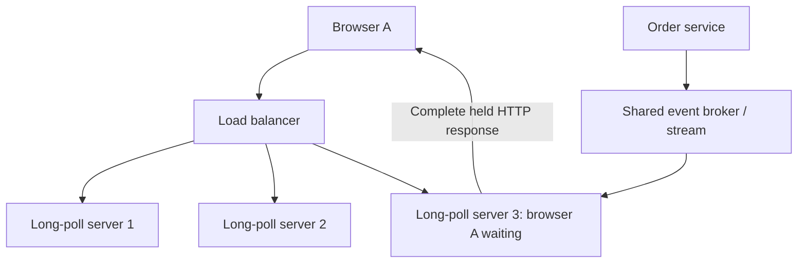
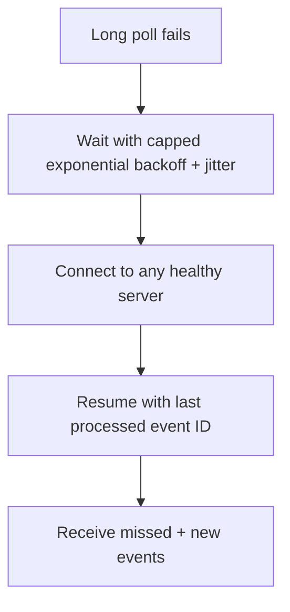
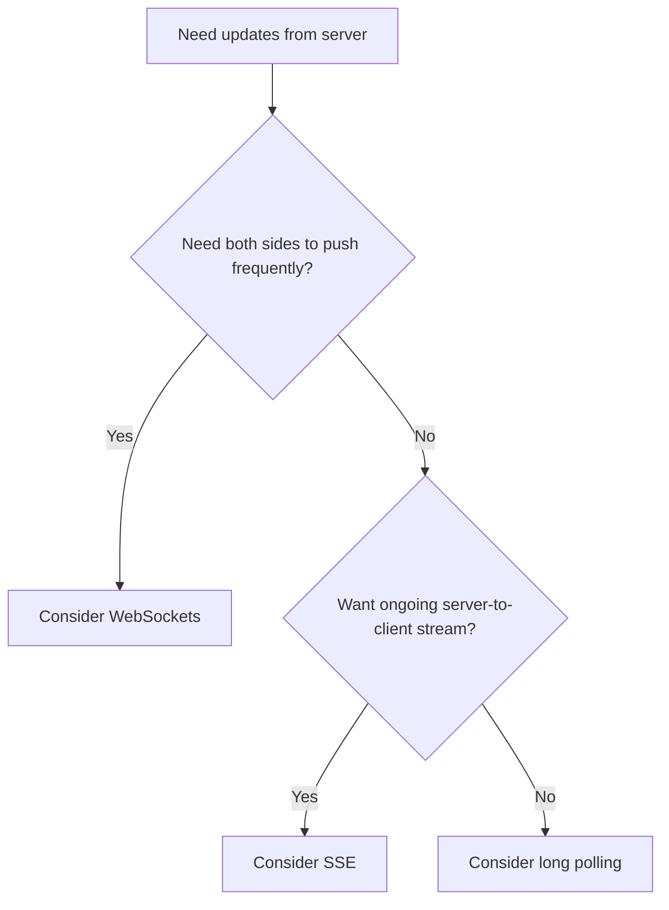

# Long Polling — Explained Simply with Diagrams

*Distributed Systems Study Library · Author: Jayesh Sharma*

**A beginner-friendly system-design guide to notification polling, HTTP timeouts, scaling long-held requests, event recovery and retry behavior.**

> Original educational notes based on the user-supplied long-polling transcript. Wording, examples, worked calculations, code sketches and diagrams are independently written. Extra implementation considerations such as race-free subscriptions, idempotent event processing, SSE comparison and monitoring are supplementary explanations.

## Contents

- [1. Why do we need polling?](#1-why-do-we-need-polling)
- [2. What is long polling?](#2-what-is-long-polling)
- [3. Regular polling vs long polling](#3-regular-polling-vs-long-polling)
- [4. A simple timeline example](#4-a-simple-timeline-example)
- [5. Timeout design: why requests cannot wait forever](#5-timeout-design-why-requests-cannot-wait-forever)
- [6. What happens with 10,000 connected clients?](#6-what-happens-with-10000-connected-clients)
- [7. Quick back-of-the-envelope capacity estimate](#7-quick-back-of-the-envelope-capacity-estimate)
- [8. Scaling across multiple application servers](#8-scaling-across-multiple-application-servers)
- [9. Prevent missed events between reconnects](#9-prevent-missed-events-between-reconnects)
- [10. Handling server failures and reconnection storms](#10-handling-server-failures-and-reconnection-storms)
- [11. Implementation sketch: client and server](#11-implementation-sketch-client-and-server)
- [12. When should you use long polling?](#12-when-should-you-use-long-polling)
- [13. Long polling vs SSE vs WebSockets](#13-long-polling-vs-sse-vs-websockets)
- [14. Frequent mistakes and best practices](#14-frequent-mistakes-and-best-practices)
- [15. Interview questions and one-minute summary](#15-interview-questions-and-one-minute-summary)

---

## 1. Why do we need polling?

Imagine a notification bell on a shopping website. A customer wants to know when a new notification is ready, but the browser does not know when it will happen.

The most basic solution is **regular (short) polling**: ask the server every few seconds.



This is easy to implement, but it creates two trade-offs:

- **Wasted calls:** The server still processes queries when nothing has changed.
- **Update delay:** An event generated just after a poll might not be discovered until the next interval.

**Memory trick:** Short polling = **ask repeatedly, even when there is no news**.

---

## 2. What is long polling?

**Long polling** keeps the familiar HTTP request–response model but changes *when the server answers*.

1. The client sends a request asking for updates.
2. If updates already exist, the server responds without unnecessary waiting.
3. Otherwise, the server **holds the request open** instead of returning an empty response immediately.
4. When an event is available, the server responds with that event.
5. The client processes the response and **starts another request**.
6. If no event appears before a configured timeout, the server responds and the client reconnects.

```mermaid
sequenceDiagram
    participant C as Client
    participant S as Long-poll server
    C->>S: GET /notifications?after=120
    Note over S: No new event; hold request
    Note over S: Event 121 arrives
    S-->>C: 200 OK: event 121
    C->>S: GET /notifications?after=121
    Note over S: Hold until event or timeout
    S-->>C: 204 No Content (timeout)
    C->>S: GET /notifications?after=121
```

**Important:** The server does not need to invent an event to respond. A timeout response is normal; **204 No Content** is one possible application contract, not a mandatory standard for long polling.

**Memory trick:** Long polling = **ask once, wait for news, ask again**.

---

## 3. Regular polling vs long polling

| Question | Regular polling | Long polling |
|---|---|---|
| Server response when nothing changed | Usually immediate empty result | May wait until event or timeout |
| Frequency of empty requests | Can be high | Often lower |
| Time from event to response | Up to next polling interval | Can be close to immediate when a request is waiting |
| Connection/request duration | Short | Can remain pending for seconds |
| Main resource concern | Request rate | Many simultaneously open requests |
| Client behavior | Sleep, then ask again | Reconnect after each response |



Long polling reduces repetitive empty checks, but **it is not a permanently open streaming connection**. Each response completes one HTTP request.

---

## 4. A simple timeline example

Consider an order-processing application:

- **10:00:00:** Client asks about order 501; result is not ready, so the HTTP request stays pending.
- **10:00:07:** Background worker completes the order.
- **10:00:07:** The server returns the result as soon as it sees the update.
- **10:00:08:** The client sends another long-polling request if it expects more updates.

With ordinary polling every **10 seconds**, the same event might be discovered later.



**Practical lesson:** Long polling is useful when updates are *infrequent or unpredictable* but people should learn about them quickly.

---

## 5. Timeout design: why requests cannot wait forever

A long-poll request should normally have an **application hold timeout**. Even though the server is willing to wait, clients, reverse proxies, CDNs, API gateways and load balancers may enforce their own limits.

For example:

| Component | Illustrative configured timeout |
|---|---:|
| Application long-poll hold | 25 seconds |
| Reverse proxy idle/read timeout | 35 seconds |
| Load balancer idle timeout | 40 seconds |
| Client request timeout | 45 seconds |

These values are **examples, not universal defaults**. Exact semantics differ: a *read timeout* and an *idle timeout* are not identical in every product.



**Rule of thumb:** Make the application return or renew before intermediaries close the request unexpectedly, and leave reasonable margin for network variance.

Do not assume a higher configured timeout automatically means better performance: longer holds can increase connection residency and complicate failure detection.

---

## 6. What happens with 10,000 connected clients?

If **10,000 clients** each maintain one active long-poll request, the backend tier may hold roughly **10,000 pending HTTP requests** at the same time.

That does **not** automatically mean 10,000 application threads.

- **Thread-per-request server:** Holding many requests may consume too many threads.
- **Asynchronous/event-driven server:** Can track many waiting requests without dedicating a thread to each wait.



Even async servers use real resources: sockets, memory, file descriptors, connection state, TLS sessions, load-balancer capacity, and event subscriptions.

**Memory trick:** Fewer useless HTTP requests does **not** mean zero cost while waiting.

---

## 7. Quick back-of-the-envelope capacity estimate

Suppose **10,000** clients maintain one long-poll each and no notifications arrive for a while.

With a **30-second** hold timeout, a steady-state approximation for empty completions is:

```text
10,000 clients ÷ 30 seconds ≈ 333 completed polls/second
```

If the same clients use **regular polling every 1 second**, they might generate roughly:

```text
10,000 clients ÷ 1 second = 10,000 polls/second
```

That is an *illustrative* reduction in empty request frequency, not a guaranteed throughput ratio. Real rates also include events, retries, reconnection delays and client distribution.



**But watch concurrency:** The long-poll solution still has up to approximately **10,000 outstanding requests** while clients wait. Always size and load-test both request rate **and** open connections.

---

## 8. Scaling across multiple application servers

One server eventually reaches limits. A load balancer can distribute client requests across several **long-poll workers**.

However, that introduces a new question: **How does an event reach the exact server holding a client's request?**

Suppose customer A is waiting on server 3 while an order-processing service publishes a notification.



A shared event bus or event store separates **event creation** from **HTTP response delivery**.

Common tools include Redis, Kafka and other messaging systems, but **their semantics are different**:

- **Redis Pub/Sub** is useful for distributing transient signals; basic Pub/Sub does not retain messages for disconnected consumers.
- **Kafka** or a durable event stream can support replay if records and offsets are managed appropriately.
- **A shared database/event log** can be the source of truth for retrieving events by cursor.

The broker does not magically locate the client by itself. Your application needs a way to route or fan out notifications to servers that own relevant pending requests.

---

## 9. Prevent missed events between reconnects

Long polling has a small **reconnection gap**. If a system only sends events to *currently open* HTTP requests, an event generated during that gap could be lost to that client.

A robust design uses an **event ID or cursor** and a durable source of events.

```mermaid
sequenceDiagram
    participant C as Client
    participant A as API server 1
    participant STORE as Shared event store
    participant B as API server 2
    C->>A: GET events?after=120
    A->>STORE: Query events after 120
    STORE-->>A: Event 121
    A-->>C: Event 121
    Note over C: Reconnecting; event 122 is created
    C->>B: GET events?after=121
    B->>STORE: Query events after 121
    STORE-->>B: Event 122
    B-->>C: Event 122
```

**Key rule:** Client says **“Give me everything after ID 121”**, not simply **“Anything right now?”**.

A reliable implementation also needs to avoid a **check-then-subscribe race**: querying storage and registering a wait must be coordinated so an event appearing between those operations cannot be missed.

**Memory trick:** **The pending connection delivers quickly; the event cursor allows recovery.**

---

## 10. Handling server failures and reconnection storms

What if the server holding the request restarts?

1. The HTTP request is broken or times out.
2. The client waits briefly, then opens another request.
3. The new request may reach a **different** server.
4. The client supplies its last processed event ID.
5. The new server reads any missed events from shared storage.

A failure should not force the client to depend on the original application instance.

### Avoid the retry storm

If tens of thousands of clients reconnect immediately, the recovering servers can be overwhelmed.

Use **exponential backoff with jitter** for errors:

```text
Attempt 1: wait ~1 second + jitter
Attempt 2: wait ~2 seconds + jitter
Attempt 3: wait ~4 seconds + jitter
Attempt 4: wait ~8 seconds + jitter

Cap the delay and reset after healthy operation.
```



**Nuance:** A normal, intentional empty timeout can usually reconnect promptly. Apply stronger backoff to repeated connection errors, overload, or service failures, following any applicable retry guidance.

---

## 11. Implementation sketch: client and server

The following is **illustrative pseudocode** to make the control flow easy to understand; it is not a ready-made production server.

### Client loop

```python
last_seen_id = load_saved_cursor()

while app_is_running:
    try:
        response = GET(
            "/notifications",
            params={"after": last_seen_id},
            timeout=45,  # client limit > application hold timeout
        )
        if response.has_events:
            for event in response.events:
                if event.id > last_seen_id:
                    process_idempotently(event)
                    last_seen_id = event.id
                    save_cursor(last_seen_id)
        reset_error_backoff()
    except TransientNetworkError:
        sleep(exponential_backoff_with_jitter())
```

### Server behavior

```text
GET /notifications?after=121

1. Authenticate and authorize the caller.
2. Query durable storage for events newer than 121.
3. If events exist, return them and their IDs.
4. Otherwise register a nonblocking wait.
5. When an event arrives, query and return the relevant events.
6. If hold timeout expires, return an empty response.
7. Always clean up wait registrations on completion/disconnect.
```

**Production caveats:** Bounds on response size, backpressure, authorization, ordered IDs, retention, duplicate processing, cancellation handling, and race-free event registration need explicit design.

---

## 12. When should you use long polling?

Long polling is a reasonable option when you need **near-real-time updates** but want to stay with normal HTTP request/response infrastructure.

| Use case | Why it can work |
|---|---|
| User notifications | Events are sporadic but should arrive quickly |
| Async report generation | Client waits for a job to complete |
| Order or payment status changes | Client resumes from a known event/status |
| Task completion dashboards | Status is delivered when it changes |
| Environments with limited WebSocket support | Uses familiar HTTP infrastructure |

It may be less attractive when you need **very frequent events**, rich bidirectional communication, or a large number of streaming updates per user. In those cases, **SSE or WebSockets** may fit better depending on requirements.

---

## 13. Long polling vs SSE vs WebSockets

| Feature | Short polling | Long polling | Server-Sent Events (SSE) | WebSocket |
|---|---|---|---|---|
| Communication | Repeated HTTP exchanges | Held HTTP exchanges | Ongoing server-to-client stream | Bidirectional persistent channel |
| Server update latency | Up to polling interval | Usually quick while waiting | Usually quick on live stream | Usually quick |
| Reconnect after every response | Yes | Yes | No, stream remains open until disconnected | No, connection remains open until disconnected |
| Typical use | Occasional refresh | Notifications and job status | Live dashboards or one-way feeds | Chat, games, interactive sessions |
| Main complexity | Request churn | Concurrent waiting requests | Streaming connection lifecycle | Stateful connection management |



These are **general selection hints**, not rigid rules. Network restrictions, runtime support, delivery guarantees, authorization, costs and message frequency can change the choice.

---

## 14. Frequent mistakes and best practices

| Common mistake | Better design |
|---|---|
| Hold requests forever | Configure bounded application and infrastructure timeouts |
| Keep a dedicated OS thread per waiting client | Prefer asynchronous/nonblocking request handling |
| Store critical notification state only in server memory | Use shared durable event data |
| Send events only to currently waiting connections | Support replay using an event ID or cursor |
| Retry failures immediately forever | Add backoff, jitter and retry limits |
| Use a message broker without understanding durability | Distinguish transient fan-out signals from persistent replay |
| Assume idle connections consume nothing | Budget sockets, memory and proxy limits |
| Ignore cleanup when clients disconnect | Remove stale waiter registrations and reclaim resources |

### A useful operational checklist

- Count **open long-poll requests** and connection usage.
- Measure **event-to-delivery latency** and missed-event recovery.
- Watch **timeouts, errors, retry rates, 5xx/429 responses** and downstream broker lag.
- Verify **cursor replay** after deployment and failover.
- Load test **mass reconnection** scenarios.

---

## 15. Interview questions and one-minute summary

### Interview questions

1. What is regular polling, and why can it waste requests?
2. How does long polling differ from regular polling?
3. What happens when a long-poll request reaches its timeout without an event?
4. Why should application timeouts be shorter than some proxy or load-balancer timeouts?
5. What limits do 10,000 concurrently pending requests place on a server?
6. Why are asynchronous server runtimes helpful?
7. How do events reach the right server in a multi-server deployment?
8. Why might Redis Pub/Sub alone be insufficient for missed-event replay?
9. How can event IDs prevent missed events between requests?
10. What is a check-then-subscribe race?
11. What should clients do during an outage to avoid a reconnection storm?
12. When would you choose long polling over SSE or WebSockets?
13. Does long polling guarantee exactly-once event delivery?
14. How would you calculate rough empty-request throughput from client count and hold timeout?

### One-minute cheat sheet

| Term | Remember |
|---|---|
| Regular polling | Ask repeatedly at intervals |
| Long polling | Hold one HTTP request until event or timeout |
| Async I/O | Wait without one OS thread per connection |
| Event broker | Pass event notifications among services |
| Durable event store | Make missed updates replayable |
| Cursor/event ID | “Resume after event N” |
| Proxy timeout | Can close a waiting HTTP request early |
| Backoff + jitter | Prevent synchronized retry storms |
| Main advantage | Fewer pointless empty polls with quick event response |
| Main trade-off | Many simultaneous pending HTTP requests and extra delivery state |

**Final takeaway:** Long polling offers **near-real-time delivery using standard HTTP requests**. To scale it safely, combine nonblocking servers, compatible timeouts, shared event infrastructure, cursor-based replay, and carefully controlled reconnects.

---
