# Server-Sent Events (SSE) — Explained Simply with Diagrams

*Distributed Systems Study Library · Author: Jayesh Sharma*

**A clear study guide to streaming updates, EventSource, reconnecting, Last-Event-ID, scaling and real-world communication patterns.**

> Original educational explanation based on the user-supplied SSE transcript. All writing, examples, comparison tables and Mermaid diagrams are independently created. Additional implementation notes clarify authentication, replay consistency, buffering and streaming HTTP clients.

## Contents

- [1. Why do we need Server-Sent Events?](#1-why-do-we-need-server-sent-events)
- [2. How SSE works step by step](#2-how-sse-works-step-by-step)
- [3. SSE compared with polling and long polling](#3-sse-compared-with-polling-and-long-polling)
- [4. The SSE message format](#4-the-sse-message-format)
- [5. Browser example using EventSource](#5-browser-example-using-eventsource)
- [6. Automatic reconnection and Last-Event-ID](#6-automatic-reconnection-and-last-event-id)
- [7. Why durable storage still matters](#7-why-durable-storage-still-matters)
- [8. Scaling SSE across multiple servers](#8-scaling-sse-across-multiple-servers)
- [9. Redis Pub/Sub vs Kafka for SSE](#9-redis-pubsub-vs-kafka-for-sse)
- [10. Slow clients and backpressure](#10-slow-clients-and-backpressure)
- [11. Heartbeats and proxy buffering](#11-heartbeats-and-proxy-buffering)
- [12. Deployments and graceful connection draining](#12-deployments-and-graceful-connection-draining)
- [13. Real-world example: an LLM response stream](#13-real-world-example-an-llm-response-stream)
- [14. When to choose SSE, long polling or WebSockets](#14-when-to-choose-sse-long-polling-or-websockets)
- [15. Interview questions and revision cheat sheet](#15-interview-questions-and-revision-cheat-sheet)

---

## 1. Why do we need Server-Sent Events?

Imagine a monitoring dashboard showing CPU utilization. New measurements arrive at unpredictable times, and users want the screen to update without clicking Refresh.

With **regular polling**, a browser repeatedly asks whether something changed. Polling every second may waste requests; polling every 15 seconds may leave the display behind.

**Server-Sent Events (SSE)** lets the server keep one HTTP response open and send a new event whenever it has an update.

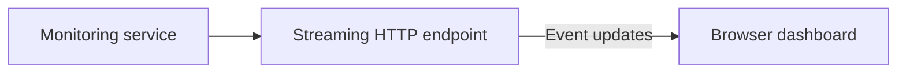

**Easy memory trick:** Polling means **the client keeps asking**. SSE means **the server keeps telling**.

---

## 2. How SSE works step by step

SSE uses an ordinary HTTP request, but the response lasts much longer than a typical API response.

1. The browser connects to an SSE endpoint.
2. The server responds with `Content-Type: text/event-stream`.
3. Instead of ending the response, the server keeps it open.
4. As updates arrive, the server writes small event messages to the stream.
5. The browser receives and handles each event.
6. If the connection closes, the browser's `EventSource` API generally tries to reconnect.

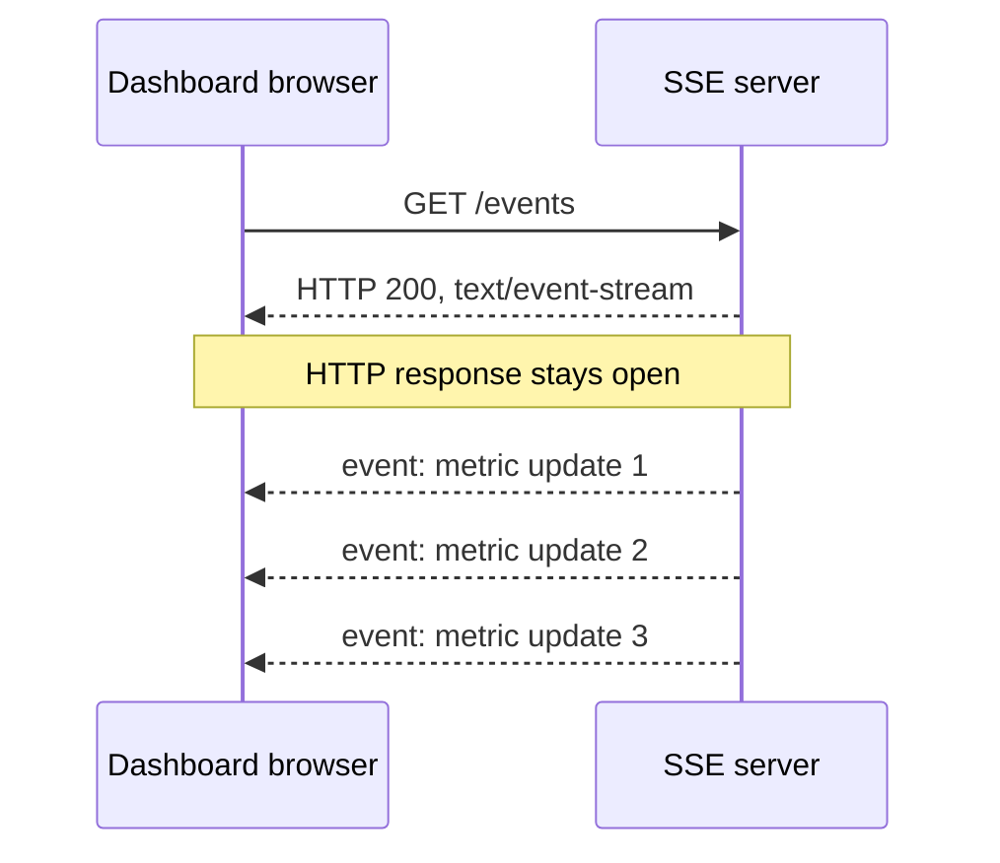

**Important:** SSE is a **one-way stream from server to client**. The client can send additional commands, but it typically uses **separate HTTP requests** rather than sending messages back through the SSE response.

---

## 3. SSE compared with polling and long polling

| Pattern | Client's behavior | Server's behavior | Update delivery |
|---|---|---|---|
| Short polling | Repeatedly requests updates | Responds promptly each time | At next poll |
| Long polling | Sends a request, then reconnects after each response | Holds the request until an event or timeout | Quickly while a request waits |
| SSE | Connects once and usually stays connected | Streams many events in one HTTP response | Quickly while connected |
| WebSockets | Opens a long-lived two-way channel | Can both receive and push messages | Two-way, interactive |

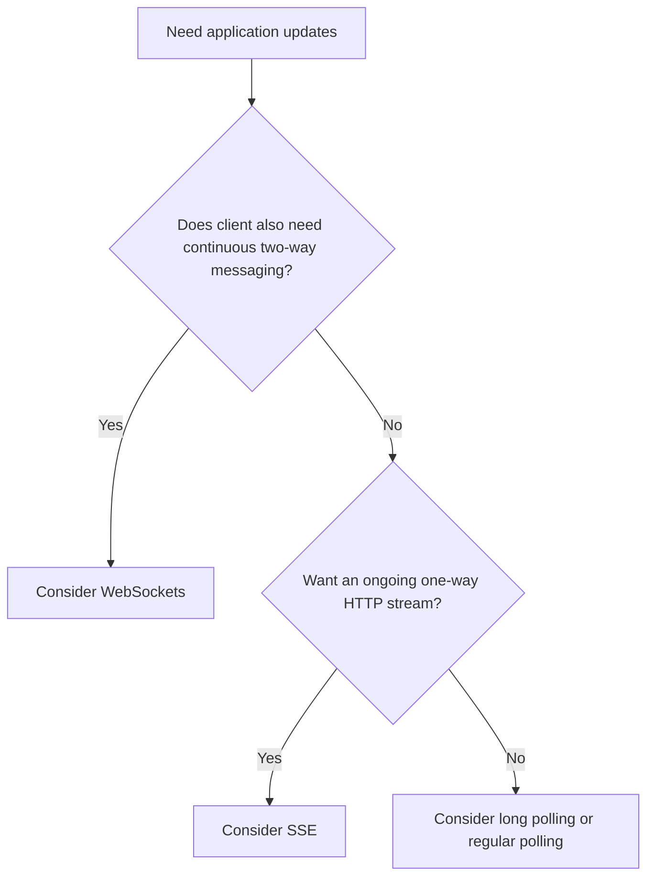

SSE can be a particularly good fit when the browser mostly **listens** for new information.

Related guide: [Long Polling — Explained Simply](Long_Polling_Explained.md).

---

## 4. The SSE message format

An SSE response carries text records separated by a **blank line**. A record can include fields such as `data`, `event`, `id`, and `retry`.

Example:

```text
HTTP/1.1 200 OK
Content-Type: text/event-stream
Cache-Control: no-cache

id: 101
event: metric
data: {"cpu":52,"unit":"percent"}

id: 102
event: notification
data: {"message":"Report is ready"}

```

| Field | Purpose |
|---|---|
| `data:` | Carries message content; may be JSON represented as text |
| `event:` | Names the event type, such as `metric` |
| `id:` | Identifies the last dispatched event for reconnection |
| `retry:` | Suggests reconnect delay in milliseconds |
| Blank line | Marks the end of an event record |

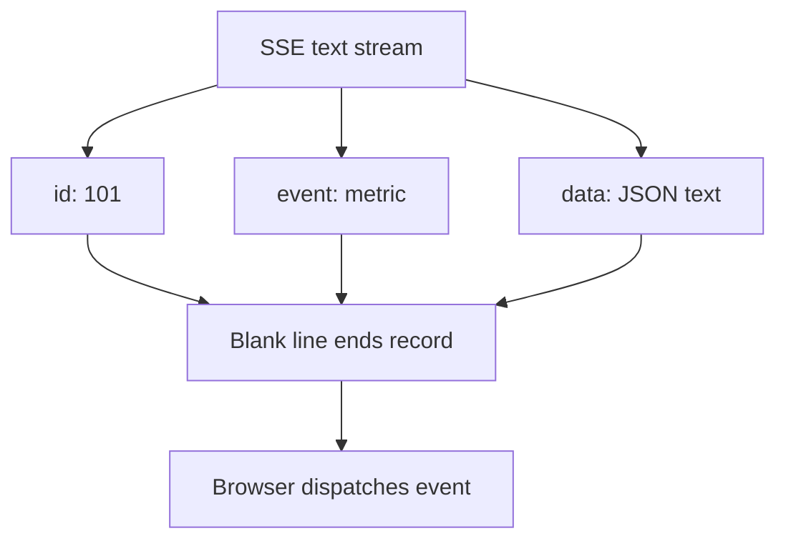

**Details:** Multiple `data:` lines can form one event with newline separators. A line beginning with `:` is a comment and can be used as a heartbeat. The SSE payload is text; JSON is an application choice, not a required SSE format.

---

## 5. Browser example using EventSource

Browsers commonly expose SSE through **EventSource**:

```javascript
const stream = new EventSource("/events");

stream.addEventListener("metric", (event) => {
  const metric = JSON.parse(event.data);
  console.log("CPU utilization:", metric.cpu);
});

stream.addEventListener("notification", (event) => {
  console.log("Notification:", JSON.parse(event.data));
});

stream.onerror = () => {
  console.log("The stream may be reconnecting");
};

// Call stream.close() when updates are no longer needed.
```

A minimal server could conceptually send:

```text
event: metric
id: 201
data: {"cpu":57}

```

**Important browser limitation:** The native `EventSource` constructor does not offer an option to set arbitrary request headers such as `Authorization`. Cookie-based authentication or a suitable streaming client implementation may be used, with the usual cross-origin, CSRF and credential-security considerations.

Also, do not put sensitive tokens in a URL query string just to make SSE easier; URLs may be logged.

---

## 6. Automatic reconnection and Last-Event-ID

What happens if the connection disappears?

The browser's EventSource implementation normally attempts to reconnect. If the server sends event IDs, the browser can remember the most recent one and include it when establishing a new stream using the **Last-Event-ID** request header.

Imagine the client has received event **100**. During the outage, events **101** and **102** are created. When the client reconnects, the server can use the last event ID to retrieve the missing events.

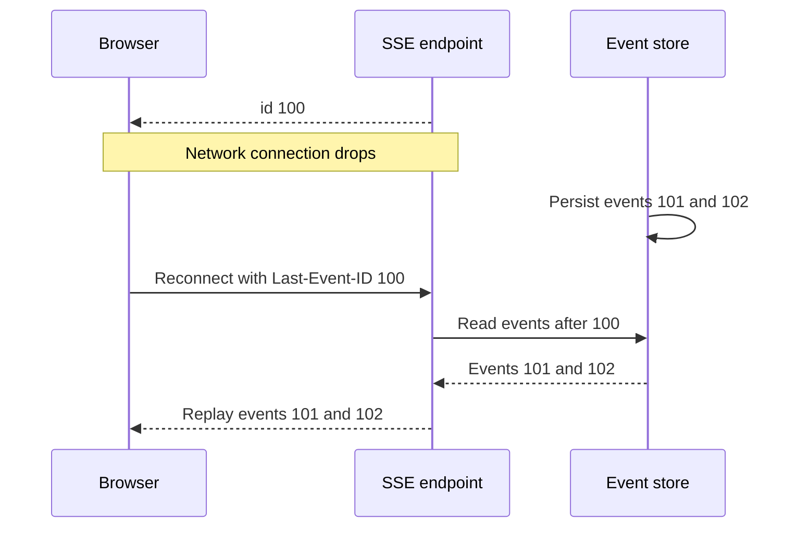

**Crucial distinction:** SSE gives you a **reconnection mechanism**. It does **not** automatically store events, guarantee replay, or enforce exactly-once application processing. For reliable recovery, implement event retention, stable IDs, authorization checks and duplicate handling.

---

## 7. Why durable storage still matters

If your server only broadcasts events to active connections, a disconnected user may miss an update permanently.

Separate **delivery** from **history**:

- A **database or durable event log** keeps enough event history.
- A **message broker** signals that new events are available.
- SSE servers stream available events to connected clients.
- Reconnecting clients replay events newer than their last processed ID.

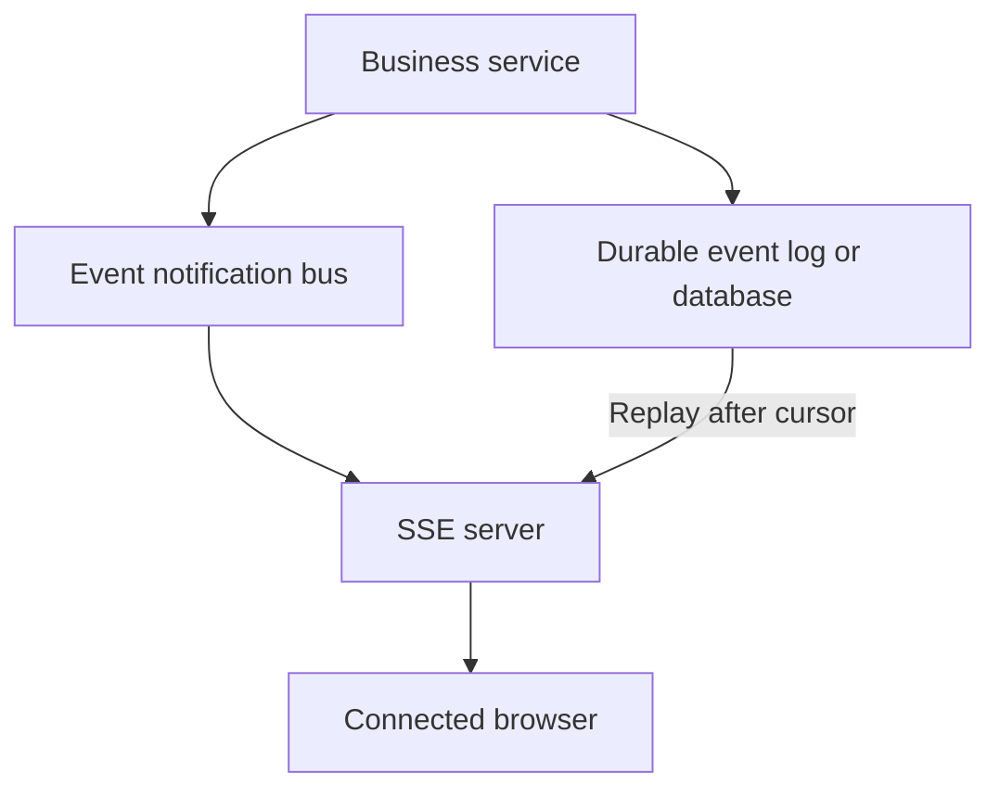

**Design caution:** Event IDs should have an ordering scheme that makes sense for the stream being resumed. A timestamp alone can have collisions, and IDs from unrelated partitions may not define a single global order.

For stronger delivery correctness, make client processing **idempotent** and coordinate the event-history query with live subscription so there is no gap between the two.

---

## 8. Scaling SSE across multiple servers

When thousands of clients connect, one SSE server may not be enough.

A load balancer distributes connections among several SSE servers. Each open stream remains associated with whichever server currently owns that connection.

Suppose Bob is connected to **SSE server 3**, but an Order Service on another machine produces Bob's notification. The event must reach the instance responsible for Bob's stream.

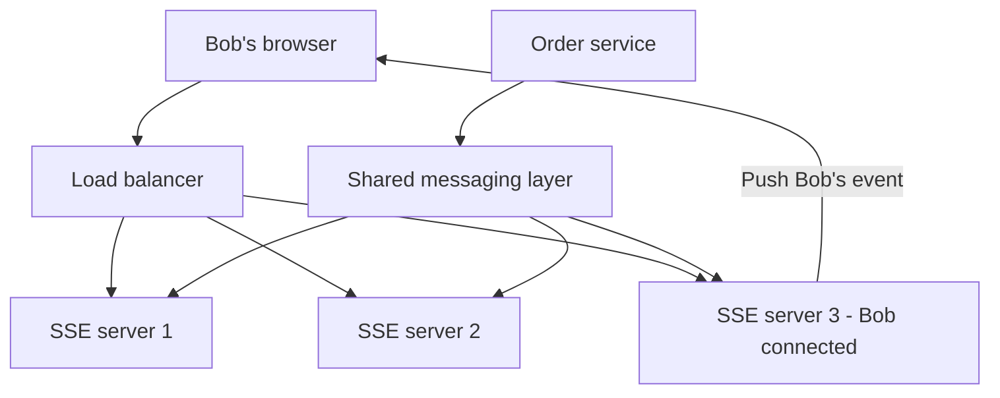

The simplest scheme **fans out notifications** to relevant SSE servers; each instance knows its locally connected users. More selective routing can reduce unnecessary fan-out but adds mapping and coordination.

Do not assume a broker can automatically find an open browser connection. The SSE tier still needs to track its local connections and subscriptions.

**Operational design:** Prefer async/nonblocking I/O for large connection counts and monitor sockets, file descriptors, memory, network bandwidth and per-instance active streams.

---

## 9. Redis Pub/Sub vs Kafka for SSE

Shared messaging can decouple event producers from the SSE delivery tier, but different systems offer different guarantees.

| Feature | Redis Pub/Sub | Kafka or durable event log |
|---|---|---|
| Basic role | Fast transient publication to subscribers | Persistent events with consumer offsets and retention |
| Built-in retention of past Pub/Sub messages | No | Yes, when configured |
| Replay after disconnect | Not from plain Pub/Sub alone | Possible within retained history |
| Typical use | Live notifications where replay is unnecessary or handled elsewhere | Activity feeds, audit-style event streams, replayable updates |

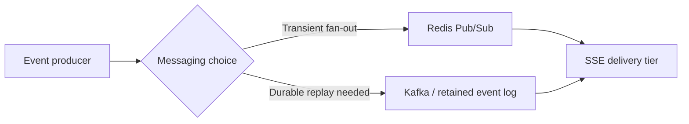

**Nuance:** Kafka does not automatically push the right event to the right user's HTTP connection. Consumer-group assignment, filtering, partitioning and local connection ownership must be designed. A durable database plus lightweight notifications can also work well.

---

## 10. Slow clients and backpressure

Imagine the server produces **100 events per second**, but one client can consume only **10**.

If the server buffers all undelivered events without a limit, memory usage can grow until it affects other clients.

Options depend on the application:

| Strategy | Suitable when | Trade-off |
|---|---|---|
| Bounded buffer | Short bursts are expected | Can overflow |
| Latest-state only | Metrics or current status matter more than every intermediate value | Intermediate updates can be skipped |
| Drop expendable older events | Some messages can be safely omitted | Not suitable for critical events |
| Disconnect slow client | Server must protect itself | Client must reconnect and catch up |

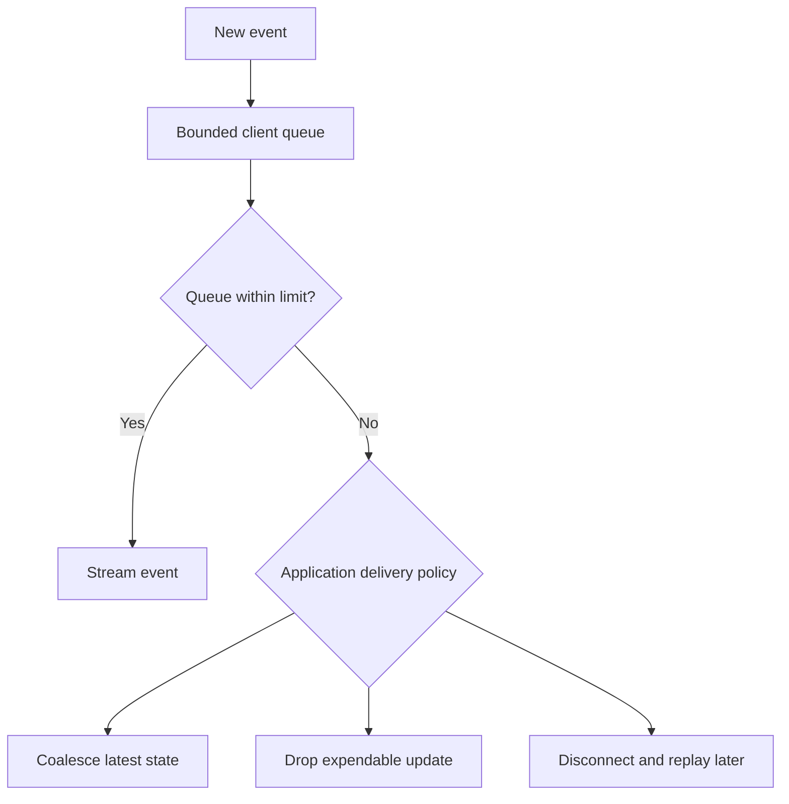

For payments or other critical business notifications, **dropping history is not acceptable unless the client can recover it from a durable source**. Backpressure policies must match your delivery guarantees.

---

## 11. Heartbeats and proxy buffering

SSE streams can remain idle while waiting for real data. Some reverse proxies, load balancers and client networks close connections that appear inactive.

The server can periodically send a **heartbeat comment**:

```text
: keep-alive

```

This is a valid SSE comment line followed by a blank line; it does not create an application event.

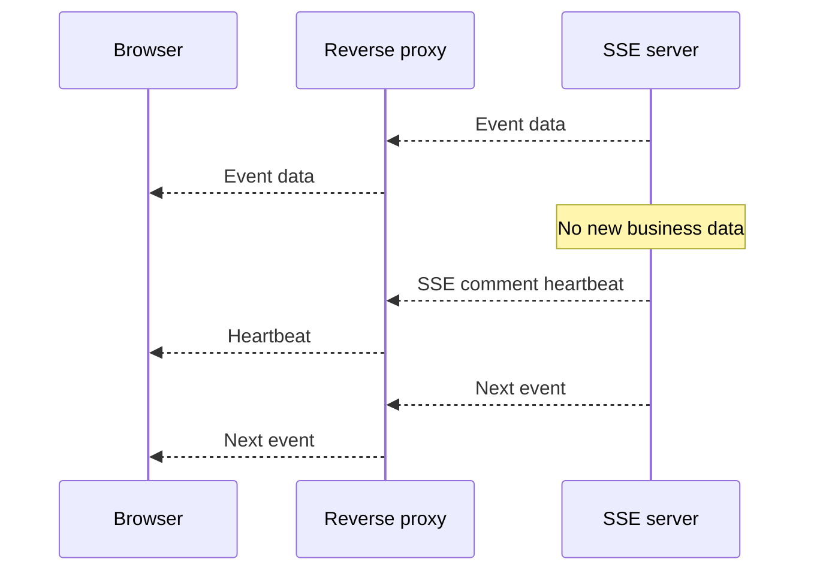

**Two infrastructure settings matter:**

1. **Idle/read timeouts** must allow a long-lived response, with a heartbeat interval compatible with those limits.
2. **Response buffering** should be disabled for the stream path where a proxy would otherwise delay events by collecting data before forwarding.

**Caution:** Headers, timeout names and buffering controls vary by gateway or CDN. Test the entire request path rather than assuming your app-server configuration is enough.

---

## 12. Deployments and graceful connection draining

SSE connections can remain open for long periods. If a server process is terminated immediately, many clients reconnect at once.

A safer deployment sequence is:

1. Stop accepting new SSE connections on the instance being retired.
2. Allow existing streams to continue for a **bounded grace period**.
3. If required, close remaining streams gracefully.
4. Clients reconnect to healthy instances and resume from their last event IDs.
5. Watch reconnection rates and event delivery lag.

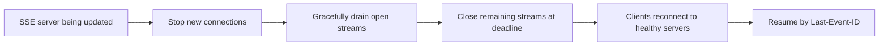

A stream that never naturally ends cannot be drained forever. Production deployments need a **maximum drain duration** and sufficient spare capacity. Reconnection behavior should be monitored to avoid a large recovery spike.

---

## 13. Real-world example: an LLM response stream

A familiar streaming use case is an AI chat interface. The model may take several seconds to finish generating an answer.

Instead of displaying nothing until the entire answer is ready, the server can progressively send text chunks so the interface begins updating earlier.

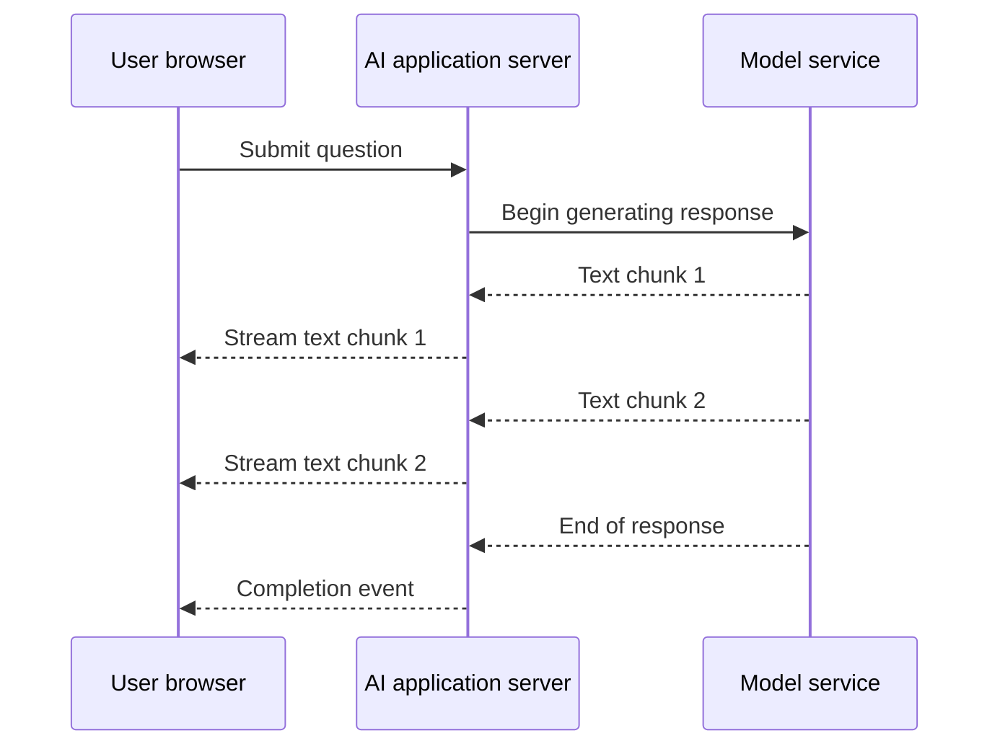

**Important distinction:** This is an example of *SSE-style streaming*. Some AI products use a streaming response to a **POST** request, which is not necessarily the browser's native `EventSource` API (normally initiated using GET). A compatible streaming HTTP client can read and process SSE-formatted data.

This improves **perceived responsiveness**, but does not make model generation itself instantaneous.

---

## 14. When to choose SSE, long polling or WebSockets

| Need | Possible fit |
|---|---|
| Live dashboards and monitoring | SSE |
| Job progress and asynchronous task completion | SSE or long polling |
| Live news, feeds or scores | SSE |
| Notifications that update occasionally | SSE or long polling |
| Real-time chat with frequent messages in both directions | WebSockets |
| Interactive multiplayer gameplay | WebSockets or another suitable real-time protocol |
| Small page refreshed infrequently | Simple polling may be sufficient |

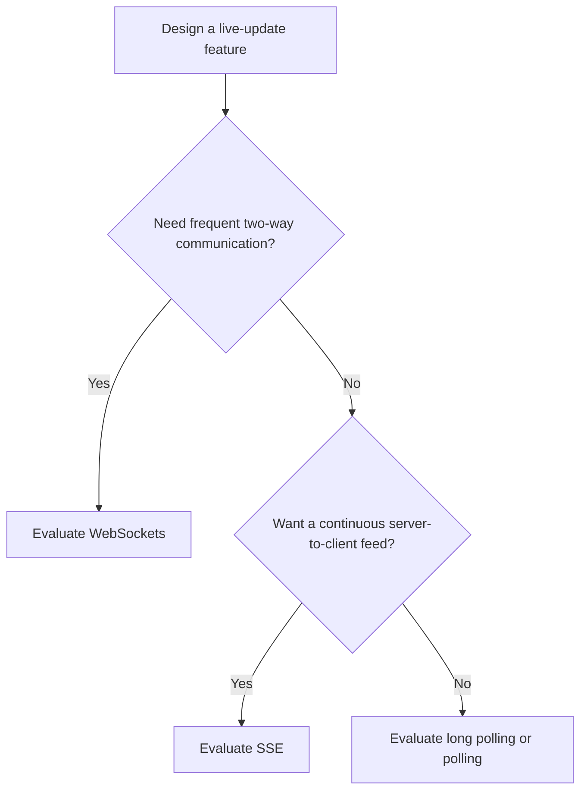

**Remember:** SSE is optimized for **server-to-client push over HTTP**, not a general replacement for bidirectional transports.

### Important considerations

- Authentication and permissions for every event stream.
- Reconnect limits and event-retention period.
- Browser and intermediary connection limits (especially with HTTP/1.1).
- Graceful shutdown and heartbeat intervals.
- Whether every event must be delivered, or only the latest current state.

---

## 15. Interview questions and revision cheat sheet

### Interview questions

1. What problem does SSE solve that short polling handles less efficiently?
2. How does SSE differ from long polling?
3. Why is SSE called a one-way protocol?
4. What is the purpose of `text/event-stream`?
5. Explain the meaning of `data`, `event`, `id` and `retry` fields.
6. How does `EventSource` recover from a dropped connection?
7. Does `Last-Event-ID` guarantee replay without storage?
8. How would SSE servers work behind a load balancer?
9. When would you choose Redis Pub/Sub versus a durable event log?
10. What is backpressure, and why is it important for slow clients?
11. Why do some proxies delay SSE responses?
12. How can heartbeat comments prevent idle timeouts?
13. How would you deploy a server holding thousands of SSE connections?
14. Why is SSE useful for live dashboards or incremental AI output?
15. When should you choose WebSockets instead?

### One-minute cheat sheet

| Term | Quick meaning |
|---|---|
| SSE | Server-to-client events over one streaming HTTP response |
| EventSource | Browser API for subscribing to an SSE stream |
| `text/event-stream` | SSE response content type |
| `data:` | Event payload |
| `event:` | Optional event name |
| `id:` | Last-event cursor for reconnect |
| `retry:` | Suggested reconnection delay |
| Last-Event-ID | Allows server to identify a reconnection cursor |
| Durable log | Required when missed events must be replayed |
| Fan-out layer | Distributes new-event notifications across SSE servers |
| Heartbeat | Keeps an otherwise idle response active |
| Backpressure | Protects server from slow clients |
| Connection draining | Gracefully migrates active streams during deployment |

**Final takeaway:** **SSE gives clients near-real-time updates over a familiar HTTP connection.** For a reliable and scalable implementation, combine event IDs, durable replay when needed, shared messaging, bounded buffers, heartbeat support and graceful connection lifecycle handling.

---
