# WebSockets — Explained Simply with Diagrams

*Distributed Systems Study Library · Author: Jayesh Sharma*

**An approachable guide to real-time, bidirectional communication, WebSocket handshakes, frames, horizontal scaling and reliable recovery.**

> Independently written study material based on the user-supplied WebSockets transcript. Wording, examples, tables and Mermaid diagrams are original. Additional security and production-design clarifications are presented separately as explanatory context.

## Contents

- [1. Why do we need WebSockets?](#1-why-do-we-need-websockets)
- [2. What is full-duplex communication?](#2-what-is-full-duplex-communication)
- [3. WebSocket handshake explained step by step](#3-websocket-handshake-explained-step-by-step)
- [4. ws:// versus wss://](#4-ws-versus-wss)
- [5. WebSocket frames and control messages](#5-websocket-frames-and-control-messages)
- [6. Simple chat on one WebSocket server](#6-simple-chat-on-one-websocket-server)
- [7. Scaling WebSockets with a load balancer](#7-scaling-websockets-with-a-load-balancer)
- [8. The distributed delivery problem](#8-the-distributed-delivery-problem)
- [9. Solving cross-server messaging with Pub/Sub](#9-solving-cross-server-messaging-with-pubsub)
- [10. Redis Pub/Sub versus Kafka](#10-redis-pubsub-versus-kafka)
- [11. Reconnect after server failure](#11-reconnect-after-server-failure)
- [12. Reconnection storms and backoff with jitter](#12-reconnection-storms-and-backoff-with-jitter)
- [13. Ping, Pong, and idle timeouts](#13-ping-pong-and-idle-timeouts)
- [14. Graceful connection draining during deployments](#14-graceful-connection-draining-during-deployments)
- [15. Infrastructure, authentication and operations](#15-infrastructure-authentication-and-operations)
- [16. WebSocket vs SSE vs long polling](#16-websocket-vs-sse-vs-long-polling)
- [17. Interview questions and quick revision](#17-interview-questions-and-quick-revision)

---

## 1. Why do we need WebSockets?

Imagine a group chat. Alice may send a message at any moment, and Bob should receive it without repeatedly pressing Refresh.

Traditional HTTP is excellent for **request → response** operations. Polling can ask for new messages every few seconds, but frequent requests add overhead, and less-frequent checks delay updates.

A **WebSocket** provides a long-lived connection through which **both client and server can send messages whenever they need to**.

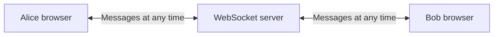

**Memory trick:** HTTP request-response = **ask, then answer**. WebSocket = **keep the conversation open**.

---

## 2. What is full-duplex communication?

**Full-duplex** means both parties can transmit independently over the same established connection.

Consider a collaborative document. Your browser can send an edit while the server pushes another person's changes. Neither direction needs to wait for the other to initiate a new HTTP request.

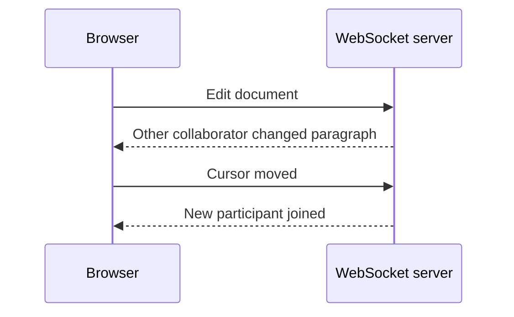

WebSockets are therefore useful for **chat, collaborative editing, interactive games and frequent two-way updates**.

A WebSocket is not necessarily the right choice for every live feed. If the server only needs to push occasional events, SSE or long polling may be simpler.

---

## 3. WebSocket handshake explained step by step

A common WebSocket connection begins with an **HTTP/1.1 opening handshake**.

1. The client establishes the underlying TCP connection, usually protected with TLS for `wss://`.
2. It sends an HTTP request asking to **Upgrade** to WebSocket.
3. The server validates the handshake and accepts with **101 Switching Protocols**.
4. The TCP connection stays open, now carrying **WebSocket frames** instead of normal HTTP request-response messages.

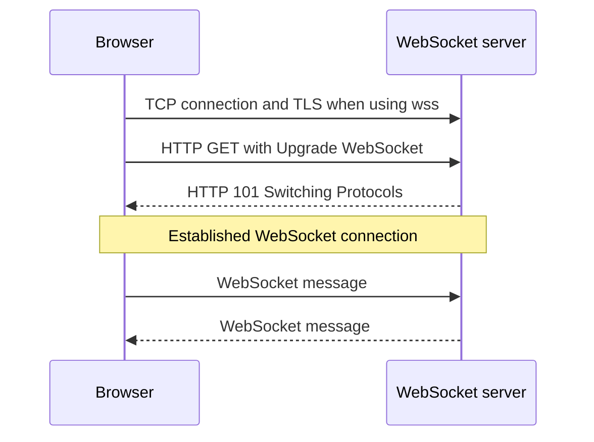

**Illustrative opening request:**

```http
GET /chat HTTP/1.1
Host: chat.example.com
Upgrade: websocket
Connection: Upgrade
Sec-WebSocket-Key: example-base64-nonce
Sec-WebSocket-Version: 13
```

The `Sec-WebSocket-Key` above is illustrative, not a real valid handshake nonce.

**Important technical nuance:** WebSockets may also be established using **extended CONNECT over HTTP/2 or HTTP/3**, where applicable. The familiar **101 Upgrade flow applies to HTTP/1.1**.

**Memory trick:** **HTTP opens the door; WebSocket keeps it open.**

---

## 4. ws:// versus wss://

| URL prefix | Meaning | Typical use |
|---|---|---|
| `ws://` | WebSocket without TLS on that connection | Local or specially controlled environments |
| `wss://` | WebSocket protected with TLS | Public websites and production traffic |

For secure public applications, prefer **`wss://`**.

TLS protects content while it travels between its TLS endpoints, but it does not replace application authentication or authorization.

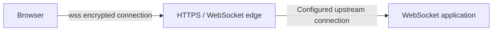

If TLS terminates at an edge proxy, protecting the next hop is a separate infrastructure decision.

---

## 5. WebSocket frames and control messages

Once connected, a WebSocket exchanges **frames**. They include protocol metadata and a payload, avoiding full HTTP headers on every application message.

| Frame kind | Common use |
|---|---|
| Text | UTF-8 text such as JSON |
| Binary | Images, media chunks or serialized binary data |
| Ping | Test liveness or solicit a Pong |
| Pong | Respond to a Ping, or send unsolicited liveness information |
| Close | Begin graceful WebSocket shutdown |

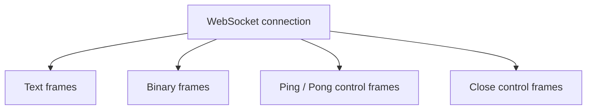

One logical WebSocket message may be split across **multiple frames**. Applications should handle messages according to their client/server WebSocket library, not assume one received network packet equals one message.

**Browser nuance:** The browser WebSocket API does not expose protocol Ping/Pong frames directly to JavaScript. If an application needs its own presence signaling, it may implement application-level heartbeat messages.

---

## 6. Simple chat on one WebSocket server

Start with the simplest architecture: **one WebSocket server** knows which local connections belong to Alice and Bob.

1. Alice connects and authenticates.
2. Bob connects and authenticates.
3. Alice sends a message over the open connection.
4. The server validates the message and identifies Bob.
5. It optionally persists the message before acknowledging it.
6. It finds Bob's local connection and sends the message.

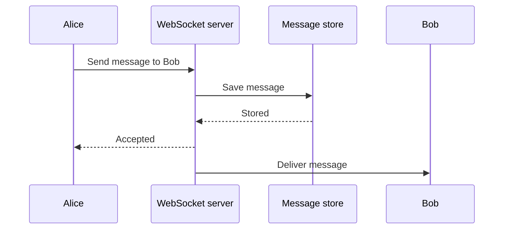

**Easy idea:** One server is like a receptionist who already knows which room every visitor is in.

**Caution:** Sending over a WebSocket does not guarantee that Bob *displayed* or *read* the message. Application-level delivery and read acknowledgments are separate concepts.

---

## 7. Scaling WebSockets with a load balancer

A single machine can only hold a finite number of active connections, buffers, file descriptors and CPU work.

To scale, run **multiple WebSocket server instances** behind a load balancer.

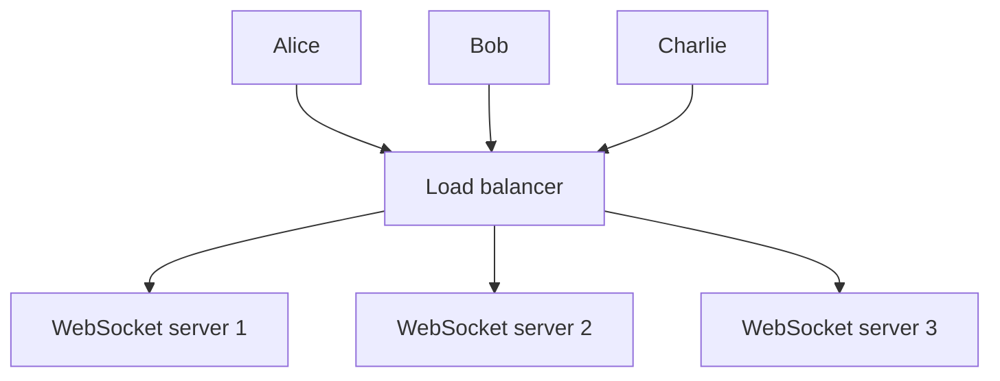

The load balancer selects a backend when the connection is created. That **long-lived connection continues through its selected backend** while open.

**Sticky sessions usually are not required just to keep an already established WebSocket connection on the same instance.** After disconnection, however, a new connection could be assigned to another server.

A load balancer must be configured to support the relevant WebSocket handshake, connection lifetimes and idle timeouts.

---

## 8. The distributed delivery problem

Now Alice is connected to **WebSocket server 1**, while Bob is connected to **server 3**.

If Alice sends Bob a message, server 1 cannot simply look up Bob in its *own* memory. Bob's live socket belongs to server 3.

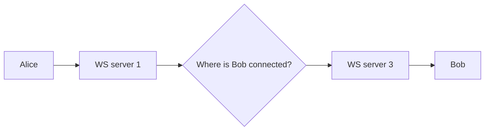

This is a **distributed routing problem**, not a TCP problem.

One design keeps a shared **user-to-server presence mapping**. Such mappings need cleanup and expiry, since users disconnect, reconnect, open multiple devices, and may briefly appear on more than one server.

Another common design uses **a shared messaging layer**, so WebSocket instances do not need a direct connection to every other instance.

---

## 9. Solving cross-server messaging with Pub/Sub

Use a shared message broker to connect producers and WebSocket delivery servers.

Example:

1. Alice sends a message to server 1.
2. Server 1 processes and, if needed, stores it.
3. Server 1 publishes a notification about the message.
4. The messaging infrastructure sends the notification to server 3, or to subscribing servers that can identify Bob.
5. Server 3 delivers the message over Bob's local WebSocket connection.

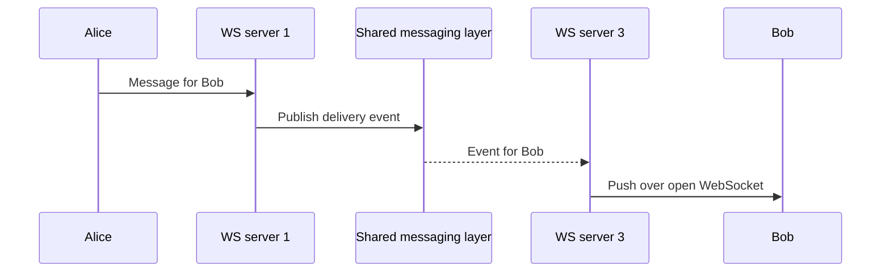

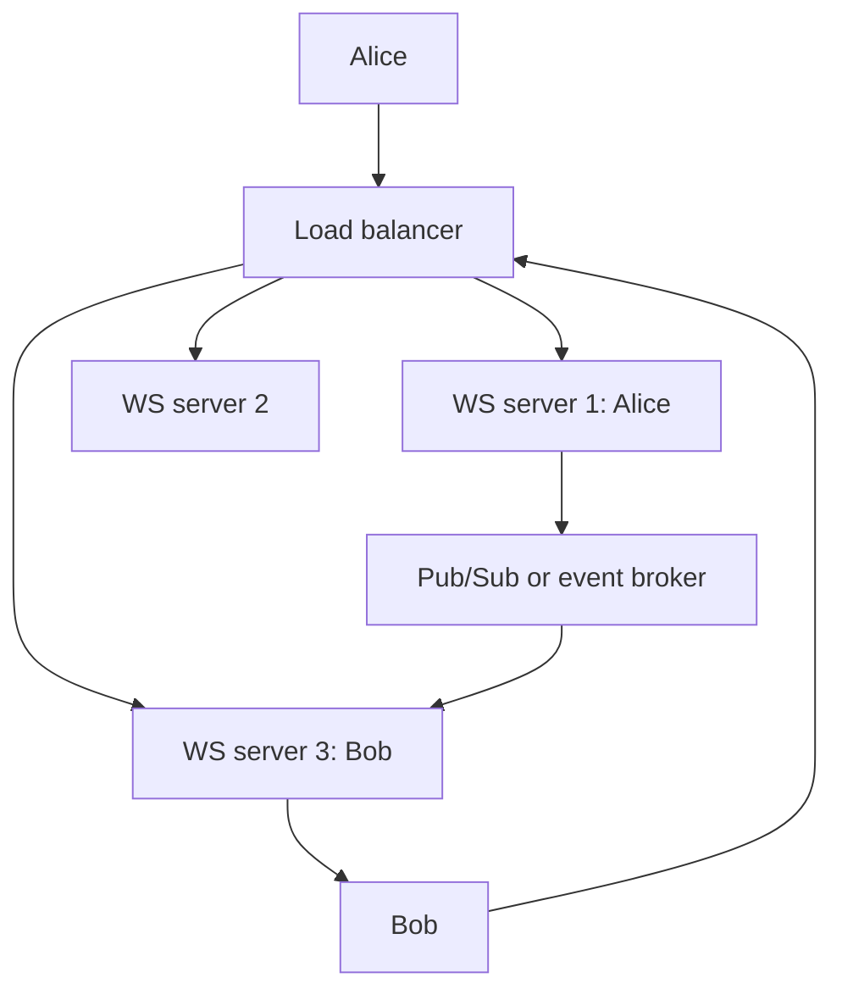

**Important:** A message broker does **not** know which server owns Bob's WebSocket unless subscriptions, routing or shared presence information are designed to make that possible.

---

## 10. Redis Pub/Sub versus Kafka

Different messaging systems provide different delivery semantics.

| Consideration | Redis Pub/Sub | Kafka / durable event log |
|---|---|---|
| Primary fit | Fast transient fan-out | Retained, replayable events |
| Ordinary message retention | No retention for plain Pub/Sub | Configurable retention |
| Reconnecting client recovery | Requires a separate persistent history | Possible through retained data and application cursors |
| Architecture concern | Subscription and message loss during disconnects | Partitioning, consumer assignments, lag and offsets |

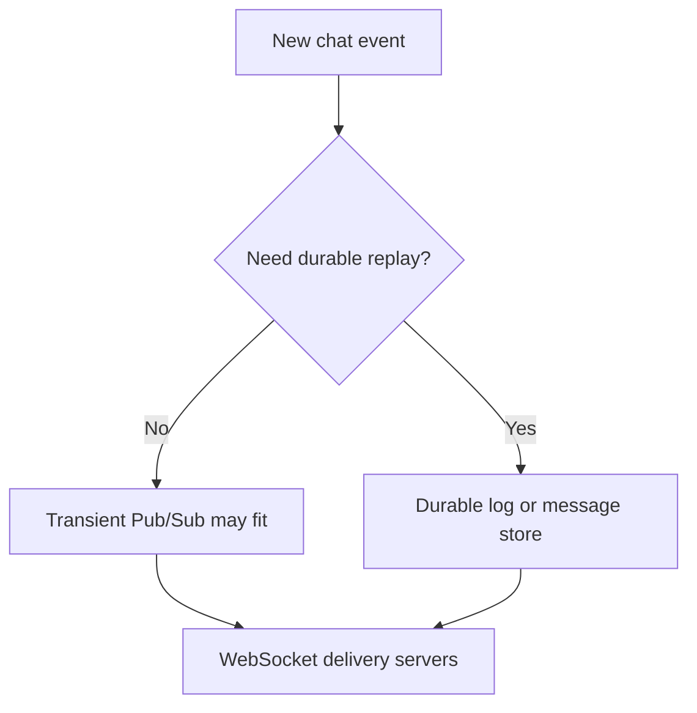

**Design detail:** Kafka retention alone doesn't mean every recipient receives a message once. The application still needs durable user-message state, delivery tracking, partition choices and deduplication where needed.

For reliable chat, treat **storage of the message** and **real-time push to an online user** as related but distinct tasks.

---

## 11. Reconnect after server failure

Suppose Bob is connected to server 3, and that server crashes.

1. Bob's existing WebSocket connection breaks.
2. His browser notices the closure or transport failure.
3. The client starts reconnecting with controlled delays.
4. The load balancer may select **server 2** this time.
5. The new server restores Bob's subscriptions or session information.
6. The client retrieves any missed messages from durable history.

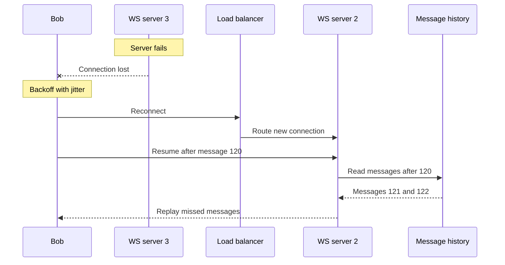

**Rule:** Do not keep indispensable message history **only in WebSocket server memory**.

The protocol itself does not store messages or provide automatic replay. Reliable recovery requires application-level IDs, retention and catch-up logic.

---

## 12. Reconnection storms and backoff with jitter

If an outage disconnects one million clients, they may all reconnect at roughly the same instant. That can overload a recovering cluster.

Use **exponential backoff with jitter**:

```text
Retry 1: about 1 second + randomness
Retry 2: about 2 seconds + randomness
Retry 3: about 4 seconds + randomness
Retry 4: about 8 seconds + randomness

Cap the delay and reset after healthy connectivity.
```

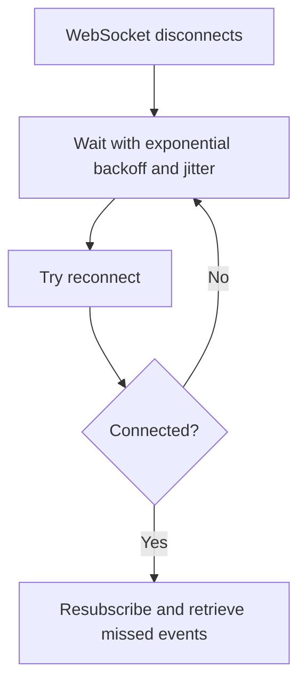

**Simple explanation:** The exponential delay reduces pressure; **jitter** prevents clients from waking up in lockstep.

Clients should also handle authentication expiry, being logged out, offline devices and deliberate server shutdowns instead of retrying blindly forever.

---

## 13. Ping, Pong, and idle timeouts

Proxies, load balancers, routers and applications can close connections that appear idle.

WebSocket includes **Ping** and **Pong** control frames to check whether peers remain responsive.

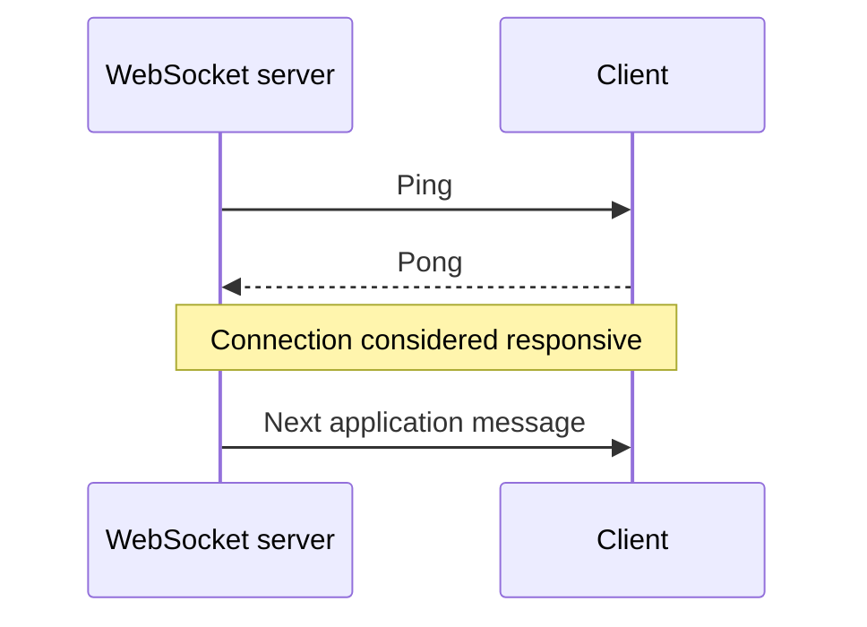

Choose liveness intervals based on your infrastructure idle timeouts and expected network conditions. Too-frequent probes waste bandwidth and may unnecessarily wake mobile clients.

**Browser JavaScript cannot directly send protocol-level Ping frames through the standard WebSocket API**, though browser implementations can respond to protocol Pings. An app can alternatively use its own heartbeat message format.

**Remember:** Heartbeats can help you detect stale connections, but a successful Ping/Pong is not proof that business-message processing succeeded.

---

## 14. Graceful connection draining during deployments

Long-lived WebSockets affect deployments. Killing a process immediately can disconnect many users simultaneously.

A safer rollout:

1. Stop directing **new connections** to the server being retired.
2. Allow existing connections to stay for a bounded grace period.
3. Optionally tell clients to reconnect in a controlled way.
4. Gracefully close remaining connections before the shutdown deadline.
5. Clients reconnect to healthy instances and recover state.

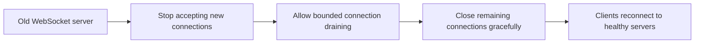

WebSocket connections may stay open indefinitely, so **draining must have a maximum duration**. Coordinate the application's close behavior with the load balancer and deployment platform.

---

## 15. Infrastructure, authentication and operations

A production WebSocket path might pass through a CDN, reverse proxy and load balancer. Every component must support the relevant handshake and sustained connections.

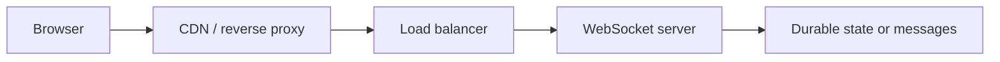

### Production checklist

- Prefer **`wss://`** for encrypted browser traffic.
- Validate the **Origin** header as appropriate and authenticate users before allowing sensitive subscriptions.
- Apply per-user authorization to messages and rooms, not only at connection start.
- Enforce connection, message-size and rate limits to protect the service.
- Bound outgoing buffers for **slow clients** and define backpressure policy.
- Monitor active connections, connection churn, ping failures, outbound queue size, reconnect rate, delivery delay and broker lag.
- Use structured message IDs and deduplication when clients may retry.
- Keep authoritative chat history, permissions and subscriptions recoverable across restarts.

**Important:** WebSocket gives you a transport channel, **not** built-in identity, storage, message authorization, replay or exactly-once delivery.

---

## 16. WebSocket vs SSE vs long polling

| Question | Short polling | Long polling | SSE | WebSocket |
|---|---|---|---|---|
| Who initiates updates? | Client asks repeatedly | Client asks, server waits | Server streams | Both can send |
| Long-lived response or connection? | No | One pending request at a time | Streaming HTTP response | Persistent bidirectional channel |
| Browser interface | Fetch | Fetch | EventSource | WebSocket |
| Best fit | Basic occasional refresh | Sporadic push-like updates | One-way live updates | Frequent bidirectional updates |
| Recovery after disconnect | App-managed | Cursor plus app-managed replay | Last-Event-ID plus app-managed replay | Fully app-managed |

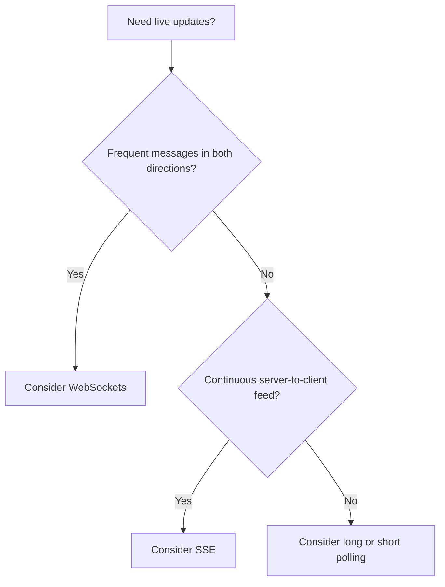

Compare related guides: [Long Polling](Long_Polling_Explained.md) and [Server-Sent Events](Server_Sent_Events_Explained.md).

**Memory trick:** Polling = **ask again**. SSE = **server talks**. WebSocket = **both talk**.

---

## 17. Interview questions and quick revision

### Interview questions

1. Why are WebSockets useful for chat or collaborative editing?
2. What does full-duplex communication mean?
3. Explain the HTTP/1.1 WebSocket Upgrade handshake and the 101 status.
4. What changes after the upgrade completes?
5. What are text, binary, Ping, Pong and Close frames?
6. Why can one WebSocket server become a bottleneck?
7. What does a load balancer decide for long-lived WebSocket connections?
8. Are sticky sessions required for an established WebSocket connection?
9. How does server 1 deliver a message to Bob connected to server 3?
10. What are the differences between Redis Pub/Sub and Kafka for real-time delivery?
11. How should a client recover after a WebSocket server crashes?
12. Why should reconnect attempts use jitter?
13. How do proxies and idle timeouts affect WebSockets?
14. What is connection draining, and why does it need a deadline?
15. Can WebSockets alone guarantee messages are durably delivered?
16. When are SSE or long polling simpler?

### Revision cheat sheet

| Term | Meaning |
|---|---|
| WebSocket | Persistent two-way communication channel |
| Full-duplex | Either party can send at any time |
| HTTP 101 | Successful HTTP/1.1 protocol switch |
| `ws://` | WebSocket without TLS |
| `wss://` | TLS-protected WebSocket |
| Frames | Units used for messages and control |
| Ping/Pong | Liveness probes |
| Load balancer | Picks backend for new connection |
| Pub/Sub | Bridges delivery between server instances |
| Durable message store | Enables missed-message recovery |
| Exponential backoff and jitter | Spreads reconnection load |
| Connection draining | Graceful handling of long-lived connections |

**Short interview answer:** A WebSocket is a persistent, full-duplex client-server channel, commonly established by upgrading an HTTP/1.1 connection. It is efficient for frequent two-way communication. At scale, WebSocket servers sit behind load balancers and use shared messaging and durable state to deliver events across server instances and recover from failures.

**Final takeaway:** **WebSockets make real-time two-way messages easy to exchange, but reliable large-scale delivery still needs careful design for routing, authentication, storage, reconnects, backpressure, and deployment.**

---
