# Webhooks — Explained Simply with Diagrams

*Distributed Systems Study Library · Author: Jayesh Sharma*

**Understand HTTP callbacks, payment notifications, delivery retries, idempotency, signed requests, queues, out-of-order events and scalable webhook design.**

> An independently written educational adaptation of the user-supplied webhook transcript. The structure, descriptions, examples, calculations and Mermaid diagrams are original. Additional security guidance such as SSRF protection and atomic deduplication is identified as supplementary context.

## Contents

- [1. What is a webhook?](#1-what-is-a-webhook)
- [2. Who registers the webhook and who sends it?](#2-who-registers-the-webhook-and-who-sends-it)
- [3. What does a webhook request contain?](#3-what-does-a-webhook-request-contain)
- [4. End-to-end payment example](#4-end-to-end-payment-example)
- [5. Why webhook delivery needs retries](#5-why-webhook-delivery-needs-retries)
- [6. At-least-once delivery and duplicates](#6-at-least-once-delivery-and-duplicates)
- [7. Idempotency: process each business effect safely](#7-idempotency-process-each-business-effect-safely)
- [8. Keep the webhook endpoint fast](#8-keep-the-webhook-endpoint-fast)
- [9. Handling bursts with queues and workers](#9-handling-bursts-with-queues-and-workers)
- [10. Ordering: event B can arrive before event A](#10-ordering-event-b-can-arrive-before-event-a)
- [11. Verify signatures and protect against replay attacks](#11-verify-signatures-and-protect-against-replay-attacks)
- [12. HTTP responses and retry policies](#12-http-responses-and-retry-policies)
- [13. Sending webhooks to your own customers](#13-sending-webhooks-to-your-own-customers)
- [14. Isolate failures and use dead-letter queues](#14-isolate-failures-and-use-dead-letter-queues)
- [15. Observability and production checklist](#15-observability-and-production-checklist)
- [16. When webhooks make sense](#16-when-webhooks-make-sense)
- [17. Interview questions and quick revision](#17-interview-questions-and-quick-revision)

---

## 1. What is a webhook?

A **webhook is an HTTP callback**. One service tells another service about an event by sending an HTTP request to a previously configured URL.

Think of ordering a parcel. You could call the delivery office every hour to ask whether it has arrived (**polling**), or ask the delivery office to **call you when it arrives** (**webhook**).

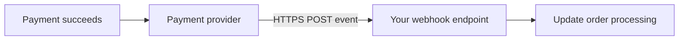

**Memory trick:** **Polling = keep asking. Webhook = notify me when it happens.**

Unlike SSE and WebSockets, a webhook usually connects **one backend system to another** for individual events. It does not require an open, continuous connection.

---

## 2. Who registers the webhook and who sends it?

Suppose an online store accepts payments using an external payment provider.

**Who registers the webhook?** Usually the **receiving application owner** configures its callback URL in the **sending provider's dashboard or API**. The provider subsequently calls that URL when subscribed events happen.

1. Your team creates a secure endpoint such as `POST https://shop.example.com/webhooks/payments`.
2. Your team registers the URL with the provider and selects relevant event types.
3. The provider generates an event after a payment changes state.
4. The provider sends an HTTP request to your endpoint.
5. Your backend verifies the sender, accepts the event durably and acknowledges it.

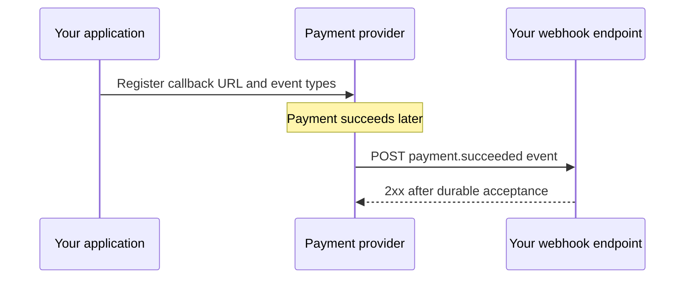

**Important:** Your users do not normally register each backend webhook themselves. Your integration configuration controls which events your system receives.

---

## 3. What does a webhook request contain?

A webhook is commonly an HTTPS POST request containing an event document. The actual schema depends on the provider.

**Illustrative payload, not a specific provider's schema:**

```http
POST /webhooks/payments HTTP/1.1
Host: shop.example.com
Content-Type: application/json
X-Webhook-Signature: illustrative-signature-value

{
  "eventId": "evt_501",
  "type": "payment.succeeded",
  "occurredAt": "2026-10-26T10:00:00Z",
  "data": {
    "orderId": "order_42",
    "paymentId": "pay_77",
    "amount": 4999,
    "currency": "INR"
  }
}
```

| Field | Why it helps |
|---|---|
| Event ID | Detect retries and duplicate deliveries |
| Event type | Choose the correct handler |
| Timestamp | Track freshness and event timing |
| Payload | Identify the affected resource and data |
| Signature header | Authenticate the message when supported |

A signature's exact header name, encoding and verification method are **provider-specific**.

---

## 4. End-to-end payment example

Imagine a customer purchases a book.

The order service first records an order as **PENDING**. The payment provider then completes the payment and sends a webhook. Your system accepts the event and changes the order status to **PAID**.

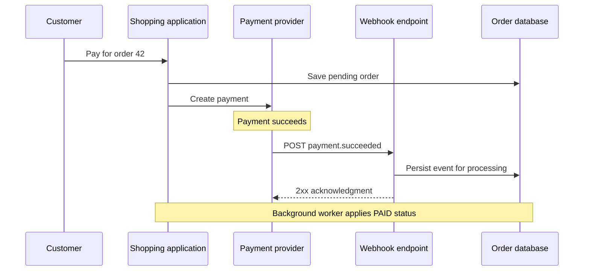

The payment provider is the **producer** of the webhook event. Your endpoint is the **consumer**. Avoid treating the customer's browser redirect alone as authoritative proof of payment.

---

## 5. Why webhook delivery needs retries

Sometimes the destination is temporarily unavailable or the network drops a response. A robust provider may retry undelivered notifications.

A typical **illustrative** policy uses exponential backoff:

| Attempt | Possible waiting time |
|---|---|
| First retry | 1 minute |
| Second retry | 2 minutes |
| Third retry | 4 minutes |
| Fourth retry | 8 minutes |

Real providers have their own retry policies; the table is **not a universal rule**.

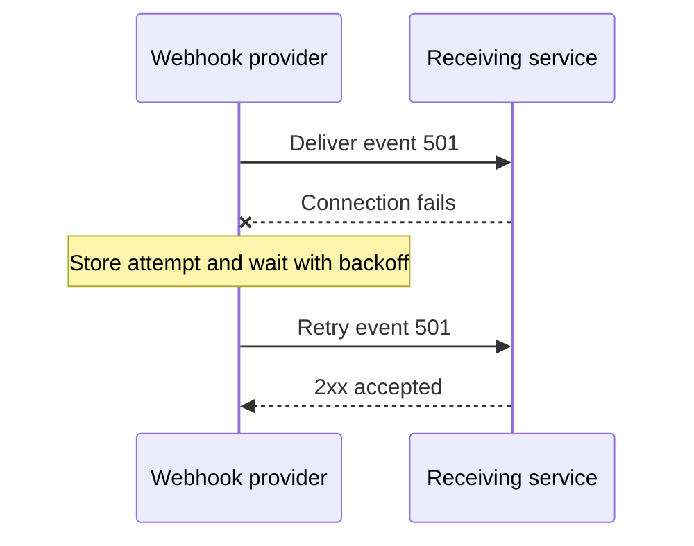

Add **jitter** (randomness in the wait) to prevent large groups of requests from retrying in lockstep. Retries should have a **bounded window or maximum attempt count**, followed by operational visibility and a replay plan.

---

## 6. At-least-once delivery and duplicates

A subtle failure happens when your server processes a webhook but the response never reaches the sender. The sender cannot tell whether processing succeeded, so it may deliver **the same event again**.

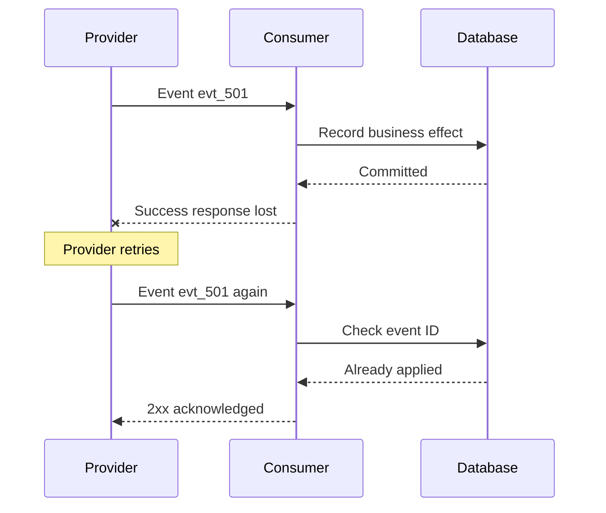

This is why webhook systems often operate with **at-least-once delivery**: duplicates are normal, not necessarily bugs.

Do **not** assume a webhook will arrive exactly once. Design the consumer to be **idempotent**.

---

## 7. Idempotency: process each business effect safely

**Idempotency** means repeating a request or event produces the same intended business effect as handling it once.

A common technique is to store a unique key based on the **provider identity and event ID**.

```text
Webhook received: evt_501
Check database:   Have we applied evt_501?

No  → Apply business effect and record evt_501
Yes → Skip duplicate business effect, acknowledge safely
```

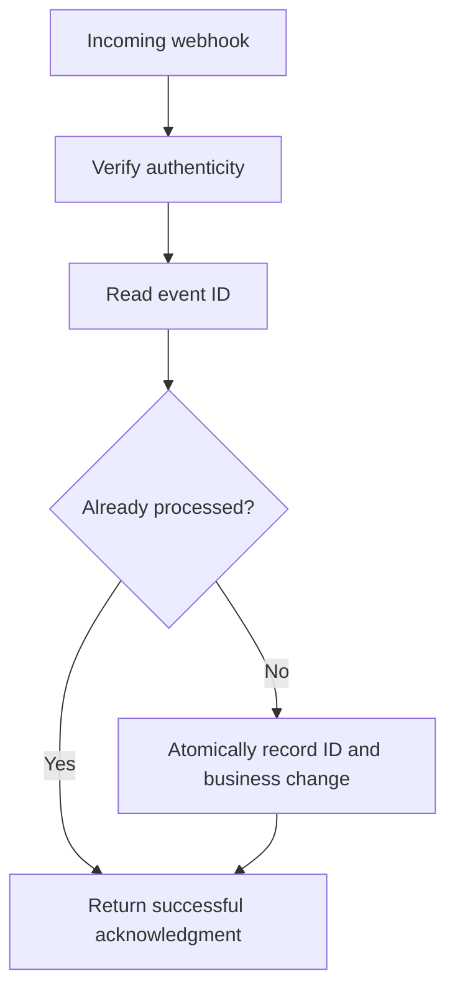

**Critical race condition:** Two duplicate requests can arrive at the same time. A simple read-before-write check is insufficient. Use an appropriate **unique database constraint and transaction**, or equivalent atomic deduplication, so both requests cannot perform the same business effect.

Some providers can emit **distinct event IDs for the same underlying business operation**. When necessary, also deduplicate using a business key such as payment ID and the state-transition rules.

---

## 8. Keep the webhook endpoint fast

The receiving endpoint should not spend a long time sending emails, updating analytics, generating invoices, and calling slow downstream APIs **before acknowledging delivery**.

Instead:

1. Receive the HTTP request.
2. Verify its signature and basic validity.
3. **Durably record the accepted event**.
4. Return an appropriate **2xx HTTP response quickly**.
5. Let background workers perform slower work.

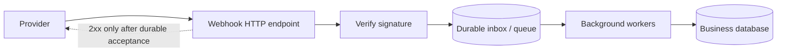

**Why durable acceptance matters:** If you return `200 OK` **before** the event has been safely stored, a server crash can lose the event and the provider may consider delivery complete.

The server might use a transactional **inbox table** or a reliably acknowledged queue write. The exact implementation depends on the technology.

---

## 9. Handling bursts with queues and workers

Suppose a provider sends **100,000 events** after a large sale. You do not want all those events to execute expensive business logic inside the HTTP request handler.

A queue acts as a **buffer** while worker instances consume at a sustainable rate.

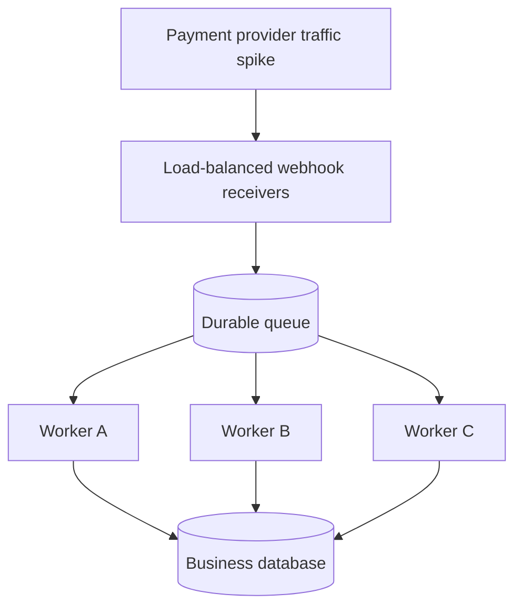

This separates:

- **Ingress capacity:** How rapidly requests can be validated and accepted.
- **Processing capacity:** How rapidly business changes can be applied.

Workers need their **own retry policy and dead-letter handling**. Queue durability and exactly what “acknowledged” means must be understood for the chosen broker.

**Monitor:** Queue depth, oldest-message age, processing latency, worker failures and duplicate rates.

---

## 10. Ordering: event B can arrive before event A

Imagine two events for the same order:

1. `order.created`
2. `order.cancelled`

A retry delays the creation event, but the cancellation event arrives first. Processing events merely in arrival order may result in an incorrect final state.

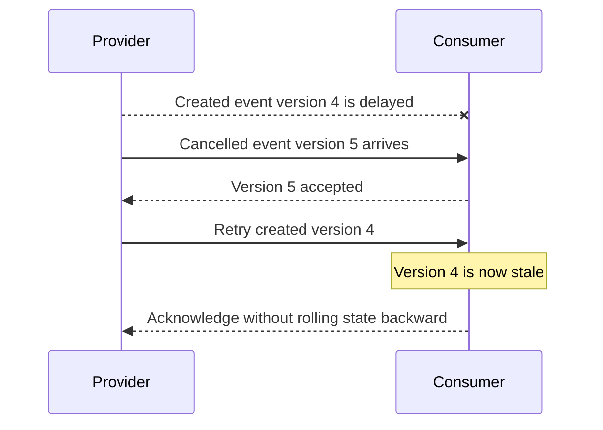

**Possible protections:**

- Event versions or monotonically increasing sequence numbers **per business entity**.
- A state machine that rejects invalid backward transitions.
- Fetching **current authoritative state** from the provider when an event only signals that something changed.

**Nuance:** Event timestamps are not always safe ordering keys. Clock skew, duplicated timestamps and cross-partition delivery can complicate ordering. Use a provider-supported version when available.

---

## 11. Verify signatures and protect against replay attacks

Webhook URLs are reachable over the network, so receiving a POST does **not** prove that a trusted partner sent it.

Many providers use a **cryptographic signature**:

1. The provider and your system share a secret configured out of band.
2. The provider signs the message (often with a timestamp included).
3. Your server computes the expected signature according to the provider's documented algorithm.
4. Compare signatures using a **constant-time comparison**.
5. Reject invalid or stale requests before applying business effects.

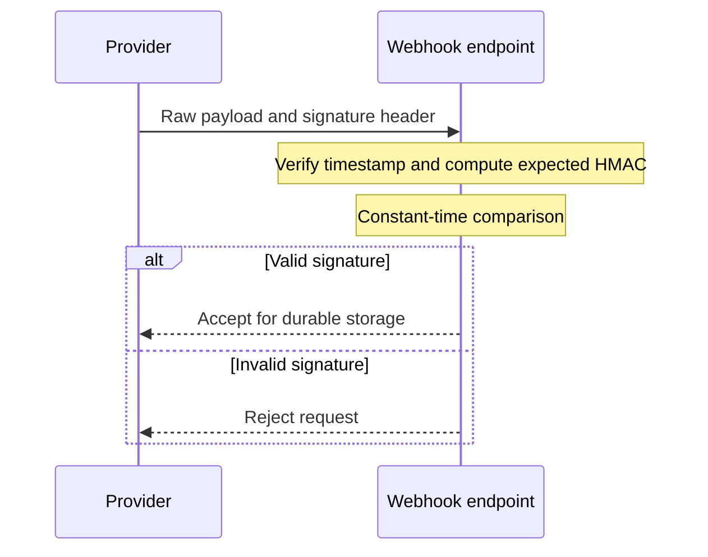

**Important:** Signatures often cover the **raw request body**. Parsing and re-serializing JSON before verification can change whitespace or encoding and break verification.

Timestamp validation narrows the replay window, but **persistent event-ID deduplication** is still valuable. Use HTTPS, secret rotation, request-size limits and any additional authentication measures required by the provider.

---

## 12. HTTP responses and retry policies

The HTTP response communicates whether your endpoint accepted a delivery, but **providers differ** in how they interpret status codes.

| Response | Typical interpretation | Caution |
|---|---|---|
| **2xx** | Delivery accepted | Send only after durable acceptance |
| **400 / 401 / 403** | Invalid payload or authentication failure | Many providers classify these as delivery failures; exact retry depends on provider |
| **429** | Rate limited | Sender may retry or back off depending on contract |
| **500 / 503** | Temporary server-side failure | Often retryable |
| **Timeout / network failure** | No usable acknowledgment | Common cause of duplicate delivery |

**Do not assume** that all providers retry only `5xx`, or that `4xx` is never retried. Read the delivery agreement and test it.

If event persistence fails, returning a success response risks permanent loss. A failure response allows a compliant provider to try again.

---

## 13. Sending webhooks to your own customers

So far, your service has **received** webhooks. What if you operate a platform and need to **send webhooks to thousands of customers**?

Avoid blocking the business transaction while making outbound HTTP calls to every customer.

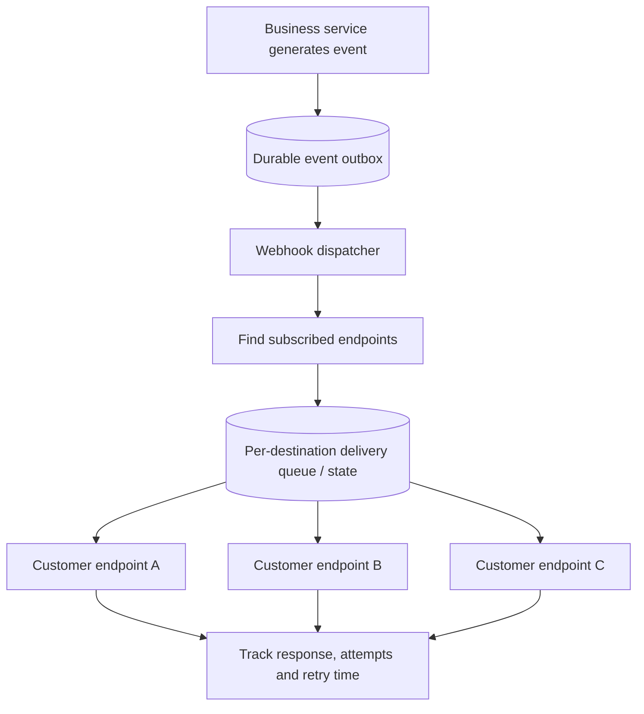

A well-designed sender records **event generation**, **subscriber matching**, **delivery attempts**, **next retry time** and **final outcome**.

A **transactional outbox** can help reliably connect a business database update with creation of the event to be delivered. Background dispatchers then manage HTTP delivery independently.

---

## 14. Isolate failures and use dead-letter queues

What if one customer endpoint is down for six hours? Its repeated failures should not block healthy customers.

Use delivery isolation with **per-endpoint timeout, concurrency limit, retry state and rate limits**.

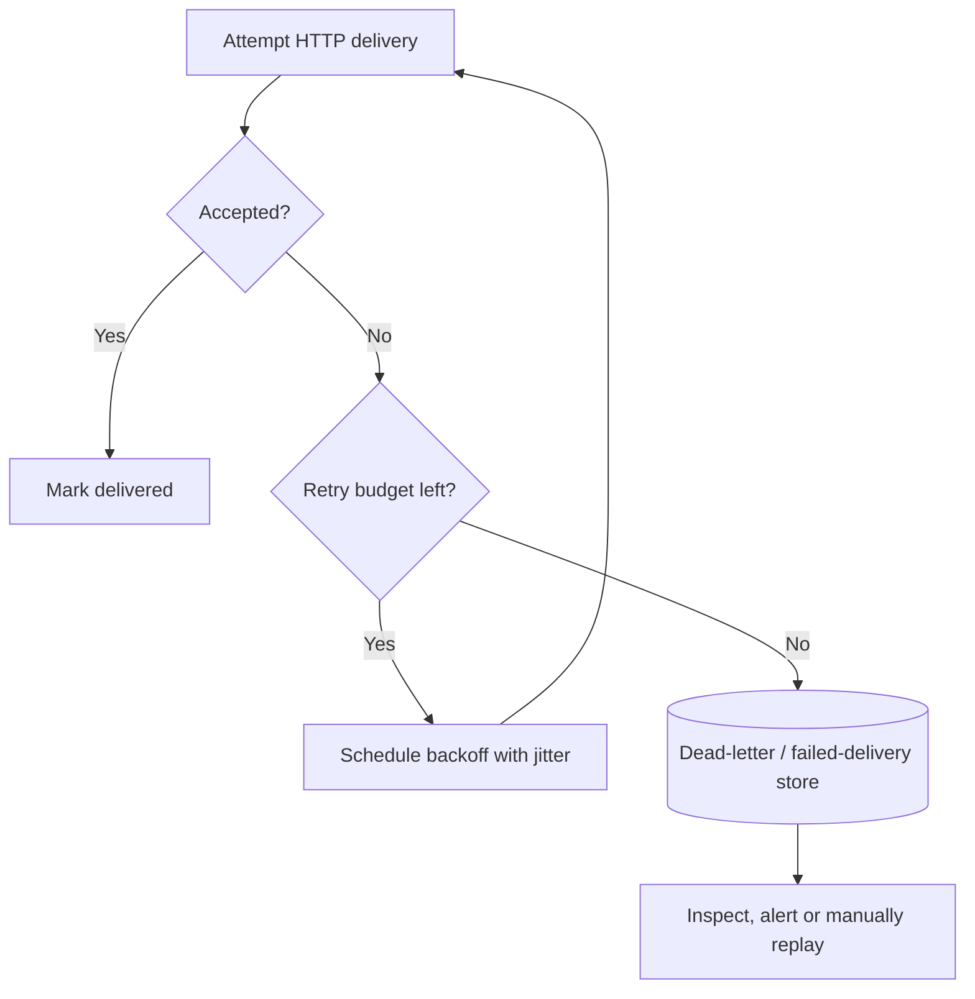

DLQ stands for **dead-letter queue**. It stores deliveries that exhausted their normal retry budget for inspection or controlled replay.

**Operational safeguard:** Manual replay should preserve event identity or idempotency rules so replay does not duplicate payments, orders or other business effects.

---

## 15. Observability and production checklist

Webhooks can fail quietly if nobody measures their delivery pipeline.

| Metric | What it reveals |
|---|---|
| Delivery request volume | Incoming event rate |
| 2xx / 4xx / 5xx rates | Acceptance and failure patterns |
| Signature verification failures | Invalid or suspicious callbacks |
| Retry attempts | Transport or consumer instability |
| Queue backlog and age | Processing capacity bottleneck |
| Time to business completion | End-to-end processing delay |
| Dead-letter count | Deliveries needing manual attention |
| Duplicate-event rate | Retry/idempotency behavior |

**Receiving-side checklist:** Verify raw-body signature, validate payload, use durable acceptance, deduplicate atomically, process asynchronously, monitor backlog.

**Sending-side checklist:** Persist events, authenticate requests, isolate destinations, use timeouts and backoff, cap retries, support failure inspection and replay.

**Security addition:** Webhook senders that accept customer-provided callback URLs should also guard against **server-side request forgery (SSRF)**, including unsafe internal addresses and redirect behavior. This is supplementary production-design context.

---

## 16. When webhooks make sense

Webhooks work well for **discrete backend-to-backend notifications**, such as:

- Payment completed or refunded
- Source-control push or pull-request event
- Order shipped or cancelled
- Email delivered or bounced
- Identity/account event
- CI/CD build completed
- Third-party integration update

They are often simpler than keeping a permanent streaming connection when events happen only occasionally.

| Need | Common approach |
|---|---|
| One backend notifies another after an event | **Webhook** |
| Browser refreshes every few minutes | **Short polling** |
| Browser wants near-real-time occasional updates | **Long polling or SSE** |
| Browser receives a continuous one-way feed | **SSE** |
| Both sides send frequent interactive messages | **WebSocket** |

Related guides: [Long Polling](Long_Polling_Explained.md), [Server-Sent Events](Server_Sent_Events_Explained.md), and [WebSockets](WebSockets_Explained.md).

---

## 17. Interview questions and quick revision

### Common interview questions

1. What is a webhook, and who registers it?
2. How is a webhook different from regular polling?
3. Why can the same event be delivered more than once?
4. What is at-least-once delivery?
5. How do you implement idempotency when duplicate webhooks arrive concurrently?
6. Why should the HTTP handler acknowledge events quickly?
7. What does “durable acceptance” mean?
8. How does a queue help during a burst of 100,000 webhooks?
9. Why can cancellation arrive before creation?
10. How do version numbers help with out-of-order events?
11. Why should a webhook signature be checked against the raw body?
12. How do timestamps help resist replay attacks?
13. Which HTTP statuses cause retries?
14. What are a transactional outbox and a dead-letter queue?
15. How do you protect one failing subscriber from affecting others?

### Quick cheat sheet

| Term | Meaning |
|---|---|
| Webhook | HTTP callback triggered by an event |
| Sender/provider | Service generating and delivering event |
| Receiver/consumer | Service exposing the callback endpoint |
| At-least-once | An event can arrive more than once |
| Event ID | Helps identify duplicate deliveries |
| Idempotency | Repeat event without duplicating effects |
| Raw-body signature | Authenticity and integrity verification |
| Durable inbox | Store accepted event before 2xx |
| Background worker | Execute slow business logic later |
| Exponential backoff + jitter | Spread retry load |
| Version/sequence | Detect stale events |
| Dead-letter queue | Keep exhausted deliveries for repair |
| Transactional outbox | Avoid losing outbound event after business commit |

**Short interview answer:** A webhook is an HTTP request one service sends to another when a subscribed event occurs. Production-grade webhooks use verified signatures, durable storage, at-least-once retries, idempotent processing, asynchronous queues, event ordering controls, failure isolation and observability.

**Final takeaway:** **A webhook is easy to send but harder to deliver reliably. Build for duplicate requests, temporary failure, unsafe input, and events arriving out of order.**

---
