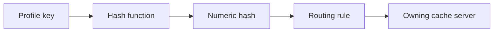
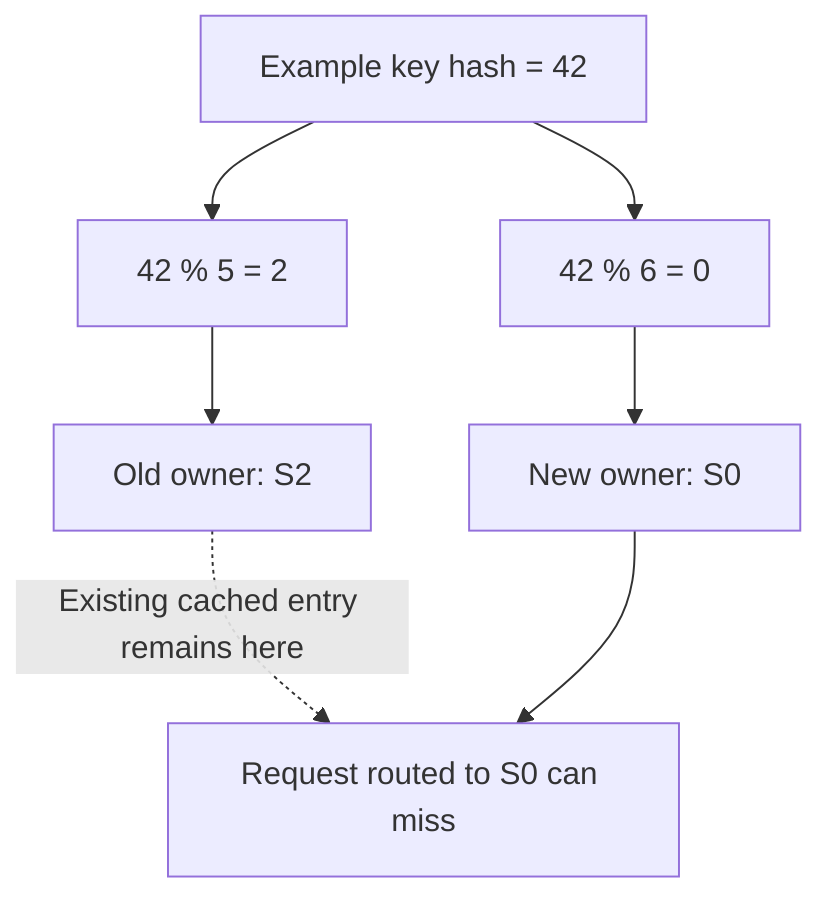
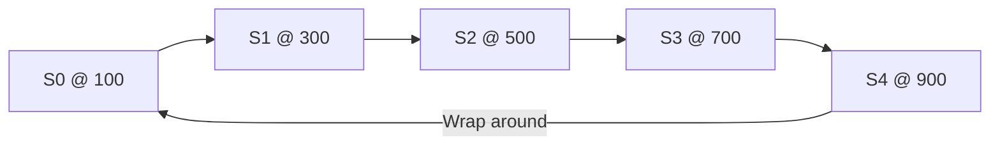
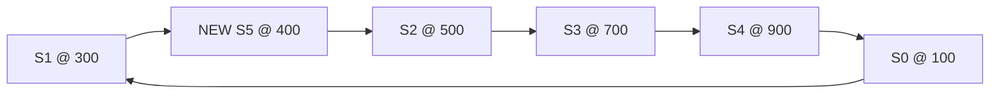
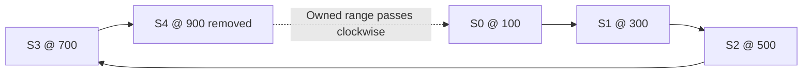
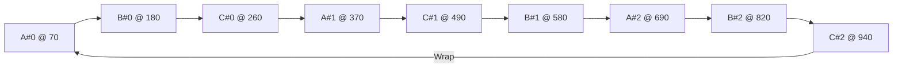
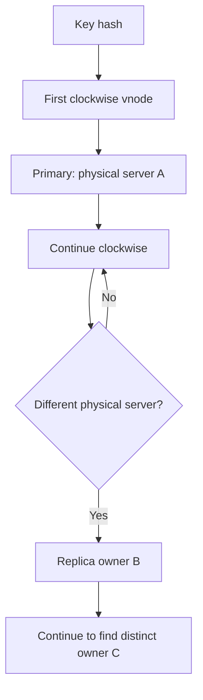

# Consistent Hashing and Virtual Nodes — Explained Simply

**From modulo hashing to a hash ring, with easy maths, routing examples, original diagrams and interview notes.**


## Contents

1. [The problem: keeping keys on the right server](#1-the-problem-keeping-keys-on-the-right-server)
2. [Simple modulo hashing](#2-simple-modulo-hashing)
3. [Why adding a server breaks modulo routing](#3-why-adding-a-server-breaks-modulo-routing)
4. [Consistent hashing: the ring idea](#4-consistent-hashing-the-ring-idea)
5. [Adding a server](#5-adding-a-server)
6. [Removing a server](#6-removing-a-server)
7. [How many keys move?](#7-how-many-keys-move)
8. [Virtual nodes (vnodes)](#8-virtual-nodes-vnodes)
9. [How to implement lookups efficiently](#9-how-to-implement-lookups-efficiently)
10. [Adding replication](#10-adding-replication)
11. [When to use consistent hashing](#11-when-to-use-consistent-hashing)
12. [Memory tricks, exercises and interview questions](#12-memory-tricks-exercises-and-interview-questions)

---

## 1. The problem: keeping keys on the right server

Suppose a profile cache has **five servers**. Each profile should be routed to the server that stores its cached value.

If requests for the same profile go to different servers randomly, most of those requests may miss the cache.

We need two properties:

- **Stable mapping:** The same key should find the same owner while cluster membership stays unchanged.
- **Minimal movement:** Adding or removing a server should disturb as few existing key assignments as practical.

For a key such as `profile:42`, a hash function produces a number. The routing algorithm turns that number into a server choice.



**Important:** A hash function is deterministic given the same input and algorithm. Every router must use compatible hashing and membership information.

## 2. Simple modulo hashing

The easiest routing rule is:

```text
server_index = hash(key) % number_of_servers
```

The symbol `%` means **remainder after division**.

With five servers, indices are `0, 1, 2, 3, 4`.

### Simple maths

```text
42 ÷ 5 = 8 remainder 2   → 42 % 5 = 2 → S2
17 ÷ 5 = 3 remainder 2   → 17 % 5 = 2 → S2
```

| Key's example hash | Divide by 5 | Remainder | Server |
|---:|---:|---:|---|
| 42 | 8 remainder 2 | 2 | S2 |
| 17 | 3 remainder 2 | 2 | S2 |
| 23 | 4 remainder 3 | 3 | S3 |
| 30 | 6 remainder 0 | 0 | S0 |

A good hash function helps distribute many independent keys relatively evenly **while the server count stays fixed**.

**Remember:** Modulo means **“hash, divide, use the remainder.”**

---

## 3. Why adding a server breaks modulo routing

Now a sixth server joins. Our routing formula changes from `hash % 5` to `hash % 6`.

The key itself has not changed, but its computed destination often does.

| Example hash | With 5 servers | With 6 servers | Did it move? |
|---:|---|---|---|
| 42 | S2 | S0 | Yes |
| 17 | S2 | S5 | Yes |
| 23 | S3 | S5 | Yes |
| 30 | S0 | S0 | No |



### Why it matters

When many keys are reassigned at once:

- The new owners may not have the cached entries.
- Cache misses rise.
- The origin database may experience a sudden increase in read traffic.
- Persistent storage would require moving records deliberately.

The problem is not that modulo hashing distributes keys badly in a fixed-size cluster. The problem is **changing the divisor changes lots of assignments**.

---

## 4. Consistent hashing: the ring idea

Instead of using the number of servers as a divisor, put **both keys and server positions in one fixed hash space**.

For an easy drawing, imagine positions **0 through 999**, connected end-to-start to form a ring. Real systems typically use much larger hash spaces.

Place five servers at example positions:

| Server | Ring position |
|---|---:|
| S0 | 100 |
| S1 | 300 |
| S2 | 500 |
| S3 | 700 |
| S4 | 900 |

### Routing rule

1. Hash the key to a position on the ring.
2. Move **clockwise**.
3. Choose the first server at or after that position.
4. If you pass the last position, wrap around to the first server.



The diagram is a ring **conceptually**; the routing order is what matters.

### Work through three keys

| Key position | First clockwise server | Reason |
|---:|---|---|
| 250 | **S1 @ 300** | 300 is the next server position |
| 620 | **S3 @ 700** | 700 follows 620 |
| 950 | **S0 @ 100** | Wrap around after 999 |

A key whose hash equals a server position belongs to that server.

**Memory trick:** **Hash → Clockwise → First server.**

### Intervals in this example

| Server | Positions owned |
|---|---|
| S0 | 901–999 and 0–100 |
| S1 | 101–300 |
| S2 | 301–500 |
| S3 | 501–700 |
| S4 | 701–900 |

Intervals show why a server owns a *range*, not just the keys with exactly the same hash.

---

## 5. Adding a server

Suppose **S5** joins at position **400**.

Before the change, S2 @ 500 owned positions **301–500**. After the change:

- S5 @ 400 owns **301–400**.
- S2 @ 500 keeps **401–500**.
- The other servers keep their existing ranges.



| Key hash | Old owner | New owner | Changes? |
|---:|---|---|---|
| 350 | S2 | **S5** | Yes |
| 450 | S2 | S2 | No |
| 620 | S3 | S3 | No |
| 950 | S0 | S0 | No |

**Key idea:** The new server steals a *neighboring interval*, not random keys from everywhere.

---

## 6. Removing a server

Now suppose **S4 @ 900** disappears.

Its interval, **701–900**, must go to the next clockwise available server, **S0 @ 100**.



| Key position | Before removal | After removal |
|---:|---|---|
| 850 | S4 | **S0** |
| 620 | S3 | S3 |
| 250 | S1 | S1 |

Only S4's former range needs reassignment under this single-position-per-server example.

**Caution:** A cache may simply rebuild the missing entries on demand. A persistent storage system must separately handle safe data movement, durability and recovery. **Changing routing does not physically transfer records.**

---

## 7. How many keys move?

With evenly spread data and appropriately balanced new ownership, adding one server to **N existing servers** is often approximated as moving:

```text
Fraction of keys moved ≈ 1 / (N + 1)
```

### Example: five servers become six

```text
N = 5
Moved ≈ 1 / (5 + 1)
      = 1/6
      ≈ 16.7%
```

### Why the example ring moves 10%, not 16.7%

Here S5 took positions **301–400**: **100 out of 1,000** positions.

```text
100 / 1,000 × 100 = 10%
```

So **about 10% of uniformly hashed keys** move in that specific ring. The **16.7%** figure is a balanced-share expectation, not a guarantee for each placement.

| Scenario | Approx. movement |
|---|---:|
| Balanced 5 → 6 servers | 1/6 ≈ 16.7% |
| Our example interval | 100/1,000 = 10% |

**Memory trick:** For ideal balanced growth, **new server's share ≈ 1 ÷ new server count**.

---

## 8. Virtual nodes (vnodes)

### The problem with one ring position per server

When physical server IDs are hashed, positions may fall unevenly. One server may own a large slice of the ring while another owns a small slice.

Also, if a server fails, all of its interval goes to **one clockwise neighbor**—potentially overloading that machine.

### The idea

Give each physical machine **multiple locations** on the ring. These are **virtual nodes**, commonly called **vnodes**.

For example, one server might have three identifiers:

```text
Physical server A
 ├─ A#0  → vnode at one ring position
 ├─ A#1  → vnode at another position
 └─ A#2  → vnode at a third position
```

Every vnode routes to its underlying physical server.

### Example with three servers and three virtual nodes each



For a key at position **300**, the first vnode clockwise is **A#1 @ 370**, so the owning physical server is **A**.

### Why virtual nodes help

- More, smaller ranges usually distribute keys **more evenly**.
- A failed physical machine's ranges can move to **several other machines**, not just one.
- Stronger hardware can receive more vnodes to obtain a greater *expected share*.

### What vnodes do NOT do

- They do **not** create additional physical machines.
- They do **not** automatically replicate data.
- They do **not** guarantee perfectly balanced traffic: one viral key can still be much hotter than another.

**Trade-off:** More vnodes require more routing metadata and membership updates.

---

## 9. How to implement lookups efficiently

A real implementation does not need to draw a circle. Store vnode positions in a **sorted array** along with the physical server behind each position.

Example:

```text
Ring positions: [100, 300, 400, 500, 700, 900]
Owners:         [ S0,  S1,  S5,  S2,  S3,  S4]
```

For each key:

1. Compute its hash position.
2. Find the first position **greater than or equal to** the hash using binary search.
3. If none is found, choose the **first** entry (wrap around).
4. Return the physical server mapped to that position.

### Simple pseudocode

```text
function findOwner(key, sortedRing):
    if sortedRing is empty:
        return error("No available server")

    h = hash(key)
    i = lowerBound(sortedRing.positions, h)

    if i == length(sortedRing):
        i = 0

    return sortedRing[i].physicalServer
```

**Runtime for a lookup:** Binary search on **V vnode positions** costs **O(log V)** time.

Hashing a key costs additional work based on key length; the O(log V) figure refers to finding the owner after the hash is computed.

**Important engineering details:**

- All routers should agree on the same hash function and ring membership version.
- Vnode identifiers and hash collisions must be handled deterministically.
- Membership changes must be coordinated to avoid routing the same data inconsistently during transitions.
- An empty ring must result in a clear error rather than an invalid lookup.

---

## 10. Adding replication

So far, each key has **one primary owner**. To tolerate failures, a system might keep **three copies**.

A common ownership policy is:

1. Find the key's primary vnode (first clockwise position).
2. Keep scanning clockwise.
3. Choose additional vnodes that belong to **different physical servers**.
4. Stop when you have the required number of distinct owners.



**Distinct matters:** Two vnodes owned by server A do not provide protection against failure of server A.

You may also place copies across separate racks or availability zones to reduce correlated failures.

### Placement is not replication

The hash ring only answers **where the copies should belong**. Other mechanisms must actually:

- Copy data
- Decide when writes are acknowledged
- Reconcile replicas
- Repair missing copies
- Handle failover and stale data

Also ensure there are at least as many distinct physical servers as the requested replication factor.

---

## 11. When to use consistent hashing

| Situation | Useful approach | Why |
|---|---|---|
| Key-based cache cluster with changing membership | Consistent hashing | Limits key ownership reshuffling |
| Distributed key-value storage | Consistent hashing (one option) | Supports deterministic ownership and expansion |
| Stateless API servers that can serve any request | Regular load balancer | No key-specific placement needed |
| Small cluster with fixed server count | Modulo hashing | Very simple |
| Key ownership without a ring | Rendezvous hashing | Scores candidate servers and selects a winner |
| Stable logical partitions | Hash key to fixed partitions; assign partitions to servers | Server count changes don't change the partition hash |

**Alternative: rendezvous hashing.** For each key, compute a score per candidate server and choose the highest-ranked server. This also offers relatively stable assignments when membership changes.

**Alternative: fixed partitions.** For example, assign keys to **256 logical partitions** with `hash(key) % 256`; separately map those 256 partitions to physical machines. Because the partition count remains fixed, adding machines changes *partition ownership*, not the key-to-partition formula.

### What consistent hashing does not solve by itself

It does not automatically address every problem in distributed storage:

- Replica consistency
- Hot keys and highly skewed traffic
- Data movement and safe cutover
- Storage durability
- Load balancing for arbitrary stateless requests

Choose it when **stable key placement matters**.

---

## 12. Memory tricks, exercises and interview questions

### One-page cheat sheet

| Topic | Remember |
|---|---|
| Modulo routing | `hash(key) % N` |
| Modulo problem | Changing N reassigns many keys |
| Consistent hashing | Fixed hash space arranged as a ring |
| Ownership | **First server clockwise** |
| Wraparound | End of ring leads back to its beginning |
| Add a server | New server takes a neighboring interval |
| Remove a server | Its keys go to next clockwise owner |
| Balanced addition | Roughly `1 / (N + 1)` keys move |
| Virtual node | Extra ring position pointing to a real server |
| Vnode advantage | Smaller ranges and usually better balance |
| Lookup | Sorted positions + binary search, O(log V) |
| Replica placement | Choose distinct physical servers |
| Data migration | Routing alone does not copy stored data |

### Five-number memory story

**5 → 6 → 42 → 400 → 1/6**

- **5 servers:** Start with S0 to S4.
- **6 servers:** Adding S5 changes `hash % N` mappings.
- **42:** `42 % 5 = 2`, but `42 % 6 = 0`.
- **400:** A new server at ring position 400 takes a limited interval.
- **1/6:** In a balanced 5-to-6 expansion, roughly 16.7% of keys move.

### Three-step routing drill

Using ring positions **100, 300, 500, 700, 900**:

| Key position | Answer |
|---:|---|
| 120 | S1 at 300 |
| 500 | S2 at 500 |
| 990 | S0 at 100 |

### Interview questions

1. Why might a distributed cache need key-based routing?
2. What happens to existing mappings when `hash(key) % N` changes from N=5 to N=6?
3. Why is the ring considered a *fixed* hash space?
4. How do you locate the owner of a key?
5. Which keys change owners when a server is added?
6. What happens after a server fails?
7. Why can one physical position per server create imbalance?
8. What is a virtual node, and what doesn't it do?
9. Why must replica owners be distinct physical machines?
10. How would you implement lookup with binary search?
11. Why doesn't ownership reassignment automatically migrate persistent data?
12. When would a load balancer or fixed partition map be simpler?

**Core takeaway:** Consistent hashing keeps most key assignments stable when servers join or leave. Virtual nodes usually improve distribution, but real systems still need careful handling of membership, data movement, replication and hot spots.

---
