# Counting at Scale — Distributed Counters, HyperLogLog and Trending Systems Explained Simply

*Distributed Systems Study Library · Author: Jayesh Sharma*

**Learn how high-traffic systems count views, likes, ad clicks, unique visitors, rate limits and trending topics safely and efficiently.**

> Independently authored educational guide based on the user-provided counting-at-scale transcript. All explanations, diagrams, calculations and tables are newly written. Additional clarifications cover correctness boundaries, stream-processing guarantees, sketches and reconciliation.

## Contents

- [1. Why counting becomes a system-design problem](#1-why-counting-becomes-a-system-design-problem)
- [2. The lost-update race condition](#2-the-lost-update-race-condition)
- [3. Atomic increments fix correctness, not hot-key throughput](#3-atomic-increments-fix-correctness-not-hot-key-throughput)
- [4. Redis INCR for fast live counters](#4-redis-incr-for-fast-live-counters)
- [5. Sharded counters remove a single hot key](#5-sharded-counters-remove-a-single-hot-key)
- [6. Batching many events into fewer updates](#6-batching-many-events-into-fewer-updates)
- [7. Durable stream aggregation with Kafka and Flink](#7-durable-stream-aggregation-with-kafka-and-flink)
- [8. Calculate the scale of a viral counter](#8-calculate-the-scale-of-a-viral-counter)
- [9. Exact counting for money requires event identity](#9-exact-counting-for-money-requires-event-identity)
- [10. Real-time billing dashboards versus reconciled totals](#10-real-time-billing-dashboards-versus-reconciled-totals)
- [11. Total events versus distinct users](#11-total-events-versus-distinct-users)
- [12. HyperLogLog: estimate unique counts cheaply](#12-hyperloglog-estimate-unique-counts-cheaply)
- [13. Merge distinct-count sketches across regions or days](#13-merge-distinct-count-sketches-across-regions-or-days)
- [14. Fixed-window counters for rate limiting](#14-fixed-window-counters-for-rate-limiting)
- [15. Sliding-window counters reduce boundary bursts](#15-sliding-window-counters-reduce-boundary-bursts)
- [16. Time-bucket counts for trending hashtags](#16-time-bucket-counts-for-trending-hashtags)
- [17. Count-Min Sketch: approximate frequency](#17-count-min-sketch-approximate-frequency)
- [18. Find the global top K across workers](#18-find-the-global-top-k-across-workers)
- [19. Cache, round and present counts to users](#19-cache-round-and-present-counts-to-users)
- [20. Failure handling and reconciliation](#20-failure-handling-and-reconciliation)
- [21. End-to-end architecture for a popular video platform](#21-end-to-end-architecture-for-a-popular-video-platform)
- [22. Which counting technique should you choose?](#22-which-counting-technique-should-you-choose)
- [23. Interview walkthrough: counting views and billable clicks](#23-interview-walkthrough-counting-views-and-billable-clicks)
- [24. Interview questions and one-minute cheat sheet](#24-interview-questions-and-one-minute-cheat-sheet)

---

## 1. Why counting becomes a system-design problem

Counting sounds simple: each view, click or request increases a number. But consider a viral video watched on phones around the world while hundreds of servers record views.

Different counting problems have different correctness requirements:

| Problem | What is counted? | Precision | Time scope |
|---|---|---|---|
| Video views | Accepted view events | Often eventually updated | Lifetime |
| Advertising billing | Eligible unique click events | Auditable and exact under billing rules | Billing period |
| Unique visitors | Distinct user identifiers | Approximate may be acceptable | Daily or monthly |
| Rate limiting | Requests per identity | Correctness relative to policy | Recent seconds or minutes |
| Trending hashtags | Frequency of each hashtag | Approximate candidates may be acceptable | Recent hour |

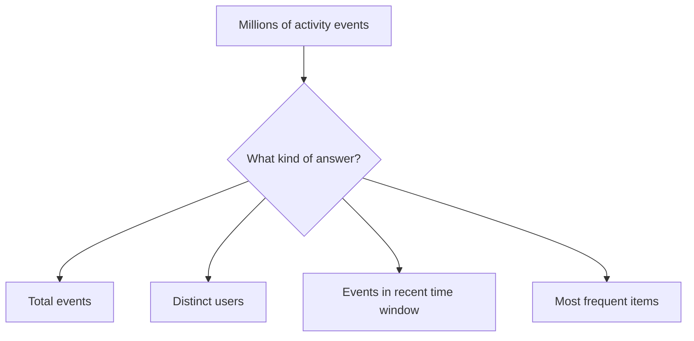

**Memory trick:** Before designing the counter, ask **what**, **how exact**, **over which window**, and **how fresh**.

---

## 2. The lost-update race condition

Suppose a counter has value **100**. Two API servers read it at the same time. Each calculates 101 and writes that number. Two views occurred, but the final count is **101 instead of 102**.

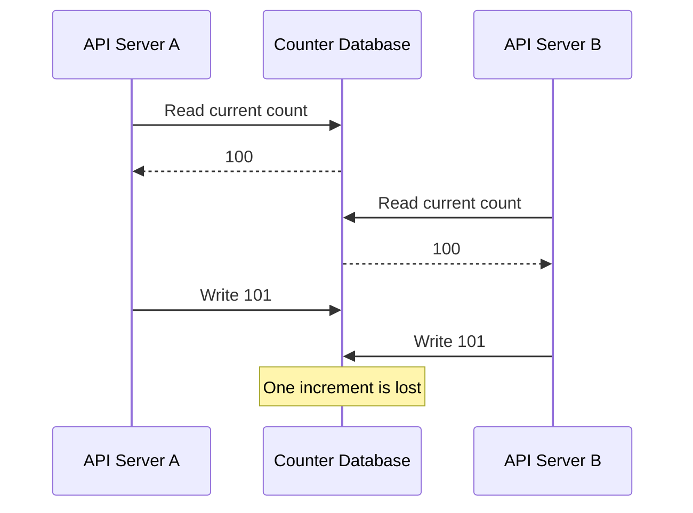

This is a **read-modify-write race**. It can occur even if the two servers execute correct-looking code.

Avoid this pattern:

```text
count = read(video_id)
count = count + 1
write(video_id, count)
```

Use a database atomic increment or properly synchronized transaction instead.

---

## 3. Atomic increments fix correctness, not hot-key throughput

A relational database can increment within one statement:

```sql
UPDATE video_stats
SET views = views + 1
WHERE video_id = 42;
```

Competing updates are handled atomically by the database. No application instance first reads an old count and then overwrites another increment.

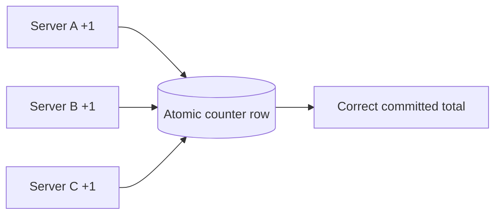

**The next bottleneck:** If one video receives tens of thousands of updates per second, every increment targets the **same logical row**. Locking or serialization, WAL traffic and storage throughput can limit scale.

Use atomic SQL counters when load is modest. Scale out the write path when **one key becomes hot**.

---

## 4. Redis INCR for fast live counters

Redis offers an atomic increment command:

```text
INCR video:42:views
```

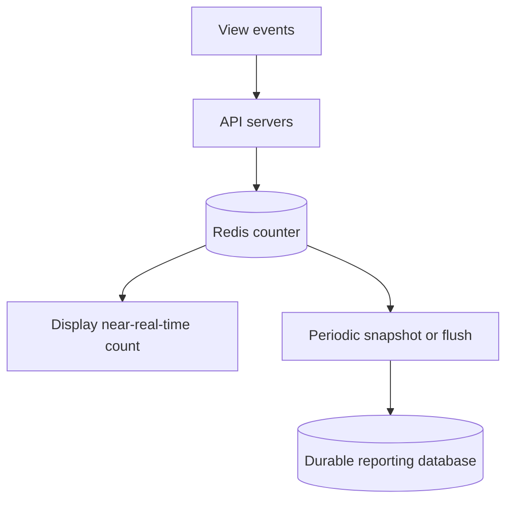

This is attractive for **high-throughput, low-latency counters** whose recent updates can tolerate the selected durability model.

**Caution:** Redis is not automatically a lossless event ledger. Persistence, failover and asynchronous replication settings affect how many recently acknowledged increments might disappear after failure.

Also, writing a Redis counter and a relational database separately can cause double counting or lost deltas if the flusher crashes. A durable event log or careful checkpointed delta/snapshot protocol is needed when precision matters.

---

## 5. Sharded counters remove a single hot key

If `video:42:views` overwhelms one node, divide it into multiple physical keys.

```text
video:42:views:0
video:42:views:1
video:42:views:2
video:42:views:3
```

Each incoming view increments one shard, chosen by a distribution rule. A read sums the shards:

```text
Total = shard0 + shard1 + shard2 + shard3
```

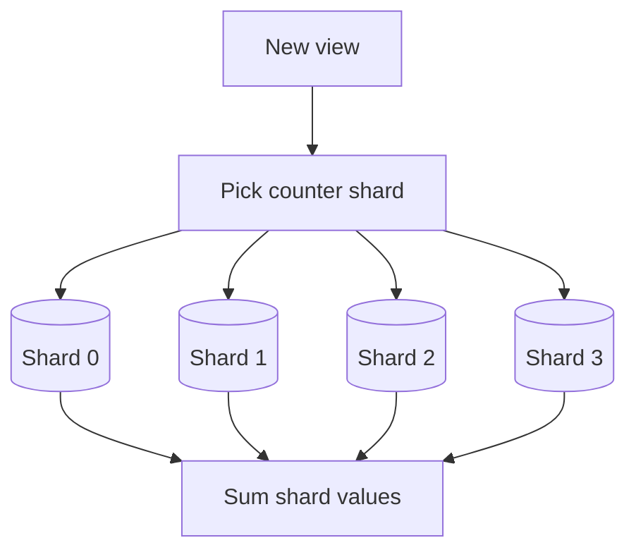

**Why it works:** Instead of every write reaching one key, writes can spread over different partitions or nodes.

**Trade-offs:** Reads now need aggregation, multi-key reads may not form a single exact instant, and a cached total may lag.

**Important detail:** Different Redis keys are not necessarily on different cluster nodes. Ensure hash-slot placement actually distributes the shards; hash tags that force all keys into one slot would defeat the purpose.

---

## 6. Batching many events into fewer updates

Suppose one API server sees **300 views for video A** in one second. Rather than issuing 300 individual database increments, it can accumulate a **delta of +300** and write once.

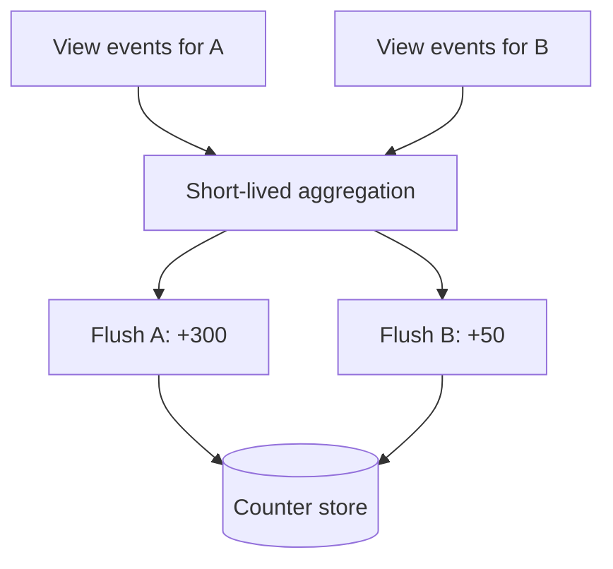

If 1,000 servers each flush at most once per second for a particular video, the database gets at most approximately 1,000 flushes per second for that video, rather than one per original view.

But keeping deltas **only in process memory** risks losing them when a server crashes. For noncritical social metrics, this may be acceptable. For billable counts, persist raw events or durable deltas before acknowledging receipt.

**Trade-off:** Lower write load means some delay in the displayed result.

---

## 7. Durable stream aggregation with Kafka and Flink

For very high volume, send accepted events to a durable stream and compute rolling or tumbling aggregates.

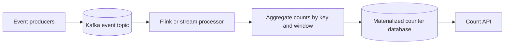

A processor can collect all `video=42` events for a **10-second window**, then update a derived count.

**Partitioning nuance:** Sending every event for one viral video to one partition preserves ordering but can create another hotspot. High-volume designs may use **two-stage aggregation**: shard the event key for parallel partial counts, then combine those partials into the logical total.

**Reliability:** Exactly-once processing guarantees depend on state checkpoints, broker offsets and the sink's transactional or idempotent behavior. Do not assume a stream job makes every external database write exactly once by default.

---

## 8. Calculate the scale of a viral counter

Suppose a video receives **50,000 accepted views per second**.

```text
Per minute = 50,000 × 60 = 3,000,000 views
Per hour   = 50,000 × 3,600 = 180,000,000 views
```

Now suppose you split its counter into **10 evenly loaded shards**:

```text
Average per shard = 50,000 ÷ 10 = 5,000 increments/s
```

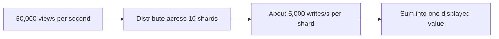

Those numbers are a **capacity illustration**, not a throughput guarantee. Real throughput depends on uneven traffic, network, memory, replication, batching and persistence.

For the data path, measure **peak writes per hot item**, not merely platform-wide average QPS.

---

## 9. Exact counting for money requires event identity

Advertising billing cannot blindly treat every received request as a new billable click. A browser might retry, or a broker might redeliver an event after a worker restart.

Assign each **logical click** a stable event ID. When an event is repeated, the consumer recognizes it as already counted.

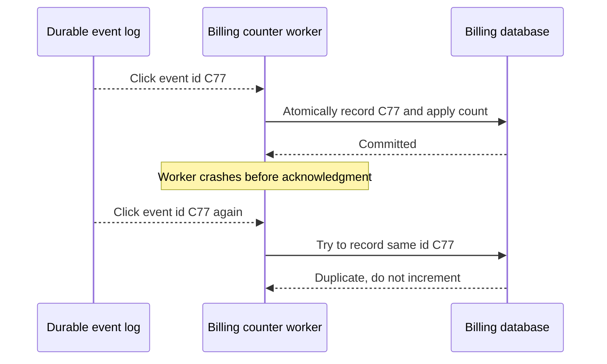

Use a **unique event-ID constraint** or another authoritative deduplication mechanism, ideally committing the dedup record and corresponding count change in the same transaction.

**Key distinction:** A unique event ID helps prevent processing the **same event twice**, but it does not identify fraudulent clicks or two distinct events that business policy considers the same interaction. Eligibility and fraud rules remain separate.

See [Idempotency and Deduplication](Idempotency_and_Deduplication_in_Distributed_Systems.md).

---

## 10. Real-time billing dashboards versus reconciled totals

Financially consequential reporting often uses two paths:

- **Live aggregation:** Fast, recent estimates for operational dashboards.
- **Reconciliation path:** Recompute verified totals from durable, deduplicated raw events according to billing policy.

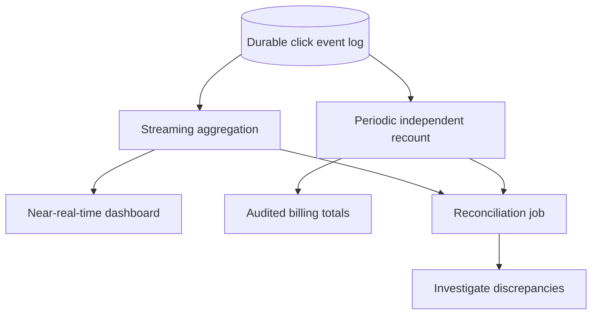

Do not assume that “batch is always correct.” The authoritative total is correct only if the raw input is complete, eligibility rules are applied consistently, and deduplication/reprocessing are valid.

**Interview phrase:** “I would keep a fast display count, but derive invoices from a verifiable source-of-truth event ledger with reconciliation.”

---

## 11. Total events versus distinct users

Two metrics are easy to confuse:

- **Views:** Alice watches five times → count **5** eligible viewing events.
- **Unique viewers:** Alice watches five times → count **1** distinct user over the chosen window.

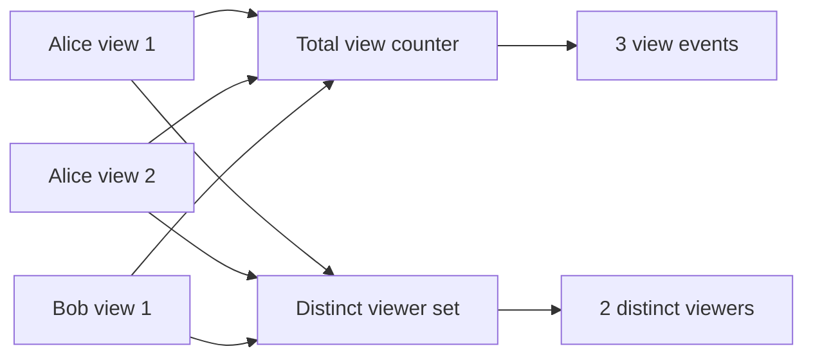

For exact unique counts, use an authoritative **set of distinct IDs** (or a deduplicated relational table), then count the entries.

At huge scale, these exact sets can require substantial storage and memory. That motivates approximate cardinality sketches such as HyperLogLog.

---

## 12. HyperLogLog: estimate unique counts cheaply

**HyperLogLog (HLL)** estimates how many distinct values have been observed. It hashes each value and updates a compact sketch rather than storing the whole list.

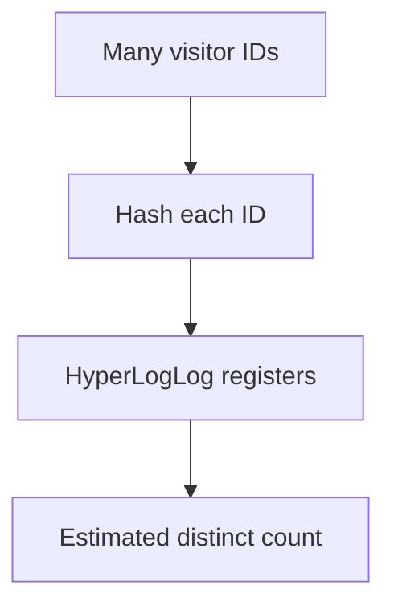

Typical strengths: a small bounded memory footprint, efficient additions and the ability to merge compatible sketches.

Redis HyperLogLog uses around **12 KB** in its dense representation, with standard error around **0.81%** for large cardinalities under typical assumptions. It is still an **estimate**, not an exact count or a guarantee that every result is within 1%.

**Example:** If an estimated count is 50 million, an error of 0.8% corresponds to about 400,000—not negligible for billing, but often acceptable for analytics dashboards.

Never use HLL when exact per-user membership or exact financial totals are required.

---

## 13. Merge distinct-count sketches across regions or days

Suppose data is collected on three application regions. An individual user might visit in two different regions. Adding region-level **unique user totals** would double-count that person.

Instead, merge the compatible HyperLogLog sketches, which approximate the cardinality of the **union**.

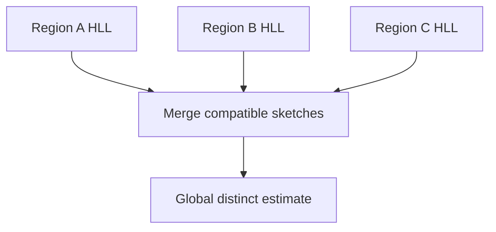

You can also merge daily HLLs to estimate distinct users over a week. But **summing daily distinct counts** is incorrect when users return on multiple days.

Align sketches on hashing scheme, precision and identity definition. If identifiers change unexpectedly between devices or sessions, even a correct HLL cannot infer that two identifiers belong to one person.

---

## 14. Fixed-window counters for rate limiting

A common rate limiter groups events into discrete intervals such as one minute.

```text
rate:user42:10:05  →  80 requests
rate:user42:10:06  →  15 requests
```

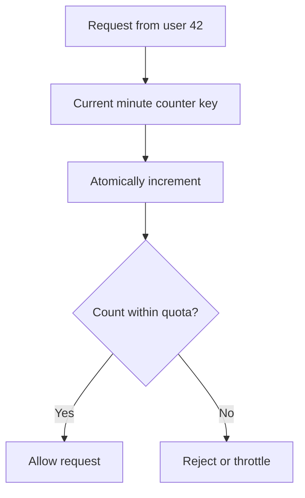

Set a safe expiry that covers the interval and small clock or processing variations. For distributed enforcement, atomic increment-plus-expiry initialization is important: separate commands without safeguards can leave keys without TTL.

**Window-boundary flaw:** A user may send a full minute's quota just before a boundary and again just after, creating a burst over a very short interval.

---

## 15. Sliding-window counters reduce boundary bursts

A **sliding-window counter** approximates traffic over the last fixed duration using counts from the current and previous fixed windows.

Suppose the one-minute limit is 100. At 10:06:15, consider:

```text
Previous minute count = 80
Current minute count  = 20
Fraction of previous minute still in last 60 seconds = 45/60

Estimated sliding count = 80 × 0.75 + 20 = 80
```

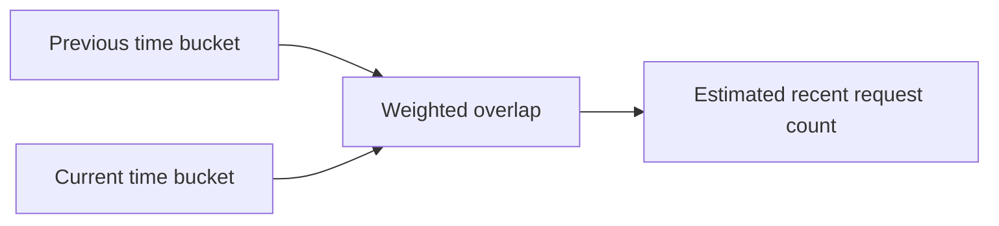

This is an **approximation**, because it assumes a roughly uniform distribution inside the previous bucket.

An exact sliding-window log keeps individual event timestamps but costs more memory and processing. A token-bucket limiter is another useful alternative when controlled bursts are desired.

---

## 16. Time-bucket counts for trending hashtags

To calculate how many times `#Architecture` was used in the last hour, maintain a separate counter for each minute.

```text
#Architecture:10:00 → 20
#Architecture:10:01 → 35
#Architecture:10:02 → 28
...
Last-hour count = sum of latest 60 minute buckets
```

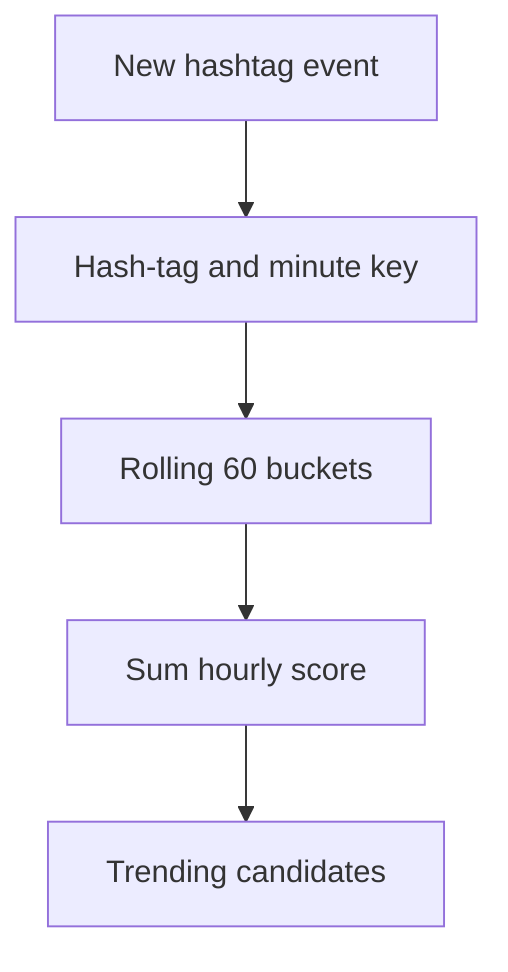

Each minute, a new bucket enters the recent-hour window and an old bucket drops out. Use appropriately defined event timestamps, time zones and late-event behavior so delayed events are handled consistently.

A trending product may also combine frequency with **recent growth**, preventing an always-popular hashtag from crowding out genuine new trends.

---

## 17. Count-Min Sketch: approximate frequency

A **Count-Min Sketch (CMS)** tracks approximate frequencies using a small grid of counters and multiple hash functions.

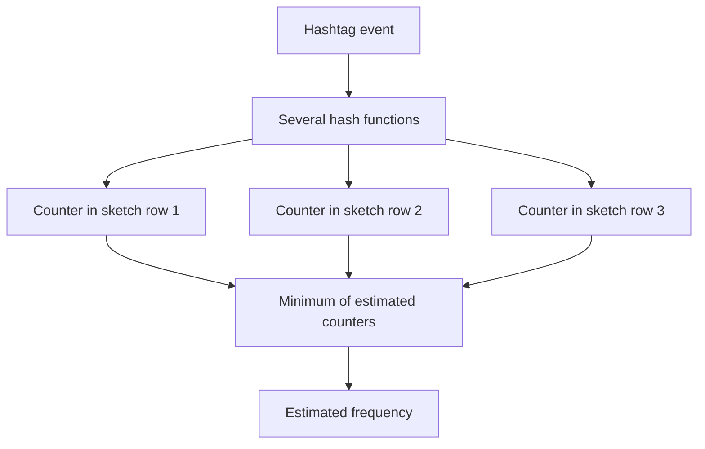

In the usual **insertion-only, nonnegative** setting, hash collisions can make frequency estimates **too high**, but not lower than the true count. The approximation error depends on sketch width, depth and stream size.

**Important correction to a tempting shortcut:** A Count-Min Sketch does **not** by itself enumerate the top hashtags. You need an accompanying **candidate-finding structure** or algorithm. The sketch then helps estimate candidate frequencies.

For finance-grade exact event totals, use durable exact processing rather than CMS.

---

## 18. Find the global top K across workers

If each hashtag is assigned consistently to one worker, each worker can maintain its own exact or approximate frequency map and report its top candidates.

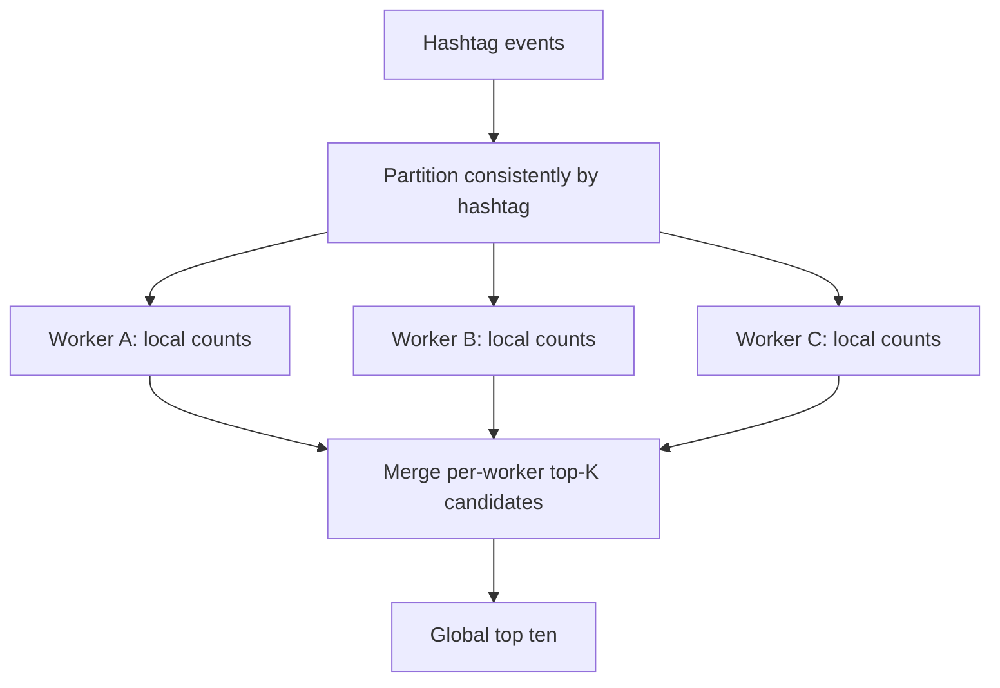

If **each key belongs to exactly one worker**, every globally top-K key must appear in that worker's own top-K (apart from tie-breaking policies). Merging the lists is then sufficient for the top-K result.

If a key is split among workers, the same reasoning **no longer holds** without first combining its partial counts.

**Hot-key trade-off:** Consistent partitioning simplifies correctness but can overload one worker for a viral hashtag. Multi-stage partial aggregation can distribute hot-key load, provided final counts are merged correctly.

---

## 19. Cache, round and present counts to users

A user probably does not need a visible counter to change after every single view.

A social interface may show **1.2M views** while internal systems track a more precise value. This permits short-lived caching and batch updates.


Design separate promises for:

- **Display freshness:** For example, a few seconds of delay may be acceptable.
- **Analytical accuracy:** Suitable error limits and refresh cadence.
- **Billing correctness:** Durable events, deduplication and audit trails.

Formatting is not the same as approximation: `1.2M` may simply be a rounded **display of an exact or near-exact count**.

---

## 20. Failure handling and reconciliation

A realistic counting pipeline must handle repeated messages, consumer crashes, stale aggregates and unexpected traffic spikes.

| Failure mode | Safer design |
|---|---|
| Two servers update same value | Atomic increment |
| One video overwhelms one key | Shard or batch the counter |
| Worker crashes after applying event | Event ID deduplication or transactional sink |
| In-memory batch disappears | Durable input stream or accepted loss policy |
| Redis loses newest increments | Persistence or recover from event log |
| Consumer falls behind | Monitor lag and scale processing |
| Late event belongs to previous window | Watermarks and allowed lateness policy |
| Live total disagrees with audit total | Reconcile and repair derived total |

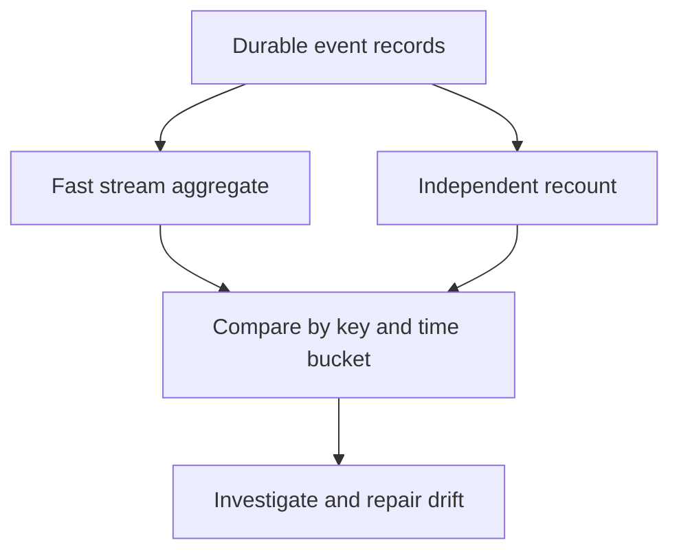

Use metrics such as processing lag, duplicate count, shard skew, missing-event alarms, state checkpoint age and reconciliation mismatch rate.

**Key principle:** A cache or display number is a **materialized view**, not automatically a billing ledger.

---

## 21. End-to-end architecture for a popular video platform

One architecture can provide inexpensive visible view totals and still retain an auditable event path.

```mermaid
flowchart TD
  VIEWERS["Viewer apps"] --> API["Event intake and validation"]
  API --> LOG[("Durable event stream")]
  LOG --> FAST["Streaming batch aggregation"]
  FAST --> SHARDS[("Sharded hot counters")]
  SHARDS --> DISPLAY["Cached display count API"]
  LOG --> HLL["Distinct viewer HyperLogLog"]
  HLL --> ANALYTICS["Approximate unique-viewer dashboard"]
  LOG --> BATCH["Independent validated recount"]
  BATCH --> AUDIT[("Audited reporting store")]
```

**Walkthrough:** Validate an eligible event, persist the accepted event durably if accuracy requires it, update the near-real-time counter asynchronously, and expose a possibly stale rounded count. Build separate approximate distinct-user dashboards from HLL. Recount durable events periodically for authoritative reports.

Remember: defining **what qualifies as a legitimate view** is a business and abuse-prevention policy, not something solved by `INCR`.

---

## 22. Which counting technique should you choose?

| Requirement | Good starting approach | Limitation |
|---|---|---|
| Low-volume exact counter | Atomic SQL update | Hot-row contention at high volume |
| High-throughput display count | Redis atomic counter | Durability policy |
| Extremely hot single key | Sharded counter | Read aggregation |
| Huge durable event volume | Kafka + stream aggregation | Pipeline complexity and lag |
| Exact billable clicks | Stable IDs + authoritative deduplication + replay | Storage and reconciliation cost |
| Approximate unique visitors | HyperLogLog | Statistical error |
| Rate limit per minute | Fixed/sliding window counters | Boundary or estimation trade-off |
| Trending top hashtags | Time buckets + top-K candidates, possibly CMS | Time/window and approximate ranking behavior |

```mermaid
flowchart TD
  NEED["What must be counted?"] --> DISTINCT{"Distinct users?"}
  DISTINCT -->|"Yes, approximate allowed"| HLL["HyperLogLog"]
  DISTINCT -->|"No"| EXACT{"Exact financial or audit requirement?"}
  EXACT -->|"Yes"| LEDGER["Durable event log and deduplication"]
  EXACT -->|"No"| HOT{"Very high write rate?"}
  HOT -->|"Yes"| SHARD["Sharding or streaming batches"]
  HOT -->|"No"| SIMPLE["Atomic SQL or Redis counter"]
```

**Rule:** Choose the smallest design that meets the specific correctness, freshness and scale requirements. Different counters inside the same product can use different architectures.

---

## 23. Interview walkthrough: counting views and billable clicks

A clear system design answer follows this order:

1. **Clarify semantics:** Count every event or distinct users? Exact or approximate? All time or a moving window?
2. **Estimate hot-spot volume:** Average and peak events for the most popular key.
3. **Protect correctness:** Atomic updates instead of read-modify-write.
4. **Choose throughput strategy:** Redis, sharded counters, batching or a streaming pipeline.
5. **Handle duplicates:** Event IDs and transactional/idempotent processing where exactness matters.
6. **Discuss specialized sketches:** HyperLogLog for unique cardinality; Count-Min Sketch plus candidates for frequencies.
7. **Specify windows:** Fixed buckets, sliding approximation, late-event policy.
8. **Define output:** Stale rounded display or auditable exact report?
9. **Design recovery:** Replay, durable state, monitoring and reconciliation.

```mermaid
flowchart TD
  START["Count semantics and precision"] --> SCALE["Volume and hot keys"]
  SCALE --> ARCH["Counter / stream architecture"]
  ARCH --> SAFE["Deduplication and durability"]
  SAFE --> WINDOW["Windows and sketches"]
  WINDOW --> UI["Display or billing result"]
  UI --> VERIFY["Reconciliation and monitoring"]
```

### Interview-ready answer

**“For public video-view counts, I would accept events through a scalable ingestion path, aggregate them in a stream processor, and keep read-friendly materialized counters. I would shard extremely popular keys and cache display totals briefly. For unique viewers I'd use HyperLogLog if approximation is acceptable. For billable ad clicks I'd persist raw eligible events with stable IDs, deduplicate exact business effects and reconcile independently.”**

---

## 24. Interview questions and one-minute cheat sheet

### Practice questions

1. Why can a naive read-plus-write lose counter increments?
2. Does an atomic SQL increment solve hot-row throughput?
3. How does Redis `INCR` work and what durability risks remain?
4. Why can a single hot counter overload a distributed Redis cluster?
5. How do sharded counters change the read/write trade-off?
6. When is batching better than sending one write per event?
7. Why might partitioning every view by video ID create a Kafka hotspot?
8. How do you protect exact billable counts from redelivery?
9. Where do stream-processing exactly-once guarantees stop?
10. Why retain raw events for reconciliation?
11. What is the difference between total views and unique viewers?
12. How does HyperLogLog reduce distinct-count memory?
13. Why should HLL sketches be merged rather than distinct totals added?
14. What is the fixed-window boundary problem?
15. How does a sliding-window counter approximate the last minute?
16. How do minute buckets support hourly trending?
17. What can Count-Min Sketch overestimate?
18. Why does CMS need a candidate algorithm for top-K queries?
19. Under which assumptions can local top-K lists produce global top-K?
20. Why separate rounded display totals from billing totals?

### Quick revision

| Term | Remember |
|---|---|
| Atomic increment | One safe concurrent counter update |
| Hot key | One key receives excessive write traffic |
| Sharded counter | Sum several physical counters |
| Batching | Combine many events into fewer writes |
| Stream aggregation | Continuously produce grouped materialized counts |
| Event ID | Stable logical event identity for deduplication |
| HyperLogLog | Approximate count of distinct items |
| Count-Min Sketch | Approximate frequency, usually overestimates |
| Fixed window | Count within discrete time buckets |
| Sliding window | Estimate or track a moving time interval |
| Top-K | Most frequent K items |
| Reconciliation | Compare live results with authoritative recount |

**Final takeaway:** **Counting at scale is not one algorithm.** Decide whether you need exactness, distinctness, recency and freshness, then choose atomic counters, shards, streams or approximate sketches accordingly.

---
