# Data Synchronization, Change Data Capture and Reconciliation — Explained Simply

*Distributed Systems Study Library · Author: Jayesh Sharma*

**Learn how PostgreSQL, Redis, Elasticsearch, warehouses and offline devices stay synchronized—and how to recover when copies disagree.**

> These are independently authored educational notes based on the user-provided transcript. The prose, examples, comparisons and Mermaid diagrams are new. Supplementary technical details distinguish typical designs from guarantees that depend on a database, broker or connector.

## Contents

- [1. Why is the same data stored in multiple places?](#1-why-is-the-same-data-stored-in-multiple-places)
- [2. One source of truth and derived copies](#2-one-source-of-truth-and-derived-copies)
- [3. The naive method: dual writes](#3-the-naive-method-dual-writes)
- [4. An overlooked dual-write bug: updates arrive out of order](#4-an-overlooked-dual-write-bug-updates-arrive-out-of-order)
- [5. Transactional outbox: make change publication durable](#5-transactional-outbox-make-change-publication-durable)
- [6. Change Data Capture (CDC): read committed database changes](#6-change-data-capture-cdc-read-committed-database-changes)
- [7. CDC versus transactional outbox](#7-cdc-versus-transactional-outbox)
- [8. A full product-search synchronization architecture](#8-a-full-product-search-synchronization-architecture)
- [9. Correct ordering in Kafka and other streams](#9-correct-ordering-in-kafka-and-other-streams)
- [10. Duplicate delivery and idempotent projection](#10-duplicate-delivery-and-idempotent-projection)
- [11. Eventual consistency and synchronization lag](#11-eventual-consistency-and-synchronization-lag)
- [12. Read-your-own-writes user experience](#12-read-your-own-writes-user-experience)
- [13. Bootstrapping new copies with snapshot plus change stream](#13-bootstrapping-new-copies-with-snapshot-plus-change-stream)
- [14. Rebuild a search index without downtime](#14-rebuild-a-search-index-without-downtime)
- [15. Reconciliation: correct silent drift](#15-reconciliation-correct-silent-drift)
- [16. Detect and respond to CDC failures](#16-detect-and-respond-to-cdc-failures)
- [17. Offline device synchronization](#17-offline-device-synchronization)
- [18. CDC versus offline sync: do not confuse them](#18-cdc-versus-offline-sync-do-not-confuse-them)
- [19. System design interview framework](#19-system-design-interview-framework)
- [20. Common pitfalls and revision sheet](#20-common-pitfalls-and-revision-sheet)

---

## 1. Why is the same data stored in multiple places?

Imagine changing the price of a laptop in an online store. That price might be present in a **PostgreSQL product database**, an **Elasticsearch search index**, a **Redis cache**, and a reporting warehouse.

Each copy has a different purpose:

| System | Why the copy exists |
|---|---|
| Primary database | Reliable business updates and transactional rules |
| Search index | Full-text matching, relevance and filtering |
| Cache | Fast responses for popular requests |
| Data warehouse | Analytical reporting on large datasets |
| User devices | Offline access and local editing |

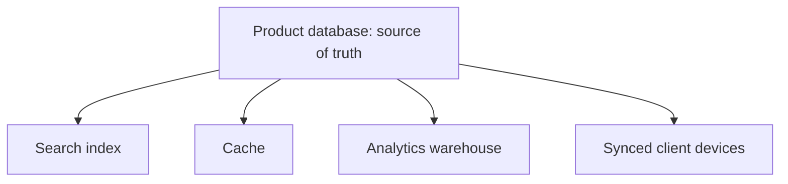

**The challenge:** Once the primary record changes, how do all other copies learn about it correctly? Different tools specialize in different workloads, so duplication is often **intentional**, not a mistake.

---

## 2. One source of truth and derived copies

A **source of truth** is the authoritative location for a particular piece of information.

In our example, the Product Service owns the canonical price. The search index is a **derived view**, not another independent authority that can silently overwrite it.

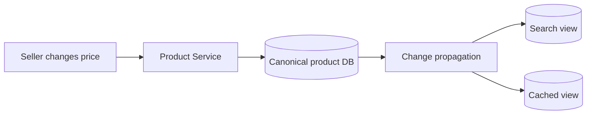

**Simple analogy:** The database is the original school register. Search and cache are photocopies prepared for different purposes.

This ownership is usually **per data domain**, not one global database for the whole organization. The Order Service may own orders while the Customer Service owns customer profiles.

Useful consequences: derived views can be **reconstructed**, inconsistencies can be identified, and consumers know which system takes precedence.

---

## 3. The naive method: dual writes

The first idea is to make application code write both systems:

```text
1. UPDATE products SET price = 25 WHERE id = 42
2. UPDATE search index product 42 price = 25
```

It looks simple, but the two writes belong to different systems, so they cannot normally commit as one local database transaction.

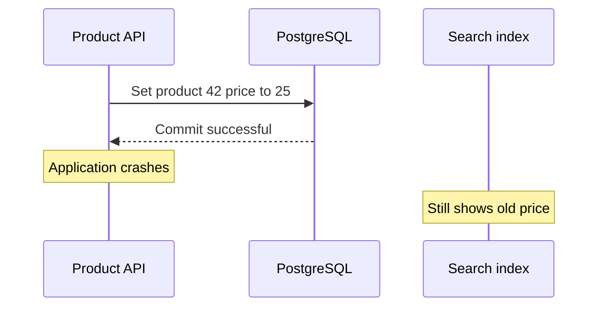

A second possibility is that the index is unavailable while the database update succeeds. Reversing the order of the two operations only creates a **different failure window**.

**Lesson:** “Write to the database, then send to the index” is not reliable enough without durable recovery.

---

## 4. An overlooked dual-write bug: updates arrive out of order

Two administrators edit the same record in quick succession:

- Update A sets the price to **₹2,000**.
- Update B sets the price to **₹2,500**.
- The primary database commits A and then B, so **₹2,500 is current**.
- Network delays cause the search index to apply B and then A, leaving **₹2,000** in search.

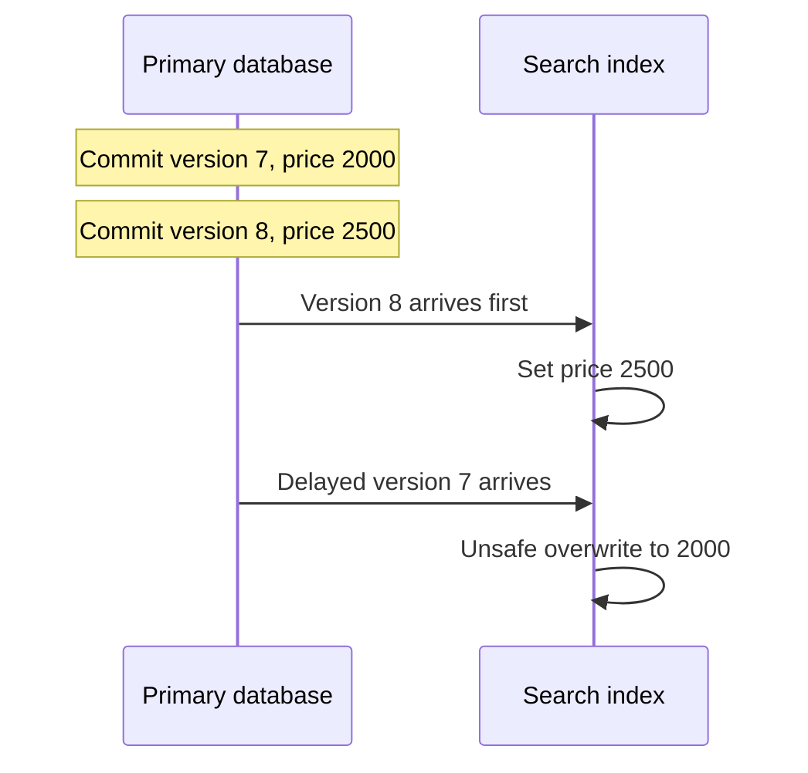

A copied value can now remain wrong indefinitely until another edit triggers a refresh.

**Better rule:** Carry a monotonic record version and apply a change only when it is newer than the destination's recorded version. You still need a reliable change source and a plan for missing versions.

---

## 5. Transactional outbox: make change publication durable

A **transactional outbox** records the business update and its corresponding event **in the same local transaction**.

The application does not directly make a network call to update Elasticsearch as part of the database transaction.

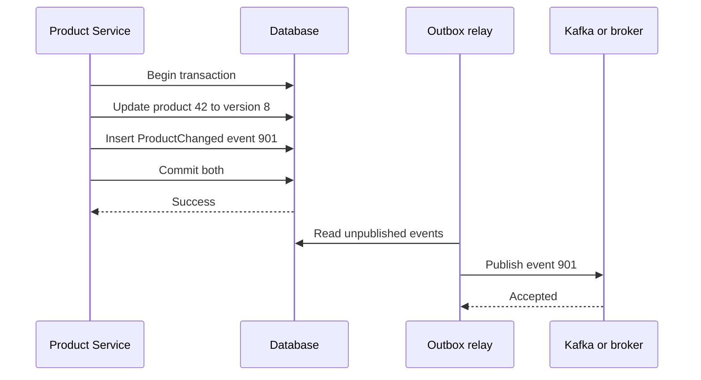

The outbox could contain:

```json
{
  "eventId": "evt_901",
  "aggregateId": "product_42",
  "version": 8,
  "type": "ProductPriceChanged",
  "newPrice": 2500
}
```

If the application crashes after the transaction, the event remains stored for later delivery. If the transaction fails, neither the change nor its event exists.

**Crucial caveat:** The relay may publish and then crash before marking an event as sent. Therefore **duplicate publication is possible**, and consumers must be idempotent.

---

## 6. Change Data Capture (CDC): read committed database changes

**Change Data Capture (CDC)** observes changes made to an authoritative database and makes them available to other systems.

Log-based CDC often reads database change logs:

- **PostgreSQL:** Write-ahead log (WAL), exposed to suitable CDC connectors through logical decoding.
- **MySQL:** Binary log (binlog), when configured appropriately.
- **Debezium:** An example connector ecosystem that can publish captured changes into streaming infrastructure.

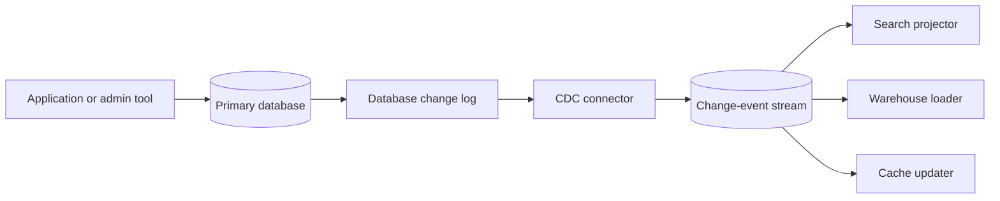

Because the change is captured from the database itself, changes made by supported scripts or administrative tools can also be observed, **provided the connector covers the affected tables and operations**.

**Important:** CDC records often reflect physical table changes; consuming services can become coupled to schema details, unlike carefully designed business events.

---

## 7. CDC versus transactional outbox

Both patterns can reduce unreliable independent writes, but they represent different things.

| Question | Transactional outbox | Log-based CDC |
|---|---|---|
| Who defines the event? | Application inserts an explicit event | Connector observes database changes |
| What changes are captured? | Changes with corresponding outbox entries | Changes from configured capture scope |
| Typical event meaning | Business-oriented | Often row-oriented |
| Additional code | Outbox write in local transaction | Connector configuration and operations |
| Risks | Omitted events, relay retries | Schema coupling, log retention, connector recovery |

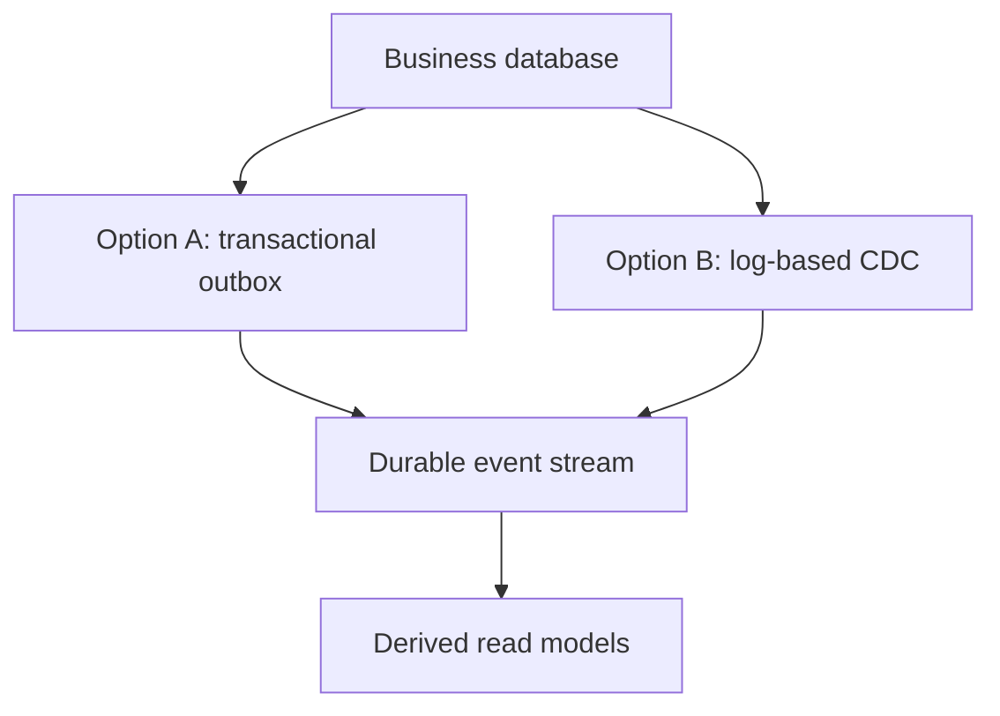

These ideas can also be **combined**: application transactions insert business events in an outbox table, and CDC reads that table instead of a polling relay.

Neither approach automatically guarantees end-to-end exactly-once effects across independent destinations. Consumers still need deduplication and recovery.

---

## 8. A full product-search synchronization architecture

Consider a product catalog where search results must reflect primary database changes.

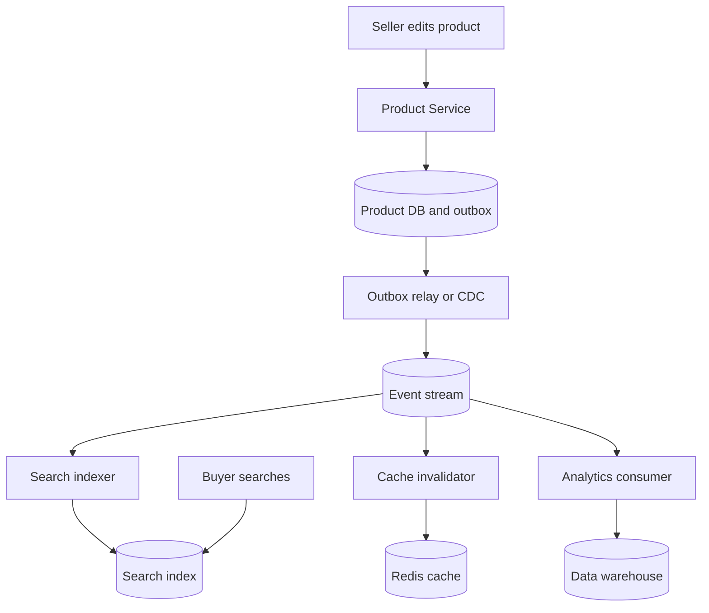

**Step by step:**

1. Seller changes a product; the database commits a new version.
2. A reliable change mechanism publishes the committed event.
3. The search indexer updates the matching document.
4. Cache consumers invalidate or replace older entries.
5. The reporting pipeline consumes the event independently.
6. Shoppers see the new value after the appropriate projection catches up.

This is a common application of **CQRS read models**: the authoritative write store remains separate from optimized query stores.

---

## 9. Correct ordering in Kafka and other streams

Suppose product 42 has versions 7, 8 and 9. The destination must not end with version 7 after version 9 has been applied.

In Kafka, a typical technique is to use **product ID as the partition key** so the related events enter the same partition.

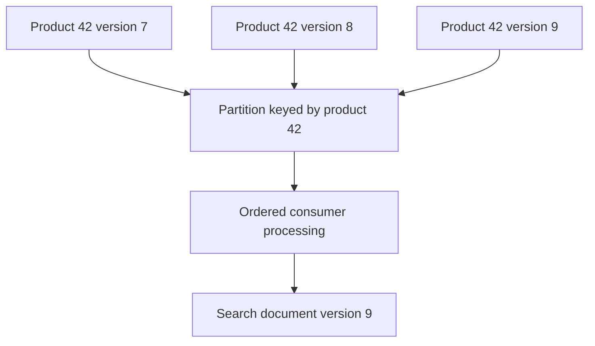

Kafka orders messages **within a partition**, not across an entire topic. Producers must also preserve the intended source order. Sending different versions concurrently through independent producer flows can undermine ordering assumptions.

**Defense in depth:** Store each target document's most recently applied **source version**. Reject events with an equal or older version using an atomic or version-checked update.

For example:

```text
Current index version = 9
Incoming event version = 8
Action = ignore stale update
```

When updates are delivered from multiple independent data sources, a single integer version may not be meaningful without coordinated ownership.

---

## 10. Duplicate delivery and idempotent projection

Consumers can crash after applying an update but before acknowledging the stream offset. The event then arrives again.

Rather than publishing `increase price by 500`, use a change describing the resulting state such as `price is now 2500 at version 8`, when this fits the domain.

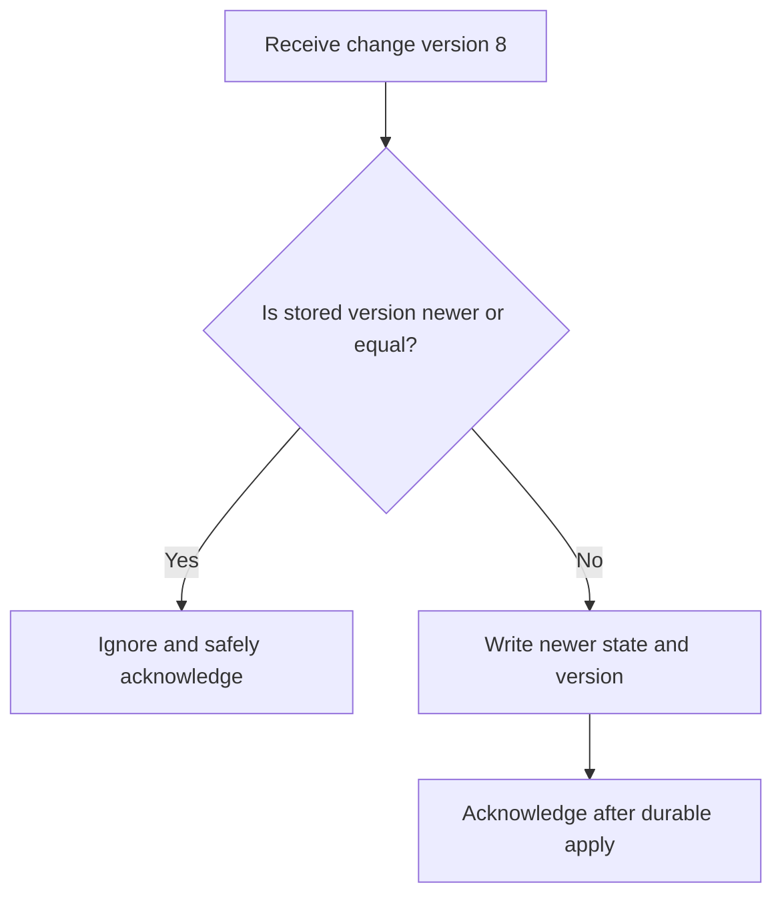

The source version and target update need to be applied with suitable atomicity; otherwise concurrent consumers can both decide an event is new.

More on retry safety: [Idempotency and Deduplication](Idempotency_and_Deduplication_in_Distributed_Systems.md).

---

## 11. Eventual consistency and synchronization lag

With an asynchronous pipeline, the authoritative database and search index can temporarily disagree.

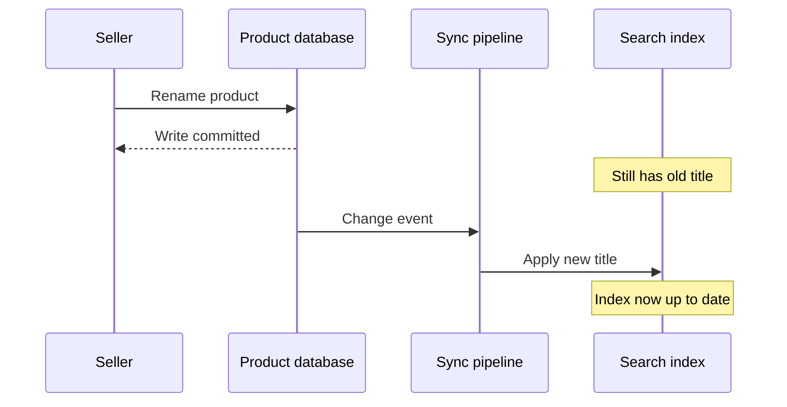

This is **eventual consistency**: under appropriate conditions and with successful delivery, derived copies converge toward the source.

Lag may be short in healthy conditions, but it can grow significantly during incidents, backfills or consumer outages. It should be a **measured SLO**, not a universal promise of “a few seconds.”

Different features tolerate different lag. Search freshness may allow delay; payment confirmation should use authoritative business state.

---

## 12. Read-your-own-writes user experience

A seller updates the product title and immediately searches for it. The search index is behind, so the seller thinks the save failed.

Solutions include:

- Show the accepted new value from the write response in the seller's management screen.
- Read the authoritative database for the seller's own details page.
- Display an indexing status or a message that search visibility may take time.
- For stronger guarantees, wait for or verify a particular indexed version before claiming search readiness.

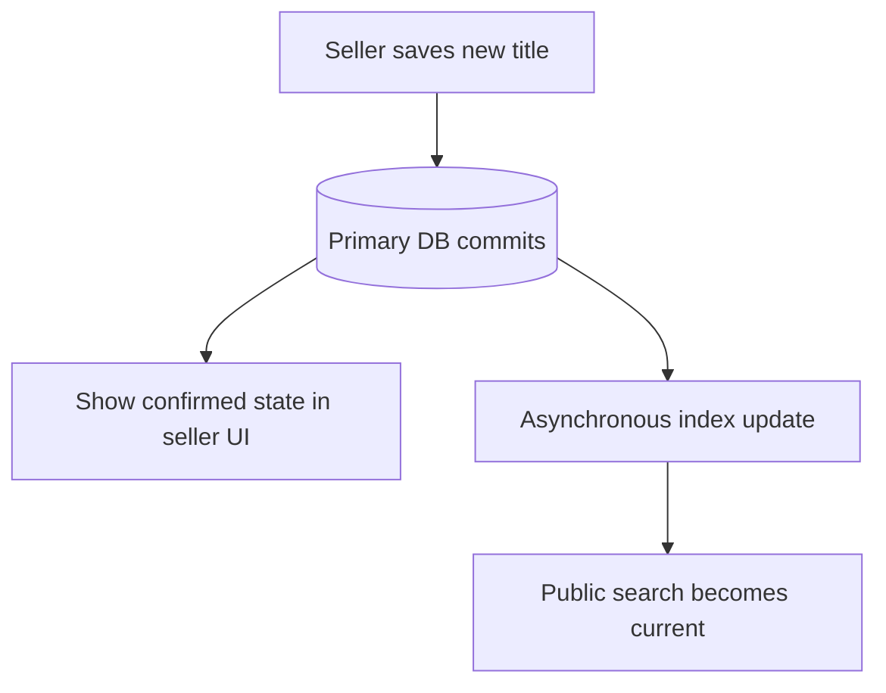

**Important distinction:** The user seeing their own committed changes in an **authoritative screen** does not guarantee that all other derived search results are already synchronized.

---

## 13. Bootstrapping new copies with snapshot plus change stream

CDC can report ongoing changes, but a new search index also needs millions of records **already present before the connector started**.

A safe bootstrap combines:

1. A **consistent snapshot** of existing records.
2. A source log position or comparable checkpoint associated with the snapshot.
3. Continuous replay of changes from the appropriate point.
4. Progress tracking until the derived store catches up.

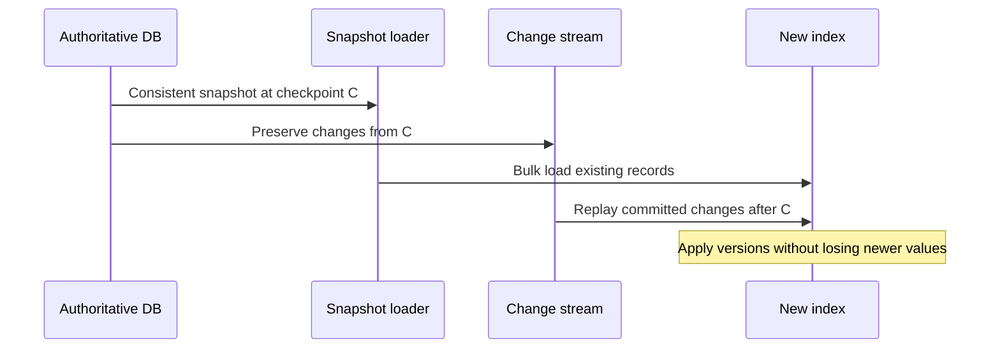

**Hard race condition:** If change events are not captured from the correct checkpoint, updates made while the snapshot is being copied can be **missed**. If both snapshot rows and stream events describe the same record, version-aware idempotency prevents incorrect overwrites.

Production CDC products may offer integrated snapshots, but correct semantics depend on connector configuration and database capabilities.

---

## 14. Rebuild a search index without downtime

Suppose your search schema changes. Rebuilding the currently serving index in place may interrupt queries or create mixed document formats.

An alternative is a **blue-green index rollout**:

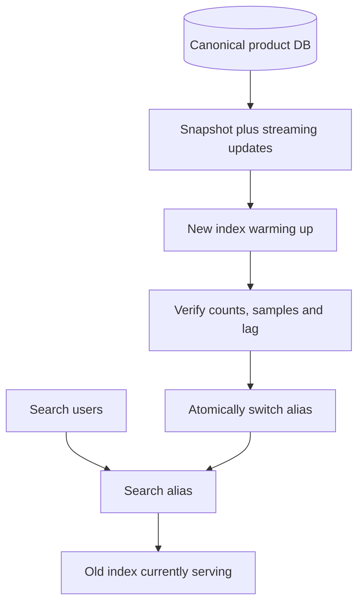

**Process:** Build a new index, apply its initial snapshot, replay changes, check projection correctness and catch-up, then switch the query alias when ready. Keep the old index briefly for rollback if appropriate.

Deleting the previous index immediately removes an easy rollback option. Plan the cutover and retention policy deliberately.

---

## 15. Reconciliation: correct silent drift

Even a good pipeline can become inconsistent because of bugs, accidental direct writes, missed events or incorrect transformations.

**Reconciliation** regularly compares each derived system against the authoritative store and repairs differences.

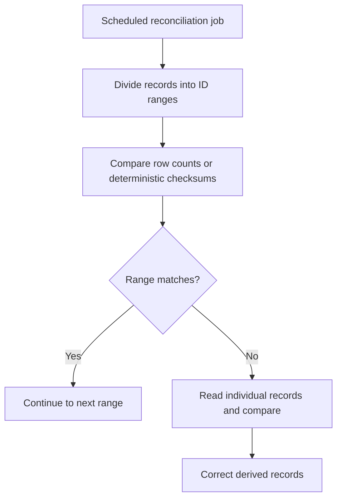

A common optimization is comparing **counts and hashes per partition or range** rather than loading every record every time.

**Nuance:** Simple counts are not enough to prove equality. Checksums are useful only when both sides normalize and order comparable data the same way. Eventual consistency can create temporary mismatches, so reconciliation needs a snapshot or watermark policy to avoid repeatedly “repairing” healthy in-flight updates.

For financial or compliance-sensitive domains, reconciliation is often a key operational control.

---

## 16. Detect and respond to CDC failures

A reliable synchronization pipeline must expose failure symptoms before users notice.

| Metric | What it tells you |
|---|---|
| CDC connector uptime | Whether changes are being captured |
| Database log retention / slot lag | Whether the source can continue retaining unread changes |
| Broker backlog and consumer lag | How far destinations are behind |
| Oldest unapplied event age | User-visible staleness risk |
| Projection failures / dead letters | Records needing repair |
| Version conflict or stale-event count | Ordering and duplicate behavior |
| Reconciliation mismatch rate | Long-term correctness of copies |
| Backfill completion checkpoint | Whether a replacement index can be promoted |

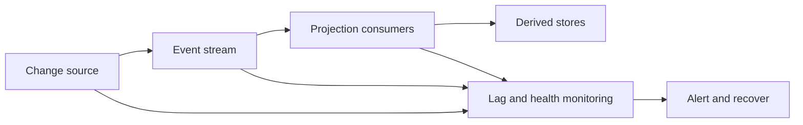

Depending on the source database, a stalled CDC reader can cause change-log retention or replication-slot growth. Monitor disk and retention limits as part of connector health.

A replay plan should include **offset recovery, consumer idempotency and rebuilding from authoritative data** when the event history no longer covers the outage.

---

## 17. Offline device synchronization

A notes app has a different kind of synchronization problem. A phone and laptop may each edit a document while disconnected.

Each device tracks a **last synchronized revision or cursor**. On reconnect it can upload local changes and request server changes since that revision.

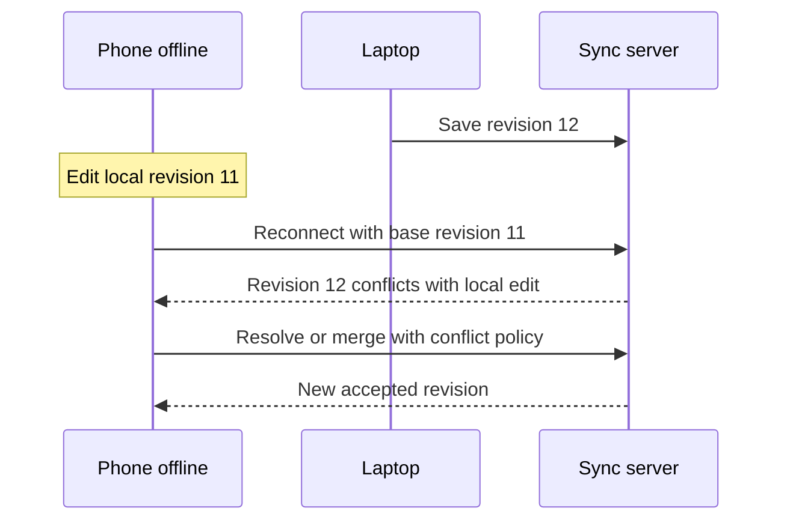

The most difficult case is **concurrent edits to the same information**.

Possible strategies:

- **Last-write-wins:** Easy, but a competing edit may disappear.
- **Conflict copies:** Preserve both versions so users can resolve them.
- **Application-specific merge:** Combine nonconflicting field updates.
- **Collaborative algorithms:** OT or CRDT-based designs may support automatic convergence for appropriate editing models.

Offline sync needs more than a download endpoint: define version tracking, conflict resolution, tombstones for deletes and durable local retry behavior.

---

## 18. CDC versus offline sync: do not confuse them

Both move changes, but their operating assumptions differ.

| Aspect | Database-to-index CDC | Offline device sync |
|---|---|---|
| Source | Authoritative database log | Local device and server edits |
| Typical writer model | One authoritative database for the entity | Multiple devices may change same document |
| Main transport | Log connector and event stream | Client-server sync protocol |
| Common correctness issue | Missing, repeated or reordered projection changes | Concurrent edits and conflict merging |
| Recovery | Rebuild snapshot plus replay | Base revisions, merge and catch-up |

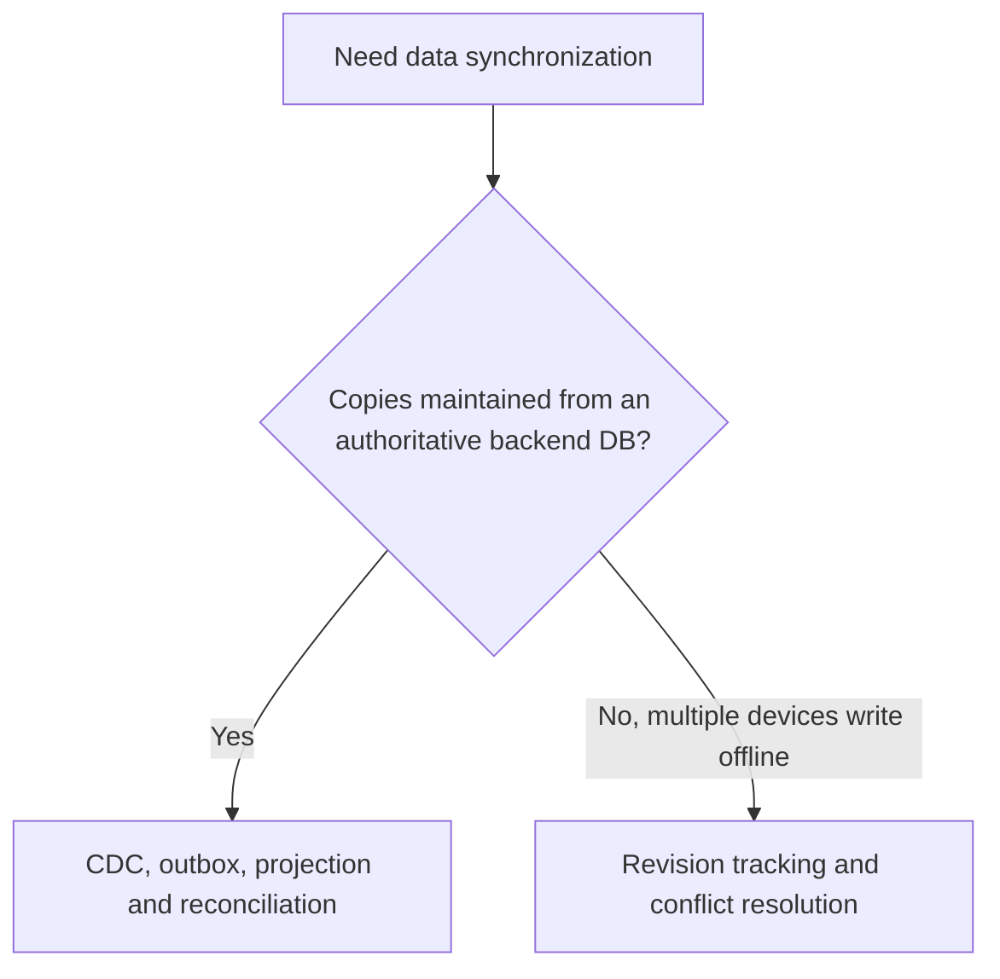

In a larger product you may use **both** approaches: mobile devices synchronize with a service, and the service publishes canonical changes into search and analytics views.

---

## 19. System design interview framework

For questions about keeping PostgreSQL, Elasticsearch, Redis and analytics in sync, explain the design in this order:

1. **Map copies:** Which systems contain the same logical data?
2. **Assign ownership:** Who is authoritative for each field or entity?
3. **Explain dual-write failures:** Crashes and reordered updates.
4. **Choose propagation:** Transactional outbox, CDC or their combination.
5. **Specify consumer safety:** Partitioning, versions and deduplication.
6. **Define freshness:** What lag is acceptable, and when must users read canonical state?
7. **Bootstrap and rebuild:** Snapshot plus change stream with a safe checkpoint.
8. **Reconcile:** Detect silent mismatches and repair them.
9. **Observe:** Connector health, stream lag, failures and backfill state.

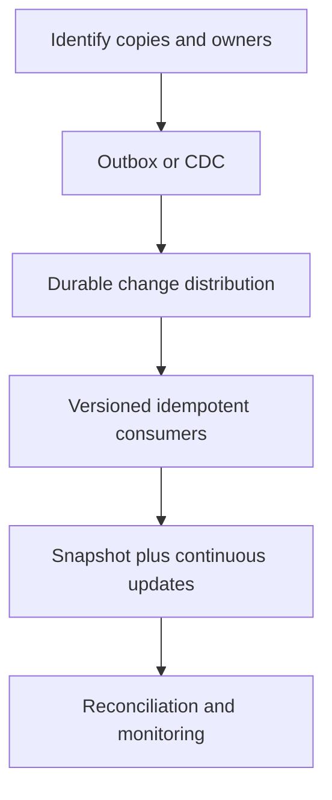

### Example interview response

**“The Product Service owns product prices in PostgreSQL. I would publish committed changes through a transactional outbox and a CDC connector into Kafka. Search and cache projection services consume by product ID, apply only newer versions and tolerate redelivery. On rollout, a consistent snapshot plus replay builds the index. I would monitor consumer lag and run reconciliation to detect drift.”**

---

## 20. Common pitfalls and revision sheet

### Frequent mistakes

- Writing to a primary database and a search index independently with no recovery path.
- Assuming a broker guarantees ordering across all partitions.
- Forgetting event IDs or source versions.
- Running a CDC connector without monitoring change-log retention.
- Building a new index from a snapshot while **missing writes made during the snapshot**.
- Treating a derived cache or index as an independent authority.
- Assuming a simple count comparison proves datasets match.
- Silently overwriting offline edits from a different device.

### Interview questions

1. Why is data intentionally copied into search indexes and caches?
2. What is the dual-write problem?
3. How can concurrent updates arrive out of order?
4. How does the transactional outbox close a database-to-event gap?
5. What does CDC read from PostgreSQL or MySQL?
6. How does CDC differ from an application-generated business event?
7. How would you preserve ordering for updates to one product?
8. What makes a consumer idempotent?
9. Why is a seller's search result sometimes stale after editing?
10. How does snapshot-plus-stream backfill prevent missed updates?
11. How would you rebuild an index with no query downtime?
12. What does a reconciliation job compare?
13. What happens when the CDC reader stops for too long?
14. How do offline devices resolve concurrent edits?

### One-minute cheat sheet

| Term | Meaning |
|---|---|
| Source of truth | Authoritative owner for data |
| Derived view | Secondary copy optimized for a use case |
| Dual write | Two independent updates that can partly fail |
| Outbox | Save business change and event atomically in one DB |
| CDC | Capture committed changes from database logs |
| WAL / binlog | Logs used as inputs for change streams |
| Partition key | Groups related events for ordered consumption |
| Record version | Prevents stale updates from overwriting newer ones |
| Eventual consistency | Copies converge after asynchronous delay |
| Snapshot + replay | Bootstrap a complete copy safely |
| Reconciliation | Detect and repair drift |
| Offline sync | Exchange device changes and resolve conflicts |

**Final takeaway:** **Own each piece of business data in one authoritative place, propagate committed changes durably, apply them idempotently, and continually check that derived copies remain correct.**

---
