# Database Scaling, Consistency, Messaging & Resilience

*Distributed Systems Study Library · Author: Jayesh Sharma*

## Contents
- [1. Database scaling](#1-database-scaling)
- [2. Replication and read replicas](#2-replication-and-read-replicas)
- [3. Sharding](#3-sharding)
- [4. Replication vs sharding](#4-replication-vs-sharding)
- [5. Consistency](#5-consistency)
- [6. Message queues and event-driven architecture](#6-message-queues-and-event-driven-architecture)
- [7. Retries and dead-letter queues](#7-retries-and-dead-letter-queues)
- [8. Reliability and resilience](#8-reliability-and-resilience)
- [9. Revision questions](#9-revision-questions)

## 1. Database scaling

**Database scaling** helps a database handle more users, requests and stored data without becoming too slow.

Why scale? More simultaneous reads/writes, increasing data size, slow queries, or CPU/memory/storage limits.

| Approach | Meaning | Shop analogy |
|---|---|---|
| Vertical scaling | Give one database server more CPU, RAM or storage | Make the existing shop bigger |
| Horizontal scaling | Use multiple servers to distribute the workload | Open more shop branches |

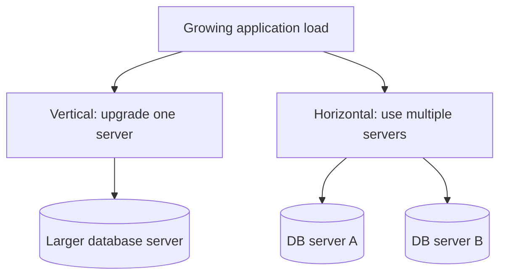

**Remember:** Vertical scaling increases one machine's capacity; horizontal scaling distributes work.

## 2. Replication and read replicas

**Replication** creates copies of the same records on multiple database servers. Updates are sent from one server to other servers; those copies may lag behind briefly.

### Leader–follower architecture

The **leader** accepts writes; **followers** receive copies of those changes and can serve suitable reads. If the leader fails, a follower may be promoted depending on the setup.

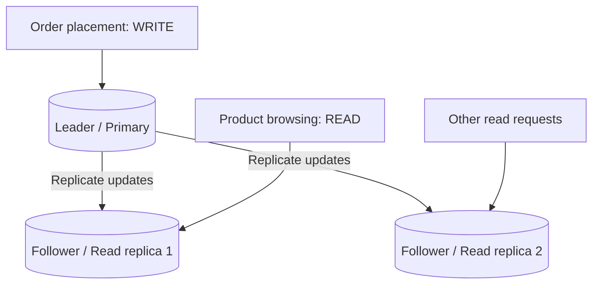

A **read replica** takes read traffic away from the primary. It is useful when reads outnumber writes. Because replication can be delayed, critical immediate reads may need to go to the primary.

**Example:** Place an order through the primary database; browse product details through a read replica.

## 3. Sharding

**Sharding** splits records into different portions called *shards*. Each shard stores only part of the overall data.

For example, customers might be distributed by customer ID:

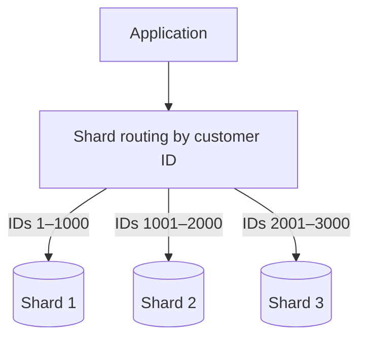

The routing layer must know where to find a given record. The ranges above are illustrative.

**Analogy:** Instead of every shop holding every customer record, each branch handles a portion.

## 4. Replication vs sharding

| Question | Replication | Sharding |
|---|---|---|
| What happens? | Same data is copied | Data is divided |
| Each server holds | Copy of the records | Subset of records |
| Main purpose | Improve read capacity and availability | Spread data and workload |
| Example | Multiple copies of product catalog | Customer records divided by ID |

**You can combine both.** Each shard can have its own replica:

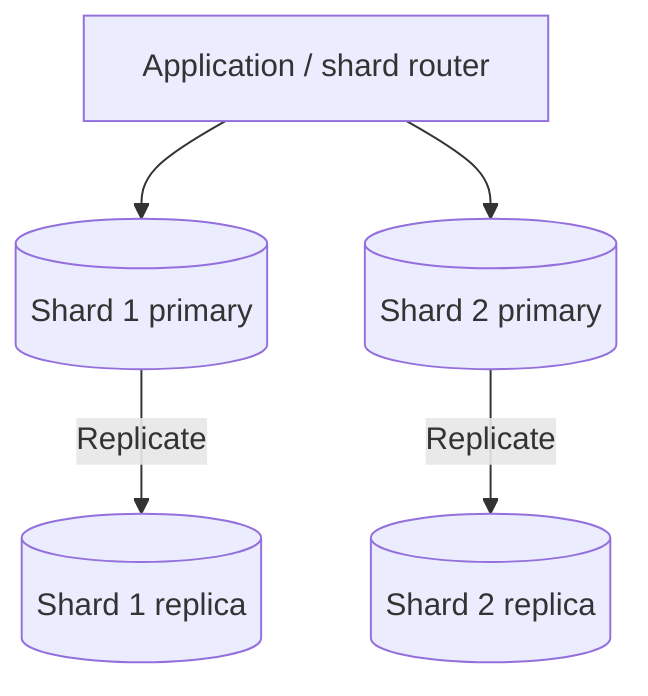

**Key idea:** Replication makes more copies; sharding divides the data.

## 5. Consistency

When data exists on multiple servers, **consistency** describes what users see after updates.

### Strong consistency

After an update succeeds, later reads see the latest confirmed value. This can require coordination across servers.

**Example:** A customer updates a delivery address; a later read returns the new address.

### Eventual consistency

Different copies may temporarily show different values. If updates stop, the copies are expected to converge.

**Example:** A changed profile picture may still look old on one server for a short period. “Eventually” does not specify an exact delay.

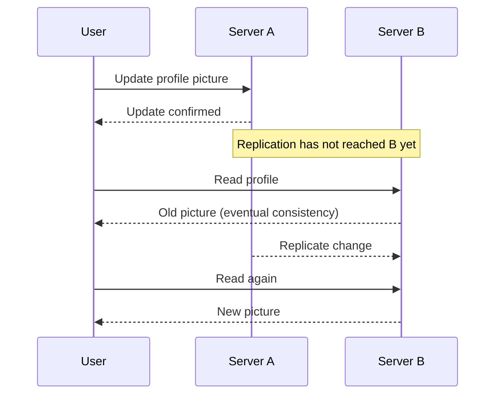

| Aspect | Strong consistency | Eventual consistency |
|---|---|---|
| Read after confirmed update | Latest confirmed value | May temporarily be older |
| Coordination | Typically more coordination | Copies may synchronize later |
| Good fit | Stale data causes serious harm | Short delay is acceptable |

### Where is eventual consistency acceptable?

- Social media like counts
- News feeds
- Product reviews
- DNS changes
- Analytics dashboards

### Where are stronger guarantees important?

- Bank transfers and accurate balances
- Seat bookings, avoiding double allocation
- Inventory checks at checkout
- Confirmed payment status

**Design question:** What happens if a user sees an old value? The impact helps determine the right consistency guarantee.

## 6. Message queues and event-driven architecture

A **message queue** temporarily stores messages between producers and consumers.

- **Producer:** Creates a message.
- **Queue:** Holds the message until processing.
- **Consumer:** Receives, processes and acknowledges it.

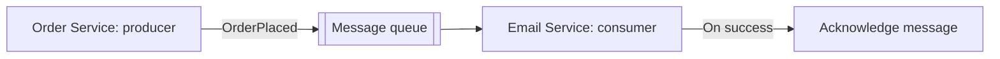

**Example:** An online store accepts an order immediately, while the email service processes the confirmation later.

### Event-driven architecture

An event describes something that has happened. Other services react independently.

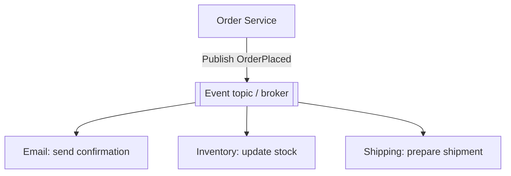

### Queue vs publish/subscribe

| Queue | Pub/Sub |
|---|---|
| Distributes a task to one consumer within a group | Sends an event to each subscribed service/group |
| Useful for background work | Useful when multiple services need the event |
| Example: one worker processes an email task | Example: email, inventory and shipping each react to an order |

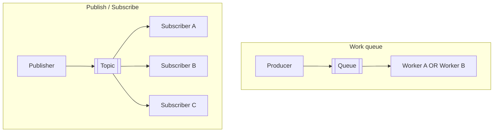

**Remember:** Queues distribute work; pub/sub broadcasts events to interested subscribers.

## 7. Retries and dead-letter queues

A consumer may fail because of a temporary network issue or an unavailable dependency.

**Retry flow:**
1. Consumer receives a message.
2. Processing fails.
3. The system waits and retries.
4. The message succeeds, or the retry limit is reached.

A **Dead Letter Queue (DLQ)** stores messages that continue failing after the allowed attempts. Teams can inspect the message, investigate and decide whether to replay it.

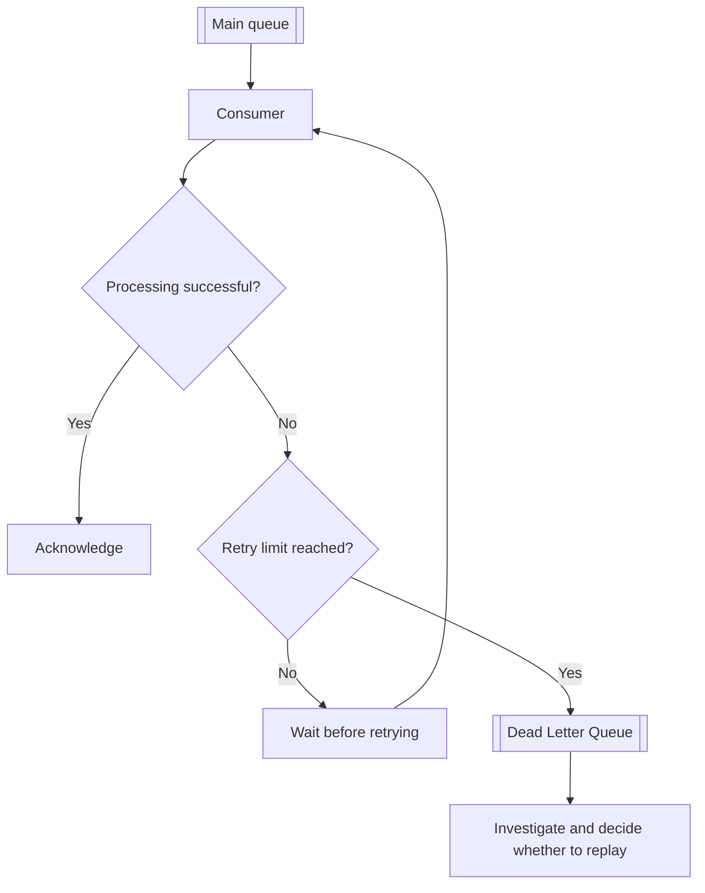

**Reliability note from the presentation:** Messages may be delivered again if acknowledgement is lost. Consumers should handle duplicates safely.

## 8. Reliability and resilience

- **Reliability:** The system works correctly over time.
- **Resilience:** The system handles failures and recovers.

### Single point of failure (SPOF)

A **SPOF** is one component whose failure can stop the entire system. A single database server with no backup is a common example.

### Redundancy and failover

- **Redundancy:** Keep extra healthy components.
- **Failover:** Switch work to a healthy backup after failure.

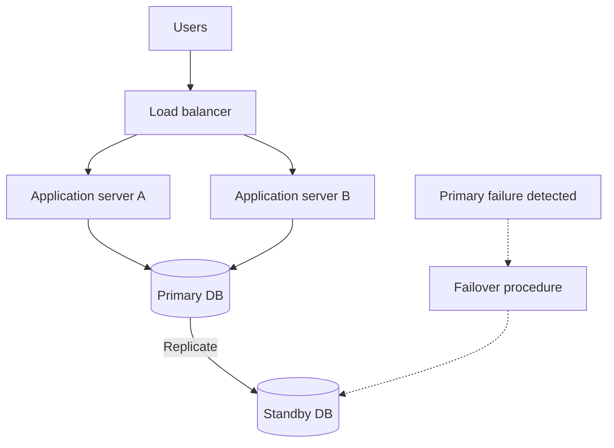

**Analogy:** Redundancy is having a backup; failover is switching to it.

### Timeouts and retries

A **timeout** prevents waiting too long for a response. A **retry** tries again after a failure.

Good practices from the presentation:

- Limit the number of retries.
- Wait before retrying.
- Retry only potentially temporary failures.
- Make repeated requests safe, especially for payments.

### Circuit breaker

A circuit breaker temporarily stops calls to a service that keeps failing.

- **Closed:** Requests flow normally.
- **Open:** Requests are blocked temporarily.
- **Half-open:** Allow a small number of test requests.

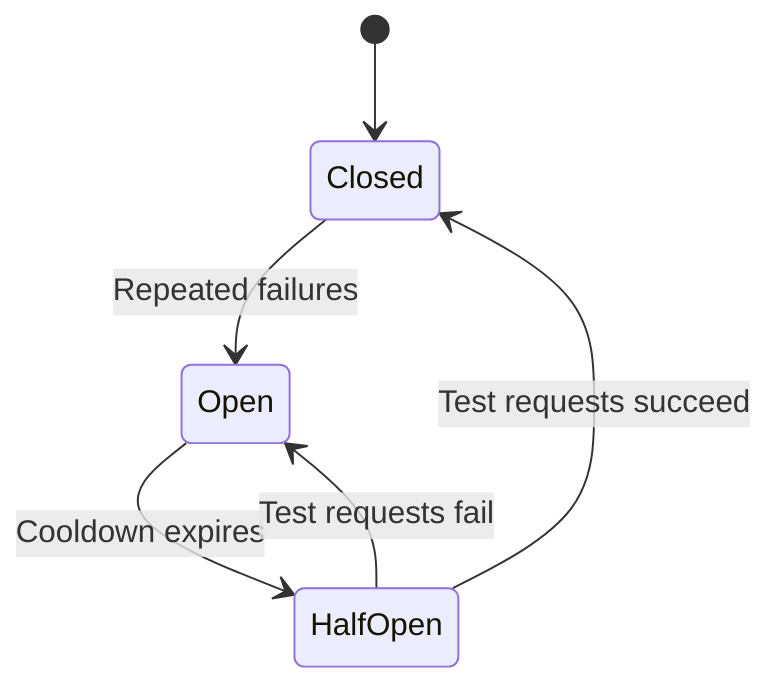

### Putting it together

A resilient service can combine multiple application servers, a standby database, timeouts, bounded retries and a circuit breaker.

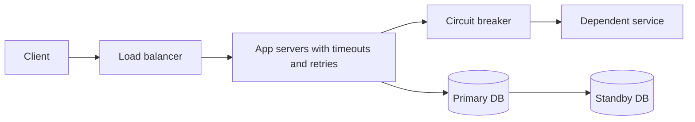

## 9. Revision questions

1. Why do databases need scaling?
2. What is the difference between vertical and horizontal scaling?
3. How do leader–follower replication and read replicas work?
4. How is sharding different from replication?
5. Can each shard also have replicas?
6. How do strong and eventual consistency differ?
7. Where is temporary staleness acceptable?
8. What are producer, queue and consumer?
9. How does pub/sub differ from a work queue?
10. Why do we need retries and a DLQ?
11. What are redundancy and failover?
12. What do closed, open and half-open mean in a circuit breaker?

---
