# Designing Real-Time Updates at Scale — Explained Simply

*Distributed Systems Study Library · Author: Jayesh Sharma*

**A step-by-step system design guide: how millions of users receive chat messages, live scores, location changes and streaming updates reliably.**

> Independently written educational material based on the user-provided real-time updates transcript. Explanations, examples and architecture diagrams are newly composed; additional production considerations are included to make the design practical.

## Contents

- [1. The system-design problem](#1-the-system-design-problem)
- [2. Where do real-time updates appear?](#2-where-do-real-time-updates-appear)
- [3. The big picture: transport versus backend delivery](#3-the-big-picture-transport-versus-backend-delivery)
- [4. Short polling: the easiest starting point](#4-short-polling-the-easiest-starting-point)
- [5. Long polling: wait for an event](#5-long-polling-wait-for-an-event)
- [6. Server-Sent Events (SSE): one-way live streams](#6-server-sent-events-sse-one-way-live-streams)
- [7. WebSockets: two-way messaging](#7-websockets-two-way-messaging)
- [8. Which transport should you choose?](#8-which-transport-should-you-choose)
- [9. Separate the connection tier from business services](#9-separate-the-connection-tier-from-business-services)
- [10. Route an event to the correct gateway](#10-route-an-event-to-the-correct-gateway)
- [11. Use room channels for large shared audiences](#11-use-room-channels-for-large-shared-audiences)
- [12. Never confuse fast delivery with durable delivery](#12-never-confuse-fast-delivery-with-durable-delivery)
- [13. Resume from a cursor after disconnection](#13-resume-from-a-cursor-after-disconnection)
- [14. Prevent reconnect storms](#14-prevent-reconnect-storms)
- [15. Back-of-the-envelope capacity and operations](#15-back-of-the-envelope-capacity-and-operations)
- [16. A simple system-design interview framework](#16-a-simple-system-design-interview-framework)
- [17. Interview questions and one-minute revision](#17-interview-questions-and-one-minute-revision)

---

## 1. The system-design problem

Imagine a chat application. Alice sends a message, and Bob should see it almost immediately. Now imagine **millions of connected people** spread across many servers. We must solve two separate problems:

- **Client delivery:** How does the browser or mobile app receive new information?
- **Backend routing:** How does the event reach the particular server currently connected to its recipient?

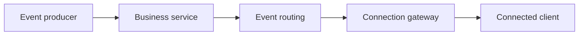

**Memory trick:** Real-time architecture is **transport + routing + recovery**. Fast delivery alone does not guarantee reliable delivery.

---

## 2. Where do real-time updates appear?

| Application | What changes? | Special concern |
|---|---|---|
| Chat | Messages, typing, read receipts | Two-way communication and offline history |
| Delivery tracking | Driver location | Frequent position changes |
| Sports scores | Scoreboard values | Many viewers of one event |
| Collaborative editors | Text and cursor changes | Conflict resolution and ordering |
| Live auctions | Highest bid | Correctness and fairness |
| Ticket booking | Seat availability | Accurate booking state |
| AI responses | Generated text chunks | Progressive display |

These applications all need quick updates, but they **do not all require the same transport or delivery guarantees**. A typing indicator may be disposable, while a payment or accepted bid cannot simply disappear.

---

## 3. The big picture: transport versus backend delivery

Do not jump directly to WebSockets. First decide what kind of information moves between the client and server, and how often.

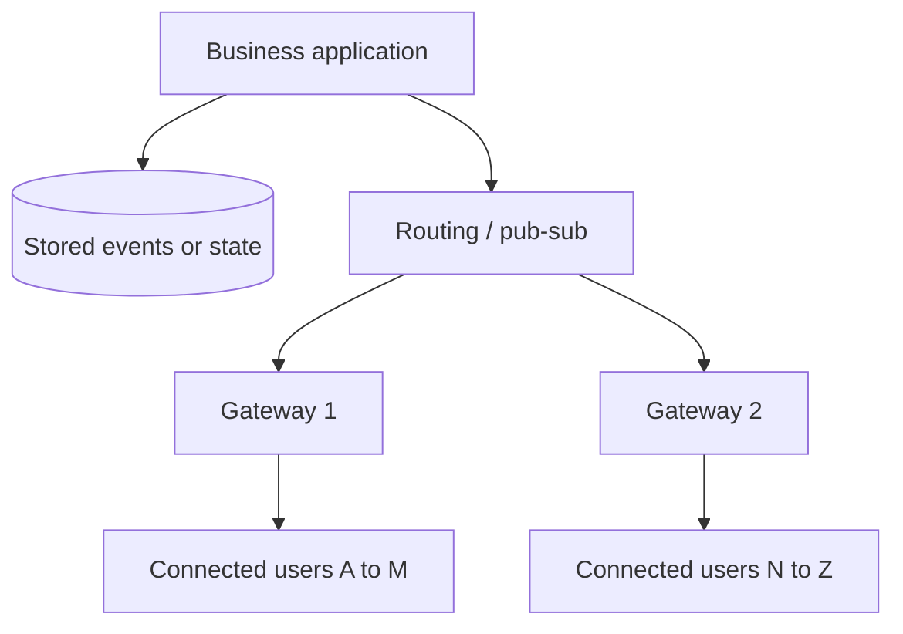

The **business service** creates or stores changes. The **gateway** manages long-lived connections and delivers updates. Keeping these responsibilities separate allows each tier to scale independently.

---

## 4. Short polling: the easiest starting point

With short polling, the client checks for changes every fixed interval.

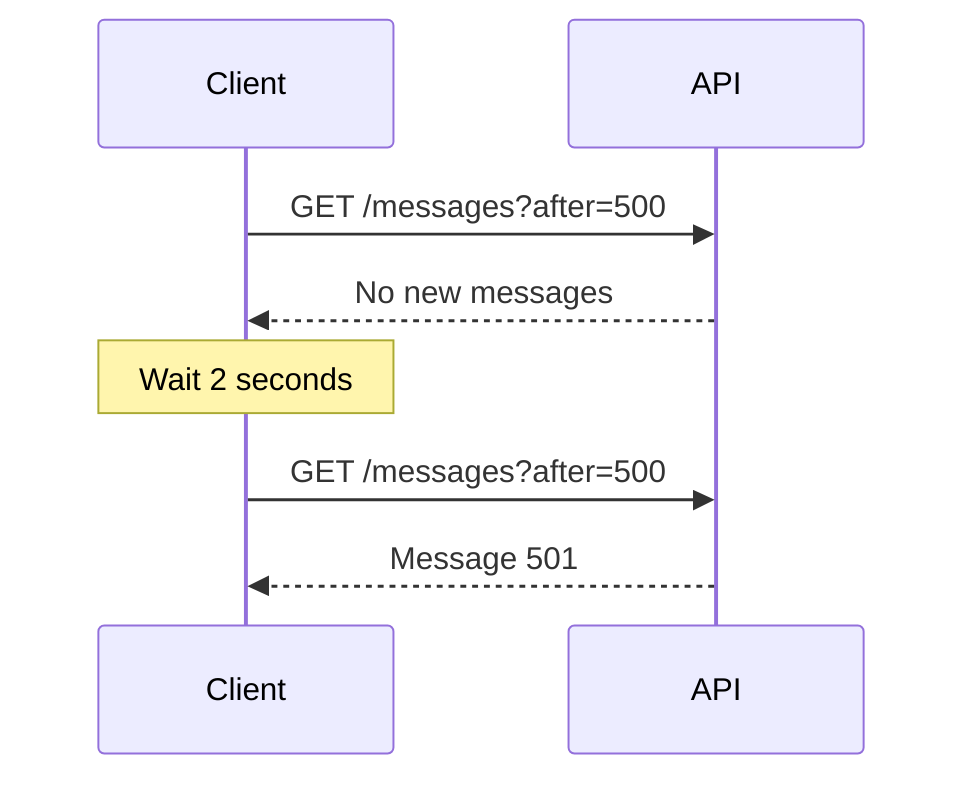

**Capacity example:** One million clients querying once every two seconds generate approximately **500,000 requests per second**, even if most have no new messages.

```text
Requests per second = connected clients / polling interval
1,000,000 / 2 = 500,000 requests per second
```

**Choose this when:** Updates are rare, a small delay is acceptable, and implementation simplicity matters more than request overhead.

---

## 5. Long polling: wait for an event

Long polling uses a normal HTTP request, but the server keeps it open until an update is ready or a timeout occurs.

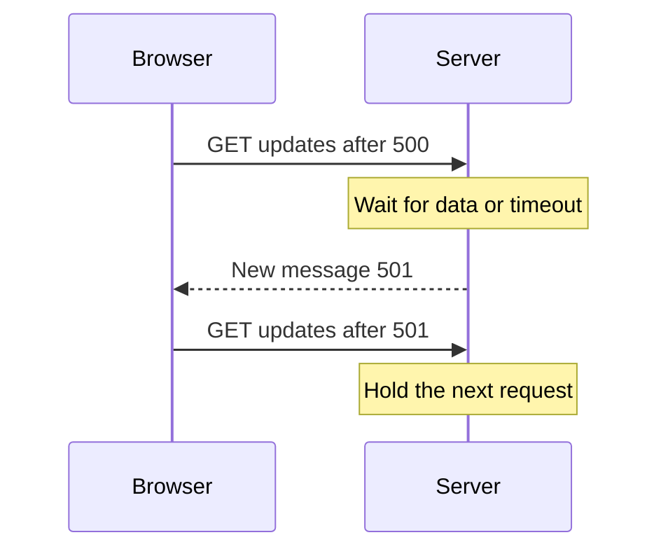

It often reduces empty requests and improves delivery latency compared with frequent short polling. Still, each response closes a request, requiring the client to reconnect.

**Important:** Always provide a **cursor** such as last message ID. Events created during the reconnect gap must be fetchable instead of being lost.

Read more: [Long Polling](Communication_Patterns/Real-Time%20Communication/Long_Polling_Explained.md).

---

## 6. Server-Sent Events (SSE): one-way live streams

With **SSE**, a client makes an HTTP request, and the server keeps the response open to send many updates over time.

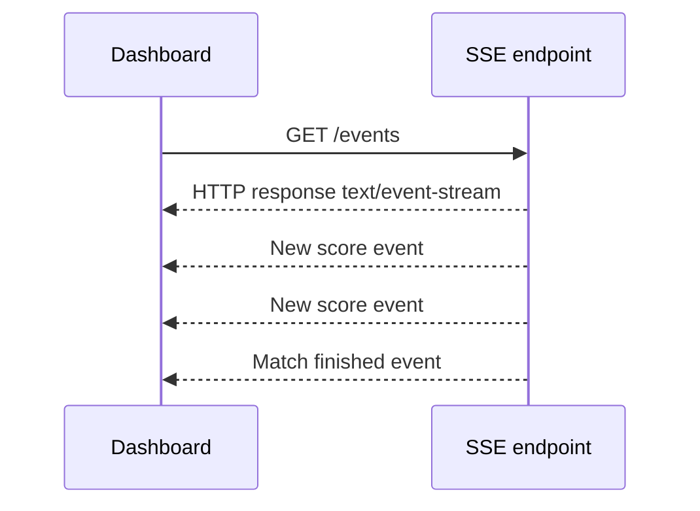

**Best fit:** Notifications, dashboards, live scores and progressive output where the server mainly talks to the client.

SSE is **server-to-client only**. The client can send commands through separate HTTP requests. Browser `EventSource` normally reconnects and can send the last event ID, but replay still requires application-managed history.

**Nuance:** SSE streams contain text, including JSON encoded as text. HTTP/1.1 per-origin connection limits can matter across many tabs; HTTP/2 multiplexing helps when supported.

Read more: [Server-Sent Events](Communication_Patterns/Real-Time%20Communication/Server_Sent_Events_Explained.md).

---

## 7. WebSockets: two-way messaging

A WebSocket maintains an open **full-duplex** channel. Once established, either side can transmit messages independently.

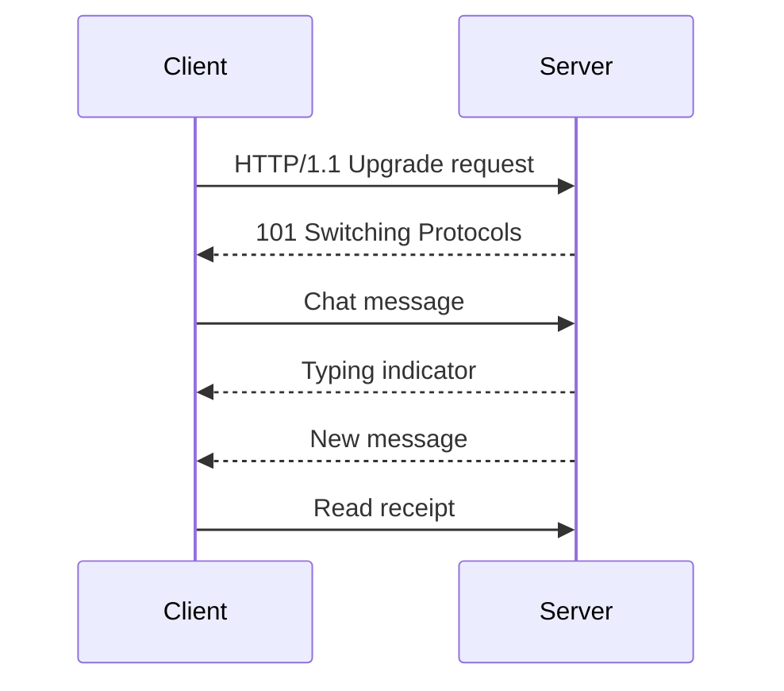

**Best fit:** Interactive chat, multiplayer games and collaboration where both sides exchange frequent updates.

With HTTP/1.1, WebSockets commonly start via Upgrade and a `101` response. HTTP/2 and HTTP/3 use other supported establishment mechanisms. A long-lived WebSocket remains attached to its selected backend while connected.

Read more: [WebSockets](Communication_Patterns/Real-Time%20Communication/WebSockets_Explained.md).

---

## 8. Which transport should you choose?

| Requirement | Typical starting choice | Why |
|---|---|---|
| Refresh job status every minute | Short polling | Very simple |
| Occasional quick notification | Long polling or SSE | Low latency without two-way messaging |
| Continuous dashboard updates | SSE | One-way stream |
| Typing and chat messages in both directions | WebSockets | Full-duplex |
| Browser receives generated AI text | Streaming HTTP or SSE-formatted response | Incremental output |

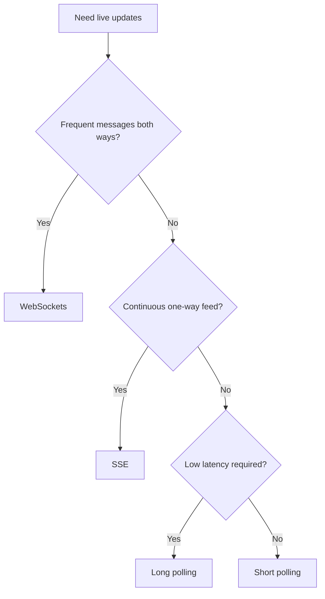

**Interview advice:** Do not say “WebSockets because it is real-time.” State the traffic direction, acceptable latency, number of users, and reliability needs, then justify your choice.

---

## 9. Separate the connection tier from business services

With long-lived connections, application logic and connection handling can have different resource needs.

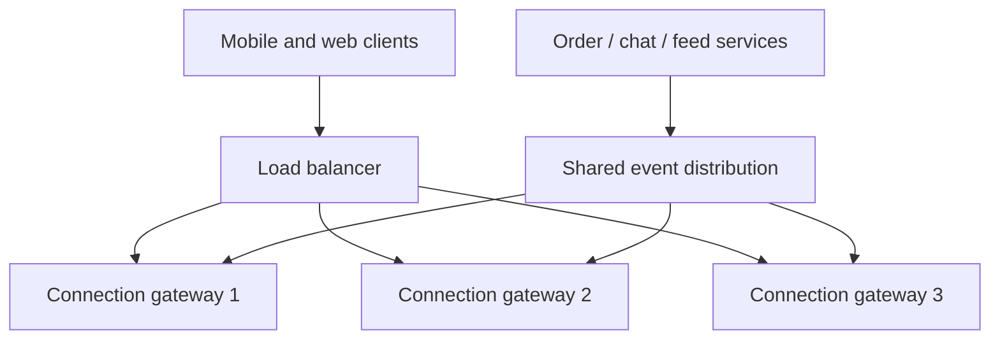

Gateway instances manage connected users, subscriptions, pings and sending. Business services validate commands, update databases and produce events. This keeps **connection count** and **business workload** independently scalable.

A server may support tens of thousands of sockets when well tuned, but capacity varies widely with message rate, payload size, TLS, memory, and infrastructure.

---

## 10. Route an event to the correct gateway

Suppose Alice is connected to gateway 1 and Bob to gateway 7. Alice sends a message, but gateway 1 does not own Bob's socket.

**Option A: Connection registry.** Store a map such as `user-B → gateway-7` in shared fast storage. Look up the destination and send or publish directly to its gateway.

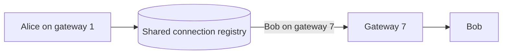

**Option B: Pub/Sub.** The gateway handling Bob subscribes to Bob's channel or to a room channel. Producers publish notifications, and the subscribed gateway pushes them to its clients.

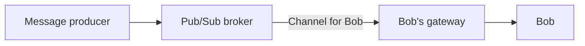

**Trade-off:** Registries offer targeted routing but require accurate connection ownership and expiry. Pub/Sub simplifies fan-out but requires careful subscription management and may distribute events unnecessarily if used broadly.

Users can have **multiple devices or tabs**, so connection mapping may be one-to-many.

---

## 11. Use room channels for large shared audiences

For a sports match, many viewers want the same score updates. Publishing separately for every viewer can be inefficient.

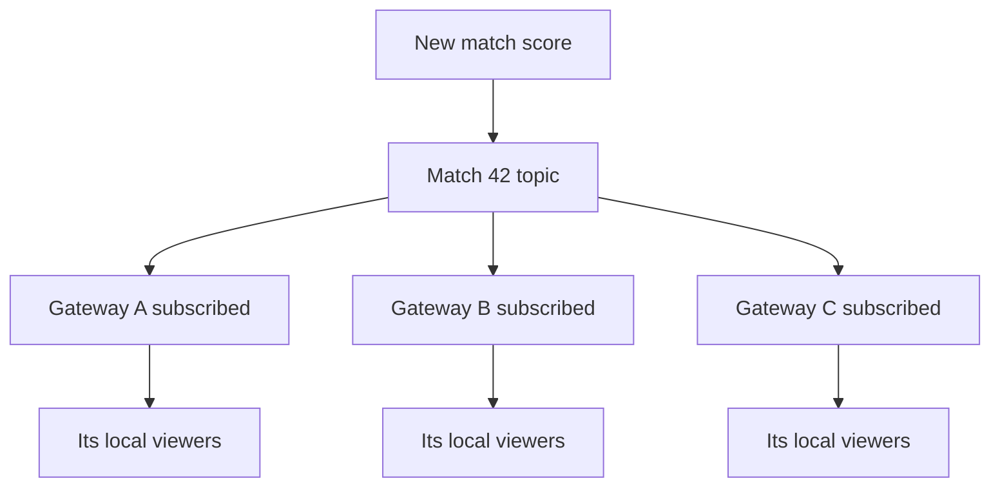

Each gateway subscribes once for a match or room if it has connected viewers. It fans out locally to those users.

**Nuance:** Pub/Sub transport alone does not provide every application's required persistence, access control, exact ordering, or replay guarantees.

---

## 12. Never confuse fast delivery with durable delivery

If a client disconnects while a notification is sent, a transient Pub/Sub message might be missed permanently.

For important events, keep a **durable source of truth**, such as message history or an ordered event log, before attempting live fan-out.

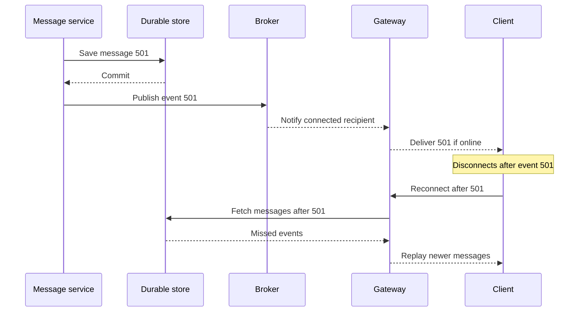

**Important reliability detail:** A database commit followed by broker publication can fail between operations. A **transactional outbox** or a comparable durable publication mechanism prevents committed changes from silently losing their notification.

---

## 13. Resume from a cursor after disconnection

A mobile phone moves from Wi-Fi to mobile data. Its old WebSocket breaks and the client reconnects through another gateway.

The reconnect request includes the last processed sequence or cursor:

```text
Last confirmed message: 700
Reconnect request:      Give me messages after 700
Database returns:       701, 702, 703
Client applies:         701, 702, 703
```

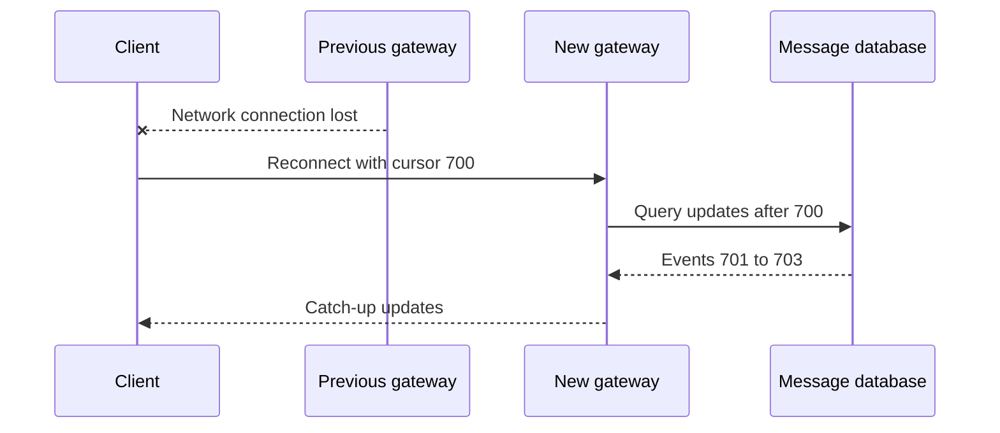

A cursor must make sense within its stream or entity. Ordering across several independent partitions can require a more sophisticated resume token.

**Correctness:** Clients should handle duplicates idempotently and avoid a race between fetching history and subscribing to live updates.

---

## 14. Prevent reconnect storms

Suppose a gateway handling **50,000 users** crashes. All 50,000 clients may attempt to reconnect immediately, overloading the surviving gateways and the message-history database.

Use **exponential backoff with jitter**:

```text
Attempt 1: random wait from 0 to 1 second
Attempt 2: random wait from 0 to 2 seconds
Attempt 3: random wait from 0 to 4 seconds
Attempt 4: random wait from 0 to 8 seconds
Keep a sensible maximum delay
```

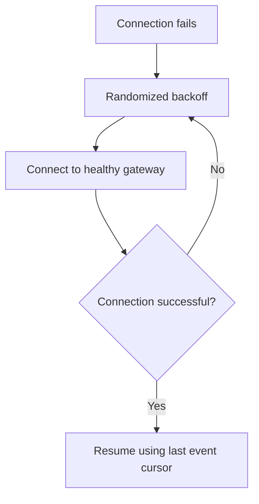

Also consider **connection draining** during deployments, limited reconnect concurrency and monitoring spikes in authentication and history fetches.

---

## 15. Back-of-the-envelope capacity and operations

Suppose you expect **10 million concurrent users**.

A purely illustrative assumption is **50,000 concurrent connections per gateway**:

```text
10,000,000 users / 50,000 connections per server = 200 servers
```

That is a **minimum illustrative division**, not a production server count. You need room for failures, deployments, uneven load, message throughput and geographic distribution.

Capacity planning should account for:

| Metric | Why it matters |
|---|---|
| Concurrent connections | Sockets, file descriptors and memory |
| Messages per second | CPU, network and broker throughput |
| Average/peak event size | Bandwidth and outbound buffering |
| Fan-out factor | One event may reach many viewers |
| Reconnect rate | Gateway and authentication pressure |
| Replay backlog | Database read capacity |
| p95/p99 delivery latency | User experience under load |

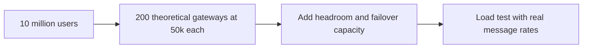

**Rule:** Benchmark on your own hardware and infrastructure rather than relying on a generic “connections per server” number.

---

## 16. A simple system-design interview framework

When asked to design WhatsApp notifications, live sports scores, collaborative editing or location updates, follow this sequence:

1. **Clarify requirements:** One-way or two-way data? How fresh must it be? How many users? Must missed updates be replayed?
2. **Choose transport:** Short polling, long polling, SSE or WebSocket. Explain why.
3. **Separate tiers:** Business services create events; gateways manage connected users.
4. **Explain routing:** Registry, user/room Pub/Sub channels, or another suitable delivery design.
5. **Explain correctness:** Durable storage, event IDs, ordering, acknowledgments, idempotency and recovery.
6. **Plan failure handling:** Backoff, jitter, heartbeats, reconnection and draining.
7. **Estimate scale:** Connections, bandwidth, events per second, fan-out, storage and availability.

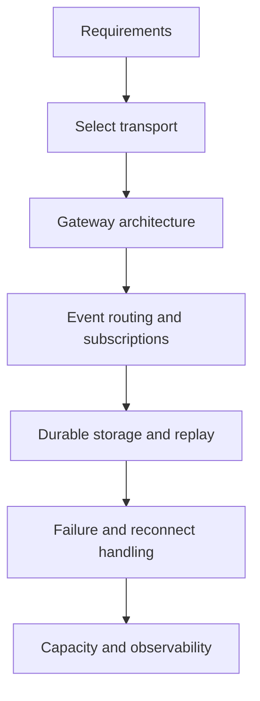

### Example interview explanation

**“For a live football scoreboard, I would use SSE because most traffic flows from the server to viewers. Score services persist changes and publish match events. SSE gateways subscribe to match channels and fan out updates to their connected viewers. Clients reconnect with an event ID, allowing missed changes to be fetched. I would load-test connection count, fan-out and failover behavior.”**

---

## 17. Interview questions and one-minute revision

### Questions to practice

1. Why do real-time applications need more than ordinary request-response HTTP?
2. What are the two main parts of an end-to-end real-time architecture?
3. Compare short polling, long polling, SSE and WebSockets.
4. Why can one million clients polling every two seconds create 500,000 requests per second?
5. When is SSE preferable to WebSockets?
6. What happens when Bob is connected to a different gateway?
7. How do connection registries differ from Pub/Sub?
8. How do you deliver an update to all viewers of a sports match?
9. Why can't Redis Pub/Sub alone recover messages missed offline?
10. Why should important messages be durably persisted before being pushed?
11. What is a cursor or sequence number?
12. How do you avoid missing events during reconnect?
13. Why does a gateway crash create a reconnection storm?
14. What does exponential backoff with jitter achieve?
15. What operational limits matter at 10 million concurrent users?

### Quick reference

| Term | Remember |
|---|---|
| Short polling | Request at regular intervals |
| Long polling | Server holds HTTP request until event or timeout |
| SSE | One-way streaming HTTP response |
| WebSocket | Persistent, two-way channel |
| Connection gateway | Holds live client connections |
| Connection registry | Tracks which gateway owns which client |
| Pub/Sub | Sends events to subscribed gateways |
| Durable history | Keeps updates for disconnected clients |
| Cursor | Indicates last received update |
| Backoff with jitter | Prevents mass synchronized reconnects |
| Transactional outbox | Helps avoid losing a notification after a database commit |

**Final takeaway:** Real-time updates at scale require more than a fast network protocol. First choose the transport, then design event routing, durable history, reconnection and operational scaling. **Fast delivery + correct recovery = a reliable user experience.**

---
