# Distributed Transactions, Two-Phase Commit and Sagas — Explained Simply

*Distributed Systems Study Library · Author: Jayesh Sharma*

**Learn how to coordinate order, payment, inventory, bookings and other cross-service operations without losing consistency when part of a workflow fails.**

> Independently written educational material based on the user-provided distributed-transactions transcript. Explanations, examples, tables and Mermaid diagrams have been newly authored. Supplementary engineering details clarify transaction boundaries, unknown outcomes and recovery requirements.

## Contents

- [1. Why do distributed transactions matter?](#1-why-do-distributed-transactions-matter)
- [2. ACID in one database versus many services](#2-acid-in-one-database-versus-many-services)
- [3. The partial-failure problem](#3-the-partial-failure-problem)
- [4. The two main coordination approaches](#4-the-two-main-coordination-approaches)
- [5. Two-Phase Commit: prepare and commit](#5-two-phase-commit-prepare-and-commit)
- [6. Two-Phase Commit when something fails](#6-two-phase-commit-when-something-fails)
- [7. Saga: one business workflow, many local transactions](#7-saga-one-business-workflow-many-local-transactions)
- [8. Saga choreography: events coordinate progress](#8-saga-choreography-events-coordinate-progress)
- [9. Saga orchestration: one workflow controller](#9-saga-orchestration-one-workflow-controller)
- [10. Choreography versus orchestration](#10-choreography-versus-orchestration)
- [11. Why intermediate states must be explicit](#11-why-intermediate-states-must-be-explicit)
- [12. Compensation may fail too](#12-compensation-may-fail-too)
- [13. Order reversible actions before irreversible ones](#13-order-reversible-actions-before-irreversible-ones)
- [14. Try-Confirm-Cancel for scarce resources](#14-try-confirm-cancel-for-scarce-resources)
- [15. The dual-write problem](#15-the-dual-write-problem)
- [16. Transactional outbox: persist the event with the change](#16-transactional-outbox-persist-the-event-with-the-change)
- [17. Inbox, retries and exactly-once business effects](#17-inbox-retries-and-exactly-once-business-effects)
- [18. Prevent distributed transactions where possible](#18-prevent-distributed-transactions-where-possible)
- [19. Choosing 2PC, saga or TCC](#19-choosing-2pc-saga-or-tcc)
- [20. A worked checkout architecture](#20-a-worked-checkout-architecture)
- [21. System design interview approach](#21-system-design-interview-approach)
- [22. Practice questions and revision sheet](#22-practice-questions-and-revision-sheet)

---

## 1. Why do distributed transactions matter?

Imagine an online store with three services. The **Order Service** creates an order, the **Inventory Service** reserves a laptop, and the **Payment Service** charges the buyer. They have separate databases.

What if the first two operations succeed, but the payment fails? We have a reserved item and an order that cannot be fulfilled. This is a **partial failure**.

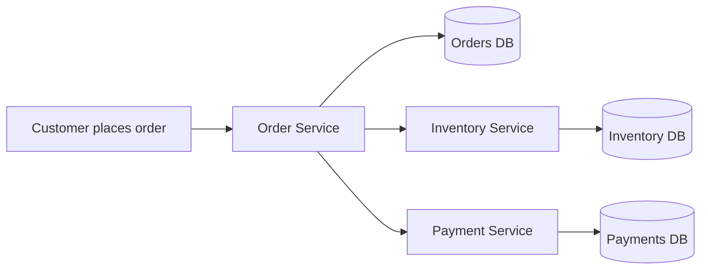

A **distributed transaction** coordinates related changes that span independently committing systems. Common examples: checkout, funds transfer, multi-provider travel booking, and ticket reservations.

**Memory trick:** One business action, multiple independently failing parts.

---

## 2. ACID in one database versus many services

A normal relational database transaction can group several statements into a single commit:

```sql
BEGIN;
UPDATE accounts SET balance = balance - 100 WHERE account_id = 10;
UPDATE accounts SET balance = balance + 100 WHERE account_id = 20;
COMMIT;
```

When both changes use the **same transaction-capable database**, the transaction can provide atomicity: all changes commit or none do.

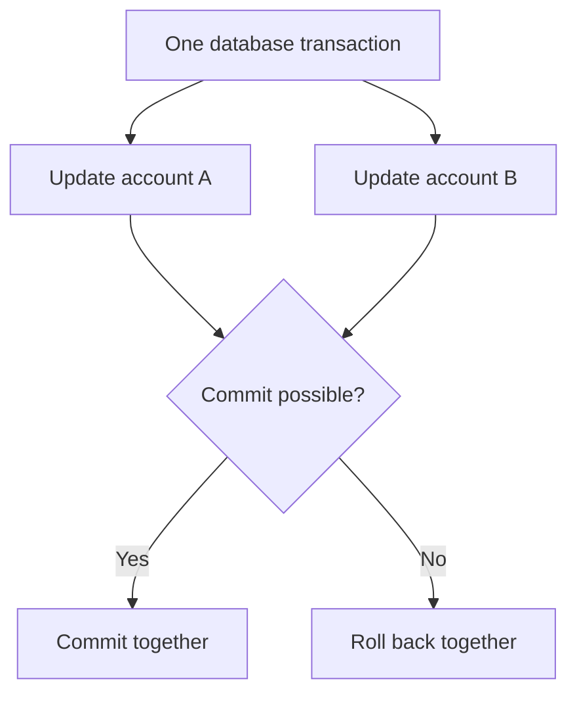

But independent microservices usually own their own databases. A local `COMMIT` in one service does not automatically roll back a completed transaction in another.

**Important:** Even when services coordinate a business workflow, a completed external charge cannot simply be undone by a SQL rollback.

---

## 3. The partial-failure problem

Consider this unsafe checkout sequence:

1. Order Service records order `#42`.
2. Payment Service charges ₹2,000.
3. Inventory Service discovers no stock.
4. The customer has paid but cannot receive the item.

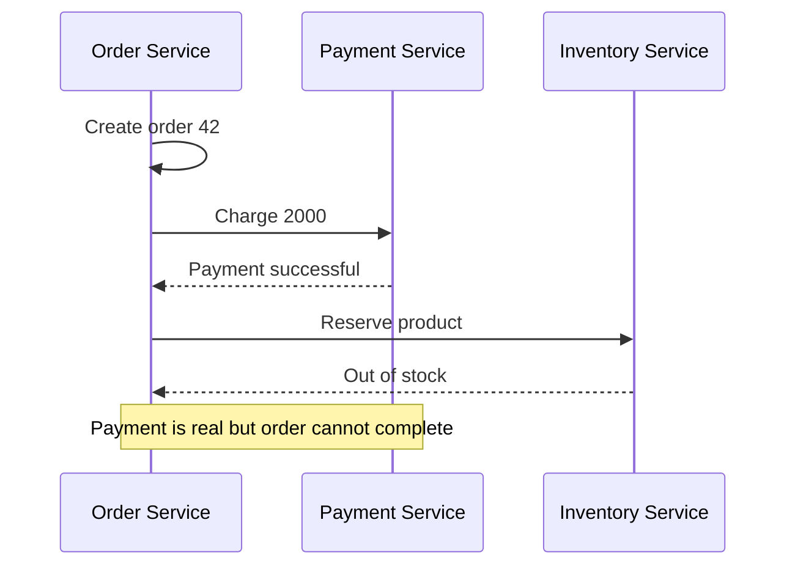

A timeout is another dangerous case: it may mean a call failed **before execution** or succeeded **without the caller seeing the reply**.

Good workflows explicitly model **success, rejection, timeout, retry, compensation and manual recovery** rather than assuming every request finishes normally.

---

## 4. The two main coordination approaches

The two common approaches serve different needs.

| Approach | Basic idea | Core trade-off |
|---|---|---|
| **Two-Phase Commit (2PC)** | Ask all participants to prepare, then commit or abort as a group | Stronger atomicity, but coordination and possible blocking |
| **Saga** | Execute local transactions, and compensate prior steps if later work fails | Better independence, but intermediate states are visible |

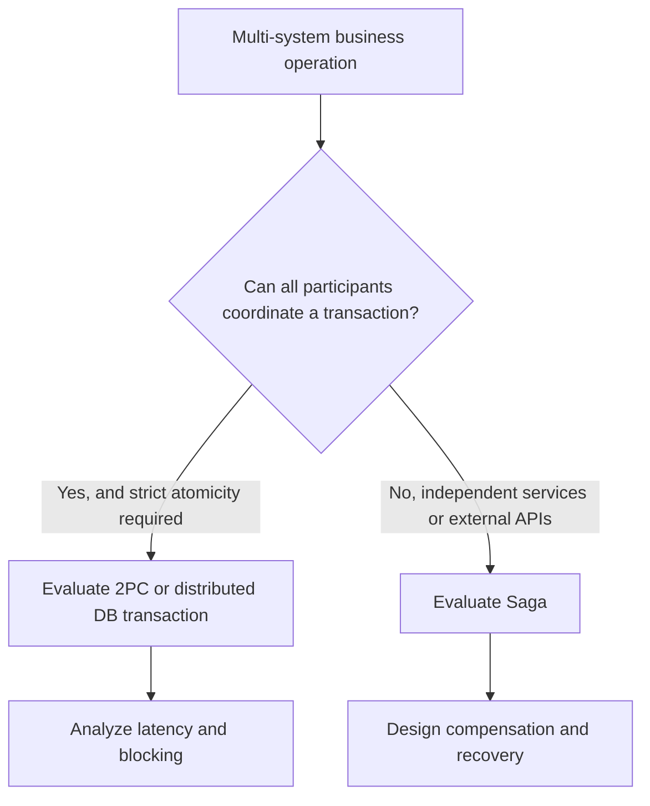

Before using either, ask whether the records that must change atomically can simply live within **one service and one local transaction**.

---

## 5. Two-Phase Commit: prepare and commit

**2PC** has a **coordinator** and multiple transaction-capable **participants**.

**Phase 1 — Prepare:** The coordinator asks each participant whether it can commit. A participant records sufficient durable state, usually retains relevant locks, and replies **YES** or **NO**.

**Phase 2 — Decision:** If all participants vote YES, the coordinator durably records **COMMIT** and tells them to commit. If any votes NO, the coordinator decides **ABORT**.

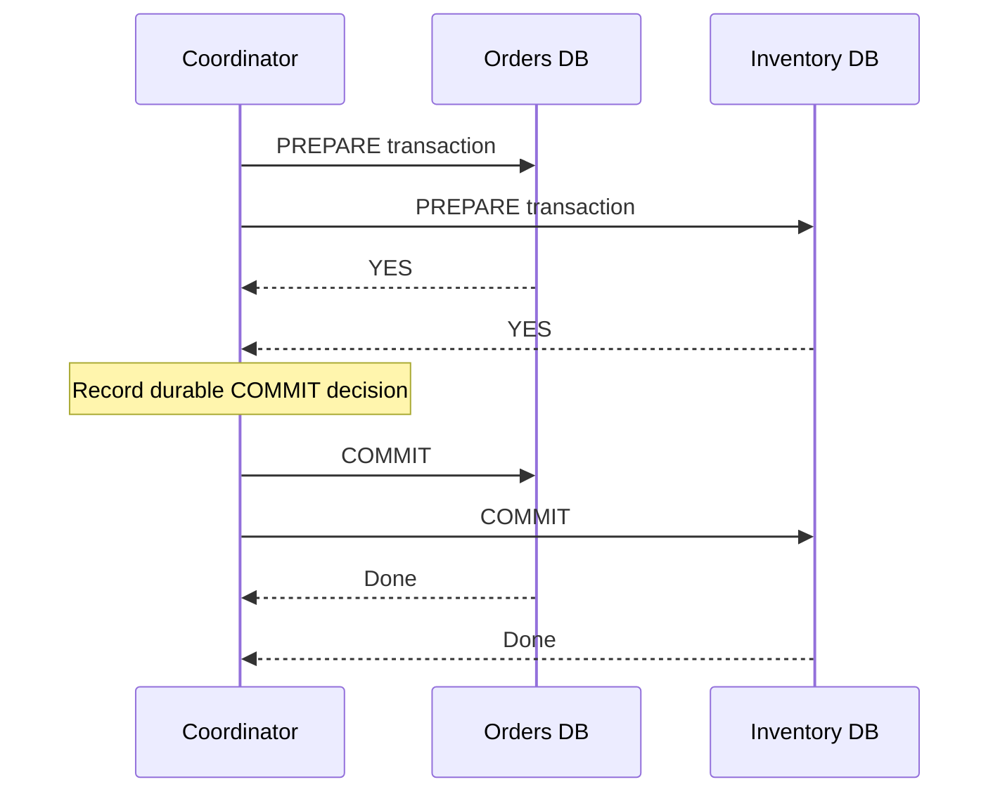

If a participant cannot prepare, the decision is ABORT. Details depend on the database protocol. The key feature is **a shared commit decision rather than independent local commits**.

---

## 6. Two-Phase Commit when something fails

A difficult scenario occurs if participants have voted YES and the coordinator becomes unavailable **before they learn the final decision**.

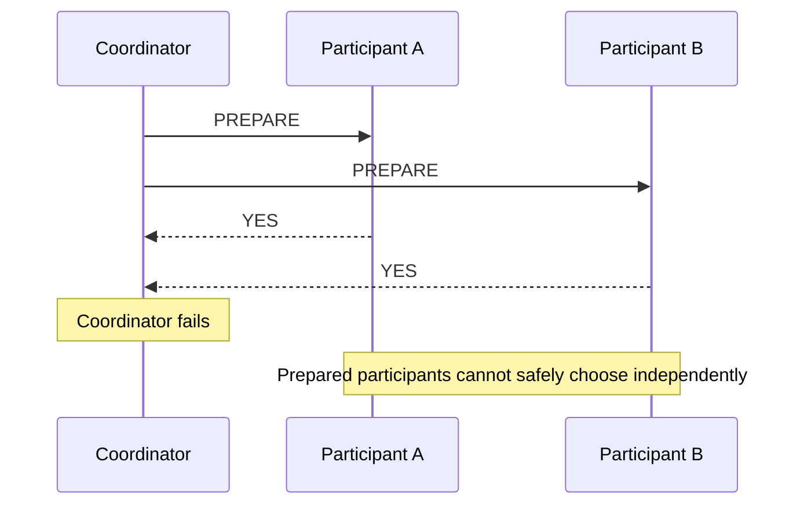

This is a classic **blocking problem**. Prepared resources or locks may stay held until the coordinator recovers or a recovery protocol can determine the outcome.

**Costs of 2PC:**

- Cross-system round trips lengthen a transaction.
- Prepared locks can reduce throughput.
- Participant outages can prevent progress.
- Every participant must support the coordination protocol.
- External services such as ordinary email APIs or card-charge endpoints generally cannot be enlisted.

2PC can still make sense **within suitably designed distributed databases**. It is usually awkward across independently deployed business microservices.

---

## 7. Saga: one business workflow, many local transactions

A **saga** divides a larger business operation into local transactions. Each completed step may have a **compensating action** used if later work cannot finish.

Travel booking example:

| Forward step | Compensation |
|---|---|
| Reserve flight | Cancel flight reservation |
| Reserve hotel | Cancel hotel reservation |
| Reserve rental car | Cancel car reservation |

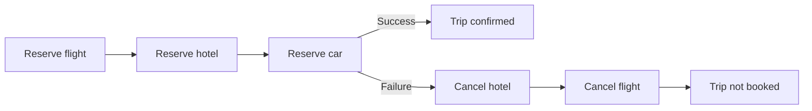

**Key distinction:** A saga provides a **recoverable business workflow**, not the same instantaneous atomic isolation as one ACID transaction. Other services may temporarily observe the completed earlier steps.

Compensation means **a new business action**, not erasing history. A refund remains a separate record from the original payment.

---

## 8. Saga choreography: events coordinate progress

In **choreography**, services react to events rather than receiving every instruction from one central process.

Example:

1. Order publishes `OrderCreated`.
2. Payment consumes it and publishes `PaymentSucceeded` or `PaymentFailed`.
3. Inventory consumes the success event and publishes the reservation result.
4. Other services react to success or failure events.

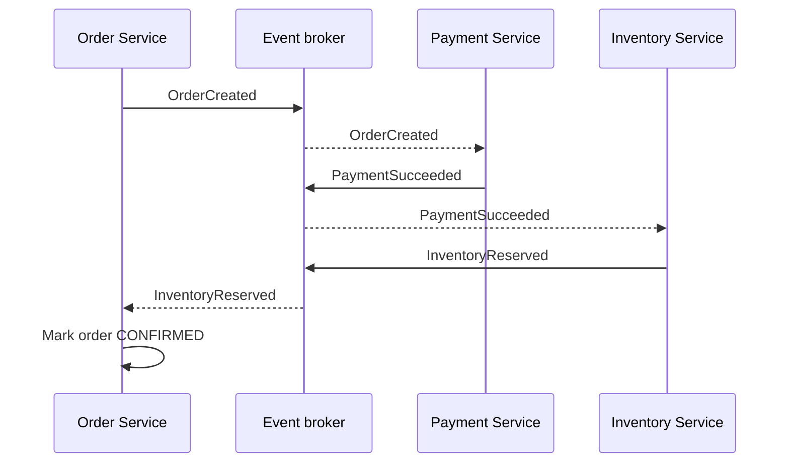

**Advantages:** Services can remain loosely coupled and use asynchronous messaging.

**Drawbacks:** The full process can be hard to understand, failure paths span many subscribers, and changes to event contracts can create surprising dependencies. It suits relatively small workflows with clear ownership.

---

## 9. Saga orchestration: one workflow controller

In **orchestration**, a workflow coordinator explicitly decides which step happens next and which compensation to run.

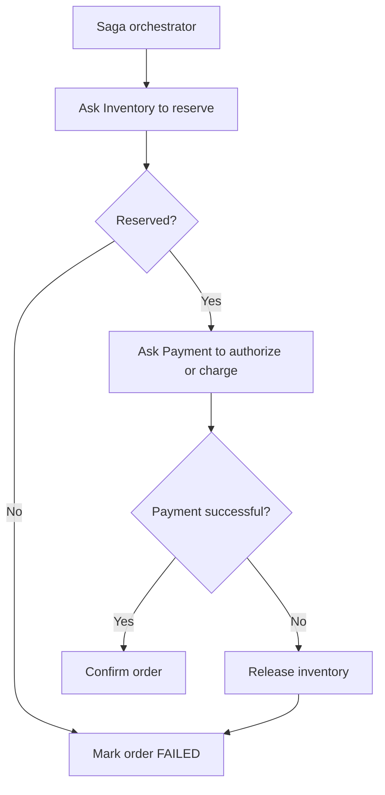

**Advantages:** One place to trace workflow state, timeouts, compensations and business decisions. The process is easier to test and inspect as its steps grow.

**Responsibilities:** The orchestrator must persist progress durably, resume after crashes, avoid double-executing steps, and maintain reliable communication with participants.

A central controller is not necessarily a single server: a durable orchestration service can run redundantly while providing one logical workflow state.

---

## 10. Choreography versus orchestration

| Criterion | Choreography | Orchestration |
|---|---|---|
| Coordination | Events and independent reactions | Explicit workflow controller |
| Global workflow visibility | Often harder | Usually easier |
| Coupling | Event-contract coupling | Coordinator knows step interfaces |
| Simple workflows | Often appropriate | Sometimes extra machinery |
| Many conditional steps | Can become complicated | Easier to model centrally |
| Error recovery | Distributed among participants | Managed through workflow state |

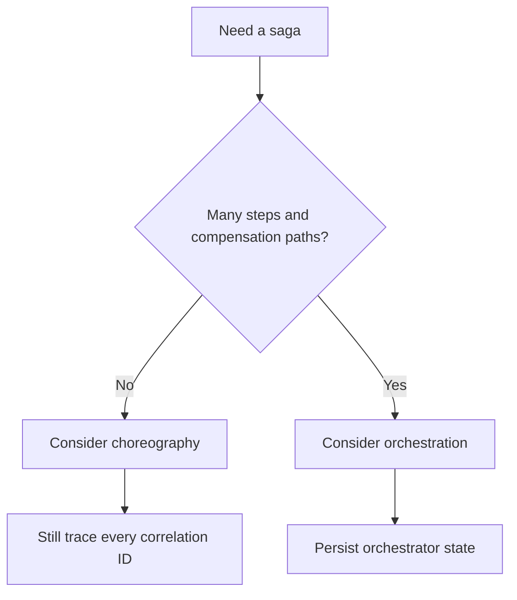

Neither approach removes the need for retries, idempotency, observability or clear failure semantics.

**Interview answer:** Start with choreography for a simple event flow; choose orchestration when the workflow is complicated enough that a central view improves correctness and operations.

---

## 11. Why intermediate states must be explicit

In a saga, a payment might already be authorized while inventory confirmation is still pending. If downstream code sees `PAID` and assumes fulfillment is final, users may receive misleading information.

Use a documented state machine.

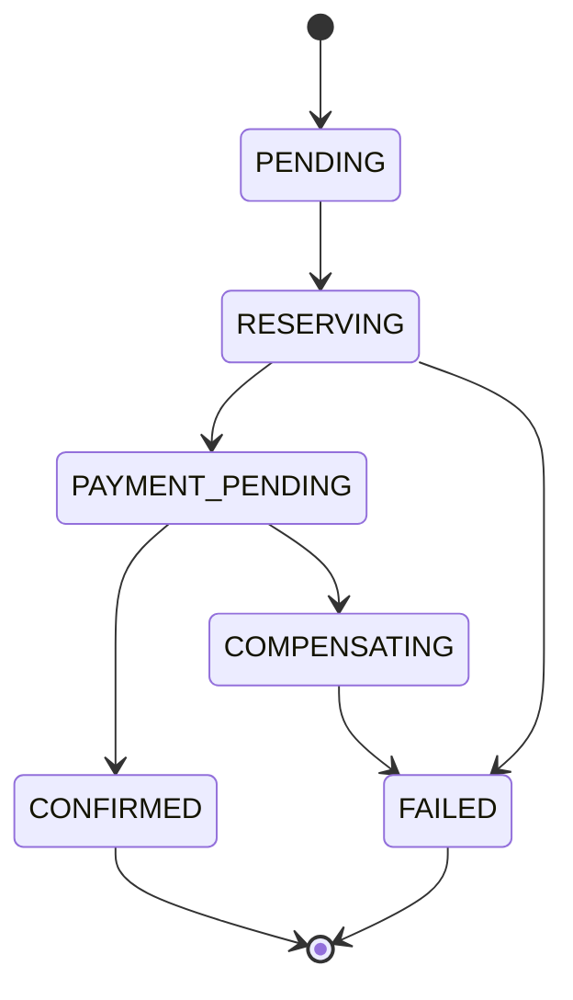

**Example rule:** Shipping is allowed only for `CONFIRMED` orders. A `PENDING` order must not appear as successfully purchased.

Explicit status values make asynchronous progress visible without pretending all services commit at the same instant.

---

## 12. Compensation may fail too

Suppose the order workflow charges a card but a later operation fails. The system requests a refund, but the refund API times out. Is the money already refunded? The answer may be unknown.

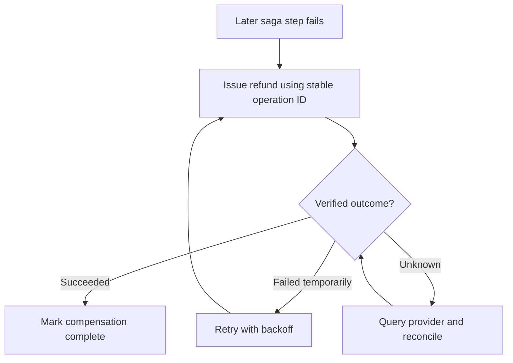

Every action and compensation should be **idempotent**. Carry a stable saga ID, step ID and provider-supported idempotency key where available.

**Crucial reality:** Some compensations are not exact inverses. A refund might incur fees or take days to appear, and a cancellation may have penalties. A saga must define an acceptable **business recovery outcome**, not promise that history is erased.

When automatic recovery is impossible, send the case to a monitored **manual intervention** queue.

---

## 13. Order reversible actions before irreversible ones

Some actions cannot meaningfully be undone:

- An email already delivered cannot be retracted reliably.
- A package already collected by a courier is difficult to recall.
- A public message already seen cannot be unseen.

Prefer steps that can be reserved or reversed early, and delay externally visible final effects where business rules allow.

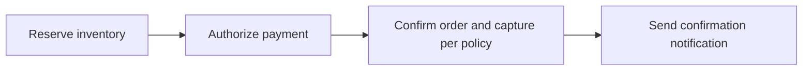

A sensible checkout may reserve inventory, authorize payment, confirm the purchase and send email afterward.

**Nuance:** The exact ordering depends on inventory risk, payment-provider semantics and business policy. Card **authorization** and **capture** are different operations, and an authorization may expire. Don't treat any sequence as universally correct.

Guard downstream services against acting on unfinished workflow states.

---

## 14. Try-Confirm-Cancel for scarce resources

A technique often called **TCC (Try-Confirm-Cancel)** reserves a resource before making the allocation final.

Ticket reservation example:

1. **Try:** Hold seat A12 for a limited time.
2. **Confirm:** Finalize it after successful payment.
3. **Cancel:** Release the hold after failure or timeout.

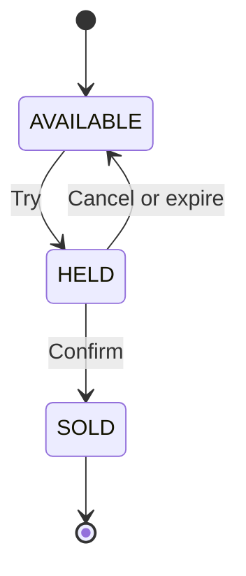

A hold needs an **expiry**, a unique reservation ID and concurrency protection so only one buyer can hold a particular seat.

TCC is related to sagas, but it is a distinct protocol style: participants must explicitly support provisional resource reservation and final confirmation or cancellation.

**Do not assume TTL alone is enough:** Releasing holds, handling clock differences and preventing stale confirmations all require deliberate implementation.

---

## 15. The dual-write problem

A service often needs to **change a database row** and **publish an event**. If these are separate actions, one may succeed while the other fails.

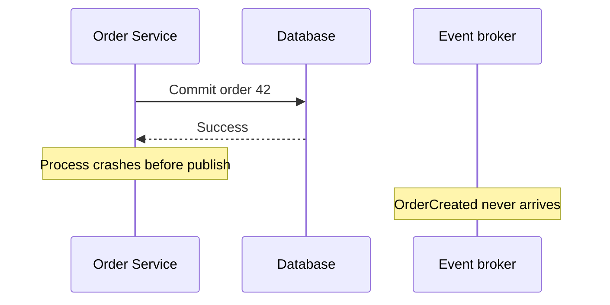

Reversing the order is also unsafe: publishing `OrderCreated` first and failing the database transaction can cause other services to act on a nonexistent order.

This problem appears in sagas, event-driven architectures and asynchronous integrations. The core need is **durable linkage between the committed data and the intent to publish**.

---

## 16. Transactional outbox: persist the event with the change

The **transactional outbox** pattern puts an event record in an `outbox` table inside the **same local transaction** as the business change.

A separate relay publishes these events to the broker.

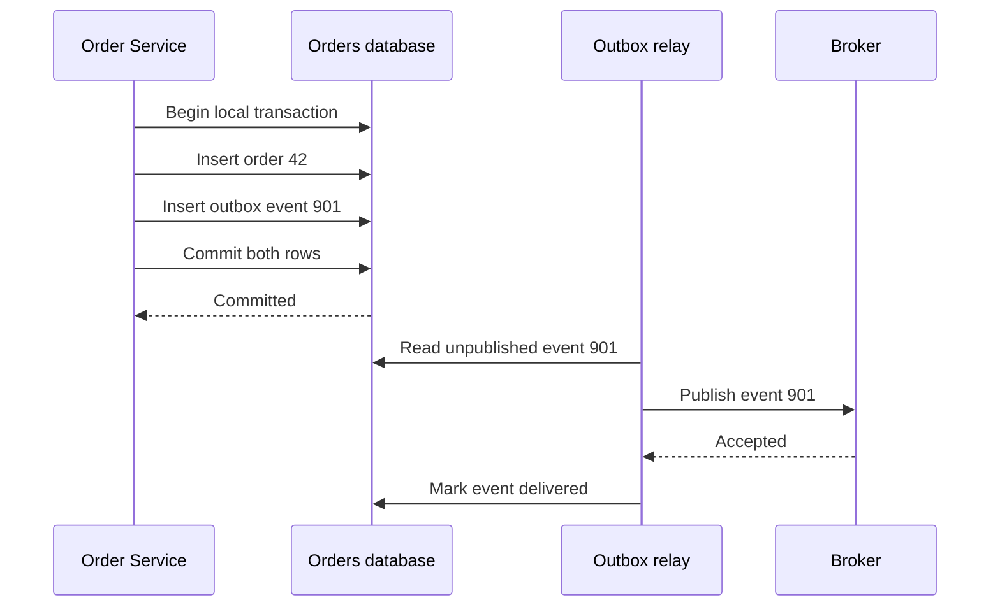

**Guarantee and limitation:** The outbox avoids silently losing the intention to publish when the business transaction succeeds. But the relay can crash **after publishing and before marking completion**, so a message may be published more than once.

Consumers therefore need stable **event IDs** and idempotent processing. Outbox relays may poll the table or use change data capture (CDC) tools such as Debezium, depending on the architecture.

---

## 17. Inbox, retries and exactly-once business effects

At-least-once brokers and outbox relays can redeliver events. A service should not run the same business action again simply because the event appeared again.

A transactional **inbox** or processed-events table can record the consumer name and event ID in the same database transaction as the local effect.

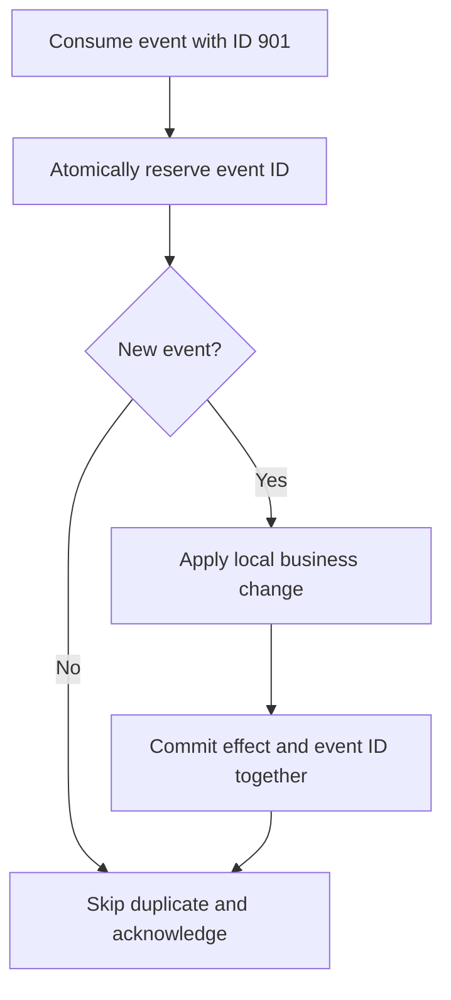

**Caution:** A database transaction cannot ordinarily make an independent external payment or email call atomic. For those effects, use a provider-supported idempotency key, reconciliation, or an explicit recovery policy.

See also [Idempotency and Deduplication](Idempotency_and_Deduplication_in_Distributed_Systems.md).

---

## 18. Prevent distributed transactions where possible

Before adding workflow coordination, ask whether the data boundary is unnecessarily fragmented.

If an order and its line items always change together, maintaining both in the Order Service database may be simpler than spreading them across independent stores.

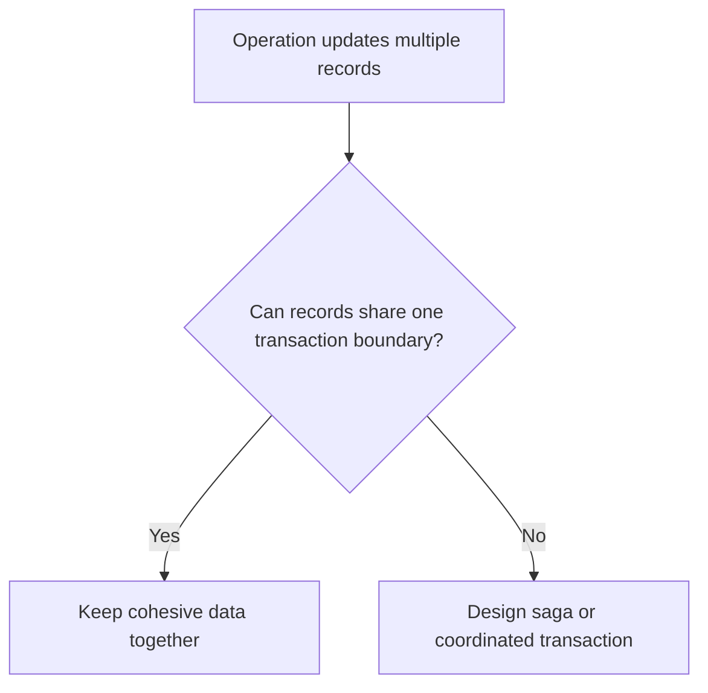

In sharded systems, a thoughtful shard key can place data that often changes together on the same shard. For example, a customer ID may co-locate a customer's orders, although cross-customer operations can still span shards.

**Architectural rule:** Prefer a reliable local transaction when it models the business boundary well. Distribute only when independent ownership, scale or organizational needs justify it.

---

## 19. Choosing 2PC, saga or TCC

| Situation | First option to evaluate | Main caveat |
|---|---|---|
| Related rows in one transactional database | Local ACID transaction | Keep ownership boundaries coherent |
| Multi-participant DB transaction with supported protocol | 2PC or DB-native coordinated transaction | Blocking and latency |
| Cross-service order/payment/inventory workflow | Saga | Compensations, intermediate states |
| Seat, hotel room or scarce inventory hold | TCC-style reservation | Expiring and reconciling holds |
| DB change followed by broker event | Transactional outbox | Relay may publish duplicates |
| Consumer receives retryable events | Transactional inbox / idempotent handling | External calls are separate |

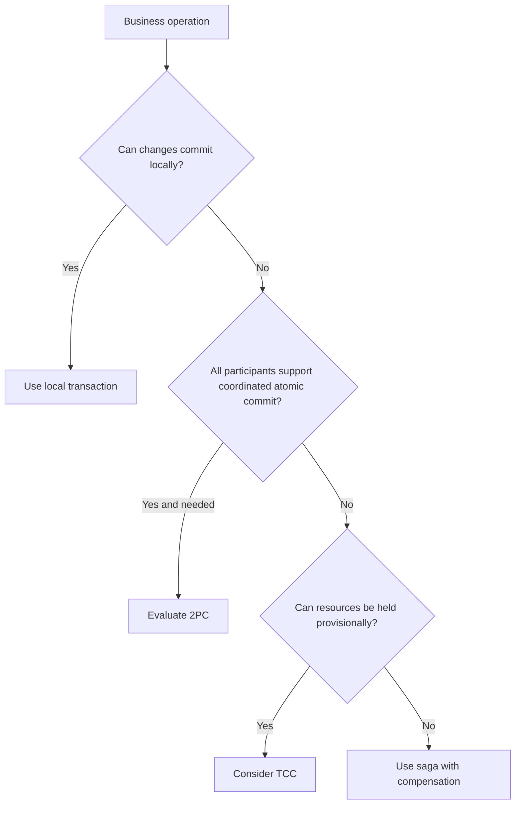

You may combine several patterns. An orchestrated saga can call TCC-style reservation services, and each service can use an outbox for reliable event publishing.

---

## 20. A worked checkout architecture

Suppose a store sells limited-edition headphones. The business cannot ship unless inventory and payment are both secured.

**One possible approach:**

1. Create an order as `PENDING`.
2. Reserve stock with an expiry and stable reservation ID.
3. Authorize the customer's payment using a stable key.
4. Confirm stock and finalize payment according to product policy.
5. Mark the order `CONFIRMED`.
6. Emit the confirmation through an outbox; notify the user afterward.
7. If a step fails, release the hold and reverse or reconcile the payment operation as necessary.

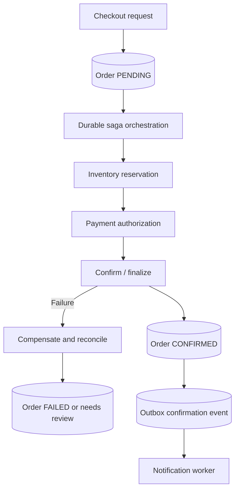

**Why this works better than naive sequential calls:** Workflow state is durable, resource ownership is explicit, retries use stable IDs, and unconfirmed orders are not treated as fulfilled.

**Do not overpromise:** External payment and inventory provider semantics can still require reconciliation and human intervention.

---

## 21. System design interview approach

If asked to design an e-commerce checkout, ticket reservation or travel booking platform, use this flow:

1. **Define invariants:** What must never happen? Double charge? Oversell? Incorrect booking confirmation?
2. **Draw boundaries:** Which services and databases own each step?
3. **Find partial failures:** Where could a timeout or crash leave work unfinished?
4. **Choose coordination:** Local transaction, 2PC, saga, or provisional reservation.
5. **Define each compensation:** Include timeouts, reversibility and failure handling.
6. **Make retries safe:** Stable operation IDs, unique constraints and inbox logic.
7. **Publish reliably:** Transactional outbox for database-to-broker changes.
8. **Observe and recover:** Saga state, stuck transitions, reconciliation and alerts.

```mermaid
flowchart TD
  REQUIRE["Business invariants"] --> BOUNDARY["Service ownership"]
  BOUNDARY --> FAILURE["Partial failure scenarios"]
  FAILURE --> STRATEGY["Choose coordination pattern"]
  STRATEGY --> COMP["Compensation and reservations"]
  COMP --> SAFE["Idempotency and outbox"]
  SAFE --> OPERATE["Monitoring and recovery"]
```

### Example interview explanation

**“I would keep the order and its line items within one local transaction. Since inventory and payment are independent, I would coordinate the checkout as an orchestrated saga. I would reserve inventory, authorize payment using an idempotency key, and confirm only when both succeed. Every step has a persisted state and retry policy. Failure triggers compensation or reconciliation, and events are emitted through a transactional outbox.”**

---

## 22. Practice questions and revision sheet

### Interview questions

1. What is a distributed transaction?
2. Why does a local ACID transaction not automatically cover separate microservice databases?
3. Explain the two phases of 2PC using a sequence diagram.
4. Why can prepared participants block when a coordinator fails?
5. Why is 2PC awkward for ordinary external payment APIs?
6. What is a saga, and how is compensation different from rollback?
7. Compare choreography and orchestration.
8. Why are intermediate saga states visible?
9. What happens when a compensation fails or times out?
10. Why should irreversible actions usually be scheduled later?
11. What is TCC, and how would you hold a ticket for ten minutes?
12. What is the dual-write problem?
13. How does a transactional outbox fix the write-plus-publish gap?
14. Why can outbox relays still publish duplicates?
15. How does a transactional inbox make consumer retries safe?
16. Why does a distributed transaction become simpler if related data can share one shard?
17. How would you recover an order stuck in `PAYMENT_PENDING`?
18. What alerts and metrics belong in a saga platform?

### Quick reference

| Concept | Simple meaning |
|---|---|
| Local ACID transaction | Atomic commit within one supported DB boundary |
| Distributed transaction | Related changes span independently committing systems |
| 2PC | Prepare participants, then decide commit or abort |
| Saga | Series of local commits with compensating actions |
| Choreography | Services advance workflow by events |
| Orchestration | Controller directs workflow steps |
| Compensation | New action that counteracts an earlier step |
| TCC | Reserve, confirm or cancel |
| Intermediate state | Partial progress visible during a saga |
| Transactional outbox | Persist business change and event intent together |
| Transactional inbox | Record consumer ID and local effect together |
| Idempotency | Retry without duplicate business effects |
| Reconciliation | Verify and repair uncertain external outcomes |

**Final takeaway:** **Avoid unnecessary cross-service transactions. When unavoidable, choose clear coordination rules, durable progress, idempotent steps, and a tested recovery strategy.**

---
