# Distributed Unique ID Generation — UUID, Snowflake and Base62 Explained Simply

*Distributed Systems Study Library · Author: Jayesh Sharma*

**Learn how to generate unique IDs on many servers, when to use UUIDv4/UUIDv7 or Snowflake, how range allocation works, and how URL shorteners create compact Base62 codes.**

> Independently written educational guide based on the user-provided transcript. Explanations, examples, tables and Mermaid diagrams are newly authored, with additional accuracy notes on uniqueness, clock behavior, global ordering and authorization.

## Contents

- [1. Why unique IDs are a distributed-systems problem](#1-why-unique-ids-are-a-distributed-systems-problem)
- [2. Decide which ID properties actually matter](#2-decide-which-id-properties-actually-matter)
- [3. Database auto-increment: the simple baseline](#3-database-auto-increment-the-simple-baseline)
- [4. Why independent shard counters can collide](#4-why-independent-shard-counters-can-collide)
- [5. Dedicated ticket servers and odd-even sequences](#5-dedicated-ticket-servers-and-odd-even-sequences)
- [6. UUID version 4: generate independently](#6-uuid-version-4-generate-independently)
- [7. UUID version 7: roughly time-ordered UUIDs](#7-uuid-version-7-roughly-time-ordered-uuids)
- [8. Snowflake IDs: compact and mostly time-sortable](#8-snowflake-ids-compact-and-mostly-time-sortable)
- [9. Decode the Snowflake bit layout](#9-decode-the-snowflake-bit-layout)
- [10. Snowflake capacity: calculate it yourself](#10-snowflake-capacity-calculate-it-yourself)
- [11. Step-by-step Snowflake generation](#11-step-by-step-snowflake-generation)
- [12. Snowflake failure #1: duplicate worker IDs](#12-snowflake-failure-1-duplicate-worker-ids)
- [13. Snowflake failure #2: clocks move backward](#13-snowflake-failure-2-clocks-move-backward)
- [14. Allocate ID ranges in blocks](#14-allocate-id-ranges-in-blocks)
- [15. Base62: turn numbers into short URL codes](#15-base62-turn-numbers-into-short-url-codes)
- [16. Three ways to generate short codes](#16-three-ways-to-generate-short-codes)
- [17. Public IDs, enumeration and security](#17-public-ids-enumeration-and-security)
- [18. Comparison: choose the least complicated option](#18-comparison-choose-the-least-complicated-option)
- [19. Interview walkthrough: unique IDs at large scale](#19-interview-walkthrough-unique-ids-at-large-scale)
- [20. Quick questions and final revision](#20-quick-questions-and-final-revision)

---

## 1. Why unique IDs are a distributed-systems problem

A social app creates messages on many servers. An e-commerce platform creates orders across several database shards. A link shortener may create billions of codes. **Every record needs an identity that cannot accidentally belong to something else.**

In a single database, a sequence is often enough. But if server A and server B independently start counting from 1, they can both generate the same ID.

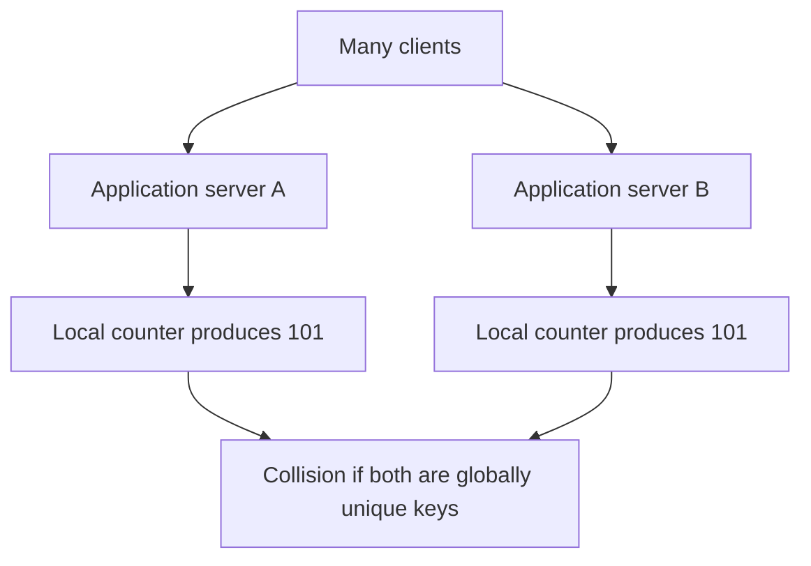

**Memory trick:** A unique ID is like a passport number: it must identify *one* record even when offices in different cities issue it.

Typical uses include messages, orders, payments, tickets, database primary keys and short URLs.

---

## 2. Decide which ID properties actually matter

Different products value different properties:

| Property | Question to ask |
|---|---|
| Uniqueness | Must IDs be unique globally, or only within a tenant or shard? |
| Sortability | Should later-created records *usually* have larger IDs? |
| Size | Can we store 128 bits, or must IDs fit in a 64-bit integer? |
| Throughput | Hundreds, thousands, or millions of IDs per second? |
| Coordination | May a server generate IDs while disconnected? |
| Predictability | Will exposing IDs reveal record counts or timing? |
| Lifetime | How long must a generator avoid reusing IDs? |

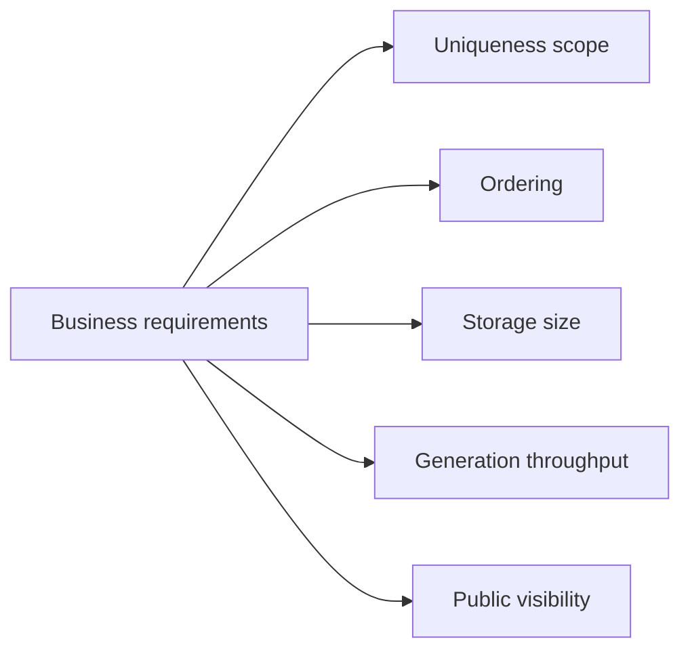

**Critical distinction:** Unique does not mean sequential, and sequential does not automatically mean secure. **No algorithm substitutes for authorization checks.**

---

## 3. Database auto-increment: the simple baseline

A database can assign an increasing number as each row is inserted.

```sql
CREATE TABLE orders (
    order_id BIGINT GENERATED ALWAYS AS IDENTITY PRIMARY KEY,
    customer_id BIGINT NOT NULL
);
```

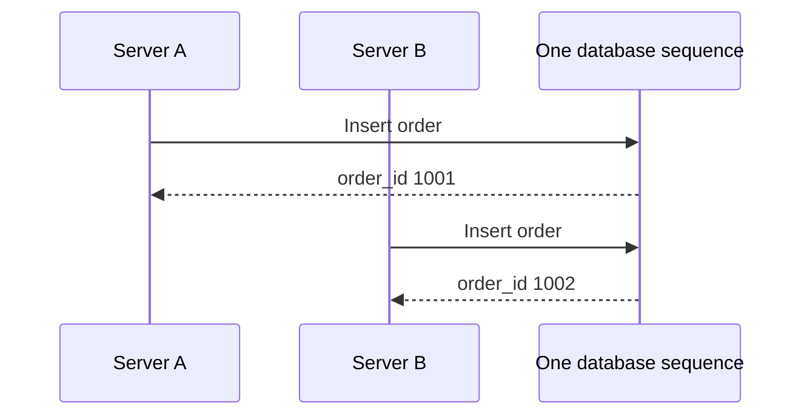

**Advantages:** Easy to understand, compact keys, database-managed concurrency.

**Trade-offs:** A shared allocator becomes a dependency. Independent database shards may produce overlapping values. A database sequence is also not necessarily gap-free or equal to transaction commit order; rollbacks and caching may create gaps.

For a moderately sized application using one database, this is often all you need.

---

## 4. Why independent shard counters can collide

Imagine a system with two independent database shards.

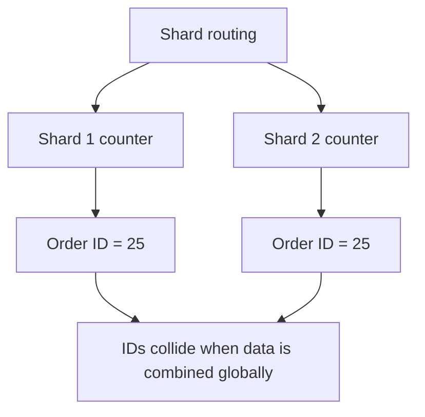

**Solutions** include allocating distinct number ranges, using a shard prefix or composite key, coordinating through a shared sequence service, or generating distributed IDs directly.

If records are identified by **(shard_id, local_id)**, local ID duplicates may be acceptable. But copying data to a global analytics store or referencing it across services often benefits from a globally unique ID.

Always define the uniqueness scope rather than assuming every local primary key must be globally unique.

---

## 5. Dedicated ticket servers and odd-even sequences

One approach gives ID-issuing servers nonoverlapping number sequences.

For two servers:

```text
Server A: 1, 3, 5, 7, ...
Server B: 2, 4, 6, 8, ...
```

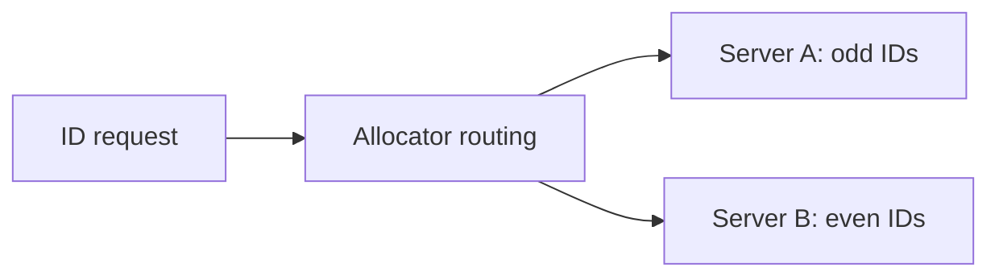

This is an example of **disjoint arithmetic sequences** (similar to the historic Flickr ticket-server concept). It preserves compact numeric IDs and avoids collisions while ownership stays correct.

**Challenge:** Adding servers or changing the step requires careful coordination. Reassigning a number sequence while another issuer is still using it can cause duplicate IDs.

Dedicated ticket servers are useful when the operational simplicity of a small set of controlled issuers outweighs their availability and coordination costs.

---

## 6. UUID version 4: generate independently

A **UUID** is 128 bits. UUIDv4 uses randomly generated bits, so applications can create IDs without contacting an ID service.

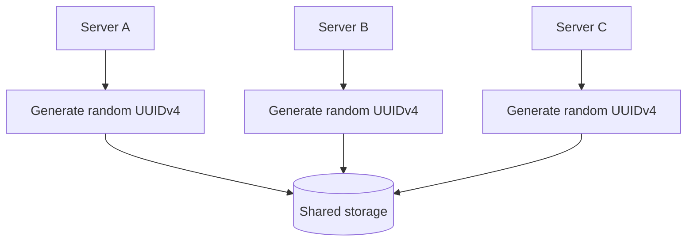

**Benefits:** No central allocator, easy horizontal scaling, high collision resistance with a proper random generator.

**Costs:** 128-bit storage footprint, less convenient integer handling, and UUIDv4 does not naturally sort by creation time. Random primary-key insertion patterns may be less index-local than increasing keys in some storage engines.

**Accuracy note:** UUIDv4 uniqueness is **probabilistic**, not a logical impossibility of collision. A uniqueness constraint remains useful for critical databases.

---

## 7. UUID version 7: roughly time-ordered UUIDs

UUIDv7 puts a Unix-time millisecond timestamp near the front of its 128-bit layout and combines it with other bits for uniqueness.

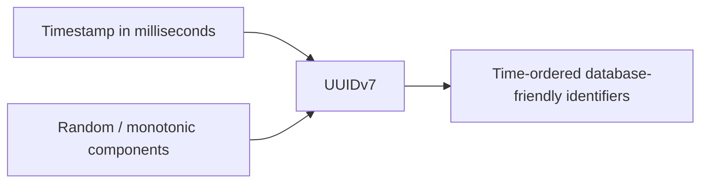

Compared with UUIDv4, UUIDv7 values are generally more locality-friendly when indexed in generation order.

**But:** It is still 128 bits, different servers can share the same millisecond, and ordering is not a replacement for a trusted creation timestamp or transactional event ordering. Implementations may use counters or monotonic generation strategies within the same millisecond.

**Choose UUIDv7** when you like UUID-style coordination-free creation but want broadly time-ordered identifiers.

---

## 8. Snowflake IDs: compact and mostly time-sortable

A Snowflake-style generator combines three ingredients in one 64-bit integer:

1. **Timestamp** since a chosen custom epoch.
2. **Worker or machine ID** unique among simultaneous generators.
3. **Sequence number** for multiple IDs generated by one worker in the same millisecond.

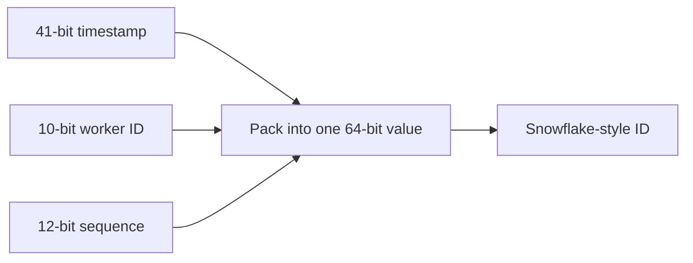

The classic Snowflake layout reserves one sign bit, followed by 41 timestamp bits, 10 worker bits and 12 sequence bits.

The resulting ID can be stored as an integer and usually sorts roughly by generation time.

**Important:** “Snowflake” describes a design family. Other implementations choose different bit allocations, epochs and worker-identity policies.

---

## 9. Decode the Snowflake bit layout

The illustrative classic layout is:

```text
| 1 sign bit | 41 bits: milliseconds | 10 bits: worker | 12 bits: sequence |
     0                  T                       W                 S
```

The packed value is calculated with bit shifts:

```text
ID = (timestamp_since_epoch << 22)
   | (worker_id << 12)
   | sequence
```

Why 22? The timestamp leaves **10 + 12 = 22** lower bits for machine identity and sequence.

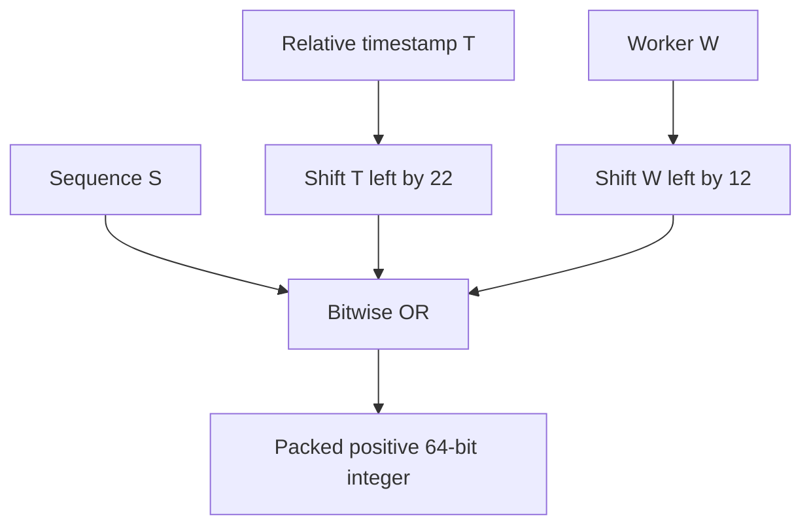

Bit boundaries matter because they prevent the three values from overwriting one another.

**Interview phrase:** Timestamp tells **when**, worker tells **where**, and sequence tells **which one within that millisecond**.

---

## 10. Snowflake capacity: calculate it yourself

For the classic bit allocation:

| Field | Bits | Capacity |
|---|---:|---:|
| Worker ID | 10 | \(2^{10}=1,024\) distinct worker IDs |
| Per-millisecond sequence | 12 | \(2^{12}=4,096\) IDs per worker per ms |
| Timestamp | 41 | \(2^{41}\) milliseconds ≈ 69.7 years |

```text
4,096 IDs / millisecond / worker
× 1,000 milliseconds / second
= 4,096,000 IDs / second / worker (theoretical ceiling)
```

These are **layout limits**, not a production throughput benchmark. CPU speed, clock access, synchronization and storage writes also affect real throughput.

A 41-bit timestamp is measured from the system's **custom epoch**, not automatically from 1970. Its lifetime is finite; plan for epoch exhaustion before it becomes urgent.

---

## 11. Step-by-step Snowflake generation

Each worker maintains the latest timestamp and an in-millisecond counter.

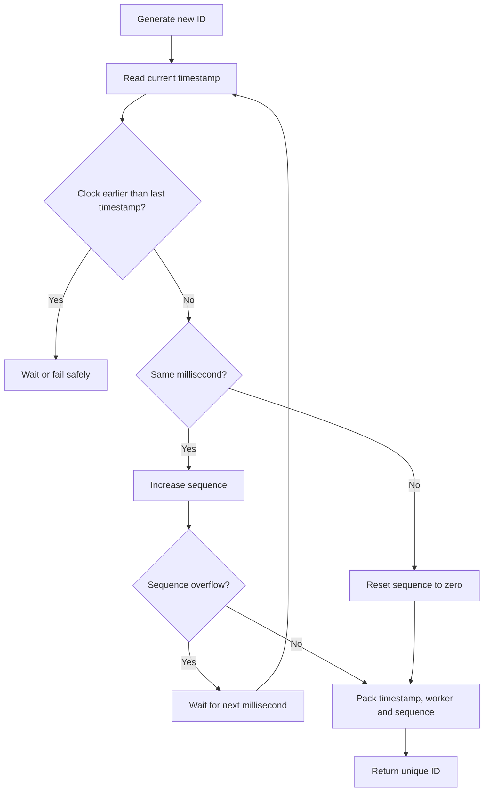

Illustrative pseudocode:

```text
if current_ms < last_ms:
    reject_or_wait_for_clock_recovery()

if current_ms == last_ms:
    sequence += 1
    if sequence >= 4096:
        wait_until_next_ms()
        sequence = 0
else:
    sequence = 0

last_ms = current_ms
return pack(current_ms - custom_epoch, worker_id, sequence)
```

The generator must protect shared internal state if multiple threads call it concurrently.

---

## 12. Snowflake failure #1: duplicate worker IDs

If two running machines share the same worker ID and generate the same per-millisecond sequence, they can create an identical packed value.

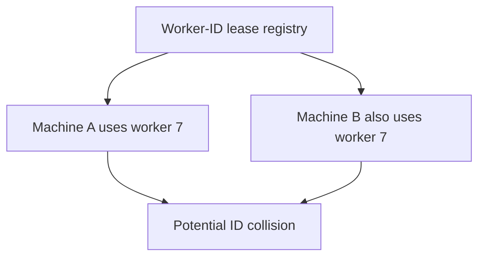

Possible safeguards:

- Static worker IDs for a small, strictly managed fleet.
- An allocation registry such as etcd or ZooKeeper.
- Strong fencing and lease-handling rules before a replacement process reuses a worker identity.
- Isolation or durable counters if worker identity could be reused unexpectedly.

**Operational warning:** A registry returning distinct numbers at startup is not enough if a paused old worker later resumes after its identity is assigned elsewhere. Worker reuse needs a safe protocol.

---

## 13. Snowflake failure #2: clocks move backward

System clocks may move because of NTP corrections, virtual-machine changes or configuration errors.

A timestamp that moves backward can overlap with an earlier timestamp already used by the same worker.

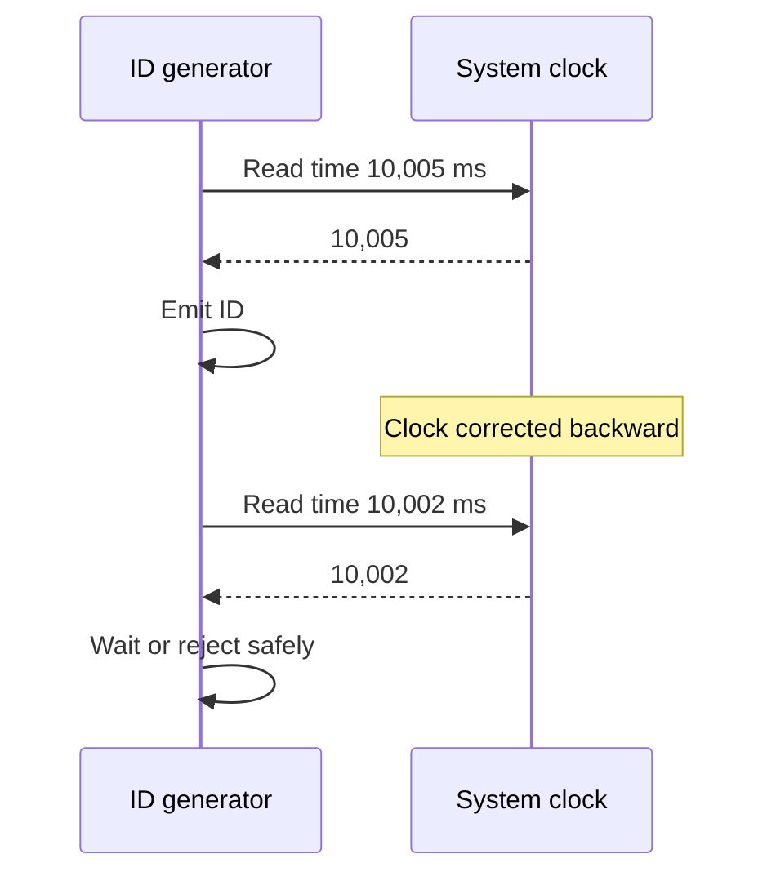

Common approaches include waiting until the clock catches up, pausing issuance, failing requests, or using a well-defined logical-time fallback. The choice depends on availability goals and collision guarantees.

**Ordering caveat:** Snowflake IDs are normally increasing on one correctly configured worker, but **different workers do not provide strict global event order**, especially within the same millisecond or when clocks differ.

---

## 14. Allocate ID ranges in blocks

A **range allocator** reserves a block of integers for each application process. The process serves IDs from memory until it runs out.

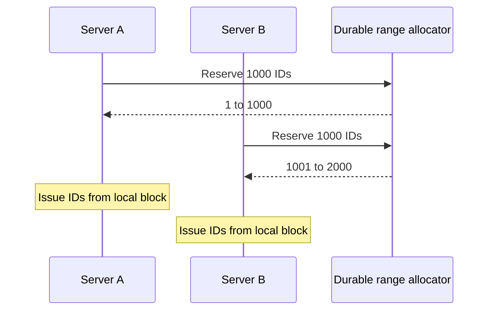

For a block of 1,000, the allocator is contacted approximately **once per thousand generated IDs**, not once per individual ID.

**Requirements:** Range reservations must be atomic and durable. A crashed server may abandon unused IDs, leaving gaps; that is normally acceptable.

**Trade-off:** IDs from different servers are **not globally chronological**. Server B can issue 1,200 while A is still issuing 950.

---

## 15. Base62: turn numbers into short URL codes

A URL shortener wants short identifiers such as `3d7` rather than long decimal strings. **Base62** uses 62 symbols:

```text
0123456789abcdefghijklmnopqrstuvwxyzABCDEFGHIJKLMNOPQRSTUVWXYZ
```

For one common alphabet ordering, decimal `12,345` becomes `3d7`.

**How to calculate it:** Divide repeatedly by 62 and convert remainders into alphabet characters.

```text
12,345 ÷ 62 = 199 remainder 7   → 7
199    ÷ 62 =   3 remainder 13  → d
3      ÷ 62 =   0 remainder 3   → 3

Read remainders in reverse → 3d7
```

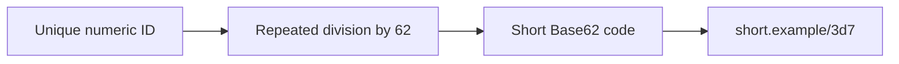

There are \(62^7 = 3,521,614,606,208\) possible seven-character strings.

**Note:** The output depends on your Base62 alphabet order. Base62 is **encoding, not encryption**: sequential IDs remain predictable.

---

## 16. Three ways to generate short codes

| Method | How it works | Main risk or trade-off |
|---|---|---|
| Counter + Base62 | Allocate unique number, encode it | Predictable codes and allocator dependency |
| Random Base62 | Generate characters, reserve with unique constraint | Possible collisions; must retry |
| Truncated URL hash | Hash URL and use shortened portion | Different URLs may collide; normalization policy matters |

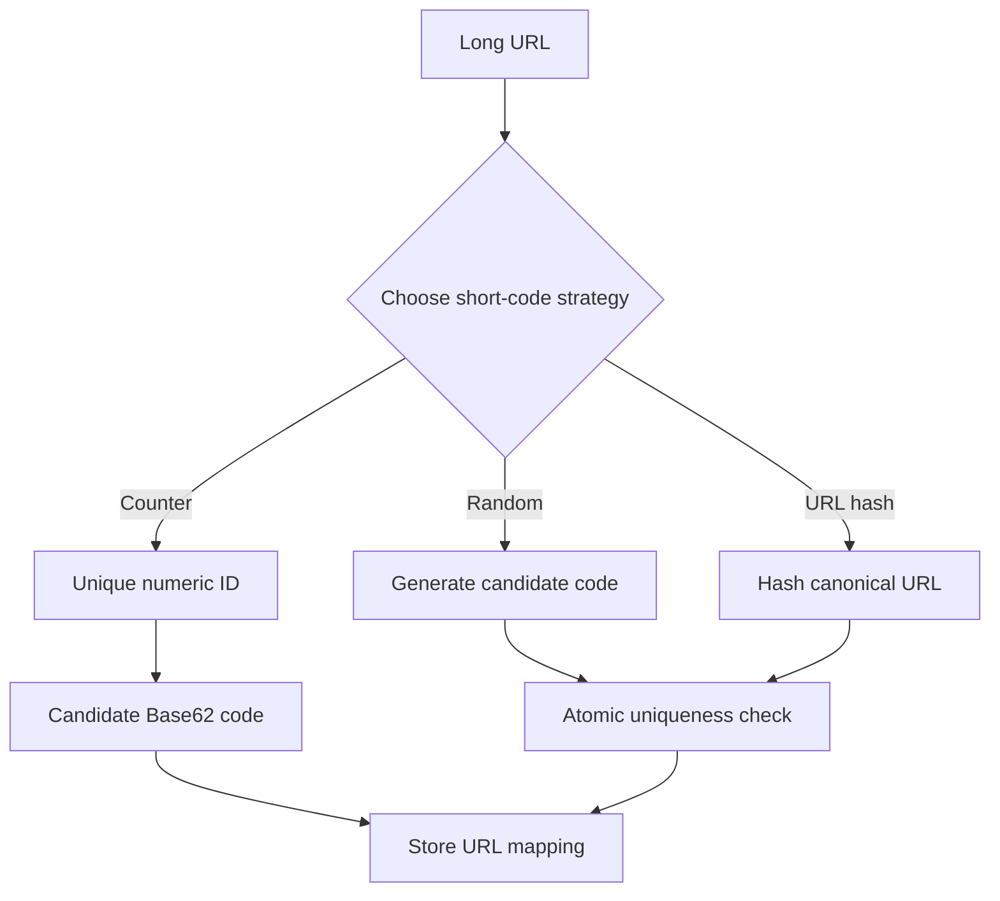

For random codes, do not rely on “collisions are rare” alone: enforce a unique key on the final code and retry on conflict.

Hashing a long URL may intentionally make repeated identical URLs map to the same code, but deciding whether duplicates should share one short link is a **product requirement**, especially when owners and expiration policies differ.

---

## 17. Public IDs, enumeration and security

A customer might see `/orders/1005` and try `/orders/1004`. If the API does not check ownership, the customer could read another person's order.

This is an **authorization failure**, not fundamentally a problem with the ID algorithm.

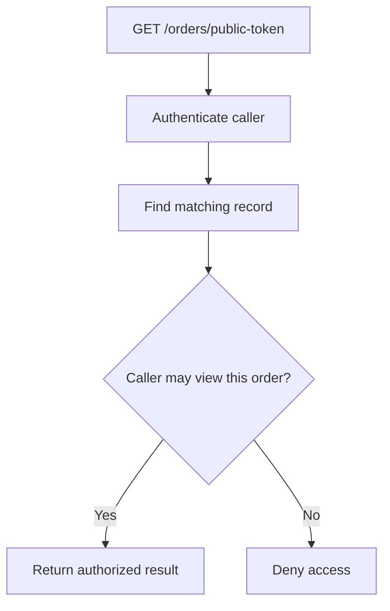

Using hard-to-guess random public references reduces easy enumeration and may hide creation-volume clues, but it never replaces authorization, rate limits or abuse monitoring.

A useful split is:

- **Internal ID:** Small numeric or time-sortable primary key.
- **External reference:** Independent UUID or random public token.

Keep the mapping in the authoritative database and enforce uniqueness on both where required.

---

## 18. Comparison: choose the least complicated option

| Strategy | Size | Central coordination | Time-order behavior | Good fit |
|---|---|---|---|---|
| Auto-increment | Usually 64 bits | Database sequence | Increasing allocation order, not necessarily commit order | Single database |
| UUIDv4 | 128 bits | None | Random | Independent generators |
| UUIDv7 | 128 bits | None for probabilistic uniqueness | Broadly time-ordered | Distributed database keys |
| Snowflake style | 64 bits | Worker-ID management | Approximately chronological | High-throughput event IDs |
| Range allocation | Often 64 bits | Occasional range request | Approximate / interleaved | Numeric IDs at scale |
| Random Base62 | Configurable text length | Uniqueness reservation | Random | Public short codes |

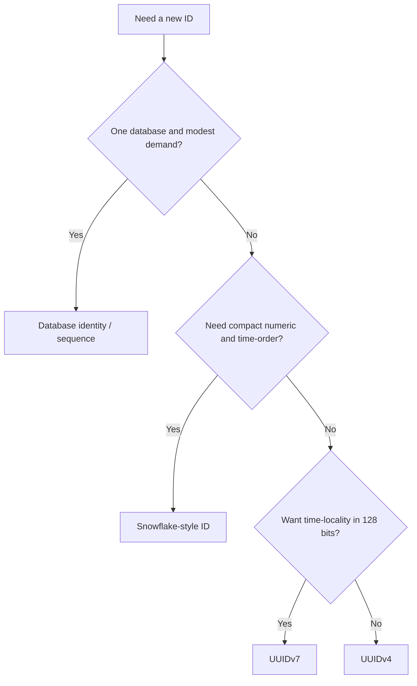

Add **block allocation** when small numerics are needed with amortized coordination, and **Base62** when a compact textual representation is needed.

No approach is ideal for every workload.

---

## 19. Interview walkthrough: unique IDs at large scale

If the prompt is “Design unique IDs for messages across hundreds of servers,” a solid answer follows this structure:

1. **Ask what must be unique:** globally, per tenant, or per shard.
2. **Size the workload:** peak IDs per second and planned lifetime.
3. **Choose the storage form:** 64-bit integer or 128-bit UUID.
4. **Clarify ordering:** approximate creation-time sort, or true causal/order guarantees?
5. **Pick a strategy:** UUIDv7, Snowflake, sequences or range reservation.
6. **Explain concurrency:** worker-ID uniqueness or atomic reservations.
7. **Explain failures:** process restarts, clock rollback, sequence overflow, collisions.
8. **Handle public access:** opaque IDs and authorization.
9. **Measure behavior:** ID throughput, allocation failures, clock anomalies, lease health.

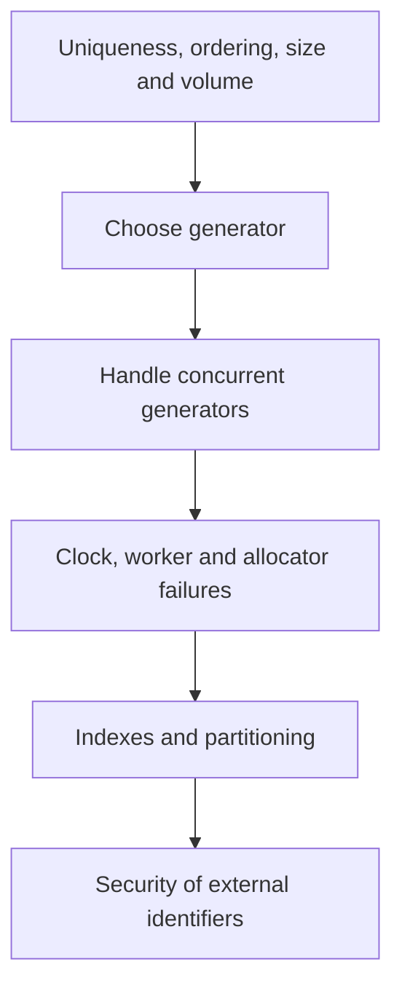

### Example interview answer

**“For a globally distributed event stream that needs compact roughly time-ordered keys, I'd choose a Snowflake-like 64-bit layout. Each writer gets a uniquely managed worker identity. The ID combines a timestamp, worker ID and local sequence. I'd explicitly handle clock rollback, per-millisecond sequence exhaustion, worker lease reuse and uniqueness constraints. If ordering were unnecessary, a UUID would be simpler.”**

---

## 20. Quick questions and final revision

### Practice questions

1. Why might two database shards generate the same numeric ID?
2. What properties should be discussed before selecting an ID scheme?
3. What is the difference between uniqueness and ordering?
4. Why can auto-increment sequences contain gaps?
5. How do odd/even ticket servers avoid collisions?
6. Compare UUIDv4 and UUIDv7.
7. What are the three main fields of Snowflake?
8. Why are 10 worker bits enough for 1,024 IDs?
9. How many IDs can a 12-bit sequence issue per millisecond?
10. Why does Snowflake need a custom epoch?
11. What happens when the system clock moves backward?
12. How could reusing a worker ID create collisions?
13. Why does a leased worker ID need safe handoff?
14. What is the benefit of allocating 1,000 IDs per request?
15. What is Base62, and why is it not encryption?
16. How do you convert decimal 12,345 to Base62?
17. How should a URL shortener resolve a collision?
18. Why is authorization still needed when public IDs are random?

### One-minute cheat sheet

| Term | Remember |
|---|---|
| Globally unique ID | Identity unambiguous across intended scope |
| Auto-increment | Easy DB-issued numeric sequence |
| UUIDv4 | Independently generated random identifier |
| UUIDv7 | Timestamp-led UUID, generally time-sortable |
| Snowflake | Timestamp + worker ID + per-ms sequence |
| Worker ID | Separates simultaneous ID generators |
| Clock rollback | Time moves backward; generator must handle safely |
| Sequence overflow | Wait for a new time unit when counter runs out |
| Block allocation | Reserve number ranges, issue locally |
| Base62 | Compact encoding with 62 symbols |
| Public opaque ID | Harder-to-guess external reference |
| IDOR | Unauthorized access through insecure object references |

**Final takeaway:** **Pick the simplest ID generator that satisfies uniqueness, size, throughput, ordering and visibility requirements.** UUIDs minimize coordination, Snowflake trades worker/clock management for compact orderable IDs, and block allocation amortizes central coordination.

---
