# Fanout-on-Read vs Fanout-on-Write — Explained Simply

*Distributed Systems Study Library · Author: Jayesh Sharma*

**A practical guide to scalable social feeds, celebrity accounts, background fanout, notification delivery, group messaging and event-driven services.**

> Independently written educational notes based on the user-provided fanout transcript. Explanations, worked examples, tables and Mermaid diagrams are newly authored. Additional engineering considerations are identified where they extend the transcript.

## Contents

- [1. What is fanout in system design?](#1-what-is-fanout-in-system-design)
- [2. Start with a news-feed example](#2-start-with-a-news-feed-example)
- [3. Fanout-on-read (pull model)](#3-fanout-on-read-pull-model)
- [4. Fanout-on-write (push model)](#4-fanout-on-write-push-model)
- [5. Compare pull and push](#5-compare-pull-and-push)
- [6. What is write amplification?](#6-what-is-write-amplification)
- [7. Hybrid fanout: combine the best of both](#7-hybrid-fanout-combine-the-best-of-both)
- [8. Inactive followers: avoid wasted work](#8-inactive-followers-avoid-wasted-work)
- [9. Run push fanout asynchronously with queues](#9-run-push-fanout-asynchronously-with-queues)
- [10. Batch follower updates and make retries safe](#10-batch-follower-updates-and-make-retries-safe)
- [11. Store post IDs, not copies of the entire post](#11-store-post-ids-not-copies-of-the-entire-post)
- [12. Edits, deletes, unfollows and blocks](#12-edits-deletes-unfollows-and-blocks)
- [13. Fanout for notifications](#13-fanout-for-notifications)
- [14. Group chat, large channels and live streams](#14-group-chat-large-channels-and-live-streams)
- [15. Fanout between backend services](#15-fanout-between-backend-services)
- [16. Capacity and system-design interview framework](#16-capacity-and-system-design-interview-framework)
- [17. Summary and interview questions](#17-summary-and-interview-questions)

---

## 1. What is fanout in system design?

**Fanout** means taking one event or piece of content and making it available to many recipients.

Imagine publishing a photo. Your post is **one action**, but thousands of followers may need to see it. The same pattern appears when one video upload generates many notifications, one group message reaches many members, or one order event informs several backend services.

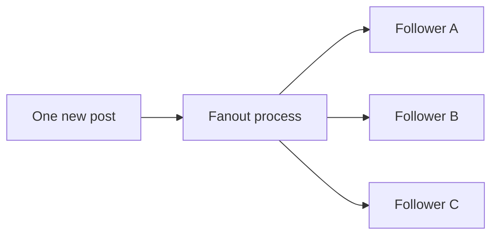

**The main design question is not merely how to deliver content. It is when to do the work:** when content is **created**, or when someone **reads** it.

**Memory trick:** **Fanout = one event, many destinations.**

---

## 2. Start with a news-feed example

Suppose Priya follows 300 creators. When she opens her home feed, she expects a mixture of recent posts from all of them.

A simplified chronological feed might require:

1. Finding the accounts Priya follows.
2. Obtaining relevant posts from those accounts.
3. Combining posts into one ordered list.
4. Returning a page of results.

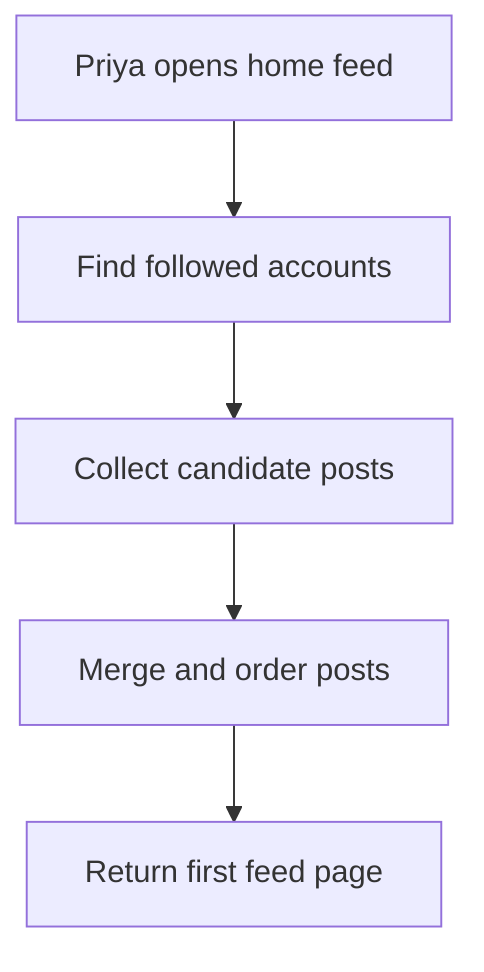

You can do the combination **at read time**, or prepare much of it **ahead of time when posts are written**. That choice leads to two familiar architectures: **fanout-on-read** and **fanout-on-write**.

This article uses a chronological feed to explain the basics. Real recommendation feeds may also rank posts by relevance and apply business policies.

---

## 3. Fanout-on-read (pull model)

With **fanout-on-read**, creating a post is cheap: save it under the author. The system builds a follower's combined feed **when the follower requests it**.

For example, if Priya follows Alice, Bob and Charlie, the feed service reads recent posts from each account and merges them.

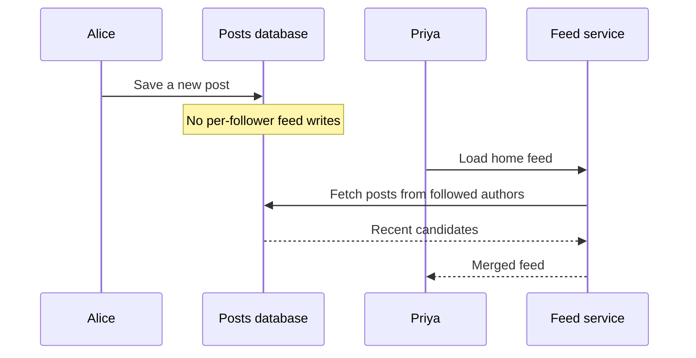

**Advantages:** Small write amplification, naturally includes newly available posts, and avoids maintaining precomputed feeds for inactive users.

**Costs:** A single feed read may require fetching from many authors, combining records and ranking or sorting them. Popularity of the reader-facing product can make this expensive.

**Useful nuance:** Pull does not have to mean hundreds of sequential database queries. The service can use batched queries, indexed author timelines and caching.

---

## 4. Fanout-on-write (push model)

With **fanout-on-write**, the system prepares each follower's feed when an author publishes something.

Imagine Alice has 200 followers. When she posts, background work adds her new **post ID** into the precomputed feed of those 200 followers.

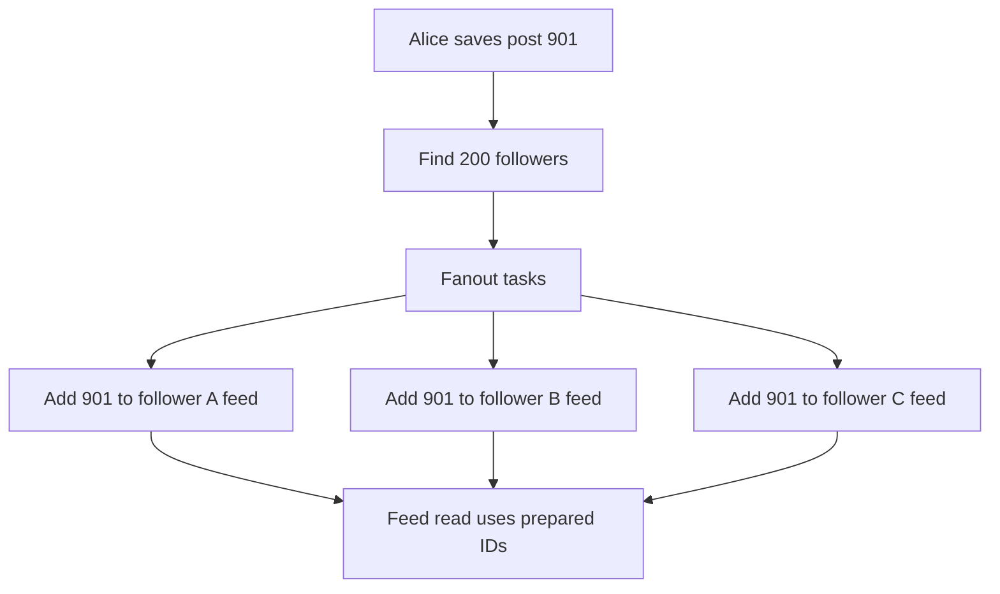

Now Priya can read her feed IDs quickly and fetch the corresponding post content.

**Advantages:** Fast feed requests because expensive candidate aggregation was moved to the write path.

**Costs:** One post may cause many extra writes. Storing a reference in every recipient's feed also consumes space, even for recipients who rarely open the application.

**Memory trick:** **Push = pay when someone posts, save work when followers read.**

---

## 5. Compare pull and push

| Dimension | Fanout-on-read | Fanout-on-write |
|---|---|---|
| When feed work happens | On feed request | After a post is created |
| Post creation cost | Usually low | Can rise with follower count |
| Feed load cost | Higher aggregation work | Lower aggregation work |
| Work for inactive followers | Usually none until they read | May still update their feeds |
| Precomputed feed storage | Smaller | More post references across feeds |
| Massive creator accounts | Avoids copying to everyone | Can create extreme bursts |
| Freshness consideration | Reads from current sources | Depends on fanout workers catching up |

A design should focus on the **workload** rather than treating one model as universally better.

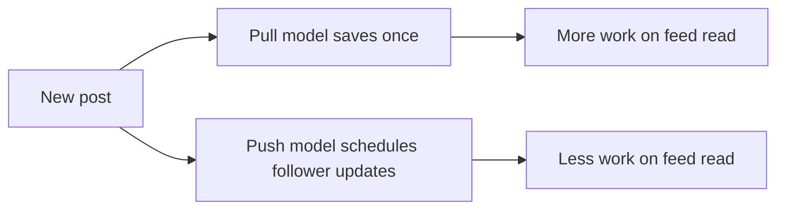

**Simple trade-off:** Pull protects the **write path**. Push protects the **read path**.

---

## 6. What is write amplification?

Write amplification happens when one logical action creates many storage updates.

Suppose an author has **500 followers**. In a simple push model, one new post can cause approximately **500 follower-feed entries** in addition to storing the original post.

```text
Follower-feed writes per post ≈ follower count
One post × 500 followers ≈ 500 feed-entry writes
```

For an account with **100 million followers**, naive push fanout could require approximately **100 million feed-entry updates**.

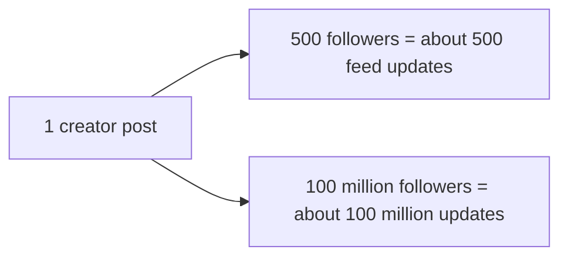

At a hypothetical throughput of one million successful feed updates per second, 100 million updates represent **about 100 seconds of aggregate write work** before accounting for overhead, retries, load skew and concurrency. This is an illustrative capacity calculation, not a real service benchmark.

**Lesson:** A strategy that works for ordinary users can become inefficient for extremely popular accounts.

---

## 7. Hybrid fanout: combine the best of both

Instead of forcing every account through one strategy, choose an approach based on scale.

- **Ordinary authors:** Push post IDs into follower feeds.
- **Very popular authors:** Store posts centrally and fetch their recent content when followers read.
- **Reader feed:** Merge precomputed ordinary posts with on-demand popular-author posts.

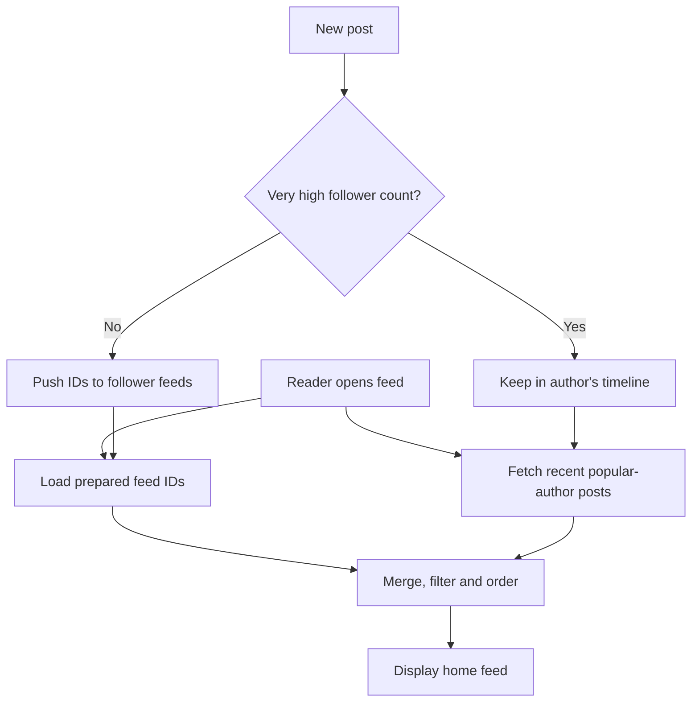

The transcript gives **one million followers** as an example threshold, but the right cutoff depends on read/write traffic, active-follower percentage, delivery targets and infrastructure costs.

**Interview phrase:** “Use push fanout for the common case and selective pull for the high-fanout outliers.”

---

## 8. Inactive followers: avoid wasted work

Not every registered user opens the application regularly. Updating a dormant user's prepared feed indefinitely may waste storage writes.

A system might:

1. Identify users whose feeds have not been requested for a configurable period.
2. Temporarily stop inserting new references into those feeds.
3. Rebuild a suitable feed when the user returns.
4. Resume prepared updates while they are active.

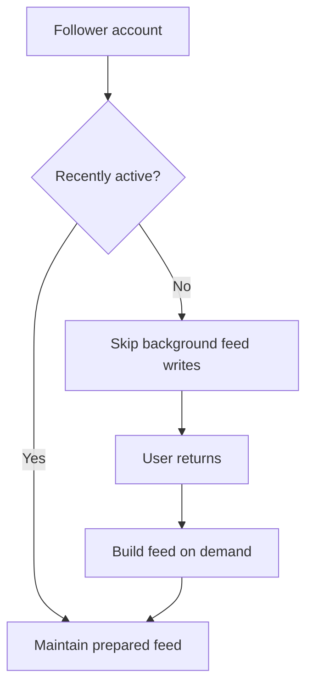

For example, **30 days** can be a starting policy for discussion, not a universal standard.

**Important:** Rebuilding on demand needs a good user experience: bounded queries, cached author timelines, and possibly a loading state while feed references are reconstructed.

---

## 9. Run push fanout asynchronously with queues

Do not force someone publishing a post to wait until every follower's feed has been updated.

A better flow separates **post persistence** from **fanout processing**:

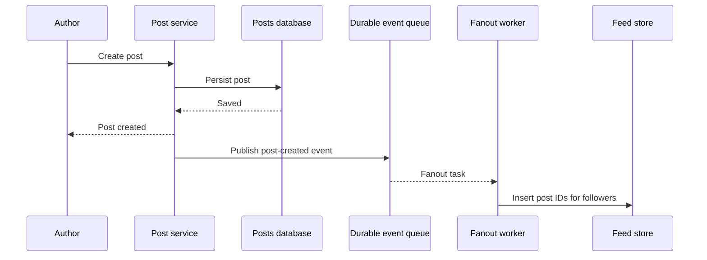

**Reliability detail:** If the post is saved but publishing the queue event fails, the feed may never update. Production systems should use a **transactional outbox** or an equivalent durable mechanism to bridge that gap.

Workers should be independently scalable, and event lag should be observable. The response to the author confirms the post was stored—not necessarily that every feed has already updated.

---

## 10. Batch follower updates and make retries safe

A large follower list can be divided into smaller independent tasks.

Suppose an author has **50,000 followers**. Split the list into **50 batches of 1,000** followers. Multiple workers can process batches concurrently.

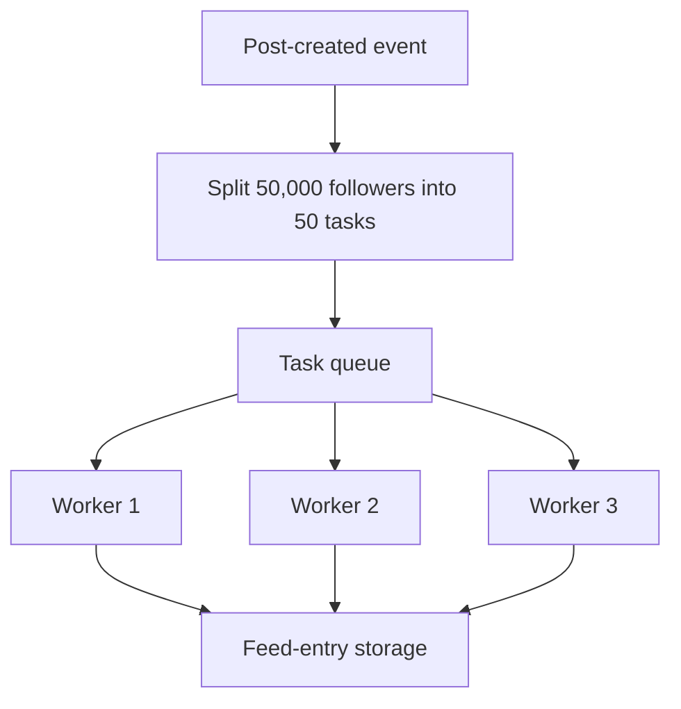

Because workers can fail and retry, inserting `post_id=901` into a follower's feed should be **idempotent**. A unique key such as `(follower_id, post_id)`, or another appropriate deduplication mechanism, prevents duplicate entries.

Do not rely on **task completion order** as the feed order. Use a stable post ordering key and a tie-breaker when necessary.

Also enforce per-user feed bounds, queue backpressure and retry limits so a single high-fanout post does not overwhelm the system.

---

## 11. Store post IDs, not copies of the entire post

A prepared feed should usually hold **references to posts**, not many copies of the content.

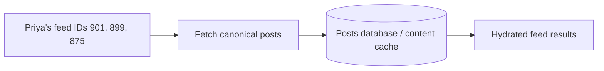

This reduces duplication, simplifies edits and allows content to be hydrated in batches.

For example:

```text
Feed for Priya:
[901, 899, 875]

Canonical post store:
901 → Alice's latest content
899 → Bob's latest content
875 → Charlie's latest content
```

Systems commonly cap how many recent IDs they keep in a prepared feed. Older content can be fetched through deeper pagination or another retrieval strategy.

**Caution:** Maintaining a feed cache is not the same as holding the authoritative record. Post content, visibility and moderation state must remain consistent with the source of truth.

---

## 12. Edits, deletes, unfollows and blocks

What if Alice edits a post that was already referenced in many follower feeds? If feeds store only the ID, the application retrieves the updated post content when it builds the response.

For deletion or access changes, enforce a final **visibility filter** before returning content.

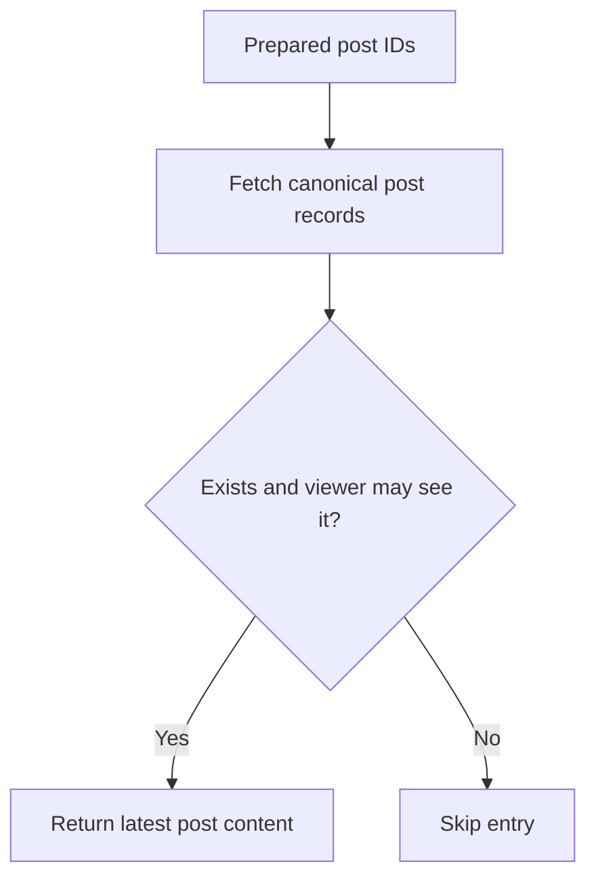

Typical checks include deleted posts, blocks, unfollows, private-account permissions and content restrictions.

**Important nuance:** An unfollow does not automatically mean all older content is forbidden; the correct behavior follows the application's product and authorization rules. If removals must be immediate, use authoritative filtering rather than depending only on asynchronous cache cleanup.

---

## 13. Fanout for notifications

When a popular creator uploads a video, many subscribers might qualify for a notification. Workers can evaluate subscription settings and dispatch notifications in controlled batches.

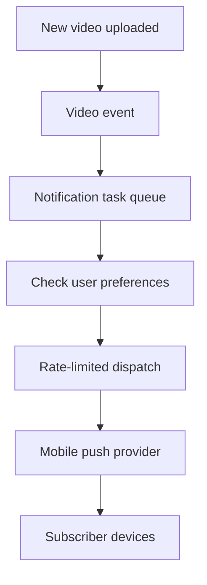

This fanout has an extra concern: sending millions of notifications simultaneously may prompt a large wave of users to open the app at once.

Strategies include **rate limiting, scheduled batches, user prioritization and monitoring open-rate spikes**. Delivery providers also have platform-specific limits, and not every subscriber necessarily wants every alert.

**Remember:** Notification fanout must consider **the traffic generated when recipients return**, not only the cost of sending notifications.

---

## 14. Group chat, large channels and live streams

The right fanout strategy changes with audience size:

- **Small group chat:** Store message references in member inboxes for simple unread tracking and offline access.
- **Huge channel:** Keep one durable channel history, with readers fetching from that source.
- **Live stream:** Publish a comment once to a room topic; connection gateways distribute it to their local viewers.

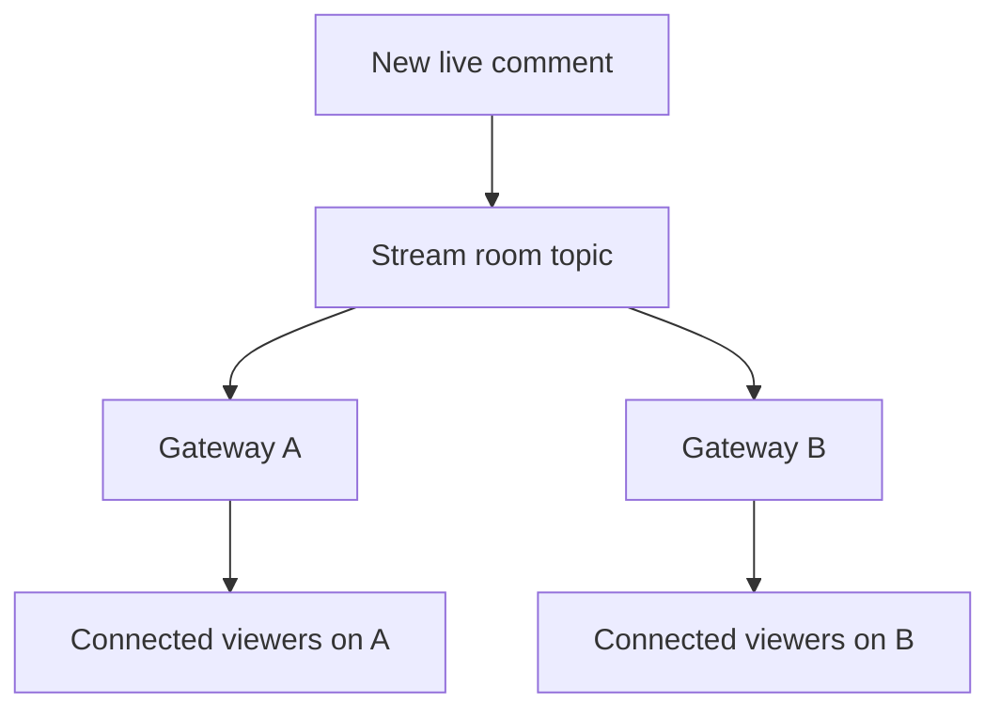

This is **two-stage fanout**: first to the gateway instances that host viewers of the room, then to each gateway's local users.

For a stream with extremely high comment volume, the UI may show a limited sample or aggregate instead of every comment. That is an intentional product policy and should not be applied to critical messages requiring durable delivery.

---

## 15. Fanout between backend services

Fanout is not limited to users. One business event can also be consumed independently by multiple services.

Suppose an order is placed. Payment, inventory, notification and analytics services may all need to react.

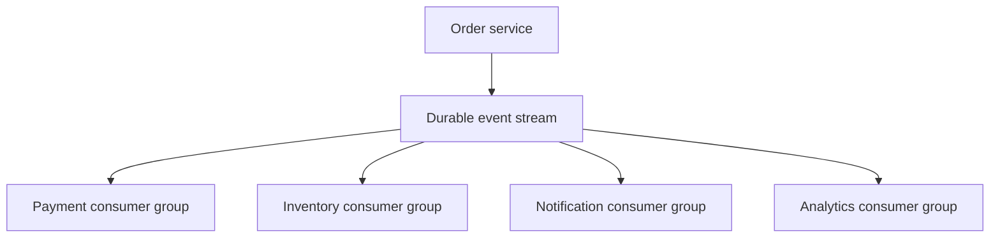

With Kafka-style consumer groups, separate groups can independently process the same event, while multiple instances within one group can divide assigned partitions.

**Trade-off:** This decouples producers from downstream consumers but introduces eventual consistency, retries, ordering considerations and idempotent processing. A slow consumer does not have to block the producer, but its own backlog and dependencies still need attention.

---

## 16. Capacity and system-design interview framework

A strong interview answer should compare **read and write costs** before drawing an architecture.

### Useful questions

1. How many people follow a typical account?
2. How large are the biggest follower graphs?
3. How often do users post versus open their feeds?
4. How many accounts are inactive?
5. How fresh must feeds be?
6. Do we need chronological ordering, personalized ranking or both?
7. Are notifications, chat and feeds subject to different delivery guarantees?

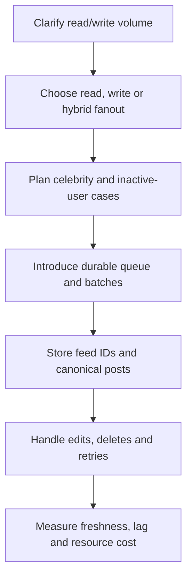

### Back-of-the-envelope comparison

```text
Ordinary author: 500 followers
1 push post ≈ 500 follower-feed writes

Popular author: 100,000,000 followers
1 push post ≈ 100,000,000 follower-feed writes

Hypothetical bulk write rate = 1,000,000 / second
100,000,000 / 1,000,000 = 100 seconds of aggregate work
```

For an interview, state that these are simplified illustrations and then discuss batching, throughput constraints, read amplification, hotspots, and eventual consistency.

---

## 17. Summary and interview questions

### Common interview questions

1. Define fanout with a news-feed example.
2. How does fanout-on-read differ from fanout-on-write?
3. Which approach makes posting cheap? Which makes reading cheap?
4. What is write amplification?
5. Why can celebrity accounts overwhelm push fanout?
6. How does a hybrid feed combine precomputed and on-demand posts?
7. How can we reduce work for inactive followers?
8. Why should fanout run after the post is durably saved?
9. What problem does a transactional outbox solve?
10. How would you split 50,000 followers among workers?
11. How do you make feed inserts safe to retry?
12. Why store post IDs rather than full post copies?
13. How do edits, deletes and blocks affect feed rendering?
14. Why can sending too many notifications at once create a traffic spike?
15. How does fanout work for a large live-stream audience?
16. What role do consumer groups play in backend event fanout?

### One-minute revision

| Term | Meaning |
|---|---|
| Fanout | One event causes work for many recipients |
| Fanout-on-read | Build results when requested |
| Fanout-on-write | Precompute recipients when a post is created |
| Write amplification | Many writes caused by one logical post |
| Hybrid fanout | Push ordinary content and pull extreme outliers |
| Feed cache | Stored references for fast reads |
| Queue + workers | Asynchronous distribution and batching |
| Idempotency | Retried updates do not cause duplicates |
| Transactional outbox | Reliably schedules event publication after data commit |
| Two-stage fanout | Broker → connected gateways → local users |

**Final takeaway:** **Fanout-on-read keeps writes inexpensive; fanout-on-write keeps reads inexpensive.** A scalable system often combines both, handles large audiences specially, and processes distribution asynchronously with reliable, retry-safe workers.

---
