# Handling Hot Keys in Distributed Systems

Practical system design notes on **read hot keys, write hot keys, skewed partitions, counters, and flash-sale inventory**.


## Contents

1. [What is a hot key?](#1-what-is-a-hot-key)
2. [Why hashing does not guarantee balanced traffic](#2-why-hashing-does-not-guarantee-balanced-traffic)
3. [Read hot keys vs write hot keys](#3-read-hot-keys-vs-write-hot-keys)
4. [Solution: application-local caching](#4-solution-application-local-caching)
5. [Solution: replicate popular cache entries](#5-solution-replicate-popular-cache-entries)
6. [Detecting hot keys](#6-detecting-hot-keys)
7. [Solution: sharded counters](#7-solution-sharded-counters)
8. [Solution: buffer and aggregate writes](#8-solution-buffer-and-aggregate-writes)
9. [Hot partitions in message brokers](#9-hot-partitions-in-message-brokers)
10. [Exact inventory during flash sales](#10-exact-inventory-during-flash-sales)
11. [Partition-key mistakes](#11-partition-key-mistakes)
12. [Interview approach and takeaways](#12-interview-approach-and-takeaways)

---

## 1. What is a hot key?

A **hot key** is a data key that receives a disproportionate share of requests, overwhelming the node, partition or row responsible for it.

Examples include:

| Scenario | Hot item | Pressure |
|---|---|---|
| Viral social post | Post content | Many reads |
| Trending video | View/like count | Many updates |
| Flash sale | Remaining stock for one product | Contended exact writes |
| Popular live stream | Chat room / stream partition | Heavy event ingestion |
| Multi-tenant SaaS | One unusually large tenant | Uneven partition traffic |

The entire cluster may have spare capacity while a single node is saturated.

## 2. Why hashing does not guarantee balanced traffic

Hashing distributes **keys**, not necessarily **requests**.

Suppose a cache has 10 nodes, each rated for 100,000 requests per second. A viral post suddenly receives 500,000 reads per second. If all reads for that key go to one node, that node is overwhelmed even if the other nine are lightly loaded.

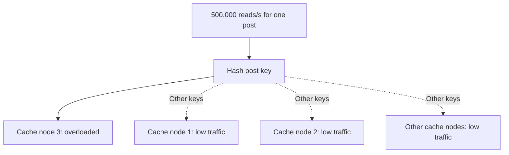

**Key idea:** More nodes do not solve a single-key bottleneck if all requests still target the same owner.

## 3. Read hot keys vs write hot keys

| Question | Read hot key | Write hot key |
|---|---|---|
| Typical example | Celebrity post details | Likes or stock count |
| Main bottleneck | Too many reads of one item | Too many updates to one item |
| Common strategy | Serve copies from several locations | Partition, aggregate or serialize updates |
| Important trade-off | Cache freshness | Accuracy, ordering and coordination |

Always classify the hot spot **before** selecting a mitigation.

## 4. Solution: application-local caching

Each application instance keeps a short-lived copy of extremely popular data. Requests can be answered without repeatedly contacting the distributed cache.

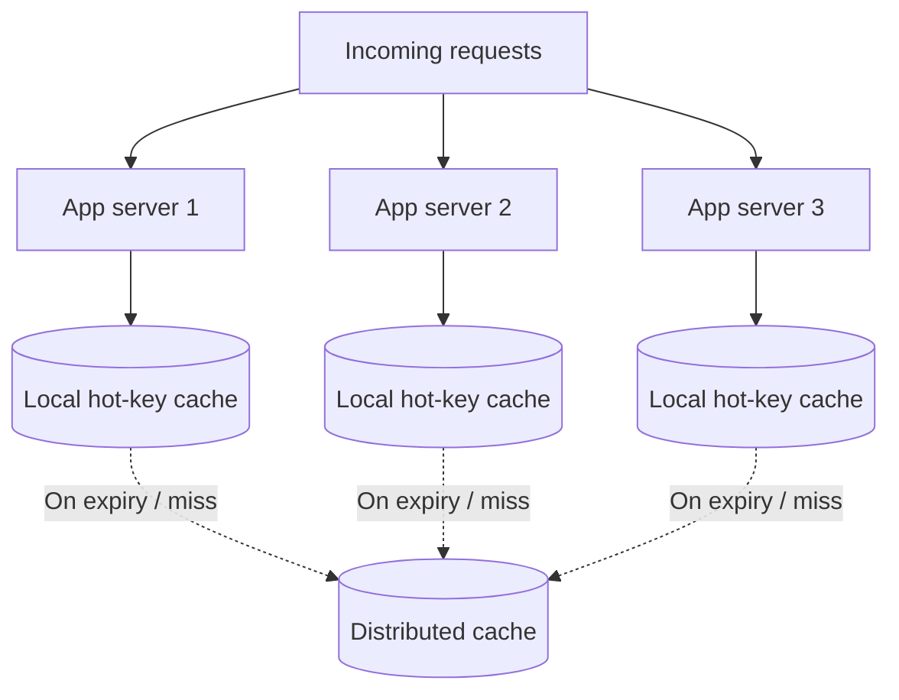

### Example calculation

Assume:

- The popular post receives **500,000 reads/s**.
- There are **100 application instances**.
- Each instance caches the post for approximately **1 second**.

Under steady traffic, the distributed cache might receive around **100 refresh reads/s** for that item instead of 500,000 reads/s. This is an idealized estimate; restarts, expiry synchronization, multiple threads and misses can create bursts.

**Trade-off:** A one-second TTL allows a local copy to be briefly stale. This is usually more acceptable for post text or video metadata than for inventory or account balances.

## 5. Solution: replicate popular cache entries

A second technique is to store multiple independently addressable copies of one frequently read value.

Example keys:

```text
post:123:copy:0
post:123:copy:1
post:123:copy:2
...
post:123:copy:9
```

The application chooses a copy when reading, spreading requests across cache nodes if those copies map to different physical owners.

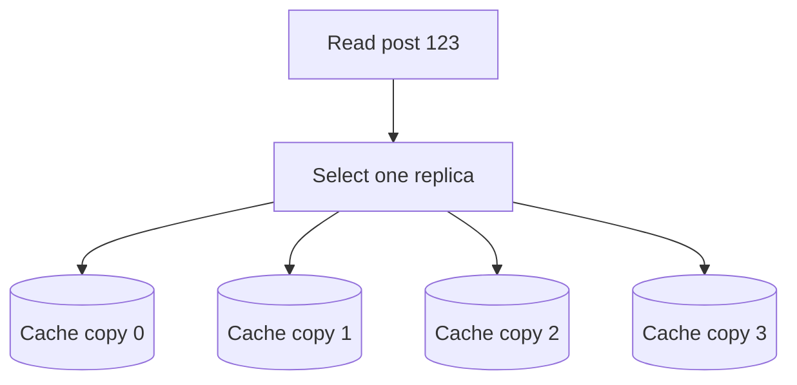

**Benefits:** One extremely popular key no longer has to rely on one cache owner.

**Costs:** Edits require invalidating or refreshing multiple copies; failed invalidation can temporarily produce different versions.

**Practical note:** Verify actual cache placement. Different key names do not *guarantee* different nodes unless the placement scheme enforces or makes that distribution sufficiently likely.

## 6. Detecting hot keys

Some hot keys are predictable, such as content from an account with a huge audience. Others become hot unexpectedly.

A detection system can:

1. Count requests by key over a rolling time window.
2. Identify the highest-frequency keys.
3. Compare them with a configured threshold.
4. Enable local caching or replicated copies for the hot set.
5. Remove special treatment after demand returns to normal.

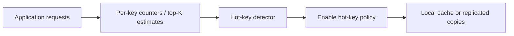

For large key spaces, collecting every key centrally can itself be costly. Sampling or approximate heavy-hitter algorithms can help. The original lesson also mentions Redis command-line support for identifying frequently accessed keys, subject to the relevant Redis version and configuration.

**Watch:** per-key QPS, node CPU, network throughput, cache hit rate, p95/p99 latency and eviction rate.

## 7. Solution: sharded counters

A popular video may receive so many likes that a single counter row becomes contended.

Instead of updating one row, split the logical count into several buckets. Each increment chooses a bucket, and the total is the sum of all buckets.

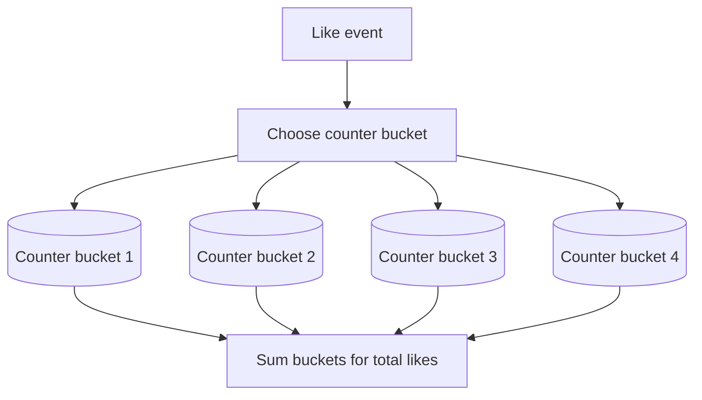

**Benefits:** Concurrent increments are distributed across multiple rows or partitions.

**Costs:** Exact reads can require combining many values. A short-lived cached total can reduce read cost when minor staleness is acceptable.

The lesson illustrates **10 buckets**, but the optimal number depends on workload and placement. A ten-bucket design does not automatically provide a tenfold improvement.

**Important:** Counting likes accurately may also require preventing the same user from liking the same post more than once. Sharded counters alone do not enforce that business rule.

## 8. Solution: buffer and aggregate writes

Rather than immediately writing every like or view, application instances can collect increments over a short interval and submit a combined update.

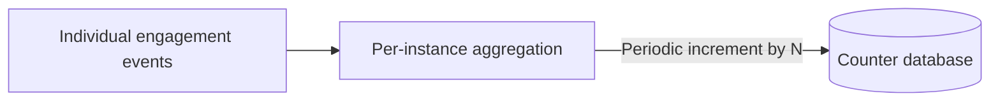

For example, if 100 application instances each flush once per second, the database may receive roughly **100 aggregate updates per second** for that item, rather than one update for every incoming event.

**Trade-offs:** The visible count may lag, and a process crash may lose increments held only in memory. If every event must be preserved, first record it durably and aggregate downstream.

## 9. Hot partitions in message brokers

A broker can suffer from the same skew as a cache.

If every event for a viral post uses the **post ID** as its partition key, those events may all land in one Kafka partition. That partition's consumer can fall behind while other consumers remain underutilized.

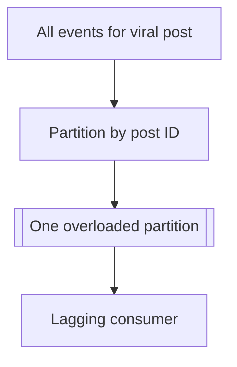

When strict per-post ordering is **not required**, a partitioning key with an additional bucket or suffix can spread events across multiple partitions.

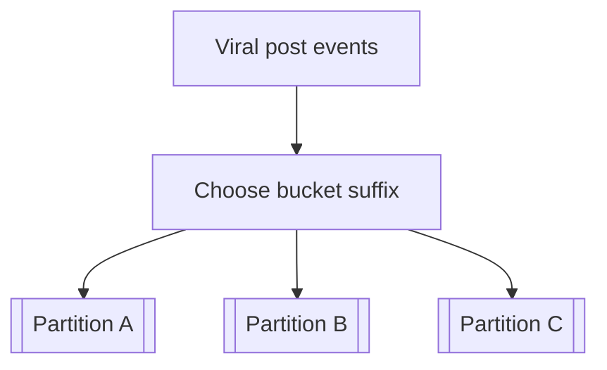

**Trade-off:** Distributing one logical key across partitions may remove a single total ordering. Design downstream aggregation and duplicate handling accordingly.

## 10. Exact inventory during flash sales

Not every hot counter can be approximate.

Suppose a store has **1,000 units** of a product while **50,000 buyers** attempt to purchase it. The system must ensure that successful reservations or sales do not exceed available stock.

### Option A: atomic conditional decrement

Use an authoritative counter with a condition equivalent to **decrement only if remaining stock is positive**.

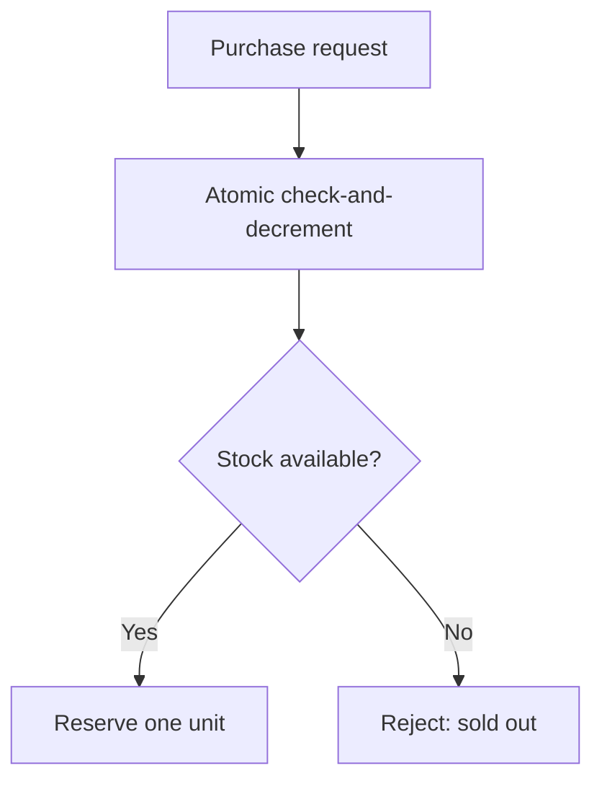

A plain decrement that can take stock below zero is insufficient. Redis scripts or other atomic operations can implement the condition, but the system still needs a plan for persistence, failover and order/payment reconciliation.

### Option B: inventory buckets

Split 1,000 units into 10 independent buckets of 100 each. Each purchase reserves from one bucket; if that bucket is empty, the system can try another.

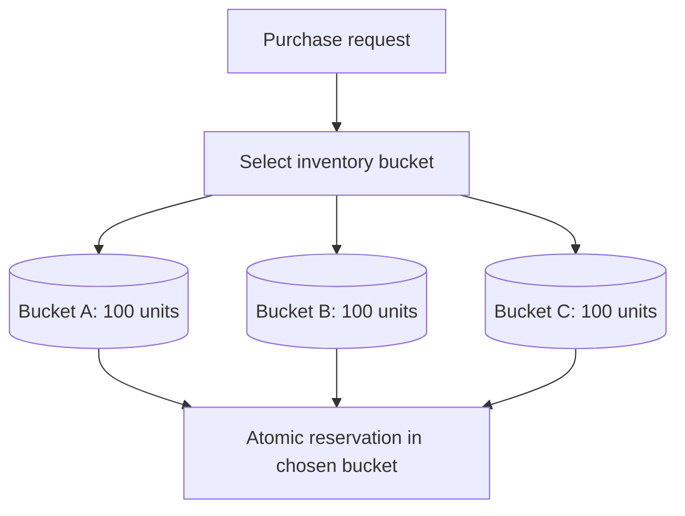

This only prevents overselling if the **initial allocation is correct** and **each bucket's reservation is atomic**. Cancellation, restocking, expiry and cross-bucket retries also need consistent rules.

### Option C: serialize purchases through a queue

Put reservation requests for one product into a queue and have one active logical worker process them in order.

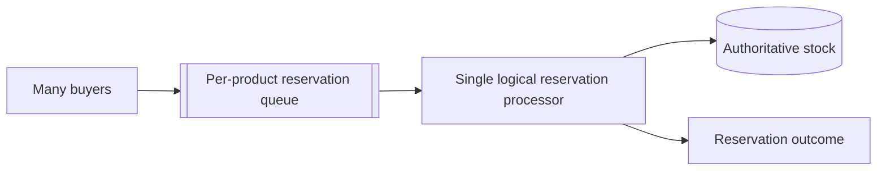

This simplifies contention management but caps throughput at the processor's rate. Exactly-once business effects still require idempotency, durable state and correct recovery after worker failure.

### Choosing an approach

| Option | Advantage | Main concern |
|---|---|---|
| Conditional atomic counter | Fast simple reservation | Durability and state reconciliation |
| Inventory buckets | Distributes contention | Bucket accounting and coordination |
| Serialized queue | Easier to reason about order | Throughput and backlog |

**Rule:** Approximate counters may work for view counts; inventory requires an explicit correctness guarantee.

## 11. Partition-key mistakes

Hot spots are sometimes caused by data placement rather than popularity.

### Increasing timestamps with range sharding

New events share the newest time range and can overload the same partition.

### Low-cardinality or skewed keys

Partitioning by `country` may be unbalanced if most users come from one country.

### Very large tenants

If all traffic from one customer maps to one shard, an unusually large customer may overload it.

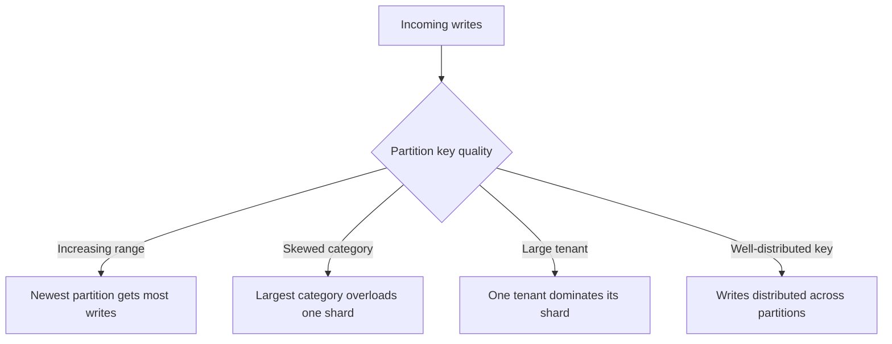

Possible remedies include hashing, composite keys, dedicated partitions for unusually large tenants, and periodic repartitioning. The correct choice must also preserve required query patterns.

## 12. Interview approach and takeaways

A strong system design answer should proceed in this order:

1. **Locate the hot key.** Which item, tenant, row or partition is receiving disproportionate traffic?
2. **Classify the operation.** Is the problem dominated by reads, writes, or both?
3. **For read-heavy hot keys:** Consider local caching, replicated cache entries and sensible TTLs.
4. **For write-heavy hot keys:** Consider sharded counters, buffering, aggregation or repartitioning.
5. **For exact values:** Describe atomic reservations, ordering, durability and recovery.
6. **Detect unexpected hot spots:** Measure per-key traffic and automatically enable mitigations.
7. **Explain the trade-offs:** Freshness, throughput, ordering, correctness, memory and operational complexity.

### Quick reference

| Problem | Candidate solution | Trade-off |
|---|---|---|
| Viral post overloads one cache node | Local cache | Briefly stale copies |
| One popular item saturates a cache owner | Replicated hot-key entries | Invalidation complexity |
| One like counter row is contended | Sharded counters | More expensive total reads |
| Too many view updates | Aggregate increments | Delay and potential buffered loss |
| Kafka partition overloaded by one post | Bucket partition keys | Loss of total per-post ordering |
| Flash-sale stock must remain exact | Atomic conditional reservation | Coordination and durability |
| One large customer overloads a shard | Dedicated tenant shard | More placement/operational complexity |

**Final principle:** Distributing keys evenly is not the same as distributing traffic evenly. Find the specific bottleneck, then choose a mitigation that matches both the operation type and its correctness requirements.

---

**Related notes:** [Scaling Write-Heavy Systems](Scaling_Write_Heavy_Systems.md) · [Scaling Read-Heavy Traffic](Scaling_Read_Traffic_Study_Notes.md) · [Database Scaling, Consistency, Messaging & Resilience](Database_Scaling_Consistency_Messaging_and_Resilience.md)

*Based on the user-provided hot-key lesson transcript; reorganized and rewritten for study purposes. Add source attribution if the original creator or link is available.*
