# Handling Long-Running Tasks — System Design Explained Simply

*Distributed Systems Study Library · Author: Jayesh Sharma*

**Learn how to build reliable background jobs for exports, video processing, imports, campaigns and AI workloads using queues, workers, checkpoints and workflow orchestration.**

> Independently authored educational guide based on the supplied transcript. Explanations, examples, diagrams and tables are newly composed; extra operational cautions cover durable scheduling, ownership and safe retries.

## Contents

- [1. Why do long-running tasks need special handling?](#1-why-do-long-running-tasks-need-special-handling)
- [2. Real-world use cases and questions to ask](#2-real-world-use-cases-and-questions-to-ask)
- [3. Why not process everything inside an HTTP request?](#3-why-not-process-everything-inside-an-http-request)
- [4. The basic asynchronous-job architecture](#4-the-basic-asynchronous-job-architecture)
- [5. Design a simple job API](#5-design-a-simple-job-api)
- [6. Job states and durable lifecycle](#6-job-states-and-durable-lifecycle)
- [7. How does a user know the work is finished?](#7-how-does-a-user-know-the-work-is-finished)
- [8. Queues and dedicated workers](#8-queues-and-dedicated-workers)
- [9. Scale from backlog, not just CPU](#9-scale-from-backlog-not-just-cpu)
- [10. Separate queues to avoid head-of-line blocking](#10-separate-queues-to-avoid-head-of-line-blocking)
- [11. Worker crash and visibility timeout](#11-worker-crash-and-visibility-timeout)
- [12. Heartbeats, leases and stale-worker fencing](#12-heartbeats-leases-and-stale-worker-fencing)
- [13. Retries with backoff and dead-letter queues](#13-retries-with-backoff-and-dead-letter-queues)
- [14. Idempotency: safe work despite repeated delivery](#14-idempotency-safe-work-despite-repeated-delivery)
- [15. Progress tracking: tell the user what is happening](#15-progress-tracking-tell-the-user-what-is-happening)
- [16. Checkpoints and resume after crashes](#16-checkpoints-and-resume-after-crashes)
- [17. Split huge jobs into parallel subtasks](#17-split-huge-jobs-into-parallel-subtasks)
- [18. Multi-step work and workflow engines](#18-multi-step-work-and-workflow-engines)
- [19. Cancellation, run timeouts and cleanup](#19-cancellation-run-timeouts-and-cleanup)
- [20. Fairness, priorities and tenant isolation](#20-fairness-priorities-and-tenant-isolation)
- [21. A worked report-export design](#21-a-worked-report-export-design)
- [22. System design interview framework](#22-system-design-interview-framework)
- [23. Common interview questions and revision notes](#23-common-interview-questions-and-revision-notes)

---

## 1. Why do long-running tasks need special handling?

A normal API request should usually finish quickly. But some jobs can take minutes or hours: exporting two million report rows, encoding a video, validating a large customer spreadsheet, compiling a coding submission or generating an AI asset.

Imagine a restaurant. The receptionist **takes your order and gives you a ticket**, while the kitchen prepares the food. The receptionist should not stand still for 30 minutes cooking one meal.

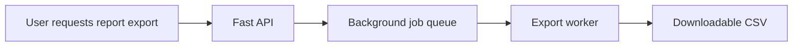

**Core rule:** Separate **accepting work** from **executing work**.

A slow process is not automatically unsafe, but tying it to a single HTTP request creates timeout, reliability and capacity challenges.

---

## 2. Real-world use cases and questions to ask

| Scenario | Slow part | Final output |
|---|---|---|
| YouTube-like upload | Encoding resolutions and thumbnails | Ready-to-play video |
| CSV export | Reading millions of records | File in object storage |
| Customer import | Validation and bulk database writes | Import result and error report |
| Coding judge | Compile and run test cases | Verdict and diagnostics |
| Email campaign | Sending to many recipients | Delivery report |
| AI media generation | Compute-intensive inference | Image or video result |

Ask about typical and maximum duration, arrival rate, peak parallel jobs, output size, cancellation, user-facing progress and recovery expectations.

**Do not assume every task needs a full workflow engine.** A simple durable queue plus workers can be enough for many single-step jobs.

---

## 3. Why not process everything inside an HTTP request?

Suppose an export takes **five minutes**. The user starts it through a web request, but an intermediate load balancer closes an idle connection earlier.

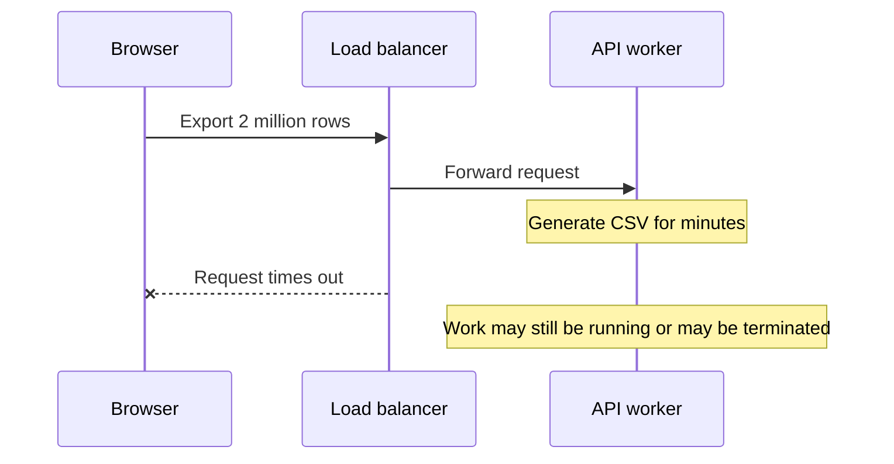

Three problems arise:

- **Timeout:** The HTTP path may end before the operation finishes.
- **Resource coupling:** Long operations occupy worker capacity, memory or connections.
- **Ambiguous result:** The client may retry even though the first operation completed.

Async processing avoids forcing a browser connection to represent the life of a lengthy job.

**Accuracy note:** Timeout defaults differ among infrastructure products and configurations; do not treat a specific number as universal.

---

## 4. The basic asynchronous-job architecture

Use three separate building blocks: **job metadata**, **durable queue**, and **workers**.

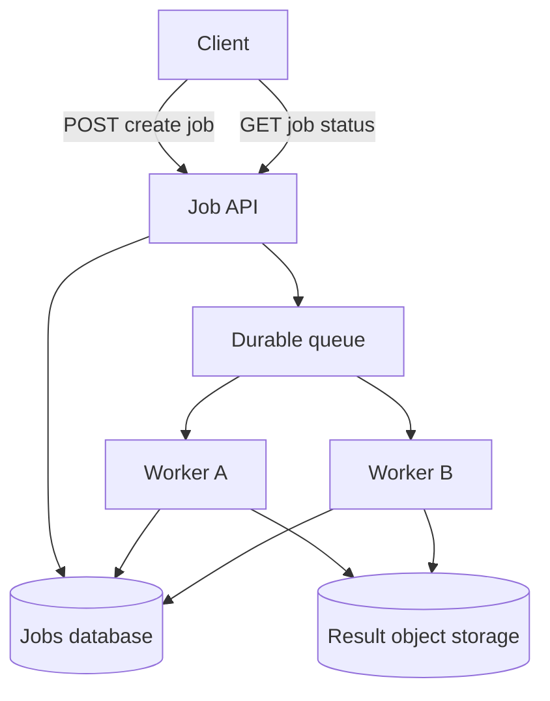

**Step by step:** The API authenticates and validates the request, creates a `QUEUED` job with a unique ID, durably schedules it, then immediately returns the ID. A separate worker claims the job, records `RUNNING`, performs the work and eventually stores a result or a failure record.

**Production consideration:** Saving the job record and publishing the queue message are two different writes. Use a transactional outbox or a reliable DB-backed job-claiming approach so a crash between them does not create a permanently stranded job.

---

## 5. Design a simple job API

A clear HTTP contract separates the submission request from the later status/result retrieval.

```http
POST /reports/exports
Idempotency-Key: export-req-92
Content-Type: application/json

{"reportType":"orders","month":"2026-10"}
```

A successful asynchronous acceptance might return:

```http
HTTP/1.1 202 Accepted
Location: /jobs/job_792
Content-Type: application/json

{"jobId":"job_792","status":"QUEUED"}
```

The status endpoint can return progress:

```json
{
  "jobId": "job_792",
  "status": "RUNNING",
  "processedItems": 400000,
  "totalItems": 2000000,
  "percent": 20
}
```

**Important:** HTTP **202 Accepted** means processing was accepted, **not that the result is ready**. Submission idempotency avoids creating duplicate jobs when browsers retry the same logical request.

Job ownership checks must apply to status, cancellation and result URLs too.

---

## 6. Job states and durable lifecycle

Represent the job as a durable **state machine**, not just a “running” Boolean.

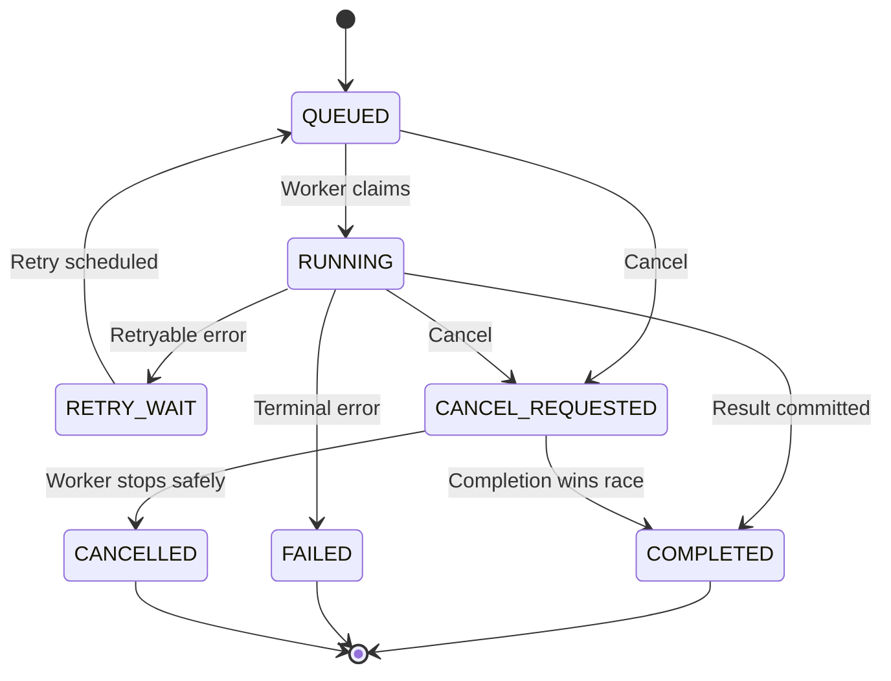

A record can contain:

| Field | Why it matters |
|---|---|
| `job_id`, `tenant_id` | Identity and access control |
| `type`, `input_ref` | Work definition |
| `status`, `attempt` | State and retry count |
| `progress`, `checkpoint` | User feedback and resumability |
| `lease_owner`, `lease_until` | Safe job claiming |
| `result_key`, `error_code` | Retrieval and diagnosis |
| `created_at`, `updated_at` | Audit and monitoring |

Make updates conditional so an **old worker cannot overwrite a newer state** after its lease has expired.

---

## 7. How does a user know the work is finished?

The right notification mechanism depends on job duration and who is waiting.

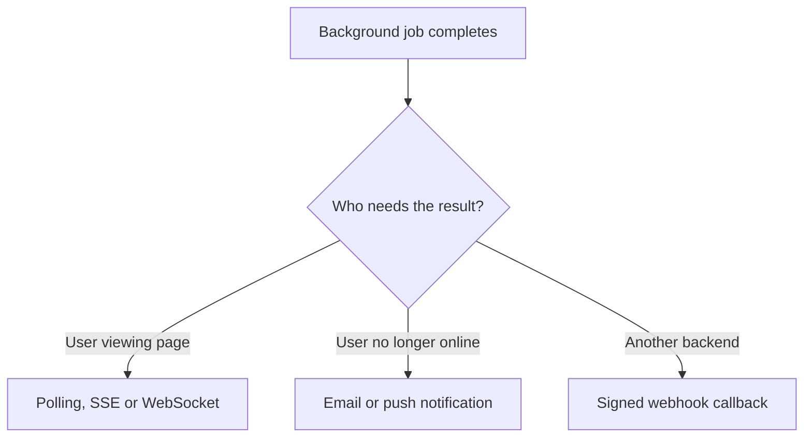

**Polling:** `GET /jobs/job_792` every few seconds is simple and often appropriate for multi-minute tasks.

**SSE or WebSockets:** Useful for richer live progress while the client remains connected.

**Email/push:** Helpful for hour-long exports when the user closes the page.

**Webhook:** Lets another system provide a callback endpoint; callbacks should be signed, retryable and idempotent at the receiver.

See [Designing Real-Time Updates at Scale](Designing_Real_Time_Updates_at_Scale.md), [Server-Sent Events](Communication_Patterns/Real-Time%20Communication/Server_Sent_Events_Explained.md), and [Webhooks](Communication_Patterns/Real-Time%20Communication/Webhooks_Explained.md).

---

## 8. Queues and dedicated workers

A job queue such as SQS or RabbitMQ can distribute work to independent workers.

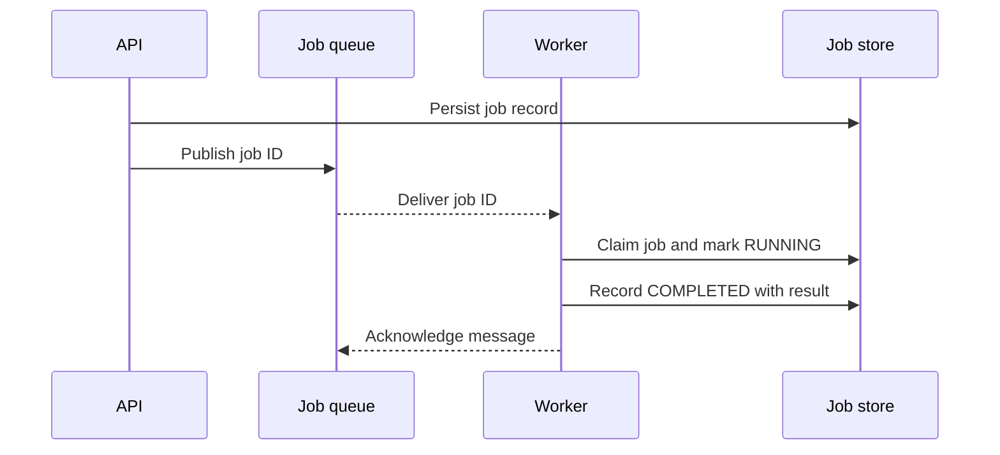

Workers can scale independently from web servers. Some need CPU, some high-memory machines, and others GPU capacity.

**Choose the queue based on required delivery, ordering, retention and scheduling behavior**, not just because a popular product name appeared in an interview answer.

---

## 9. Scale from backlog, not just CPU

A long queue means users wait before their work even starts. Scaling workers based only on CPU can miss this problem.

Useful signals include:

- Number of waiting jobs.
- **Age of the oldest queued job.**
- Average service time per job type.
- Active workers and successful throughput.
- Retry and failure rates.

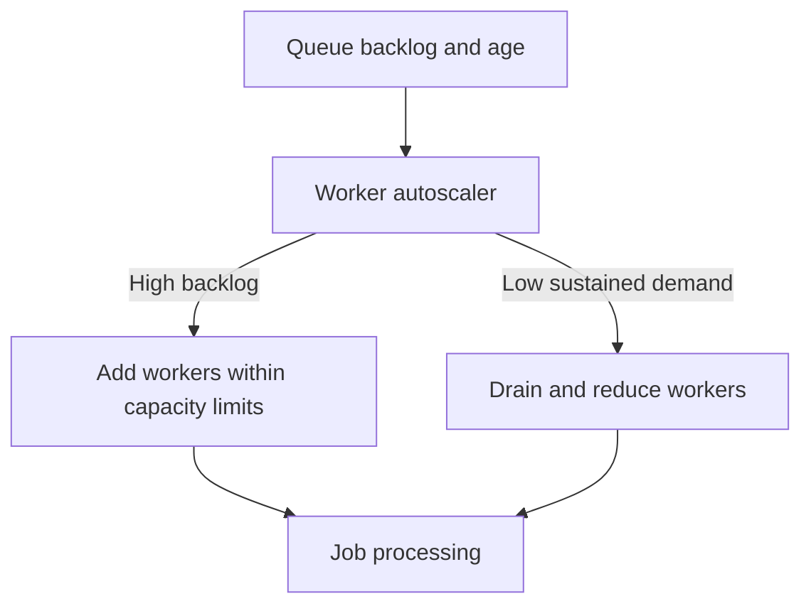

**Illustrative capacity:** If a worker completes one job every 60 seconds, 10 continuously busy workers can complete roughly **10 jobs per minute**, ignoring variability, parallelism and overhead.

Use per-class concurrency limits so a surge of expensive work does not exhaust storage, databases or downstream APIs.

---

## 10. Separate queues to avoid head-of-line blocking

A password-reset email should not wait behind hundreds of video transcoding jobs.

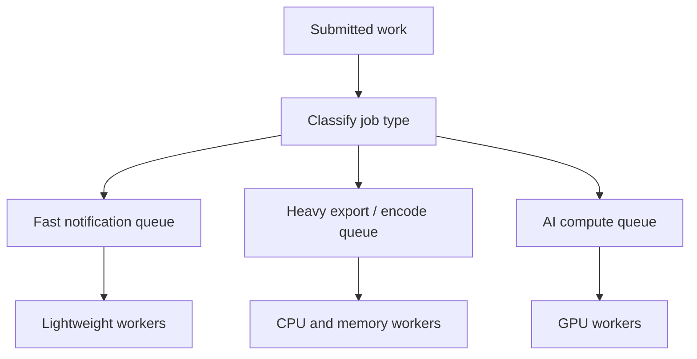

Separate queues, worker pools and concurrency budgets make it easier to prioritize urgent work and select the right hardware.

**Caution:** Too many isolated queues can strand capacity. Group jobs according to meaningful differences in latency, resources, priority and tenant policy.

---

## 11. Worker crash and visibility timeout

A worker can disappear halfway through a task. Durable task queues often avoid permanently deleting the message until the worker acknowledges success.

SQS uses a **visibility timeout**: the message is temporarily hidden while a worker processes it. If no successful acknowledgment/deletion happens before the timeout, the message can be delivered again.

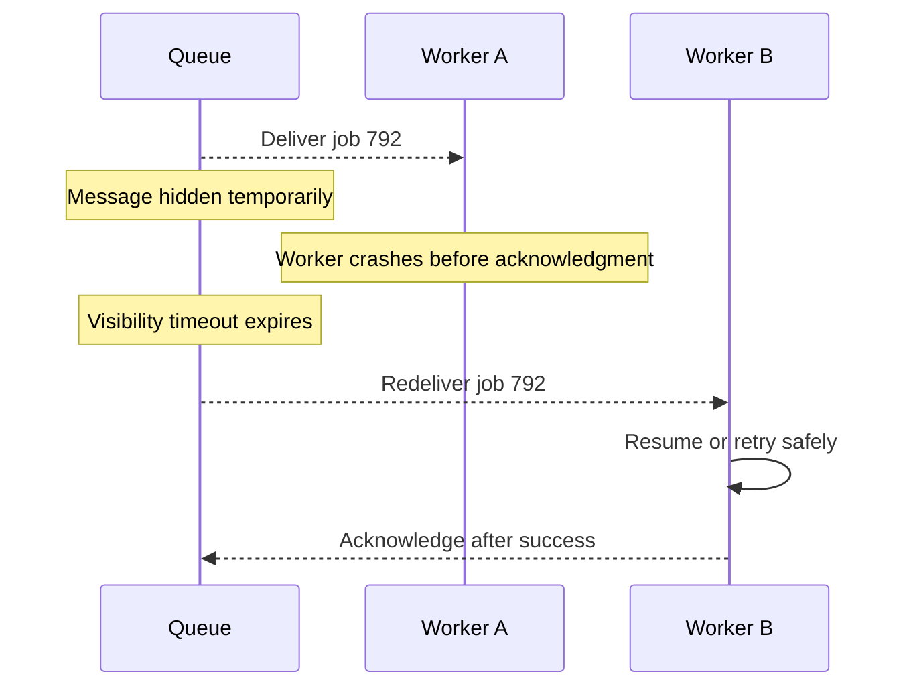

This is commonly **at-least-once execution**, not “exactly one worker will ever see this job.”

The worker should extend visibility or its processing lease for legitimate long work. But a heartbeat does **not** replace a durable checkpoint or a protection against stale workers.

---

## 12. Heartbeats, leases and stale-worker fencing

What if Worker A pauses for two minutes? Its lease may expire, Worker B may take over, and A may later wake up. Without a guard, **both** can write a result.

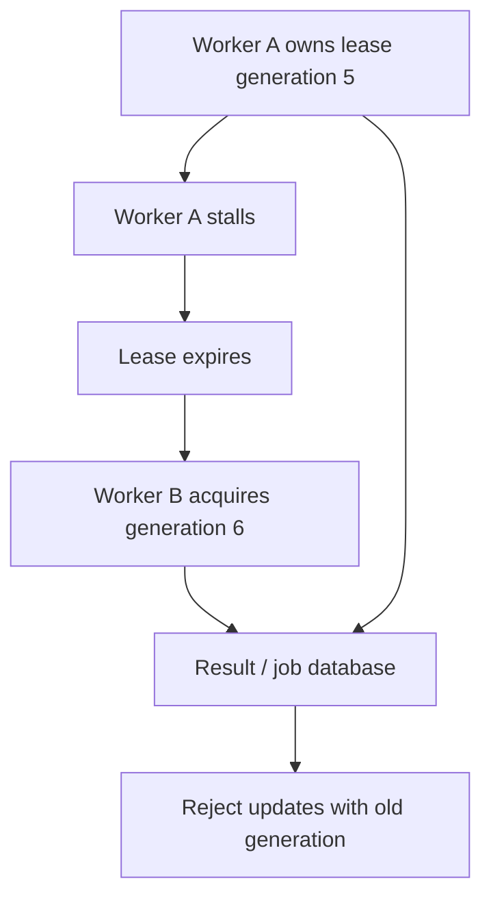

Use a **lease generation / fencing token** and conditional writes so only the current owner can transition the job to `COMPLETED` or publish the final result pointer.

**Important:** Job leases and queue visibility are separate concepts in some architectures. Keep them aligned, and prevent expired owners from performing irreversible external effects where possible.

---

## 13. Retries with backoff and dead-letter queues

Some failures are temporary: a network call times out or an external storage service is unavailable. Others are permanent: the uploaded file is malformed or permissions are invalid.

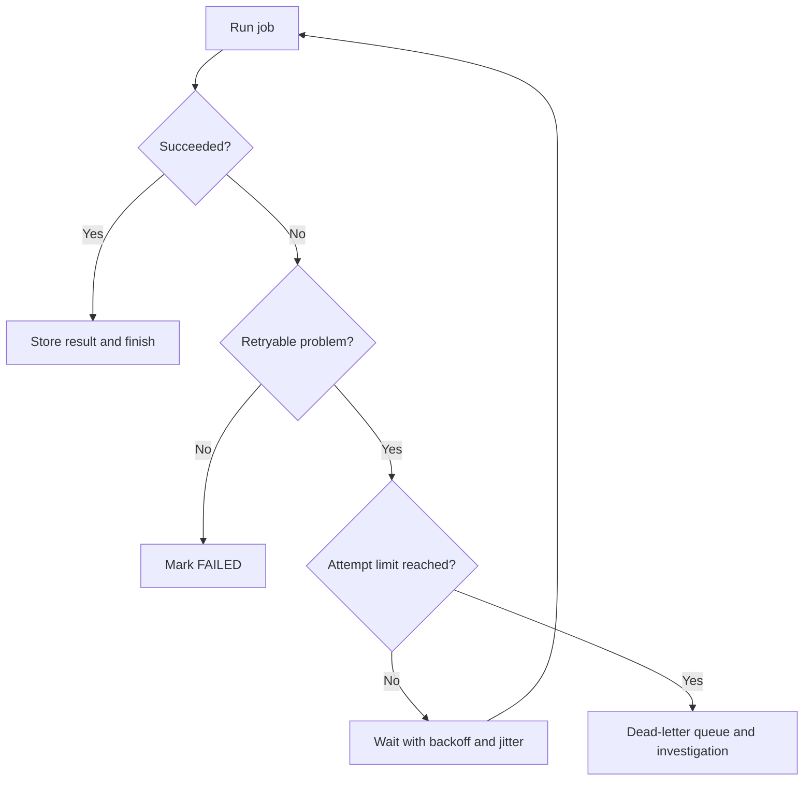

**Backoff with jitter** spreads load and avoids synchronized retries. A finite retry budget prevents infinite work on irreparably bad inputs.

Dead-letter messages need an **operational owner**, investigation tools, safe replay procedures and alerting. A DLQ is not a magical repair mechanism.

An attempt limit such as five is an example policy, not universal.

---

## 14. Idempotency: safe work despite repeated delivery

Because jobs can be retried, each logical task needs a stable **job ID or operation key**.

For a report export, generate output into a temporary object and atomically mark one chosen final result as belonging to the job.

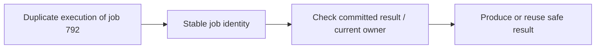

Simply writing repeatedly to the same filename **may not be enough** when concurrent workers can overwrite each other or notify the user twice. Store the final result reference using a version-checked job transition; publish completion notifications idempotently.

If a job triggers payments, billing or external emails, those side effects require their **own idempotency and reconciliation controls**.

See [Idempotency and Deduplication](Idempotency_and_Deduplication_in_Distributed_Systems.md).

---

## 15. Progress tracking: tell the user what is happening

For a job processing 2 million rows, show actual progress when possible.

```text
Processed rows = 400,000
Total rows     = 2,000,000
Progress       = 20%
```

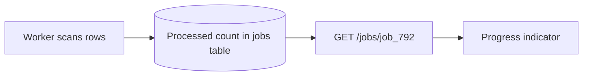

Track **completed work**, not simply how long the worker has been running. Progress can be an estimate if steps differ greatly in complexity.

Updates should be throttled to avoid writing the database for every row. A worker may update every few thousand records or every few seconds.

**Separate progress from correctness:** A displayed 100% is not the same as a durably stored, verified result unless the system says so.

---

## 16. Checkpoints and resume after crashes

Suppose importing a million records takes two hours and the worker crashes near the end. Without checkpoints, it may repeat almost all the work.

A **checkpoint** records the last safely completed unit or durable cursor.

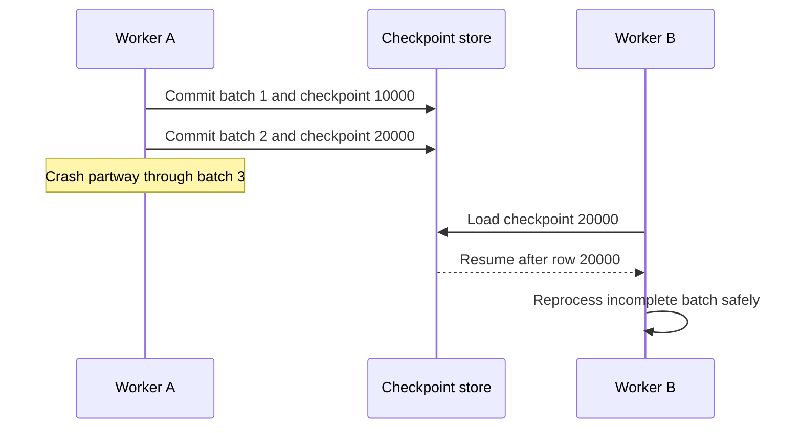

**Crucial detail:** Save the checkpoint **only after** the corresponding work is durably committed, ideally in the same transaction when using one database.

If the side effect and checkpoint live in different systems, use idempotency and reconciliation so retries do not duplicate business effects.

For imports, use stable source ordering or record IDs; a raw row offset alone can be unsafe if the source changes.

---

## 17. Split huge jobs into parallel subtasks

Some jobs are naturally divisible: exporting independent date ranges, transcoding video segments or sending bounded campaign batches.

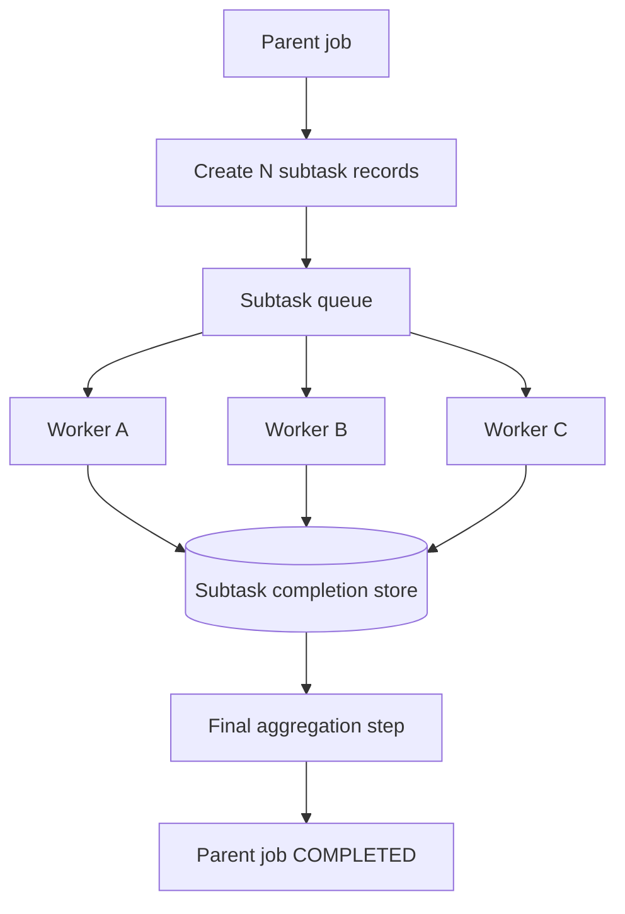

Workers can execute independent pieces concurrently. Failed pieces are retried without rerunning every completed piece.

**Safety concern:** A completion counter alone can be incremented twice when messages are redelivered. Store a unique completion record **per subtask**, then derive or atomically maintain the total.

Finally, aggregate outputs only when all **required unique subtasks** have succeeded. Watch for resource hot spots and retry storms.

---

## 18. Multi-step work and workflow engines

A video pipeline might include file validation, safety scanning, encoding, thumbnail creation, caption extraction and creator notification.

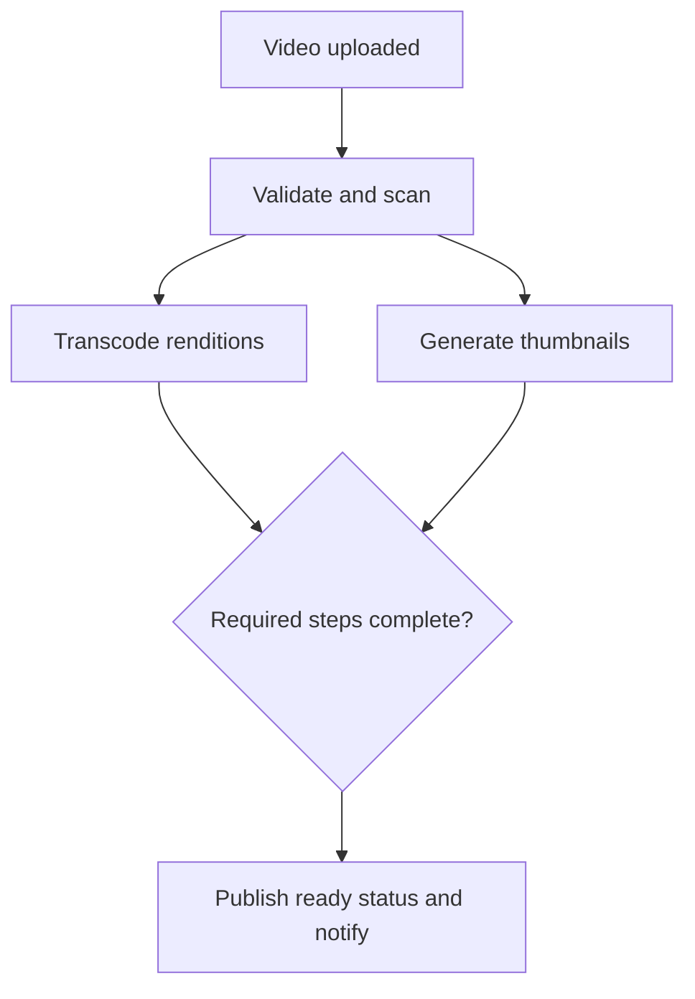

For **simple, independent jobs**, a queue and workers often suffice. For complex dependencies, timeouts, retries and compensation rules, **workflow engines** such as Temporal or AWS Step Functions can preserve execution state.

A workflow engine can coordinate durable retries, but individual activities **still need idempotency** because executing an activity more than once may be necessary during recovery.

Avoid adding orchestration complexity when a single queue plus clear job state already meets requirements.

---

## 19. Cancellation, run timeouts and cleanup

Users sometimes start the wrong export or no longer need a costly job. Cancellation is usually **cooperative**.

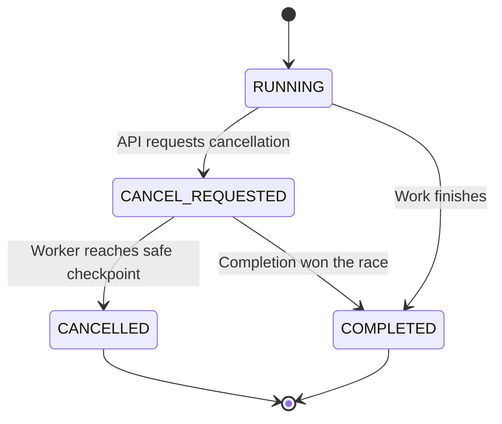

The API sets a `CANCEL_REQUESTED` flag. Workers check at safe boundaries, stop scheduling new subtasks and clean temporary artifacts when cancellation wins.

**Nuance:** Cancellation is not always instantaneous. Work already sent to an external service may finish and require compensation. The status transition must define who wins if completion and cancellation arrive together.

Set practical **maximum run times** and watchdogs for stuck jobs. Different job types need different limits: a five-second email dispatch and a two-hour export should not use the same deadline.

---

## 20. Fairness, priorities and tenant isolation

One customer submitting 10,000 enormous exports should not prevent every other customer from completing one small export.

Techniques include per-tenant concurrent-job limits, admission quotas, weighted fair scheduling, and separate pools for urgent and batch work.

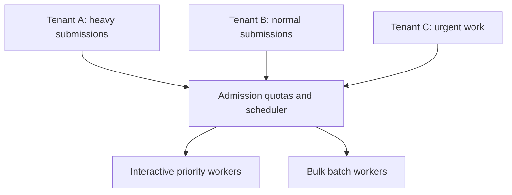

Balance fairness with efficient worker utilization. An idle GPU should not necessarily stay unused forever just because one queue's static allocation is exhausted.

Security and cost: enforce per-tenant access checks, maximum input sizes, maximum runtime, storage retention and budget protections against accidental job explosions.

---

## 21. A worked report-export design

Consider a dashboard where analysts export millions of rows.

**Submission:** `POST /exports` creates a job, validates filters and returns `202 Accepted` with the job ID.

**Execution:** The export queue schedules an appropriate worker. It reads consistent report data in batches, saves progress, and writes output to an object-storage object.

**Result:** When the object is complete, the worker atomically saves the final object key and marks the job `COMPLETED`. The status API returns a short-lived download link after authorization.

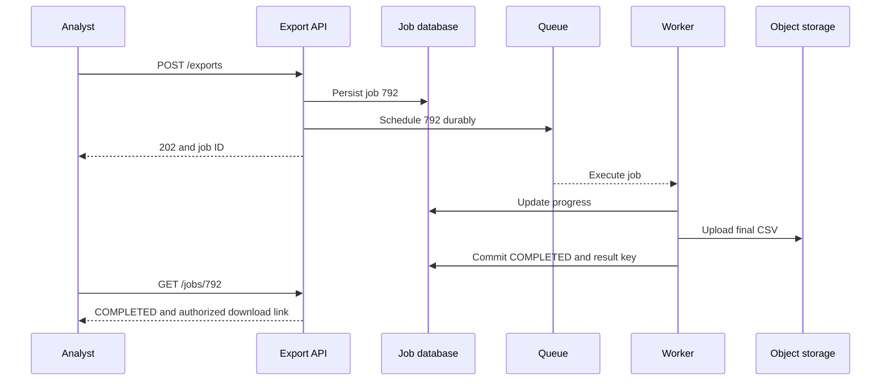

**Reliability checklist:** Stable submission key, durable scheduling, leases, batched checkpoints, progress updates, result publication fencing, secure downloads, retry limits and result cleanup.

**Trade-off:** A live export of changing data should define a consistent reporting snapshot or at least disclose its consistency model.

---

## 22. System design interview framework

When asked to design exports, video processing, bulk imports, notifications or AI generation, use this structured answer:

1. **Identify work:** Duration, concurrency, size and result expectations.
2. **Decouple HTTP:** Persist a job and return a job ID quickly.
3. **Make scheduling durable:** Queue plus outbox or another crash-safe mechanism.
4. **Track job state:** Status, ownership, progress, output and errors.
5. **Notify clients:** Polling, SSE/WebSockets, email or webhook.
6. **Protect execution:** Visibility leases, heartbeats, fencing and idempotency.
7. **Recover:** Backoff, retry limit, DLQ and checkpoints.
8. **Scale:** Worker pools, backlog metrics, parallel subtasks and workflow engines.
9. **Control:** Cancellation, timeouts, quotas and per-tenant fairness.
10. **Observe:** Queue age, processing latency, success rate and stuck jobs.

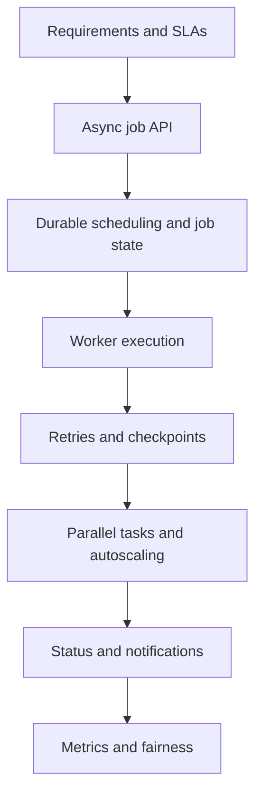

### Interview-ready example

**“I would create a durable job record and return HTTP 202 with the job ID. A queue drives separately scaled workers. Workers acquire expiring leases, heartbeat, checkpoint meaningful progress and write results to object storage. At-least-once delivery is handled through idempotent job steps and conditional finalization. Users poll for status or receive a notification, and job classes have separate concurrency controls.”**

---

## 23. Common interview questions and revision notes

### Practice questions

1. Why should a five-minute export not block an ordinary HTTP request?
2. What does `202 Accepted` communicate?
3. What fields belong in a job record?
4. How do you prevent the DB-record-plus-queue dual-write problem?
5. Compare status polling, SSE, push notifications and webhooks.
6. Why do queue messages become visible again after worker failure?
7. What is a visibility timeout or processing lease?
8. What happens if a worker resumes after losing its lease?
9. Why must job execution be idempotent?
10. How do backoff and dead-letter queues help?
11. When should a checkpoint be saved?
12. How do you safely count completed parallel subtasks?
13. What does a workflow engine add beyond a queue?
14. How should cancellation compete with a job completing?
15. How can you stop one tenant's bulk jobs from starving others?
16. What metrics reveal a growing worker backlog?

### One-minute cheat sheet

| Term | Remember |
|---|---|
| Asynchronous job | Work continues after the request returns |
| HTTP 202 | Accepted for later processing |
| Job ID | Stable identifier for status and recovery |
| Durable queue | Retains work through worker failures |
| Visibility timeout | Temporary hiding of an in-flight message |
| Heartbeat | Renews evidence that processing is active |
| Lease / fencing | Controls which worker may finalize a job |
| Idempotency | Makes retries safe |
| Backoff + jitter | Spreads retry traffic |
| DLQ | Isolates exhausted or poison messages |
| Checkpoint | Last safely committed processing position |
| Fan-out/fan-in | Parallel subtasks followed by aggregation |
| Workflow engine | Tracks dependent steps durably |
| Cooperative cancellation | Worker stops at safe boundaries |
| Queue fairness | Prevents starvation between job classes or tenants |

**Final takeaway:** **Accept quickly, schedule durably, execute in workers, and make every recovery path safe.** Long-running tasks become manageable when their lifecycle and progress survive failures.

---
