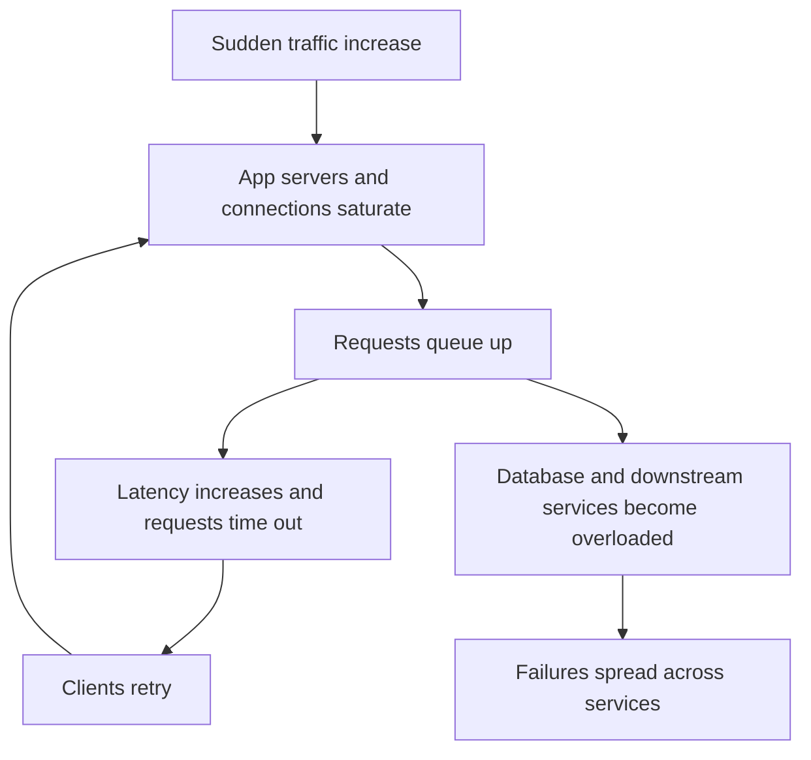
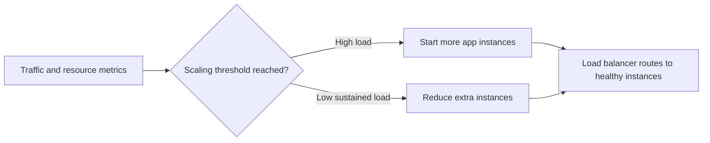
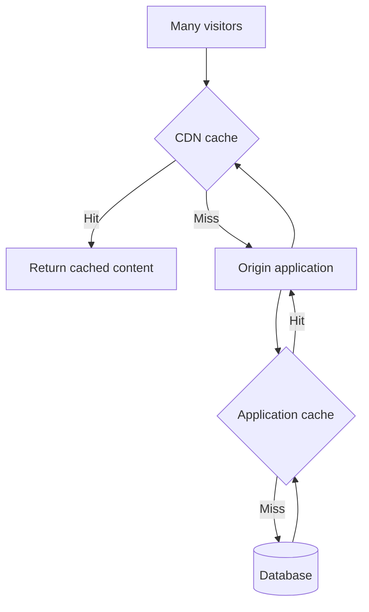
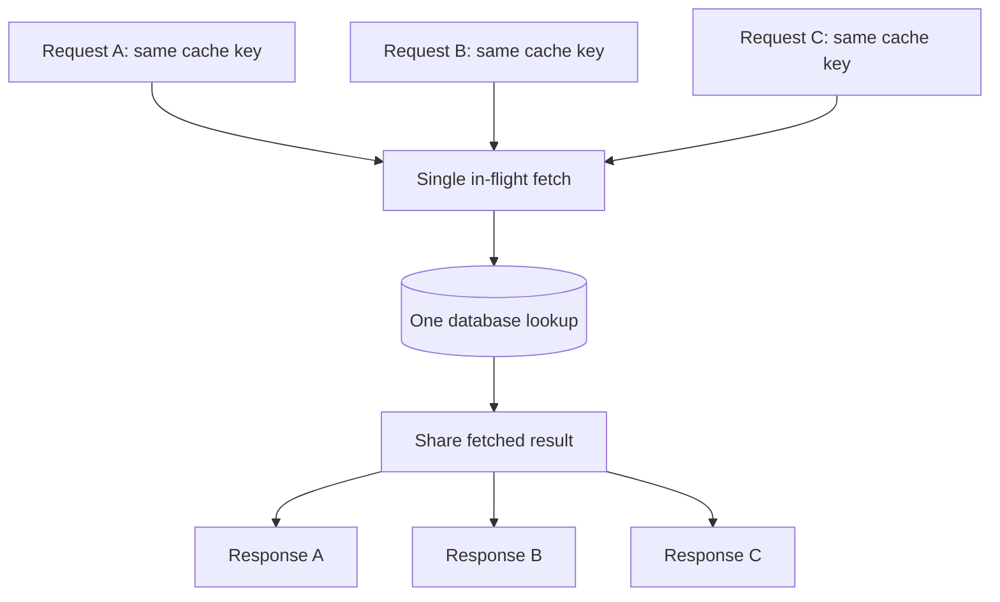
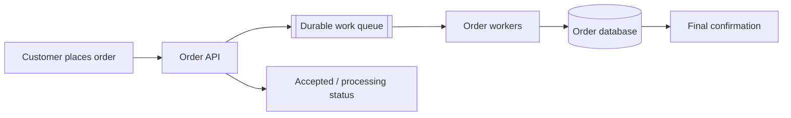
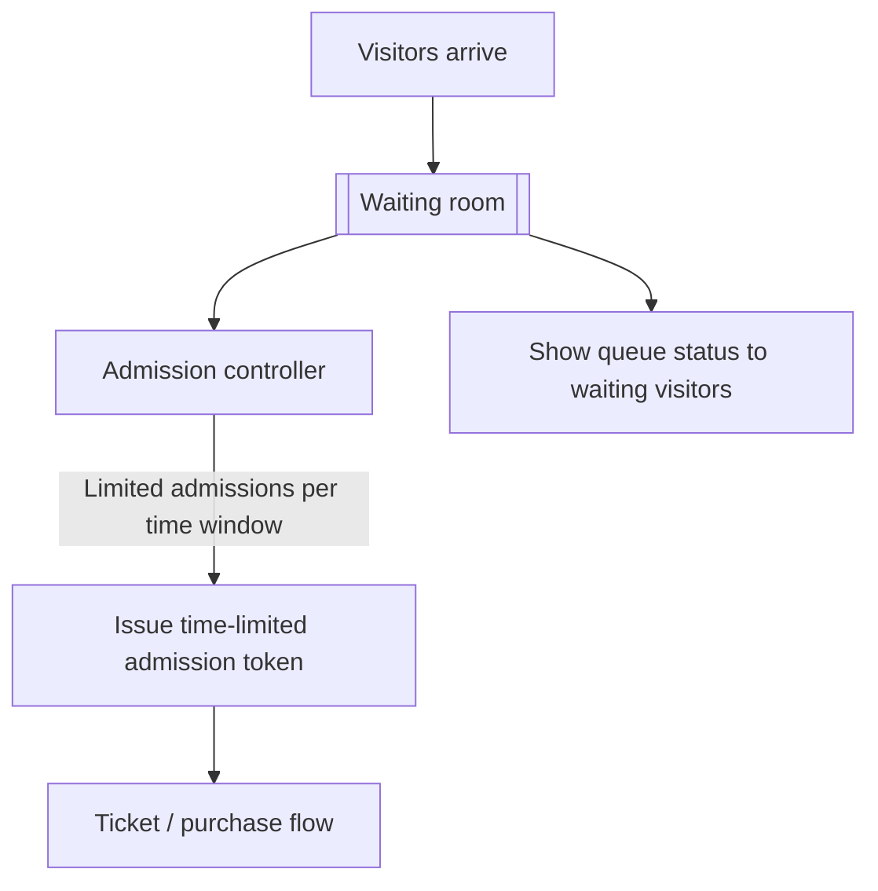
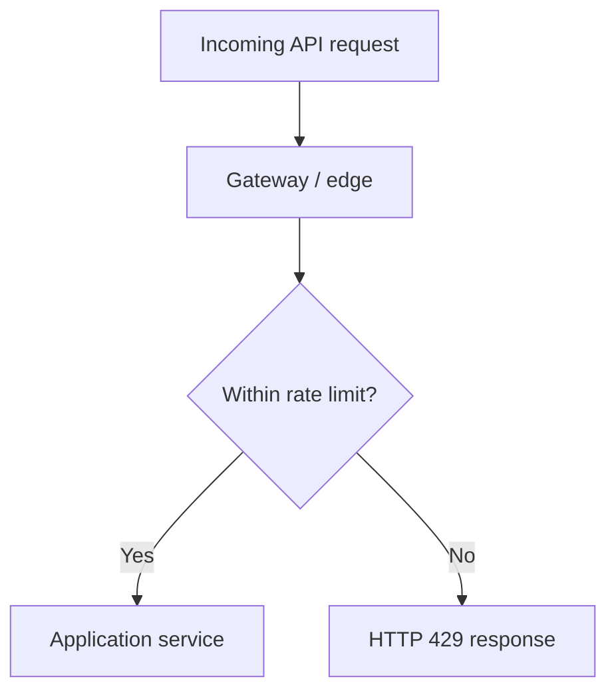
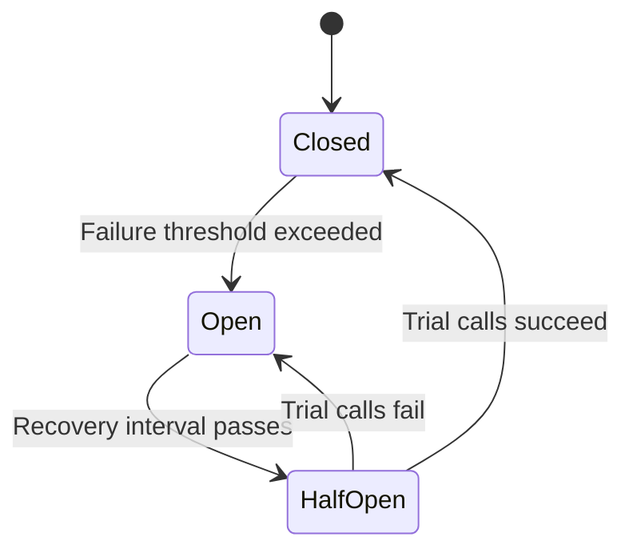
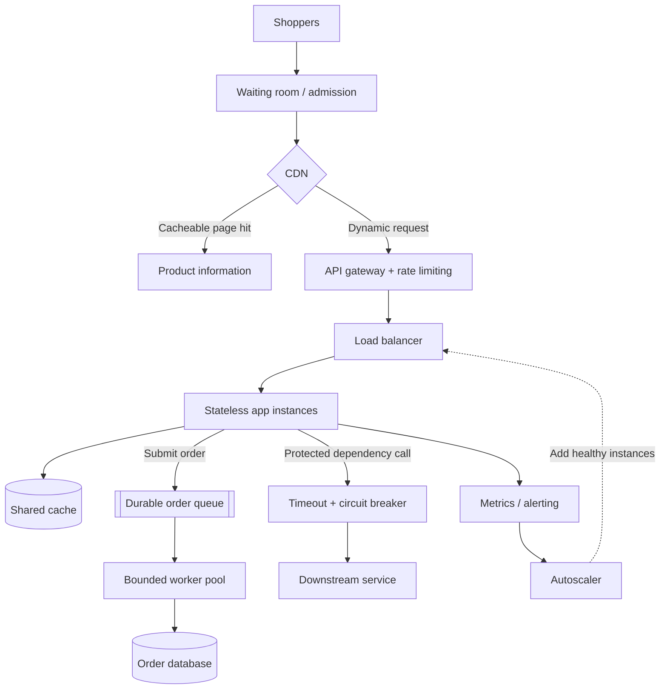

# Handling Traffic Spikes in Distributed Systems

*A practical system-design guide to sudden increases in traffic, based on the supplied lesson transcript. The explanations and diagrams below have been independently rewritten and organized for learning.*

## What will you learn?

- Why sudden bursts can bring down an otherwise healthy service
- How predictable and unpredictable spikes require different preparation
- How to add capacity, absorb traffic, and limit the impact of overload
- How to apply these ideas to flash sales, concert tickets, and news events
- A repeatable approach for system-design interviews

## 1. Understanding a traffic spike

A **traffic spike** is a rapid increase in demand beyond the level a system typically handles.

Think of these situations:

| Situation | Why demand jumps |
|---|---|
| Concert ticket release | Everyone tries to book when sales open |
| Online flash sale | Shoppers race to buy limited stock |
| Major sporting event | Viewers arrive around the same moment |
| Breaking news | Many readers request one popular article |
| Mass push notification | A large group opens an application at once |

For example, an application that receives **5,000 requests per second (RPS)** most of the day might have capacity for **10,000 RPS**. A viral event could suddenly push demand to **50,000–100,000 RPS**. The numerical values are illustrative, not a sizing recommendation.

### How overload spreads

Notice the feedback loop: when callers retry immediately, a slow system receives *more* work just when it can least afford it.

The design goal has three parts:

1. **Expand** available processing capacity.
2. **Control** how much work enters the system.
3. **Isolate** faults so one struggling component does not disrupt everything.

---

## 2. Predictable vs. unpredictable spikes

| Type | Examples | Best starting strategy |
|---|---|---|
| **Predictable** | Scheduled concert sale, product launch, sporting event | Provision ahead of time, pre-warm caches, load-test |
| **Unpredictable** | Viral content, major breaking news | Maintain spare capacity, monitor, autoscale, protect dependencies |

### Predictable: prepare before the event

For a sale starting at 10:00 AM, operators might add servers well in advance, increase caching resources, warm frequently accessed product data, and run tests against expected peak traffic.

**Cache pre-warming** means fetching or generating popular data before the audience arrives. Otherwise, the first wave of visitors may all miss the cache and hit the database simultaneously.

**Load testing** reveals the first component that stops keeping up. It could be the database, cache, API server, connection pool, or an external dependency.

### Unpredictable: respond automatically

Autoscaling watches metrics such as CPU utilization or request demand, then changes application capacity.

**Why autoscaling alone isn't enough:** New instances need time to start and pass health checks. Demand may rise much faster than capacity can be added.

Keep a reasonable **capacity buffer** to handle the first part of a sudden spike. Stateless application instances are easier to scale because any healthy instance can serve a request; session and other shared state should live in an appropriate shared store.

A further limitation is that scaling the application tier does not automatically scale the database. You must separately manage backend pressure.

---

## 3. Reduce requests with caching and a CDN

The easiest backend request to process is one the backend never receives.

During a spike, a large share of visitors may be requesting the **same public content**: a product description, news article, or event information page. A **CDN (content delivery network)** can serve cacheable responses close to the user, often without involving the origin application.

A very short cache lifetime can have a large effect on repeatedly requested public data. But remember:

- CDN locations maintain separate caches, so total origin traffic depends on the number of locations and cache behavior.
- Publicly cached data can briefly be outdated.
- Personalized or sensitive responses must not accidentally enter a public cache.
- Inventory availability or payment data may require fresher checks than a product description.

### Request coalescing

Suppose hundreds of requests for one uncached product arrive together. Rather than letting each request query the database, one request fetches the data while the others wait for and reuse its result. This is also known as **single-flight** loading.

This reduces the risk of a **cache stampede**, where one expired hot entry triggers many identical database queries.

---

## 4. Smooth write bursts with a message queue

Caching helps reduce **reads**, but an order or payment usually requires backend processing.

During a sale, directly processing every purchase request synchronously can overwhelm the write path. When the product allows asynchronous confirmation, a durable queue can absorb incoming work.

The queue acts as a **buffer**. Producers can enqueue work during a short rush while workers process it at a sustainable rate. The backlog can grow temporarily and drain later.

**Key trade-off:** “Request accepted” does not mean “order confirmed.” The interface should communicate a pending state and eventually report success or failure.

Additional production considerations include durable message storage, queue length monitoring, backpressure, retry policies, and idempotent processing so duplicate deliveries do not create duplicate orders.

---

## 5. Virtual waiting rooms for extreme demand

Ticket sales can exceed the capacity of the *whole interactive buying path*. Rather than allowing every visitor to compete for checkout simultaneously, a **virtual waiting room** can control how quickly people enter.

The admission rate should be based on measured backend capacity. For illustration, a service might admit **2,000 users per minute**, but an actual limit depends on how much work each admitted user produces.

A waiting room can improve predictability and user experience, but it needs protection against bots, token sharing, unfair queue jumping, and bypassing admission checks.

---

## 6. Rate limiting at the edge

A **rate limiter** caps how often a client can make requests. Common identities include account, API key, device, or IP address.

For example, a policy might allow **10 requests per second per user**. Requests above the threshold can receive **HTTP 429 Too Many Requests**; servers may provide a `Retry-After` header.

Rate limits help prevent aggressive polling, bot activity, and retry storms from consuming disproportionate capacity.

Rate limiting and waiting rooms serve different purposes: a **waiting room** manages entry into a constrained workflow; **rate limiting** restricts the frequency of requests by a client or group.

---

## 7. What if demand still exceeds capacity?

Even after caching, queueing and scaling, some bursts will exceed your limits.

### Load shedding

**Load shedding** means intentionally rejecting excess or low-priority work rather than accepting everything and making every request slow.

For example, a retailer might prioritize checkout over personalized recommendations. Rejecting or deferring recommendation requests can preserve resources for payments and orders.

### Graceful degradation

**Graceful degradation** keeps the core user journey available while simplifying less-essential features.

A product page could temporarily hide recommendations and reviews but still display key product information and a purchase button. Feature flags make it possible to change such behavior without releasing new code.

| Technique | What it does | Example |
|---|---|---|
| Load shedding | Rejects excess work | Decline low-priority requests under saturation |
| Graceful degradation | Reduces feature complexity | Serve cached feed instead of computing a fresh one |
| Admission control | Limits active users entering | Queue ticket buyers |
| Queue buffering | Spreads tasks across time | Process order requests at controlled throughput |

---

## 8. Prevent cascading failures

A slow downstream service can tie up the resources of every upstream service waiting for it. If a payment service stops responding, its callers may run out of threads or connections, and their callers may fail in turn.

Three basic protections work together:

**Timeouts:** Never wait indefinitely on a dependency. Set explicit, realistic time budgets.

**Bounded retries:** Retry only errors that may recover, with limited attempts and exponential backoff plus random jitter. Retries must not amplify overload, and non-idempotent operations require particular care.

**Circuit breakers:** After repeated failures, stop calling a struggling dependency temporarily. Later, allow a small number of trial requests before restoring normal traffic.

Circuit breakers protect callers from repeated slow failures; they do not repair the failed service themselves.

---

## 9. Putting it together: flash-sale architecture

The layers below address different bottlenecks. The diagram is a **study architecture**, not a claim that every shopping application uses the same components.

### The sequence

1. **Before a known event:** provision capacity, prime popular caches, and load-test.
2. **At arrival:** a waiting room controls admission when necessary.
3. **For content:** the CDN and shared cache reduce origin and database reads.
4. **For APIs:** the gateway limits abusive or excessively frequent calls.
5. **For purchases:** a durable queue buffers eligible asynchronous operations.
6. **During overload:** shed less important work and disable expensive optional features.
7. **During failures:** use timeouts, bounded retries and circuit breakers to contain problems.
8. **After the burst:** let queues drain and scale unused capacity down safely.

Note: The exact routing of an e-commerce site may differ. Public pages may be served directly by a CDN even before admission, while buying APIs remain admission-controlled.

---

## 10. System design interview approach

A strong answer explains *why* each control is necessary, not just the names of technologies.

| Step | Interview question | Design response |
|---|---|---|
| 1. Characterize the burst | Peak RPS? Arrival speed? Predictable? Duration? | Quantify demand |
| 2. Find the bottleneck | App tier, database, hot cache key, third-party API? | Locate the weakest link |
| 3. Reduce expensive reads | What is safe to cache? | CDN, cache, request coalescing |
| 4. Control incoming work | Can all visitors enter at once? | Waiting room, rate limits, bounded queues |
| 5. Add capacity | Can capacity be prepared or added quickly? | Pre-scaling, headroom, autoscaling |
| 6. Survive overload | What matters most to users? | Load shedding, degradation, dependency isolation |
| 7. Validate behavior | What happens when demand exceeds projections? | Load tests, dashboards, alerts and recovery drills |

### Example talking points

- “I'd separate content browsing from the scarce checkout operation.”
- “I'd test the throughput the payment and order database can sustain before choosing an admission rate.”
- “I'd keep spare capacity because autoscaling is not instantaneous.”
- “I'd make asynchronous acceptance visible to the user instead of promising an order is already confirmed.”
- “I'd use retries with backoff and jitter, not unrestricted immediate retries.”

---

## 11. Quick reference

| Problem | Primary technique | Limitation / trade-off |
|---|---|---|
| Known upcoming spike | Pre-scale and load-test | Extra cost before event |
| Unannounced burst | Autoscaling plus headroom | New capacity takes time |
| Many identical public reads | CDN caching | Potentially stale responses |
| Simultaneous cache misses | Request coalescing | Requires coordination per key |
| Write-heavy burst | Durable queue | Delayed completion / backlog |
| Too many buyers at once | Virtual waiting room | Admission delays |
| Bots or runaway clients | Rate limiting | May reject legitimate bursts |
| Severe saturation | Load shedding | Some requests intentionally fail |
| Optional work consumes capacity | Graceful degradation | Reduced user experience |
| Dependency repeatedly fails | Timeout + retries + circuit breaker | Needs careful configuration |

## Key takeaway

Reliable spike handling is not one scaling trick. A well-designed system combines **preparation**, **caching**, **traffic admission**, **work buffering**, and **failure containment**, so the most important user actions continue to work when demand rises suddenly.

---

### Source and attribution

Adapted into original study notes from the transcript uploaded for this repository (lesson on **handling sudden traffic spikes**). The prose, comparisons, and Mermaid diagrams here are independently composed for explanation; the original video narration is not reproduced. Examples and thresholds are illustrative rather than promises of real-world capacity.
