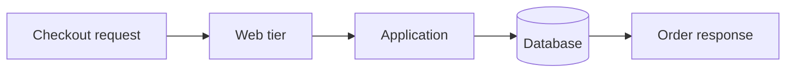
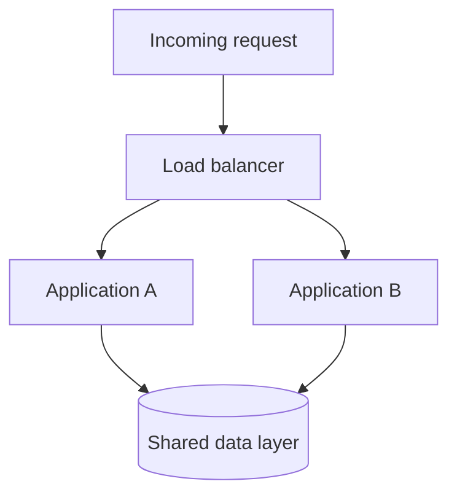
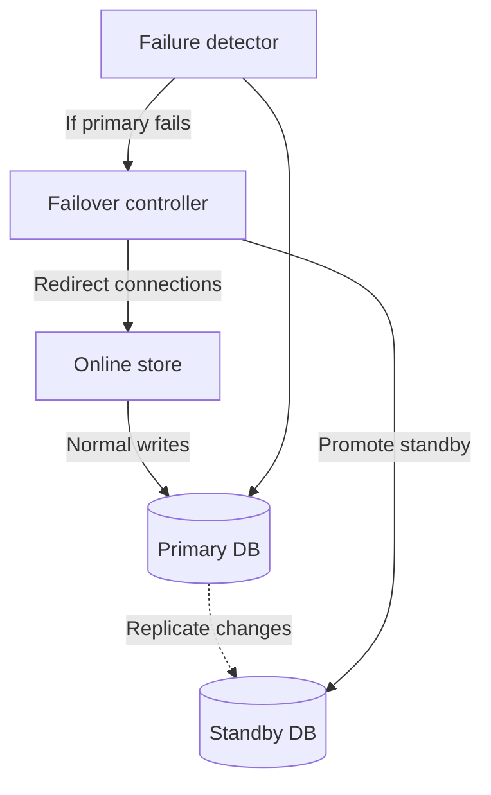
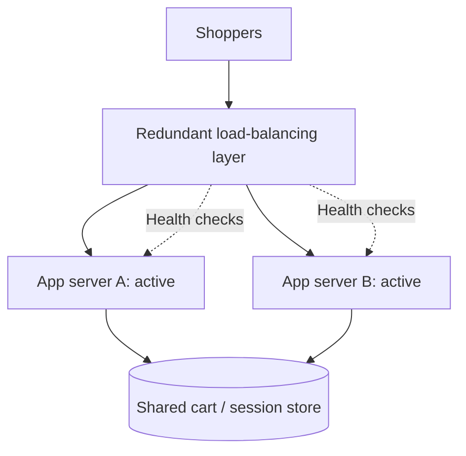
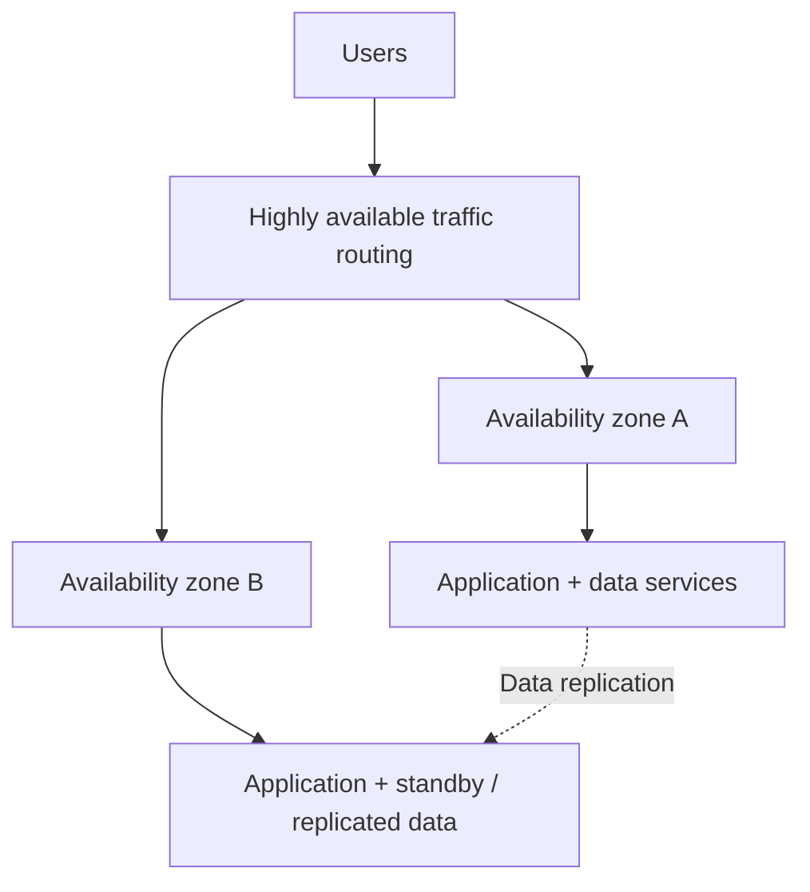
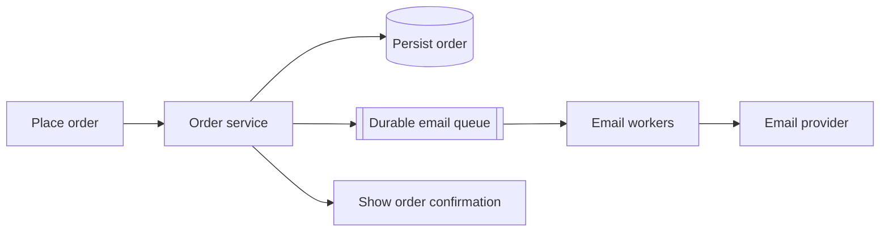
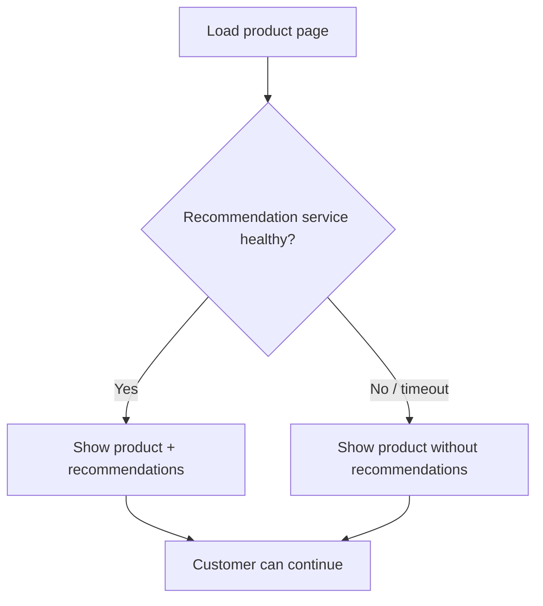
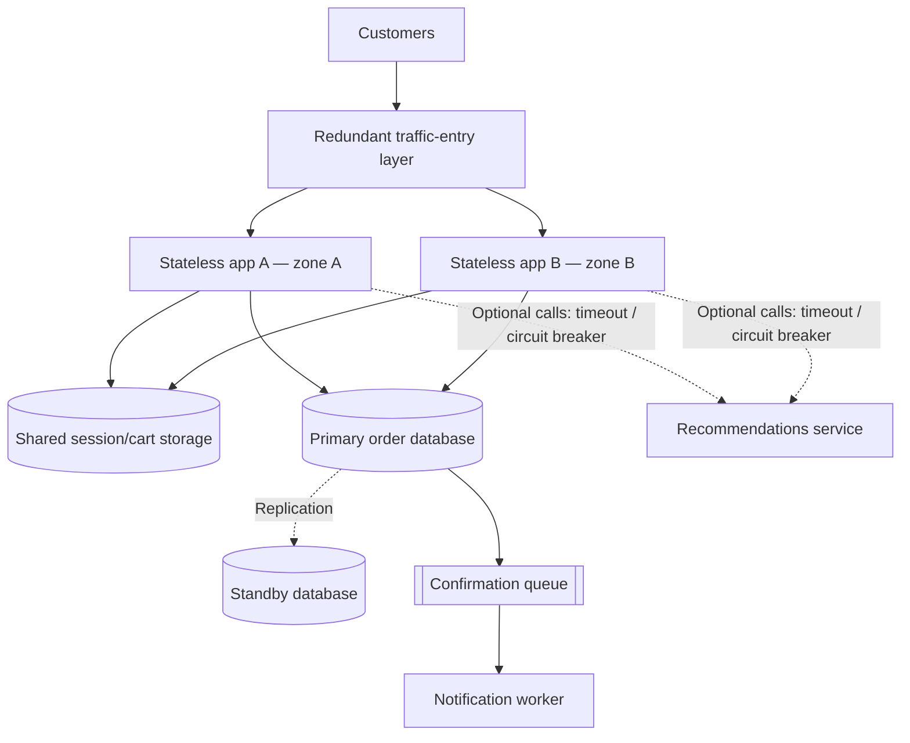

# High Availability in Distributed Systems

**Uptime, redundancy, failover, health checks and fault isolation — explained with easy maths and diagrams**

> Original study notes adapted from the user-provided availability lesson transcript. This is an independently organized explanation with newly written examples and Mermaid diagrams; it is not a reproduction of the lesson's narration. Numbers below assume a 365-day year unless stated otherwise.

## Contents

1. [Availability vs reliability vs scalability](#1-availability-vs-reliability-vs-scalability)
2. [How to calculate availability](#2-how-to-calculate-availability)
3. [The nines: downtime cheat sheet](#3-the-nines-downtime-cheat-sheet)
4. [Series dependencies: every required component matters](#4-series-dependencies-every-required-component-matters)
5. [Parallel redundancy: two working paths](#5-parallel-redundancy-two-working-paths)
6. [Active–passive and database failover](#6-activepassive-and-database-failover)
7. [Cold, warm and hot standby](#7-cold-warm-and-hot-standby)
8. [Active–active applications and health checks](#8-activeactive-applications-and-health-checks)
9. [Multi-zone and multi-region resilience](#9-multi-zone-and-multi-region-resilience)
10. [Protect availability during overload](#10-protect-availability-during-overload)
11. [Online store: end-to-end architecture](#11-online-store-end-to-end-architecture)
12. [Interview checklist and revision](#12-interview-checklist-and-revision)

---

## 1. Availability vs reliability vs scalability

Imagine an online store with one app server and one database. Everything works until the app server crashes. Even if the database remains healthy, customers cannot browse or order.

**Availability** asks: *Can users access the operation they need, when they need it?*

**Reliability** asks: *Does the system keep behaving correctly over time?*

**Scalability** asks: *Can the system handle more work when we add resources?*

| Quality | Simple question | Store example |
|---|---|---|
| Availability | Is the service usable? | Can the customer place an order? |
| Reliability | Is the outcome correct? | Is the order total calculated correctly? |
| Scalability | Can we handle more demand? | Can checkout handle a flash-sale peak? |

A store can be **available but incorrect**: checkout might respond successfully while computing the wrong total. Availability and reliability are related, but not interchangeable.

**Measure the user journey.** A store that serves product pages but cannot accept orders may have good *browse availability* and poor *checkout availability*.

## 2. How to calculate availability

For a defined service and observation window:

```text
Availability (%) = Uptime / (Uptime + Downtime) × 100
```

### Example: one day offline in a 365-day year

```text
Uptime   = 364 days
Downtime =   1 day
Total    = 365 days

Availability = (364 / 365) × 100 ≈ 99.726%
             ≈ 99.73%
```

**Quick mental shortcut:** If the service was down for 1 day out of 365, downtime was about **0.27%**, so uptime was about **99.73%**.

**Scope matters:** Always state whether you are measuring *the entire website*, *checkout*, *payment processing* or some other critical operation. State the time window too.

## 3. The nines: downtime cheat sheet

Availability targets are frequently expressed as “nines”:

| Availability target | Common name | Approx. allowed downtime per year |
|---|---|---|
| 99% | Two nines | 3 days 15 hours 36 minutes |
| 99.9% | Three nines | **8 hours 46 minutes** |
| 99.99% | Four nines | **52 minutes 34 seconds** |
| 99.999% | Five nines | **5 minutes 15 seconds** |
| 99.9999% | Six nines | **31.5 seconds** |

### Easy formula

```text
Allowed downtime = Total time × (1 − Availability/100)

A year ≈ 365 × 24 × 60 = 525,600 minutes
```

For **99.9%**:

```text
Unavailable fraction = 0.001
525,600 × 0.001 = 525.6 minutes ≈ 8 h 46 min
```

For **99.99%**, divide that budget by **10**:

```text
525.6 ÷ 10 = 52.56 minutes ≈ 53 minutes
```

For **99.999%**, divide again by 10:

```text
52.56 ÷ 10 = 5.256 minutes ≈ 5 minutes 15 seconds
```

**Memory trick: 9 → 9 → 9:** Each additional nine gives you roughly **one-tenth** the downtime budget.

> These figures illustrate continuous annual availability targets. Real-world SLAs can define exclusions and use shorter measurement windows, so read the actual SLA terms.

---

## 4. Series dependencies: every required component matters

Suppose the checkout request *must* pass through a web tier, an application tier, and a database. If any required component is unavailable, checkout fails.



### Easy maths

Assume each required component is available **99.9%** of the time, and component failures are **independent**.

```text
End-to-end availability
= 0.999 × 0.999 × 0.999
≈ 0.997003

As a percentage ≈ 99.70%
```

**Why less than 99.9%?** The whole operation requires *all three* components to be working.

**Rule to remember:** For required independent components in **series, multiply their availabilities**.

This is a *simplified mathematical model*, not a measured SLA. Shared failures, correlated faults, retries, and alternative paths can change the real result.

---

## 5. Parallel redundancy: two working paths

Now imagine two equivalent app servers. Either can serve the request, and a healthy instance has enough capacity.



Assume each app server has **99.9% availability**, so each has a **0.1% chance of being unavailable** at a random point in time.

### Easy maths: both must fail

```text
Failure chance per server = 1 − 0.999 = 0.001

Both down (independent) = 0.001 × 0.001
                        = 0.000001

At least one up = 1 − 0.000001
                = 0.999999
                = 99.9999%
```

**Memory trick:** For independent *parallel* components, **multiply their failure probabilities, then subtract from 1**.

> **Important:** The theoretical **99.9999%** applies only to the *two-server pool*. It does **not** include a failing load balancer, database, network, common deployment, or other shared dependencies.

### Independence is a big assumption

Two machines may fail together if they share:

- The same power supply or physical facility
- The same network bottleneck
- A faulty deployment
- A shared dependency such as a database
- A configuration mistake affecting every instance

Redundancy must avoid **common failure modes**, not merely add identical copies.

---

## 6. Active–passive and database failover

In **active–passive**, one component actively serves the workload and another remains ready to take over.

A common example is a primary database and standby replica:



### Failover steps

1. Detect that the primary no longer serves requests.
2. Determine whether failover is safe and necessary.
3. Promote a suitably synchronized standby to primary.
4. Redirect application connections to the replacement.
5. Verify that reads and writes behave correctly.

**Trade-off:** Database write coordination is simpler with one active primary, but **detection, promotion, and reconnection take time**.

**Additional implementation consideration:** Use fencing/leader-election safeguards to avoid two isolated machines both accepting conflicting primary writes (*split-brain*).

---

## 7. Cold, warm and hot standby

The more ready the backup is, the less work remains after a failure—but the greater its ongoing cost usually becomes.

| Standby | State before failure | Typical recovery implication | Cost implication |
|---|---|---|---|
| **Cold** | Not running or not fully provisioned | Must start and perhaps restore data | Usually cheapest |
| **Warm** | Running, partially ready | Needs activation/preparation | Middle ground |
| **Hot** | Running and kept close to current state | Can take over more quickly | Usually costlier |

**Memory trick:** **Cold = start; Warm = prepare; Hot = switch.**

A standby still needs **realistic failover tests**: it may be technically healthy yet too small to serve production traffic.

---

## 8. Active–active applications and health checks

With **active–active**, two or more application servers handle requests simultaneously.



If server A fails, the balancing layer can route new requests to B.

**Requirements for this to work:**

- The remaining app servers must have **spare capacity**.
- Cart/session state must not live only in a failed server's memory.
- Health checks must identify whether an instance can actually serve useful requests.
- The load-balancing layer itself must not be an unprotected single point of failure.

**Nuance:** Health detection and traffic rerouting are not instantaneous. Some in-flight requests can still fail.

### Capacity example

If two servers each handle up to 1,000 RPS, and normal load is 1,600 RPS total, losing either server leaves only **1,000 RPS** of capacity. The app has redundancy but **not enough failover capacity**.

---

## 9. Multi-zone and multi-region resilience

Multiple app instances in the same facility might still fail together due to a power or network outage.



### Failure domains and trade-offs

| Deployment | Protects against | New concerns |
|---|---|---|
| Multiple instances, one zone | Some machine failures | Zone remains shared dependency |
| Multiple zones, one region | Zone-level incidents | Cross-zone network and data design |
| Multiple regions | Some region-wide incidents | Higher latency, replication and failover complexity |
| Multiple cloud providers | Some provider-specific risks | Substantially more operational complexity |

**Synchronous long-distance replication** can increase write latency because a response may wait for remote confirmation.

**Asynchronous replication** can reduce latency, but a sudden region loss may mean the backup lacks the latest updates.

### Two useful objectives (additional terminology)

- **RTO — Recovery Time Objective:** How quickly must the service be restored?
- **RPO — Recovery Point Objective:** How much recent data loss is acceptable?

These help choose between colder/warmer standbys, synchronous/asynchronous replication, and failover designs. The source discusses these trade-offs without naming RTO or RPO.

---

## 10. Protect availability during overload

Availability is not only about broken machines. A service can become effectively unavailable because it is too slow or overloaded.

### A. Move non-critical work out of checkout

Instead of waiting for a confirmation email to send, accept and persist the order, enqueue a message, and send it with a background worker.



**Benefit:** Email-provider slowness need not delay order confirmation. Ensure enqueueing is reliable if the notification must not be lost.

### B. Prevent cascading failures

Suppose the product recommendation service stops responding. Every caller waits, consuming connections and threads, which can affect checkout.

Possible protections:

- **Timeout:** Stop waiting after a reasonable limit.
- **Circuit breaker:** Temporarily avoid a repeatedly failing dependency.
- **Fallback:** Display the product without recommendations rather than failing the entire page.



**Principle:** Make optional features fail independently so essential shopping journeys remain usable.

---

## 11. Online store: end-to-end architecture

This is a teaching example combining the main availability concepts from the source, not a prescription to deploy every component immediately.



**Read the design in layers:**

1. Redundant application instances reduce dependence on one machine.
2. Shared state enables any healthy instance to serve an incoming request.
3. Database failover protects a critical storage dependency.
4. A durable queue separates slow email delivery from order handling.
5. Timeouts, circuit breakers and fallback responses contain optional-service failures.
6. Multiple zones reduce some shared infrastructure risks.

Availability must be measured **end to end**. Two highly available app servers do not make checkout highly available if a single database is the bottleneck.

---

## 12. Interview checklist and revision

### Six questions to ask

1. **What counts as available?** Browsing, checkout, payment—or all of them?
2. **What is the availability target?** 99.9%? 99.99%? For which period?
3. **Which components are mandatory?** Draw the request path and identify single points of failure.
4. **Where is redundancy required?** Servers, database, traffic routing, zones?
5. **How does failover work?** Detect, switch, reconnect, recover—and test.
6. **How do we contain failures?** Timeouts, queues, optional-feature fallback and capacity headroom.

### Easy-to-remember rules

| Concept | Memory cue |
|---|---|
| Availability | **Uptime / total time** |
| Three nines | **~9 hours downtime/year** |
| Four nines | **~53 minutes/year** |
| Five nines | **~5 minutes/year** |
| Six nines | **~32 seconds/year** |
| Series path | **Multiply success probabilities** |
| Parallel copies | **Multiply failure probabilities, subtract from 1** |
| Active–passive | **One serves; one stands by** |
| Active–active | **Both serve** |
| Standby readiness | **Cold → warm → hot** |
| Fault isolation | **Timeout, breaker, fallback** |

### Practice exercise

Trace a request through a simple online store. For each component, imagine that it becomes unavailable. Ask:

- Does product browsing continue?
- Can customers place orders?
- Do orders remain durable?
- How does the system detect and recover?
- What other shared dependency could defeat our redundancy?

**Takeaway:** High availability comes from designing useful alternate paths, reducing shared failure points, automating and testing recovery, and protecting essential user operations when dependencies fail.

---

*Attribution: Concepts summarized from the user-provided availability lesson transcript, with independent wording, original Mermaid diagrams, and labelled supplementary terminology. This is a study adaptation rather than a transcription.*
