# Idempotency and Deduplication in Distributed Systems — Explained Simply

*Distributed Systems Study Library · Author: Jayesh Sharma*

**A practical guide to preventing duplicate charges, duplicate orders and repeated message processing, with clear examples and architecture diagrams.**

> Original educational notes inspired by the user-provided transcript. All explanations, illustrative scenarios, diagrams and tables are independently written. Additional cautions clarify concurrency, transaction boundaries, retention and exact-once guarantees.

## Contents

- [1. Why duplicates happen](#1-why-duplicates-happen)
- [2. What is idempotency?](#2-what-is-idempotency)
- [3. Deduplication versus idempotency](#3-deduplication-versus-idempotency)
- [4. API idempotency keys](#4-api-idempotency-keys)
- [5. Concurrent requests require atomic reservation](#5-concurrent-requests-require-atomic-reservation)
- [6. Prevent a key from being reused with different data](#6-prevent-a-key-from-being-reused-with-different-data)
- [7. Database constraints and transactional changes](#7-database-constraints-and-transactional-changes)
- [8. At-least-once messages and the consumer inbox](#8-at-least-once-messages-and-the-consumer-inbox)
- [9. Kafka idempotent producers and exactly-once boundaries](#9-kafka-idempotent-producers-and-exactly-once-boundaries)
- [10. External side effects: payments, email and notifications](#10-external-side-effects-payments-email-and-notifications)
- [11. Redis time-limited deduplication](#11-redis-time-limited-deduplication)
- [12. Bloom filters for large-scale approximate checks](#12-bloom-filters-for-large-scale-approximate-checks)
- [13. Content-based deduplication for files](#13-content-based-deduplication-for-files)
- [14. URL normalization and near-duplicate content](#14-url-normalization-and-near-duplicate-content)
- [15. The deduplication window and expiry trade-offs](#15-the-deduplication-window-and-expiry-trade-offs)
- [16. System design interview framework](#16-system-design-interview-framework)
- [17. Common mistakes and troubleshooting](#17-common-mistakes-and-troubleshooting)
- [18. Questions and revision cheat sheet](#18-questions-and-revision-cheat-sheet)

---

## 1. Why duplicates happen

Imagine pressing **Pay** and seeing a loading spinner. The payment succeeds, but the internet drops before the success response arrives. You press **Try again**. Without protection, the system might charge twice.

The same uncertainty affects queues: a worker finishes its work, crashes before acknowledging the message, and the broker delivers it again.

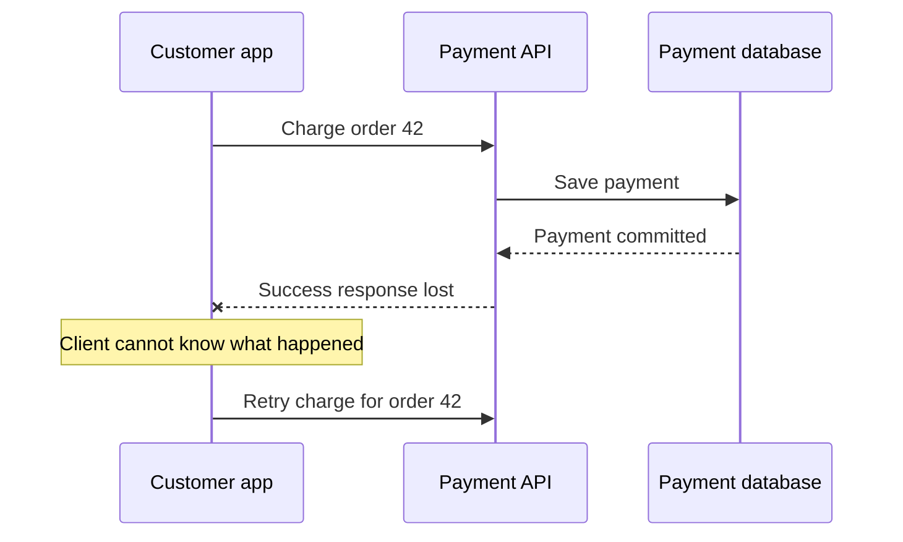

**Remember:** A timeout means **the outcome is unknown**, not necessarily that the server did nothing. Retry safety is essential for payments, orders, ad billing and business events.

---

## 2. What is idempotency?

An operation is **idempotent** if repeating it has the same intended effect as doing it once.

| Operation | Usually idempotent? | Reason |
|---|---|---|
| Set order status to `SHIPPED` | Yes, for the resulting status | Repeating the same assignment does not change the final status |
| Set value to 100 | Yes | Same target value |
| Add ₹100 to balance | No | Repetition adds ₹200 |
| Create a fresh order with a new ID | No | Repetition creates multiple orders |
| Delete an existing resource | Usually yes in effect | It remains absent; response codes can still differ |

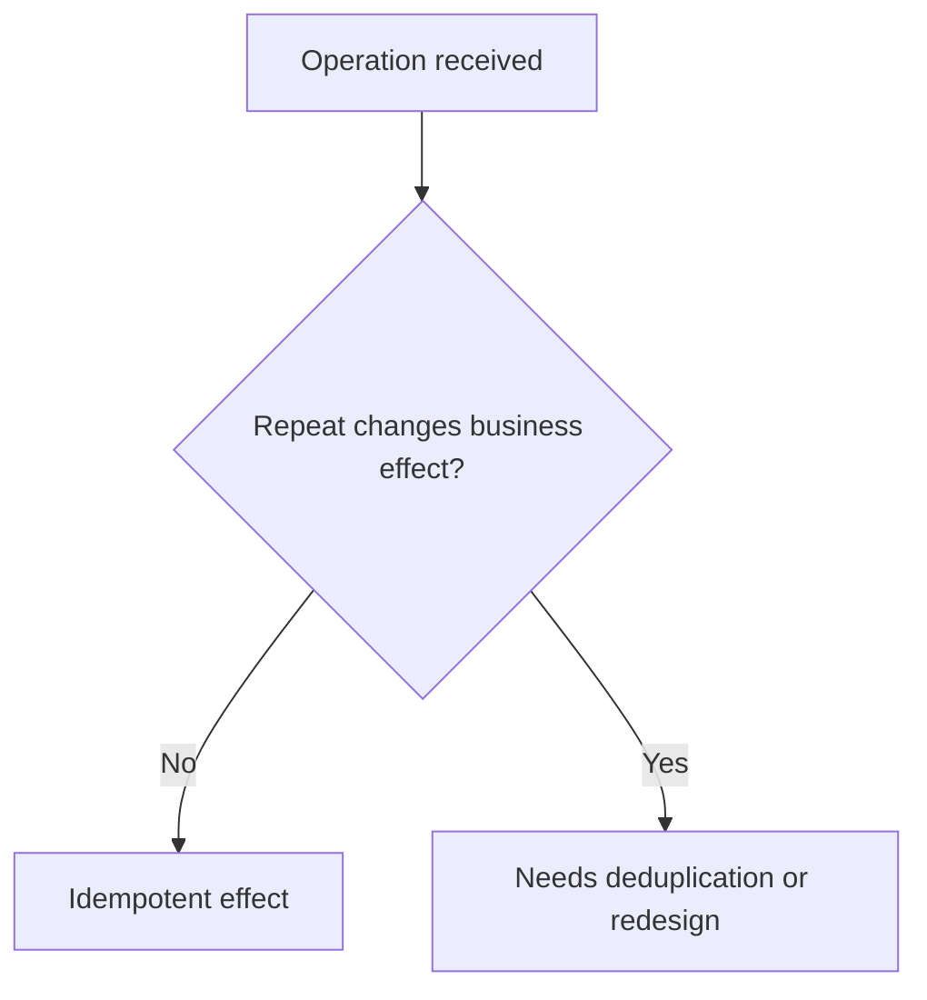

**Subtle point:** Idempotency concerns the **business effect**. It does not require the HTTP response status or every audit log to be identical on each attempt.

---

## 3. Deduplication versus idempotency

These terms are related but not identical.

- **Deduplication** asks, “Have I already seen this request, event or data item?”
- **Idempotency** asks, “Will doing this again produce an additional business effect?”

Deduplication is one way to implement idempotency, but not the only way. A simple `SET status = 'SHIPPED'` may be idempotent even without storing a request ID. A financial transfer generally requires explicit safeguards.


Always define **what counts as the same operation** before choosing a deduplication key.

---

## 4. API idempotency keys

For a create-order or charge API, the client can generate a **unique key once for a logical action**, often a UUID. Every retry of that action uses **the same key**.

```http
POST /orders HTTP/1.1
Idempotency-Key: 93bbf2c0-47d7-43f3-a003-example

{"cartId":"cart-42","total":1499}
```

The server stores the scoped key, request fingerprint, processing status and eventual result.

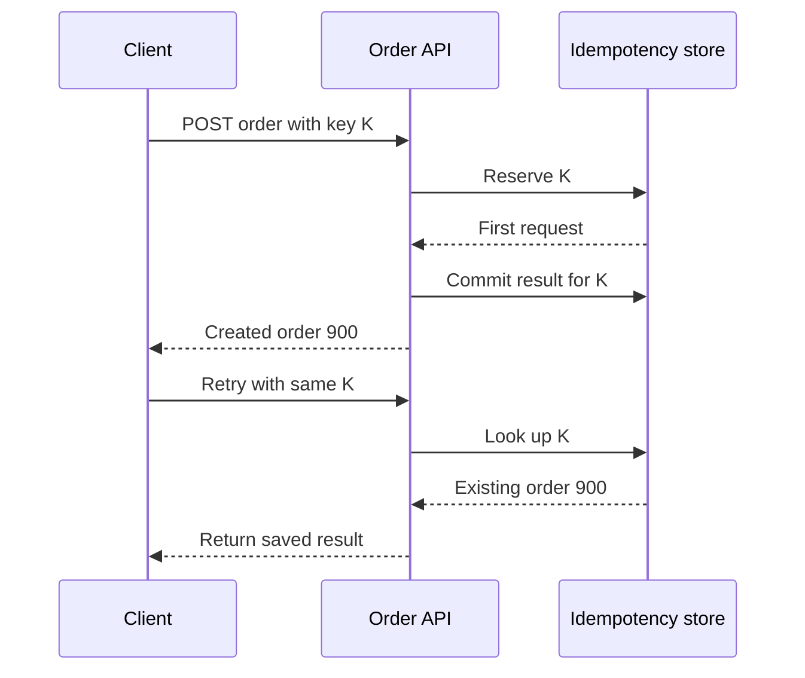

**Rule:** A *new* purchase needs a **new key**. A retry of the *same* purchase needs the **same key**. Retention duration (for example 24 hours) is an application or provider policy, not a universal guarantee.

---

## 5. Concurrent requests require atomic reservation

Two copies of a request can reach separate API instances at almost the same moment.

A fragile implementation does this:

```text
if key is absent:
    charge_customer()
    save(key)
```

Both servers may observe **absent** before either saves the key. Both might charge.

Use a **unique database constraint**, atomic insert, transaction or equivalent coordination mechanism to reserve the request key.

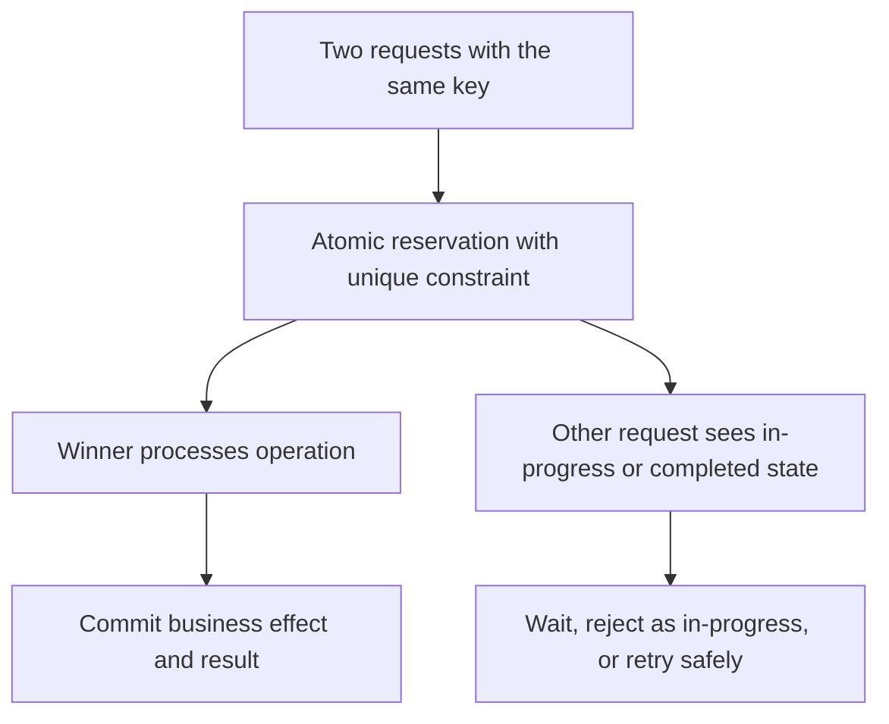

The losing request should **never independently perform the effect**. It can return the stored result if completed, or a documented in-progress response when the first execution is still underway.

Scope keys by **tenant or customer and operation** to prevent unrelated clients colliding.

---

## 6. Prevent a key from being reused with different data

What if a client accidentally uses key `K` once for ₹500 and later for ₹900? Returning the first result silently would be misleading.

Store a canonical **request fingerprint**, such as a hash of the meaningful request fields, with the key. Reject conflicting payloads for the same key.

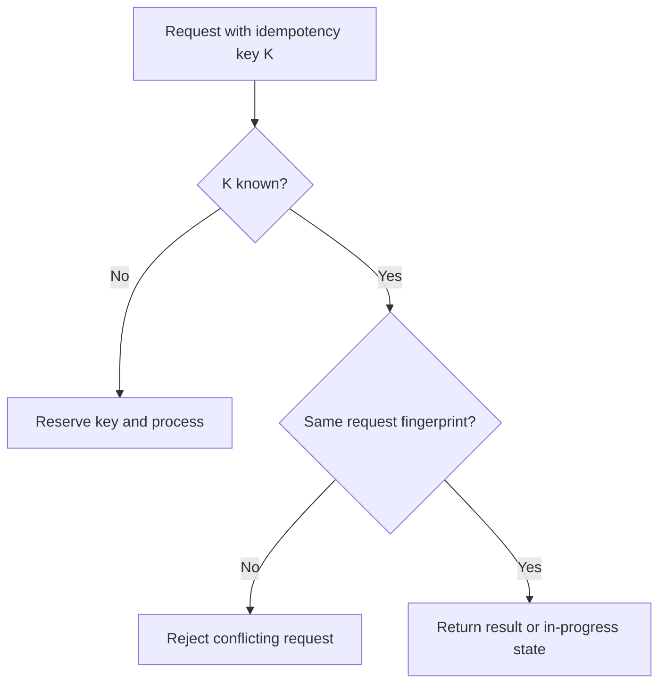

Canonicalization matters: JSON property order or insignificant formatting should not create false differences if they do not change the logical action. Define allowed reuse precisely.

---

## 7. Database constraints and transactional changes

A database is often the strongest place to enforce **business uniqueness**.

For example, if the business rule is “one successful payment record per order,” use an appropriate unique constraint. That rule depends on the domain; systems allowing retries, split payments or refunds may need a more specific uniqueness key.

```sql
CREATE TABLE processed_requests (
  tenant_id   VARCHAR(64) NOT NULL,
  request_key VARCHAR(128) NOT NULL,
  result_id   VARCHAR(64),
  PRIMARY KEY (tenant_id, request_key)
);
```

The **idempotency record** and **local business database mutation** should be committed in the same transaction whenever feasible.

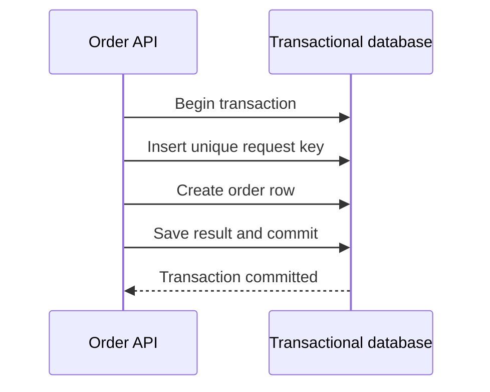

If the process crashes *before commit*, neither local change persists. If it crashes *after commit*, a retry finds the reservation or completed record. This greatly reduces the classic “did I already create the order?” gap.

---

## 8. At-least-once messages and the consumer inbox

Queues commonly redeliver messages if a consumer crashes before acknowledging. Design for **at-least-once** processing, even when a broker offers additional reliability features.

Each event should carry a stable event ID assigned by the producer. A consumer can keep a **processed-messages table**, sometimes called a transactional inbox.

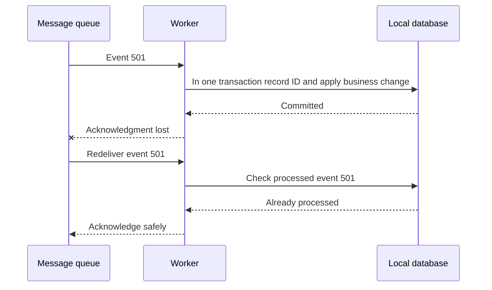

For multiple consumers, scope the deduplication key to the **logical consumer** (and tenant where appropriate). Two independent services may each legitimately process the same event exactly once for their own business purpose.

---

## 9. Kafka idempotent producers and exactly-once boundaries

Kafka supports idempotent production that avoids duplicates caused by retrying producer writes within its supported guarantees. Kafka transactions also support read-process-write workflows that commit Kafka output and consumed offsets together.

However, **Kafka's exactly-once mechanisms do not automatically make an external SQL update, payment charge or email exactly once**.

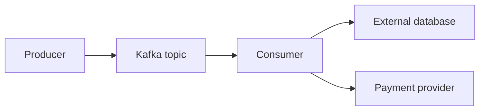

For the database path, use business uniqueness, atomic inbox processing or carefully designed transactional integration. For external APIs, use the external provider's own idempotency capability when available.

**Interview insight:** State the **boundary** of any exactly-once claim. “Exactly once in Kafka” is not the same as “exactly one real-world payment.”

---

## 10. External side effects: payments, email and notifications

A call to a payment provider occurs outside your local database transaction.

For payments, pass a stable idempotency key recognized by the provider when supported. Recover uncertain outcomes by querying the provider or reconciling payment records rather than blindly issuing another charge.

Notifications are harder: after an email is sent, your worker could crash before recording that fact. If the worker retries, the email might be delivered again.

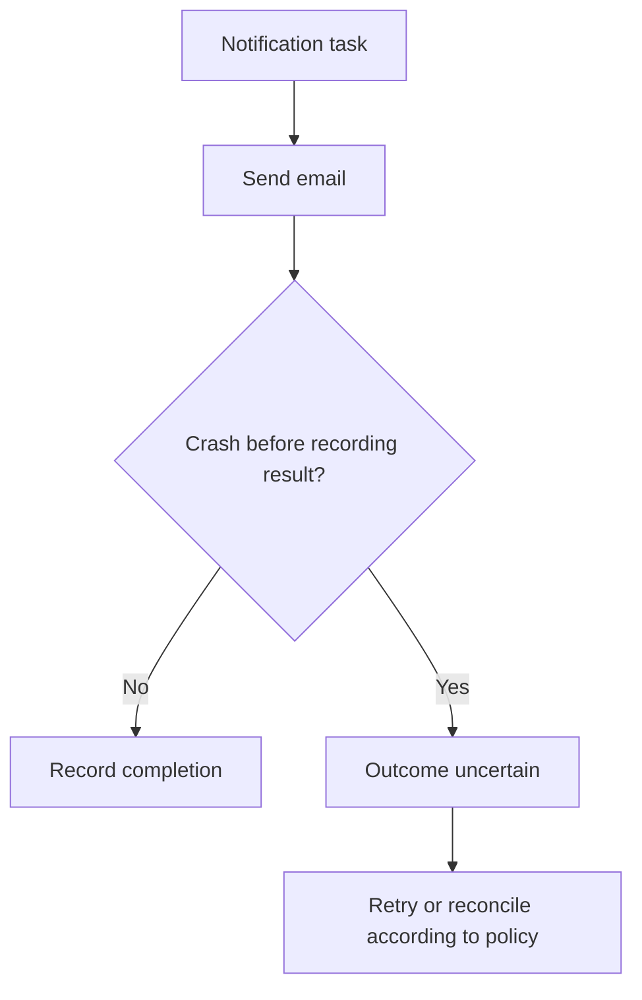

There is an unavoidable trade-off when the external provider lacks idempotency or status lookup. **Send then record** may produce duplicates; **record then send** may lose a delivery. Explain which failure is acceptable for the product and reduce risk with a durable outbox and provider message IDs.

---

## 11. Redis time-limited deduplication

For high-volume, short-lived duplicate detection, Redis can keep recent event IDs with a **time-to-live (TTL)**.

A common primitive is:

```text
SET dedup:event-501 processing NX EX 86400
```

`NX` means insert only when absent. `EX` sets expiry in seconds; 86,400 seconds is one day.

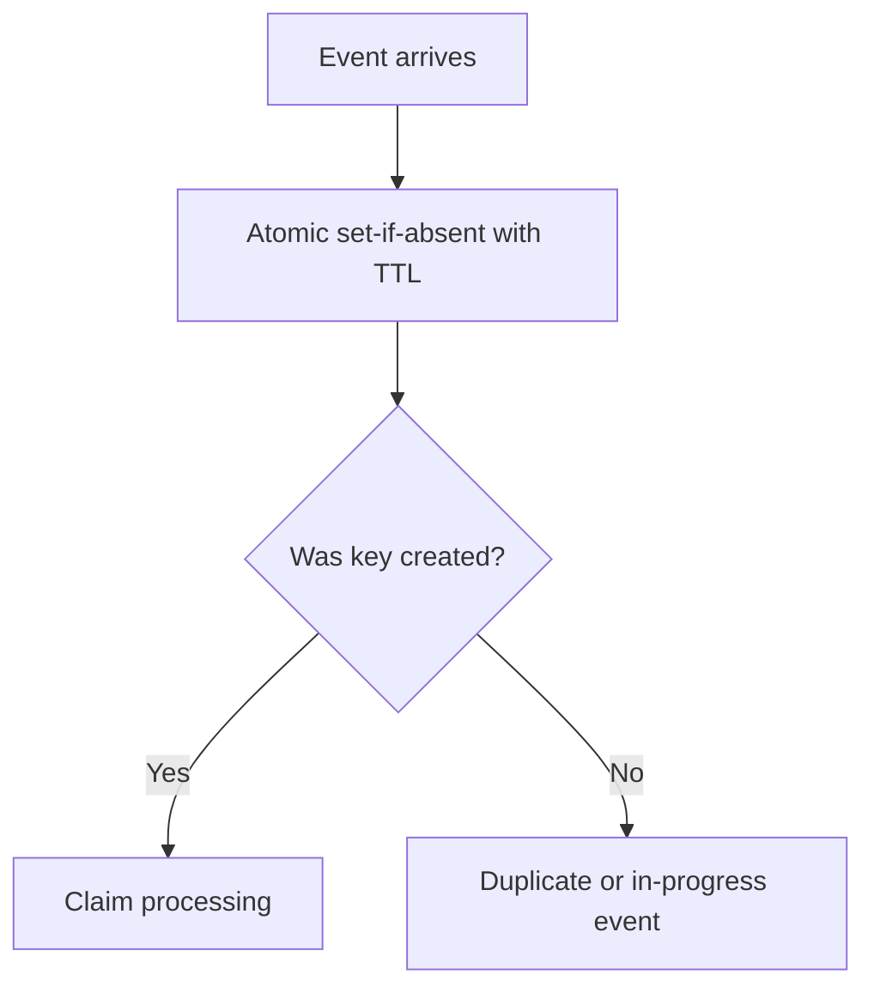

**Critical caveat:** A Redis key created before the business operation is not proof the operation succeeded. If the worker crashes after claiming the key, a naive implementation could suppress required retries for the entire TTL.

Use an explicit processing/result state, a recovery mechanism, and durable transactional deduplication for critical financial effects. TTL must exceed the expected retry window, or old duplicates may reappear.

---

## 12. Bloom filters for large-scale approximate checks

A **Bloom filter** is a compact probabilistic structure for answering whether an item *might* have been seen.

- **Definitely absent:** If the filter says no, the item was not added (assuming the filter is functioning correctly).
- **Possibly present:** If it says yes, the item may or may not actually exist.

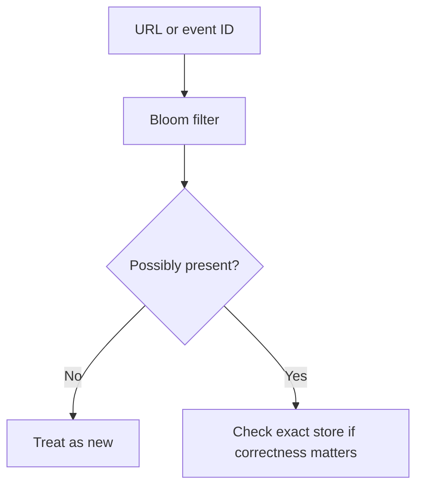

Bloom filters save memory, but may have **false positives**. They have no false negatives for inserted items under the usual assumptions.

For a crawler, occasional false positives might be a tolerable trade-off or might reduce crawl coverage. For payments, **never let a Bloom filter alone decide a charge was already processed**. Combine it with authoritative database lookup.

---

## 13. Content-based deduplication for files

Sometimes two files have **different upload IDs but identical bytes**. Request-ID deduplication will not detect that.

A storage system can hash file content using a strong algorithm such as **SHA-256** to identify matching content candidates.

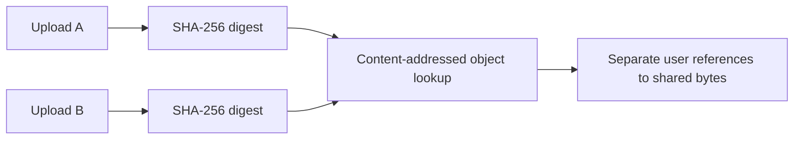

A matching cryptographic hash is strong evidence of identical content, but a system should still use suitable size/verification checks according to its threat model; it is not a mathematical proof of collision impossibility.

Large-file sync products can deduplicate **chunks** instead of whole files. That allows a revised document to reuse unchanged blocks.

**Security consideration:** Cross-user deduplication can leak information about whether another person already possesses content. Respect authorization and encryption boundaries.

---

## 14. URL normalization and near-duplicate content

A web crawler might find the same page through multiple URLs with tracking parameters or formatting differences. Normalize URL representations before checking a visited set.

Examples of potentially safe transformations depend on URL semantics:

- Standardize scheme and host case.
- Remove known nonessential tracking parameters when that does not change the resource.
- Apply carefully designed redirect and canonical URL policies.

**Do not automatically remove trailing slashes or change path case**, because those may identify different resources.

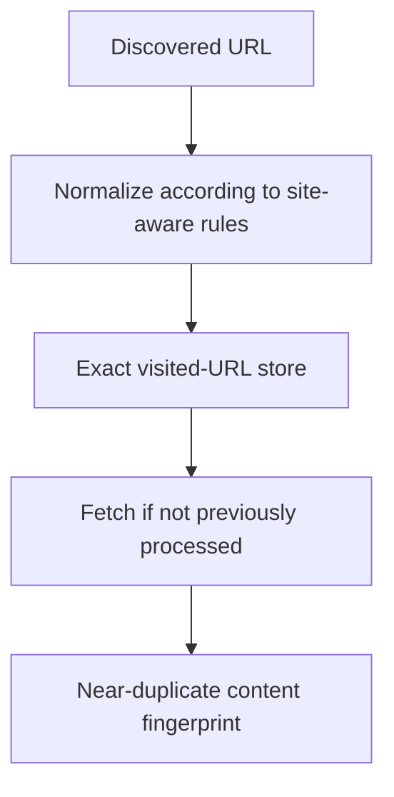

Near-duplicate algorithms such as **SimHash** can identify pages with similar content. Unlike cryptographic hashes, similarity fingerprints are designed to be close when content is similar, making them useful for search-index de-duplication or clustering.

---

## 15. The deduplication window and expiry trade-offs

Keeping every processed ID forever can become expensive, especially at billions of events.

Choose retention from actual failure and retry behavior. Ask:

1. How long might an API client retry?
2. Can a broker redeliver an old event after days or weeks?
3. Can operators replay historical messages?
4. Are regulatory or financial records subject to longer retention requirements?


A 24-hour TTL can be useful in some workflows, but **not if operational replay occurs after 30 days**. For high-value actions, enforce a durable **business invariant** that survives expiry of temporary request-key records.

Separate the short-lived duplicate cache from durable transaction records whenever appropriate.

---

## 16. System design interview framework

Use this sequence to answer questions about safe retries, queue consumers, webhooks, payments or storage deduplication:

1. **Find duplicates:** Client retry? Double click? Queue redelivery? Data uploaded twice?
2. **Assess damage:** Duplicate charges are critical; a duplicated telemetry event may be tolerable.
3. **Define identity:** What exactly is one logical operation?
4. **Choose guard:** Idempotency key, unique constraint, consumer inbox, content hash or approximate filter.
5. **Handle races:** Concurrent duplicates need atomic claims and correct transaction boundaries.
6. **Handle failures:** Crash after effect? Crash before acknowledgment? External side effect?
7. **Plan retention:** How long can a request or event be replayed?
8. **Measure:** Duplicate rate, in-progress keys, conflicts, processing lag and recovery backlog.

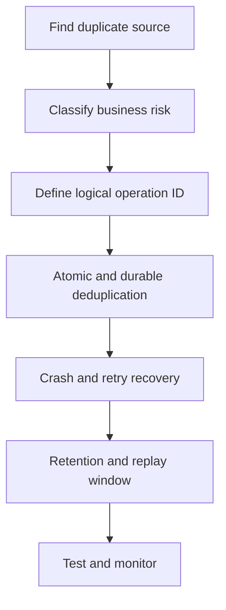

### Example interview answer

**“For order creation, the client generates one idempotency key per checkout attempt and reuses it for retries. The service atomically reserves that key, creates the order in the same database transaction, and stores the result. Concurrent requests cannot create a second order. For payment charging, the service forwards a stable provider-supported idempotency key and reconciles uncertain outcomes.”**

---

## 17. Common mistakes and troubleshooting

| Mistake | Why it fails | Better approach |
|---|---|---|
| Check then insert without a constraint | Two concurrent requests both pass | Unique key / atomic claim |
| Save order, then key separately | Crash leaves no dedup record | Same local transaction |
| Mark Redis key before work and assume success | Crash can suppress unfinished work | Track states and recover |
| Reuse key for different payload | Returns unrelated result | Compare request fingerprint |
| Store keys only for too short a period | Late retries repeat effects | Align TTL with retry/replay window |
| Assume Kafka guarantees external payment exactly once | Broker transaction cannot cover external card charge | Provider idempotency and reconciliation |
| Use Bloom filter alone for payments | False positives could reject real charges | Authoritative exact store |
| Assume same URL spelling implies same resource | Path and query semantics differ | Site-aware normalization |

**Testing checklist:** Fire 100 simultaneous requests with one key; kill the worker before and after commit; simulate lost responses; redeliver the same event; reuse a key with changed request contents; and replay an event after its cache TTL expires.

---

## 18. Questions and revision cheat sheet

### Interview questions

1. Why do duplicate requests occur even if the server already succeeded?
2. Explain idempotency with an order-status example.
3. What is the difference between duplicate detection and safe repetition?
4. How do `Idempotency-Key` headers work?
5. What if two requests with the same key arrive simultaneously?
6. Why should the key and local business change use one transaction?
7. Why compare request fingerprints?
8. How do you deduplicate queue messages?
9. What happens when a consumer commits a transaction but crashes before acknowledging?
10. Where do Kafka's exactly-once guarantees stop?
11. How can payment-provider idempotency help?
12. Why are email notifications harder to guarantee exactly once?
13. What are the risks of Redis TTL-based deduplication?
14. What does a Bloom filter guarantee, and what can it falsely report?
15. How does SHA-256 help file deduplication?
16. Why is URL canonicalization not just lowercasing the entire URL?
17. How do retention policies interact with replay?

### One-minute revision table

| Term | Remember |
|---|---|
| Idempotency | Repeat does not add another intended effect |
| Deduplication | Detect same logical request, event or data |
| Idempotency key | Reused ID for retries of one action |
| Unique constraint | Database enforces one logical record |
| Transactional inbox | Store consumer event ID and DB effect atomically |
| At-least-once | A message may be delivered repeatedly |
| Producer idempotence | Broker protects supported retry/write path |
| TTL | Time period a dedup record stays available |
| Bloom filter | Memory-efficient maybe-present check |
| SHA-256 | Content hash for detecting identical files |
| SimHash | Similarity fingerprint for near-duplicates |

**Final takeaway:** In distributed systems, retries are normal. **Design repeated requests to be safe, make duplicate detection atomic, protect critical business effects with durable constraints, and state clearly where your guarantees stop.**

---
