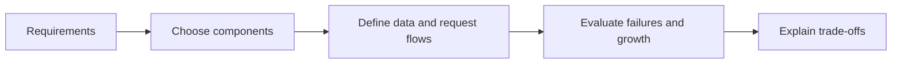
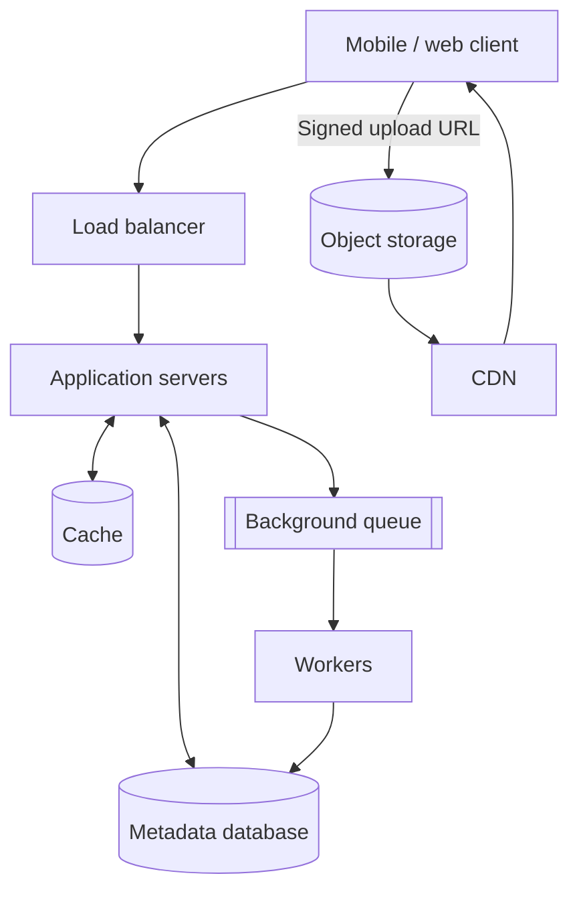
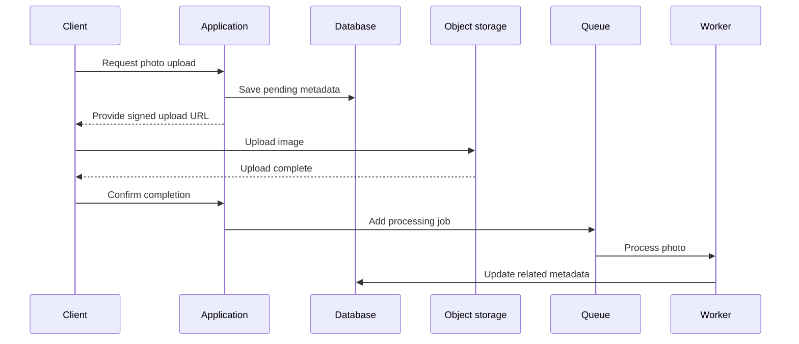
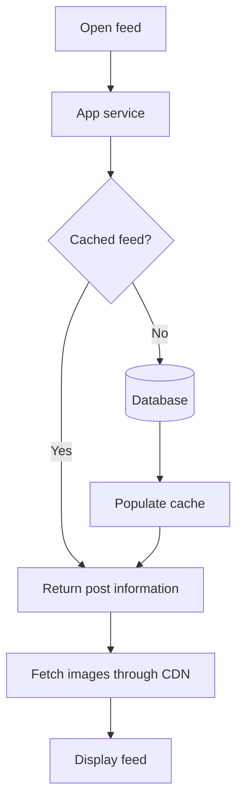
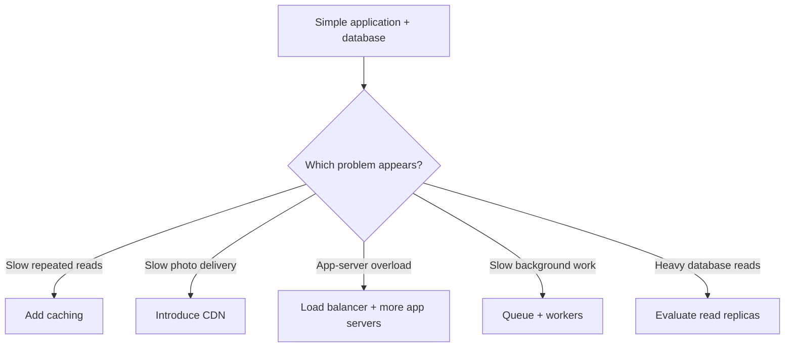
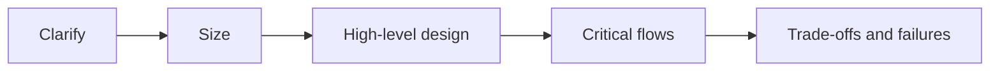

# Introduction to System Design

*A beginner-friendly guide to components, requirements, architecture decisions and trade-offs.*

## Contents

1. [What is system design?](#1-what-is-system-design)
2. [Requirements](#2-requirements)
3. [Core building blocks](#3-core-building-blocks)
4. [Photo-sharing architecture](#4-photo-sharing-architecture)
5. [Upload and feed journeys](#5-upload-and-feed-journeys)
6. [Qualities and trade-offs](#6-qualities-and-trade-offs)
7. [Evolving the design](#7-evolving-the-design)
8. [System design interviews](#8-system-design-interviews)
9. [Revision notes](#9-revision-notes)

## 1. What is system design?

A photo-sharing application might begin with one server handling sign-up, uploads, following, and feeds. When usage grows to millions of people, new challenges appear: large image storage, server failures, geographical latency, and heavy traffic around popular accounts.

**System design** means deciding which components an application needs, the purpose of each component, how they communicate, and how the result satisfies the requirements.

| Coding focus | System design focus |
|---|---|
| Functions and classes | Services and responsibilities |
| Algorithms and data structures | Data flow and communication |
| Behavior inside one process | Interactions across servers and storage |
| Error handling | Failure isolation and recovery |

**Remember:** Code defines *how a component works*; system design defines *how components work together*.

## 2. Requirements

Before selecting a database, cache, or queue, clarify the goals.

### Functional requirements: what users can do

For a photo application:

- Register and sign in
- Upload photos
- Follow people
- Like posts
- View a feed

### Non-functional requirements: how well the system works

Examples:

- A feed response target could be **under 200 milliseconds**. This is a sample requirement, not a guarantee.
- The application should remain accessible after an individual server fails.
- Uploaded photos should not disappear after successful completion.

| Requirement | Category |
|---|---|
| Upload a photo | Functional |
| Follow a user | Functional |
| Fast feed loading | Non-functional |
| Data durability | Non-functional |
| Continued operation during a failure | Non-functional |

**Memory trick:** Functional = **what**; non-functional = **how well**.

## 3. Core building blocks

| Component | Main role |
|---|---|
| Client | Browser or mobile application |
| DNS | Helps resolve the service's domain |
| Load balancer | Distributes requests among app servers |
| Application server | Runs business logic |
| Database | Stores users, follows and photo metadata |
| Object storage | Holds large photo files |
| Cache | Speeds up repeated lookups |
| CDN | Serves cacheable images nearer to users |
| Queue | Buffers work that can happen later |
| Worker | Runs background jobs, such as thumbnail generation |

A component belongs in the architecture only when it solves a relevant problem.

## 4. Photo-sharing architecture

This separates structured information (such as captions and owner IDs) from large image objects. Cache reduces database reads; workers handle tasks that need not complete immediately.

**Design note:** Real implementations may include authentication, upload confirmation and additional reliability mechanisms. This simplified diagram emphasizes the components introduced in the source.

## 5. Upload and feed journeys

### Upload flow

1. A client asks the app service to start a photo upload.
2. The service records metadata and returns a **pre-signed URL** for object storage.
3. The client transfers the photo directly to storage.
4. After the upload is confirmed, the application schedules processing.
5. A worker creates thumbnails or updates feed-related information.

**Why these choices?** Large images bypass application servers, and slower image processing happens outside the main request.

### Feed read flow

1. Client requests its feed.
2. App checks for a cached post list.
3. On a miss, app reads the database and may cache the result.
4. Client receives post information and retrieves images through the CDN.

## 6. Qualities and trade-offs

| Quality | Question to ask |
|---|---|
| Scalability | Can we handle more users, traffic or data? |
| Availability | Can users still reach the service during failures? |
| Reliability | Can the service avoid losing or corrupting data? |
| Performance | How fast is each request, and how many requests can we serve? |
| Consistency | How current and aligned is data across components? |
| Maintainability | Can engineers operate and evolve the system? |
| Cost | Are we spending resources appropriately? |

**Latency** means the time required for one request; **throughput** means the amount of work completed per time interval.

The architectural trade-offs are real:

| Add | Benefit | Trade-off |
|---|---|---|
| Cache | Faster reads | Data can become stale |
| Replicas | Redundancy and read capacity | Extra cost and synchronization |
| CDN | Faster content delivery worldwide | Cache freshness management |
| Message queue | Faster response for deferred work | Eventual completion and retry handling |
| More servers | Higher aggregate capacity | Increased operational complexity |

Good design is choosing the trade-off that matches the requirements, not collecting as many technologies as possible.

## 7. Evolving the design

At small scale, one application server and a database may be sufficient. Add other layers **when a bottleneck justifies them**, not automatically.

For example, a Like button creates several design questions: should the count be cached, should all work finish synchronously, and what happens if millions of users like the same post? These decisions affect latency, correctness and scaling.

## 8. System design interviews

It describes an open-ended discussion, often around **45–60 minutes** for relevant engineering interviews, rather than a coding exercise with a single correct solution.

A practical approach:

1. Clarify **functional** and **non-functional** requirements.
2. Estimate the scale where it changes design decisions.
3. Sketch a simple high-level architecture.
4. Describe key flows, such as upload and read.
5. Explore bottlenecks, storage, caching and failure handling.
6. Explain why each design choice is appropriate.

Understanding the building blocks and their trade-offs is more useful than memorizing a single perfect design.

## 9. Revision notes

**Five questions to remember:**

1. **What?** — What must the system do?
2. **How well?** — What are the quality expectations?
3. **Who does the work?** — What components own each responsibility?
4. **How does data move?** — What are the main request and data flows?
5. **What if it grows or fails?** — How does the design respond?

### Self-check questions

- How do functional and non-functional requirements differ?
- Why separate photo files from photo metadata?
- What does a CDN improve?
- Why use a queue for thumbnail processing?
- What happens when a feed cache misses?
- How can caching improve latency but create a consistency problem?
- Why is adding every infrastructure component on day one often a mistake?
- How would you explain the architecture during an interview?

**Takeaway:** Start with requirements, assign clear responsibilities, trace how requests and data move, and justify each architectural trade-off.

---

*Source basis: user-provided introductory system-design transcript. Explanations, layout, comparisons and Mermaid diagrams are newly authored. The source's concepts are paraphrased rather than its narration reproduced.*
