# Large File Uploads and Downloads — System Design Explained Simply

*Distributed Systems Study Library · Author: Jayesh Sharma*

**Understand direct uploads, presigned URLs, multipart transfer, checksums, processing pipelines, CDN downloads, HTTP Range, block-level synchronization and storage tiers.**

> This is an independently written educational adaptation of the user-provided transcript. The wording, diagrams, examples, tables and interview discussion are original, with supplementary engineering details distinguished where appropriate.

## Contents

- [1. Why large files need a different architecture](#1-why-large-files-need-a-different-architecture)
- [2. Examples and requirements to clarify](#2-examples-and-requirements-to-clarify)
- [3. Store file bytes separately from metadata](#3-store-file-bytes-separately-from-metadata)
- [4. Direct-to-storage uploads with presigned URLs](#4-direct-to-storage-uploads-with-presigned-urls)
- [5. Why chunking solves interrupted uploads](#5-why-chunking-solves-interrupted-uploads)
- [6. Multipart upload lifecycle and cleanup](#6-multipart-upload-lifecycle-and-cleanup)
- [7. Validate data integrity with checksums](#7-validate-data-integrity-with-checksums)
- [8. Process files asynchronously after upload](#8-process-files-asynchronously-after-upload)
- [9. How clients learn when processing finishes](#9-how-clients-learn-when-processing-finishes)
- [10. Serve public downloads through a CDN](#10-serve-public-downloads-through-a-cdn)
- [11. Private downloads and signed links](#11-private-downloads-and-signed-links)
- [12. HTTP Range requests: resume and seek](#12-http-range-requests-resume-and-seek)
- [13. File sync: upload only changed blocks](#13-file-sync-upload-only-changed-blocks)
- [14. Fixed-size chunks vs content-defined chunks](#14-fixed-size-chunks-vs-content-defined-chunks)
- [15. Control storage cost with lifecycle policies](#15-control-storage-cost-with-lifecycle-policies)
- [16. Capacity planning and interview design](#16-capacity-planning-and-interview-design)
- [17. Troubleshooting and common mistakes](#17-troubleshooting-and-common-mistakes)
- [18. Interview questions and quick revision](#18-interview-questions-and-quick-revision)

---

## 1. Why large files need a different architecture

Uploading a small JSON request and uploading a two-gigabyte video are very different jobs. A JSON request may finish quickly, while a file transfer can remain active for minutes and might disconnect near the end.

Think of an **application server as the front desk** and **object storage as the warehouse**. The front desk should check permissions and arrange delivery. It should not personally carry every heavy box.

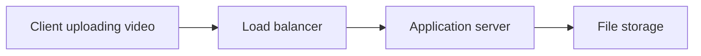

Routing all file bytes through the application tier can consume its network capacity, open sockets, memory and request-processing resources. API gateways may also impose payload or timeout limits. This approach can work for small files, but is usually inefficient for very large transfers.

**The primary principle:** Separate **control operations** (permissions and metadata) from **data transfer** (the file's bytes).

---

## 2. Examples and requirements to clarify

Large-file patterns appear in cloud drives, video platforms, messaging apps, backups and document-management systems.

| Application | Typical requirement | Important trade-off |
|---|---|---|
| Cloud drive | Upload, download and sync large documents | Resumability and consistency |
| Video platform | Upload and process media | Transcoding and global playback |
| Messaging | Share photos and videos on mobile networks | Unstable connectivity |
| Backup system | Store large historical datasets | Cost and recovery |
| Software downloads | Distribute installers globally | CDN caching and range requests |

Before designing, ask: maximum file size, upload/download volume, network conditions, privacy needs, processing steps, geographical distribution, and retention policies.

**Example:** A 2 GB video uploaded over a slow network may take minutes. A good design should **retry only failed work**, not restart everything.

---

## 3. Store file bytes separately from metadata

Use **object storage** for large file content and a **database** for its metadata.

Object stores such as Amazon S3, Google Cloud Storage or Azure Blob Storage are designed for objects and large-scale durability. The database can maintain a compact record describing each file.

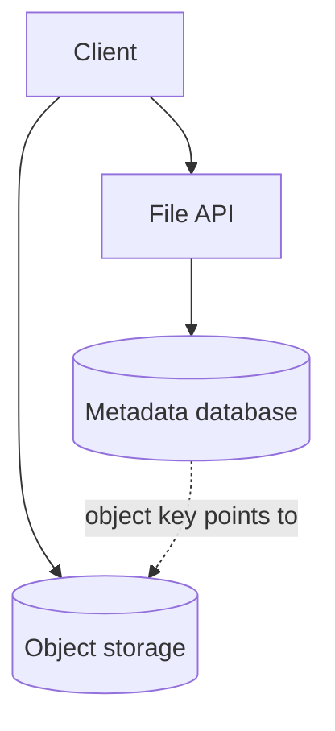

A metadata record might contain:

```json
{
  "fileId": "file_742",
  "ownerId": "user_19",
  "name": "vacation-video.mp4",
  "sizeBytes": 2147483648,
  "objectKey": "uploads/user_19/file_742",
  "status": "UPLOADING",
  "checksum": null
}
```

Large binary objects *can* be stored inside some databases, but separating them usually makes scaling, backups and bandwidth management easier for this class of system.

**Memory trick:** Database = **what the file is**. Object storage = **the actual file**.

---

## 4. Direct-to-storage uploads with presigned URLs

Instead of moving the video through your application servers, let the client transfer it directly to object storage after your API authorizes the operation.

**Step by step**

1. Client asks the API to create an upload for a file of a specified type and size.
2. API checks authentication, quota, allowed formats and ownership.
3. API creates an `UPLOADING` metadata record and a short-lived, scoped upload URL or upload authorization.
4. Client uploads the file bytes directly to the storage service.
5. Client or storage event tells the backend the transfer finished.
6. Backend **verifies actual storage state** before marking the file `UPLOADED`.

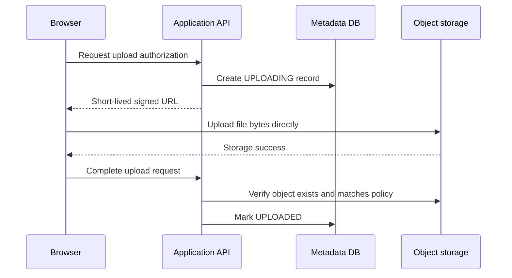

A **presigned URL** acts like a temporary permission slip. Protect it as a bearer credential: restrict its destination, operation, expiration and any supported content conditions. A signed URL alone does not guarantee antivirus scanning, correct content type or safe file handling.

**Important:** Upload URL permissions and expiration rules vary by storage product. The client should never be allowed to select unrestricted object keys.

---

## 5. Why chunking solves interrupted uploads

Imagine a transfer is 95% finished when a phone changes networks. Repeating a whole multi-gigabyte upload wastes time and bandwidth.

Instead, divide the file into **parts**. If part 7 fails, retry **part 7** rather than the entire file.

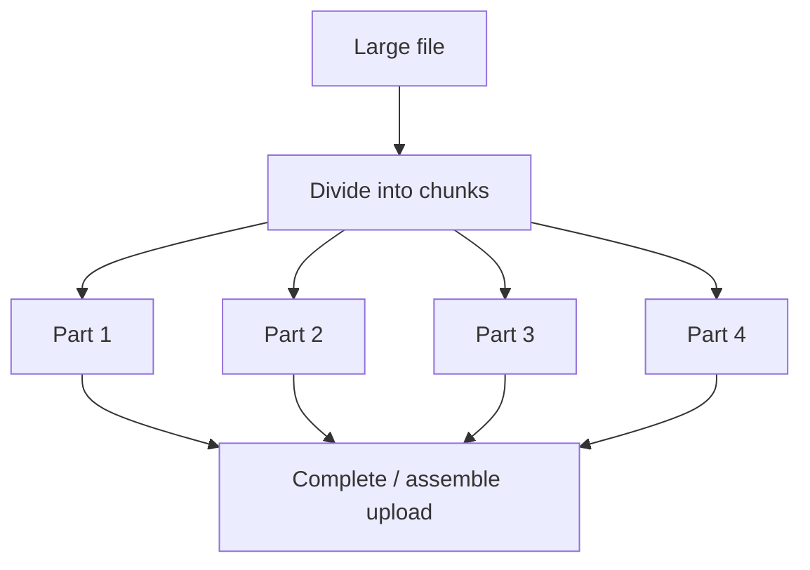

Benefits include **partial retries**, **resume after interruption** and **limited parallelism** to improve throughput where bandwidth permits.

When choosing part sizes, remember that “2 GB ÷ 10 MB = 200 parts” uses decimal units. For **2 GiB**, dividing into 10 MiB parts requires about **205 parts**. Precise calculations should always say whether MB means decimal or binary units.

Too many tiny chunks increase per-request overhead. Extremely large chunks make failed retries expensive. Choose a practical size based on storage-service constraints and observed network conditions.

---

## 6. Multipart upload lifecycle and cleanup

A typical multipart upload has a lifecycle:

1. **Initiate:** Storage issues an upload/session identifier.
2. **Upload parts:** Each part has an identifier and the service returns metadata needed to complete the upload.
3. **Resume:** Ask which parts are complete, or use safely persisted client state.
4. **Complete:** Submit the required part list and finalize the object.
5. **Abort:** Cancel a failed or abandoned upload so orphaned parts stop consuming storage.

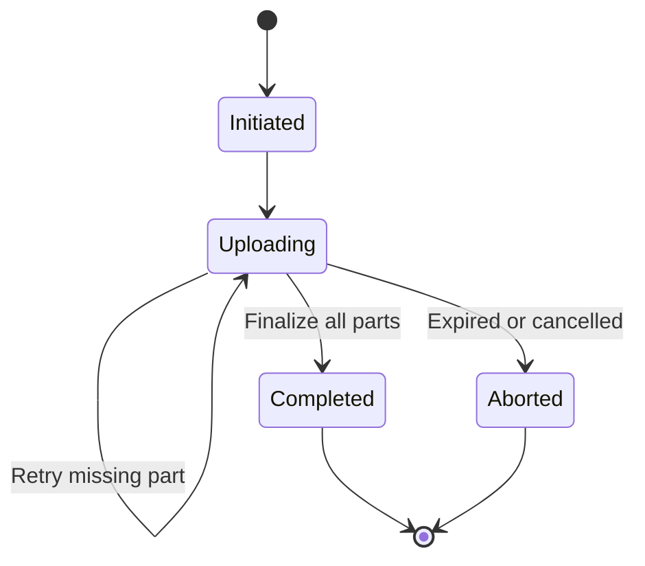

For S3 multipart uploads, the commonly documented rules include **5 MiB minimum part size except the final part** and **up to 10,000 parts**. Check the specific storage service's current limits rather than assuming all providers are identical.

**Operational rule:** Configure lifecycle cleanup for incomplete multipart sessions. Otherwise, uploaded-but-unfinished parts can accumulate storage charges.

---

## 7. Validate data integrity with checksums

A successful network request is not the same as verifying that the intended file is intact.

The client can calculate a checksum for each chunk. The storage service or backend can validate it using a supported checksum mechanism. A final whole-object checksum can be stored in metadata when appropriate.

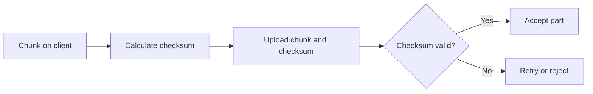

For integrity, use supported mechanisms such as **SHA-256** or other provider-supported checksums. **MD5 should not be treated as collision-resistant security verification.**

In S3, a multipart object's ETag is **not necessarily the MD5 hash of the complete file**. Do not use that assumption for universal whole-file verification.

Checksums help detect corruption and support block comparison, but they do not replace authentication, authorization or malicious-file scanning.

---

## 8. Process files asynchronously after upload

Uploading completes when storage receives the bytes, but a video may still need thumbnails, transcoding or virus scanning.

Do not make the user keep the upload HTTP request open while minutes of processing finish. Instead, queue a background job.

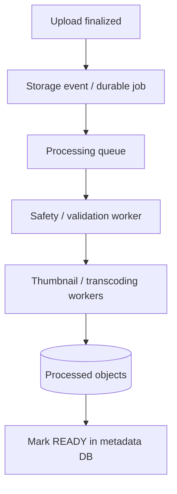

A simple status model:

```text
UPLOADING → UPLOADED → PROCESSING → READY
                 ↘ FAILED (if validation or processing fails)
```

Workers should be **retry-safe** because duplicate events can occur. Use file IDs and processing versions to avoid applying incompatible results from an old attempt.

For long video processing, independent segments may be processed in parallel, then assembled into deliverable outputs if the encoding pipeline permits it.

---

## 9. How clients learn when processing finishes

After uploading a video, the user might see **“Processing — 62% complete.”** The client needs an update mechanism independent of the original upload transfer.

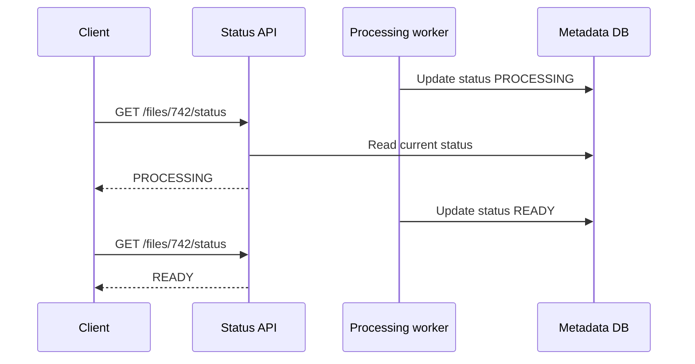

For occasional updates, **polling** may be enough. For continuous progress, **SSE or WebSockets** are options if you already operate the required infrastructure.

Related system design overview: [Designing Real-Time Updates at Scale](Designing_Real_Time_Updates_at_Scale.md).

---

## 10. Serve public downloads through a CDN

For a video or installer popular across multiple countries, fetching every copy from one storage region can increase latency and origin bandwidth.

A **content delivery network (CDN)** places cached copies closer to users when the objects are eligible for caching.

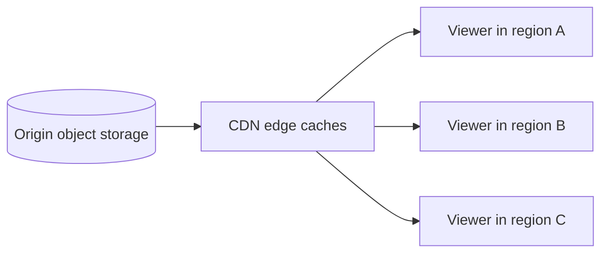

A first request may cause an edge cache **miss** and fetch content from the origin. Later suitable requests can become **cache hits**.

Choose cache keys, TTLs and invalidation strategy carefully. Private objects require authorization controls; a public cache must not accidentally expose user-specific files.

---

## 11. Private downloads and signed links

A user should only download a private document if they are authorized.

One practical approach:

1. Client asks the application API to download a specific file.
2. API authenticates the user and checks file ownership or sharing policy.
3. API returns a time-limited signed storage URL or signed CDN link.
4. The browser downloads directly from that authorized endpoint.

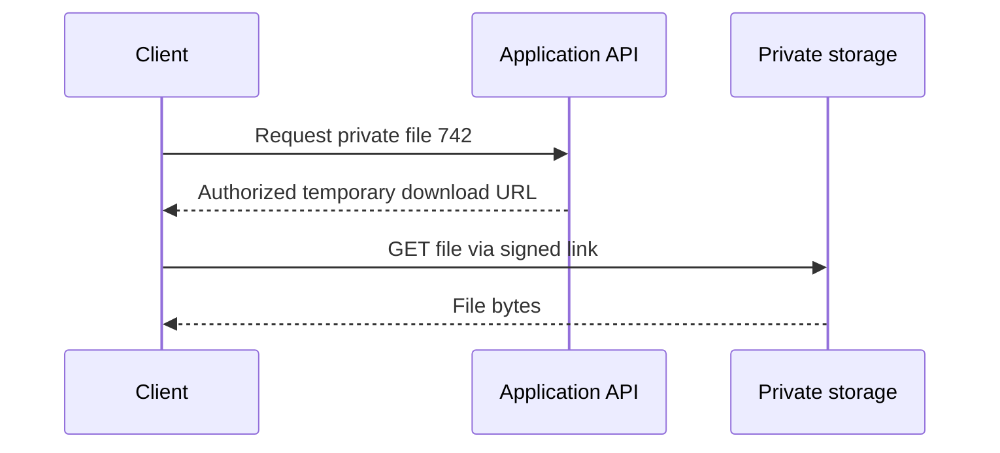

**Security caution:** A signed URL can be forwarded to someone else while valid. Use short expirations, least-privilege scope, HTTPS and revocation controls where supported. Do not confuse “hard to guess” with actual access control.

---

## 12. HTTP Range requests: resume and seek

Large downloads should allow clients to request **only part of an object**, when the serving endpoint supports HTTP byte ranges.

Example:

```http
GET /videos/sample.mp4 HTTP/1.1
Range: bytes=500000000-599999999
```

A successful byte-range response commonly uses **206 Partial Content** with a `Content-Range` header.

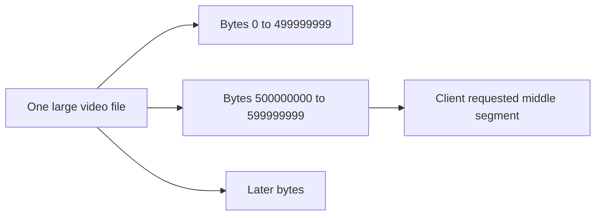

Range requests support download resume, parallel download strategies and media seeking. For safe resume, the client should check whether the underlying file changed, using appropriate validators such as `ETag` and `If-Range`.

**Nuance:** Range support is an HTTP feature of the serving path; clients should handle servers that return the whole object instead.

---

## 13. File sync: upload only changed blocks

In cloud-drive synchronization, editing a few bytes of a large document should not necessarily require sending the complete file again.

Break the file into blocks and compare hashes against a previous version. Only changed blocks need transferring when the storage design supports block reuse.

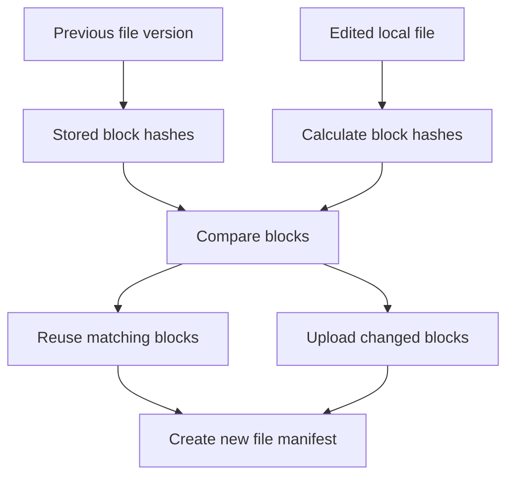

A **manifest** records the ordered block references making up a file version. Content-addressed storage can reuse blocks shared by different versions.

**Important:** This is **block-level synchronization**, different from a multipart upload that only improves the resilience of a single file transfer.

---

## 14. Fixed-size chunks vs content-defined chunks

Fixed-size chunking makes block boundaries easy to compute. But inserting bytes near the beginning of a file can shift every later fixed boundary, making many block hashes change.

**Content-defined chunking** chooses boundaries based on content patterns, often with rolling-hash techniques, so inserts may disturb fewer nearby chunks.

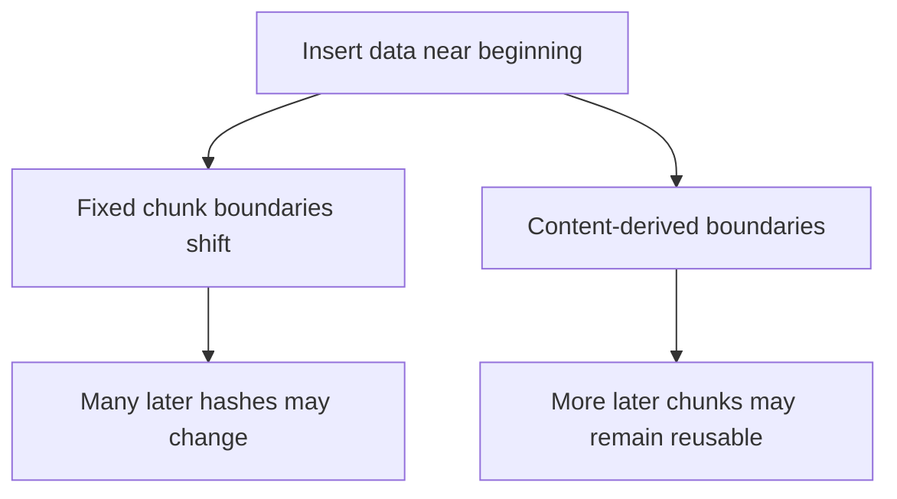

| Approach | Advantage | Disadvantage |
|---|---|---|
| Fixed-size blocks | Simpler boundaries and indexing | Insertions can shift many subsequent blocks |
| Content-defined blocks | Better matching after insertions | More CPU and implementation complexity |

Cross-user deduplication requires care: encryption models, access boundaries, information leaks and retention policy can make naive global deduplication unsafe.

---

## 15. Control storage cost with lifecycle policies

Not every file is downloaded forever. Frequently accessed objects need quick access; long-unused backups may be candidates for lower-cost storage tiers.

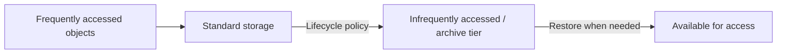

Tiers trade lower storage charges against retrieval cost, retrieval delay and minimum-duration rules. Use real access data instead of moving every file to cold storage blindly.

Other possible cost controls include **duplicate-block reuse**, appropriate compression and expiration of temporary files. Already-compressed video, JPEG and many archive formats often yield limited savings from another compression pass.

---

## 16. Capacity planning and interview design

Start by identifying the **number of files**, **average file size**, **peak simultaneous uploads**, **outbound traffic**, **processing time**, and **retention duration**.

### Illustrative throughput estimate

Suppose 1,000 users each upload at an average of 5 MiB/s during a traffic peak:

```text
Aggregate inbound throughput ≈ 1,000 × 5 MiB/s
                             ≈ 5,000 MiB/s
                             ≈ 4.88 GiB/s
```

This estimates aggregate inbound bytes, not application-server traffic when direct-to-storage upload is used. Actual bandwidth includes protocol overhead and uneven client rates.

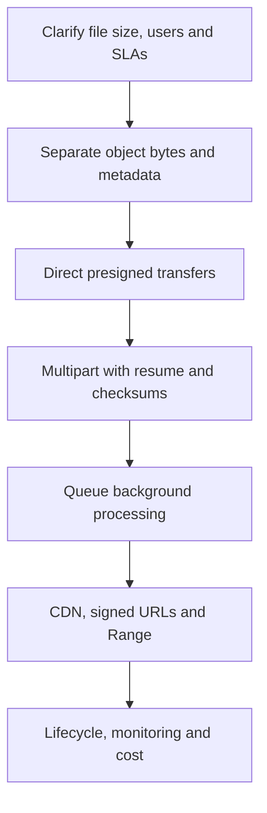

For interviews, explain design choices in that order before diving into a specific cloud product.

---

## 17. Troubleshooting and common mistakes

| Problem | What to check |
|---|---|
| Upload fails near completion | Multipart retry and resume logic |
| Browser upload blocked | CORS settings and signed URL method/headers |
| Transfer cannot pass API gateway | Request size and timeout limits; direct-to-storage path |
| Completed upload missing in app | Completion handshake, storage verification and status update |
| Parts accumulating in storage | Incomplete multipart lifecycle cleanup |
| Video uploaded but not playable | Background job state, transcoding and validation |
| Download starts from zero after interruption | Range support and validators |
| Old content persists on CDN | Cache TTL and invalidation policy |
| Sync uploads entire file after tiny edit | Fixed-block shifting versus content-defined boundaries |
| Storage bill rising unexpectedly | Access patterns, lifecycle and abandoned objects |

### Production safeguards

Authenticate metadata APIs, tightly scope upload/download URLs, validate content and ownership, implement quotas and malware scanning, make background tasks idempotent, and measure processing backlog and upload failure rates.

---

## 18. Interview questions and quick revision

### Questions

1. Why should application servers usually avoid proxying multi-gigabyte uploads?
2. What belongs in object storage versus a metadata database?
3. Who creates a presigned URL and what does it authorize?
4. Why must a backend verify the object before marking an upload complete?
5. How do multipart uploads resume after a failure?
6. Why should incomplete multipart parts be cleaned up?
7. How are per-part checksums different from whole-object integrity?
8. Why is S3 multipart ETag not always the whole-file MD5?
9. How would you design asynchronous video transcoding?
10. How should clients learn a file is ready?
11. Why use a CDN for popular downloads?
12. What is an HTTP byte-range request?
13. How can a download safely resume if the file changes?
14. How do fixed-size blocks differ from content-defined chunking?
15. How does block-level synchronization enable deduplication?
16. What are the trade-offs of archival storage classes?

### One-minute cheat sheet

| Concept | Remember |
|---|---|
| Object storage | Stores the large binary content |
| Metadata DB | Stores owner, size, key and status |
| Presigned URL | Time-limited scoped access to object operations |
| Multipart upload | Retry or resume independent parts |
| Checksum | Detect accidental data corruption |
| Processing queue | Run thumbnails, scanning and transcoding later |
| CDN | Cache public or authorized content closer to viewers |
| Signed download URL | Temporary access to a private object |
| Range request | Read a selected byte interval |
| Block-level sync | Transfer only changed portions |
| Content-defined chunking | Avoid excessive boundary shifting |
| Lifecycle tiers | Trade access speed for storage cost |

**Final takeaway:** **Keep metadata in the app database and file bytes in object storage. Transfer directly, upload in resumable parts, process asynchronously, and distribute downloads with the appropriate security and caching controls.**

---
