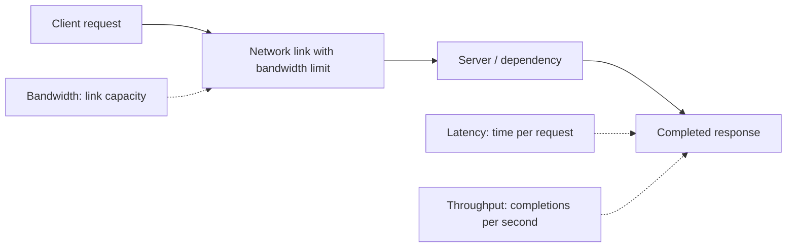
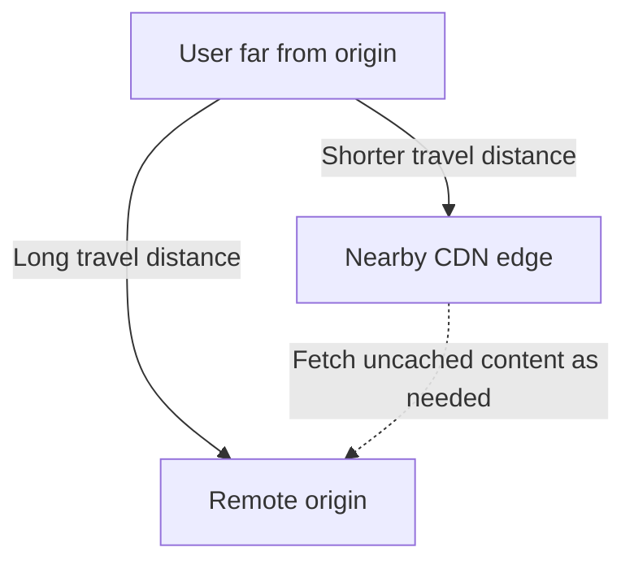
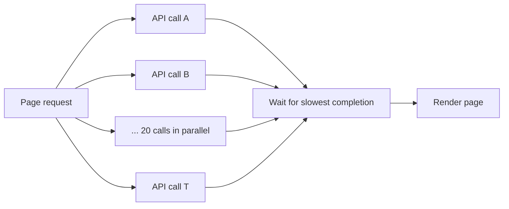
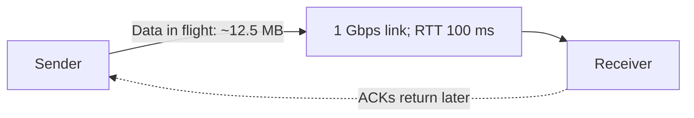
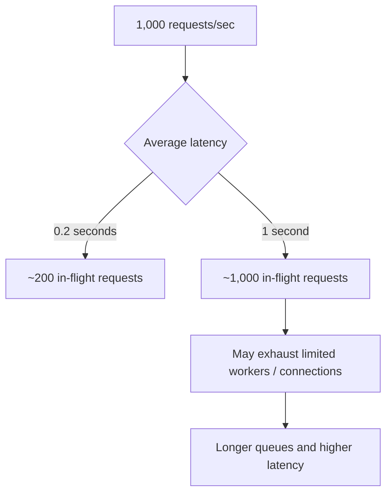
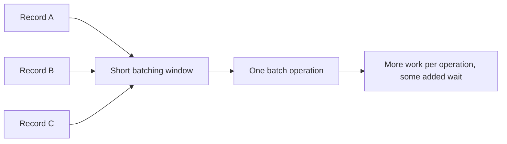
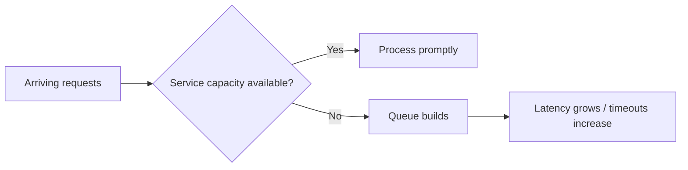

# Latency vs Throughput vs Bandwidth

**Understand performance with simple maths, intuitive examples, and system-design diagrams**

## Contents

1. [Three different performance questions](#1-three-different-performance-questions)
2. [Latency and its four network delays](#2-latency-and-its-four-network-delays)
3. [Average latency, percentiles and tail latency](#3-average-latency-percentiles-and-tail-latency)
4. [Bandwidth and bit/byte conversions](#4-bandwidth-and-bitbyte-conversions)
5. [Throughput and bottlenecks](#5-throughput-and-bottlenecks)
6. [Small API calls vs large downloads](#6-small-api-calls-vs-large-downloads)
7. [TCP window and bandwidth-delay product](#7-tcp-window-and-bandwidth-delay-product)
8. [Little's Law and concurrency](#8-littles-law-and-concurrency)
9. [Batching and utilization trade-offs](#9-batching-and-utilization-trade-offs)
10. [How to improve each metric](#10-how-to-improve-each-metric)
11. [Which metric matters for which system?](#11-which-metric-matters-for-which-system)
12. [One-page cheat sheet](#12-one-page-cheat-sheet)

---

## 1. Three different performance questions

Picture an express train service:

- **Latency:** How long does *one passenger* take to reach the destination?
- **Bandwidth:** How much data can the connection *theoretically carry per second*? In the transport analogy, think of track capacity.
- **Throughput:** How many passengers *actually arrive per hour*?

Increasing track capacity may allow more travelers, but does not automatically shorten one passenger's journey.

| Metric | Core question | Common units |
|---|---|---|
| **Latency** | How long does one operation take? | milliseconds (ms), microseconds (µs) |
| **Bandwidth** | How many bits can a network link carry per second? | Mbps, Gbps |
| **Throughput** | How much useful work completes per second? | RPS, TPS, messages/s, MB/s |

**Memory trick: L–B–T**

- **L = Length of wait** (latency)
- **B = Bandwidth ceiling** (link capacity)
- **T = Tasks completed** (throughput)



---

## 2. Latency and its four network delays

Application request latency measures elapsed time from a client sending a request to receiving the response. It includes networking **and** server work.

The source lesson breaks network delay into four main contributors:

| Contributor | Meaning | What increases it? |
|---|---|---|
| **Propagation** | Signal travel time | Physical distance |
| **Transmission** | Time to put bits onto a link | Larger messages, slower link |
| **Queuing** | Time waiting at a busy network device | Congestion |
| **Processing** | Time spent handling/forwarding packets | Device work |

Application latency additionally includes API logic, database queries, downstream calls, and response generation.

### Propagation: distance costs time

The example assumes signals in optical fiber travel about **200,000 km/s**. For an ideal straight **5,600 km** path:

```text
One-way propagation = distance ÷ speed
                    = 5,600 km ÷ 200,000 km/s
                    = 0.028 seconds
                    = 28 ms

Ideal minimum round trip ≈ 28 × 2 = 56 ms
```

Actual routed paths are longer and include equipment and congestion; the lesson gives **roughly 70–80 ms** as an illustrative observed intercity RTT.

**Why a CDN helps:** It moves content nearer to users, reducing the distance part of a request. Buying a wider connection does not make signals exceed their physical propagation speed.



### Transmission is different from propagation

```text
Transmission time = data size in bits ÷ link rate in bits/sec
```

Example: A 1,000-byte message contains **8,000 bits**. At **1 Gbps**:

```text
8,000 ÷ 1,000,000,000 = 0.000008 sec = 8 µs
```

This counts serialization of the payload onto the link, not the full application response time.

---

## 3. Average latency, percentiles and tail latency

Averages are useful but can hide a small set of very slow requests.

Imagine **100 requests**:

- **98** finish in **50 ms**
- **2** finish in **2,000 ms**

### Simplified mean calculation

```text
Average = (98 × 50 + 2 × 2,000) ÷ 100
        = (4,900 + 4,000) ÷ 100
        = 89 ms
```

The **89 ms average** sounds good, but two people waited two full seconds.

### Percentile definitions

| Percentile | Read it as | Why it matters |
|---|---|---|
| **p50** | About 50% of requests complete within this time | Typical experience |
| **p95** | About 95% complete within this time | Slower users |
| **p99** | About 99% complete within this time | Worst ~1% tail |

For this illustrative distribution, **p50 = 50 ms**. With a nearest-rank percentile method, **p99 = 2,000 ms**. Percentile implementations can interpolate differently; always be aware of how your monitoring tool calculates them.

### Slowest dependency affects whole page

Suppose a page launches **20 independent backend calls**, each with **1%** probability of being slow. The page finishes only after all return.

```text
Probability a call is not slow = 99% = 0.99
Probability none of 20 is slow = 0.99^20 ≈ 0.818
Probability at least one is slow = 1 − 0.818
                                 ≈ 0.182 = 18.2%
```

So a 1% slow-call rate can affect **about 18 out of 100 page loads** when there are 20 parallel independent calls.



**Memory trick:** **p50 = middle, p95 = slow users, p99 = tail.** Always inspect p95/p99 along with the average.

---

## 4. Bandwidth and bit/byte conversions

Bandwidth describes the nominal maximum data rate supported by a communication link.

Networking uses **bits per second**. File sizes commonly use **bytes**.

```text
1 byte = 8 bits
1 Mbps = 1,000,000 bits/sec
1 Gbps = 1,000,000,000 bits/sec
1 GB = 1,000,000,000 bytes (decimal)
```

### Convert 1 Gbps to MB/s

```text
1 Gbps ÷ 8 = 0.125 GB/sec = 125 MB/sec
```

| Link rate | Maximum theoretical transfer in decimal bytes |
|---|---|
| 100 Mbps | 12.5 MB/s |
| 1 Gbps | 125 MB/s |
| 10 Gbps | 1,250 MB/s = 1.25 GB/s |

These are **ideal link-rate ceilings**, not delivered application payload rates. Headers, congestion, retransmissions and other overhead reduce useful throughput.

**Memory trick:** **b = bit; B = Byte; divide by 8 to convert bits to bytes.**

---

## 5. Throughput and bottlenecks

Throughput counts **completed** work: network bytes delivered, API requests served, records processed, or transactions committed per second.

A fast link may not help if another part of the pipeline is slower.

### Example: fast network, slower disk

- Network link: **10 Gbps = 1,250 MB/s**
- Sustained disk writes: **200 MB/s**

For a workload that must write every received byte to that disk:

```text
Sustained throughput ≤ min(1,250 MB/s, 200 MB/s)
                     = 200 MB/s
```

The disk becomes the limiting stage.


**Memory trick:** **A pipeline is limited by its slowest required stage.** This simplified minimum assumes stages form a required stream and excludes other constraints.

---

## 6. Small API calls vs large downloads

A teaching approximation for a request dominated by one network round trip and one transfer is:

```text
Rough total time ≈ RTT + (data size in bits ÷ usable link rate)
```

It omits server processing, handshake overhead, congestion and protocol behavior; real transfers may behave differently.

### Small payload: 1 KB on 1 Gbps

- RTT: **50 ms**
- Data size: **1 KB = 8,000 bits**
- Transfer time: **8 µs = 0.008 ms**

```text
Total ≈ 50 + 0.008 = 50.008 ms
```

Even a 10× faster link cannot remove the **~50 ms RTT**. Reduce round trips, geographical distance, or dependency calls.

### Large payload: 10 GB on 1 Gbps

```text
10 GB = 80 gigabits
80 Gb ÷ 1 Gb/s = 80 seconds

50 ms RTT = 0.05 seconds
```

Here **80 seconds of serialization** dominates **0.05 seconds of round-trip delay**.

| Workload | Dominant concern |
|---|---|
| Many tiny API requests | RTT and application latency |
| Huge backup transfer | Sustained throughput / available bandwidth |

**Memory trick:** **Small requests care about waiting; large files care about moving bytes.**

---

## 7. TCP window and bandwidth-delay product

TCP can limit the amount of data awaiting acknowledgment. With a fixed effective in-flight window, throughput can be constrained by the time acknowledgments take.

### Window-size shortcut

```text
Max approximate throughput ≈ window size ÷ RTT
```

For an illustrative **64 KB** window with **100 ms RTT**:

```text
64 KB ÷ 0.1 sec = 640 KB/s
640 KB/s × 8 = 5,120 Kb/s ≈ 5.12 Mbps
```

Even when a network link is rated **1 Gbps**, a small effective window can limit a single connection to around **5 Mbps**.

This is a simplified window-limited model; modern TCP dynamically adjusts windows and also considers congestion control and other factors.

### Bandwidth-delay product (BDP)

**BDP** estimates how much data must be in flight to fully use a link.

```text
BDP = bandwidth × RTT

1 Gbps × 0.1 sec = 0.1 gigabit
                  = 100 megabits
                  = 12.5 MB
```

**Meaning:** For a **1 Gbps** path with a **100 ms** round trip, an in-flight amount around **12.5 MB** is needed to approach full utilization under ideal assumptions.



**Memory trick:** **Bandwidth × RTT = bytes/bits in flight**, depending on units.

---

## 8. Little's Law and concurrency

**Little's Law:** For a stable system measured over a consistent boundary:

```text
L = λ × W

L = average requests in the system
λ = average completed requests per second
W = average time each request spends in the system (seconds)
```

### Example: 1,000 RPS and 200 ms response time

```text
W = 200 ms = 0.2 sec
L = 1,000 × 0.2 = 200 requests in progress on average
```

If the average response time increases to **1 second** while throughput remains **1,000 RPS**:

```text
L = 1,000 × 1 = 1,000 concurrent requests on average
```

That is **5× more requests in progress**. If the service has only **200 available blocking workers or connections** and no other means of parallelism, it may fail to sustain the same rate.



**Memory trick:** **RPS × seconds = concurrency.** Convert milliseconds to seconds first.

> Important: Little's Law is a statement about stable averages. It does not assert a direct one-to-one relationship between in-flight requests and OS threads in fully asynchronous systems.

---

## 9. Batching and utilization trade-offs

### Batching

Instead of sending or writing each record separately, a system may collect records briefly and process them together.

**Benefit:** Less overhead per record; often higher throughput.

**Trade-off:** Early records in each batch must wait for batch formation, increasing their individual latency.

The source cites Kafka producer settings such as `linger.ms` and `batch.size`, and database **group commit**, as examples of this trade-off.



### High utilization and queueing

When a server has spare capacity, bursts may clear quickly. Near saturation, requests wait behind one another and response-time tails can grow sharply.



**Design principle:** Leave headroom rather than planning all servers to operate continuously at their absolute capacity.

---

## 10. How to improve each metric

### Reduce latency

- Place data closer to users using a CDN or suitable regional deployment.
- Cache frequently requested results.
- Reuse connections and reduce needless round trips.
- Parallelize **independent** downstream calls when safe.
- Move optional slow work to background queues.
- Improve database queries and indexes.
- Track **p95/p99**, not only average latency.

### Improve throughput

- Find and remove the true bottleneck.
- Scale stateless application tiers horizontally.
- Partition data when one storage node becomes limiting.
- Use parallel processing for independent work.
- Batch operations when latency targets allow.
- Queue bursty work while monitoring backlog and consumer capacity.

### Reduce required bandwidth or origin traffic

- Compress suitable text responses such as JSON and HTML.
- Avoid unnecessary response fields.
- Paginate large datasets.
- Deliver cacheable assets via CDNs.

**Important distinction:** Compression reduces bytes transferred but consumes compute. A queue can smooth bursts, but it does not make the total work disappear.

---

## 11. Which metric matters for which system?

| Application type | Common priority | Why |
|---|---|---|
| Multiplayer game | Low latency and tail latency | Delayed actions harm responsiveness |
| Trading platform | Predictable latency | Timing-sensitive operations |
| Backup transfer | Sustained bandwidth / throughput | Large volume must finish on time |
| Data pipeline | Throughput | Large number of records processed |
| Video streaming | Per-stream bandwidth and aggregate throughput | Avoid buffering at scale |
| User-facing API | Both low p99 latency and sufficient RPS | Fast individual requests under high demand |

A system design interview might use a **hypothetical** objective like:

> Serve 10,000 requests per second while keeping p99 response time below 200 ms.

Such a goal is meaningful only when **both** throughput and latency are measured at the stated workload.

---

## 12. One-page cheat sheet

| Remember | Quick equation or meaning |
|---|---|
| Latency | Time per operation |
| Bandwidth | Link's data-rate ceiling |
| Throughput | Useful completed work per second |
| 8 bits | 1 byte |
| 1 Gbps | Up to 125 MB/s theoretically |
| Transmission delay | Bits ÷ bits/sec |
| Propagation delay | Distance ÷ signal speed |
| Mean latency | Total response times ÷ request count |
| p50 / p95 / p99 | Typical / slower / tail requests |
| 20 independent 1%-slow calls | At least one slow ≈ **18%** |
| Small 1 KB payload, 1 Gbps | ~**8 µs** serialization |
| Large 10 GB, 1 Gbps | ~**80 sec** ideal transfer |
| Window-limited throughput | Window ÷ RTT |
| BDP | Bandwidth × RTT |
| 1 Gbps × 100 ms | **12.5 MB in flight** |
| Little's Law | **In-flight requests = RPS × latency in seconds** |
| 1,000 RPS × 0.2 sec | **200 concurrent requests** |
| More batching | Often more throughput, some extra latency |

### Six easy-to-remember numbers

**8 — 50 — 80 — 99 — 200 — 12.5**

- **8:** Bits per byte.
- **50 ms:** Example round-trip latency.
- **80 sec:** Theoretical 10 GB transfer on a 1 Gbps link.
- **99:** p99 highlights the slow request tail.
- **200:** Concurrency at 1,000 RPS and 200 ms.
- **12.5 MB:** Ideal in-flight data to fill 1 Gbps with 100 ms RTT.

### Practice interview questions

1. What's the difference between link bandwidth and achieved throughput?
2. Why might faster internet not improve a 1 KB API request?
3. Calculate transfer time for a 10 GB file over 1 Gbps.
4. Why do p99 latency metrics matter even when average latency is low?
5. What happens to end-to-end latency when many independent calls run in parallel?
6. Explain how the TCP receive/congestion window can limit throughput.
7. What does bandwidth-delay product mean?
8. Calculate concurrency at 2,000 RPS and 150 ms average latency.
9. Why can batching increase throughput but worsen per-record latency?
10. Why does high resource utilization often increase queueing delay?

**Core takeaway:** Faster systems are not always those with the biggest network links. Measure how long each operation takes, how much work finishes, and which resource constrains the workload—then fix that bottleneck.

---
