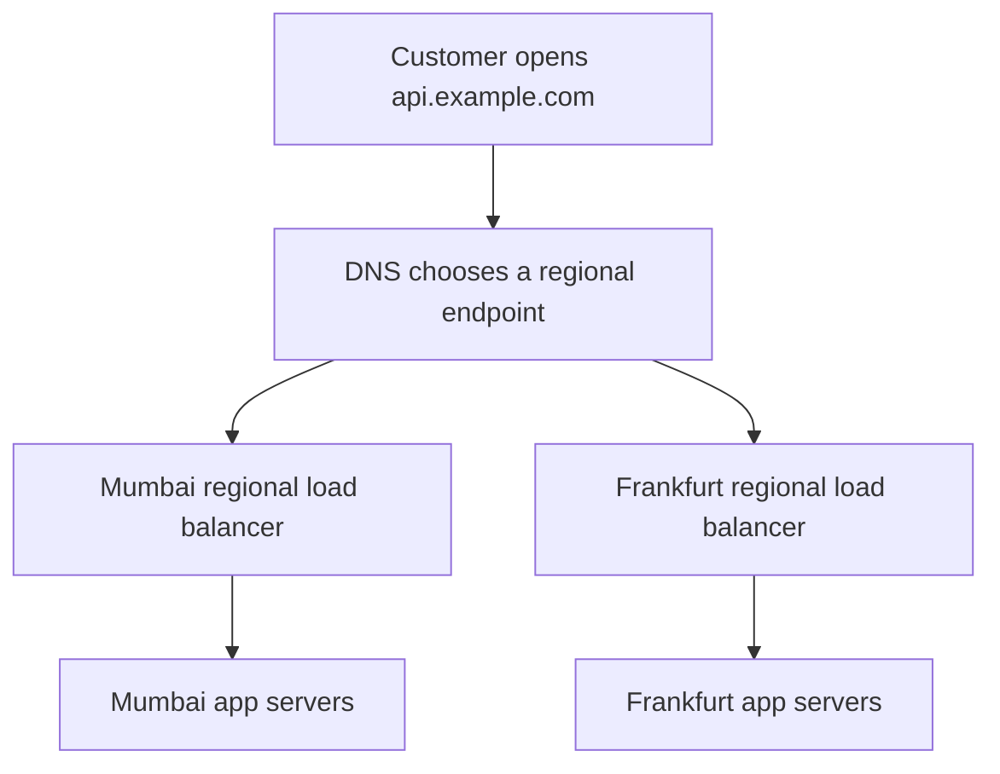
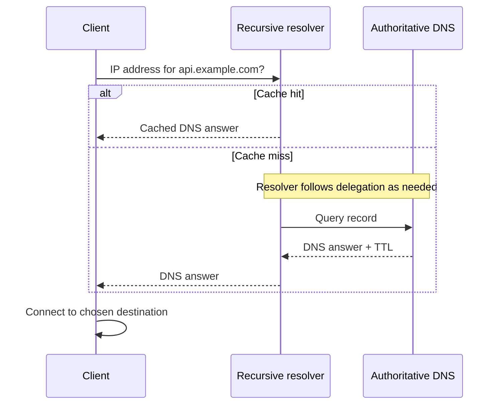
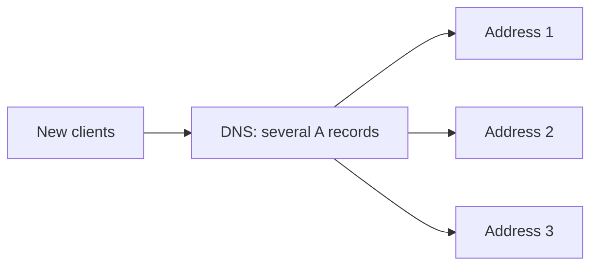
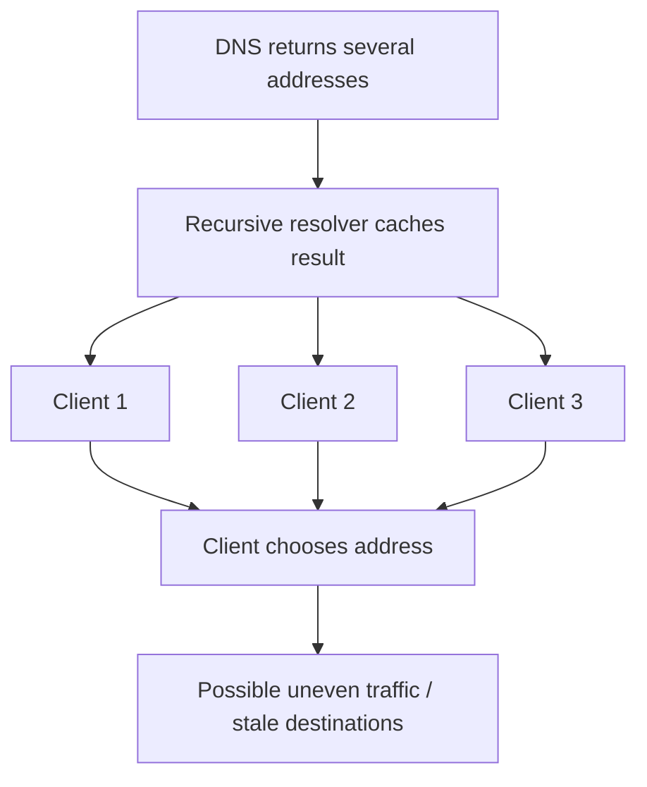
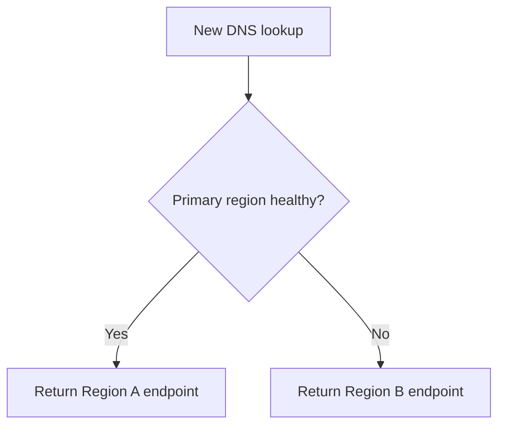
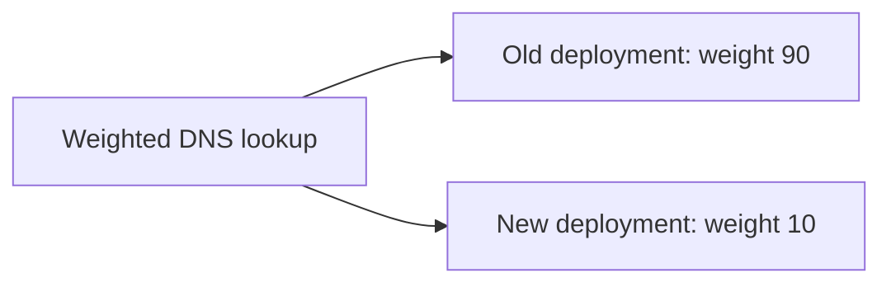
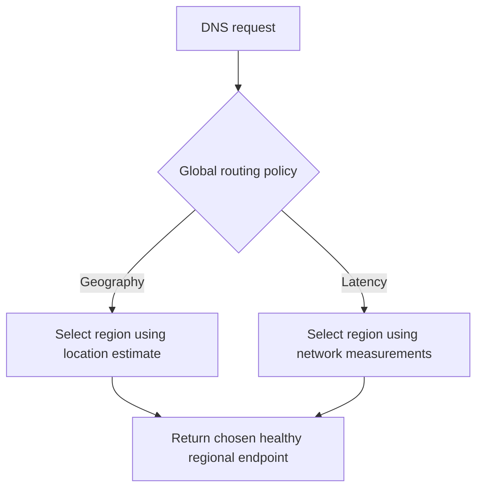
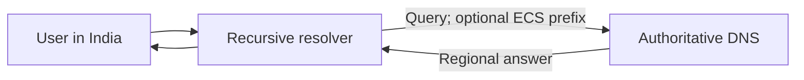
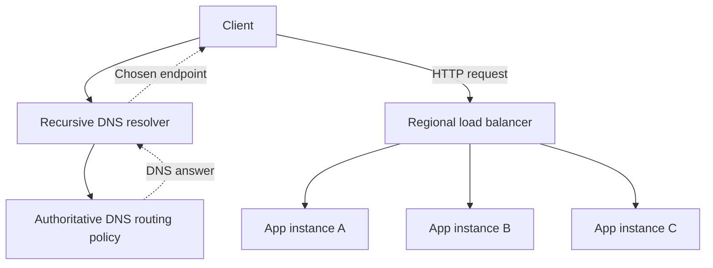
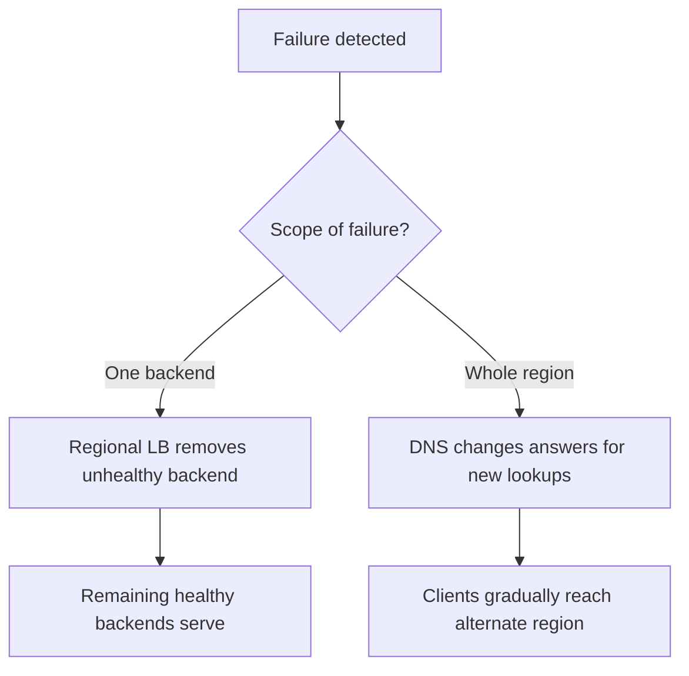

# DNS Load Balancing — Explained Simply

**How DNS sends users to the right region, what TTL means, and why DNS and regional load balancers work together**

*Distributed Systems Study Library · Author: Jayesh Sharma*

> Original study notes based on the supplied DNS load-balancing transcript. The explanations, examples, tables and Mermaid diagrams here are independently authored. Any numbers in worked scenarios are illustrative; a real deployment depends on DNS-provider, resolver and client behavior.

## Contents

1. [Why DNS can help with load balancing](#1-why-dns-can-help-with-load-balancing)
2. [How a DNS lookup works](#2-how-a-dns-lookup-works)
3. [Round-robin DNS](#3-round-robin-dns)
4. [Limitations of basic DNS balancing](#4-limitations-of-basic-dns-balancing)
5. [Health checks and regional failover](#5-health-checks-and-regional-failover)
6. [TTL and why failover is not instant](#6-ttl-and-why-failover-is-not-instant)
7. [Weighted DNS and canary releases](#7-weighted-dns-and-canary-releases)
8. [Geolocation and latency-based routing](#8-geolocation-and-latency-based-routing)
9. [The recursive-resolver location problem](#9-the-recursive-resolver-location-problem)
10. [DNS balancing vs traditional load balancing](#10-dns-balancing-vs-traditional-load-balancing)
11. [How they work together in a real system](#11-how-they-work-together-in-a-real-system)
12. [Best practices and common mistakes](#12-best-practices-and-common-mistakes)
13. [Interview examples and cheat sheet](#13-interview-examples-and-cheat-sheet)

---

## 1. Why DNS can help with load balancing

Imagine an online store running in two places: **Mumbai** and **Frankfurt**. Each region has its own load balancer and application servers.

A customer in India opens `api.example.com`. Ideally, the request should reach a suitable region instead of always traveling to a distant data center.

There are **two routing decisions**:

- **Global decision:** Which region should the user connect to?
- **Regional decision:** Which healthy application server in that region should handle the request?

DNS can influence the first decision by returning an appropriate destination address. A regional load balancer then handles the second.



**Memory trick:** **DNS chooses the destination; the load balancer chooses the machine.**

DNS does not normally carry the subsequent HTTP request. Once the client has resolved the name, it connects to the selected address.

---

## 2. How a DNS lookup works

Before a browser or application contacts `api.example.com`, it needs an IP address (or another usable connection endpoint).

A simplified lookup looks like this:

1. The application asks its configured **recursive DNS resolver**.
2. If the resolver already has an unexpired cached answer, it returns that answer.
3. Otherwise, the resolver follows the DNS hierarchy, using root and top-level-domain delegation information to reach the domain's authoritative servers.
4. The authoritative DNS service supplies the relevant records and a **TTL**.
5. The resolver returns the answer to the client and may cache it according to TTL and its own policies.



### Terms to remember

| Term | Simple meaning |
|---|---|
| **DNS** | Translates names to routing information such as IP addresses |
| **Recursive resolver** | Finds and caches answers for clients |
| **Authoritative DNS** | Holds or serves the domain's configured DNS records and policies |
| **A record** | Maps a name to an IPv4 address |
| **AAAA record** | Maps a name to an IPv6 address |
| **TTL** | Time-to-live: how long a DNS answer is eligible to be cached |

**Key idea:** The authoritative DNS service chooses what answer to provide; caching controls when a resolver asks again.

---

## 3. Round-robin DNS

The simplest DNS balancing technique makes one name resolve to multiple destination IP addresses.

For illustration, consider three servers with documentation-only IPs:

```text
api.example.com → 192.0.2.10
api.example.com → 192.0.2.20
api.example.com → 192.0.2.30
```

The authoritative service may rotate their order across different responses:

| DNS query | Example returned order |
|---|---|
| First | 10, 20, 30 |
| Second | 20, 30, 10 |
| Third | 30, 10, 20 |

Here, `10`, `20`, and `30` abbreviate the final octet of those sample IPs.

If enough clients tend to use the first address, the rotation can spread connections over time.



**Why it is appealing:** Very little application-side complexity. The DNS server selects answers, then clients connect directly to the destination.

**But:** DNS does not guarantee a fair share of requests for every server.

---

## 4. Limitations of basic DNS balancing

### Problem A — A dead server can still appear in answers

Basic record rotation alone does not check whether a destination is healthy. If server 2 stops responding, some clients might still be directed there.

### Problem B — DNS responses are cached

The authoritative service cannot reshuffle an answer on every user request because many users may share a recursive resolver's **same cached response**.

### Problem C — Server load is ignored

Simple rotation has no direct idea that one node is at 90% CPU while another is almost idle.

### Problem D — Client address selection varies

Clients and operating systems may reorder, retry, race or otherwise choose from returned addresses in different ways. The first A record is not guaranteed to receive the connection.



**Memory trick:** **DNS controls an answer, not every later request.**

---

## 5. Health checks and regional failover

Managed DNS routing can incorporate **endpoint health checks**. These may check HTTP responses or other configured signals.

Suppose your application uses **Region A** normally and **Region B** as a standby:

- While A passes health checks, the DNS service answers with A's endpoint.
- When A fails enough checks to be considered unhealthy, the DNS service can begin returning B's endpoint for **new answers**.
- When A recovers, the configured routing policy may allow it back.



This can help clients reach a different region after an outage, without manually changing the application URL.

**Important limit:** Removing a failed region from fresh DNS answers does not erase older cached answers. Real failover also requires that the standby region have the necessary application, data and capacity.

---

## 6. TTL and why failover is not instant

**TTL = Time To Live.**

A TTL of **3,600 seconds** represents **one hour** of permitted caching under the advertised record lifetime.

A shorter TTL means resolvers can refresh more frequently, giving DNS changes an opportunity to propagate sooner.

| Example TTL | Potential benefit | Trade-off |
|---|---|---|
| 3,600 seconds (1 hour) | More cache reuse, fewer DNS lookups | Some clients may retain old routing longer |
| 60 seconds | Faster opportunity to refresh | More DNS queries |
| 30 seconds | More frequent opportunity to refresh | Still more lookup traffic |

### Easy example

A resolver caches Region A's address at **10:00:00** with TTL **60 seconds**.

```text
10:00:00  Cache Region A address (TTL = 60s)
10:00:10  Region A experiences outage
10:00:20  Resolver may still return cached Region A
10:01:00  Cached TTL expires; next query may ask for new answer
```

This is a simplified compliant-cache timeline. It is **not** a guarantee that all clients switch precisely at 10:01.


### Why even a short TTL does not guarantee instant failover

- Some resolvers or application runtimes keep DNS answers longer than expected.
- Long-lived existing connections may continue using their original destination without another DNS lookup.
- Health checking and routing updates themselves take some time.
- Clients may apply their own retry or address-selection behavior.

**Memory trick:** **TTL influences refresh timing; it is not a failover stopwatch.**

---

## 7. Weighted DNS and canary releases

With weighted DNS, the service chooses which answer to provide using configured relative weights.

Suppose you're migrating from an old region to a new region.

| Migration step | Old region weight | New region weight |
|---|---:|---:|
| Initial canary | 90 | 10 |
| Broader trial | 50 | 50 |
| Completed migration | 0 | 100 |



**Crucial distinction:** Weights affect the selection of **DNS answers**, not a guaranteed percentage of individual HTTP requests.

For example, if one recursive resolver caches a new-region answer and serves many busy customers, the new region might receive considerably more than 10% of actual traffic during that interval.

**Remember:** **10% of DNS choices ≠ necessarily 10% of HTTP requests.**

A canary rollout should monitor error rates and latency and retain rollback capability.

---

## 8. Geolocation and latency-based routing

When the service runs in multiple regions, DNS may choose a destination using geography or estimated network performance.

### Geolocation routing

Route a query based on the location inferred from DNS query context.

Example policy:

- India → **Mumbai**
- Europe → **Frankfurt**

### Latency-based routing

Choose a region that the DNS provider estimates can be reached with comparatively low latency. The geographically nearest region is **not always** the fastest because network paths and provider performance differ.



**Additional caution:** DNS location-based routing alone does not guarantee legal data-residency compliance. Data storage, processing and failover rules also matter.

---

## 9. The recursive-resolver location problem

The authoritative DNS service generally sees a query from the **recursive resolver**, not a direct connection from the end user.

If a customer is in India but uses a resolver located elsewhere, geography-based routing could choose an unexpectedly distant destination.

### EDNS Client Subnet (ECS)

ECS is a mechanism by which a participating recursive resolver can share part of a client's network prefix with an authoritative DNS service to help inform routing.



However, not every resolver supplies ECS, and sharing network prefixes raises privacy considerations. DNS geography is therefore an **estimate**, not perfect knowledge of the user location.

---

## 10. DNS balancing vs traditional load balancing

These technologies solve **different levels of the same routing problem**.

| Question | DNS-based routing | Regional L4/L7 load balancer |
|---|---|---|
| When does it make a choice? | Usually at name resolution | At connection/request handling |
| Typical decision | Which regional endpoint should client connect to? | Which healthy backend receives traffic? |
| Is it in the HTTP request data path? | Usually no | Typically yes |
| Can its decisions be cached by resolvers? | Yes | Not DNS-cached in the same way |
| Can it react to per-server active connections? | Not typically | Often, depending on algorithm |
| What happens after a server fails? | Old DNS answers may persist | Can stop assigning new traffic after detecting failure |

**Memory trick:** **DNS = broad/global steering. Load balancer = precise/local distribution.**

For regional traffic distribution details, see [What Are Load Balancers?](What_Are_Load_Balancers.md) and [Load Balancing Algorithms](Load_Balancing_Algorithms.md).

---

## 11. How they work together in a real system

Consider `api.example.com` deployed in **Mumbai** and **Frankfurt**, each with a highly available regional load-balancing endpoint.

### Happy path

1. The client's resolver requests the address for `api.example.com`.
2. DNS routing selects an appropriate **healthy region**.
3. The client connects to that region's load balancer.
4. The load balancer routes to a **healthy application instance**.



### Failure scenario A: one app instance fails

The regional load balancer marks the instance unhealthy and stops giving it new work. **No global DNS change is required** if the regional endpoint itself remains healthy.

### Failure scenario B: an entire region fails

DNS health checks can cause **new lookups** to receive another region's endpoint. Existing caches and connections mean the transition is **usually gradual rather than immediate**.



---

## 12. Best practices and common mistakes

### Practical practices from the lesson

- **Attach useful health checks.** A TCP connection alone may not prove an application can serve critical requests.
- **Choose TTL based on required agility.** Consider query volume and acceptable transition delay.
- **Lower TTL before planned migrations.** Allow enough time for existing longer-lived cached answers to expire.
- **Keep old endpoints temporarily available.** Existing connections and DNS caches may outlive the cutover.
- **Use highly available regional entry points.** Let DNS decide regions and regional balancers decide individual app instances.

### Avoid these misunderstandings

| Misunderstanding | Better understanding |
|---|---|
| “Round-robin DNS splits requests equally.” | It can spread answers, but caching and client behavior create skew. |
| “30-second TTL means recovery in 30 seconds.” | Health detection, caches and live connections add delay. |
| “Weighted DNS gives exactly 10% of my requests to canary.” | It influences DNS answer selection; HTTP request percentages may differ. |
| “DNS selects the least busy app server.” | That is usually the responsibility of the in-path load balancer. |
| “Geolocation always knows the user's location.” | DNS may only know the resolver's approximate location. |

---

## 13. Interview examples and cheat sheet

### Example A: estimate cached-answer lifetime

```text
TTL = 60 seconds
Answer cached at 12:00:00
Potential expiry = 12:01:00

If outage starts 12:00:15,
remaining advertised cache lifetime ≈ 45 seconds
```

This is **only the TTL portion** of potential redirection delay.

### Example B: weighted rollout

```text
Old deployment weight = 90
New deployment weight = 10
Total weight = 100

New deployment is selected for roughly 10%
of eligible weighted DNS decisions, under ideal assumptions.
```

Do not interpret the result as a guaranteed share of user sessions or requests.

### Quick revision table

| Topic | One-line reminder |
|---|---|
| DNS load balancing | Choose destinations through DNS answers |
| Round-robin DNS | Rotate among multiple destination IPs |
| Resolver cache | May serve the same answer to many users |
| Health checks | Exclude unhealthy destinations from new responses |
| TTL | Controls advertised DNS cache lifetime |
| Weighted routing | Influence the proportion of DNS answers |
| Geolocation | Route based on approximate query location |
| Latency-based | Route using network-latency estimates |
| ECS | Optionally shares part of client network prefix |
| Regional load balancer | Select a healthy local backend |
| Regional failover | New DNS answers can direct clients elsewhere |

### Interview questions

1. Why would a multi-region system use DNS routing *and* a local load balancer?
2. What happens when round-robin DNS keeps returning the address of a failed server?
3. How can a recursive resolver make traffic distribution uneven?
4. Explain why a 60-second TTL cannot guarantee 60-second failover.
5. What is the difference between weighted DNS answers and HTTP request percentages?
6. How is geolocation routing different from latency-based routing?
7. Why might a customer in India reach a distant region despite geolocation rules?
8. What problem does EDNS Client Subnet attempt to reduce?
9. How would you plan a low-risk migration between two regional endpoints?
10. What happens when one backend fails versus an entire region failing?

**Final takeaway:** **DNS can guide clients toward an appropriate region, while a regional load balancer directs connections or requests to healthy servers. Combining the two provides flexible global routing without pretending DNS is instant or aware of every request.**

---

*Source basis: user-supplied DNS load-balancing transcript. All prose and diagrams are independently written for study. Concepts and examples are educational; operational behavior depends on resolver, client and service configuration.*
