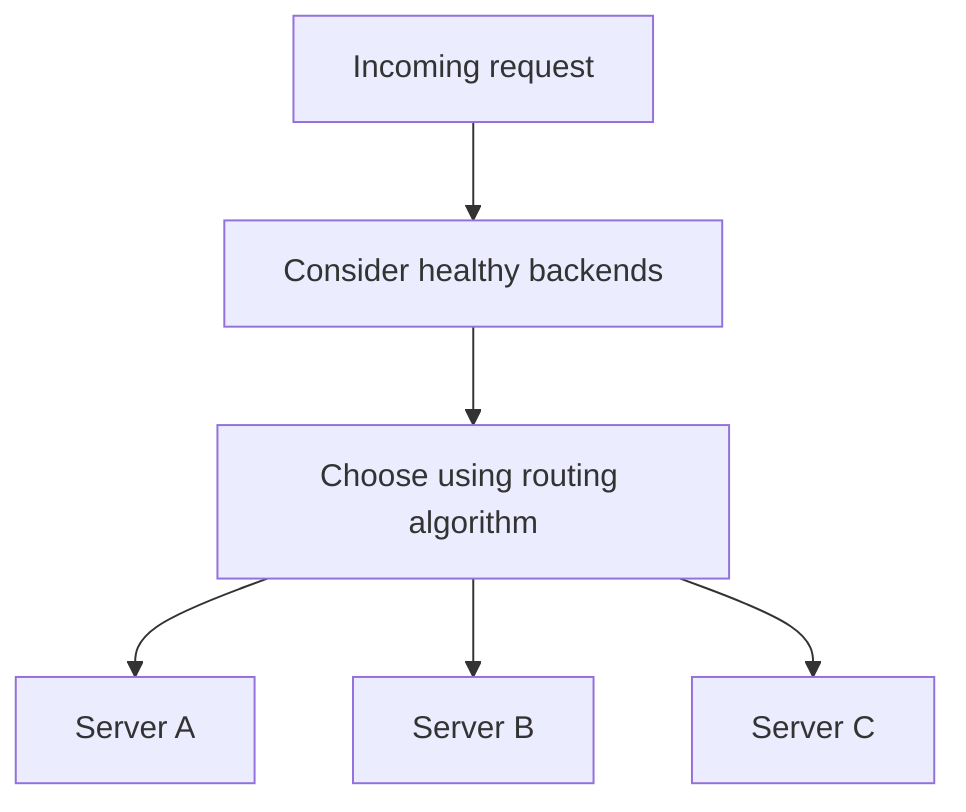
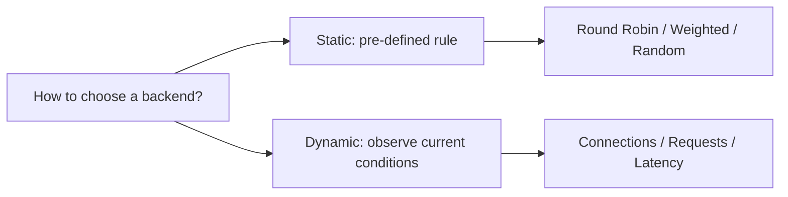
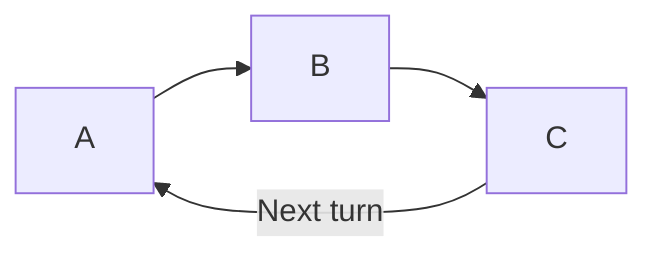
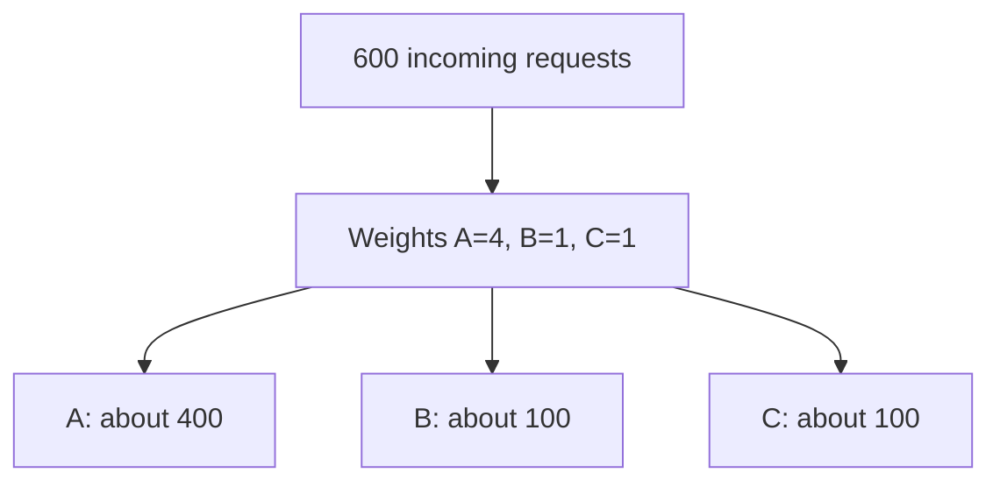
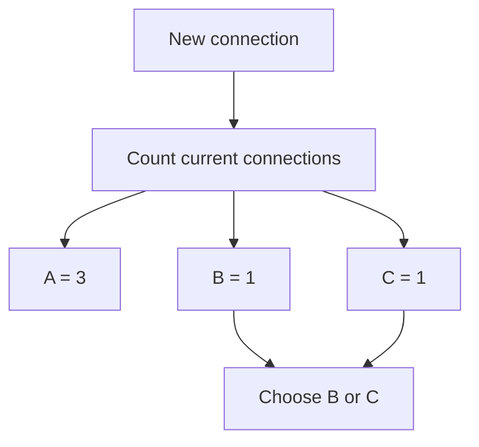
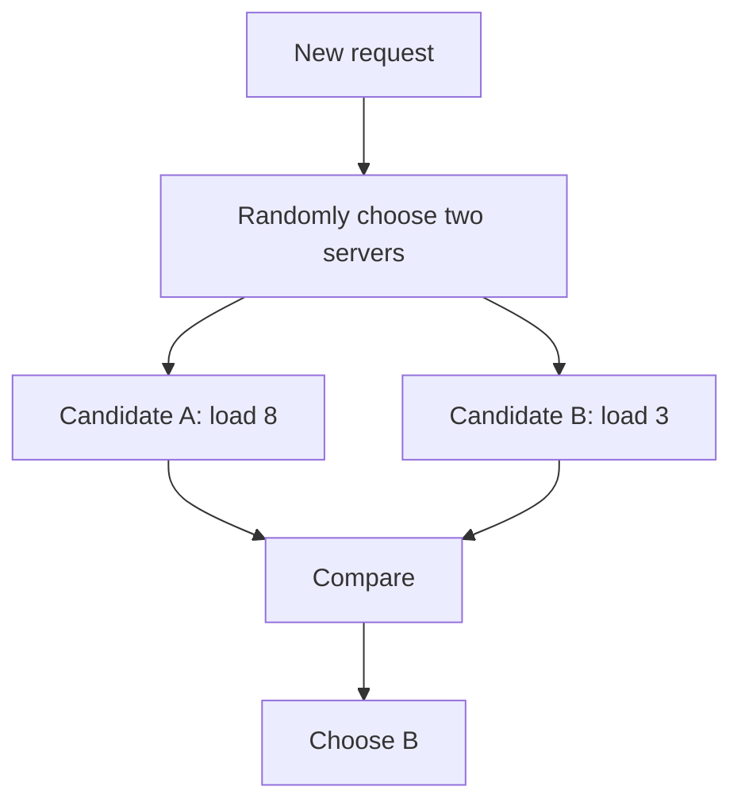
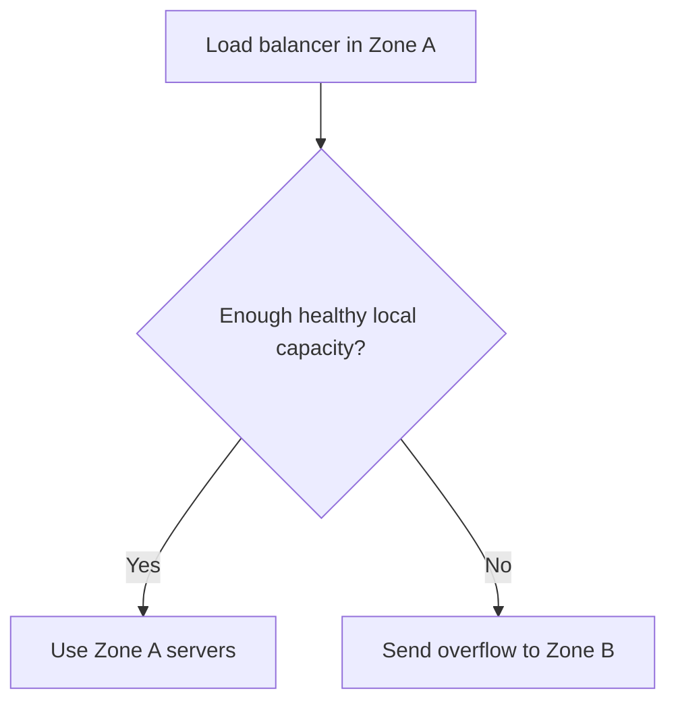
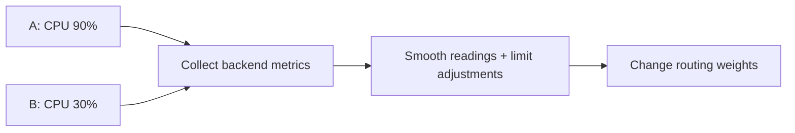
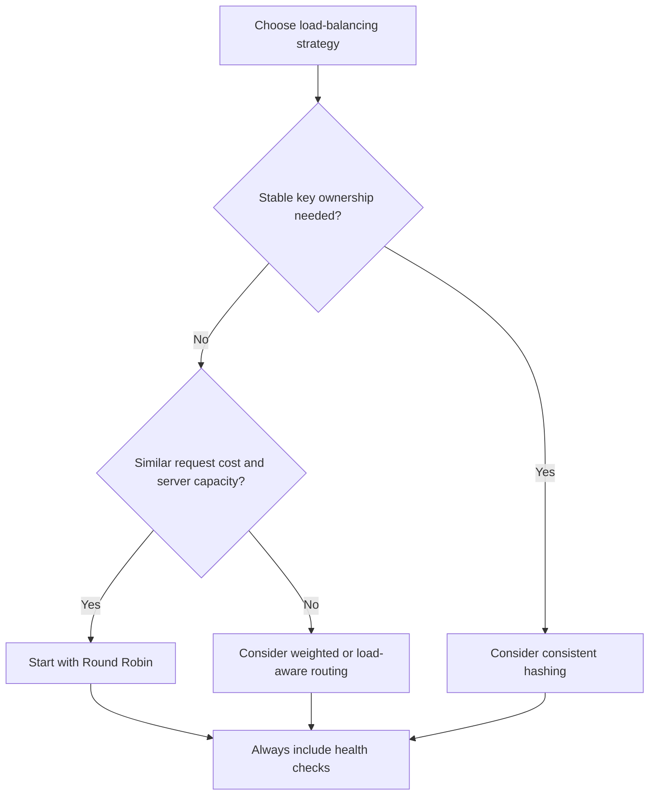

# Load Balancing Algorithms — Explained Simply

**Round Robin, weighted routing, Least Connections, Power of Two Choices, Consistent Hashing and more**

*Distributed Systems Study Library · Author: Jayesh Sharma*


## Contents

1. [What is a load-balancing algorithm?](#1-what-is-a-load-balancing-algorithm)
2. [Static vs dynamic algorithms](#2-static-vs-dynamic-algorithms)
3. [Round Robin](#3-round-robin)
4. [Weighted Round Robin](#4-weighted-round-robin)
5. [Random selection](#5-random-selection)
6. [Least Connections vs Least Requests](#6-least-connections-vs-least-requests)
7. [Slow start for new servers](#7-slow-start-for-new-servers)
8. [Least Response Time and EWMA](#8-least-response-time-and-ewma)
9. [Power of Two Choices](#9-power-of-two-choices)
10. [Hash-based routing and consistent hashing](#10-hash-based-routing-and-consistent-hashing)
11. [Locality-aware routing](#11-locality-aware-routing)
12. [Adaptive routing from server metrics](#12-adaptive-routing-from-server-metrics)
13. [How to choose an algorithm](#13-how-to-choose-an-algorithm)
14. [Interview revision and examples](#14-interview-revision-and-examples)

---

## 1. What is a load-balancing algorithm?

Suppose your application has three servers: **A, B and C**. A load balancer receives a new request. Which server should get it?

The **algorithm** is simply the rule the load balancer uses to select a backend.

Think of a restaurant with three cashiers. You could send customers to cashiers **in turn**, to the **shortest queue**, or to the cashier with the **fastest observed service**. Different rules suit different situations.



**Important:** Every algorithm should work with health checks. A server that cannot serve requests should not be selected merely because a routing formula prefers it.

## 2. Static vs dynamic algorithms

| Category | What decides? | Common examples | Trade-off |
|---|---|---|---|
| **Static** | Fixed sequence, weights or random selection | Round Robin, Weighted Round Robin, Random | Simple, but ignores current server load |
| **Dynamic** | Recent observed load or performance | Least Connections, Least Requests, Response Time | Adapts, but measurements may be stale |



**Remember:** Static = **follow a rule**. Dynamic = **check the situation**.

---

## 3. Round Robin

With **Round Robin**, each next request goes to the next eligible server.

### Example

| Incoming request | Server |
|---|---|
| R1 | A |
| R2 | B |
| R3 | C |
| R4 | A |
| R5 | B |
| R6 | C |



**Good when:** Servers have similar capacity and requests cost roughly the same.

**Problem:** An easy API lookup may finish in **10 ms**, while a report export may take **5 seconds**. Round Robin counts both as **one** request.

Server A might receive several long exports and become busy while B and C finish short requests quickly.

**Memory trick:** Round Robin balances **number of assignments**, not necessarily **amount of work**.

---

## 4. Weighted Round Robin

What if server A is more powerful?

Say A has **16 CPU cores**, and B and C each have **4 cores**. Giving all three identical traffic might underuse A.

**Weighted Round Robin (WRR)** assigns a configured relative weight.

### Example: weights 4 : 1 : 1

```text
Total weight = 4 + 1 + 1 = 6

A share = 4/6 = 66.7%
B share = 1/6 = 16.7%
C share = 1/6 = 16.7%
```

For **600 requests**, an ideal longer-run distribution is:

| Server | Weight | Approx. assigned requests |
|---|---:|---:|
| A | 4 | 400 |
| B | 1 | 100 |
| C | 1 | 100 |



A naive schedule `A A A A B C` gives the correct ratio but groups A's turns together. **Smooth weighted Round Robin** spaces assignments more evenly across the cycle.

**Limitation:** Weights typically reflect expected capacity, **not instantaneous busyness**. A slow server may keep getting its configured share.

---

## 5. Random selection

A simple alternative is to randomly pick a healthy server for each new request.

**Advantages:** Very little coordination; multiple load balancers can select independently.

**Limitations:** A few requests may cluster on one server by chance, and random selection does not consider current load.

**Useful distinction:** Over many requests, the proportions tend to even out statistically. That does not mean every short interval is perfectly balanced.

---

## 6. Least Connections vs Least Requests

**Least Connections** asks: **Which backend has the fewest currently open connections?**

### Example

| Server | Open connections |
|---|---:|
| A | 3 |
| B | 1 |
| C | 1 |

The next connection can be assigned to **B or C**, according to tie-breaking rules.



This often suits workloads where connections have different lifetimes, such as file uploads or long-lived connections.

### Why HTTP/2 and gRPC change the picture

A single HTTP/2 connection can carry **many simultaneous streams/requests**.

For example:

```text
Server A: 2 connections, 20 requests in flight
Server B: 5 connections, 5 requests in flight
```

Least Connections might prefer **A** (2 is less than 5), although A has much more active work.

**Least Requests** looks at **in-progress requests**, when that information is available.

| Algorithm | Counts | Good signal when |
|---|---|---|
| Least Connections | Open connections | Connection lifetimes roughly reflect workload |
| Least Requests | Requests currently in progress | Multiplexing makes connection counts misleading |

Neither is a perfect measure of CPU demand: one request may be much heavier than another.

---

## 7. Slow start for new servers

A newly added server may have **zero connections** and look like the least busy one. But it may still be warming up its cache, JIT compiler or connection pools.

**Slow start** gradually increases the amount of traffic assigned to a new backend.


The transcript gives **30–60 seconds** as example ramp intervals. Choose a ramp duration based on your actual warm-up measurements and load balancer capabilities.

**Remember:** Readiness says **can serve**. Slow start controls **how much to serve initially**.

---

## 8. Least Response Time and EWMA

Suppose two servers each have 10 active connections:

- Server A responds in **20 ms**.
- Server B responds in **200 ms**.

A **Least Response Time** style policy favors the backend with better observed responsiveness; some versions combine latency with connection count.

But a single unusually slow report query should not permanently mark a healthy server as slow.

### EWMA: smooth noisy measurements

An **Exponentially Weighted Moving Average (EWMA)** blends a new response-time sample with the previous estimate.

```text
New estimate = α × new measurement
             + (1 − α) × old estimate

Example:
α = 0.2
New measurement = 100 ms
Old estimate = 50 ms

New estimate = 0.2 × 100 + 0.8 × 50 = 60 ms
```

A new sample changes the running estimate gradually.

**Caution:** Response time also depends on **what kind of request** each server receives. Several expensive requests can make an otherwise healthy server look slow.

---

## 9. Power of Two Choices

Imagine **10 separate load balancers** all notice that Server C has the fewest connections. All send their next requests to C. C becomes overloaded; then the balancers switch elsewhere.

This is the **herding problem**.

**Power of Two Choices (P2C)** avoids always chasing the same globally lowest number:

1. Randomly select **two** eligible backends.
2. Compare their load using a chosen metric.
3. Send the work to the better of those two.



**Why it helps:** Random sampling spreads choices across different pairs while avoiding the weakness of completely random routing.

**Memory trick:** **Pick two, choose the less busy one.**

---

## 10. Hash-based routing and consistent hashing

Sometimes repeated requests should reach the **same backend**. For example, one server may hold a local cache relevant to a particular user.

One simple policy is:

```text
server index = hash(client IP) % number of servers
```

### Two difficulties

**Shared IP addresses:** A whole office or many mobile users may appear behind one public IP. All could be mapped to one backend.

**Changing server count:** A key assignment can change when the modulo divisor changes.

```text
19 % 4 = 3
19 % 5 = 4

Same key, different destination.
```

For uniformly distributed hashes, growing from four to five servers with direct modulo hashing can remap roughly **80%** of assignments.

### Consistent hashing

**Consistent hashing** places server and key positions on a fixed ring. Each key goes to the first server clockwise.


When a server joins, only a limited ownership interval shifts. Under balanced placement, adding a fifth server to four moves roughly **20%** of keys on average, rather than the large reshuffle caused by direct modulo.

**Virtual nodes** give physical servers multiple positions on the ring and usually improve distribution.

**Limitation:** Stable routing can create a **hot key**: a very popular item may overwhelm its owner.

For more detail, read [Consistent Hashing and Virtual Nodes](../Consistent_Hashing_and_Virtual_Nodes.md).

---

## 11. Locality-aware routing

Your servers may run in multiple availability zones. Sending traffic across zones can increase latency and sometimes cost.

**Locality-aware routing** prefers nearby healthy capacity when appropriate.



**Benefit:** Less network distance and potentially less cross-zone traffic.

**Trade-off:** If a lot of traffic enters Zone A but most capacity is in Zone B, strict local preference can overload A. Locality must be balanced with real capacity.

**Memory trick:** **Prefer nearby, but don't overload nearby.**

---

## 12. Adaptive routing from server metrics

Instead of estimating load only from connections or response time, backends can directly report information such as:

- CPU utilization
- Memory utilization
- Queue depth
- Request rate or capacity indicators

The routing layer can adjust weights based on these measurements.

### Example

Server A reports **90% CPU** and B reports **30% CPU**. A policy may steer some new requests toward B.



### Danger: unstable reactions

If many balancers rapidly switch to B, it becomes overloaded. Then they all switch back to A. This oscillation makes performance unpredictable.

Useful safeguards include averaging metrics, restricting how quickly routing weights change and having a fallback policy if metrics become unavailable.

**Memory trick:** **Measure → smooth → adjust → measure again.**

---

## 13. How to choose an algorithm

| Situation | Useful starting point | Reason |
|---|---|---|
| Similar servers; requests roughly equal | **Round Robin** | Simplicity |
| Different expected server capacities | **Weighted Round Robin** | Distribute traffic by configured shares |
| Independent balancing decisions; minimal state | **Random** | No common pointer |
| Unequal connection durations | **Least Connections** | Recognize longer occupied connections |
| HTTP/2 or gRPC multiplexing | **Least Requests** | More meaningful than socket counts |
| Freshly added servers | **Slow Start** | Avoid warming-up overload |
| Observable and stable response-time differences | **Response Time / EWMA** | Favor responsive backends |
| Many balancer instances with incomplete load views | **Power of Two Choices** | Avoid global herding |
| Repeated requests need stable ownership | **Consistent Hashing** | Limit key reassignment |
| Multi-zone deployments | **Locality-aware** | Prefer close capacity with fallback |
| Changing performance with trustworthy backend metrics | **Adaptive routing** | Follow reported load |

Real architectures **combine policies**. You might choose a nearby zone first, use Power of Two Choices among its eligible backends and apply slow start for recently added instances.



---

## 14. Interview revision and examples

### Worked example A: weighted share

If A:B:C have weights **4:1:1**, for **600 requests**:

```text
Total weight = 6
A ≈ 600 × 4/6 = 400
B ≈ 600 × 1/6 = 100
C ≈ 600 × 1/6 = 100
```

These are ideal shares over a suitable period, not guaranteed counts in every short burst.

### Worked example B: connection count vs request count

```text
A: 2 HTTP/2 connections, 20 active requests
B: 5 HTTP/2 connections, 5 active requests
```

Least Connections may pick **A**, but Least Requests may pick **B**. The protocol and routing metric matter.

### Worked example C: hash remapping

Direct modulo routing from **4 servers to 5** can move around **80%** of keys for evenly distributed hashes. A balanced consistent-hash placement moves around **20%** on average. Actual movement depends on placement.

### Ten interview questions

1. Why doesn't Round Robin guarantee equal CPU utilization?
2. How is Weighted Round Robin different from Least Connections?
3. What does smooth weighted routing change?
4. Why might Least Connections mislead an HTTP/2 proxy?
5. What does slow start protect against?
6. How does EWMA make response-time estimates steadier?
7. What is herding, and how does P2C help?
8. Why can source-IP affinity produce hot spots?
9. Why does consistent hashing reduce key movement?
10. How do locality-aware and adaptive routing trade efficiency against complexity?

### One-page cheat sheet

| Name | Remember |
|---|---|
| Round Robin | Next server in a cycle |
| Weighted Round Robin | Fixed proportional shares |
| Random | Choose without load measurement |
| Least Connections | Fewest open connections |
| Least Requests | Fewest current requests |
| Slow Start | Warm up new servers gradually |
| Least Response Time | Prefer faster observed backends |
| EWMA | Smooth recent measurements |
| Power of Two Choices | Randomly sample two; choose less busy |
| Source-IP hash | Stable mapping while membership is fixed |
| Consistent hashing | Less remapping as servers join/leave |
| Locality-aware | Prefer close capacity, spill when needed |
| Adaptive | Change routing using backend feedback |

**Final takeaway:** There is no universally best load-balancing algorithm. Start with the workload and routing requirements, then use measured performance, health checks and capacity to validate your choice.

---
