# What Are Load Balancers? — Layer 4 vs Layer 7

**A beginner-friendly guide to load balancing, routing, health checks, TLS termination and high availability**

*Study notes prepared for the Distributed Systems Study Library · Author: Jayesh Sharma*

> These notes are an original educational adaptation of the supplied load-balancing transcript. Explanations and Mermaid diagrams are newly created. The OSI table and practical clarifications explain how Layer 4 and Layer 7 routing relate to networking.

## Contents

1. [Why we need a load balancer](#1-why-we-need-a-load-balancer)
2. [How the load balancer works](#2-how-the-load-balancer-works)
3. [Where Layer 4 and Layer 7 fit in OSI](#3-where-layer-4-and-layer-7-fit-in-osi)
4. [Layer 4 load balancing](#4-layer-4-load-balancing)
5. [Layer 7 load balancing](#5-layer-7-load-balancing)
6. [L4 vs L7 comparison](#6-l4-vs-l7-comparison)
7. [Algorithms: Round Robin and Least Connections](#7-algorithms-round-robin-and-least-connections)
8. [Stateless servers, sessions and affinity](#8-stateless-servers-sessions-and-affinity)
9. [Health checks and removing failed servers](#9-health-checks-and-removing-failed-servers)
10. [TLS termination and re-encryption](#10-tls-termination-and-re-encryption)
11. [Connection draining](#11-connection-draining)
12. [Making load balancers highly available](#12-making-load-balancers-highly-available)
13. [Popular load-balancing technologies](#13-popular-load-balancing-technologies)
14. [Worked examples and interview questions](#14-worked-examples-and-interview-questions)

---

## 1. Why we need a load balancer

Imagine a shopping application that starts on one server. As more customers arrive, the machine becomes overloaded. And if it crashes, the application is unreachable.

Adding several application servers solves only half the problem: **which machine should receive each incoming request?**

A load balancer provides one entry point and chooses a healthy backend to handle traffic.

### Before and after

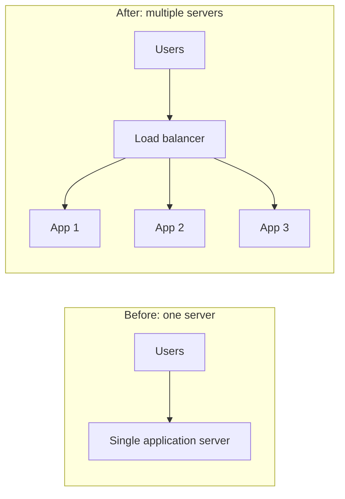

**Four main reasons to use it:**

- **Scale out:** Add or remove servers without changing the public endpoint.
- **Availability:** Route new traffic away from unhealthy servers.
- **Better utilization:** Avoid leaving one server idle while another is overloaded.
- **Operational flexibility:** Drain and replace instances during upgrades.

**Memory trick:** **S–A–U–O:** Scale, Availability, Utilization, Operations.

---

## 2. How the load balancer works

A load balancer typically follows this sequence:

1. Receive traffic addressed to the application's public endpoint.
2. Select a backend from the currently eligible pool.
3. Forward traffic according to a configured policy.
4. Monitor backend health so routing can change as instances fail or recover.

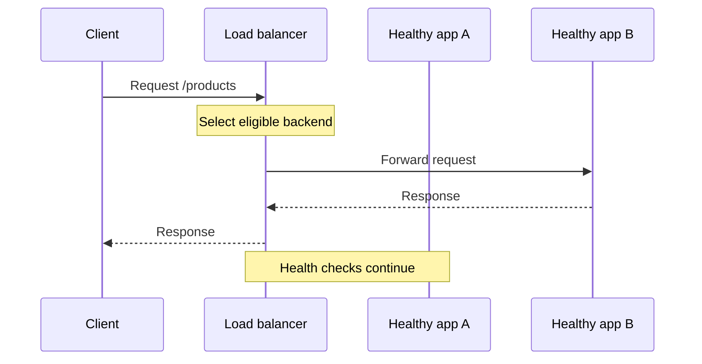

Clients interact with a stable service address, while individual backend servers can come and go.

**Important:** A load balancer is not a magical capacity multiplier. If all backends share a saturated database, adding app instances alone will not fix that bottleneck.

---

## 3. Where Layer 4 and Layer 7 fit in OSI

The **OSI model** is a conceptual seven-layer framework for understanding networking. The transcript concentrates on **Layer 4** and **Layer 7** load balancing.

| OSI layer | Name | Example concepts |
|---|---|---|
| **7** | Application | HTTP requests, headers, URLs |
| 6 | Presentation | Data representation and encoding concepts |
| 5 | Session | Session-management concepts |
| **4** | Transport | TCP, UDP and transport ports |
| 3 | Network | IP addressing and packet routing |
| 2 | Data Link | Ethernet frames and MAC addresses |
| 1 | Physical | Electrical, optical and radio transmission |

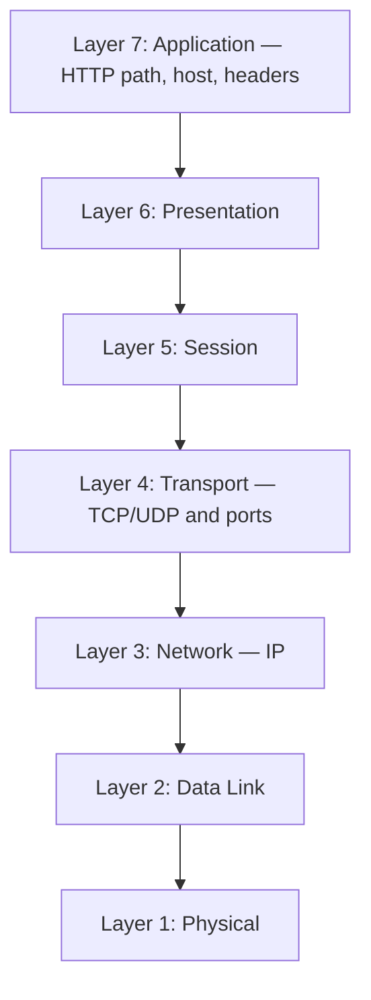

**Practical note:** The modern Internet protocol stack does not map one-to-one onto every OSI layer. Describing load balancers as **L4** or **L7** is a useful shorthand for *which information drives routing*. TLS behavior depends on the proxy/deployment mode.

---

## 4. Layer 4 load balancing

An **L4 load balancer** primarily makes forwarding decisions from transport/network information, without needing to interpret HTTP application content.

Examples of relevant fields:

- Source or destination IP address
- TCP or UDP protocol
- Source or destination port

### Example

A client opens a TCP connection to a public service at port **443**. The L4 balancer chooses a backend using its connection/routing policy. It does not need to inspect `/images` versus `/payments`.

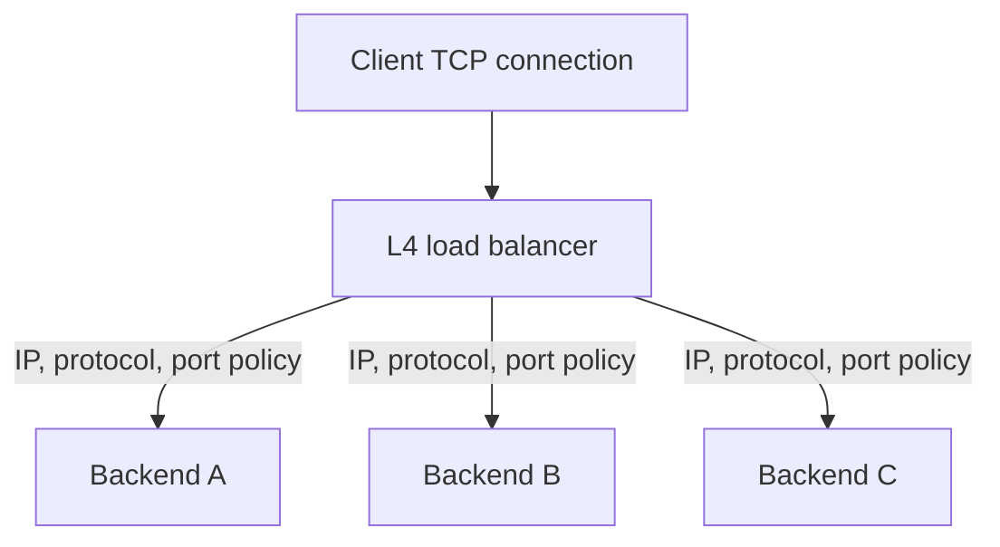

**Typical benefit:** Works for a broad range of TCP/UDP services and can use efficient forwarding.

**Limitation:** Path- and header-based HTTP routing requires application-level visibility, so it is not a pure L4 decision.

---

## 5. Layer 7 load balancing

An **L7 load balancer** understands the application protocol, especially HTTP/HTTPS.

Depending on configuration, it can route using:

- Host name, such as `api.example.com`
- URL path, such as `/images` or `/payments`
- HTTP method or headers
- Cookies and other request attributes

### Example: route by path

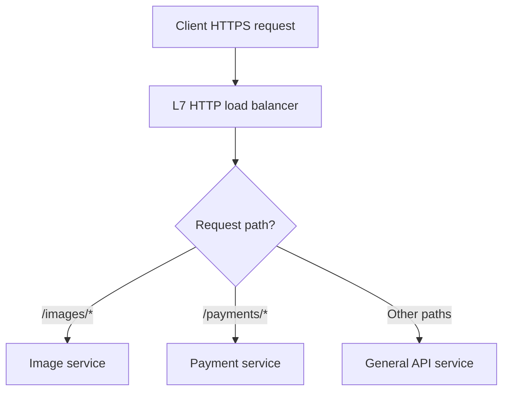

**Benefit:** Precise routing and HTTP-aware behavior.

**Trade-off:** Application inspection and proxy functionality introduce processing work and operational decisions.

**Memory trick:** **L4 sees connection details; L7 understands the request.**

---

## 6. L4 vs L7 comparison

| Question | Layer 4 | Layer 7 |
|---|---|---|
| Main decision inputs | IP, protocol, port and connection state | URL, host, headers, HTTP method, cookies |
| Needs to understand HTTP? | No | Yes, for HTTP routing |
| Common protocol fit | TCP and UDP | HTTP and HTTPS |
| Path-based routing | Not with purely L4 forwarding | Yes |
| TLS visibility | Can forward encrypted bytes without decryption | Needs HTTP visibility to inspect encrypted request content |
| Processing complexity | Often lower | Often higher |
| Example use | Generic TCP service or database proxy | `/images` to one service, `/payments` to another |

**Useful interview answer:** Choose the balancing *layer* based on routing requirements—not simply because one sounds faster.

---

## 7. Algorithms: Round Robin and Least Connections

The source mentions these algorithms without going deeply into the next lesson. Here is a short additional explanation.

**Round Robin** assigns successive new requests or connections to the next eligible server.

```text
Request 1 → Server A
Request 2 → Server B
Request 3 → Server C
Request 4 → Server A
```

**Least Connections** prefers a server with fewer active connections, depending on implementation and configured weights.

| Algorithm | Easy analogy | When it can help |
|---|---|---|
| Round Robin | Deal cards in order | Similar-capacity backends and broadly similar workloads |
| Least Connections | Pick the shortest occupied line | Uneven connection durations |

Neither guarantees identical CPU utilization. Server weights, connection duration and request complexity also matter.

---

## 8. Stateless servers, sessions and affinity

Imagine a shopper signs in through **App A**, which stores the session only in its own memory. The next request goes to **App B**. App B cannot recognize that local session.

### Sticky sessions

A load balancer may keep directing a client to the same backend—called **session affinity** or **sticky sessions**.

**Trade-off:** Affinity restricts routing flexibility, and a failed backend may lose its local session.

### Shared state / stateless app tier

A more flexible alternative is to store session or cart information in an external shared data service.

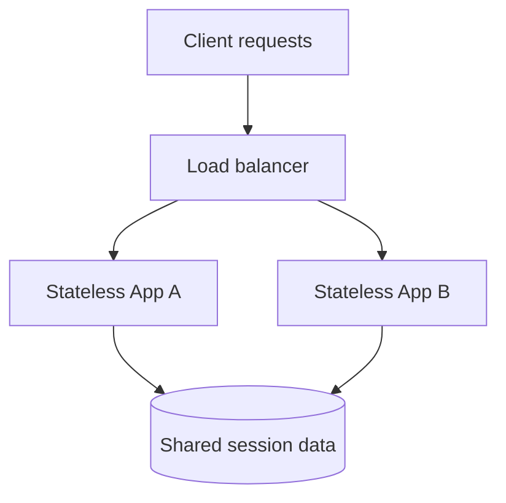

**Remember:** *Stateless application server* does **not** mean the overall system contains no state. It means each app instance can be replaced without relying on its own unique local session history.

---

## 9. Health checks and removing failed servers

A load balancer needs to know whether backends can actually serve traffic.

Typical approach:

1. Periodically test a readiness endpoint such as `/health`.
2. Mark a server unhealthy after configured failures.
3. Stop directing new traffic to the unhealthy instance.
4. Keep probing it and re-enable it when the recovery policy is satisfied.

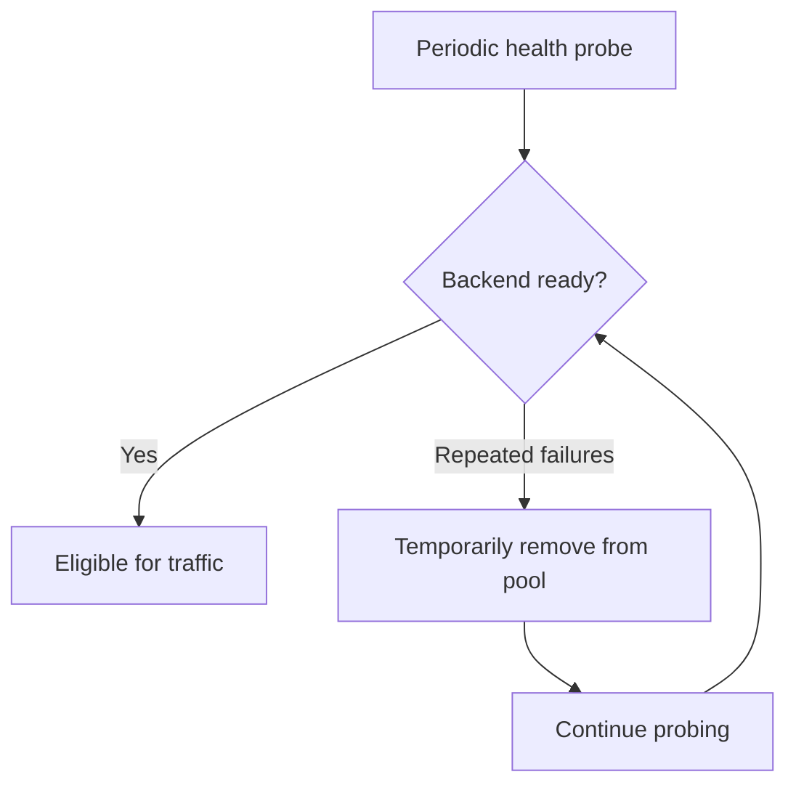

A health check that only confirms the process is running may be too shallow. But a probe that fails whenever *any optional dependency* is unhealthy can unnecessarily remove perfectly useful instances.

**Additional practical distinction:** A **liveness** check asks whether to restart a process; a **readiness** check asks whether it should receive traffic. Configure these for the application's actual needs.

**Failure nuance:** Detecting a fault takes time, and existing in-flight requests may fail before traffic has been redirected.

---

## 10. TLS termination and re-encryption

For HTTPS, a balancer or reverse proxy may terminate the **client-side TLS connection**. It then makes a separate connection to the backend.

### Example A: terminate TLS at the load balancer

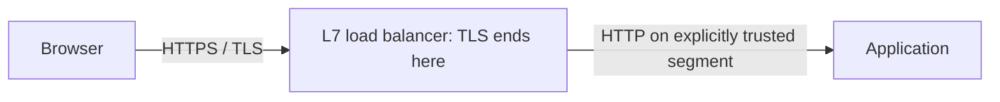

### Example B: terminate and establish new TLS to backend

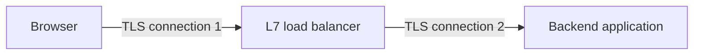

**Why do it?**

- Centralize certificate and HTTPS policy management.
- Reduce TLS work at the app tier in some architectures.
- Inspect HTTP information for L7 routing.

**Security note:** The second hop should use TLS when your security or compliance requirements call for encryption in transit. Client-side TLS termination does not necessarily mean that backend traffic is sent in cleartext.

---

## 11. Connection draining

Suppose an app instance needs to be removed for maintenance while requests are still running.

If it is killed immediately, active requests and long-lived connections can be interrupted.

**Connection draining** removes it from *new traffic*, while allowing existing work to complete up to a configured grace period.

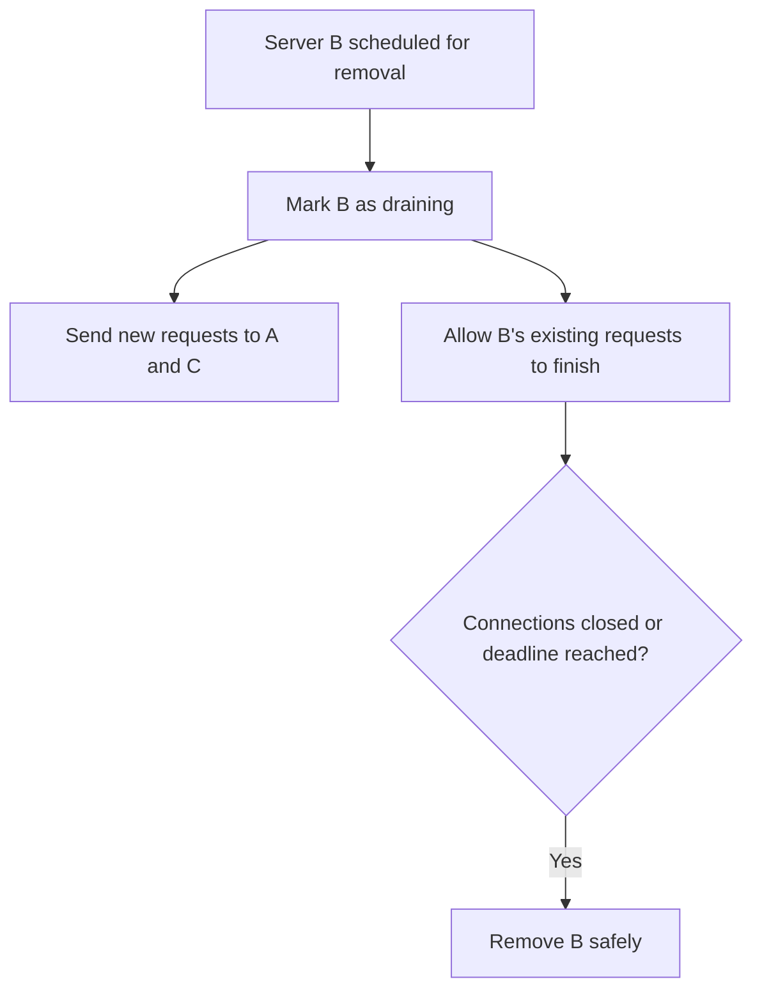

This is especially relevant to long-running requests, streaming, and WebSockets. A draining timeout still matters: some connections cannot be kept alive forever.

**Memory trick:** **Drain = no new work, finish old work.**

---

## 12. Making load balancers highly available

A single load balancer can itself become a **single point of failure**.

There are two broad approaches:

- **Active–active:** Multiple load-balancing instances serve traffic concurrently.
- **Active–passive:** One serves while another is prepared to take over.

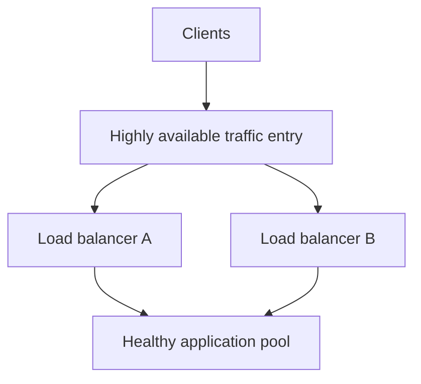

Managed cloud balancing services often hide several infrastructure instances behind one logical endpoint.

**Important:** Redundancy also depends on the endpoint's routing mechanism, health checks, failure domains, and healthy backend capacity. Two balancers sharing one vulnerable dependency may still fail together.

---

## 13. Popular load-balancing technologies

The transcript names several examples:

| Technology | Context in the lesson |
|---|---|
| **NGINX** | Reverse proxy and common HTTP/HTTPS load balancing |
| **HAProxy** | Transport- and application-aware load balancing |
| **Envoy** | Proxies for modern services and service-mesh architectures |
| **AWS Application Load Balancer** | HTTP/HTTPS application-layer routing |
| **AWS Network Load Balancer** | Transport-level load balancing |
| **Google Cloud / Azure managed load balancing** | Cloud-managed routing alternatives |
| **Kubernetes Services, Ingress and gateways** | Routing traffic in containerized applications |

These are illustrative technologies, not an endorsement of a specific product. Exact protocol and feature support depends on product version, configuration and deployment.

---

## 14. Worked examples and interview questions

### Example 1: calculate rough app capacity

Suppose one app instance sustains **500 requests/second** for a specified workload at acceptable latency, and you expect **1,500 RPS**.

```text
Bare minimum instances = 1,500 ÷ 500 = 3
```

Three instances at the tested limit provide **no spare capacity** if one fails. For **N−1** resilience at that same assumed load:

```text
(Servers − 1) × 500 ≥ 1,500
Servers − 1 ≥ 3
Servers ≥ 4
```

**Answer:** **4 instances** are needed under this simplified capacity model to survive the loss of one instance at the tested maximum. Real designs reserve additional headroom and measure downstream limits.

### Example 2: pick L4 or L7

**Requirement:** “Route `/images/*` to Image Service and `/payments/*` to Payments Service.”

**Choice:** An **L7 HTTP-aware balancer** because routing depends on URL paths.

**Requirement:** “Distribute generic TCP connections among equivalent backends without examining HTTP.”

**Choice:** An **L4 balancer** may be appropriate.

### Example 3: server removal

A backend currently has active WebSocket connections but must be replaced.

**Choice:** Begin draining, stop new assignments, define a graceful shutdown policy, and handle existing connections within the available deadline.

### Ten useful interview questions

1. What problem does a load balancer solve after horizontally scaling an application?
2. How does L4 balancing differ from L7 balancing?
3. Where do HTTP paths and TCP ports sit in the OSI model?
4. Why can't a pure L4 balancer make URL path decisions?
5. How do Round Robin and Least Connections differ?
6. What breaks if login sessions are stored only on one app server?
7. What should a backend readiness probe check?
8. What happens to HTTPS when TLS is terminated at the load balancer?
9. Why is connection draining valuable during a deployment?
10. How do you prevent the load balancer itself from becoming a single point of failure?

### Fast revision table

| Concept | Remember |
|---|---|
| Load balancer | One entry point, several backend choices |
| L4 | IP/port/TCP/UDP based routing |
| L7 | Host/path/header aware routing |
| Stateless apps | Any eligible server can handle the next request |
| Sticky session | Same client tends to use same server |
| Health check | Remove backends that cannot serve correctly |
| TLS termination | Client-side encrypted session ends at the proxy |
| Re-encryption | A new TLS session protects the backend hop |
| Draining | Stop new requests and finish old ones |
| HA load balancer | Protect the entry point itself |

**Final takeaway:** **A load balancer makes a pool of services look like one endpoint. Choose L4 or L7 based on the routing information you need, then design for health, shared state, graceful removal and redundancy.**

---

*Source basis: user-provided load-balancers transcript. The guide is restructured and paraphrased with original examples and diagrams, plus explicitly identified supplemental OSI and capacity explanations. It does not reproduce extended passages of the transcript.*
