# Location-Based System Design — Geohashes, Quadtrees and Nearby Search Explained Simply

*Distributed Systems Study Library · Author: Jayesh Sharma*

**Learn how ride-hailing, delivery, restaurant search and geofencing systems index locations, find nearby candidates, process moving positions and scale dense geographic hotspots.**

> This guide is independently written from the user-provided location-system transcript. All explanations, worked examples, tables and Mermaid diagrams are original. Additional notes distinguish simplifying examples from production-specific spatial and security requirements.

## Contents

- [1. Why location-based systems are challenging](#1-why-location-based-systems-are-challenging)
- [2. Static places versus moving objects](#2-static-places-versus-moving-objects)
- [3. Latitude, longitude and why naive range scans struggle](#3-latitude-longitude-and-why-naive-range-scans-struggle)
- [4. What is a geohash?](#4-what-is-a-geohash)
- [5. Choosing geohash precision](#5-choosing-geohash-precision)
- [6. The border problem: always check neighboring cells](#6-the-border-problem-always-check-neighboring-cells)
- [7. Exact distance and road travel time are different](#7-exact-distance-and-road-travel-time-are-different)
- [8. Quadtrees: split busy areas into smaller areas](#8-quadtrees-split-busy-areas-into-smaller-areas)
- [9. Compare geohashes, quadtrees, PostGIS, S2 and H3](#9-compare-geohashes-quadtrees-postgis-s2-and-h3)
- [10. Nearby search with PostGIS](#10-nearby-search-with-postgis)
- [11. Moving-driver workload: estimate the write volume](#11-moving-driver-workload-estimate-the-write-volume)
- [12. Store latest moving locations and expire stale drivers](#12-store-latest-moving-locations-and-expire-stale-drivers)
- [13. City partitioning and location-cell ownership](#13-city-partitioning-and-location-cell-ownership)
- [14. Step-by-step nearby driver matching](#14-step-by-step-nearby-driver-matching)
- [15. Real-time trip tracking](#15-real-time-trip-tracking)
- [16. Geofencing: is a point inside a zone?](#16-geofencing-is-a-point-inside-a-zone)
- [17. Handling hot locations and uneven traffic](#17-handling-hot-locations-and-uneven-traffic)
- [18. Privacy, location accuracy and operational safeguards](#18-privacy-location-accuracy-and-operational-safeguards)
- [19. Design interview walkthrough: a ride-hailing app](#19-design-interview-walkthrough-a-ride-hailing-app)
- [20. Questions and one-minute revision](#20-questions-and-one-minute-revision)

---

## 1. Why location-based systems are challenging

Imagine opening a ride-hailing app. You need the app to find nearby available drivers, even though thousands of drivers move every few seconds.

The same problem appears in restaurant search, delivery tracking, nearby people, airport zones and service-area checks.

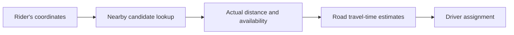

**Simple idea:** Search for nearby *candidates* cheaply, then verify actual distance and business rules before making a decision. A latitude/longitude pair is not enough by itself to serve huge traffic efficiently.

---

## 2. Static places versus moving objects

Location workloads fall into two useful groups:

| Data | Examples | Typical workload |
|---|---|---|
| Mostly static | Restaurants, stores, hotels | Many reads, relatively few location changes |
| Continuously moving | Drivers, couriers, vehicles | Frequent writes plus nearby queries |

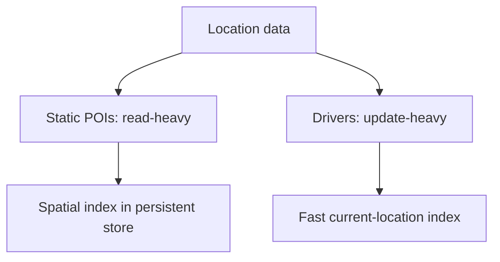

A restaurant may change address once in years. A driver may transmit a new position every few seconds. A single identical storage strategy is rarely optimal for both.

**Interview question:** What is the ratio of position updates to nearby-search requests?

---

## 3. Latitude, longitude and why naive range scans struggle

Coordinates use **latitude** (north/south) and **longitude** (east/west).

A naive database query uses rectangular ranges:

```sql
SELECT id, latitude, longitude
FROM restaurants
WHERE latitude BETWEEN :min_lat AND :max_lat
  AND longitude BETWEEN :min_lon AND :max_lon;
```


The box is only a first filter. It includes points farther than the requested circular radius.

Ordinary single-column B-tree indexes may not efficiently answer arbitrary two-dimensional searches at huge scale. However, spatial-capable databases and appropriate compound or specialized indexes can perform well—**do not assume every SQL location query requires a full table scan**.

---

## 4. What is a geohash?

A **geohash** encodes a geographic position as a compact Base32 string. It divides the Earth into progressively smaller rectangular cells.

Nearby locations often share the beginning of their geohash, called a **prefix**.

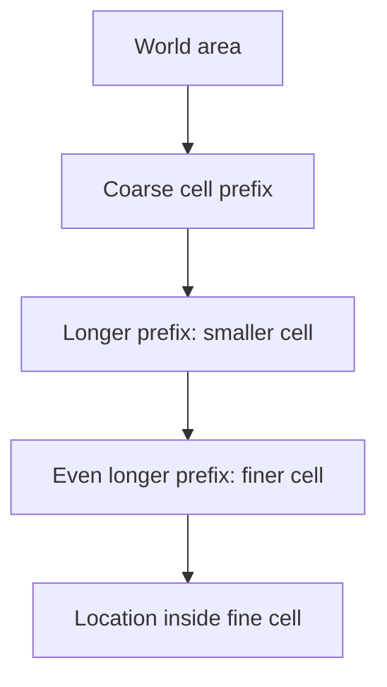

For example, a hypothetical key such as `tdr1w` represents one cell at a particular precision. Adding characters narrows its coverage.

**Memory trick:** Geohash is like an address with increasing detail: country → city → street, except it is a grid code rather than an administrative address.

**Important:** Geohash is a *spatial index helper*, not an accurate distance measurement by itself.

---

## 5. Choosing geohash precision

Longer geohash prefixes identify smaller cells, which reduce unrelated candidates—but need more neighboring-cell lookups to cover a large radius.

Approximate equatorial dimensions are commonly of these orders:

| Length | Approximate cell dimensions |
|---|---|
| 5 characters | 4.9 km × 4.9 km |
| 6 characters | 1.2 km × 0.61 km |
| 7 characters | 153 m × 153 m |

The physical size varies by latitude because longitude lines converge toward the poles.

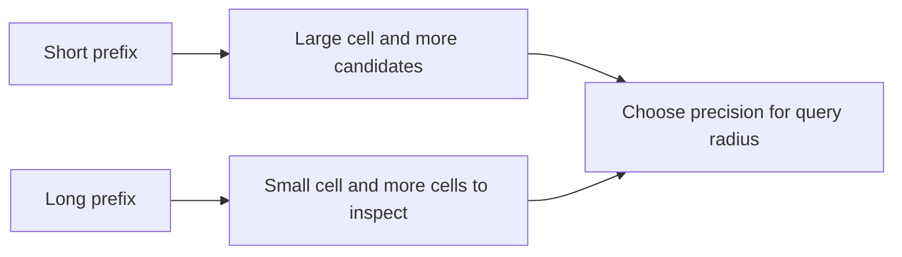

There is no perfect universal length. A neighborhood-level lookup and a 100-meter pickup search usually need different resolutions.

---

## 6. The border problem: always check neighboring cells

Two restaurants may be only 20 meters apart but lie on opposite sides of a geohash boundary. Their prefixes may differ.

Searching **only the user's own cell** can therefore miss nearby results.

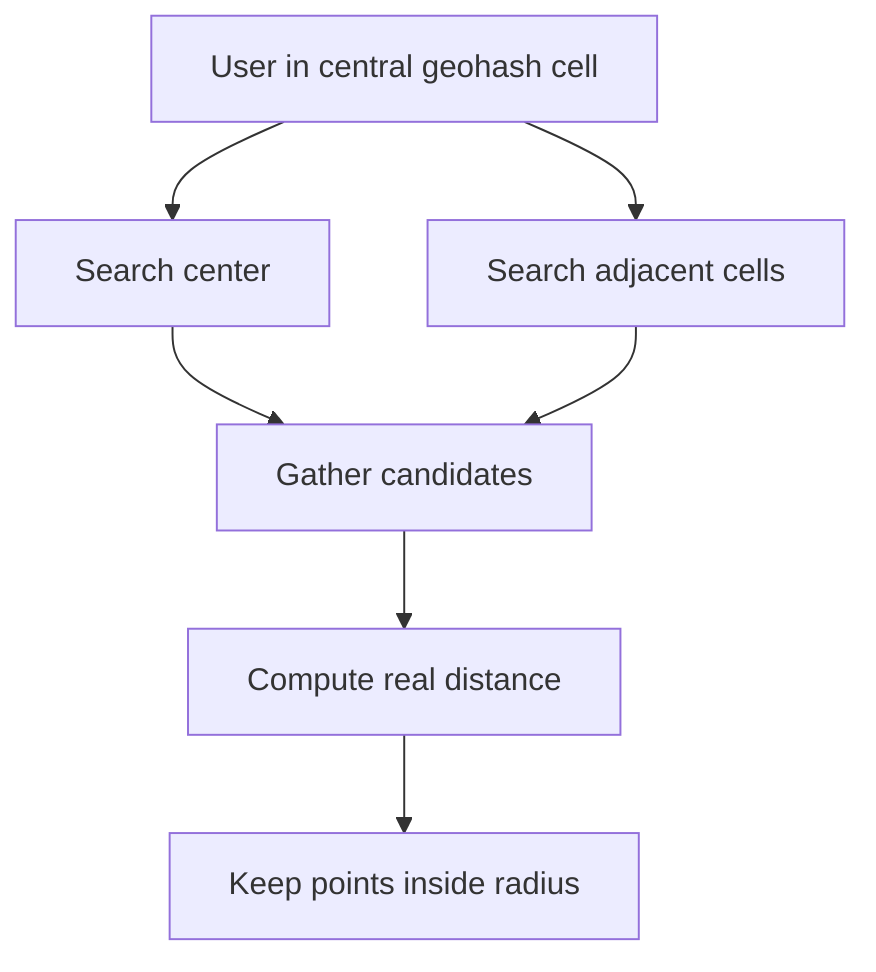

For a radius well matched to the cell size, the center plus eight neighbors is a useful illustration. **For larger radii or near boundaries, cover every intersecting cell**, not just nine cells blindly.

Then compute accurate distance and exclude false positives. Handle the international date line and high latitudes deliberately.

---

## 7. Exact distance and road travel time are different

A straight-line calculation answers “how far apart are these coordinates?” A driver-assignment system usually needs “how long will this trip take on available roads?”

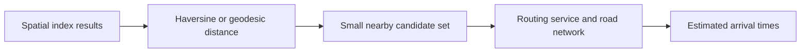

The **Haversine formula** is a familiar approximation for distance over Earth's surface. For production precision, choose appropriate geodesic or database geography calculations.

**Example:** A driver 500 m away across a river may have a worse ETA than a driver 1.2 km away with an open bridge route.

Use cheap geographical filtering first; request road-network ETAs only for the best candidates to control routing-service cost.

---

## 8. Quadtrees: split busy areas into smaller areas

A **quadtree** recursively divides a two-dimensional region into four quadrants. It can subdivide crowded parts of a map more deeply than sparsely populated ones.

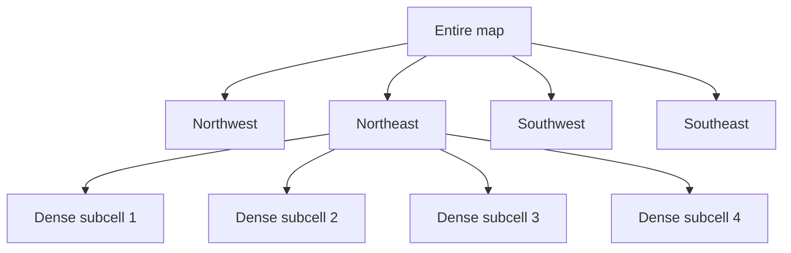

Imagine a city square holding hundreds of restaurants and a rural square with only two. The dense square gets subdivided; the sparse square can remain a single node.

A search walks the tree to regions intersecting a query area and checks stored points.

**Trade-off:** Tree maintenance and balancing add complexity. Quadtrees can be effective for mostly static point sets, but frequent moving-object updates may require careful engineering. They are not inherently unusable for moving points.

---

## 9. Compare geohashes, quadtrees, PostGIS, S2 and H3

| Tool | Useful idea | Good starting scenario |
|---|---|---|
| Geohash | Prefix-coded rectangular cells | Simple cell indexing and nearby lookup |
| Quadtree | Adaptive recursive spatial partitioning | Unevenly distributed static objects |
| PostgreSQL + PostGIS | Spatial types and index-assisted distance queries | Relational data with geographic queries |
| S2 | Hierarchical cells on a spherical surface | Large-scale globe-based indexing |
| H3 | Hierarchical mostly hexagonal indexing | Regional aggregation, density and demand maps |
| Redis GEO | Fast geospatial operations using Redis-managed indexing | Rapid current-position queries |

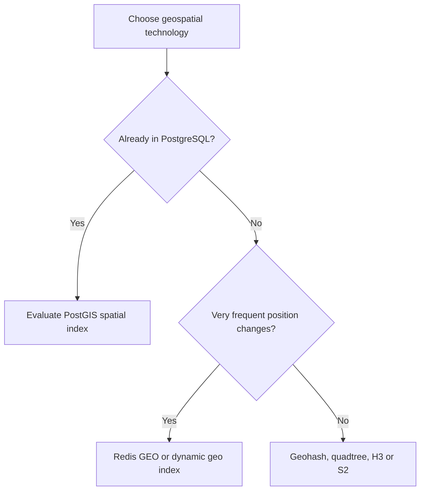

**Nuance:** H3 cells are mostly hexagonal, with pentagons as part of its global grid; its hierarchy is not simply identical hexagons at every level. Compare tools against real query patterns instead of memorizing a universal winner.

---

## 10. Nearby search with PostGIS

For a moderate-scale business directory already using PostgreSQL, **PostGIS** is often simpler than building a custom spatial service.

An illustrative query:

```sql
SELECT id, name
FROM restaurants
WHERE ST_DWithin(
  location_geog,
  ST_SetSRID(ST_MakePoint(:longitude, :latitude), 4326)::geography,
  2000
);
```

Here `location_geog` is a `geography(Point, 4326)` column with a suitable spatial index. The distance threshold is **2,000 meters**.

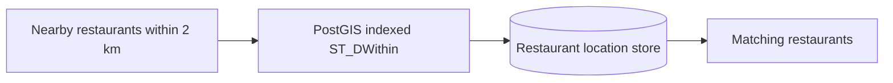

Use the matching **GiST index**, and verify query plans and actual load. Note that latitude/longitude argument order matters: `ST_MakePoint` takes **longitude first**, then latitude.

---

## 11. Moving-driver workload: estimate the write volume

Suppose a ride-hailing platform has **1,000,000 active drivers**, each transmitting coordinates every **4 seconds**.

```text
Location updates per second
= active drivers / update interval
= 1,000,000 / 4
= 250,000 updates/second
```

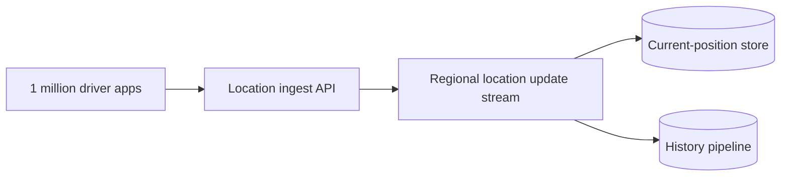

This is an illustrative **aggregate average while all drivers follow that cadence**; peak rates, bursts and inactive clients can change actual throughput.

Separating **latest position** from **historical position events** is important. The current position is overwritten frequently; analytics may retain selected history asynchronously.

---

## 12. Store latest moving locations and expire stale drivers

For driver discovery, what matters is the **current known position**, availability and how recently it was updated.

A fast index may store:

```text
driver_id: 842
latitude: 18.5204
longitude: 73.8567
updated_at: 2026-10-26T12:00:00Z
status: AVAILABLE
```

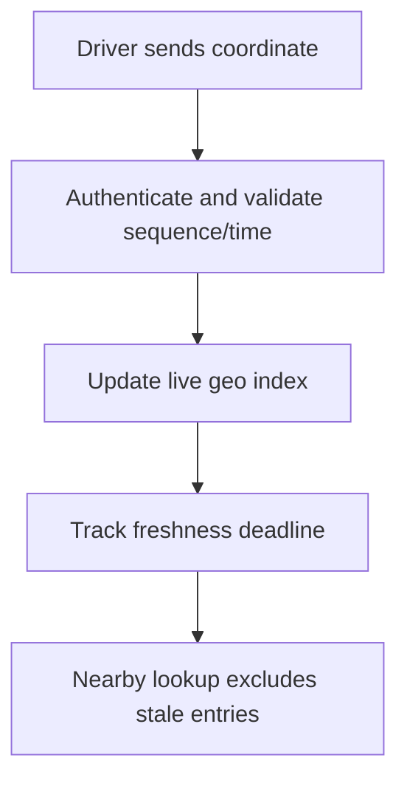

If a phone loses connectivity without sending an offline event, old coordinates should not remain eligible forever. Use a freshness threshold or expiry, such as an illustrative 30-second window.

**Operational caution:** A TTL on an auxiliary key does not automatically remove its member from a Redis GEO sorted set. Implement explicit stale filtering and cleanup, or use a design where expiration truly removes geo membership.

Also reject delayed updates that would move a driver's stored position backward in time.

---

## 13. City partitioning and location-cell ownership

Ride matching tends to be local. Partitioning the live index by **city, service zone or region** can reduce the amount of data each service handles.

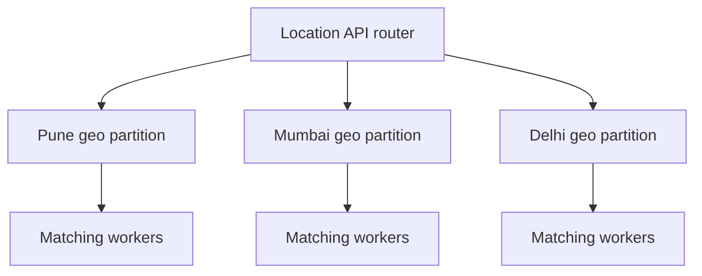

But partition boundaries can cut through a rider's search radius. Query neighboring partitions when a radius overlaps a boundary.

A busy airport can cause concentrated write and read traffic inside one city. Track cell-level hotspots and split or redistribute heavy partitions rather than assuming all geographic cells have equal load.

---

## 14. Step-by-step nearby driver matching

When the rider presses **Find a ride**, a typical matching service:

1. Gets the rider's fresh location and requested ride category.
2. Looks up drivers from spatial cells covering an initial radius.
3. Filters **stale, busy or ineligible** drivers.
4. Checks true geographic distance and shortlists candidates.
5. Requests road-network travel-time estimates.
6. Chooses or offers a suitable driver, with **atomic assignment** so one driver cannot accept incompatible trips simultaneously.
7. Expands the search radius if necessary.

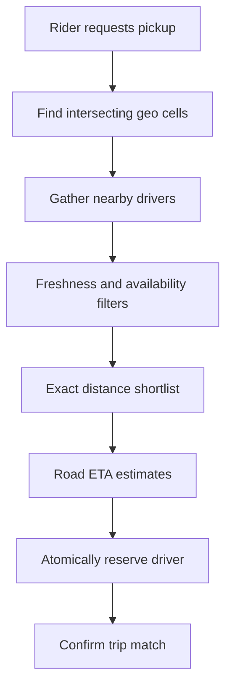

The spatial index provides a **candidate list**, not the final booking guarantee.

**Key interview insight:** Driver proximity and driver ownership are two separate correctness problems.

---

## 15. Real-time trip tracking

After driver assignment, the passenger watches an animated vehicle icon approaching.

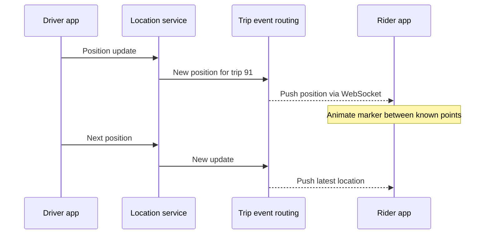

The system routes updates only to **authorized watchers of that trip**, not every app user.

For battery and bandwidth, adjust update frequency based on movement, app foreground/background state and product requirements. The rider app can interpolate between valid recent positions, while still showing uncertainty if the location becomes stale.

Related reading: [Designing Real-Time Updates at Scale](Designing_Real_Time_Updates_at_Scale.md).

---

## 16. Geofencing: is a point inside a zone?

**Geofencing** asks whether coordinates fall inside a permitted or designated region, such as a delivery radius, airport pickup zone or surge-pricing area.

Zones may be represented as **polygons** containing many vertices.

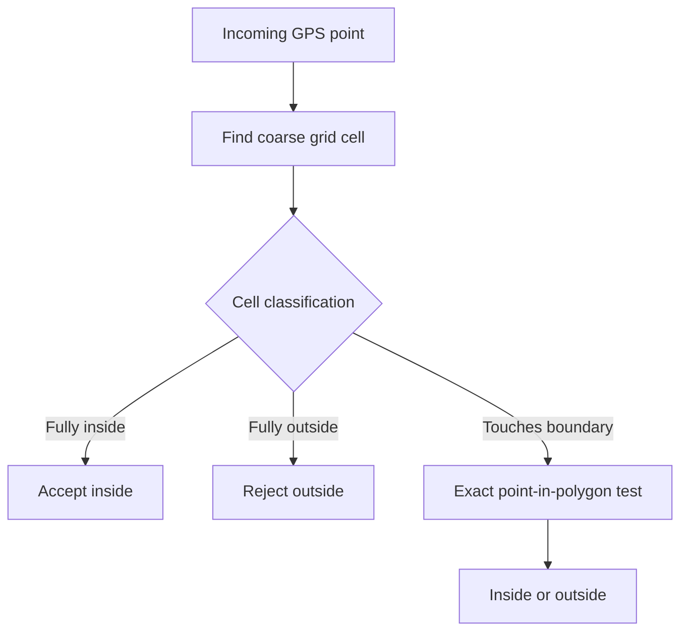

An index or **precomputed cell covering** can avoid expensive polygon tests for every location. Boundary cells still need precise verification.

Coordinate reference systems, points on boundaries, and invalid polygon geometry require explicit handling.

---

## 17. Handling hot locations and uneven traffic

An airport after a concert can have many drivers and riders concentrated in a small radius. A naive “one cell → one server” mapping can create a hot shard.

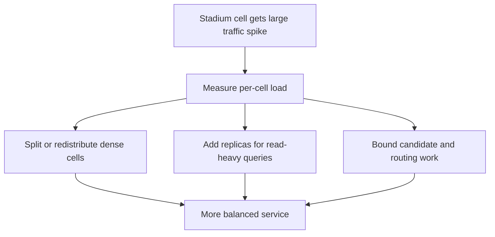

Read replicas are most straightforward for static spatial data. Moving driver positions require careful propagation and freshness guarantees.

Large radius requests also need **caps**; finding every driver within 100 km is much more expensive than finding the nearest few dozen candidates.

Always load-test **dense hotspots**, not only random coordinates distributed evenly over the map.

---

## 18. Privacy, location accuracy and operational safeguards

Location is sensitive data. A technically fast location API can still be unsafe if anyone can track a person without authorization.

Key safeguards include:

- Authenticate location updates and trip-watcher subscriptions.
- Only disclose positions needed for the approved interaction.
- Store historical coordinates only as long as necessary.
- Respect consent and app/platform location permissions.
- Apply retention controls to logs, analytics and backups.
- Account for stale GPS, inaccurate positions, spoofing and impossible movement.

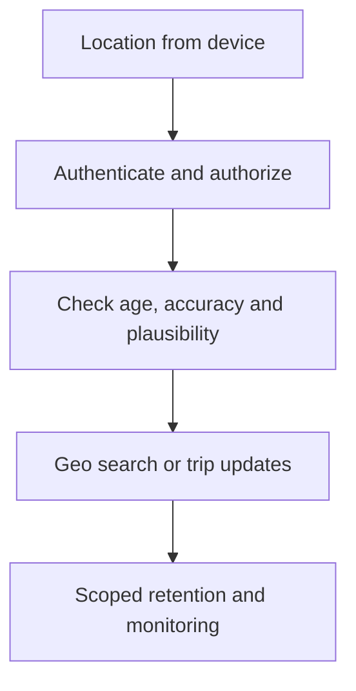

Operational metrics include location-ingest QPS, p95 nearby-search latency, stale-driver fraction, hot-cell load, geo-index memory, match success rate and ETA error.

---

## 19. Design interview walkthrough: a ride-hailing app

A clear interview answer can follow this order:

1. **Separate data classes:** Static pickup places versus frequently moving drivers.
2. **Estimate scale:** Number of active drivers, update cadence and search QPS.
3. **Choose index:** Redis GEO, geohash cells, PostGIS or other suitable options.
4. **Find candidates:** Search intersecting cells, include boundaries, compute exact distances.
5. **Rank by travel time:** Ask routing service for ETA on a bounded shortlist.
6. **Ensure safe assignment:** Use atomic driver reservation, not just a nearby lookup.
7. **Handle stale data:** Expire or filter disconnected drivers.
8. **Scale geographic hotspots:** Split, rebalance, replicate where appropriate.
9. **Push trip updates:** Send changes only to authorized riders.
10. **Add geofencing and privacy controls** when the requirements call for them.

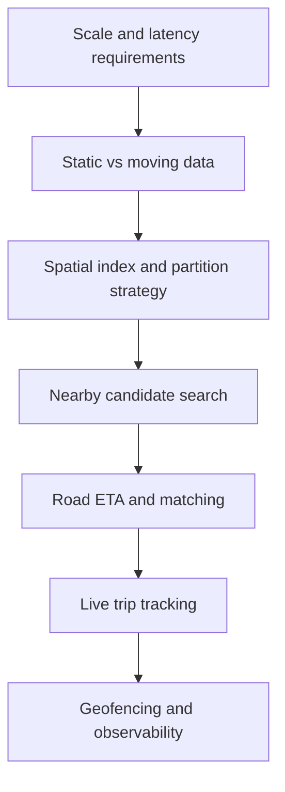

### Interview-ready answer

**“For a ride-hailing platform, I would keep active driver coordinates in a fast regional geo index and process location updates independently from long-term history. A nearby request collects candidates from intersecting cells, removes stale drivers, then uses road ETAs to select options. Driver assignment is atomic. A WebSocket-based trip channel delivers authorized location updates, and dense cells are partitioned further when needed.”**

---

## 20. Questions and one-minute revision

### Interview questions

1. What is a geo-nearby query?
2. Why are static places and moving drivers different workloads?
3. What problems arise with naive latitude/longitude filters?
4. What is a geohash, and what does prefix length change?
5. Why must geohash queries cover neighboring cells?
6. Why is straight-line distance not enough for ride matching?
7. How does a quadtree split dense areas?
8. When would you choose PostGIS versus Redis GEO?
9. What are H3 and S2 useful for?
10. How many updates per second come from one million drivers reporting every four seconds?
11. How do you remove offline drivers from nearby search?
12. Why can a hotspot overload a geo partition?
13. How does a rider watch a vehicle move in real time?
14. What is a geofence, and how does a point-in-polygon test work?
15. How do you prevent two riders from simultaneously claiming one driver?
16. What privacy controls belong in a location tracking design?

### Quick reference

| Term | Remember |
|---|---|
| Latitude / longitude | Position on Earth |
| Geohash | Hierarchical prefix-based rectangular cell code |
| Geohash neighbor search | Avoid missing close points across cell borders |
| Quadtree | Adaptively split crowded areas into four child cells |
| PostGIS | Spatial types and queries for PostgreSQL |
| Redis GEO | Fast geospatial search primitives |
| S2 / H3 | Hierarchical global spatial cell systems |
| Haversine | Approximate spherical distance |
| ETA routing | Travel time on real roads |
| Current-position store | Latest moving-object position |
| Freshness expiry | Ignore locations that stopped updating |
| Geofencing | Check whether a point is inside a defined area |
| Hot partition | A geographic area receiving excessive load |

**Final takeaway:** **A spatial index finds likely nearby objects quickly. Exact distance, freshness, business eligibility and road travel time determine the useful result.** For moving objects, design update throughput, stale-entry cleanup and hot-region handling as carefully as the search itself.

---
