# Multi-Region System Design — Explained Simply

*Distributed Systems Study Library · Author: Jayesh Sharma*

**Learn how global applications reduce latency, handle regional outages, replicate data, resolve conflicts, meet residency requirements and plan reliable failover.**

> Independently written educational guide based on the user-supplied multi-region transcript. All explanations, comparisons, practical examples and Mermaid diagrams are newly composed. Supplementary accuracy notes distinguish general design guidance from provider-specific guarantees and legal requirements.

## Contents

- [1. What is a multi-region system?](#1-what-is-a-multi-region-system)
- [2. Three reasons to use multiple regions](#2-three-reasons-to-use-multiple-regions)
- [3. What makes geography slow?](#3-what-makes-geography-slow)
- [4. Region versus availability zone](#4-region-versus-availability-zone)
- [5. Route each user to an appropriate region](#5-route-each-user-to-an-appropriate-region)
- [6. DNS TTL and failover delay](#6-dns-ttl-and-failover-delay)
- [7. Why databases make multi-region difficult](#7-why-databases-make-multi-region-difficult)
- [8. Active-passive: one working region and one standby](#8-active-passive-one-working-region-and-one-standby)
- [9. RPO versus RTO explained simply](#9-rpo-versus-rto-explained-simply)
- [10. Local reads with one central write region](#10-local-reads-with-one-central-write-region)
- [11. Read-your-own-writes and replica lag](#11-read-your-own-writes-and-replica-lag)
- [12. Active-active: regional reads and writes](#12-active-active-regional-reads-and-writes)
- [13. What does a write conflict look like?](#13-what-does-a-write-conflict-look-like)
- [14. Home regions avoid many conflicts](#14-home-regions-avoid-many-conflicts)
- [15. Strong consistency across regions](#15-strong-consistency-across-regions)
- [16. Failover: detecting failure and preventing split brain](#16-failover-detecting-failure-and-preventing-split-brain)
- [17. Capacity planning when a region disappears](#17-capacity-planning-when-a-region-disappears)
- [18. Data residency: include caches, logs and backups](#18-data-residency-include-caches-logs-and-backups)
- [19. Compare multi-region architectures](#19-compare-multi-region-architectures)
- [20. Interview walkthrough: global social application](#20-interview-walkthrough-global-social-application)
- [21. Operational checks and failure testing](#21-operational-checks-and-failure-testing)
- [22. Interview questions and cheat sheet](#22-interview-questions-and-cheat-sheet)

---

## 1. What is a multi-region system?

A **region** is a distinct geographical area where a cloud provider operates data centers. A multi-region application runs some or all of its infrastructure in **more than one region**.

Imagine a store with just one branch in New York. A customer in India may need to contact that branch for every request. Opening a nearby branch can make service quicker, but then the business must keep inventory and account records correct at both locations.

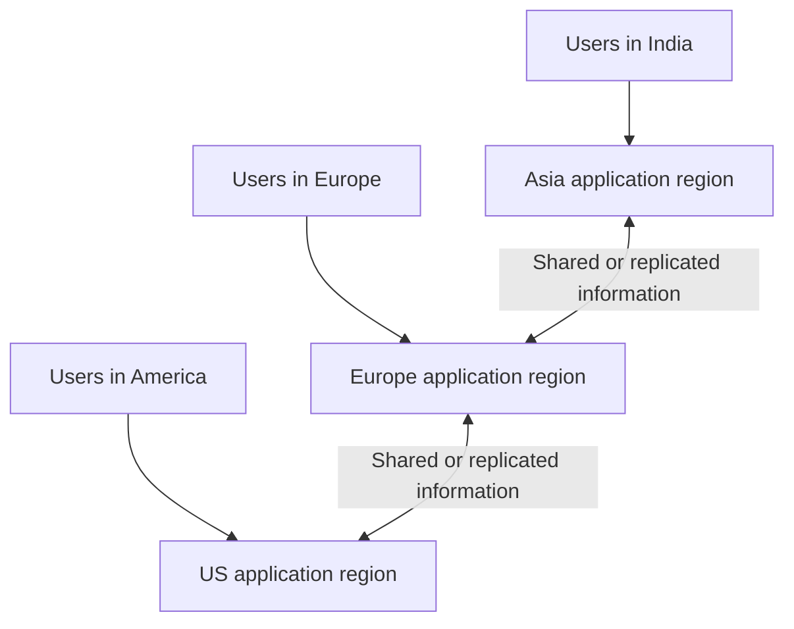

The difficult part is usually **not starting another application server**. It is deciding **which region owns each write, how information moves, and what happens when a region becomes unreachable**.

**Memory trick:** Multi-region = **near users + survive outages + respect data location**, at the cost of additional complexity.

---

## 2. Three reasons to use multiple regions

| Motivation | Everyday example | Architectural implication |
|---|---|---|
| **Latency** | A user in Mumbai should not wait for unnecessary long-distance round trips | Route traffic near users |
| **Disaster recovery** | An entire region becomes unavailable | Maintain another region able to recover service |
| **Data residency** | A customer requires certain records to remain in the EU | Restrict storage, backup and processing locations |

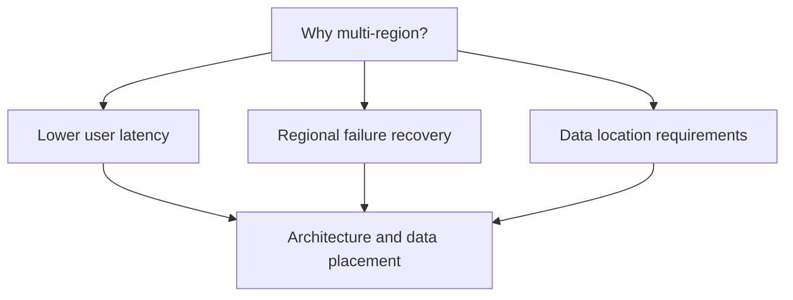

**Interview question to ask first:** Is the priority faster worldwide reads, continuity during a disaster, legal or contractual restrictions, or all three? The answer changes the cheapest viable design.

**Important qualification:** Laws such as GDPR do not impose a blanket rule that *all* EU personal data must always stay within the EU. Actual cross-border transfer restrictions and contractual residency requirements must be evaluated specifically.

---

## 3. What makes geography slow?

Network signals take time to travel over fiber, pass through routing equipment, and return. Even if processing is fast, **distance contributes to round-trip time (RTT)**.

For illustration, a request that makes three sequential long-distance round trips of 150 ms adds about **450 ms of network waiting** before application work.

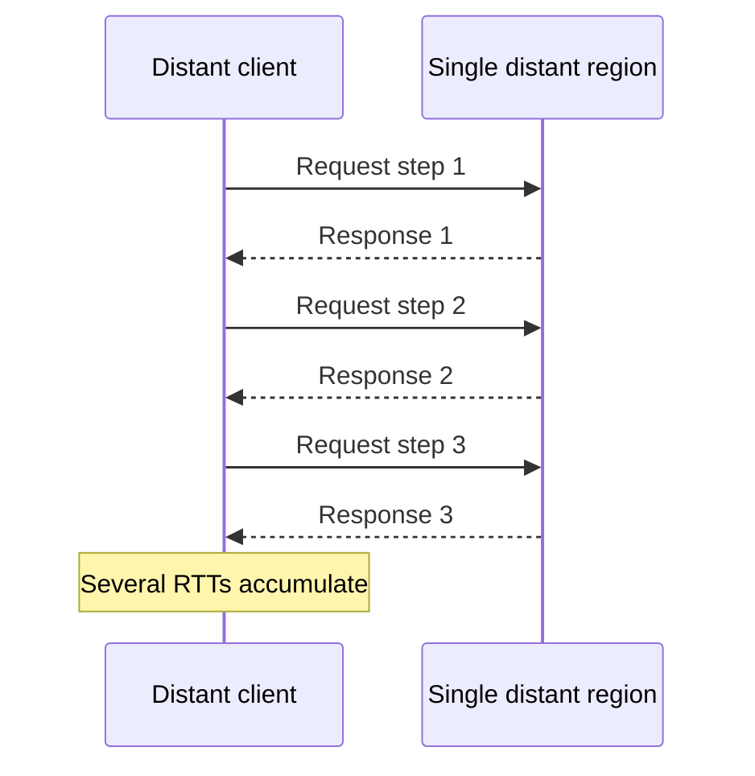

Exact RTTs depend on carriers, routes and network conditions; quoted intercontinental figures are examples, not guarantees. A local region can reduce RTT, but **only if that request does not still block on a distant database**.

Placing a stateless API locally while sending every database request across an ocean may deliver less improvement than expected.

---

## 4. Region versus availability zone

A **region** contains a set of data centers in one geographical area. An **availability zone (AZ)** is a separately designed failure domain **within** a region.

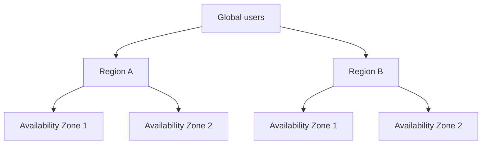

Multiple AZs protect against some localized failures such as one facility becoming unreachable. They do **not** automatically protect against an outage that impacts the entire region.

**Design progression:** Usually start with a healthy single-region, multi-AZ architecture before accepting the operational and data-consistency cost of multi-region deployment.

---

## 5. Route each user to an appropriate region

You need a **global traffic-entry layer** that directs users to a healthy deployment.

Common options include geographic or latency-aware DNS, global load balancing, and anycast-based edge networks.

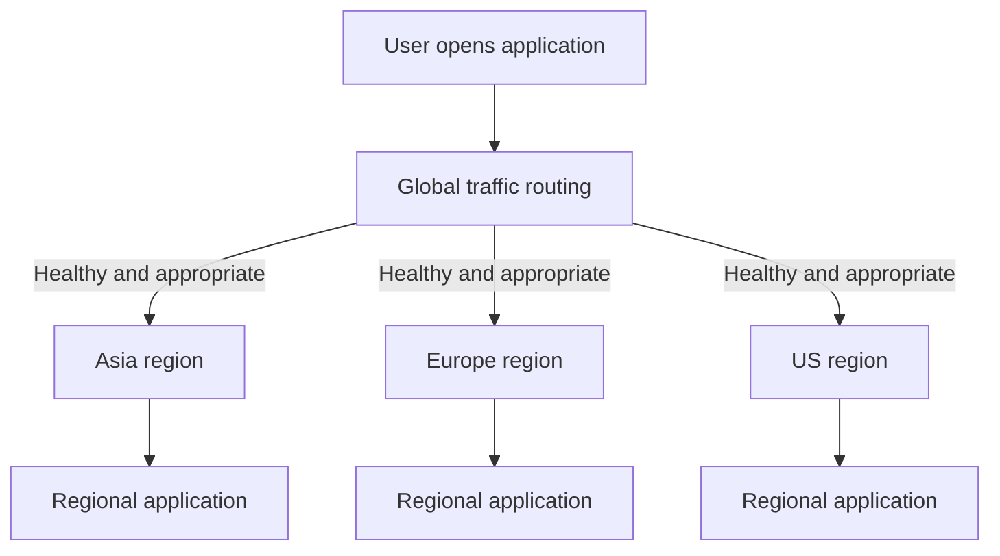

**GeoDNS or latency DNS** returns selected endpoint addresses in DNS responses. Resolver location and provider measurements may influence the decision, so “closest” is not always geographically closest.

**Anycast** advertises the same address from different network locations, allowing routing to select a path. It does not automatically guarantee immediate regional failover or strict geographic proximity.

Health-check design should distinguish application health from the health of its data dependencies.

---

## 6. DNS TTL and failover delay

DNS answers may be cached by recursive resolvers, operating systems and browsers.

**TTL (time to live)** indicates how long an answer may be cached under normal DNS behavior. Even after you change routing, clients or resolvers may temporarily continue using a previous endpoint.

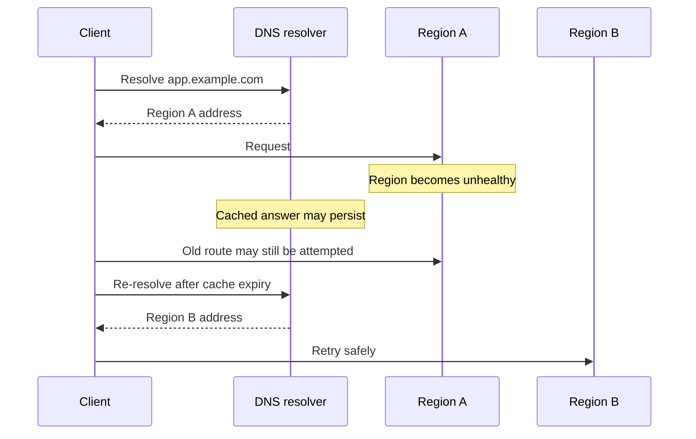

A short TTL can help, but it does **not** establish a hard upper bound for every client because caches and connections behave differently.

For critical failover, combine suitable routing, health detection, connection timeout policy, safe retries and a tested recovery procedure.

---

## 7. Why databases make multi-region difficult

Application servers are often stateless: you can deploy equivalent instances in many regions. Databases are different because **updates must remain correct despite travel time, concurrency and failures**.

There is an unavoidable practical trade-off:

- **Synchronous cross-region replication:** Wait for required remote acknowledgments. Stronger durability guarantees may be possible but writes may be slower.
- **Asynchronous replication:** Confirm locally, copy later. Writes are faster but other regions may be behind, and recently acknowledged data may be at risk if the source region fails before replication.

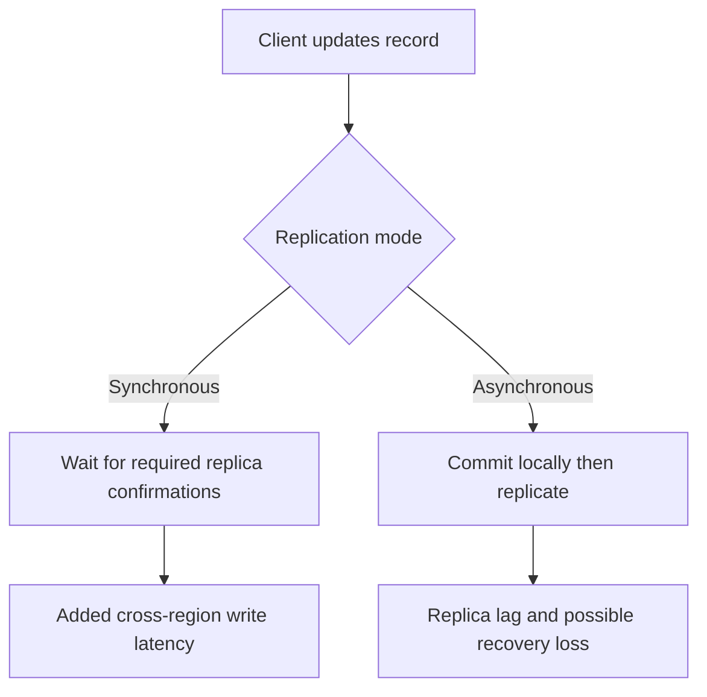

These are design patterns, not absolute properties of every database. Quorum placement, durability rules, and deployment topology determine actual behavior.

---

## 8. Active-passive: one working region and one standby

In an **active-passive** arrangement, Region A handles application traffic while Region B keeps standby infrastructure and data replicas.

If Region A fails, an operator or automation promotes the standby database where necessary and redirects application traffic.

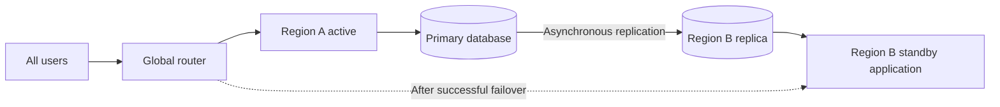

**Benefits:** Simpler write ownership, no normal multi-writer conflict, familiar disaster-recovery model.

**Costs:** Users far away may still experience high latency; standby capacity costs money; failover requires promotion, routing updates, checks and regular rehearsals.

A standby region can be “warm” or “hot” depending on how much infrastructure is provisioned and kept ready.

---

## 9. RPO versus RTO explained simply

These two terms come up in nearly every disaster-recovery interview.

**RPO — Recovery Point Objective:** The maximum tolerable **data loss measured in time**.

**RTO — Recovery Time Objective:** The maximum tolerable **time to restore service** after disruption.


**Example:** Suppose the last safely available replica is 5 seconds behind the primary when failure occurs. Recovery *might* lose changes from those 5 seconds depending on what was acknowledged and recovered. If promotion and routing complete in 3 minutes, downtime is around 3 minutes.

Those figures are **observations in an example**, not universal RPO/RTO guarantees. Objectives are targets; actual replication delay and recovery execution must be monitored and tested.

**Memory trick:** **RPO = how much data? RTO = how long down?**

---

## 10. Local reads with one central write region

For read-heavy applications, you can serve reads from regional replicas while routing all updates to one primary region.

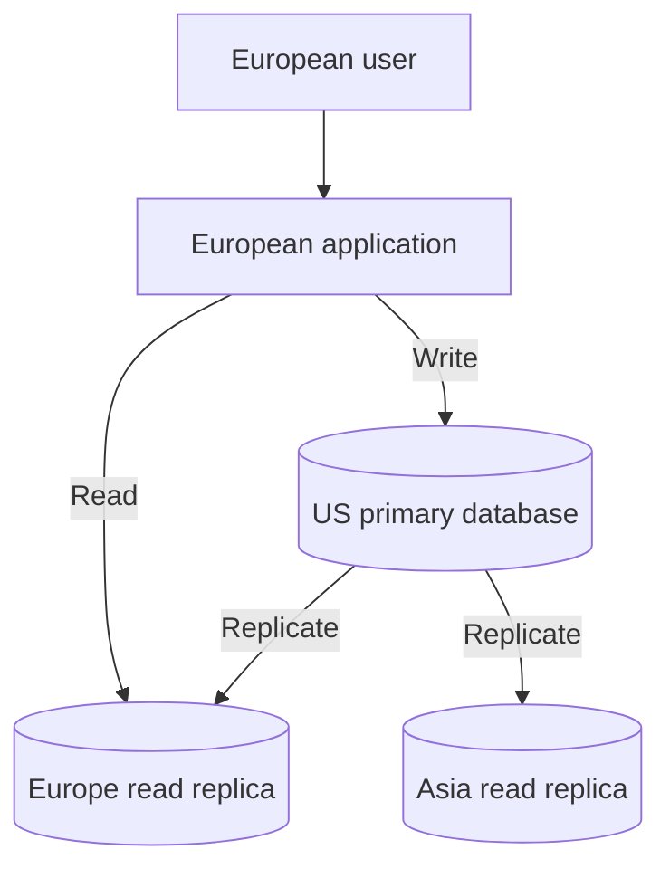

**Why it helps:** Frequently requested information such as timelines or product descriptions can be fetched closer to users.

**Limitation:** All writes still incur travel to the primary, and local replicas can lag. Read scaling does not magically make the whole transaction local.

This approach is sometimes called a **single-writer, multi-reader** architecture.

---

## 11. Read-your-own-writes and replica lag

Imagine updating your profile photo in Europe. The write commits in a US database, but a read from the Europe replica happens before replication catches up. Your old picture appears!

This is a **read-your-own-writes consistency** problem.

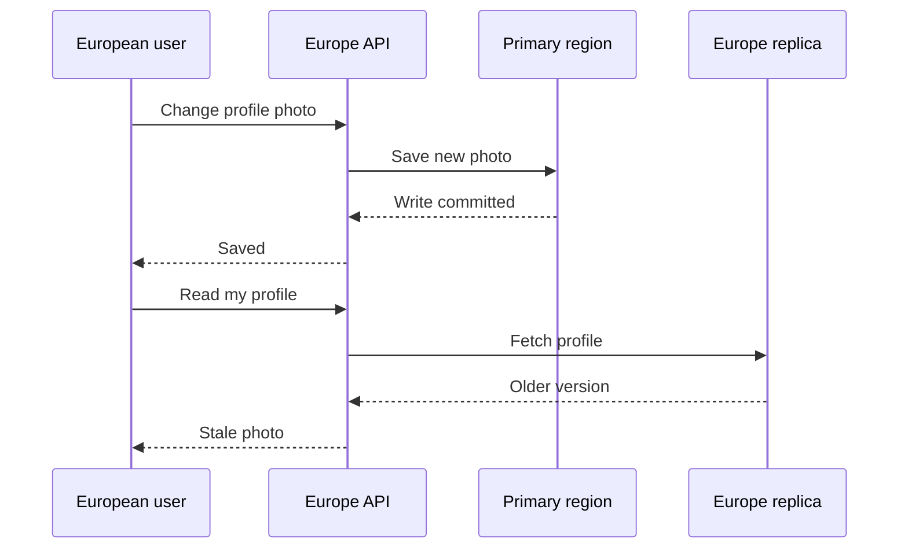

Possible solutions include **temporary primary reads** after writing, **session-level version tokens**, waiting until a replica catches up, or displaying the accepted local change while synchronization proceeds.

A fixed “read from primary for five seconds” policy can work as a heuristic, but it is not a rigorous guarantee if replication lag exceeds that interval.

---

## 12. Active-active: regional reads and writes

With **active-active**, multiple regions serve traffic and accept writes.

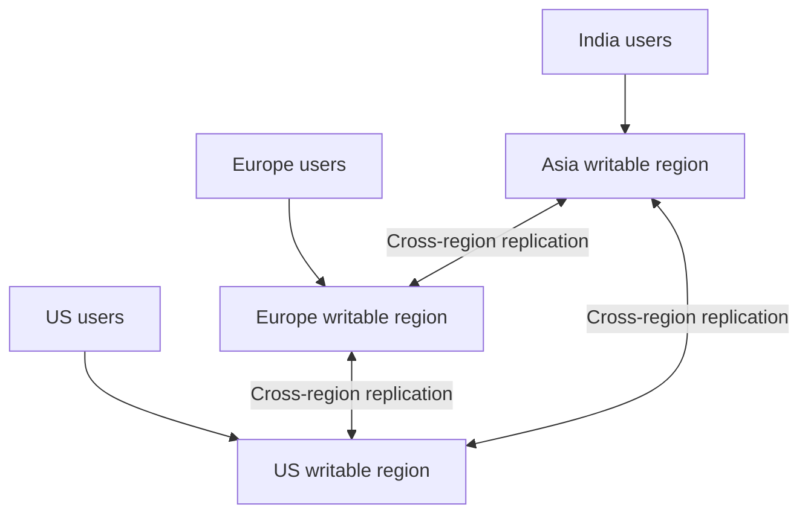

**Advantages:** Local request handling, potentially lower write latency, existing active regional infrastructure during failures.

**Challenge:** Concurrent changes to the same logical record can conflict, and replication needs a well-defined convergence model.

**Important:** Not every “active-active” system permits unconstrained simultaneous writes to the exact same record. Many deployments restrict per-key ownership or use a consensus database. Always specify the actual write model.

---

## 13. What does a write conflict look like?

A user updates their display name in two regions close together:

- Europe accepts: `displayName = "Asha"`
- US accepts: `displayName = "Ash"`

Before either has seen the other's change, both consider their update valid.

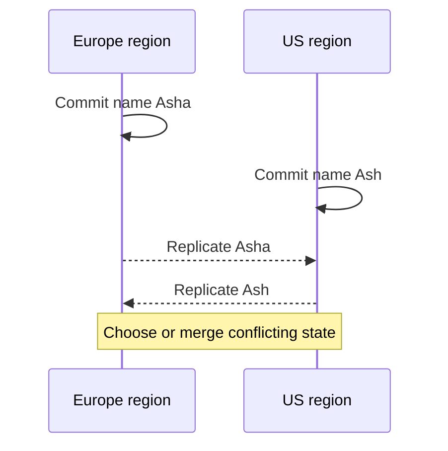

Strategies include:

- **Last-write-wins:** Keep a value according to an ordered timestamp or version. Simple, but can discard a legitimate edit and suffer clock-related problems.
- **Application merge:** Preserve competing versions and apply domain-specific rules.
- **CRDTs:** Specially designed replicated data types support deterministic convergence for suitable operations, such as certain counters and sets.
- **Single owner per record:** Avoid competing writes by routing each record to one authoritative writer.

A payment balance is not automatically safe with a generic last-write-wins rule.

---

## 14. Home regions avoid many conflicts

One pragmatic approach gives each user or resource a **home region**. That region owns authoritative writes for that resource.

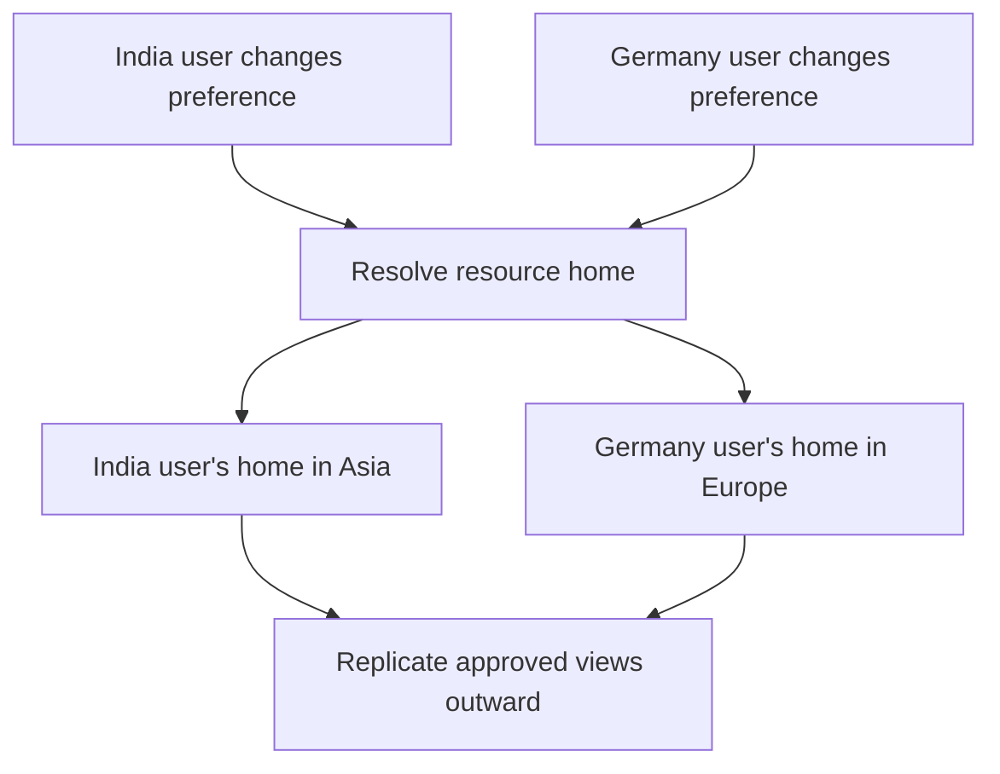

Benefits include local writes for many users and avoidance of multi-writer conflicts **for resources with correctly enforced single ownership**.

But a user moving countries, multiple user devices, or a group conversation spanning Europe and Asia introduces new challenges.

**Shared object rule:** A cross-region group chat can have one authoritative home for its messages even if members connect from many regions.

**Operational nuance:** Home-region migration needs a controlled handoff so both old and new homes do not accept writes simultaneously.

---

## 15. Strong consistency across regions

Some operations cannot safely rely on an asynchronously replicated copy. Examples may include financial ledger updates and overselling-sensitive inventory reservations.

Multi-region consensus databases can coordinate writes through a **quorum** of replicas, depending on deployment.

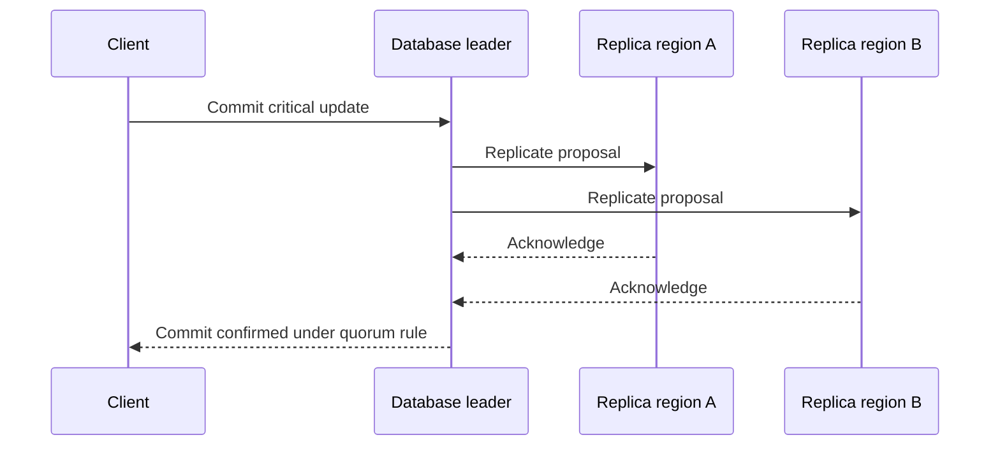

Strong consistency normally trades some latency and availability behavior for coordination, especially if quorum replicas are geographically distant.

**Precision matters:** A database advertising strong consistency does not imply **all queries from every replica always return the latest version without conditions**. Read mode, isolation level, quorum placement and database configuration determine which operations have which guarantees.

Systems may sensibly store money balances strongly, user preferences under home-region ownership, and noncritical counters with eventual convergence.

---

## 16. Failover: detecting failure and preventing split brain

Moving traffic after a region outage is only half the job. You must also ensure there is **exactly one accepted writer** for each single-writer dataset.

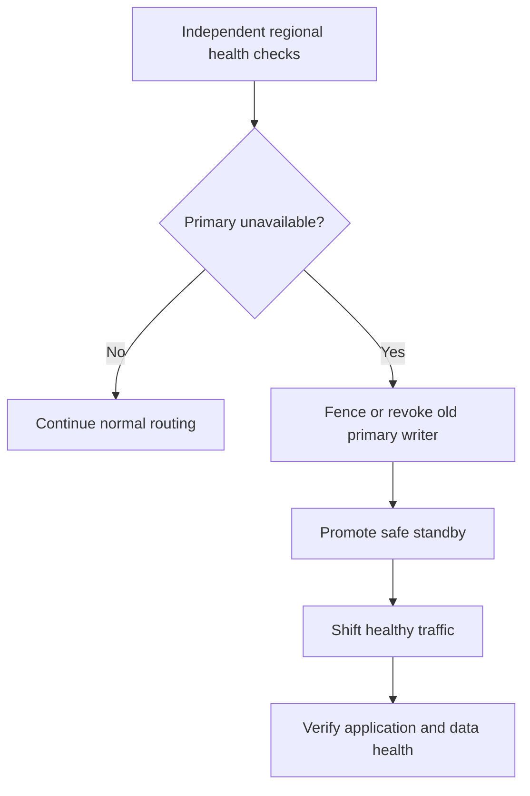

**Split brain** is when two isolated systems both believe they are primary and accept incompatible writes. Fencing tokens, leases or database-supported promotion controls can prevent old primaries from continuing writes when connectivity returns.

Also plan for partial outages: one region may still respond to health checks while its database or message broker is unavailable.

---

## 17. Capacity planning when a region disappears

Suppose three regions each normally carry one-third of the traffic. If one region fails, two regions must handle all users.

```text
Normal traffic per region = 1/3 of total
After one region fails = 1/2 of total per surviving region
Increase over normal load = (1/2) / (1/3) - 1 = 50%
```

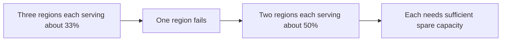

To survive that failure without scaling first, each region's normal traffic should be **no more than around two-thirds of its own safe capacity** under an evenly distributed model. In practice reserve more headroom for imbalance, background workload, burst traffic and degraded dependencies.

Regional failover is a **capacity event**, not simply a DNS configuration change.

---

## 18. Data residency: include caches, logs and backups

Some products have contractual or regulatory requirements limiting where particular personal or business records may be stored or processed.

A compliant design may assign regulated users to an approved home and replica set, but the restriction must also cover derived data, logs, object storage, search indexes, telemetry and backups.

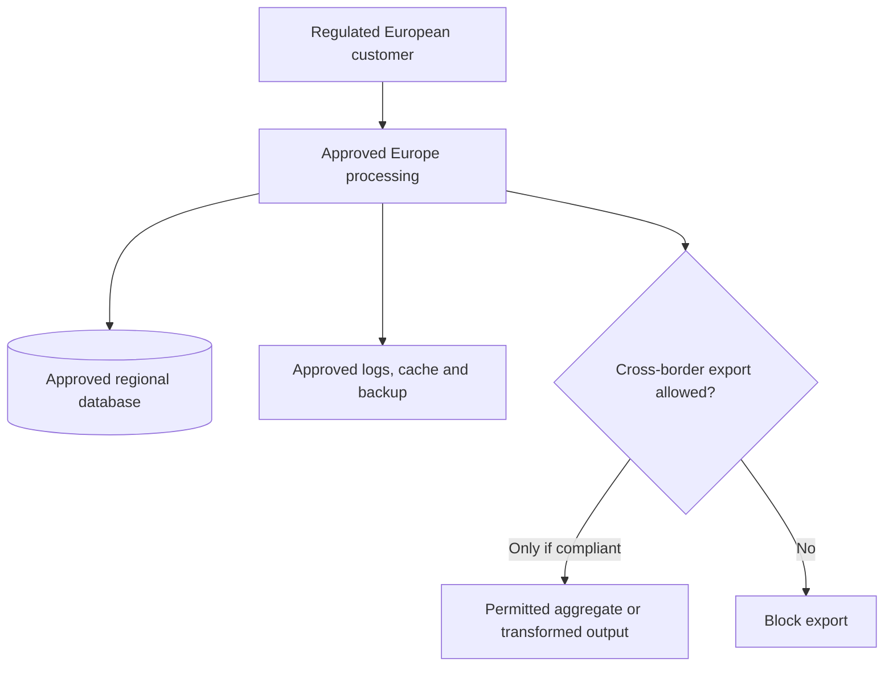

**Important nuance:** “GDPR means every EU record must stay in the EU” is too broad. Cross-border transfers can be lawful under applicable safeguards; specific customers may impose stricter contractual residency rules. Confirm the actual jurisdiction and requirements instead of assuming one global rule.

Data residency is not only a database-region setting; it is a **whole-data-lifecycle constraint**.

---

## 19. Compare multi-region architectures

| Pattern | Reads | Writes | Main strength | Main trade-off |
|---|---|---|---|---|
| Single region, multi-AZ | One region | One region | Operational simplicity | Regional outage risk |
| Active-passive | Active region | Active region | Straightforward disaster recovery | Failover time and standby expense |
| Single-writer with regional replicas | Locally where safe | One home region | Fast regional reads | Write latency, replica lag |
| Multi-writer active-active | Several regions | Several regions | Local read/write opportunities | Conflicts and replication complexity |
| Per-entity home regions | Many locations | Home for each entity | Avoids per-entity conflicts | Routing ownership and migrations |
| Multi-region quorum database | Depends on read mode | Coordinated quorum | Stronger cross-region invariants | Coordination latency and availability trade-offs |

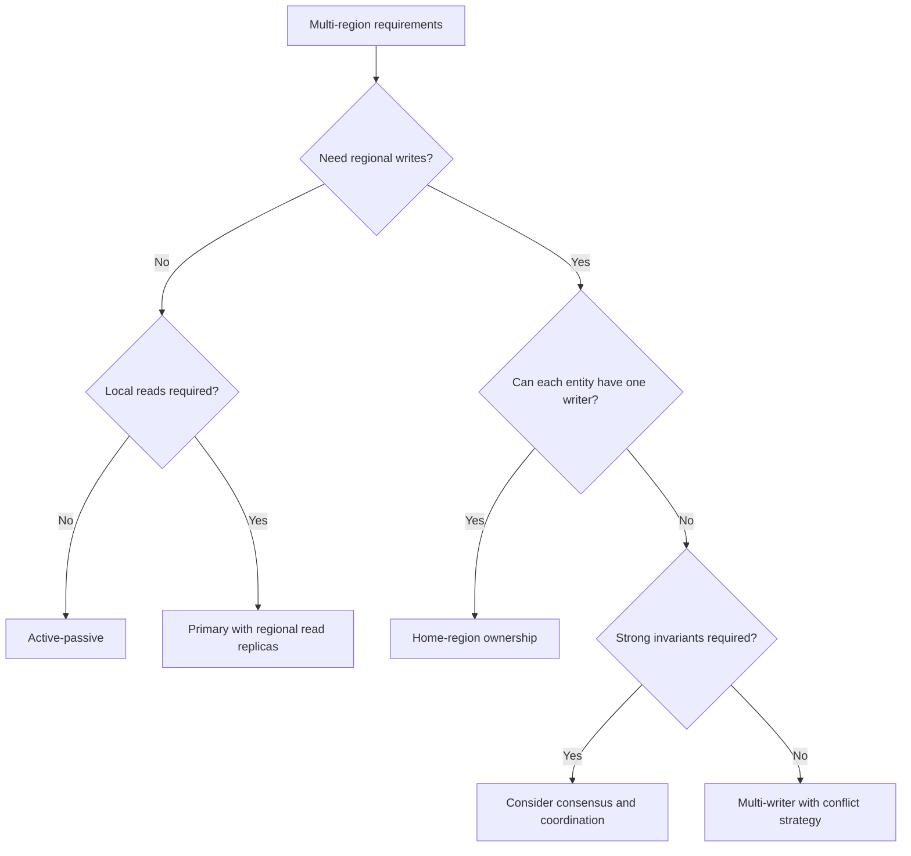

A production system frequently **mixes patterns by data type** instead of selecting a single replication model for all data.

---

## 20. Interview walkthrough: global social application

Assume a social platform serves Europe, Asia and North America, with mostly feed reads and occasional posts.

**Step 1 — Requirements:** Global low-latency reads, resilience to a regional outage, and no strict requirement for synchronous publication everywhere.

**Step 2 — Traffic:** Use global routing and regional stateless API instances.

**Step 3 — Data placement:** Route posts to a defined writer or home region, replicate to regional read stores, and serve appropriate cached content locally.

**Step 4 — Consistency:** After publishing, show the post locally or read from the writer until the replica catches up.

**Step 5 — Recovery:** Set explicit RPO/RTO targets, rehearse promotion and traffic shift, and prevent split brain.

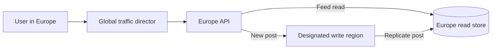

For payments or critical inventories, this casual asynchronous design might not be sufficient; reconsider the consistency model for that data.

---

## 21. Operational checks and failure testing

A diagram alone does not prove high availability. Test your failover and recovery mechanisms.

Track at least: per-region error rate, response latency, replication lag, quorum health, write rejection, failover timing, DNS/router health, and spare capacity.

**Useful chaos-test scenarios:**

- A whole region stops responding.
- Only the database fails while APIs still answer.
- Cross-region links become slow or partitioned.
- DNS keeps returning a stale address.
- A promoted replica has missing recent writes.
- The old primary returns and attempts to write.
- A standby region cannot handle diverted traffic.
- A data migration crosses an unauthorized jurisdiction.

```mermaid
flowchart TD
  TEST["Inject regional failure"] --> DETECT["Measure detection"]
  DETECT --> ROUTE["Verify traffic switch"]
  ROUTE --> DATA["Check data correctness"]
  DATA --> CAP["Measure surviving capacity"]
  CAP --> REVIEW["Update runbooks and thresholds"]
```

**Key insight:** Failover is successful only if users can complete **correct operations**, not merely if the homepage responds.

---

## 22. Interview questions and cheat sheet

### Interview questions

1. Why would a product deploy across regions?
2. How is a region different from an availability zone?
3. Why do geographically distant round trips matter?
4. Compare GeoDNS, latency-based routing and anycast.
5. Why can DNS failover take longer than expected?
6. What is the difference between synchronous and asynchronous replication?
7. Draw active-passive architecture and explain the promotion procedure.
8. Explain RPO and RTO using concrete failure timelines.
9. What is read-your-own-writes consistency?
10. When are regional read replicas useful?
11. What is an active-active conflict?
12. Compare last-write-wins, application merge and CRDTs.
13. How do home regions reduce write conflicts?
14. When would you choose cross-region consensus?
15. How can split brain occur during failover?
16. Why does losing one of three equal-sized regions raise survivor traffic by 50%?
17. What components beyond the primary DB may contain regulated personal data?
18. How would you test the design before launch?

### One-minute revision

| Concept | Simple meaning |
|---|---|
| Multi-region | Deploy service across different geographic locations |
| GeoDNS | Return region-aware DNS answers |
| Anycast | Advertise one IP from multiple network locations |
| TTL | How long a DNS answer may be cached |
| Active-passive | One serving region and another standby |
| Active-active | Multiple regions serving and potentially writing |
| RPO | Acceptable recovery data-loss window |
| RTO | Acceptable service recovery duration |
| Replica lag | Delay before remote copies see a write |
| Read-your-own-writes | User sees changes they have just made |
| Home region | Authoritative write location for a resource |
| CRDT | Data type with convergent concurrent updates |
| Quorum | Required replica agreement under a protocol |
| Split brain | More than one region believes it can write |
| Data residency | Restrictions on where data can live or be processed |

**Final takeaway:** Start with the *reason* for using multiple regions. Route traffic close to healthy services, select a data ownership and consistency model that matches each business operation, reserve failover capacity, and test the entire recovery plan.

---
