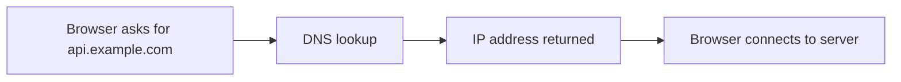
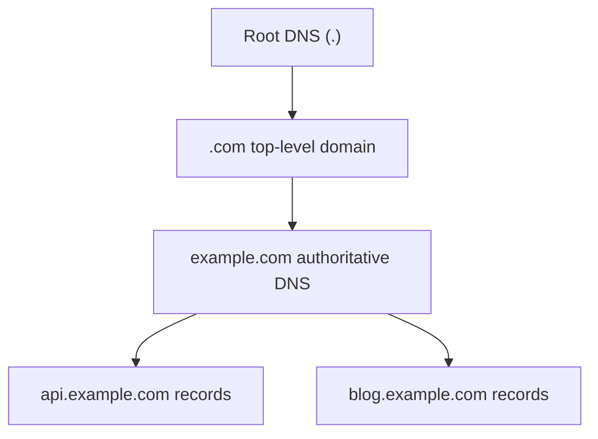
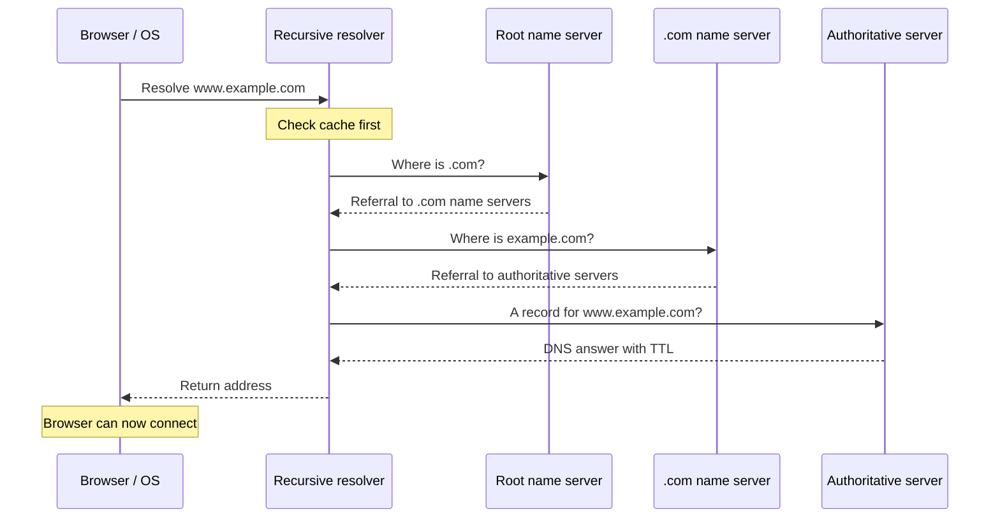
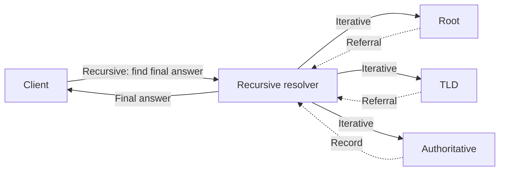
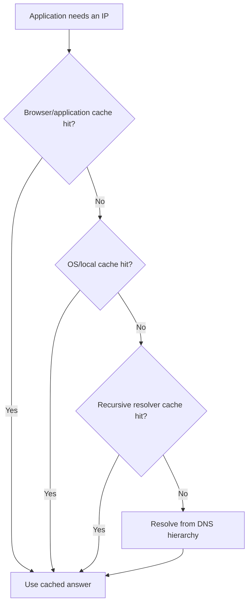
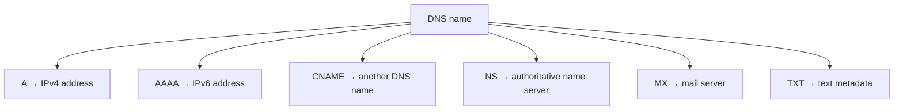
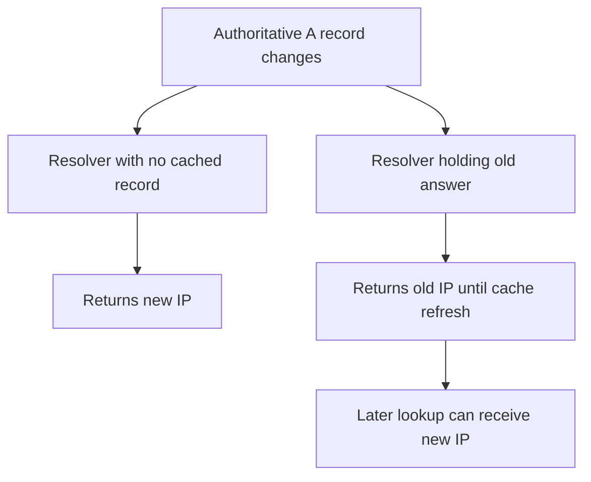
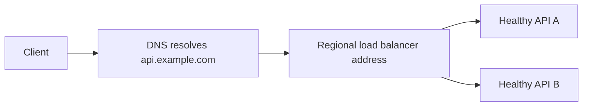

# DNS Resolution — Explained Simply with Diagrams

*Distributed Systems Study Library · Author: Jayesh Sharma*

**Understand domain lookups, root/TLD/authoritative servers, caching, TTL, DNS records, and DNS updates using simple examples.**

## Contents

- [1. What is DNS?](#1-what-is-dns)
- [2. Why is DNS distributed and hierarchical?](#2-why-is-dns-distributed-and-hierarchical)
- [3. Key participants in a DNS lookup](#3-key-participants-in-a-dns-lookup)
- [4. Step-by-step: what happens when you type a domain?](#4-step-by-step-what-happens-when-you-type-a-domain)
- [5. Recursive vs iterative queries](#5-recursive-vs-iterative-queries)
- [6. DNS caching: why repeated lookups are fast](#6-dns-caching-why-repeated-lookups-are-fast)
- [7. TTL: how long may DNS answers be reused?](#7-ttl-how-long-may-dns-answers-be-reused)
- [8. Important DNS record types](#8-important-dns-record-types)
- [9. What does DNS propagation really mean?](#9-what-does-dns-propagation-really-mean)
- [10. Plan a safer DNS migration](#10-plan-a-safer-dns-migration)
- [11. DNS and load balancing: different jobs](#11-dns-and-load-balancing-different-jobs)
- [12. Common misunderstandings](#12-common-misunderstandings)
- [13. Worked examples and interview questions](#13-worked-examples-and-interview-questions)

---

## 1. What is DNS?

**DNS (Domain Name System)** helps convert a name people can remember into information computers use to connect to a service.

Imagine saving a friend's name in your phone. You select the name, and your phone looks up the number. DNS plays a similar *directory* role for names such as `api.example.com`, often returning an IP address.



A service can move to a different IP without asking users to memorize a new address. The DNS records can be updated, although cached old answers may remain for some time.

**Remember:** **DNS finds the address; it does not normally carry the website's HTTP requests.**

---

## 2. Why is DNS distributed and hierarchical?

There are far too many Internet names to maintain conveniently in one central list. DNS divides responsibility among levels.

For `api.example.com`:

- **Root (`.`)** points resolvers toward servers for top-level domains.
- **Top-level domain (`.com`)** points resolvers toward the authoritative name servers for `example.com`.
- **Authoritative name servers** provide DNS data for the relevant name.
- **`api`** is a subdomain label beneath `example.com`.



The root does **not** store the IP address of every website. It provides referrals to the next part of the hierarchy. This delegation is an important reason DNS can scale.

---

## 3. Key participants in a DNS lookup

| Participant | Easy explanation |
|---|---|
| **Browser or application** | Needs a destination address to connect |
| **Operating-system resolver** | Checks local sources and typically uses a configured DNS resolver |
| **Recursive resolver** | Finds a final answer on behalf of its clients and caches it |
| **Root name server** | Helps locate the right TLD name servers |
| **TLD name server** | Helps locate authoritative servers for a domain |
| **Authoritative name server** | Serves the DNS records it is responsible for |

**Analogy:** The client asks a librarian for a book. The librarian checks the shelf, then consults a directory of libraries if necessary. The client doesn't have to visit every location personally.

---

## 4. Step-by-step: what happens when you type a domain?

Let's imagine you type `www.example.com`.

1. The browser or system may already have a usable cached answer. If so, the lookup can stop early.
2. Otherwise, the client asks its configured **recursive resolver**.
3. If the resolver has no usable cached answer, it follows the hierarchy.
4. A **root server** refers it toward the relevant **.com TLD servers**.
5. A **TLD server** refers it toward the domain's **authoritative name servers**.
6. An authoritative server returns the requested record, such as an **A record** with an IPv4 address.
7. The resolver sends the result to the client, usually retaining it in cache for its allowed lifetime.
8. The browser can then connect to the returned destination.



**Important:** The diagram shows a **cache miss**, and omits some implementation details. In practice, delegated name-server information may also already be cached, and a name may involve aliases or more than one lookup.

---

## 5. Recursive vs iterative queries

These two terms describe different kinds of responsibility.

**Recursive query:** *“Please find the answer for me.”* The client asks a recursive resolver to do the lookup work.

**Iterative query:** *“Give me the answer you have, or tell me where to ask next.”* The resolver can follow referrals between root, TLD, and authoritative name servers.



**Easy distinction:** The client **delegates the job**; the recursive resolver **follows the directions**.

---

## 6. DNS caching: why repeated lookups are fast

Imagine thousands of people opening the same website. If every visitor caused a complete lookup from the DNS root, it would waste time and produce unnecessary work.

A DNS answer may be cached by:

- The **browser or application** (depending on its configuration).
- The **operating system** or local caching service.
- A **recursive DNS resolver** serving many clients.



Caching usually lowers lookup latency and reduces queries reaching authoritative DNS infrastructure.

**Keep in mind:** Different applications and operating systems do not necessarily use every cache layer shown in this conceptual diagram.

---

## 7. TTL: how long may DNS answers be reused?

**TTL** means **Time To Live**. It is commonly expressed in **seconds** and tells compliant DNS caches how long a record is eligible to be reused before it needs refreshing.

### Example: TTL = 300 seconds

Suppose `api.example.com` is cached at **10:00 AM** with a **300-second TTL**.

| Time | What may happen |
|---|---|
| 10:00 | Resolver caches the answer |
| 10:02 | Resolver can reuse the cached address |
| 10:05 | Cache lifetime reaches zero; a new lookup may be required |
| After refresh | Resolver can observe the new authoritative answer |


### Short vs long TTL

| TTL | Advantage | Disadvantage |
|---|---|---|
| **Long, e.g. 3600 s** | More cache hits and fewer DNS lookups | Changes may take longer to reach some clients |
| **Short, e.g. 60 s** | Clients may refresh answers sooner | More frequent resolver queries |

**Memory trick:** **Long TTL = more caching. Short TTL = quicker opportunity to update.**

A short TTL is **not a guarantee of instant failover**: application caches, resolver policies, health detection and existing connections can add delay.

---

## 8. Important DNS record types

These are the record types discussed in the transcript.

| Type | Job | Simple example |
|---|---|---|
| **A** | Maps a hostname to an **IPv4** address | `api.example.com → 192.0.2.10` |
| **AAAA** | Maps a hostname to an **IPv6** address | `api.example.com → 2001:db8::10` |
| **CNAME** | Makes one DNS name an alias of another | `www.example.com → app.example.net` |
| **NS** | Identifies authoritative name servers for a DNS zone/delegation | `example.com → ns1.example.net` |
| **MX** | Identifies mail-receiving servers and their preference | `example.com → mail.example.net` |
| **TXT** | Carries text data, often verification or email-related policy | Domain verification; SPF text |

The IP addresses above use ranges reserved for documentation examples.



**Useful nuance:** A CNAME points to **another name**, not directly to an IP address. The resolver may need additional resolution steps. A conventional CNAME name cannot simultaneously have unrelated record types at that same owner name. DNS hosting platforms sometimes provide specialized alias/flattening features instead.

---

## 9. What does DNS propagation really mean?

Suppose a service moves from an old endpoint to a new endpoint.

```text
Before update:
api.example.com → 192.0.2.10

After update:
api.example.com → 192.0.2.20
```

The authoritative record may change immediately, but some recursive resolvers still have `192.0.2.10` cached.



So two users asking for the **same name** may briefly receive **different IP addresses**.

This is often called **DNS propagation**, but for ordinary record updates it is largely about *cache expiry and refresh*, rather than broadcasting a change instantly to every resolver.

**Important:** Existing open TCP or QUIC connections can continue using a previously selected endpoint even after DNS changes.

---

## 10. Plan a safer DNS migration

If you know an address change is coming, consider this sequence:

1. **Inspect the current TTL** and other dependencies.
2. **Lower the TTL in advance**, leaving enough time for old longer-TTL cache entries to expire.
3. **Prepare and test the new endpoint**, including health, certificates and access policies.
4. **Update DNS records** to the new destination.
5. **Monitor errors, latency and traffic** while old cached answers drain away.
6. **Keep the old endpoint available for a transition period** if feasible, then retire it when safe.


Reducing TTL at the moment of cutover does **not** shorten TTLs already cached from before that change.

---

## 11. DNS and load balancing: different jobs

DNS can return the address of a **load balancer** rather than an individual application instance.



DNS helps clients find a service endpoint. The load balancer can then distribute new connections or requests across healthy backends using policies such as Round Robin or Least Connections.

For more on regional routing and TTL trade-offs, see [DNS Load Balancing](../Load_Balancing/DNS_Load_Balancing.md).

---

## 12. Common misunderstandings

| Common misunderstanding | Correct idea |
|---|---|
| “DNS sends the web request to the server.” | DNS usually resolves a destination; the client then sends its HTTP traffic separately. |
| “The root server knows every website's IP.” | Root DNS delegates toward TLD name servers. |
| “Every website visit contacts a root server.” | Browser, OS and recursive caches may answer earlier. |
| “A CNAME directly contains an IP address.” | CNAME names another DNS hostname. |
| “TTL 60 means every user changes within exactly 60 seconds.” | Caches, applications and existing connections may delay the visible change. |
| “DNS propagation means the record is pushed everywhere.” | Most ordinary record-change delays are caused by cached answers expiring. |
| “DNS and a load balancer are interchangeable.” | DNS chooses returned destination addresses; load balancers route live traffic. |

---

## 13. Worked examples and interview questions

### Worked example A: a five-minute cache

A DNS record has TTL **300 seconds** and is cached at **09:00:00**. The authoritative answer changes at **09:01:00**.

```text
Cache created:          09:00:00
Original TTL:           300 seconds
Simplified expiry time: 09:05:00
Authoritative update:   09:01:00

Possible remaining stale-cache window: about 4 minutes
```

This is a simplified example for a resolver respecting the TTL. It is not a service-level failover guarantee.

### Worked example B: identify the record

**Question:** Which record would you check when a domain receives email?

**Answer:** The **MX record**, which identifies mail-routing destinations.

**Question:** Which record would you check for `api.example.com` when using an IPv6 address?

**Answer:** The **AAAA record**.

### Interview questions

1. What problem does DNS solve?
2. Why does DNS use a hierarchy rather than one big central lookup table?
3. What do root, TLD and authoritative name servers each do?
4. Walk through a DNS cache miss for `www.example.com`.
5. What is the difference between recursive and iterative DNS queries?
6. Which DNS layers can cache an answer?
7. What is TTL, and what are the trade-offs of a shorter value?
8. Explain A, AAAA, CNAME, NS, MX and TXT records.
9. Why might two users receive different IP addresses after a DNS update?
10. Why should a TTL reduction happen **before** a planned migration?
11. How does DNS differ from a regional load balancer?
12. Does an already-open network connection automatically follow a DNS change?

### Quick revision cheat sheet

| Term | Remember |
|---|---|
| DNS | Distributed name-to-record directory |
| Root | Refers to TLD servers |
| TLD | Refers to authoritative domain servers |
| Authoritative | Provides configured DNS record data |
| Recursive resolver | Finds and caches final answers |
| Iterative lookup | Follow referrals to another server |
| A | IPv4 |
| AAAA | IPv6 |
| CNAME | Another DNS name |
| NS | DNS name servers |
| MX | Mail destination |
| TXT | Domain-related text |
| TTL | Allowed cache lifetime |

**Final takeaway:** **DNS lets you use stable names while infrastructure addresses change. Hierarchical delegation finds records, caching speeds repeated lookups, and TTL determines when cached results may be refreshed.**

---
