# Forward Proxy vs Reverse Proxy — Explained Simply with Diagrams

*Distributed Systems Study Library · Author: Jayesh Sharma*

**A beginner-friendly explanation of client-side and server-side proxies, their uses, trade-offs, and system-design applications.**

> Original educational adaptation of the transcript supplied for this topic. The prose, examples, diagrams and comparisons are newly authored; technical clarifications, such as HTTPS CONNECT tunneling, are supplemental context.

## Contents

- [1. What is a proxy?](#1-what-is-a-proxy)
- [2. How a forward proxy works](#2-how-a-forward-proxy-works)
- [3. Why organizations use forward proxies](#3-why-organizations-use-forward-proxies)
- [4. Forward proxy vs VPN](#4-forward-proxy-vs-vpn)
- [5. How a reverse proxy works](#5-how-a-reverse-proxy-works)
- [6. Why reverse proxies matter in distributed systems](#6-why-reverse-proxies-matter-in-distributed-systems)
- [7. Forward vs reverse proxy comparison](#7-forward-vs-reverse-proxy-comparison)
- [8. Reverse proxy vs load balancer](#8-reverse-proxy-vs-load-balancer)
- [9. TLS termination and backend encryption](#9-tls-termination-and-backend-encryption)
- [10. Caching, authentication and rate limiting](#10-caching-authentication-and-rate-limiting)
- [11. Reverse proxies in microservices and Kubernetes](#11-reverse-proxies-in-microservices-and-kubernetes)
- [12. Popular technologies](#12-popular-technologies)
- [13. A complete real-world example](#13-a-complete-real-world-example)
- [14. Troubleshooting and common misconceptions](#14-troubleshooting-and-common-misconceptions)
- [15. Interview questions and quick revision](#15-interview-questions-and-quick-revision)

---

## 1. What is a proxy?

A **proxy** is a computer or service that receives a network request and communicates with another service on behalf of someone else.

Think of a receptionist at an office. Visitors speak to the receptionist, who passes messages to the correct employee.

There are two common placements:

- **Forward proxy:** Represents the **client** when reaching outside services.
- **Reverse proxy:** Represents the **server side** when accepting incoming traffic.

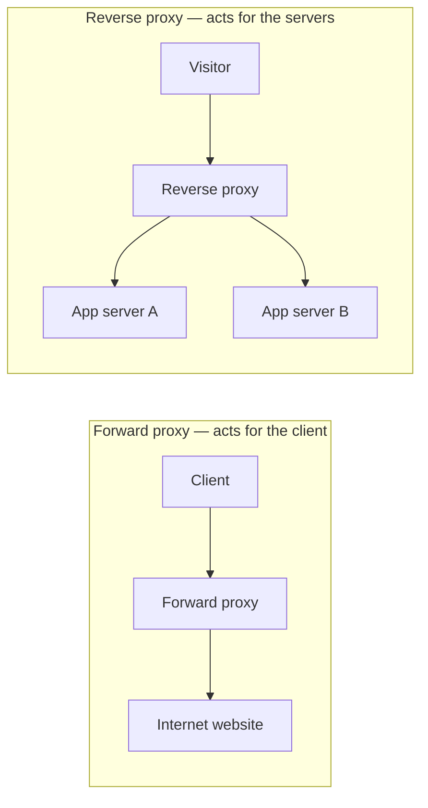

**Memory trick:** **Forward = client side. Reverse = server side.**

---

## 2. How a forward proxy works

A **forward proxy** is an intermediary used by a client or a group of clients to reach external destinations.

For example, a company might configure employee browsers to access external web services through its corporate proxy.

1. The employee's browser sends a request to the forward proxy.
2. The proxy checks any configured policies and forwards the permitted request.
3. The website responds to the proxy.
4. The proxy sends the response back to the browser.

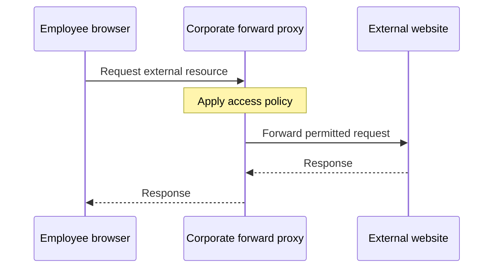

The external destination typically sees the **proxy's network address** as its direct peer, though it may learn about the original client through forwarded headers or other metadata if the proxy shares them.

**Important:** A forward proxy is not automatically anonymous, encrypted, or safe. Privacy and security depend on configuration and trust.

---

## 3. Why organizations use forward proxies

| Purpose | Simple example | Important detail |
|---|---|---|
| **Access control** | Block access to disallowed external domains | Policies need enforcement |
| **Monitoring** | Record which destinations employees contact | Logging should follow organizational privacy rules |
| **Caching** | Reuse suitable repeated responses | HTTPS content is not generally readable/cacheable by a basic tunnel proxy |
| **Network egress** | Give clients a managed path to outside services | Proxy availability and capacity matter |
| **Address masking** | Destinations connect to the proxy rather than directly to client | Headers or application data may still reveal a client |

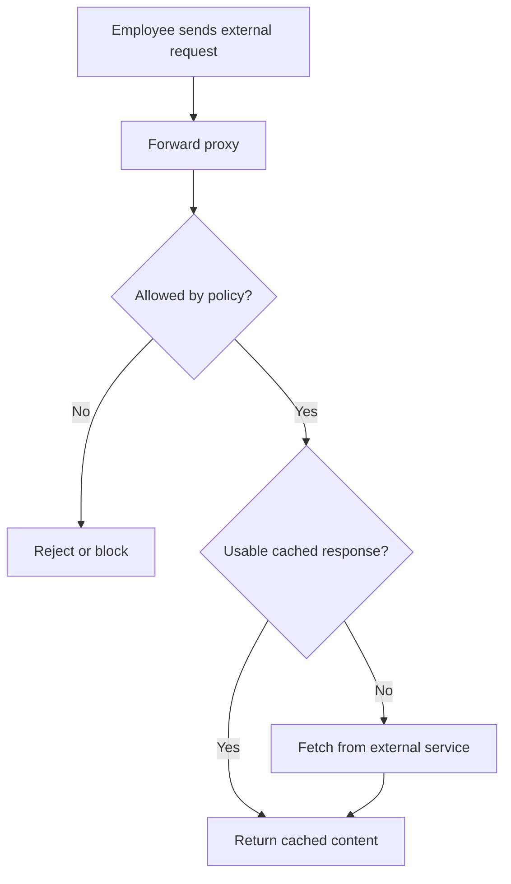

**Easy summary:** Forward proxies help an organization **manage outgoing client traffic**.

---

## 4. Forward proxy vs VPN

They can both change what address a destination sees, but their jobs and scope differ.

| Question | Forward proxy | VPN |
|---|---|---|
| Typical scope | Configured apps or protocols | Broader IP traffic routed through a tunnel |
| Main job | Relay selected requests or connections | Create a tunnel to another network endpoint |
| Encryption guaranteed by the concept? | No; depends on proxy protocol, tunnel and end-to-end TLS | A VPN commonly encrypts its tunnel, subject to protocol and configuration |
| Typical example | Corporate web proxy | Secure access to a company network |

**Example:** A browser may be configured to use a proxy only for web requests. A VPN client may route much more of the device's network traffic.

Neither one guarantees online anonymity. The proxy/VPN provider, applications, cookies, destination systems and network paths can still expose information.

---

## 5. How a reverse proxy works

A **reverse proxy** is an entry point deployed in front of one or more backend services.

When someone visits an online store, they connect to the store's public endpoint, not necessarily to an application instance directly.

1. The browser sends the request to the reverse proxy.
2. The proxy selects the appropriate backend or application service.
3. The backend returns its response to the proxy.
4. The proxy returns the result to the browser.

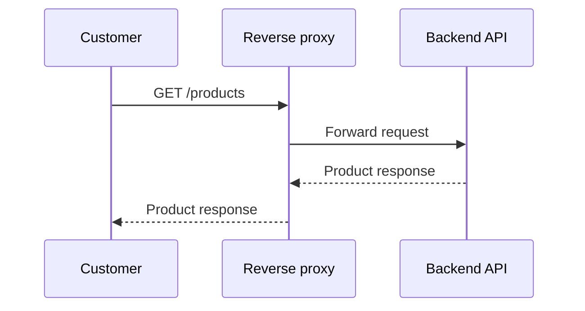

To the customer, the application appears as **one service endpoint**, even if the proxy is coordinating multiple servers.

**Easy summary:** A reverse proxy helps **manage incoming traffic to servers**.

---

## 6. Why reverse proxies matter in distributed systems

A reverse proxy can perform multiple functions beyond forwarding traffic:

- **Load balancing:** Distribute incoming traffic among eligible instances.
- **TLS termination:** Handle client-side HTTPS connections and certificates at the edge.
- **Caching:** Serve eligible repeated responses without contacting the application each time.
- **Routing:** Send different URL paths or hosts to different services.
- **Security policies:** Apply suitable authentication, rate limits, filtering, or request validation.
- **Backend abstraction:** Change internal instances without changing the public endpoint.

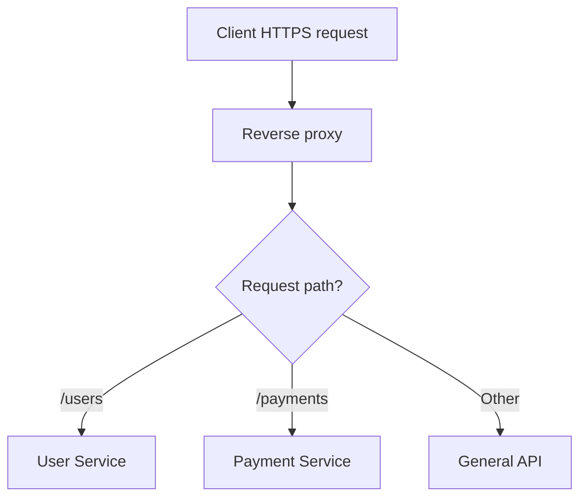

For instance, `/users/42` can go to a User Service while `/payments` goes to a Payment Service.

**Security nuance:** A reverse proxy does not make backend servers unreachable by magic. Network routing, firewalls, security groups, and identity controls must also prevent unintended direct access.

---

## 7. Forward vs reverse proxy comparison

| Feature | Forward proxy | Reverse proxy |
|---|---|---|
| Represents | Client or client network | Backend service or backend group |
| Typical traffic direction | Outbound client requests | Inbound service requests |
| Positioned | In front of clients | In front of backend servers |
| Usually selected by | Client/network configuration | Public service architecture and DNS |
| Common goal | Access policy, outbound monitoring, controlled egress | Routing, scale, caching, TLS, security |
| Example | Office employees reaching external sites | Online store fronting several app servers |

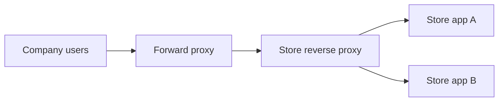

**Both can appear in the same request path.** A company employee might use a corporate forward proxy to reach an online store that itself runs behind a reverse proxy.

**Interview answer:** Forward proxies are deployed to act for **clients**; reverse proxies are deployed to act for **services**.

---

## 8. Reverse proxy vs load balancer

The terms overlap but do not mean the exact same thing.

A **load balancer** focuses on spreading traffic among backends. A **reverse proxy** is a wider intermediary role that may also handle HTTPS, caching, request routing and other policies.

Some reverse-proxy software supports both **Layer 4** and **Layer 7** balancing. Also, not every network load balancer acts as an HTTP-aware reverse proxy.

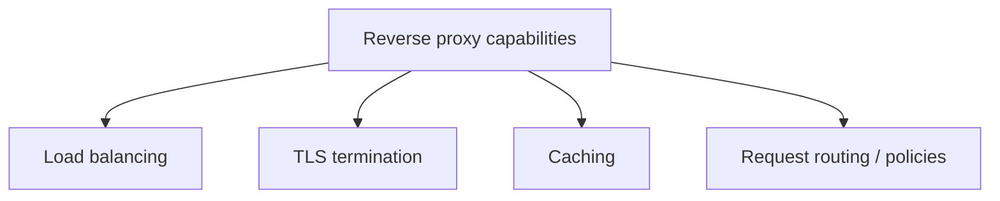

**Remember:** **Load balancing is a capability; reverse proxying describes the intermediary role.**

For deeper coverage, read [What Are Load Balancers?](../Load_Balancing/What_Are_Load_Balancers.md) and [Load Balancing Algorithms](../Load_Balancing/Load_Balancing_Algorithms.md).

---

## 9. TLS termination and backend encryption

If a browser establishes HTTPS with a reverse proxy, that **client-side TLS connection ends at the proxy**. The reverse proxy can inspect the decrypted HTTP request and decide where to send it.

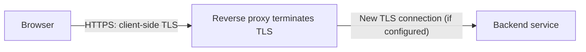

A proxy may use plain HTTP on a separately trusted internal segment, or **establish another TLS connection** to the backend. Many systems require the second option for encryption in transit.

**Important:** Terminating TLS does **not** automatically mean communication becomes insecure; the security outcome depends on the protection of the next hop.

In some microservice environments, **mTLS** is used so both service endpoints authenticate each other with certificates.

---

## 10. Caching, authentication and rate limiting

A reverse proxy can remove unnecessary load from application instances.

### Example: caching a popular product page

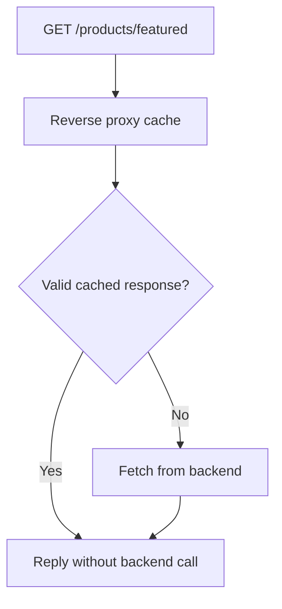

Caching works only when responses are eligible under the cache policy; personalized or sensitive responses require special care.

The same edge tier can also enforce **rate limits** and some **authentication or authorization policies**. These controls complement, rather than replace, checks performed by downstream services.

**Example:** A burst of 10,000 requests per second reaches the edge. Rate limiting might protect overloaded services by declining or delaying excess work according to policy, even though a proxy cannot create unlimited server capacity.

---

## 11. Reverse proxies in microservices and Kubernetes

In a microservices architecture, a reverse proxy may appear as an **API gateway**, **Ingress controller**, **Gateway API implementation**, or **service-mesh proxy**, depending on deployment.

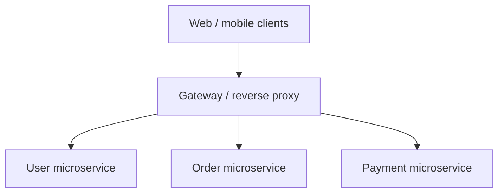

A cloud load balancer or CDN may also perform reverse-proxy behavior. The tool's product name matters less than **where traffic is intercepted and what decisions it makes**.

**Operational tip:** Keep routing configuration, health checks, timeouts, retries and observability aligned; a misconfigured edge can become a bottleneck or single point of failure.

---

## 12. Popular technologies

The source transcript names several examples:

| Technology | Typical role in this topic |
|---|---|
| **NGINX** | Web reverse proxy, HTTP routing, caching, TLS and load balancing |
| **HAProxy** | High-performance proxying and load balancing |
| **Envoy** | Modern service proxy with routing, observability and resilience features |
| **Managed cloud services** | Managed load balancing, gateways or CDN functionality |

Features depend on the version, license, deployment and configuration; this is an educational overview, not a claim that every product supports every feature identically.

---

## 13. A complete real-world example

Imagine a company employee ordering a laptop from an online shop.

1. The employee's browser sends its outbound request through the **corporate forward proxy**.
2. The forward proxy applies outbound access policy and forwards the permitted connection.
3. The online shop's **reverse proxy** receives the incoming request.
4. The reverse proxy chooses the right backend service.
5. The response returns through the intermediaries.

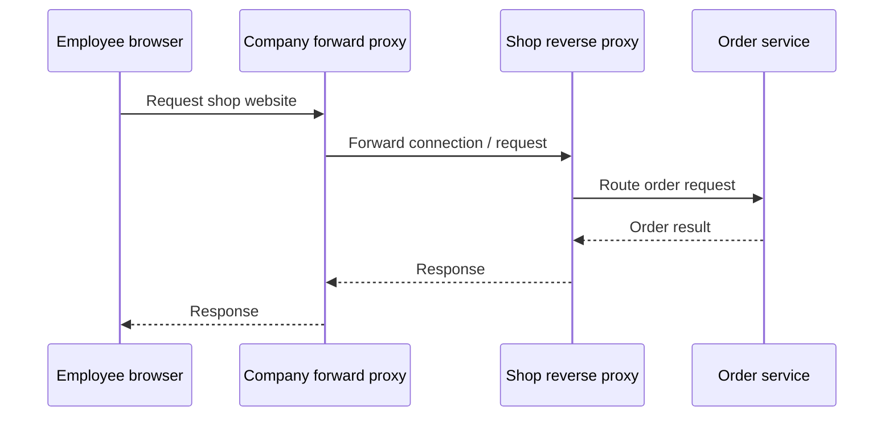

**Important HTTPS detail:** A forward proxy may use an HTTP **CONNECT tunnel** to pass end-to-end encrypted TLS bytes without reading HTTP content. An organization that deliberately decrypts and inspects HTTPS traffic requires additional explicit configuration and trust arrangements. The diagram focuses on routing, not the exact encryption termination points.

---

## 14. Troubleshooting and common misconceptions

| Misunderstanding | Better explanation |
|---|---|
| “A proxy is always a VPN.” | A VPN typically tunnels broader IP traffic; a proxy often relays selected protocols. |
| “A forward proxy guarantees anonymity.” | It can obscure the source IP at one hop but may leak or log other identifying information. |
| “All reverse proxies are only load balancers.” | They can also apply TLS, caching, routing and policies. |
| “Reverse proxy means the backend is secure.” | Direct network access still needs correct firewall and route rules. |
| “HTTPS inspection always happens at forward proxies.” | Ordinary CONNECT tunneling can leave HTTPS content encrypted end-to-end. |
| “A cache always improves performance.” | Uncacheable or stale content can make caching inappropriate. |

### Quick diagnosis

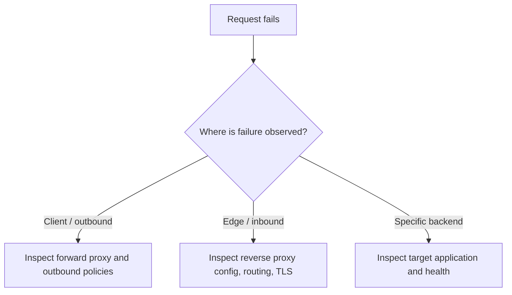

---

## 15. Interview questions and quick revision

### Frequently asked questions

1. What is a proxy, in simple terms?
2. What is the main difference between forward and reverse proxies?
3. Explain the request flow through a corporate forward proxy.
4. How is a forward proxy different from a VPN?
5. Why would a company log or restrict outbound traffic?
6. How does a reverse proxy hide implementation details of multiple services?
7. Is a reverse proxy the same as a load balancer?
8. What is TLS termination, and when should backend traffic be re-encrypted?
9. How can a reverse proxy cache repeated requests?
10. How is path-based routing different from simple connection forwarding?
11. Where might reverse-proxy functions appear in Kubernetes?
12. Can forward and reverse proxies both participate in one request path?
13. What is an HTTP CONNECT tunnel?
14. What happens if your only reverse proxy instance fails?

### One-minute revision

| Concept | Remember |
|---|---|
| Proxy | Intermediary for a network request |
| Forward proxy | Acts on behalf of the client |
| Reverse proxy | Acts on behalf of the server |
| VPN | Commonly tunnels broader IP traffic |
| L7 routing | Uses HTTP paths, hosts and headers |
| Load balancing | Spreads traffic among backends |
| TLS termination | Client TLS session ends at proxy |
| Backend re-encryption | Separate secure connection to backend |
| Cache | Reuses eligible responses |
| Rate limiting | Helps control excess incoming traffic |

**Final takeaway:** **Forward proxy = manage outgoing client traffic. Reverse proxy = manage incoming service traffic.** Both can be used together; their security and performance depend on configuration.

---
