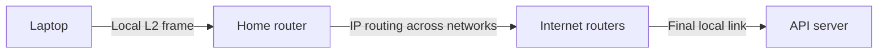
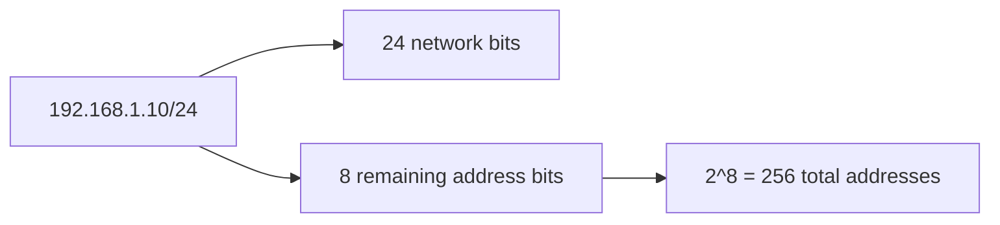
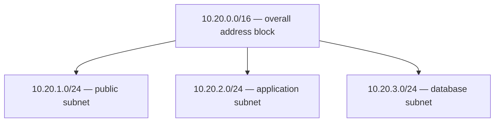
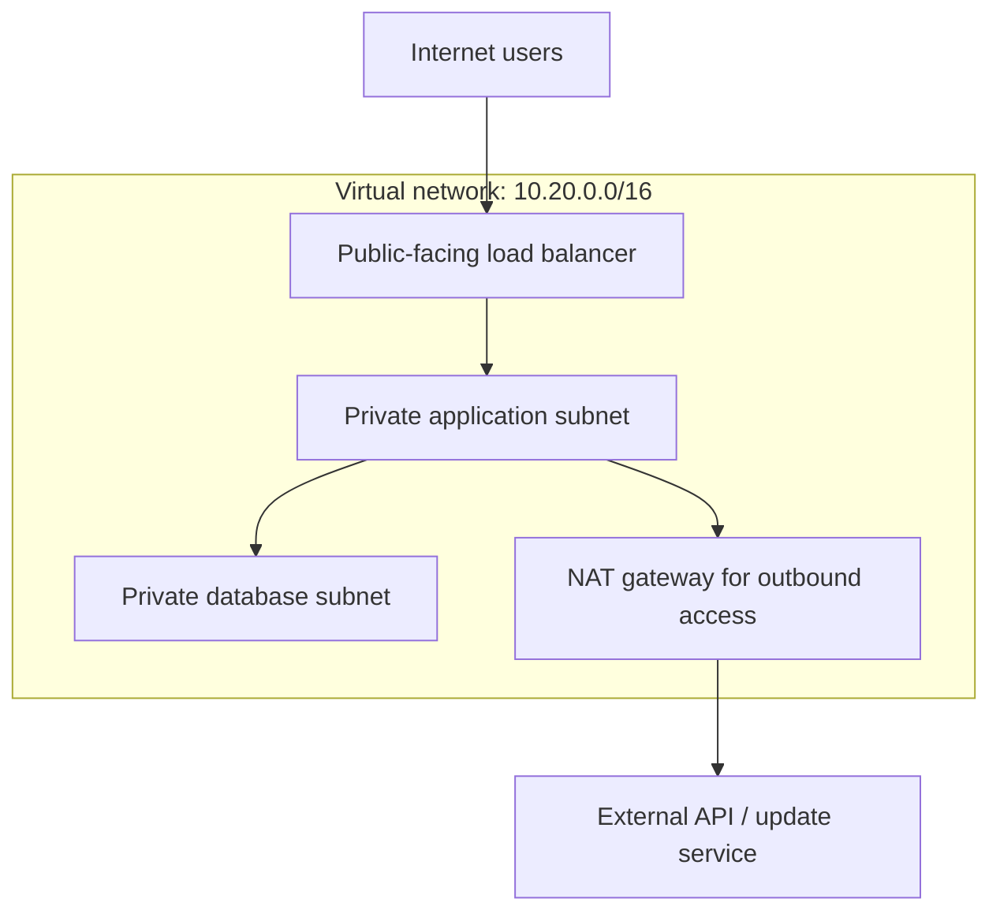
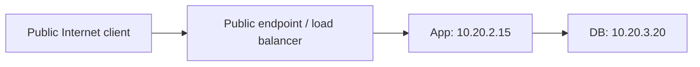
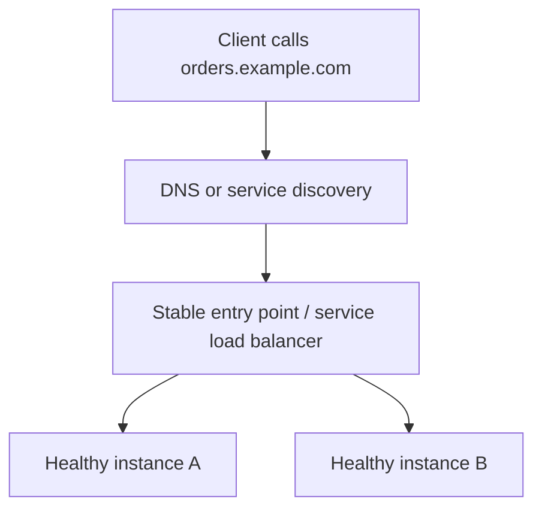
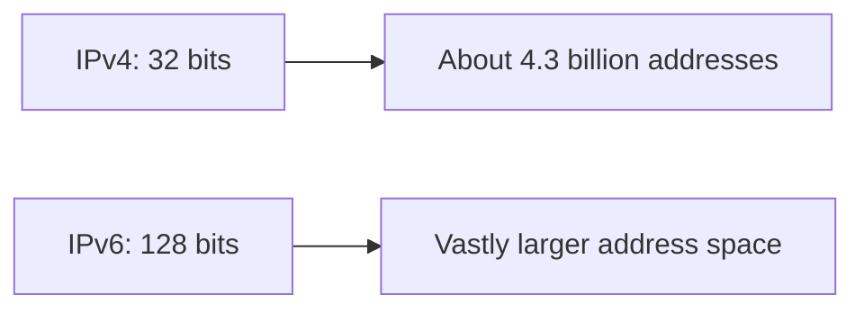
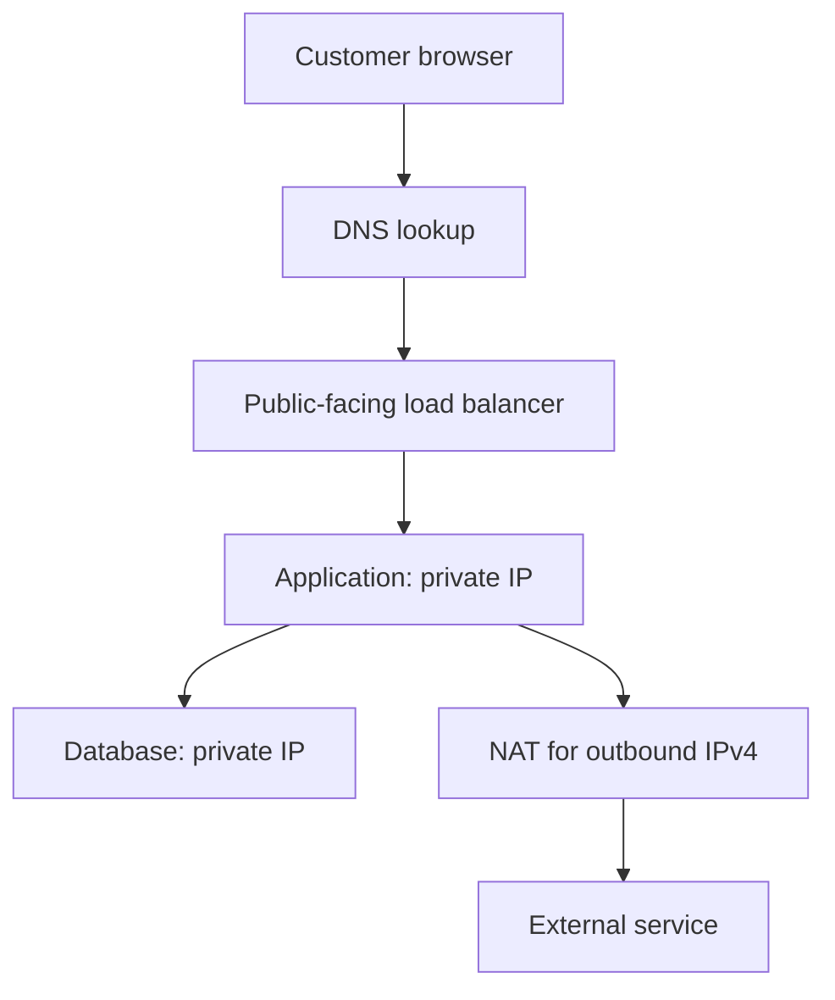
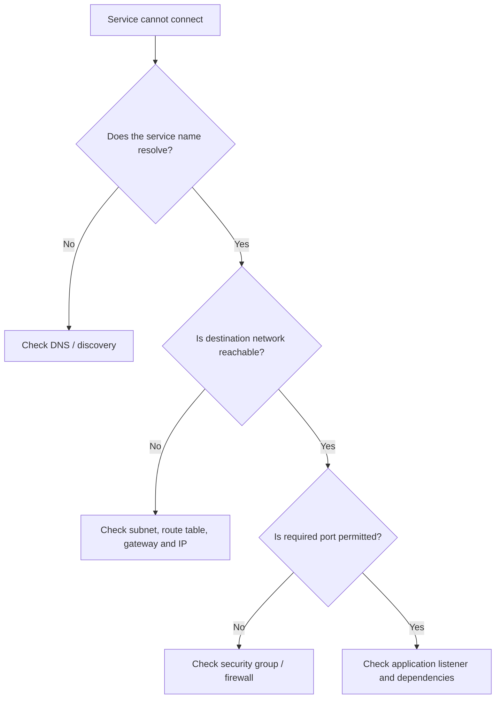

# IP Addressing Explained Simply — IPv4, IPv6, CIDR, Subnets and NAT

*Distributed Systems Study Library · Author: Jayesh Sharma*

**A practical networking chapter for beginners and system-design interviews, with original examples and Mermaid diagrams.**

> These notes independently explain the ideas in the user-provided IP-addressing transcript. Examples, diagrams, structure and wording are original. Supplementary details such as standard private IPv4 ranges, reserved-address calculations and IPv6 notation are added as clearly explained background rather than copied transcript text.

## Contents

1. [Why an IP address matters](#1-why-an-ip-address-matters)
2. [IP address vs MAC address](#2-ip-address-vs-mac-address)
3. [IPv4: four numbers, 32 bits](#3-ipv4-four-numbers-32-bits)
4. [Network part, host part and CIDR](#4-network-part-host-part-and-cidr)
5. [Subnetting with a realistic example](#5-subnetting-with-a-realistic-example)
6. [IP addresses inside a cloud VPC](#6-ip-addresses-inside-a-cloud-vpc)
7. [Public vs private IPv4 addresses](#7-public-vs-private-ipv4-addresses)
8. [How NAT works](#8-how-nat-works)
9. [Static vs dynamic IP addresses](#9-static-vs-dynamic-ip-addresses)
10. [DNS and service discovery](#10-dns-and-service-discovery)
11. [IPv6 made simple](#11-ipv6-made-simple)
12. [A complete request journey](#12-a-complete-request-journey)
13. [Common mistakes and troubleshooting](#13-common-mistakes-and-troubleshooting)
14. [Quick revision and interview questions](#14-quick-revision-and-interview-questions)

---

## 1. Why an IP address matters

Imagine ordering a parcel. A courier needs an address to decide where the parcel should travel.

On a network, **an IP address is an address assigned to a network interface**. It helps routers forward packets toward the correct destination. A packet normally includes a **source IP** and a **destination IP**.

For example, your browser can reach a web API, the API can contact another service, and that service can connect to a database using network addresses.


**Important:** An IP address is not necessarily a permanent identity for a whole computer. A machine can have multiple network interfaces, multiple addresses, and addresses that change when networking changes.

**Memory trick:** **IP = where to send the packet**, not **who owns the physical machine forever**.

---

## 2. IP address vs MAC address

IP and MAC addresses answer different questions.

| Question | IP address | MAC address |
|---|---|---|
| Primary purpose | Routing and addressing across IP networks | Addressing/forwarding on a particular local link |
| Typical OSI layer | Layer 3 — Network | Layer 2 — Data Link |
| Scope | Across networks through routers | Primarily within a local Ethernet/Wi-Fi link |
| Example | `192.168.1.10` | `02:00:5e:10:20:30` (illustrative) |

Imagine sending data from your laptop to an API server in another city:

- The **destination IP** identifies the remote network endpoint.
- The **next-hop MAC** helps deliver the frame across the current local link.
- After a router forwards the packet, a **new link-layer frame** is generally used for the next hop.



**Remember:** **MAC = local-hop delivery; IP = network-to-network routing.**

---

## 3. IPv4: four numbers, 32 bits

An **IPv4 address contains 32 bits**, normally displayed as **four decimal octets** separated by dots.

Example:

```text
192.168.1.10

192       168        1        10
8 bits  + 8 bits  + 8 bits  + 8 bits = 32 bits
```

Each octet ranges from **0 to 255**, because eight bits represent `2^8 = 256` distinct values.

### How many IPv4 addresses exist?

```text
2^32 = 4,294,967,296
     ≈ 4.29 billion possible IPv4 addresses
```

These are **all possible bit patterns**, not a count of publicly assignable addresses. Private, reserved and special-use blocks reduce the public pool.


The limited IPv4 space is one reason networks use **private addresses and NAT**, and why **IPv6** was introduced.

---

## 4. Network part, host part and CIDR

An IP address belongs to a **network prefix**. This prefix tells routers which addresses are grouped together.

**CIDR** stands for **Classless Inter-Domain Routing**. CIDR writes a network prefix length after a slash.

Example:

```text
192.168.1.10/24
            ^^
       first 24 bits = network prefix

IPv4 size = 32 bits
Host bits = 32 − 24 = 8 bits
Addresses in /24 = 2^8 = 256
```



### CIDR sizes you should remember

For IPv4, total block size is:

```text
Total addresses = 2^(32 − prefix length)
```

| CIDR prefix | Host bits | Total addresses |
|---|---:|---:|
| `/16` | 16 | 65,536 |
| `/24` | 8 | 256 |
| `/26` | 6 | 64 |
| `/28` | 4 | 16 |
| `/30` | 2 | 4 |
| `/32` | 0 | 1 |

**Important:** *Total addresses* does not necessarily mean *usable host addresses*. In an ordinary traditional IPv4 subnet, the network and broadcast addresses are typically unavailable for ordinary host assignment. Cloud providers may reserve additional IP addresses.

### A simple rule

**Larger slash number → fewer addresses.**

- `/16` is a large block.
- `/24` is smaller.
- `/28` is much smaller.

---

## 5. Subnetting with a realistic example

A **subnet** is a smaller address block carved out from a larger one.

Suppose your organization owns the private range `10.20.0.0/16` for its application environment. Instead of placing everything in a single large range, plan separate non-overlapping subnets.

| Purpose | Example subnet | Total addresses |
|---|---|---:|
| Public-facing components | `10.20.1.0/24` | 256 |
| Application servers | `10.20.2.0/24` | 256 |
| Databases | `10.20.3.0/24` | 256 |

These are three **illustrative /24 ranges** inside `10.20.0.0/16`.



### Why split into subnets?

- Organize different kinds of infrastructure.
- Assign different routes and access policies.
- Support future capacity growth and separate failure/administrative domains.
- Keep internet-facing resources separate from internal application and data tiers.

**Very important:** A subnet by itself is **not a firewall**. Route tables, security groups, network ACLs and other network policies determine actual reachability.

### Worked example: a /28

```text
Subnet: 192.168.10.0/28

Host bits = 32 − 28 = 4
Total addresses = 2^4 = 16

Address range:
192.168.10.0 through 192.168.10.15
```

In a conventional subnet, `.0` is the network address and `.15` is the broadcast address, so **14 ordinary host addresses** remain. Cloud subnet reservations can reduce that further.

---

## 6. IP addresses inside a cloud VPC

Cloud infrastructure often groups networking resources into a logically isolated virtual network, such as an **AWS Virtual Private Cloud (VPC)**.

Imagine an online store:

1. Internet users reach a public-facing regional load balancer.
2. The balancer sends requests to application instances using private addressing.
3. The application contacts a database in an internal subnet.
4. Internal servers may use a NAT gateway for outbound IPv4 internet access.



### Public vs private subnet in AWS terminology

- A **public subnet** has a route to an **Internet Gateway** in its route table.
- A **private subnet** does not provide that direct internet-gateway route for the relevant traffic.
- A private instance can often initiate outbound connections through a properly configured **NAT gateway**.

A load balancer, route table and appropriate security policies must all be configured correctly. Simply naming a subnet “private” is not enough.

**Planning tip:** Avoid overlapping address ranges if VPCs may later connect through peering, VPNs or shared routing infrastructure.

---

## 7. Public vs private IPv4 addresses

**Public IP:** An address suitable for routing on the public Internet, subject to actual allocation and routing policy.

**Private IPv4:** An address intended for internal networks. Internet routers do not globally route these private blocks as public destinations.

### Standard private IPv4 ranges

| Private CIDR block | Range |
|---|---|
| `10.0.0.0/8` | `10.0.0.0` – `10.255.255.255` |
| `172.16.0.0/12` | `172.16.0.0` – `172.31.255.255` |
| `192.168.0.0/16` | `192.168.0.0` – `192.168.255.255` |

Example:

```text
Browser → public-facing endpoint → app private IP → DB private IP
```



The app and DB are examples of **private addresses**, not publicly reachable server addresses.

**Important nuance:** Not every non-private address is usable as a public unicast address. Some IPv4 ranges have other special uses.

---

## 8. How NAT works

**NAT = Network Address Translation.**

It allows a network device to rewrite addressing information as packets cross a boundary. A common outbound IPv4 design uses **NAPT/PAT** (translation of IP addresses *and ports*) so many private clients can share one public address.

### Example: one public address shared by multiple servers

```text
App A: 10.20.2.10:51000
App B: 10.20.2.11:51000

NAT public address: 198.51.100.20 (illustrative)

Translated connections may be:
198.51.100.20:40001 → external API
198.51.100.20:40002 → external API
```

The NAT device tracks connection mappings so replies return to the correct private client.

```mermaid
sequenceDiagram
    participant A as Private App A
    participant N as NAT gateway
    participant X as External API
    A->>N: From 10.20.2.10:51000
    Note over N: Rewrite source to public IP and mapped port
    N->>X: From 198.51.100.20:40001
    X-->>N: Reply to 198.51.100.20:40001
    Note over N: Lookup mapping; restore private destination
    N-->>A: Reply delivered
```

**Why it is useful:** Private applications can access external APIs and software repositories without each needing its own public IPv4 address.

**Critical point:** NAT is **not itself a security policy**. Firewalls, security groups, access policies and correct network design still matter.

**Memory trick:** NAT = **translate the return address and remember the mapping**.

---

## 9. Static vs dynamic IP addresses

| Address type | Meaning | Typical use |
|---|---|---|
| **Static** | Intentionally kept stable until changed | Fixed ingress endpoint, allowlisted egress address |
| **Dynamic** | Allocated automatically and may change | Workstations, auto-scaled application instances |

**DHCP** often assigns dynamic addresses within networks. Cloud instances may also receive different addresses when they are replaced.

Suppose a partner API permits traffic only from approved outbound IP addresses. You might expose a stable **NAT egress IP**, rather than trying to allowlist every auto-scaled application instance.

Avoid hard-coding an instance's private address in service consumers.

---

## 10. DNS and service discovery

Most people type **names**, not addresses:

```text
api.example.com → DNS lookup → suitable endpoint IP
```

When the underlying service changes addresses, you can update the DNS record, and clients can learn the new address when they refresh their cached resolution.

Within a distributed system, **service discovery** helps applications find live service instances without manually tracking every server's changing IP.



**Why this matters:** Auto-scaled machines are replaceable, but clients need a **stable way to find the service**.

DNS caching means routing updates may take time to be observed. See [DNS Load Balancing](../../Load_Balancing/DNS_Load_Balancing.md) for details.

---

## 11. IPv6 made simple

IPv4 has **32-bit addresses**. IPv6 expands that to **128 bits**.

```text
IPv4: 192.168.1.10
IPv6: 2001:db8:0:0:0:0:0:1
```

IPv6 uses **hexadecimal groups** separated by colons. A consecutive run of zero groups can be compressed using `::`:

```text
2001:db8:0:0:0:0:0:1
             ↓
2001:db8::1
```

`2001:db8::/32` is reserved for documentation examples.

### Address-space difference

```text
IPv4 = 2^32  ≈ 4.29 × 10^9 addresses
IPv6 = 2^128 ≈ 3.4 × 10^38 addresses
```



IPv6 greatly reduces the **need for NAT as an address-conservation workaround**. It does not eliminate the need for security controls.

Modern systems frequently support **both IPv4 and IPv6** (dual-stack). Which one is used depends on the network and application configuration.

---

## 12. A complete request journey

Let's combine the concepts.

A user visits an online store. Its API servers have private addresses and the store is deployed in a cloud VPC.

### Inbound request

1. The user's browser resolves the public service name with DNS.
2. The browser connects to a public-facing load-balancing endpoint.
3. The load balancer selects an eligible app instance on a private address.
4. The application connects to a database on an internal address.

### Outbound request from an app

5. When the app calls an external API, the route may send its IPv4 traffic through a NAT gateway.
6. NAT rewrites the source address/port and tracks the reply mapping.
7. The response returns through NAT to the app.



**Key lesson:** DNS, IP routing, subnets, load balancers and NAT serve **different purposes**, but together make service-to-service communication possible.

---

## 13. Common mistakes and troubleshooting

| Mistake | Better understanding |
|---|---|
| “An IP address identifies a machine permanently.” | Addresses belong to interfaces and can change. |
| “A /24 always has 256 usable hosts.” | 256 total IPv4 addresses; ordinary host availability is usually lower. |
| “Everything in a private subnet is automatically secure.” | Policies and routes determine real access. |
| “NAT is the same as a firewall.” | NAT translates addresses; a firewall enforces access policy. |
| “A public IP always means an internet connection works.” | Routing, gateways and security rules must permit it. |
| “Use hard-coded IPs for microservices.” | Prefer DNS and service discovery for replaceable instances. |
| “IPv6 makes security unnecessary.” | Security controls remain essential. |

### Troubleshooting flow



This is a practical investigation guide. A failed connection can involve several networking layers.

---

## 14. Quick revision and interview questions

### Fast cheat sheet

| Concept | Remember |
|---|---|
| IP address | Network interface address used for IP routing |
| MAC address | Local link delivery identifier |
| IPv4 | 32 bits = four 8-bit octets |
| IPv6 | 128 bits, hexadecimal and colon notation |
| CIDR | Slash prefix length, e.g. `/24` |
| Subnet | Smaller piece of a larger address range |
| IPv4 block size | `2^(32 − prefix)` total addresses |
| Private ranges | `10/8`, `172.16/12`, `192.168/16` |
| NAT | Rewrite address and often source port |
| Static IP | Intentionally stable address |
| Dynamic IP | May be reassigned automatically |
| DNS | Resolve stable names to destinations |
| Service discovery | Locate changing service instances |
| VPC | Cloud virtual network boundary |

### Interview questions

1. What is an IP address and why doesn't it permanently identify a physical machine?
2. What is the difference between an IP address and a MAC address?
3. Why does an IPv4 octet range from 0 to 255?
4. How many total addresses are in a `/24`, `/28` or `/32` block?
5. Why is a `/28` subnet smaller than a `/24` subnet?
6. What is the purpose of subnetting application and database tiers?
7. Name the three standard private IPv4 address ranges.
8. Explain how multiple private servers share one public IP using NAT and ports.
9. Why is NAT not a replacement for firewall policy?
10. What is the difference between static and dynamic addressing?
11. Why do microservices use DNS and service discovery instead of hard-coded IPs?
12. What problem does IPv6 primarily help address?

### Short interview answer

An IP address identifies an interface for packet routing across networks. IPv4 uses 32-bit addresses and IPv6 uses 128-bit addresses. CIDR specifies the network prefix, which helps with routing and subnetting. Private IPv4 networks commonly use NAT for outbound Internet connectivity; public endpoints, routing policies, DNS and service discovery help dynamically changing distributed services communicate.

**Final takeaway:** **IP tells the network where a packet should go; CIDR and subnets organize addresses; NAT helps private IPv4 services communicate outward; DNS and service discovery let callers find services even when underlying IPs change.**

---

*Source basis: user-supplied IP-addressing transcript. These notes use original prose, arithmetic examples and Mermaid diagrams, with clearly distinguished supplementary networking fundamentals.*
