# OSI Model — All 7 Layers Explained Simply

*Distributed Systems Study Library · Author: Jayesh Sharma*

**From a browser request to electrical signals: networking explained with examples, diagrams, and troubleshooting tips.**


## Contents

1. [What is the OSI model?](#1-what-is-the-osi-model)
2. [The seven layers at a glance](#2-the-seven-layers-at-a-glance)
3. [Layer 1: Physical](#3-layer-1-physical)
4. [Layer 2: Data Link](#4-layer-2-data-link)
5. [Layer 3: Network](#5-layer-3-network)
6. [Layer 4: Transport](#6-layer-4-transport)
7. [Layer 5: Session](#7-layer-5-session)
8. [Layer 6: Presentation](#8-layer-6-presentation)
9. [Layer 7: Application](#9-layer-7-application)
10. [Encapsulation and decapsulation](#10-encapsulation-and-decapsulation)
11. [A complete HTTPS request, step by step](#11-a-complete-https-request-step-by-step)
12. [OSI versus TCP/IP](#12-osi-versus-tcpip)
13. [Troubleshooting with the layers](#13-troubleshooting-with-the-layers)
14. [Cheat sheet and interview questions](#14-cheat-sheet-and-interview-questions)

---

## 1. What is the OSI model?

Imagine sending a parcel. You write the message, put it in an envelope, add an address, hand it to a delivery service, and the recipient opens it. Network communication also involves multiple responsibilities.

The **Open Systems Interconnection (OSI) model** divides communication into **seven conceptual layers**. Each layer explains one kind of work, helping us understand how data travels and where problems might occur.

When you open a website, software may prepare an HTTP request, secure it using TLS, carry it over TCP and IP, and transmit it over Wi-Fi or Ethernet.

**Simple idea:** Upper layers deal more with application meaning; lower layers deal more with delivering data.

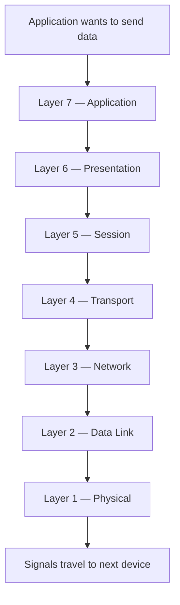

**Remember:** The OSI model is a *learning framework*, not a requirement that every Internet protocol exists as a separate seven-layer component.

---

## 2. The seven layers at a glance

| No. | Layer | Main job | Familiar example |
|---:|---|---|---|
| **7** | Application | Defines application-to-application messages | HTTP, DNS |
| **6** | Presentation | Represents and transforms data | Encoding, serialization, encryption concepts |
| **5** | Session | Manages a communication session | Establish, manage, close conversation |
| **4** | Transport | Delivers data to the right communicating endpoint | TCP, UDP, ports |
| **3** | Network | Routes packets between networks | IP, routers |
| **2** | Data Link | Delivers frames on a local network link | Ethernet, Wi-Fi MAC, switches |
| **1** | Physical | Transmits signals/bits | Copper, fiber, radio |

### Easy memory trick

Top to bottom: **All People Seem To Need Data Processing**.

```text
A — Application        (7)
P — Presentation       (6)
S — Session            (5)
T — Transport          (4)
N — Network            (3)
D — Data Link          (2)
P — Physical           (1)
```

For system design, the layers most often discussed directly are **7, 4, and 3**. The other layers still matter.

---

## 3. Layer 1: Physical

### What does it do?

**Layer 1 moves raw bits as physical signals.**

Examples:

- Electrical pulses through copper cable
- Light through optical fiber
- Radio transmission over Wi-Fi

**Analogy:** This is the road or track that makes movement possible.

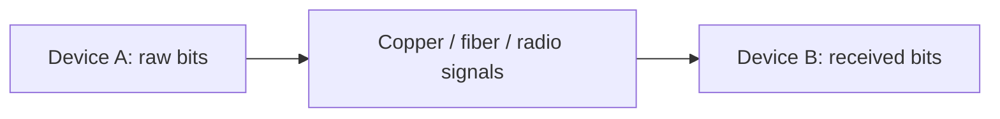

**What to check if it breaks:** Cable unplugged, weak radio signal, failed physical interface or optical link.

The Physical layer does not interpret an HTTP request or decide which remote server owns an IP address.

---

## 4. Layer 2: Data Link

### What does it do?

Layer 2 handles communication across a **local link or local network segment**.

Its important concepts include:

- **Frames:** Units of link-layer data
- **MAC addresses:** Link-layer device/interface identifiers used by Ethernet and Wi-Fi
- **Switching:** Forwarding frames to the correct local destination

### Example: laptop to home router

Your laptop can send a frame over Wi-Fi to its local gateway. An Ethernet switch uses learned MAC-address-to-port information to direct frames on a local network.

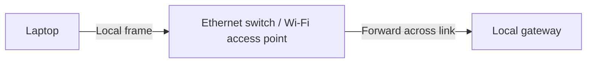

**Memory trick:** **L2 = Local delivery**.

An IP packet can cross many routers, but its **Layer 2 frame may change at every hop**.

---

## 5. Layer 3: Network

### What does it do?

Layer 3 moves **packets across different networks**.

- **IP address:** Identifies an IP endpoint/interface and helps route toward the destination.
- **Router:** Examines destination IP information to choose the next hop.
- **IP packet:** Network-layer unit carrying higher-layer data.

### Example: India to another region

Your laptop may be connected to one network while the API server is on another continent. Routers forward IP packets between networks toward the server.

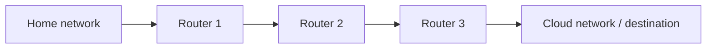

**Memory trick:** **L2 = move across a local link; L3 = move across networks**.

Routers use IP routing. They generally do not need to understand your website's URL path.

---

## 6. Layer 4: Transport

### What does it do?

Layer 4 manages communication between software endpoints using **transport protocols and ports**.

### TCP versus UDP

| Question | TCP | UDP |
|---|---|---|
| Connection setup? | Connection-oriented | Connectionless |
| Delivery and ordering? | Provides a reliable ordered byte stream while connection survives | No built-in delivery or ordering guarantee |
| Retransmissions? | Yes, when needed | Not by the UDP protocol itself |
| Typical application fit | HTTPS over TCP, many APIs and databases | Real-time media, DNS transport, QUIC underneath HTTP/3 |

**Practical nuance:** Applications built over UDP can implement their *own* reliability. QUIC is a well-known example, so “UDP = never reliable” is incorrect.

### What is a port?

Think of an **IP address as the building address** and a **port as the particular room or office**.

```text
Destination IP:   203.0.113.10   (illustrative address)
Destination port: 443            (HTTPS service)
```

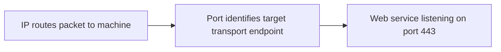

**Memory trick:** **L3 finds the machine; L4 finds the service endpoint**.

---

## 7. Layer 5: Session

Layer 5 conceptually manages **creating, maintaining and ending communication sessions**.

Analogy: A conversation has a beginning, a period of interaction, and an ending.

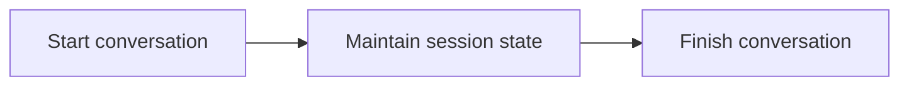

**Modern-stack nuance:** Many session responsibilities are implemented in applications, frameworks or protocols rather than in a separately identifiable “OSI Layer 5 protocol.”

Don't confuse the conceptual OSI session layer with an HTTP login session cookie: they are related only at a high conceptual level, not the same standardized mechanism.

---

## 8. Layer 6: Presentation

This layer explains **how data is represented and transformed**.

Typical conceptual responsibilities:

- Character encoding (for example, UTF-8)
- Serialization (for example, JSON)
- Compression and decompression
- Encryption and decryption

### Example

A user profile object may be serialized to JSON text; a secure protocol may encrypt the bytes for transport.

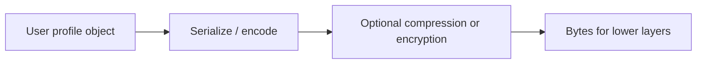

**Important:** TLS and JSON are not always implemented as a separate OSI Layer 6 component. In real systems, these jobs often sit within the broader application/protocol stack.

**Memory trick:** **Presentation = how information is formatted**.

---

## 9. Layer 7: Application

Layer 7 defines **application-level communication**: what the message says, which operation is requested, and how the other service interprets it.

Familiar protocols and technologies:

- **HTTP/HTTPS:** Web/API communication; HTTPS means HTTP protected by TLS
- **DNS:** Name resolution
- **WebSocket:** Full-duplex application communication after its handshake
- **gRPC:** An RPC framework, commonly using HTTP/2
- **API gateways, reverse proxies and HTTP-aware load balancers:** Interpret and route application requests

### Example: routing by path

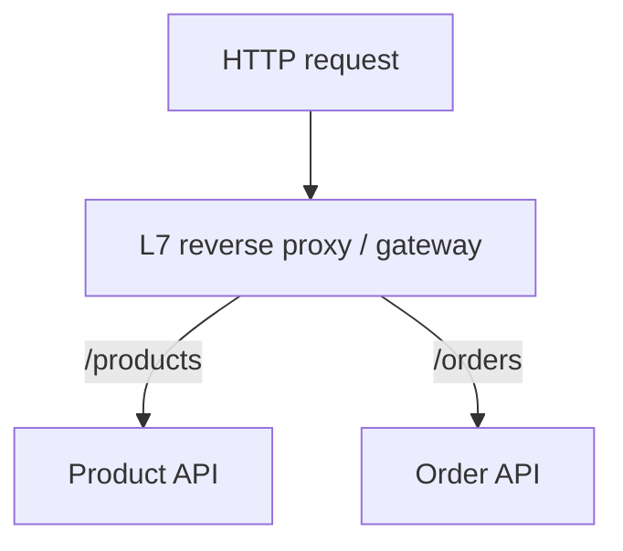

Compare this with **Layer 4 load balancing**, which can distribute TCP/UDP flows using transport/network metadata without needing to interpret HTTP paths.

**Memory trick:** **L7 = what the application means**.

---

## 10. Encapsulation and decapsulation

**Encapsulation** means each sending-side layer supplies information needed by the layers below.

Think of putting a letter into a sequence of labeled envelopes.

For a simplified **HTTP over TCP over IP over Ethernet** path:

```text
HTTP message
    ↓ add TCP information
TCP segment
    ↓ add IP information
IP packet
    ↓ add Ethernet information
Ethernet frame
    ↓ encode as physical signals
Bits on the link
```

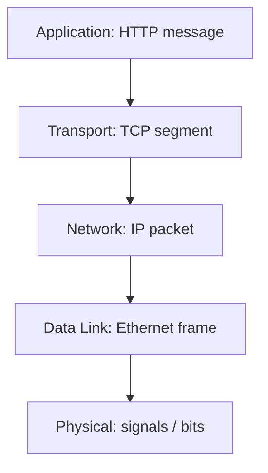

On reception, the process reverses: **signals → frame → packet → transport stream → application message**.

Not all protocols use TCP/Ethernet. For example, HTTP/3 uses QUIC over UDP. The above is one deliberately simple example.

### Important detail about routers

At every network link, the **Layer 2 frame may be replaced** with another frame suitable for that link. The IP packet is generally forwarded toward its destination (possibly with routing-related header changes).

---

## 11. A complete HTTPS request, step by step

Suppose a browser wants to request `https://api.example.com/products`.

This walkthrough assumes **HTTPS using HTTP over TCP**, rather than HTTP/3 over QUIC.

### Step A: resolve the name

The browser or OS obtains the IP address for `api.example.com`, often using DNS and possibly a cached answer.

### Step B: establish the connection

The browser opens a TCP connection to the destination, commonly using port **443**, and negotiates TLS before transmitting protected HTTP data.

### Step C: send the request

The HTTP request is carried as encrypted application data within TCP. It is represented in IP packets and appropriate link-layer frames.

### Step D: route across the network

Routers forward packets toward the destination. Each hop uses the relevant local link technology.

### Step E: process the request

The receiving stack handles the incoming link signals, frames, IP packets, TCP data and TLS decryption. The application eventually handles an HTTP request and creates its response.

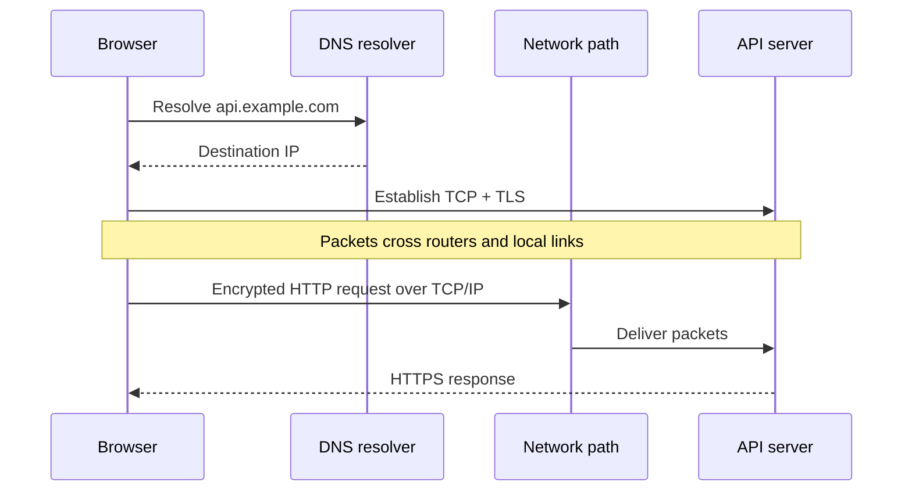

### What changes when you cross a router?

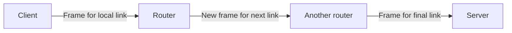

**Remember the route:** **DNS → TCP → TLS → HTTP** is a useful *simplified connection preparation* sequence for this particular HTTPS-over-TCP scenario. DNS may be cached, and transport alternatives exist.

---

## 12. OSI versus TCP/IP

Real Internet systems are commonly described with the **TCP/IP model**, which groups some of the seven OSI responsibilities.

| OSI model | Approximate TCP/IP model group |
|---|---|
| 7 Application | Application |
| 6 Presentation | Application |
| 5 Session | Application |
| 4 Transport | Transport |
| 3 Network | Internet |
| 2 Data Link | Link / Network Access |
| 1 Physical | Link / Network Access |

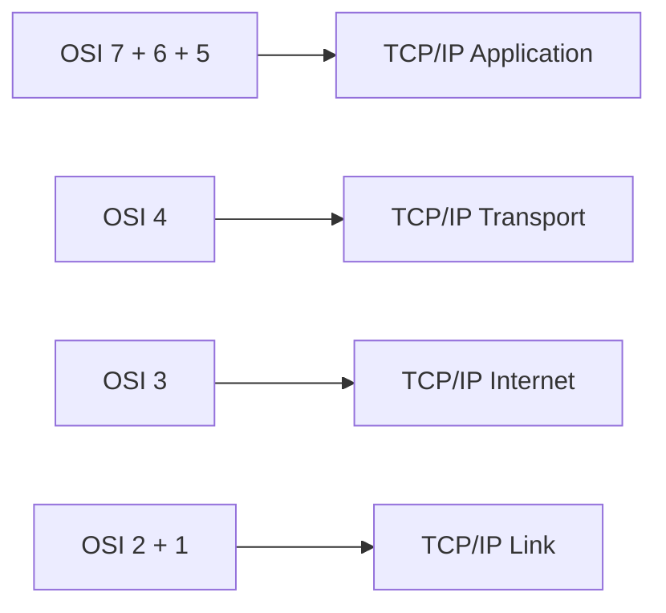

The mapping is approximate: TCP/IP model variants have four or five layers, and individual protocols do not always line up neatly with the OSI boxes.

**When to use which mental model?**

- **OSI:** Understanding responsibilities and diagnosing problems by layer.
- **TCP/IP:** Describing practical Internet protocols and their implementation.

---

## 13. Troubleshooting with the layers

When something fails, use the layer model to narrow the investigation.

| Symptom | Useful area to investigate | Examples to check |
|---|---|---|
| No physical network connection | L1 | Cable, link, radio signal |
| Local frame forwarding fails | L2 | MAC learning, switching, local link |
| Remote network unreachable | L3 | IP configuration, routing, subnet |
| TCP connection cannot open | L4 (and possibly L3) | Port, transport connectivity, firewall |
| HTTPS handshake fails | TLS / representation/security layer concerns | Certificates, TLS versions, endpoint config |
| Hostname will not resolve | L7 DNS service | Resolver, authoritative records, DNS connectivity |
| Request reaches wrong backend | L7 proxy/gateway | Host/path routing rules |
| Application returns 500 | Application/service behavior | Logs, dependencies, application exceptions |

### Example troubleshooting path

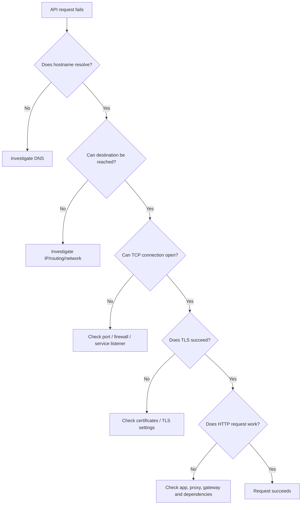

**Engineering caveat:** This is a diagnostic sequence, not proof that every failure belongs to one precise layer. DNS, firewalls, load balancers and application configuration can interact.

---

## 14. Cheat sheet and interview questions

### Fast revision

| Layer | Question to remember | Unit / identifier |
|---|---|---|
| 7 Application | **What does the request mean?** | HTTP message, domain name |
| 6 Presentation | **How is data represented?** | Encoded/serialized bytes |
| 5 Session | **How is the conversation managed?** | Session context |
| 4 Transport | **Which service endpoint?** | TCP/UDP ports, segments/datagrams |
| 3 Network | **Which destination across networks?** | IP address, packets |
| 2 Data Link | **Which next device on this link?** | MAC, frames |
| 1 Physical | **How are signals transmitted?** | Bits / signals |

### Interview questions

1. Why does the OSI model divide networking into layers?
2. Explain the difference between a MAC address and an IP address.
3. What are the basic responsibilities of a switch and a router?
4. How do TCP and UDP differ?
5. Why do computers need ports if they already have IP addresses?
6. How do the Session and Presentation layers appear in modern applications?
7. Which OSI layer is HTTP associated with?
8. Why is an application-aware load balancer called Layer 7?
9. Walk through the encapsulation of an HTTP request.
10. What changes at Layer 2 as packets move between routers?
11. Why is the OSI model not an exact diagram of the Internet stack?
12. How would you narrow down a DNS, TCP, TLS or HTTP failure?

### Short interview answer

The OSI model is a conceptual framework that splits network communication into seven responsibilities: Physical, Data Link, Network, Transport, Session, Presentation and Application. It helps explain the flow from application messages down to transmitted bits and back up at the receiver. In production, the TCP/IP stack combines several of these responsibilities, but OSI remains useful for design discussions and troubleshooting.

**Final takeaway:** **Layer 1 carries bits; Layer 2 handles local frames; Layer 3 routes across networks; Layer 4 delivers to the right endpoint; Layers 5 and 6 describe sessions and data representation; Layer 7 handles application-level meaning.**

---
