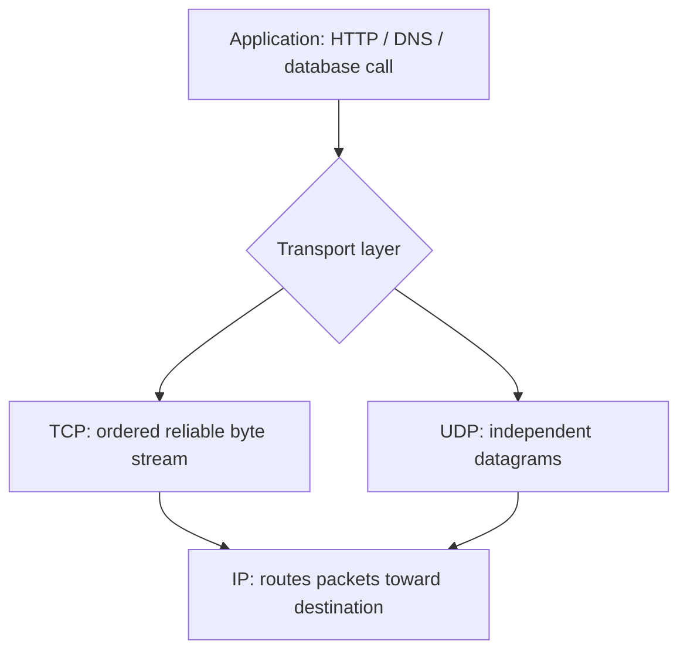
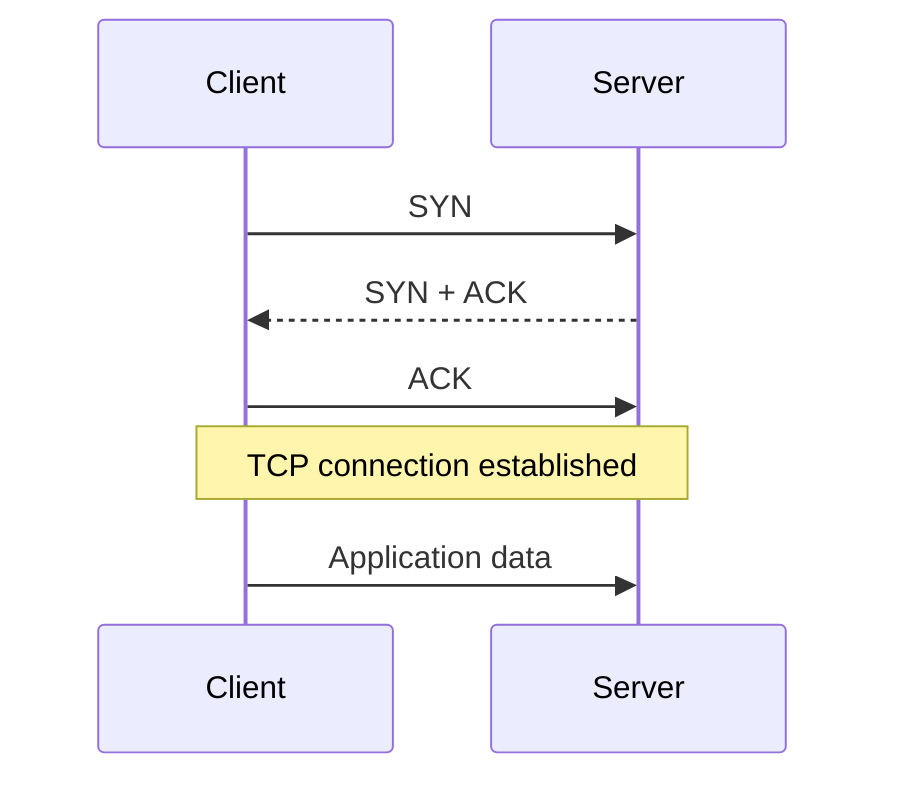
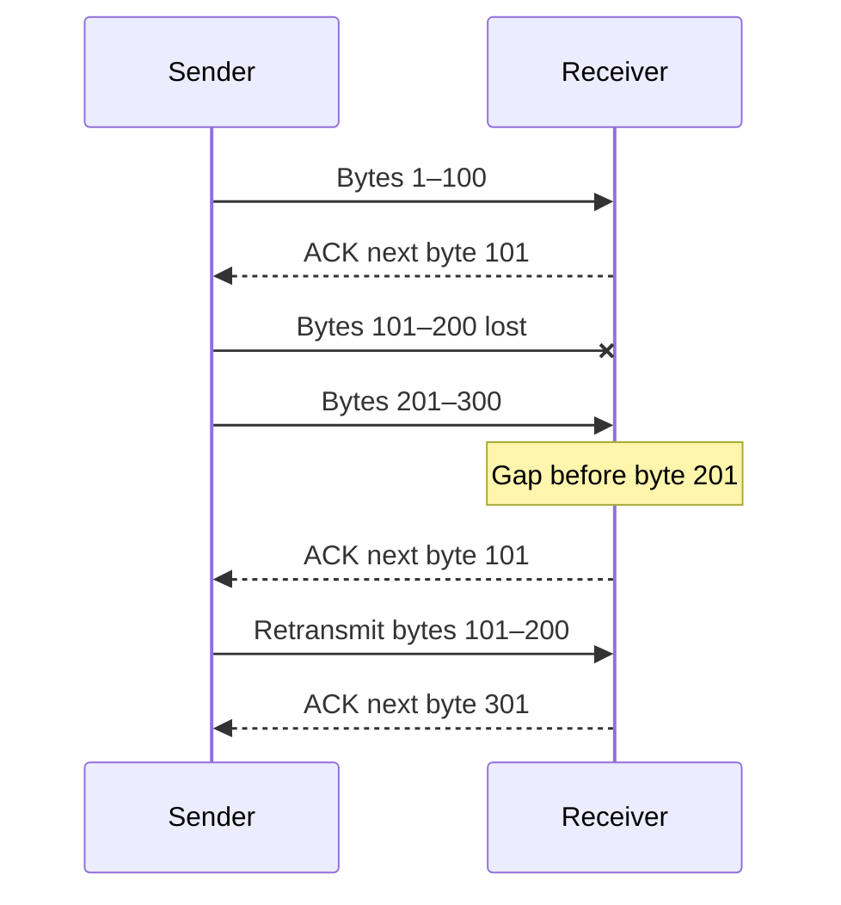
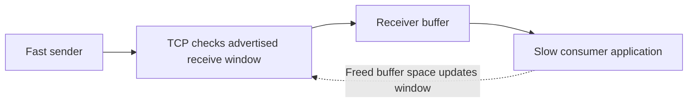
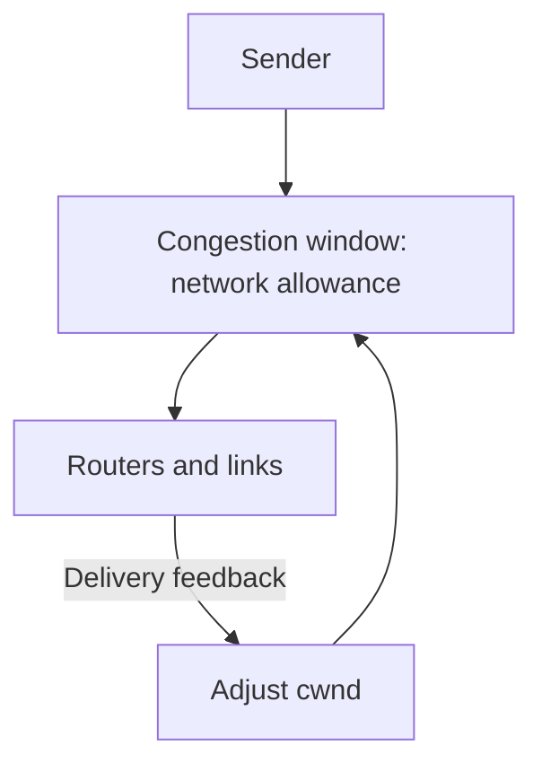
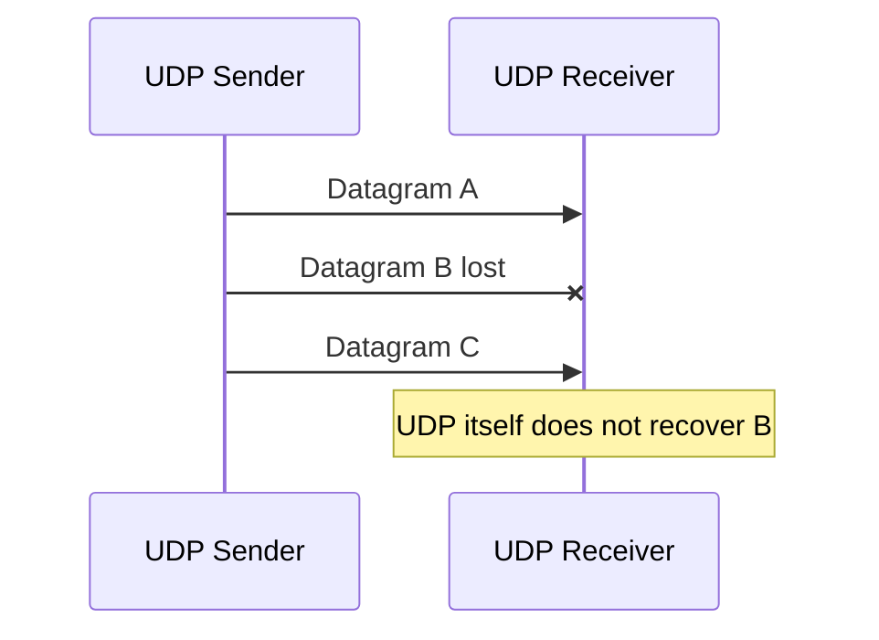
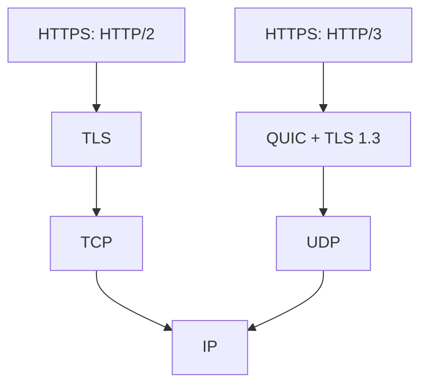
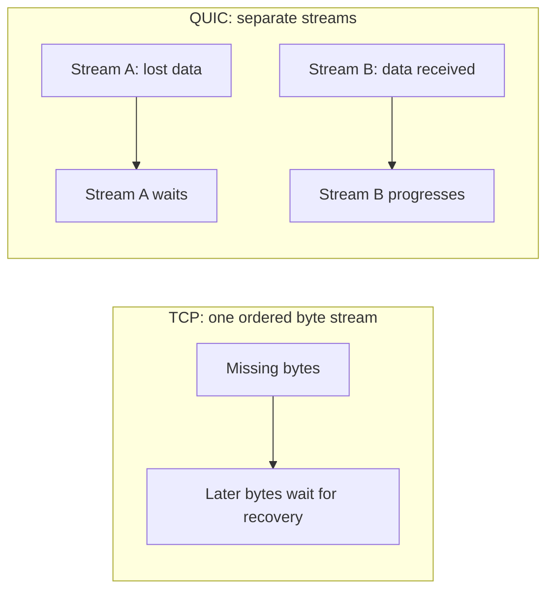
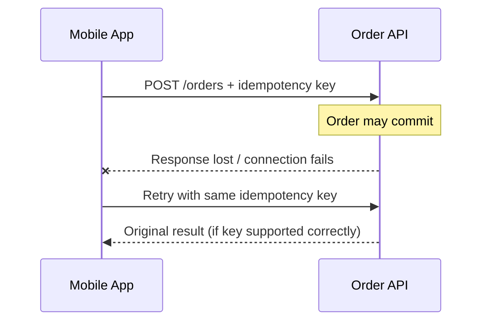

# TCP vs UDP — Explained Simply with Diagrams

*Distributed Systems Study Library · Author: Jayesh Sharma*

**An easy-to-follow guide to reliable transport, latency, handshakes, acknowledgments, flow control, congestion control, QUIC and HTTP/3.**

> Source basis: user-provided TCP/UDP video transcript. The writing, examples, tables and Mermaid diagrams are original interpretations of its concepts. The API idempotency example and selected technical clarifications are additional educational context.

## Contents

- [1. Where TCP and UDP fit in networking](#1-where-tcp-and-udp-fit-in-networking)
- [2. TCP: reliable communication](#2-tcp-reliable-communication)
- [3. TCP three-way handshake](#3-tcp-three-way-handshake)
- [4. Sequence numbers, ACKs and retransmission](#4-sequence-numbers-acks-and-retransmission)
- [5. Flow control: protect the receiver](#5-flow-control-protect-the-receiver)
- [6. Congestion control: protect the network](#6-congestion-control-protect-the-network)
- [7. UDP: small, independent messages](#7-udp-small-independent-messages)
- [8. Choosing reliability versus timeliness](#8-choosing-reliability-versus-timeliness)
- [9. Reliability can be built above UDP](#9-reliability-can-be-built-above-udp)
- [10. QUIC and HTTP/3](#10-quic-and-http3)
- [11. A concrete API example](#11-a-concrete-api-example)
- [12. TCP vs UDP comparison](#12-tcp-vs-udp-comparison)
- [13. Interview questions and revision cheat sheet](#13-interview-questions-and-revision-cheat-sheet)

---

## 1. Where TCP and UDP fit in networking

When you order a parcel, the street address identifies the building while an apartment number identifies the recipient inside it. In networking, an **IP address helps route a packet to a destination interface**, while a **transport port helps deliver it to the right application endpoint**.

TCP and UDP both sit in the **transport layer (OSI Layer 4)**. The main difference is the behavior they promise.

| Layer | Role | Examples |
|---|---|---|
| Application (L7) | What the software asks for | HTTP, DNS, database protocols |
| Transport (L4) | Communication between endpoints | TCP, UDP; ports |
| Network (L3) | Routing between networks | IPv4, IPv6 |



A web server may use TCP port 443 while another application listens on a different port. Both protocols use **source and destination ports**. An IP address alone does not distinguish all applications on the same host.

---

## 2. TCP: reliable communication

**TCP (Transmission Control Protocol)** establishes a connection and exposes a **reliable, ordered stream of bytes** to applications.

Think of sending a long document in several numbered packages. The receiver must rebuild the exact document, even if network packets are delayed or lost. TCP provides sequence tracking, acknowledgments and retransmission to support that behavior.

TCP does not preserve the boundaries of individual application writes: if you send two messages, an application still needs **framing**, such as a length prefix or delimiter, to tell them apart.

TCP handles routine network loss while a connection remains viable. It cannot guarantee that data eventually arrives if connectivity permanently fails: applications must still handle timeouts, connection errors and uncertain outcomes.

---

## 3. TCP three-way handshake

Before ordinary application data flows on a newly established TCP connection, the endpoints exchange three messages:

1. **SYN:** The client proposes a connection and an initial sequence number.
2. **SYN–ACK:** The server acknowledges and supplies its own initial sequence number.
3. **ACK:** The client acknowledges the server's proposal.



**Why the extra steps?** Both parties synchronize connection state. The trade-off is setup latency. Opening a fresh TCP connection typically needs **one network round-trip time (RTT)** for the handshake before normal client data exchange; secure HTTPS over TCP also uses TLS negotiation.

**Interview cue:** SYN → SYN–ACK → ACK.

---

## 4. Sequence numbers, ACKs and retransmission

TCP tracks **byte positions**, not application message numbers. When a receiver acknowledges data, it communicates which bytes have arrived in sequence. A missing span can trigger retransmission.

For an easy analogy, pretend the sender transfers three numbered byte ranges. Range 2 is lost; range 3 may physically arrive first. TCP can retain out-of-order bytes and give the application the missing portion in the correct sequence once recovered.



This is **illustrative**, not a specification of retransmission triggers. Real TCP uses byte sequence numbers, cumulative acknowledgments and may use duplicate ACKs, timeouts, selective acknowledgments and other mechanisms.

**Remember:** TCP makes the application see bytes **in order**, even when packets are not delivered in order.

---

## 5. Flow control: protect the receiver

A fast sender could overwhelm a slow receiver. **Flow control** addresses this problem.

The receiving side advertises a **receive window (rwnd)** representing buffer capacity available for incoming data. The sender limits outstanding bytes accordingly.



Example: if the receiver currently advertises room for **16 KiB**, the sender cannot exceed that limit for data in flight *as measured by the receive-window rules*, even if the network itself is fast.

**Memory trick:** Flow control asks, **“Can the receiver keep up?”**

---

## 6. Congestion control: protect the network

The receiver might have spare memory while the network path is overloaded. Routers have finite bandwidth and queues; congestion can create delay and dropped packets.

**Congestion control** responds to signals about network capacity. TCP maintains a congestion window (**cwnd**) and adapts it using an algorithm. Modern algorithms differ; loss, latency and explicit congestion signals may all matter depending on implementation.



A useful simplified upper bound for outstanding data is:

```text
Permitted in-flight bytes ≈ min(receive window, congestion window)
```

| Mechanism | What is it protecting? | Main signal |
|---|---|---|
| Flow control | Receiving application/buffer | Advertised receive window |
| Congestion control | Shared network path | Congestion feedback / algorithm |

**Memory trick:** Flow = **receiver capacity**. Congestion = **network capacity**.

---

## 7. UDP: small, independent messages

**UDP (User Datagram Protocol)** is a connectionless transport protocol. The sender can send a datagram without a UDP handshake.

UDP by itself does **not** provide:

- Guaranteed delivery
- In-order delivery
- Automatic retransmission
- TCP-style congestion or flow control



Unlike a TCP byte stream, UDP **preserves datagram boundaries** for successfully received messages.

**Do not confuse “UDP is lightweight” with “UDP is always faster.”** Latency depends on packet loss, application behavior, network configuration, message size and the protocol built above UDP.

---

## 8. Choosing reliability versus timeliness

Imagine a live voice call. A missing **20 ms audio chunk** may be less harmful than stopping the call to wait for a late chunk. The application can conceal a small glitch and continue playing newer audio.

Now imagine sending a bank statement or a ZIP file. Incorrect or missing bytes are unacceptable. An ordered, reliable transfer is usually desirable.

| Workload | What matters most? | Common transport direction |
|---|---|---|
| Web pages and many REST APIs | Correct complete byte stream | TCP (HTTP/1.1, HTTP/2) |
| Database connections | Correct ordered exchanges | Often TCP |
| File transfer | Reliable bytes | Often TCP |
| Live voice or interactive gaming | Timely updates, tolerable occasional loss | Often UDP plus application-level controls |
| Modern HTTP/3 | Reliable independent streams and secure connection | QUIC over UDP |

These are **typical patterns**, not universal rules. A real-time app may retransmit critical messages over UDP; some systems deliberately discard stale updates.

**Memory trick:** If old information quickly becomes useless, **timeliness can matter more than recovery of every packet**.

---

## 9. Reliability can be built above UDP

“UDP has no reliability” means **the UDP transport does not supply those guarantees**, not that an application cannot build them.

For example, an application protocol may implement:

- Message IDs and acknowledgments
- Retransmission of important messages
- Duplicate detection
- Reordering of messages
- Congestion controls suited to its workloads

This extra freedom is useful, but implementing correctness and security is complex. Established higher-level protocols are usually preferable to inventing custom reliability from scratch.

---

## 10. QUIC and HTTP/3

**QUIC** is a modern secure transport protocol built over UDP. It adds reliable data delivery, loss recovery, congestion control and **multiple independent streams**, with TLS 1.3 integrated into its connection setup.

**HTTP/3 uses QUIC**; by contrast, HTTP/1.1 and HTTP/2 commonly run over TCP with TLS for HTTPS.



### Why QUIC can reduce setup time

Instead of separate TCP setup followed by conventional TLS setup, QUIC combines transport and security negotiation. For a **new connection**, QUIC can often begin application data after **one RTT**; **0-RTT** resumption may be possible with safeguards and replay considerations. Actual timing depends on conditions and configuration.

### Independent streams and head-of-line blocking

TCP exposes **one ordered byte stream**. Missing bytes can delay later bytes being passed to the application on that connection.

QUIC can carry **several independently ordered streams**. When packets needed by one stream go missing, another stream can often progress with its own available data. Packet loss still matters to congestion control and available bandwidth.



**Important:** QUIC uses UDP, but **QUIC itself is reliable** where its stream guarantees apply. UDP alone does not automatically provide QUIC's guarantees.

---

## 11. A concrete API example

Suppose a mobile shopping app calls an order service.

1. The app resolves the service name to an IP address.
2. It connects to the chosen endpoint.
3. For an HTTP/2 API it normally uses a secure TCP connection.
4. TCP handles ordering and routine loss recovery while the app processes the request and response.
5. If the client times out after sending an order, it **must not assume the server did nothing**.



**System-design lesson:** Even TCP reliability does not give application-level *exactly-once business execution*. Use idempotency keys or deduplication for operations where retrying could duplicate an effect.

This is additional application-level context beyond the transcript's core transport discussion.

---

## 12. TCP vs UDP comparison

| Feature | TCP | UDP |
|---|---|---|
| Transport layer | L4 | L4 |
| Communication model | Connection-oriented | Connectionless |
| Data view | Ordered byte stream | Distinct datagrams |
| Handshake | Three-way TCP handshake | No UDP handshake |
| Built-in delivery recovery | Yes, while connection remains viable | No |
| Built-in ordering | Yes | No |
| Flow control | Yes, receive window | No TCP-style mechanism |
| Congestion control | Yes | Not in UDP itself |
| Protocol header (without options) | Typically 20 bytes | 8 bytes |
| Common use | Web, databases, file transfers | Voice, games, QUIC/HTTP3 transport |

**Technical note:** Smaller UDP headers do not imply overall application traffic always uses fewer bytes: a higher-level reliable UDP-based transport adds its own control and security overhead.

---

## 13. Interview questions and revision cheat sheet

### Common interview questions

1. Which OSI layer contains TCP and UDP?
2. What role do ports serve compared with IP addresses?
3. Explain SYN, SYN–ACK and ACK.
4. How do sequence numbers and acknowledgments help TCP?
5. How does TCP deliver bytes in order when packets arrive out of order?
6. What is the difference between flow control and congestion control?
7. What guarantees does raw UDP *not* provide?
8. Why may late retransmissions be undesirable in a voice call?
9. Can a reliable protocol run over UDP? Give an example.
10. Why does HTTP/3 use QUIC?
11. How does QUIC reduce stream-level head-of-line blocking?
12. Does TCP prevent two duplicate payment requests? Why not?

### Quick revision

| Phrase | Meaning |
|---|---|
| TCP | **Connect, acknowledge, order, retry** |
| UDP | **Send datagram; application decides what to recover** |
| SYN → SYN–ACK → ACK | TCP handshake |
| Sequence number | Position within TCP byte stream |
| ACK | Receiver's progress feedback |
| Receive window | Receiver-side flow control |
| Congestion window | Network-side congestion control |
| QUIC | Secure multipath-capable UDP-based transport with independent reliable streams |
| HTTP/3 | HTTP over QUIC |

### Short interview answer

**TCP** provides connection-oriented, reliable, in-order byte-stream communication with acknowledgments, retransmissions, flow control and congestion control. **UDP** sends independent datagrams without those guarantees, so applications can prioritize timeliness or implement their own recovery. **QUIC**, used by HTTP/3, builds secure, reliable multi-stream transport above UDP to combine low-latency setup with strong transport features.

**Final takeaway:** Choose a **transport or higher-level protocol based on the application's correctness and latency needs**, not the oversimplified slogan that TCP is “slow” and UDP is “fast”.

---
