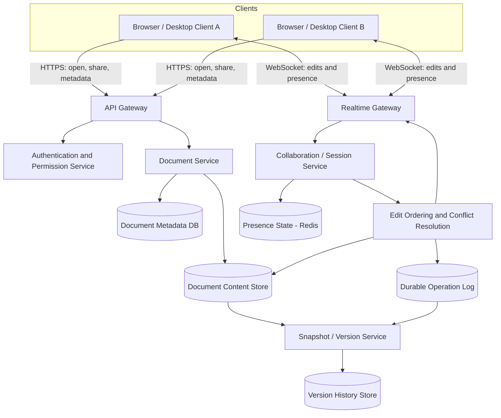
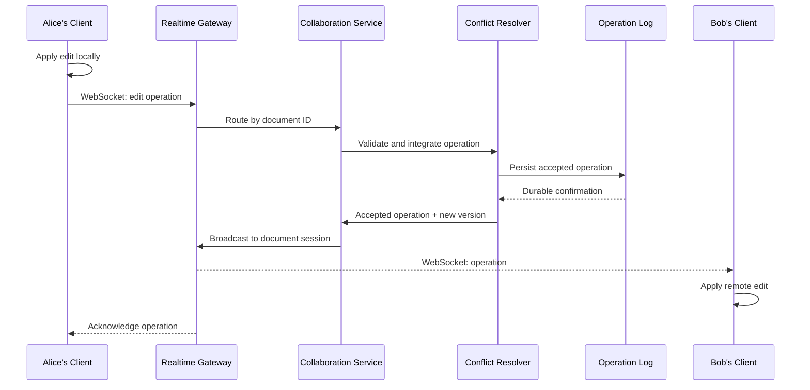
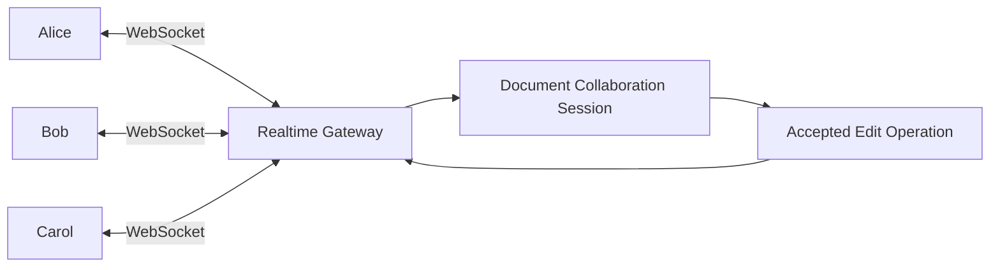
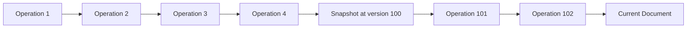
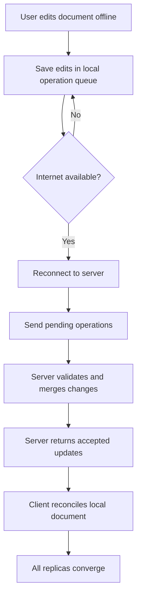
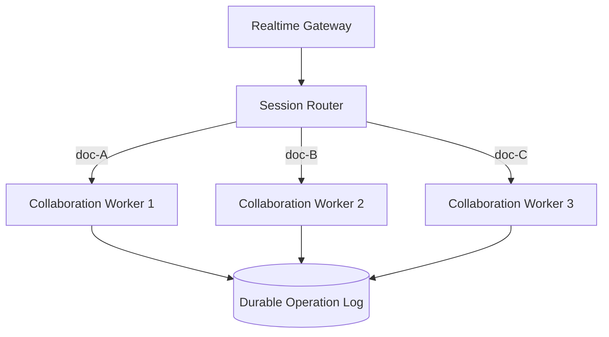

# Design Google Docs — Explained Simply


## 1. What are we building?

Think of Google Docs as a shared notebook on the internet.

- You create a document and save it in the cloud.
- You share it with other people.
- Several people can type in the same document at the same time.
- Everyone sees other people's edits shortly after they happen.
- Changes are saved automatically.
- You can see who is online, where their cursor is, and what changed earlier.
- You can work offline and synchronize changes when you reconnect.

The difficult part is not displaying text. The difficult part is making sure that simultaneous edits do not overwrite one another and that every collaborator eventually sees the same document.

## 2. Requirements

### Functional requirements

1. Create, open, rename, and delete documents.
2. Edit text and rich formatting such as headings, bold, italic, links, and lists.
3. Allow multiple people to edit one document simultaneously.
4. Show collaborators, their cursor positions, and selections.
5. Share documents with viewer, commenter, or editor permissions.
6. Add comments and resolve comment threads.
7. Save changes automatically and keep version history.
8. Support offline editing and synchronization after reconnecting.

### Non-functional requirements

- **Low latency:** edits should appear to collaborators quickly.
- **Consistency:** collaborators must converge on the same document state.
- **Durability:** acknowledged edits must not disappear after a server failure.
- **Availability:** users should be able to open and work on documents despite individual component failures.
- **Scalability:** support many users and many active documents.
- **Security:** only authorized people can read or modify a document.

For an interview, state the most important requirement clearly: **real-time collaborative editing without losing concurrent changes.**

## 3. High-level architecture

Start with a simple architecture. Add complexity only when the requirements demand it.



### What does each component do?

| Component | Responsibility |
|---|---|
| Browser / desktop client | Displays the document, captures edits, and applies incoming changes |
| API Gateway | Entry point for normal HTTP requests; handles routing and common checks |
| Authentication service | Identifies the user |
| Permission service | Checks whether the user can view, comment, or edit a document |
| Document service | Creates documents and loads metadata/content |
| Realtime gateway | Maintains WebSocket connections for live collaboration |
| Collaboration service | Tracks active editing sessions and distributes operations |
| Conflict-resolution engine | Ensures concurrent edits are transformed/merged consistently |
| Operation log | Stores ordered edit operations durably |
| Document content store | Stores the current document state |
| Presence store | Holds temporary online status and cursor information |
| Version service | Creates snapshots and supports history/restore |

These are logical components. They do not all need to be separate microservices in the first implementation.

## 4. The most important concept: send operations, not the whole document

Imagine a document contains:

`Hello World`

A user inserts ` beautiful` after `Hello`.

Instead of sending the complete document every time, the client sends a small operation:

```json
{
  "documentId": "doc-123",
  "operationId": "op-901",
  "baseVersion": 12,
  "type": "INSERT",
  "position": 5,
  "text": " beautiful"
}
```

The server validates and processes this operation, updates the document, and sends the accepted operation (or its transformed form) to other collaborators.

Why operations?

- Less network traffic than sending the full document after every keystroke.
- Easier to record what changed.
- Supports collaboration and version history.
- Allows the system to replay operations to rebuild a document.

An operation needs enough metadata to identify the document, the author, the operation itself, and the document version on which it was based. Exact fields depend on the chosen editing algorithm.

## 5. Real-time editing flow

Suppose Alice and Bob have the same document open.

1. Alice types a character.
2. Alice's client updates the screen immediately (optimistic local update).
3. The client sends an edit operation over its WebSocket connection.
4. The collaboration service identifies the document's active session.
5. The conflict-resolution engine checks the operation's base version and integrates it with concurrent changes.
6. The accepted operation is recorded in a durable operation log.
7. The server broadcasts the operation to the other collaborators.
8. Bob's client applies the operation and updates his screen.
9. The server acknowledges Alice's operation.



**Important:** the client can display its own edit immediately to feel responsive, but it must reconcile that local change with the server's accepted operation.

## 6. What happens when two people edit at the same time?

This is the central challenge.

Suppose both users start with:

`HELLO`

At nearly the same time:

- Alice inserts `A` at position 0.
- Bob inserts `B` at position 0.

If the system blindly applies both operations using the original positions, the result can differ across clients or one edit can be misplaced.

We need a conflict-resolution strategy.

### Option A: Operational Transformation (OT)

OT adjusts an incoming operation based on operations that have already been accepted.

Example:

- Original text: `HELLO`
- Alice inserts `A` at position 0.
- Bob also inserts `B` at position 0, based on the old document.

If Alice's operation is applied first, Bob's insertion position may be transformed from 0 to 1, according to the chosen tie-breaking rule.

Final text could be:

`ABHELLO`

The exact ordering rule must be deterministic so every client reaches the same result.

**In simple words:** OT changes the position/meaning of an edit so it still makes sense after another person's edit has happened.

### Option B: Conflict-free Replicated Data Type (CRDT)

A CRDT uses data structures and identifiers designed to let edits from different users merge deterministically.

Instead of relying only on numeric character positions, inserted elements can have stable identifiers and ordering information. Concurrent inserts can then be merged using deterministic rules.

**In simple words:** CRDTs attach enough identity and ordering information to edits so replicas can merge changes and converge.

### OT vs CRDT

| Topic | OT | CRDT |
|---|---|---|
| Main idea | Transform an operation against other operations | Design data so concurrent changes can be merged |
| Coordination | Often uses a central ordering/coordination service | Can support more decentralized merging |
| Complexity | Transformation rules can become difficult | Data structures and metadata can be more complex |
| Offline collaboration | Possible, but reconnect/rebase logic is important | Often a natural fit for offline and multi-replica merging |
| Trade-off | Efficient in some centrally coordinated designs | May require additional metadata and cleanup |

Neither is automatically best for every editor. Choose based on offline requirements, architecture, implementation complexity, and collaboration semantics. A system should generally choose one core model rather than casually mixing OT and CRDT rules.

## 7. WebSockets: how do collaborators receive live changes?

Normal HTTP is request-response: a client sends a request and receives a response.

For live editing, the server also needs to send information to a client when that client did not make a new request. A WebSocket provides a long-lived, two-way connection.



When Alice edits document `doc-123`, the collaboration service sends the accepted edit to the other clients connected to that document.

The server should route operations by document/session ID so that users editing unrelated documents do not receive each other's updates.

### What if a WebSocket connection drops?

- The client detects the disconnect.
- It keeps unacknowledged local operations.
- It reconnects and identifies the last server version/sequence it has received.
- The server sends missing operations or a fresh snapshot plus later operations.
- The client reconciles pending local edits using the selected OT/CRDT approach.

A reconnect should be safe to retry. Operation IDs and acknowledgements help prevent duplicate application.

## 8. Presence and live cursors

Presence means showing who is currently in the document.

Examples:

- Alice is viewing the document.
- Bob is editing paragraph 3.
- Carol's cursor is near the end of a sentence.

Presence data changes frequently and is temporary. It is different from document content.

A typical design:

- Store active user/session information in a fast in-memory store such as Redis.
- Send cursor and presence updates through WebSockets.
- Use a heartbeat or lease with a short expiry to remove disconnected users.
- Throttle cursor updates; do not persist every cursor movement as a document edit.

**Remember:** cursor position is not the same as an edit operation. Presence is usually ephemeral; document edits must be durable.

## 9. Saving documents and version history

Do not create a complete permanent copy of the document for every keystroke. That would create unnecessary storage and write overhead.

A practical approach combines:

1. **Current document state:** the latest materialized content.
2. **Operation log:** a sequence of accepted changes.
3. **Snapshot:** a full copy of the document at selected points in time.
4. **Version history:** named or user-visible points that can be inspected or restored.



To rebuild a document, load the latest suitable snapshot and replay the operations after it.

### Why take snapshots?

Without snapshots, loading a document may require replaying a very long operation history.

Snapshots reduce replay time. The operation log still provides the detailed changes between snapshots.

### Restoring an old version

A restore should normally create a **new current version** based on the selected historical version. It should not silently erase the intervening history. This keeps the audit trail understandable.

## 10. Offline editing and synchronization

A user may lose internet connectivity while editing.

A robust client can:

1. Keep a local copy of the document.
2. Record local edits in a durable local queue.
3. Continue allowing the user to edit.
4. Reconnect and send pending operations with unique operation IDs and their base versions.
5. Have the server reconcile them with edits made by other users.
6. Receive missing server operations and converge on the latest state.



Offline synchronization is not simply uploading the local document when the user reconnects. That could overwrite other people's work. The client must synchronize operations and resolve concurrent changes.

## 11. Data model (one possible design)

The exact schema depends on the storage technology. Separate metadata, content, operation history, and presence because they have different access patterns and lifetimes.

### Documents

| Field | Meaning |
|---|---|
| document_id | Unique document ID |
| owner_id | User who owns the document |
| title | Document title |
| current_version | Latest committed version |
| created_at | Creation time |
| updated_at | Last update time |

### Document permissions

| Field | Meaning |
|---|---|
| document_id | Document being shared |
| user_id | User receiving access |
| role | viewer, commenter, or editor |

### Operations

| Field | Meaning |
|---|---|
| operation_id | Unique ID for deduplication |
| document_id | Document being edited |
| sequence_number | Order assigned by the collaboration system |
| user_id | User who made the edit |
| operation_payload | Insert/delete/format operation |
| created_at | Time received/committed |

### Snapshots / versions

| Field | Meaning |
|---|---|
| document_id | Document ID |
| version | Version identifier |
| content_reference | Pointer to snapshot content |
| created_by | User or system that created the version |
| created_at | Snapshot time |

### Presence

Presence can live in an in-memory store with a TTL rather than in the durable document database.

## 12. API design

Use HTTP for document and permission operations. Use WebSockets for live collaborative events.

### HTTP APIs

| Method | Endpoint | Purpose |
|---|---|---|
| POST | /documents | Create a document |
| GET | /documents/{id} | Retrieve document metadata/content |
| PATCH | /documents/{id} | Rename or update metadata |
| POST | /documents/{id}/share | Grant access to another user |
| GET | /documents/{id}/versions | List available versions |
| POST | /documents/{id}/restore | Restore a selected version |
| POST | /documents/{id}/comments | Add a comment |

### WebSocket events

| Event | Direction | Purpose |
|---|---|---|
| join_document | Client → Server | Join a collaboration session |
| edit_operation | Client → Server | Submit an edit |
| operation_accepted | Server → Client | Acknowledge an accepted edit |
| remote_operation | Server → Client | Deliver another user's edit |
| cursor_update | Both ways | Share cursor/selection changes |
| presence_update | Server → Client | Notify users joining/leaving |
| sync_request | Client → Server | Request missing updates after reconnect |

Example edit event:

```json
{
  "type": "edit_operation",
  "documentId": "doc-123",
  "operationId": "op-901",
  "baseVersion": 12,
  "operation": {
    "type": "INSERT",
    "position": 5,
    "text": "Hello"
  }
}
```

Example accepted event:

```json
{
  "type": "operation_accepted",
  "documentId": "doc-123",
  "operationId": "op-901",
  "serverSequence": 13
}
```

These are illustrative contracts, not a requirement to use these exact field names.

## 13. Scaling the system

### Partition by document ID

A document is the natural unit of collaboration. Route all active operations for the same document to the same logical collaboration owner/session.

This makes ordering and coordination easier.



A single popular document can become a hot partition. Monitor active collaborators and operation rate per document. A very large shared document may need special handling, but splitting one document's ordering domain introduces additional coordination complexity.

### Scale read traffic

- Cache document metadata and common access checks where safe.
- Use snapshots to reduce document reconstruction time.
- Put static assets behind a CDN.
- Keep the most frequently accessed document state close to the collaboration workers.

### Scale write traffic

- Batch persistence where latency and durability requirements allow.
- Use an append-only operation log.
- Partition logs by document or a stable document hash.
- Make writes idempotent using operation IDs.
- Apply backpressure when a document session cannot process updates quickly enough.

A queue or streaming platform can help with durable asynchronous work, analytics, notifications, or snapshot generation. It should not be inserted into the keystroke path without checking the latency and ordering requirements.

## 14. Reliability and failure handling

| Failure | Possible handling |
|---|---|
| Client disconnects | Reconnect and request missing operations |
| Duplicate operation arrives | Deduplicate by operation ID |
| Realtime worker crashes | Reassign session and recover from snapshot + operation log |
| Database temporarily unavailable | Retry with backoff; do not acknowledge an edit as durable before the required persistence succeeds |
| Slow collaborator | Buffer a limited amount, then resynchronize from a snapshot if too far behind |
| Lost acknowledgement | Client retries using the same operation ID |
| Presence heartbeat stops | Expire the presence entry using TTL |
| Permission is revoked | Stop future edits and close or downgrade the user's session |

The system must distinguish between an operation being received, applied in memory, and durably committed. The acknowledgement contract should say which of these has happened.

## 15. Security

- Authenticate users before granting document access.
- Check document-level permissions when opening a document and when submitting edits.
- Use TLS for network communication.
- Encrypt stored document data and backups.
- Validate operation payloads and limit message size/rate.
- Audit sharing, permission changes, and version restores.
- Avoid exposing document content through logs, metrics, or error messages.

Do not rely only on the fact that a user has a valid WebSocket connection. Permissions can change while the connection is open.

## 16. Capacity estimation (illustrative)

The source article provides one possible interview estimate. These are assumptions for practicing calculations, not measured Google production numbers.

Assume:

- 100 million monthly active users.
- 20 documents per user on average.
- Average document size: 100 KB.
- 100,000 active collaborative sessions at peak.
- Each active user generates about 100 edit operations per minute.

### Number of documents

`100M users × 20 documents = 2 billion documents`

### Current document storage

`2B documents × 100 KB = 200,000,000,000 KB`

Using decimal units, this is approximately **200 PB**, not 200 TB.

> Unit check: 1 PB = 1,000 TB. Always write the units down when doing capacity estimation.

### Edit operation rate

`100,000 active users × 100 operations / 60 seconds ≈ 166,667 operations/second`

This is the incoming operation rate under the stated assumptions. Fan-out to multiple collaborators increases outbound messages and network traffic.

### What should we estimate next?

- Average and peak operation payload size.
- Number of collaborators per active document.
- Outbound fan-out messages/second.
- Operation log retention.
- Snapshot frequency and snapshot size.
- Replication and backup overhead.
- Regional distribution and network egress.

Capacity estimates are only as good as their assumptions. State assumptions, calculate step by step, and revisit them when requirements change.

## 17. Important design decisions and trade-offs

| Decision | Option 1 | Option 2 | What to consider |
|---|---|---|---|
| Concurrent edit handling | OT | CRDT | Central coordination, offline support, complexity |
| Client communication | Polling | WebSockets | Latency, connection count, infrastructure |
| Persistence | Full document per edit | Operation log + snapshots | Write cost, recovery time |
| Presence | Durable database | In-memory TTL store | Presence is temporary and changes frequently |
| Session routing | Random worker per operation | Stable document-based routing | Ordering and coordination |
| History | Full copy per version | Snapshots + deltas | Storage vs reconstruction cost |

## 18. How to explain this design in an interview

A simple interview narrative:

1. **Clarify the requirements:** multiple users edit the same rich-text document, see changes live, share permissions, and recover history.
2. **Identify the hardest problem:** concurrent edits must not overwrite each other.
3. **Introduce the architecture:** HTTP APIs for document management; WebSockets for collaboration; a collaboration service for each active document session.
4. **Explain an edit:** client sends a small operation; server validates and orders/transforms it; operation is persisted; other clients receive it.
5. **Explain conflict resolution:** choose OT or CRDT and explain why.
6. **Explain storage:** current content plus operation log and periodic snapshots.
7. **Cover offline mode:** local operation queue and reconciliation on reconnect.
8. **Scale and protect it:** partition by document ID, add backpressure, permissions, idempotency, monitoring, and recovery.

### Key points to remember

- Send small edit operations, not the entire document on every keystroke.
- Use WebSockets for low-latency, two-way communication.
- OT and CRDT are approaches to concurrent editing; understand the trade-offs.
- Keep ephemeral presence/cursor data separate from durable document edits.
- Use an operation log and snapshots for recovery and version history.
- Use operation IDs for deduplication and safe retries.
- Route one document's operations through a consistent collaboration session.
- Reconcile offline edits; never blindly overwrite the cloud document with a stale local copy.

## 19. Further reading
- [Operational Transformation (OT)](https://en.wikipedia.org/wiki/Operational_transformation)
- [Conflict-free Replicated Data Types (CRDTs)](https://crdt.tech/)

---

*Prepared by Jayesh Sharma. This is an original, simplified learning guide based on the publicly accessible requirements and capacity-estimation sections of the AlgoMaster article, supplemented with general system-design concepts. It is not a reproduction of the source article or a description of Google's internal architecture.*
