# Preventing Double Booking — Reservation System Design Explained Simply

*Distributed Systems Study Library · Author: Jayesh Sharma*

**A beginner-friendly guide to seat-booking race conditions, database constraints, pessimistic and optimistic locking, expiring holds, Redis leases, waiting rooms and high-demand ticket sales.**

> This independent educational guide is based on the user-supplied double-booking transcript. Explanations, examples, tables and Mermaid diagrams are newly written. Supplementary cautions clarify transaction boundaries, payment races and production correctness.

## Contents

- [1. The real problem: many buyers, one resource](#1-the-real-problem-many-buyers-one-resource)
- [2. How the check-then-act race happens](#2-how-the-check-then-act-race-happens)
- [3. Define what counts as a conflicting booking](#3-define-what-counts-as-a-conflicting-booking)
- [4. Unique constraints: make the database the referee](#4-unique-constraints-make-the-database-the-referee)
- [5. Hotel nights and overlapping time ranges](#5-hotel-nights-and-overlapping-time-ranges)
- [6. Pessimistic locking with SELECT FOR UPDATE](#6-pessimistic-locking-with-select-for-update)
- [7. Deadlocks and consistent lock ordering](#7-deadlocks-and-consistent-lock-ordering)
- [8. Optimistic concurrency: conditional updates](#8-optimistic-concurrency-conditional-updates)
- [9. Compare database correctness options](#9-compare-database-correctness-options)
- [10. Why booking needs temporary holds](#10-why-booking-needs-temporary-holds)
- [11. Expired holds and safe confirmation](#11-expired-holds-and-safe-confirmation)
- [12. Payment, booking and idempotency](#12-payment-booking-and-idempotency)
- [13. Redis distributed locks are not a final safety guarantee](#13-redis-distributed-locks-are-not-a-final-safety-guarantee)
- [14. Massive ticket launches: waiting rooms and backpressure](#14-massive-ticket-launches-waiting-rooms-and-backpressure)
- [15. Queues and partitioned booking workers](#15-queues-and-partitioned-booking-workers)
- [16. Four adjacent seats must be all-or-nothing](#16-four-adjacent-seats-must-be-all-or-nothing)
- [17. Overbooking may be a business rule](#17-overbooking-may-be-a-business-rule)
- [18. Monitoring, testing and tricky edge cases](#18-monitoring-testing-and-tricky-edge-cases)
- [19. System design interview approach](#19-system-design-interview-approach)
- [20. Practice questions and cheat sheet](#20-practice-questions-and-cheat-sheet)

---

## 1. The real problem: many buyers, one resource

Imagine a concert with **one remaining seat: A12**. Two buyers click Book almost simultaneously. Both screens might show “Available”, but only one buyer may own the final reservation.

The same issue appears with hotel rooms, overlapping vacation-rental dates, doctor appointments, flight seats and meeting rooms.

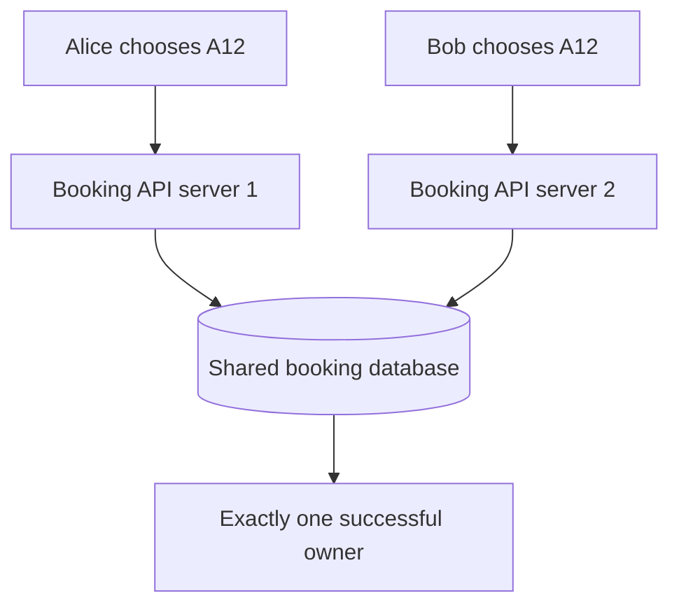

The central **business invariant** is: *for each exclusive resource and time period, there must be at most one valid booking*. Enforcing that invariant is different from merely displaying a green Available badge.

**Memory trick:** **Availability is a hint; the atomic database decision is the truth.**

---

## 2. How the check-then-act race happens

A naive system reads the seat's status and then inserts a booking. The two operations are separated in time.

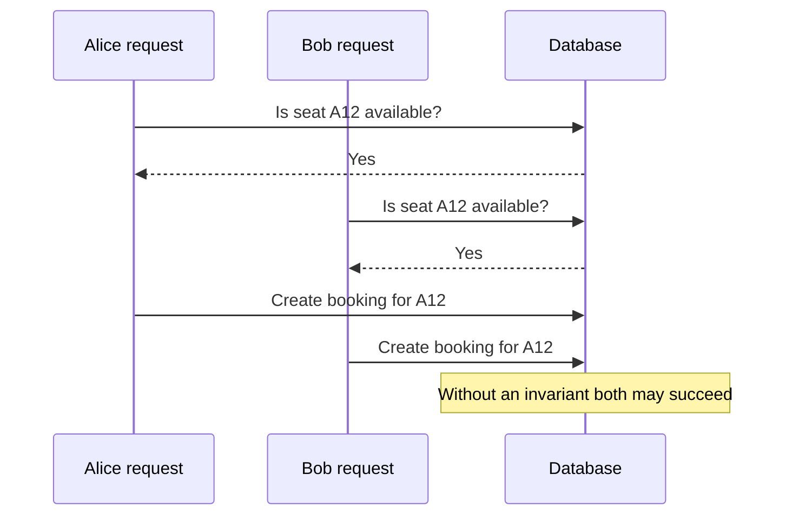

Both callers read the same old state. Adding another check in application code does not remove the gap between checking and writing.

**Correct principle:** The decision “I can take this seat” and the resulting change must be enforced **atomically** by a shared source of truth, not by separate checks on two web servers.

---

## 3. Define what counts as a conflicting booking

Different businesses need different uniqueness rules:

| Product | Unique resource | Conflicting interval |
|---|---|---|
| Concert | Show ID + seat ID | Entire show |
| Doctor appointment | Practitioner + slot | Same time slot |
| Hotel | Room | Overlapping occupied nights |
| Vacation rental | Listing | Overlapping date range |
| Meeting room | Room | Overlapping meeting time |
| Flight | Flight occurrence + seat | Same flight |

Ask whether the product permits deliberate **overbooking**, whether cancellations free capacity, and whether a tentative hold is considered unavailable.

A seat map can be out of date for a second without violating correctness. A completed sale of the same numbered seat to two buyers **does** violate correctness.

---

## 4. Unique constraints: make the database the referee

A relational database **unique constraint** can reject competing inserts even when requests arrive through different API instances.

```sql
CREATE TABLE confirmed_bookings (
  booking_id BIGINT PRIMARY KEY,
  show_id BIGINT NOT NULL,
  seat_id VARCHAR(20) NOT NULL,
  buyer_id BIGINT NOT NULL,
  UNIQUE (show_id, seat_id)
);
```

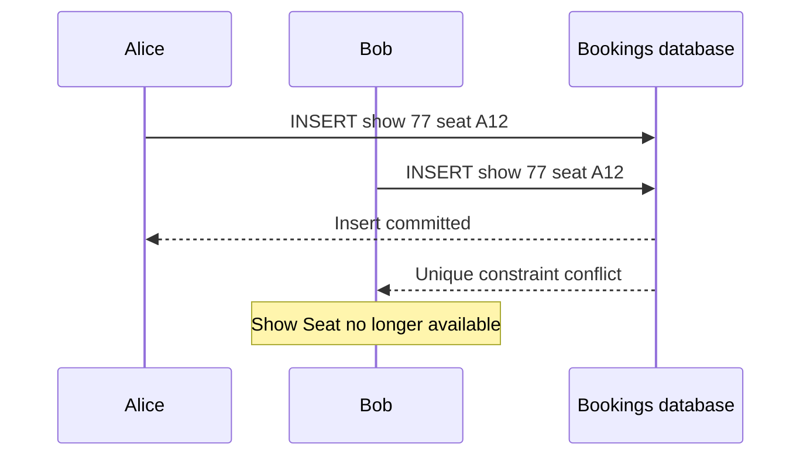

This example models **confirmed bookings**. Temporary holds need additional rules so an unexpired hold also blocks competing claims.

**Caution:** If cancelled rows stay in the same table, an unconditional unique key can block resale. Designs may use a current-ownership table, an appropriate partial unique index, or a transaction that releases/reassigns ownership while preserving history elsewhere.

---

## 5. Hotel nights and overlapping time ranges

A unique key on `(room_id, check_in, check_out)` is **not enough**. These bookings overlap even though the dates differ:

- Guest A: 3–6 November.
- Guest B: 5–8 November.

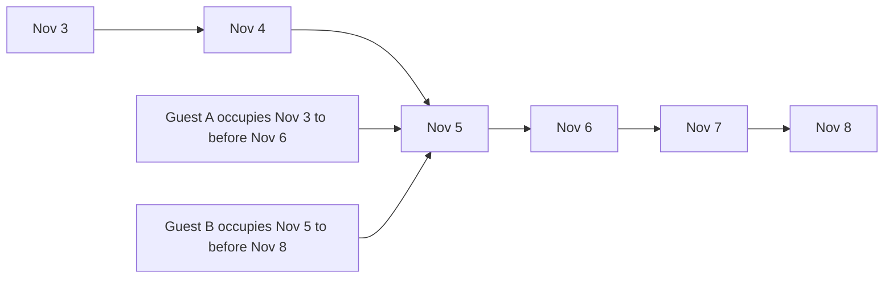

Two common designs:

**Per-night rows:** Store one row per occupied night with a unique key on `(room_id, night)`. Insert every night of a booking **within one transaction**, rolling back if any night conflicts.

**Range exclusion:** PostgreSQL can enforce no overlapping date ranges for the same room with a range type and **exclusion constraint**.

```sql
-- PostgreSQL illustrative design (requires btree_gist)
CREATE EXTENSION IF NOT EXISTS btree_gist;
CREATE TABLE room_stays (
  booking_id BIGINT PRIMARY KEY,
  room_id BIGINT NOT NULL,
  stay DATERANGE NOT NULL,
  EXCLUDE USING gist (
    room_id WITH =,
    stay WITH &&
  )
);
```

In hotel conventions, checkout is often exclusive: `[check_in, check_out)`. Model timezone, overnight boundaries and cancellation status explicitly.

---

## 6. Pessimistic locking with SELECT FOR UPDATE

**Pessimistic locking** makes a conflicting transaction **wait** while another transaction holds a row lock.

```sql
BEGIN;
SELECT status FROM seats
WHERE show_id = 77 AND seat_id = 'A12'
FOR UPDATE;
-- If available, create the booking and update seat state
COMMIT;
```

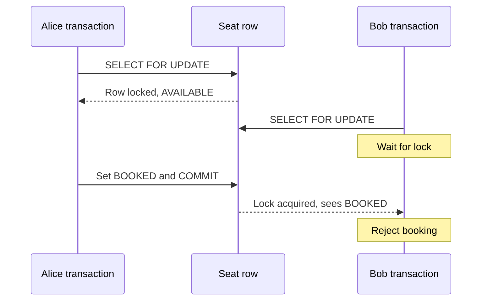

**When it fits:** Frequent collisions for a small number of shared records.

**Trade-off:** Waiting requests increase latency. Locks must be held for the shortest possible time. Never keep a database transaction open while the user enters card details or while a slow external payment API runs.

Locking an existing seat row is more dependable than trying to lock a booking row that does **not yet exist**.

---

## 7. Deadlocks and consistent lock ordering

Suppose Alice tries to reserve seats A12 then A13, while Bob tries A13 then A12.

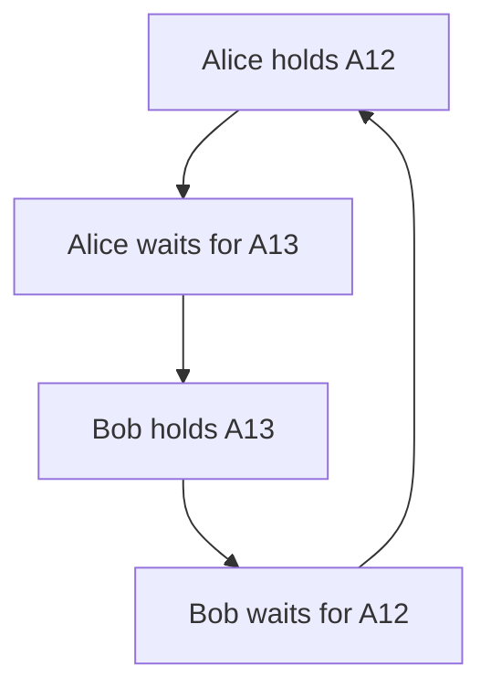

Neither can progress until the database detects a deadlock and aborts a participant.

**Prevention:** Always acquire seat locks in a deterministic order, such as ascending seat ID. Use bounded transactions and retry deadlock victims with **backoff and idempotency**.

Deadlock handling does not replace the database uniqueness or state-transition checks that enforce correct ownership.

---

## 8. Optimistic concurrency: conditional updates

When contention is usually low, you can avoid an explicit pre-read lock and issue a single **conditional UPDATE**.

```sql
UPDATE seats
SET status = 'BOOKED', owner_id = 101
WHERE show_id = 77 AND seat_id = 'A12'
  AND status = 'AVAILABLE';
```

Check the affected row count. **One row** means you won. **Zero rows** means the expected state is no longer present.

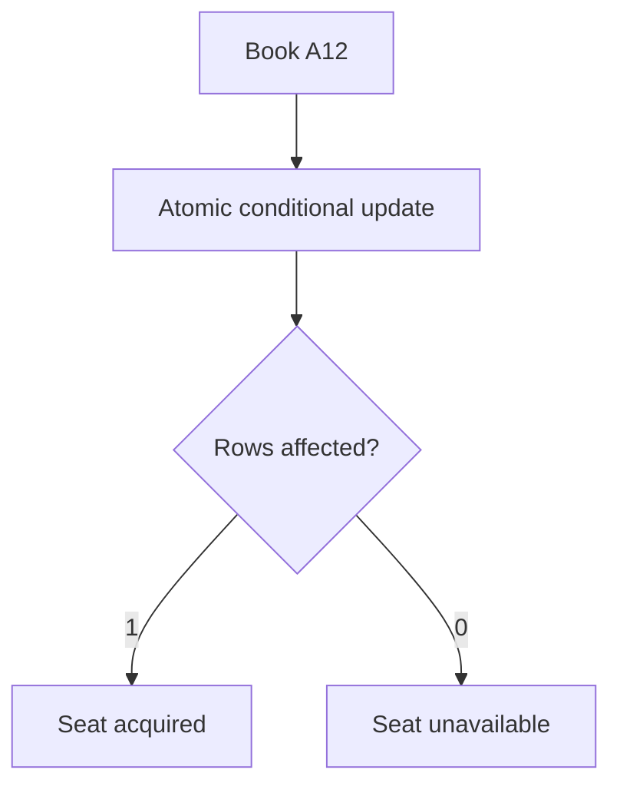

Another variant uses a **version column**:

```sql
UPDATE seats
SET status = 'BOOKED', version = version + 1
WHERE show_id = 77 AND seat_id = 'A12'
  AND version = 15 AND status = 'AVAILABLE';
```

The version comparison is a form of **optimistic concurrency control**. It works well under low conflicts, but extremely popular seats can create many failed attempts. Successful atomic updates still depend on appropriate database isolation and constraints.

---

## 9. Compare database correctness options

| Mechanism | Core idea | Strong point | Important limitation |
|---|---|---|---|
| Unique constraint | Reject duplicate ownership | Database-enforced race safety | Needs a suitable uniqueness model |
| Row lock | Serialize conflicting transactions | Easy to reason about | Lock wait, deadlocks, throughput |
| Conditional update | Change only if expected state still holds | Short atomic operation | Many failures under hot contention |
| Version check | Update only unchanged version | Helpful for optimistic workflows | Retry/read-refresh required |
| Distributed lock | Coordinate across servers | May reduce attempted conflicts | Lease expiration does not itself guarantee correctness |

For a single relational database holding the authoritative seat state, a **unique constraint or conditional state update** is usually the essential correctness layer. Additional mechanisms help throughput, not replace it.

---

## 10. Why booking needs temporary holds

A buyer may need several minutes to pay. You **cannot** hold a database row lock that entire time.

Instead, atomically change the seat's state to **HELD** and save who owns the hold, a unique hold token and its expiration.

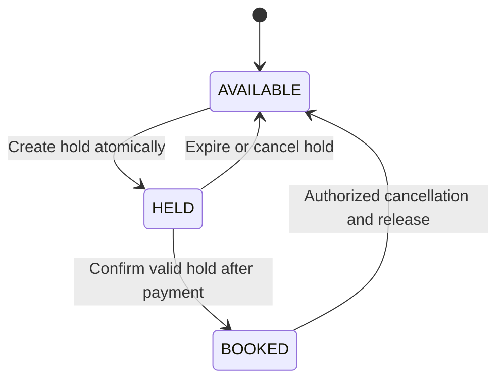

```text
show_id:    77
seat_id:    A12
status:     HELD
hold_id:    hold_930
held_by:    buyer_101
expires_at: 2026-10-26T18:10:00Z
```

The expiry is a **policy**, e.g. ten minutes, not a universal number. The database must enforce the transition from AVAILABLE (or an expired hold) to HELD atomically so **two buyers cannot both receive valid holds**.

**Memory trick:** A hold is like a grocery basket reservation with a timer, not a committed purchase.

---

## 11. Expired holds and safe confirmation

An expired seat hold may become claimable by another buyer. Do not rely on a background cleanup job running exactly on time.

A conditional claim can allow the transition if the seat is **AVAILABLE** or the old hold is already expired, subject to correct database-time checks.

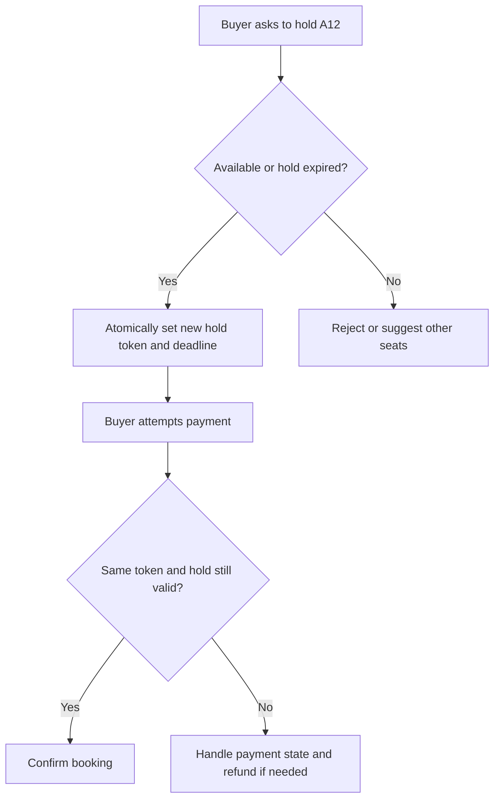

At confirmation, verify **the current hold token, buyer identity and expiry**. An older buyer must not be able to confirm a seat that was reassigned after their hold timed out.

Use a cleanup worker to make seat maps current and reclaim old metadata, but not as the sole enforcement of booking correctness.

**Important:** Time races between payment confirmation and hold expiration require a documented policy and safe payment reconciliation.

---

## 12. Payment, booking and idempotency

The booking database cannot generally atomically commit an external card payment.

A checkout flow often resembles:

1. Claim a temporary seat hold.
2. Initiate payment authorization with a stable **idempotency key**.
3. On confirmed authorization, atomically finalize the still-valid hold.
4. Capture or settle the payment according to business policy.
5. If the booking cannot be finalized, void the authorization or refund a completed capture, and reconcile uncertain outcomes.

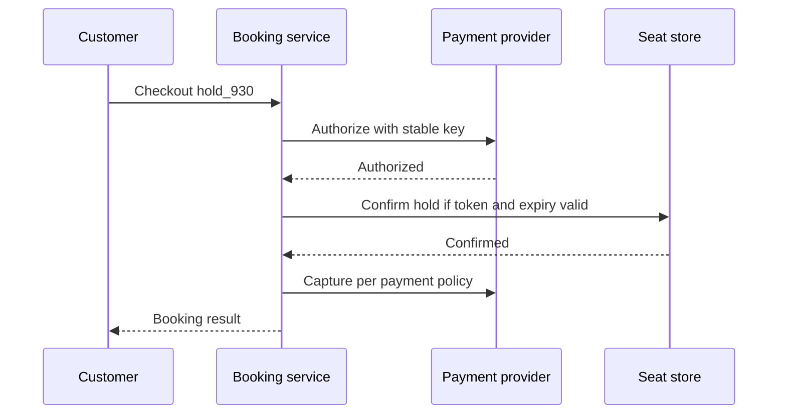

**Production caveat:** Authorization, capture and booking steps can each fail independently. A durable workflow, compensation and reconciliation are required. “Payment succeeded” must not be treated as proof that the seat is booked.

Related reading: [Distributed Transactions, 2PC and Sagas](Distributed_Transactions_2PC_and_Sagas.md) and [Idempotency and Deduplication](Idempotency_and_Deduplication_in_Distributed_Systems.md).

---

## 13. Redis distributed locks are not a final safety guarantee

A service may acquire a Redis-based lease before trying to reserve A12. For example, an atomic **set-if-absent with expiration** can reduce concurrent workers attempting the same seat.

But suppose the lease expires while a process is paused. Another process acquires a new lease. The first process wakes up and still attempts its write.

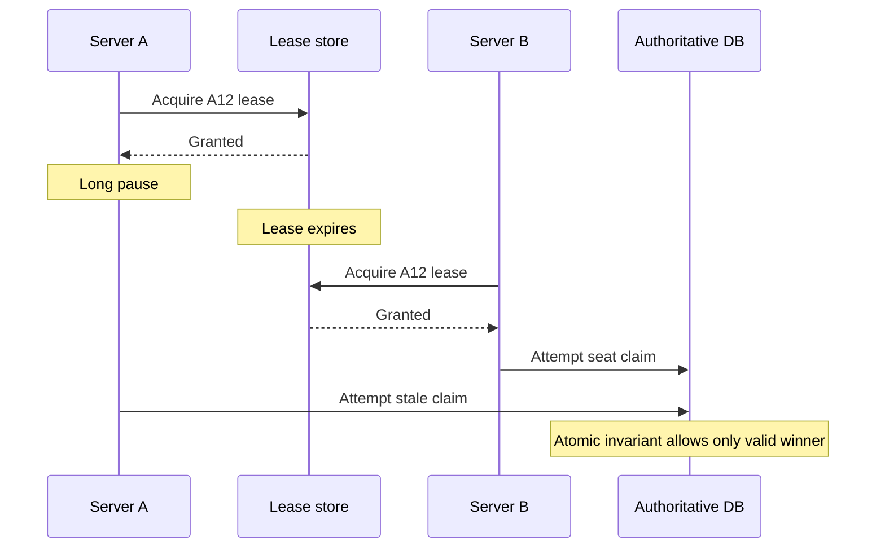

**Fencing tokens** are monotonically increasing grant numbers. A storage system that correctly checks a token can reject writes from older lease owners.

**Critical detail:** A token helps only if the authoritative destination enforces freshness. In most seat-booking designs, keep the **database constraint or atomic update** as the last line of defense, with Redis used only to reduce contention or coordinate work.

---

## 14. Massive ticket launches: waiting rooms and backpressure

Imagine **50,000 seats** and **500,000 interested buyers** arriving at the same second. The database may be correct but still collapse under hundreds of thousands of conflicting requests.

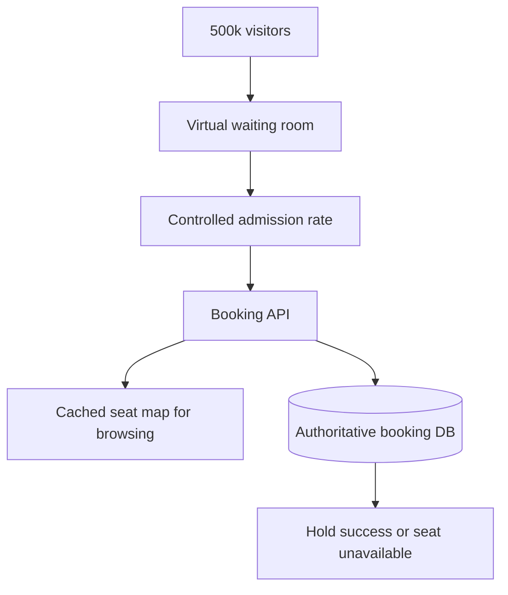

A virtual waiting room allows a manageable number of users into the checkout path. Admission tokens must be tamper-resistant, reasonably fair and protected against automated abuse.

Seat maps can be served from a cache, and may be momentarily stale. **Cached availability must not be mistaken for ownership confirmation.**

Capacity planning should distinguish **browse traffic**, **attempted holds**, **successful holds**, **payments**, and **timeouts**. Scaling the app tier alone is not enough if all requests contend for the same database rows.

---

## 15. Queues and partitioned booking workers

Another design is to place booking requests into a durable queue and process conflicting resources in a controlled order.

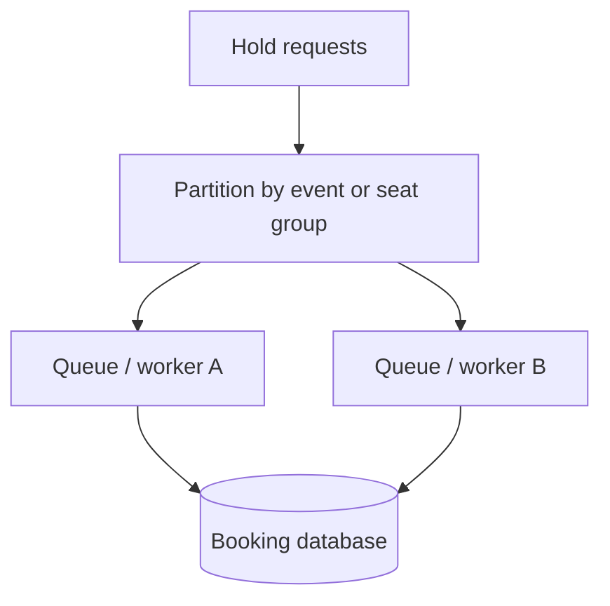

A queue can **smooth bursts** and offer controlled worker concurrency. But it does not automatically remove *all* contention, particularly when requests for related seats cross partitions.

**Ordering rules:** Put commands for the same logical resource into the same partition where possible, manage worker ownership, and keep database constraints as final enforcement even if a worker accidentally retries or two workers overlap.

A queued request should have a stable request ID and an explicit outcome. Acknowledging receipt of a request is **not** the same as guaranteeing a seat reservation.

---

## 16. Four adjacent seats must be all-or-nothing

A family wants four seats: A12, A13, A14 and A15. If only three are available, the system should normally reserve **none** unless the customer explicitly accepts a partial booking.

Within one transactional database, the service can atomically attempt all four state transitions and **commit only if the affected row count equals four**.

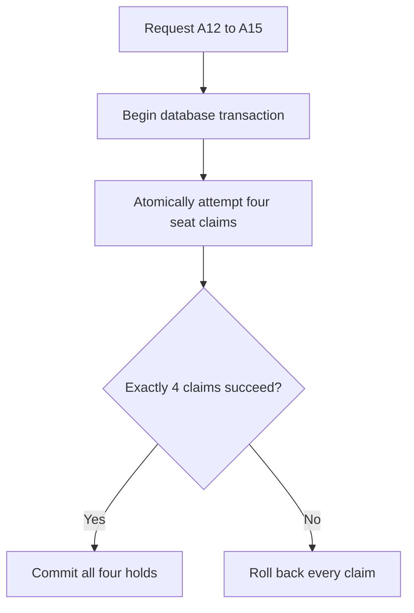

For row locking, acquire locks in deterministic seat order. Ensure all seats share the correct show occurrence.

If resources belong to independent providers, such as a flight plus a hotel, use individually expiring holds and **saga-style compensation** instead of assuming one ordinary SQL transaction spans both.

---

## 17. Overbooking may be a business rule

Sometimes **overselling is deliberately permitted** at an aggregate capacity level, such as certain airline or hotel inventory policies. That is different from accidentally assigning the **same uniquely numbered seat** to two confirmed customers.

Ask what must be guaranteed:

- **Hard exclusivity:** Exactly one customer may hold or purchase seat A12.
- **Capacity threshold:** Up to `N` confirmed bookings may be allowed for a shared inventory pool.
- **Controlled overbooking:** A documented policy permits bookings beyond expected physical capacity with operational consequences.

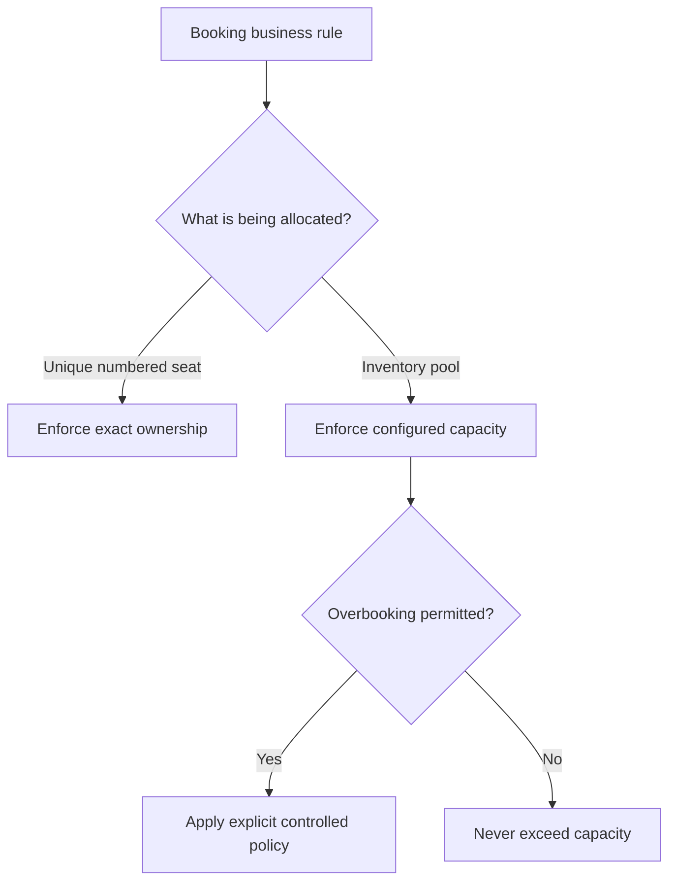

**System design starts with invariants**, not with a default assumption that every kind of booking has the same overselling rule.

---

## 18. Monitoring, testing and tricky edge cases

A reliable design should be tested with deliberate races and failures.

| Test case | Expected outcome |
|---|---|
| 100 requests for one seat | At most one active valid owner |
| Two checkouts sharing a hold token | Idempotent result, no double charge |
| Hold expires during payment | Never confirm a seat now owned by another buyer |
| Booking API crashes after database commit | Retry returns correct existing outcome |
| Redis lease expires mid-operation | DB still rejects invalid competing ownership |
| Four-seat request with one unavailable | No partial hold unless explicitly allowed |
| Seat map cache is stale | Final database decision prevents oversell |
| Payment status is unknown | Reconcile instead of blindly charging again |

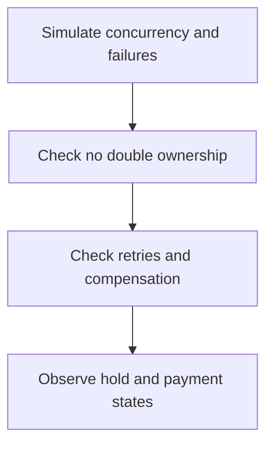

Operational metrics: successful hold rate, hold conflict rate, lock wait time, deadlocks, expiry rate, payment reconciliation backlog, queue depth, and waiting-room admission latency.

Check privacy and abuse prevention, because an attacker repeatedly holding all popular seats can deny access to real buyers.

---

## 19. System design interview approach

An effective interview structure:

1. **Clarify the resource:** One seat, one room-night, one appointment slot, or a pool of inventory?
2. **State the invariant:** Exactly one owner? Strict maximum capacity? Deliberate overbooking?
3. **Show the race:** Two servers both see available before either commits.
4. **Pick database enforcement:** Unique key, range exclusion, row locks or atomic conditional update.
5. **Add time-limited holds:** Allow payment without long transactions.
6. **Define failure recovery:** Expiry, hold-token verification, idempotent payment and compensation.
7. **Scale hot events:** Waiting room, cached browsing, controlled queues and rate limits.
8. **Handle multiple resources:** One transaction for a group of seats, or saga across providers.
9. **Measure correctness:** Concurrency tests, alerting and reconciliation.

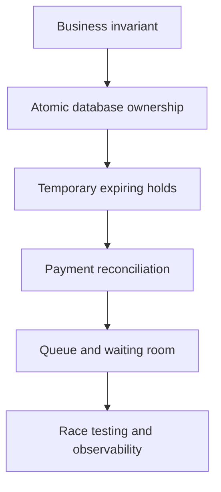

### Example answer

**“For a concert, I would make `(show_id, seat_id)` ownership unique and use an atomic conditional update to create a hold with an expiry and unique token. The customer has a short checkout window, and confirmation succeeds only if the token is still current. Payment requests use idempotency keys. A virtual waiting room limits request spikes, and a cached seat map makes browsing cheap. The booking database remains the final authority.”**

---

## 20. Practice questions and cheat sheet

### Questions to prepare

1. How does a check-then-act race cause double booking?
2. Why do extra application-level checks not solve the problem?
3. How does a unique constraint prevent simultaneous inserts?
4. Why is a unique start/end date pair insufficient for hotel reservations?
5. What is PostgreSQL's exclusion constraint?
6. How does `SELECT FOR UPDATE` work?
7. How can multi-seat locking cause a deadlock?
8. How does an atomic conditional update indicate success?
9. What is optimistic version-based concurrency control?
10. Why use a temporary hold instead of a long database transaction?
11. What happens when payment finishes after hold expiry?
12. Why are Redis leases insufficient as the only exclusivity control?
13. When are fencing tokens valuable?
14. What do a waiting room and cached seat map solve?
15. When is queue-based booking useful?
16. How do you guarantee four seats are reserved together?
17. What changes when overbooking is explicitly allowed?

### One-minute revision

| Technique | Simple meaning |
|---|---|
| Race condition | Two requests act on stale availability |
| Unique constraint | Reject conflicting database ownership |
| Range exclusion | Prevent overlapping booking periods |
| Pessimistic lock | Make competitors wait |
| Conditional update | Atomically claim only when available |
| Version number | Reject stale optimistic writes |
| Temporary hold | Short-lived exclusive reservation while paying |
| Hold token | Prove who currently owns the hold |
| Redis lease | Optional contention-control coordination |
| Fencing token | Reject stale lease holders at destination |
| Waiting room | Control how many buyers enter checkout |
| Cached seat map | Fast approximate browsing data |
| Booking queue | Smooth spikes and serialize selected commands |
| Saga | Compensate across independent services |

**Final takeaway:** Prevent double booking through an **atomic ownership rule in the authoritative database**. Add expiring holds for real checkout journeys and traffic controls for popular events, while keeping every retry and payment step safe.

---
