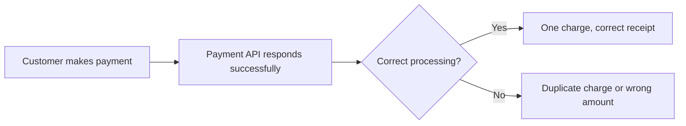
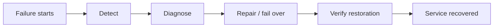
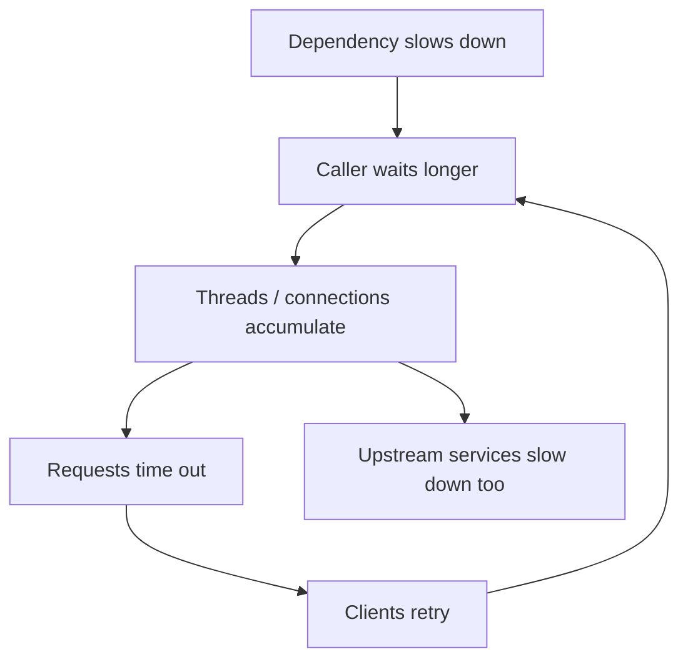
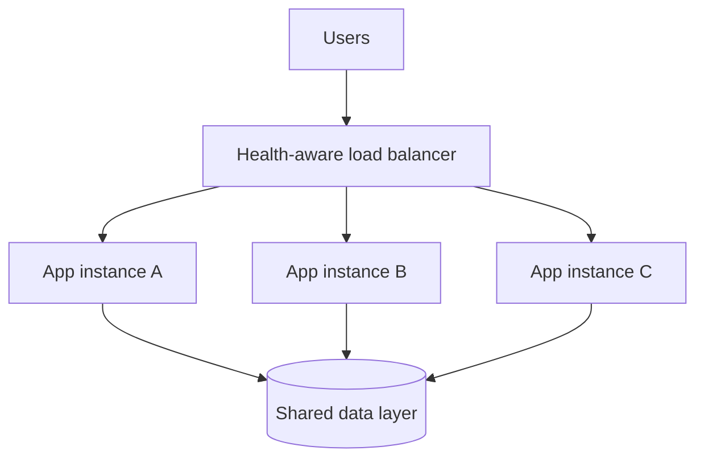
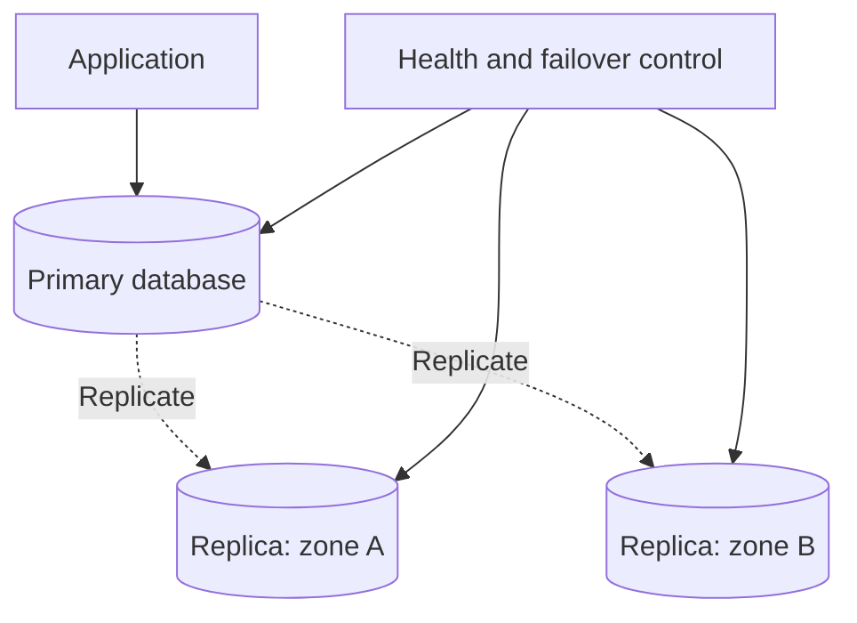
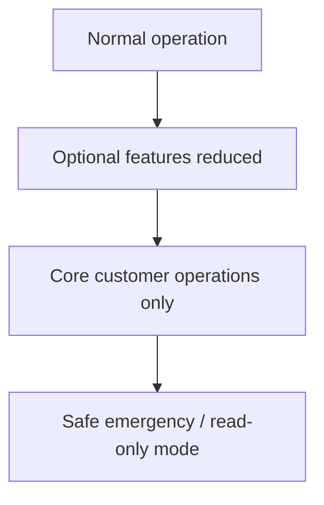
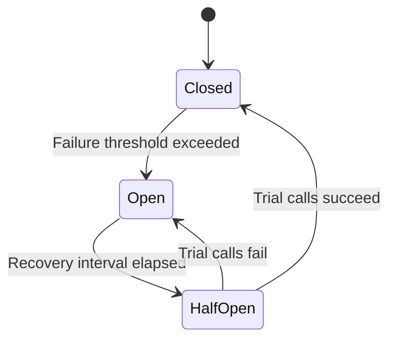
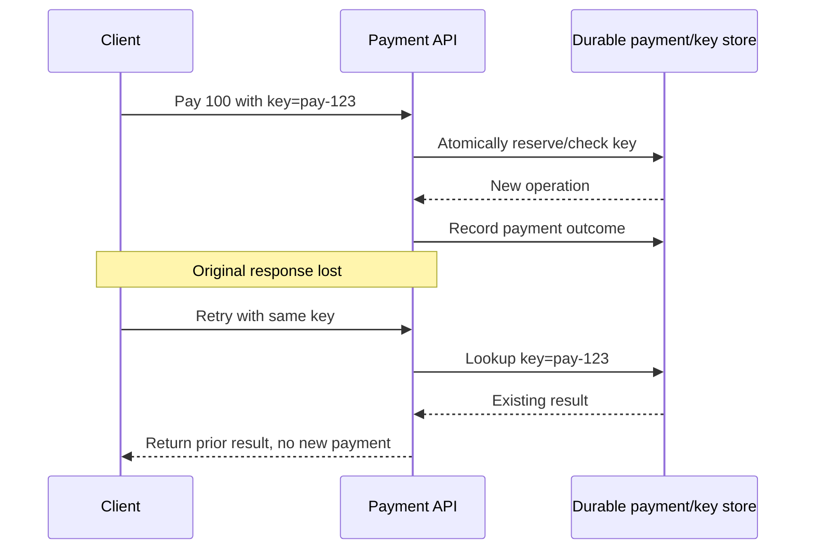
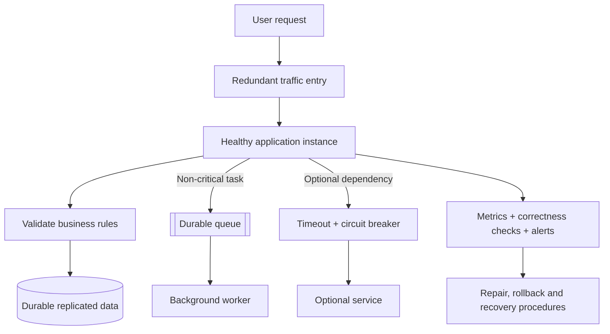

# Reliability in Distributed Systems

**Correct results, safe recovery, controlled failures and dependable user experiences**


## Contents

1. [What reliability means](#1-what-reliability-means)
2. [Reliability versus related concepts](#2-reliability-versus-related-concepts)
3. [How to measure reliability](#3-how-to-measure-reliability)
4. [Why systems become unreliable](#4-why-systems-become-unreliable)
5. [Redundancy, failover and replication](#5-redundancy-failover-and-replication)
6. [Graceful degradation](#6-graceful-degradation)
7. [Circuit breakers and failure isolation](#7-circuit-breakers-and-failure-isolation)
8. [Idempotency and safe retries](#8-idempotency-and-safe-retries)
9. [Putting reliability together](#9-putting-reliability-together)
10. [Interview questions and cheat sheet](#10-interview-questions-and-cheat-sheet)

---

## 1. What reliability means

A service can be reachable all day and still fail its users. Imagine a payment API that answers every request quickly but sometimes charges twice. It is **available**, yet it is not doing its job correctly.

**Reliability** describes whether a system performs its intended function correctly and consistently **over a defined period, under specified conditions**.

Three parts matter:

- **Correctness:** An answer must be right, not merely returned.
- **Time:** One successful request does not prove a service is dependable over weeks or months.
- **Operating conditions:** Expectations depend on the workload, environment and failure assumptions.

**Simple memory trick:** **Availability = “Did it respond?” Reliability = “Did it do the right thing?”**

### An unreliable but available system



Both branches may return HTTP 200. **HTTP success does not guarantee a correct business outcome.**

## 2. Reliability versus related concepts

| Concept | Main question | Example |
|---|---|---|
| **Availability** | Is the operation usable? | Checkout responds |
| **Reliability** | Does it keep working correctly? | Checkout charges the correct amount |
| **Fault tolerance** | Can it continue through a component fault? | One failed server does not stop shopping |
| **Durability** | Does committed information survive failures? | Confirmed orders are preserved |

The properties overlap, but one does not guarantee the others.

For example, automatic database failover might restore service quickly, yet asynchronous replication could mean the newly promoted database has not received a recently acknowledged write. **Recovery capability does not automatically guarantee zero data loss.**

---

## 3. How to measure reliability

Useful measurements include how frequently a repairable component breaks, how quickly it is restored, how many requests fail and whether accepted answers are accurate.

### A. Mean Time Between Failures (MTBF)

MTBF is an average measure of time between failures for a **repairable** system.

```text
MTBF = Total operating time / Number of failures

Example:
10,000 operating hours / 5 failures
= 2,000 hours between failures, on average
```

To get a memorable rough conversion:

```text
2,000 hours / 24 ≈ 83 days
```

That is a historical average, **not a prediction that a failure will occur exactly every 83 days**.

**Scale insight:** If 100 identical independent servers each have a mean failure interval of about 2,000 hours, the expected fleet failure count is:

```text
100 servers / 2,000 hours = 0.05 failures/hour
0.05 × 24 ≈ 1.2 failures/day
```

This is a statistical expectation under simplified steady-state assumptions, not a guaranteed daily incident count.

### B. Mean Time to Recovery (MTTR)

MTTR measures average restoration time after an incident.

```text
MTTR = Total time spent recovering / Number of failures

Example:
10 hours of recovery across 5 failures
= 2 hours per failure
```

Depending on your organization's definition, recovery time may include detection, investigation, repair and verification. **Define exactly when the clock starts and stops.**



**Memory trick:** **MTBF = how often failures happen; MTTR = how long recovery takes.**

### C. Error rate

```text
Error rate (%) = Failed requests / Total requests × 100
```

Example:

```text
10 failed requests / 10,000 requests × 100
= 0.1% error rate
```

The original lesson offers illustrative error-rate categories:

| Illustrative goal | Equivalent failed requests |
|---|---|
| Less than 1% | Fewer than 1 in 100 |
| Less than 0.1% | Fewer than 1 in 1,000 |
| Less than 0.01% | Fewer than 1 in 10,000 |

These are **examples, not industry-wide mandatory SLOs**. The right target depends on the operation.

### D. Data correctness

```text
Correctness (%) = Correct responses / Evaluated responses × 100
```

Example:

```text
9,900 correct results / 10,000 evaluated results
= 99% correctness
```

A system can have a tiny technical error rate and still be unreliable if returned totals, account balances or delivered messages are wrong.

**Practical note:** Correctness needs a trusted reference, such as invariants, reconciliations, audits or validated business outcomes; it cannot always be inferred from HTTP status codes.

### A helpful MTBF/MTTR relationship

For a simple repairable component under steady-state assumptions:

```text
Approximate availability = MTBF / (MTBF + MTTR)

2,000 / (2,000 + 2)
≈ 99.90%
```

This is an **additional explanatory calculation**; it is not a replacement for measuring end-to-end user availability.

---

## 4. Why systems become unreliable

A dependable design plans for more than failed hardware.

| Failure source | What can go wrong | Helpful protection |
|---|---|---|
| **Hardware** | Disk, memory, network or host failure | Replication, replacement and health checks |
| **Software bug** | Incorrect business logic, corrupt results | Tests, validation and safe rollout |
| **Configuration** | Wrong routing, permissions or feature flags | Reviews, validation and rollback |
| **Human operation** | Mistaken commands or deployment actions | Automation, scoped privileges and reversible changes |
| **Overload** | Queue buildup, timeouts, retry amplification | Admission control, backpressure and isolation |

Software bugs can be particularly dangerous when they return plausible but incorrect answers rather than crashing.

### How a local slowdown can become widespread



This illustrates a **cascading failure** and why retries must be bounded.

---

## 5. Redundancy, failover and replication

### A. Multiple application instances

Running several servers behind a load balancer provides alternate serving paths.



If one instance becomes unhealthy, the load balancer can stop routing new requests to it.

**Conditions:** Remaining instances need enough spare capacity; state must remain accessible; the load-balancing layer and shared dependencies must also be resilient.

### B. Replicate important data

A primary can copy updates to other locations so an alternate copy exists after a fault.



**Replication is not the same as backup.** Replicas can propagate accidental deletion or corruption. Independent backups, recovery testing and appropriate retention remain important.

**Failover** means detecting a failed active component, switching to a suitable alternate, and ensuring clients can resume safe operation.

A failover strategy that has never been tested under realistic conditions should not be assumed to work.

---

## 6. Graceful degradation

A system need not choose only between *all features working* and *nothing working*. It can temporarily provide fewer capabilities while preserving critical operations.

### Online store example

| Level | Experience | Main intent |
|---|---|---|
| **Full** | All features including recommendations | Normal functionality |
| **Reduced** | Simpler recommendations or fewer optional features | Reduce load and dependencies |
| **Core** | Product information and verified checkout | Preserve essential purchase path |
| **Emergency** | Limited, possibly read-only catalogue | Keep an explicitly safe minimum |



**Safety qualification:** The source mentions accepting orders for later processing in an emergency mode. That is only appropriate if orders can be recorded **durably**, inventory can be handled safely, and the user is told that processing is pending. Otherwise a read-only mode is safer than promising an unconfirmed purchase.

**Design rule:** Decide in advance which features can be omitted and which guarantees must never be weakened.

---

## 7. Circuit breakers and failure isolation

If an external service repeatedly fails, continuously calling it wastes resources and can spread the slowdown.

A **circuit breaker** has three states:

- **Closed:** Calls are allowed; failures are monitored.
- **Open:** Calls to that dependency are temporarily blocked.
- **Half-open:** A limited number of trial calls check whether it has recovered.



Illustrative tuning: open after repeated failures in a defined window, wait briefly, then allow a few probes. Thresholds and cooldowns are workload-specific, not universal constants.

Circuit breakers are most useful when combined with:

- **Timeouts** so individual calls cannot wait forever.
- **Bounded retries** with backoff and jitter for retryable failures.
- **Fallback behavior** that does not misrepresent the operation's outcome.
- **Monitoring** so engineers know the system is running in a degraded state.

A product recommendations failure might safely return no recommendations. A failed payment confirmation should **not** be replaced with a fake success response.

---

## 8. Idempotency and safe retries

Suppose a client requests a payment, the server completes it, but the response disappears. The client cannot tell whether the payment went through.

Repeating the request without protection risks a second charge.

**Idempotency** ensures repeated requests for the same logical operation do not create additional unintended effects.



A production implementation should validate that the same key is not reused with different request data, handle concurrent retries atomically, and define key retention.

**Important nuance:** An idempotency key alone does not guarantee exactly-once effects across a database and an external payment provider. Safe processing also depends on durable state changes, provider behavior and reconciliation.

### Easy memory example

```text
Payment amount = 100
Requests sent = 2 (original + retry)
Desired actual charge = 100, not 200
```

---

## 9. Putting reliability together

Think of reliability in layers:



Each element addresses a different concern:

- **Validation and reconciliation** protect correctness.
- **Replication and redundancy** reduce impact from component failure.
- **Failover** restores a serving path.
- **Queues** isolate delayed background work.
- **Timeouts and circuit breakers** prevent one dependency from overwhelming callers.
- **Monitoring** identifies errors, silent correctness issues and slow recovery.
- **Idempotency** makes supported retries safer.

No one layer is sufficient by itself.

---

## 10. Interview questions and cheat sheet

### Common follow-up questions

1. How can a system be available but unreliable?
2. What is the difference between durability and fault tolerance?
3. When would you track MTBF versus MTTR?
4. Why is measuring HTTP 500 responses insufficient to measure correctness?
5. How can retries make an outage worse?
6. Why do replicas not replace backups?
7. What is the difference between graceful degradation and returning incorrect results?
8. Walk through closed, open and half-open circuit-breaker states.
9. How do you prevent duplicate payments after a lost response?
10. What should happen if a critical dependency produces wrong data rather than failing outright?

### One-page memory card

| Topic | Remember |
|---|---|
| Availability | **Does it respond?** |
| Reliability | **Does it respond correctly over time?** |
| Fault tolerance | **Does it survive component faults?** |
| Durability | **Does committed data survive?** |
| MTBF | **Operating time ÷ failures** |
| MTTR | **Recovery time ÷ failures** |
| Error rate | **Failed ÷ total requests × 100** |
| Correctness rate | **Correct ÷ evaluated results × 100** |
| Redundancy | **More than one usable serving path** |
| Failover | **Detect → switch → verify** |
| Graceful degradation | **Preserve core actions safely** |
| Circuit breaker | **Closed → open → half-open** |
| Idempotency | **Retry without duplicate business effects** |

### Final principle

**Reliable systems don't only stay online; they deliver correct outcomes, limit the consequences of faults, and recover predictably.**

---
