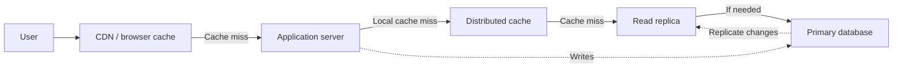

# Scaling Read Traffic — Study Notes

## 1. What is read-heavy traffic?

A system is read-heavy when users read data far more often than they update it. The read-to-write ratio may be 100:1 or higher.

Examples:

- A short URL is created once but clicked millions of times.
- A social media post is published once and viewed by many followers.
- Product details are updated occasionally but product pages are viewed constantly.
- Many users check an event page before buying tickets.

The goal is to serve these reads quickly without overloading the main database.

## 2. Why does the database become a bottleneck?

Consider a URL shortener handling 1 billion redirects a day:

- Average: about 11,500 reads per second.
- Peak: about 35,000 reads per second.

Every database query uses CPU, memory, and sometimes disk. As load increases, queries wait in a queue, latency rises, and requests may time out. The general strategy is to serve most reads from faster layers before they reach the database.

## 3. First optimize the database

Before adding infrastructure, make sure the database is used efficiently:

- **Add indexes** to columns used for lookups. Without an index, the database may scan the whole table.
- **Fix N+1 queries.** For example, fetching 20 posts and then querying each author separately takes 21 queries. A join or batch fetch can reduce this.
- **Limit and paginate** large result sets.
- **Precompute** expensive aggregations when possible.

Use query analysis tools such as `EXPLAIN ANALYZE` to find inefficient queries.

## 4. Read replicas

A read replica is a copy of the primary database. Writes go to the primary, which sends changes to replicas. Reads can be distributed across the replicas.

**Benefits:** Adds read capacity while writes continue going to one primary.

**Trade-offs:** Replicas cost more to operate and must apply every write. Scaling is not perfectly linear. Replicas also do not solve the problem of one extremely popular record by themselves.

## 5. Replication lag and stale reads

Changes take time to travel from the primary to a replica. This delay is called **replication lag**. Under heavy load, it can grow from milliseconds to seconds.

Example: A user changes their profile picture. The write reaches the primary, but the page reload reads from a replica that has not received the change. The old picture appears. This is a **read-your-own-writes** problem.

Possible solutions:

- Route the user's reads to the primary for a few seconds after a write.
- Always read a user's own profile, settings, and orders from the primary.
- Monitor replica lag and stop routing reads to replicas that are too far behind.

Some features can tolerate slightly stale data; others require up-to-date reads. Clarify this requirement during design.

## 6. Caching

A cache keeps frequently accessed data in memory, often using Redis or Memcached. Memory access is much faster than a database query.

### Cache-aside pattern

1. The application checks the cache.
2. If the value is present, return it.
3. If it is missing, read from the database.
4. Store the result in the cache, then return it.

The **cache hit ratio** is the share of reads served by the cache. At 35,000 reads per second, a 95% hit ratio means only 5% reach the database: about 1,750 reads per second.

Good candidates are read often, change infrequently, and can tolerate some staleness: popular links, product details, posts, and profiles. Frequently changing or highly sensitive values may be poor candidates.

## 7. Keeping the cache fresh

The database and cache can hold different versions of the same data. Common approaches are:

- **TTL (time to live):** The cache entry expires after a set period. Simple, but stale data may be served until it expires.
- **Delete on write:** After updating the database, delete the corresponding cache entry. The next read reloads fresh data.
- **Write-through:** Update the cache in the write path along with the database. This can keep the cache fresher but adds work to writes.
- **Event-based invalidation:** Publish a change event so services can remove their cached copies.

A common approach is to delete on write and also set a TTL as a fallback if an invalidation is missed.

## 8. Cache stampedes

A **cache stampede** happens when a popular entry expires and many requests miss the cache at once. They all fetch the same data from the database, causing a sudden load spike.

Ways to prevent it:

- Use a lock so only one request rebuilds the entry.
- Refresh popular entries in the background before they expire.
- Add random variation, or **jitter**, to TTLs so many entries do not expire together.

## 9. Hot keys and negative caching

A **hot key** is one cache key receiving far more traffic than other keys. For example, millions of followers may request the same celebrity post. The cache server holding that one key may become a bottleneck, even if other cache servers are idle.

Possible fixes:

- Keep several copies of the hot key on different cache servers and distribute reads across them.
- Keep a short-lived copy in each application server's local memory.

Local copies can be briefly stale, so use a short TTL. **Negative caching** is another useful technique: briefly cache “not found” results so repeated requests for missing items do not all reach the database.

## 10. CDNs and browser caching

A **CDN (content delivery network)** stores copies of content on servers close to users. It commonly serves images, video, JavaScript, and CSS, and can also serve public pages or API responses that are identical for everyone.

CDNs reduce load on the application and database and can improve response times for users far from the data center. Browser caching uses headers such as `Cache-Control` to control how long a response can be reused.

Do not share user-specific data, such as a cart or account page, through a public cache. Mark it private or separate the public content from the user-specific part.

## 11. Precomputing results

Instead of doing expensive work every time someone reads, calculate results earlier—often when data is written.

For a social feed, the system can add a new post to each follower's precomputed feed. Opening the feed then becomes a simple lookup. This is called **fanout on write**. For accounts with millions of followers, systems may use a hybrid and merge those posts at read time.

Counters work similarly: update a stored like count when a user likes a post instead of recounting all likes on every page view. This makes writes more expensive and uses extra storage, but can be a good trade-off when reads greatly outnumber writes.

## 12. The complete read path

**How to read the diagram:** Requests move from the user through the fastest cache layers first. A cache hit returns the response immediately. Only a miss moves the request to the next layer, and the database handles the requests that remain. Writes go to the primary database, which sends updates to read replicas; replication may take time.

Each layer serves requests that would otherwise continue to the next layer. Only cache misses should reach the database. Every layer can also contain stale data, so define how long staleness is acceptable and how each layer is refreshed.

## 13. System design interview approach

1. Clarify the read-to-write ratio and expected peak reads per second.
2. Ask how fresh the data must be and whether the response is the same for all users.
3. Estimate peak load to determine whether one database is sufficient.
4. Optimize queries and indexes first.
5. Add a cache. Explain what is cached, how it is invalidated, and the expected hit ratio.
6. Add read replicas for reads that still reach the database; explain how replication lag is handled.
7. Add a CDN for public content shared by all users.
8. Discuss hot keys, cache stampedes, and other likely traffic spikes.

Tie each component to a specific bottleneck rather than listing technologies without explaining why they are needed.

## Key takeaways

- Optimize database queries and indexes before scaling infrastructure.
- Cache frequently read data; hit ratio directly affects database load.
- Combine cache invalidation on writes with TTLs as a safety net.
- Use replicas for database reads and account for replication lag.
- Use CDNs for public, shared content; protect user-specific data.
- Precompute expensive results when reads greatly outnumber writes.
- Plan for hot keys and cache stampedes.
- At every layer, decide how stale data can be and how it gets refreshed.
