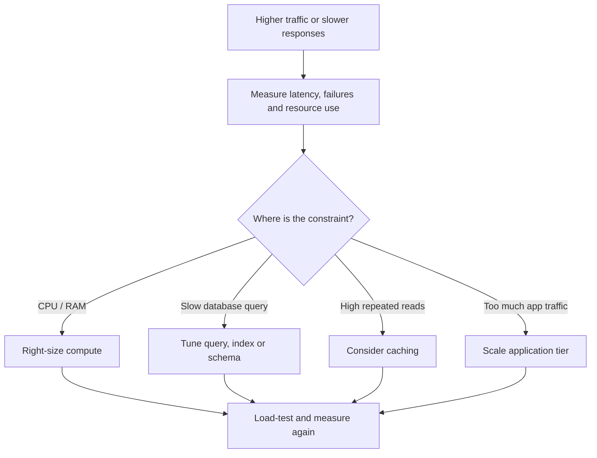
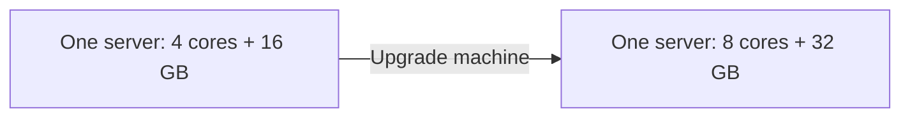
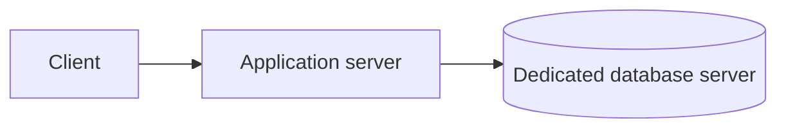
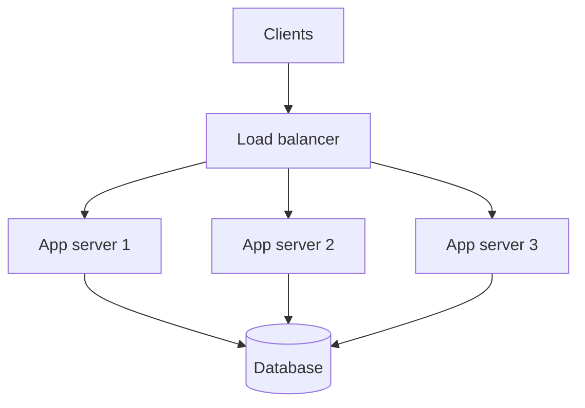
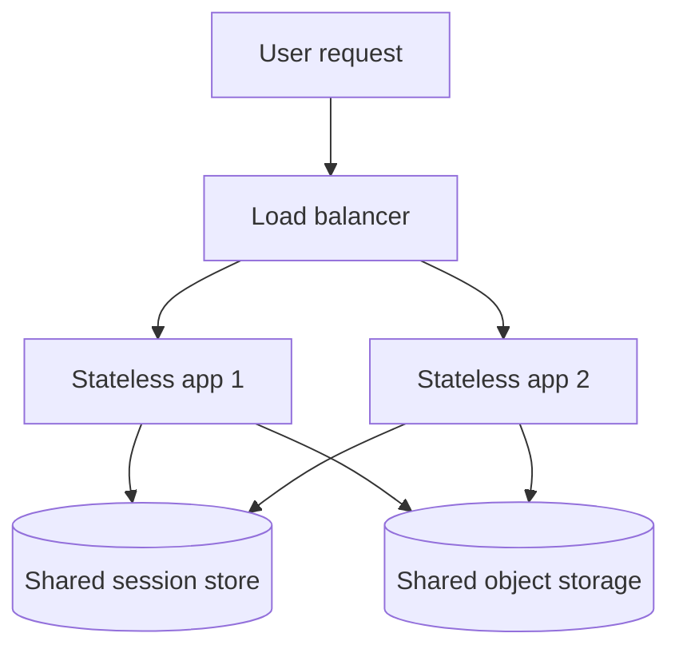
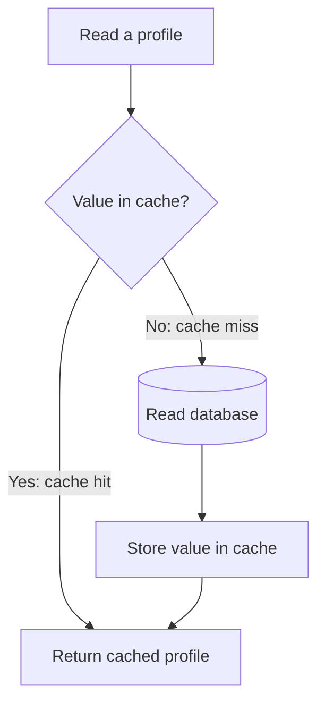
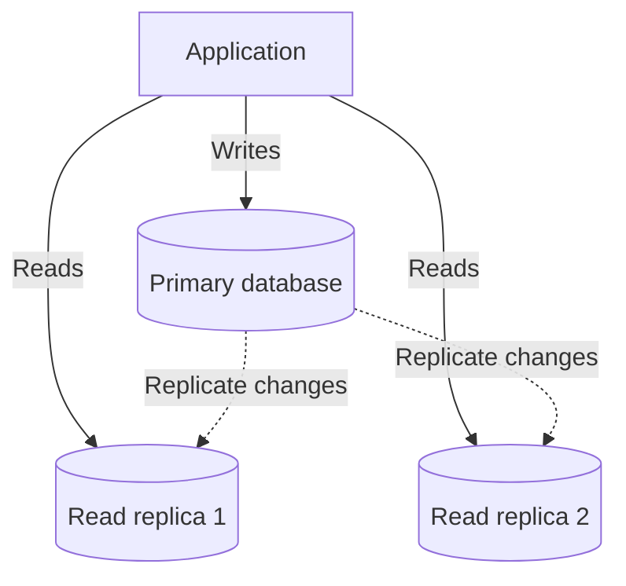
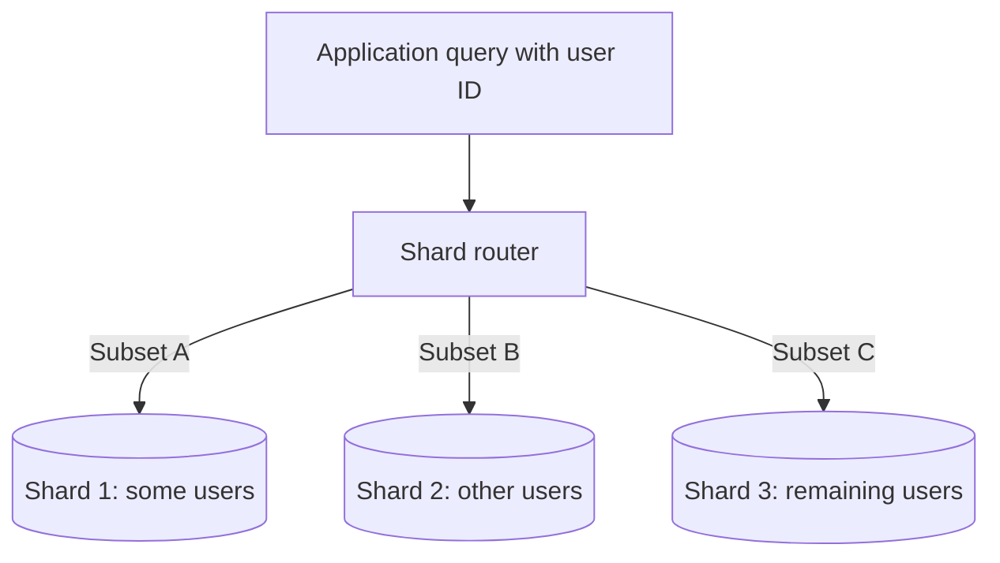
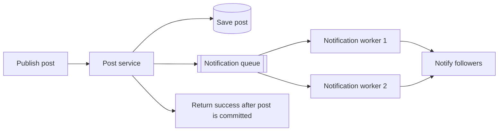
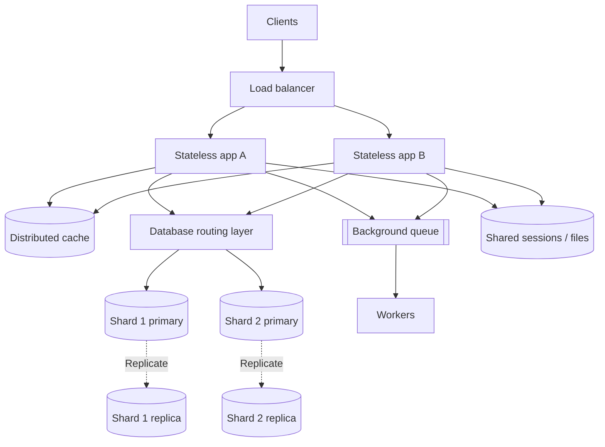

# Scalability Explained: How to Scale a System Step by Step

*A practical guide to vertical scaling, horizontal scaling, stateless services, caching, database replication, sharding and background queues.*

> These notes are independently written from the user-supplied scalability lesson transcript. The flowcharts are newly created learning diagrams. Example numbers illustrate design reasoning; they are not promises of real-world system capacity.

## Contents

1. [What scalability really means](#1-what-scalability-really-means)
2. [Find the bottleneck first](#2-find-the-bottleneck-first)
3. [Vertical scaling: scale up](#3-vertical-scaling-scale-up)
4. [Separate the application and database](#4-separate-the-application-and-database)
5. [Horizontal scaling: scale out](#5-horizontal-scaling-scale-out)
6. [Why stateless servers matter](#6-why-stateless-servers-matter)
7. [Caching and cache-aside](#7-caching-and-cache-aside)
8. [Database read replicas](#8-database-read-replicas)
9. [Database sharding](#9-database-sharding)
10. [Message queues and background workers](#10-message-queues-and-background-workers)
11. [A complete scaling journey](#11-a-complete-scaling-journey)
12. [Measuring improvements and trade-offs](#12-measuring-improvements-and-trade-offs)
13. [Quick revision and interview tips](#13-quick-revision-and-interview-tips)

---

## 1. What scalability really means

Imagine a social application where users maintain profiles, publish posts and read feeds. One machine may handle the first few users comfortably. As demand grows, requests queue up, pages take longer to load and some requests fail.

**Scalability** is the ability to support more work or more stored data by adding appropriate resources *while still meeting the system's requirements*.

For example, suppose the application currently supports **1,000 requests per second (RPS)** and the target is **5,000 RPS** with acceptable latency. We need roughly **5× more useful throughput**, but not necessarily 5× more servers: the result depends on the workload and the current bottleneck.

### Measure the right kind of growth

| Metric | What it tells you |
|---|---|
| Registered users | Total accounts; not necessarily concurrent load |
| Concurrent users | Users active at the same time |
| Requests per second | Incoming request demand |
| Work per request | Cost of processing a profile lookup versus a video job |
| Data volume | Storage and indexing requirements |
| Latency and error rate | Whether users still receive acceptable service |

**Memory trick: U–R–D–L:** **Users, Requests, Data, Latency.** User count alone does not determine capacity.

## 2. Find the bottleneck first

A **bottleneck** is the component that limits end-to-end performance. If response time increases from **50 ms** to **500 ms**, don't immediately add servers. Investigate where time is spent.

Inspect CPU, memory, disk I/O, database query time, connection pools and request queues.



**Important:** More application instances will not repair a badly performing database query. Fix the component actually limiting the system.

---

## 3. Vertical scaling: scale up

**Vertical scaling** makes an existing machine more powerful, for example:

| Before | After |
|---|---|
| 4 CPU cores | 8 CPU cores |
| 16 GB RAM | 32 GB RAM |

The upgrade may help if compute or memory is saturated. If the bottleneck is slow storage, a faster disk or query optimization might matter more than additional CPU.

### Vertical scaling



**Advantages:** Straightforward architecture, often limited application changes, fewer machines to manage.

**Limitations:** Machine sizes are finite; bigger servers cost more; upgrades may require disruption; a single machine can remain a single point of failure.

**Analogy:** Make one store larger instead of opening more stores.

---

## 4. Separate the application and database

Initially the application and database may share one machine. As usage increases, they compete for memory, CPU and I/O.

Running them separately allows independent capacity choices.



The application can prioritize compute for processing requests while the database has its own memory and storage resources. This separation introduces a network hop but reduces resource contention and improves deployment flexibility.

---

## 5. Horizontal scaling: scale out

**Horizontal scaling** adds more machines to share a workload. For a web application, a load balancer distributes incoming requests among healthy app instances.



If one application server fails, the load balancer can stop sending it requests. The others continue working **only if enough healthy capacity remains**.

### Vertical vs horizontal scaling

| Aspect | Vertical (up) | Horizontal (out) |
|---|---|---|
| Method | Give one server more resources | Add more servers |
| Initial complexity | Usually lower | Load balancing and shared state needed |
| Upper limit | Maximum practical machine size | More flexible, but dependencies can limit scale |
| Availability | One machine may still fail | Can tolerate app instance failures with redundancy |
| Cost | Larger machines can be costly | More machines and operations to manage |
| Best fit | Simple early-stage scale or single-node limits | Stateless application tiers and growing request volumes |

**Remember:** **Up = bigger box. Out = more boxes.**

Autoscaling can adjust the number of instances as demand changes, but provisioning new capacity takes time.

---

## 6. Why stateless servers matter

Suppose login data is saved only in **Server 1's memory**. A subsequent request routed to **Server 2** may appear to come from a logged-out user.

A **sticky session** asks the load balancer to keep that person on the original server. It can work, but creates routing constraints, and session state may disappear if that server fails.

A more flexible design stores session state in a **shared store**. Uploaded files should also live in shared storage rather than one app server's local disk.

### Stateful vs stateless application tiers



**Stateless does not mean the entire system has no state.** It means individual app instances are not responsible for keeping state that must survive their replacement.

This makes adding, replacing and removing app instances easier.

---

## 7. Caching and cache-aside

As application servers multiply, they can generate more database reads. If users repeatedly open popular profiles, caching avoids querying the database for identical information.

### Cache-aside flow



- **Cache hit:** No database query needed.
- **Cache miss:** Load from database and optionally cache the result.
- **Update:** Remove or refresh an outdated cache value, or wait for its TTL to expire.

If one cache server becomes too small or busy, cache entries can be distributed across several nodes based on keys. This distributes storage and many independent requests, although **one extremely popular key can still become hot**.

**Trade-off:** Faster reads are useful only if cache freshness meets application requirements.

---

## 8. Database read replicas

Caching doesn't eliminate every read. To handle more database reads, a system may add **read replicas**.

The primary processes writes and sends changes to replicas, while eligible read queries can use those replicas.



**What improves:** Read-serving capacity and potentially recovery options.

**What doesn't automatically improve:** The primary database's write throughput.

**Trade-off:** Replicas may briefly lag behind the primary. Read-after-write operations requiring fresh values may need to use the primary or another consistency strategy.

---

## 9. Database sharding

When **data volume or writes** exceed the capacity of one primary, sharding becomes an option.

**Sharding** divides data into different subsets. A routing layer uses a *shard key*—for example, a user ID—to determine which database owns a record.



Different shards can store and process different records concurrently, spreading both storage and eligible writes.

### Replication vs sharding

| Question | Replication | Sharding |
|---|---|---|
| What is distributed? | **Copies** of the same data | **Partitions** of different data |
| Main reason | Read scaling, redundancy | Data size and workload distribution |
| Does it spread primary writes? | Not usually | Yes, across shards |
| Main concern | Replica lag | Routing, rebalancing, cross-shard queries |

**Memory trick:** **Replicate = duplicate. Shard = divide.**

Sharding increases complexity, so it should be justified by workload and data-growth evidence.

---

## 10. Message queues and background workers

Some actions need not finish before the user gets a response.

When someone publishes a post, follower notifications can often be delivered asynchronously:



During a short spike, the queue accumulates work while consumers process it at sustainable speed. More consumers may help **if the tasks are independently processable and downstream capacity permits**.

**Important:** A queue does not remove the total work. It moves work out of the user-facing request path and can smooth bursts.

For reliable processing, consider durable messages, retry policies, deduplication/idempotency, and monitoring the queue backlog. These are additional practical implementation considerations.

---

## 11. A complete scaling journey

The transcript follows one application as it grows. Here's the same reasoning expressed as stages:

| Stage | Symptom | Possible change | Important qualification |
|---|---|---|---|
| 1 | Small load, simple needs | App and DB on one machine | Keep it simple |
| 2 | CPU/RAM pressure | Upgrade server | Only useful if those resources are limiting |
| 3 | App and DB compete | Separate database | Adds network communication |
| 4 | App instance maxed out | Load balancer and more app servers | Externalize shared state |
| 5 | Repeat reads overload DB | Add cache | Handle stale entries |
| 6 | Uncached reads too high | Add read replicas | Consider replication delay |
| 7 | Data or primary writes too large | Consider sharding | Adds routing and operational complexity |
| 8 | Non-urgent tasks slow responses | Queue and workers | Completion becomes asynchronous |

These are **options, not a mandatory sequence**. The correct order depends on the bottleneck.

### End-state conceptual architecture



This diagram illustrates combining several techniques. A real application may not require every component.

---

## 12. Measuring improvements and trade-offs

After each change, test with realistic traffic instead of assuming that additional resources solved the problem.

### What to observe

- **Throughput:** Successful requests per second
- **Latency:** Median and slow requests, including **p95/p99**
- **Error rate:** Timeouts and failures
- **Utilization:** CPU, memory, disk, connections
- **Database load:** Query latency and read/write pressure
- **Queue backlog:** How fast pending work grows or drains
- **Correctness:** Data loss, duplication and consistency problems
- **Cost:** Operational resources consumed by the new design

### Simple calculation example

If the target rises from **1,000 RPS to 5,000 RPS**:

```text
Required growth factor = 5,000 / 1,000 = 5×
```

That is a **capacity goal**, not a promise that adding five servers will deliver 5× throughput. Bottlenecks and overhead can reduce scaling efficiency.

If latency changes from 50 ms to 500 ms:

```text
Latency increase = 500 / 50 = 10× slower
```

That suggests a problem worth investigating; it does not identify the problem by itself.

**Operational rule:** Find the constraint → change the relevant component → load-test again.

---

## 13. Quick revision and interview tips

### Five memorable rules

1. **Find it before fixing it:** Identify the bottleneck.
2. **Up = bigger machine; out = more machines.**
3. **Stateless app servers scale more easily:** Store required shared state externally.
4. **Copies vs pieces:** Replication copies data; sharding splits it.
5. **Queues shift work in time:** They do not make work disappear.

### Typical interview follow-ups

- How is scalability different from simply adding servers?
- Why doesn't doubling hardware always double throughput?
- When would you choose vertical scaling?
- How does a load balancer help with horizontal scaling?
- What goes wrong when sessions live in one server's memory?
- How does cache-aside work, and when can cached values become stale?
- Why do read replicas not increase primary write capacity?
- What makes a good shard key?
- Why do queues improve perceived response time but not reduce work?
- Which metrics would prove that your scaling change worked?

### One-sentence takeaway

**Scaling is a feedback loop: observe the workload, find the limiting component, apply the smallest useful architectural change, and measure again.**

---

*Source basis: the user-provided scalability transcript. This Markdown guide is an original explanatory adaptation with newly authored diagrams, reorganized examples and clearly marked supplementary operational considerations. No extended transcript passages are reproduced.*
