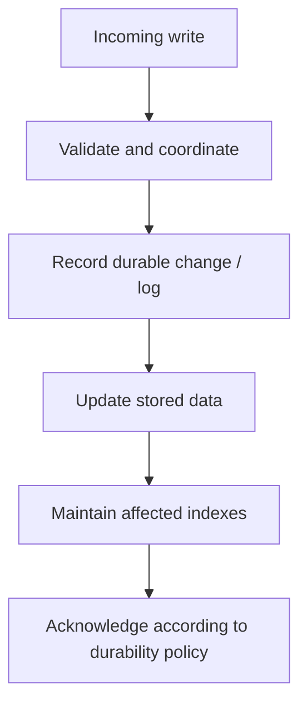
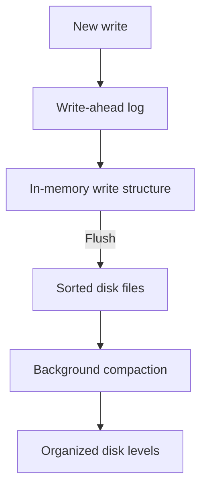
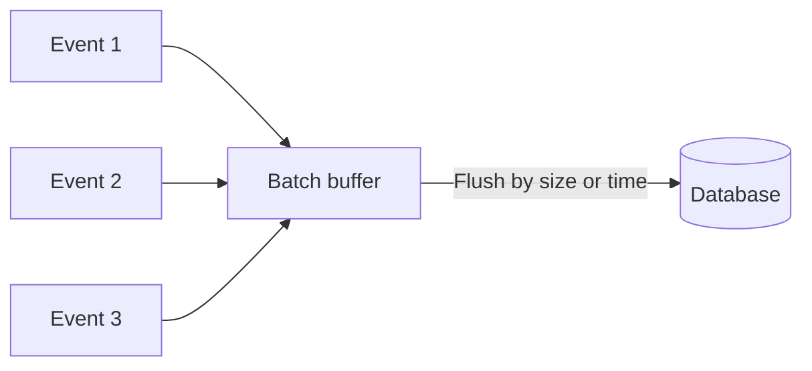
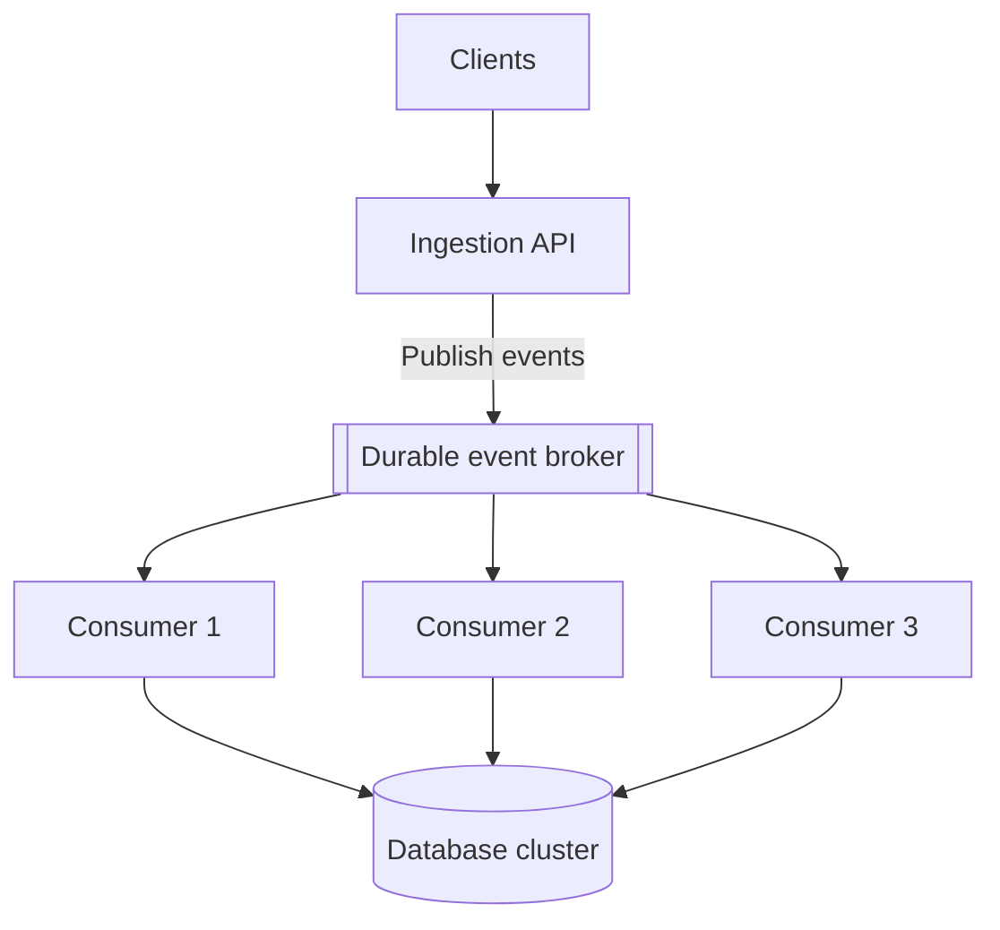
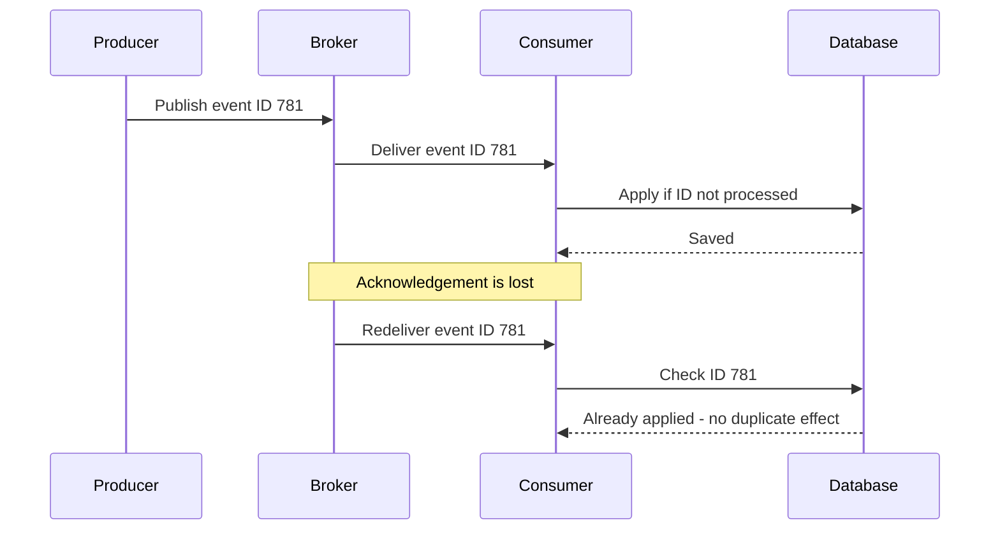
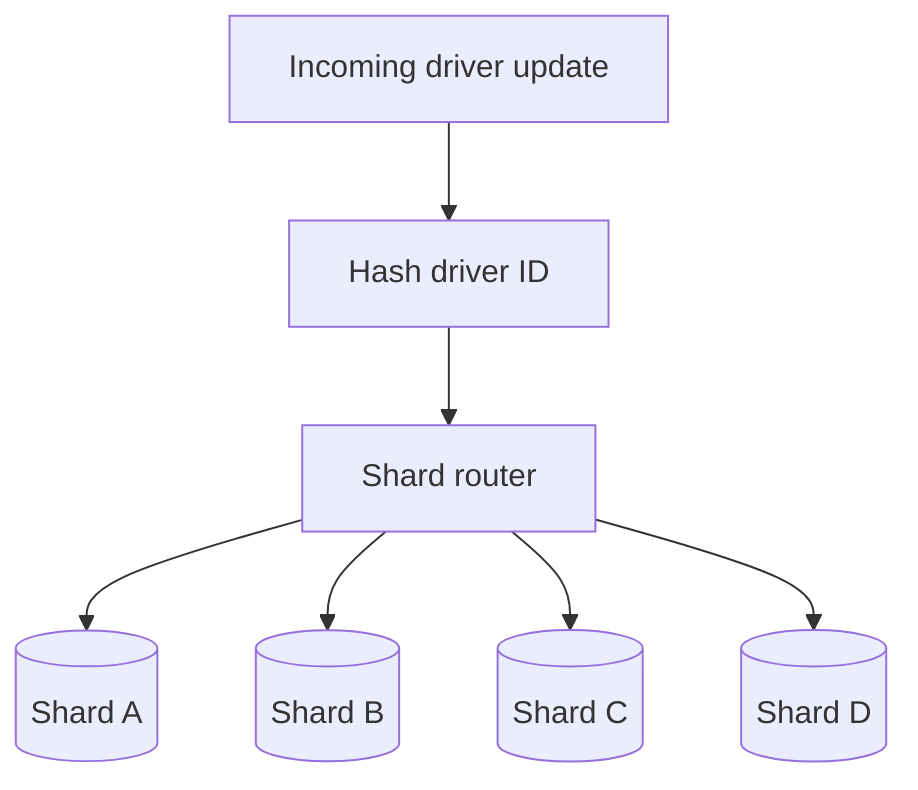
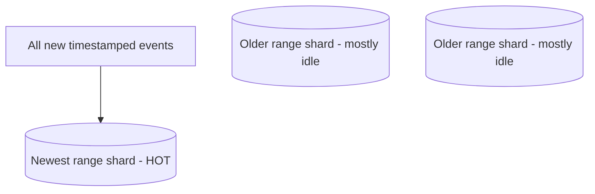
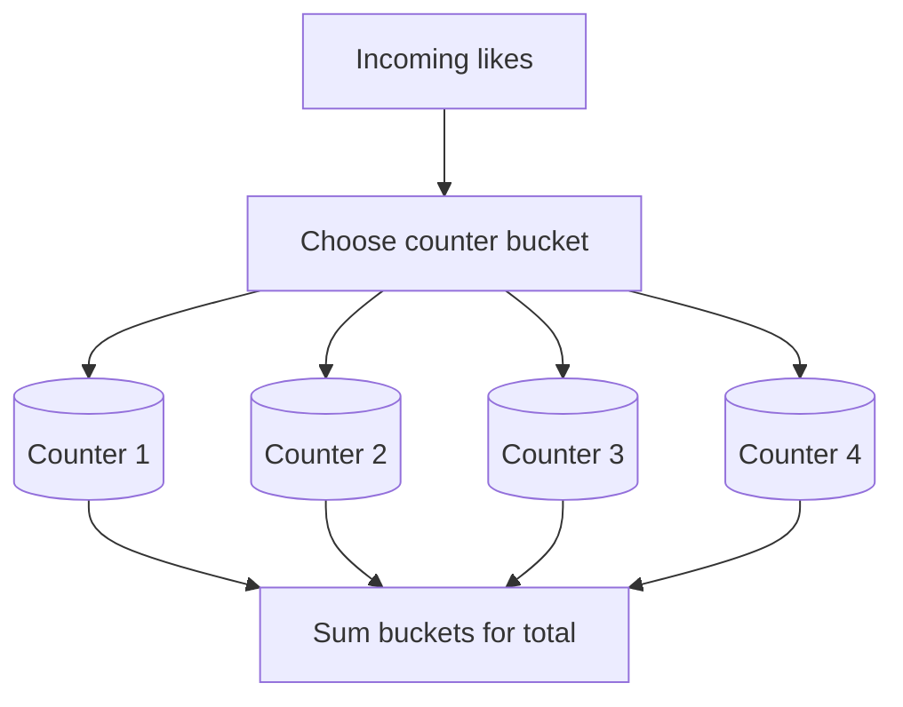
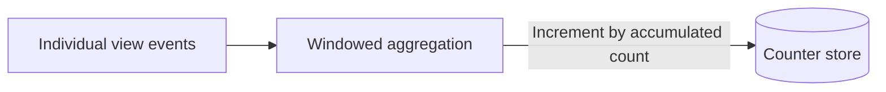
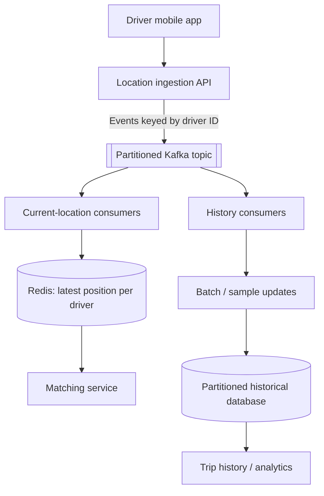

# Scaling Write-Heavy Systems — Practical System Design Notes

A practical guide to designing systems that receive a continuous stream of updates. Examples include location tracking, messaging, telemetry, engagement counters, and click events.

## Contents

1. [What makes a system write-heavy?](#1-what-makes-a-system-write-heavy)
2. [Estimate incoming traffic](#2-estimate-incoming-traffic)
3. [Make individual writes less expensive](#3-make-individual-writes-less-expensive)
4. [Batching writes](#4-batching-writes)
5. [Use a queue to absorb bursts](#5-use-a-queue-to-absorb-bursts)
6. [Partition the workload with sharding](#6-partition-the-workload-with-sharding)
7. [Avoid write hot spots](#7-avoid-write-hot-spots)
8. [Reduce the number of writes](#8-reduce-the-number-of-writes)
9. [Durability and acknowledgement](#9-durability-and-acknowledgement)
10. [Example: driver location updates](#10-example-driver-location-updates)
11. [System design interview framework](#11-system-design-interview-framework)
12. [Quick revision](#12-quick-revision)

---

## 1. What makes a system write-heavy?

A write-heavy service constantly receives new events or state changes. Unlike a popular page that can be read from a cache thousands of times, an incoming write usually requires some processing and a decision about how to store it.

Examples:

| System | Typical incoming writes |
|---|---|
| Ride-hailing | Updated driver coordinates |
| Chat application | New messages |
| Video platform | Views, reactions and engagement counts |
| Advertising | Click records |
| Monitoring platform | Logs, traces and metrics |

### Why can't we just add a cache or read replicas?

Caches and read replicas are useful for **serving reads**. They do not automatically increase the capacity of the system that accepts and persists **new writes**. Replicas generally need to apply changes too, so replication itself creates additional work.

A write can involve:

- Recording a change in a write-ahead log or equivalent durability mechanism.
- Updating the underlying data representation.
- Maintaining indexes.
- Checking constraints or coordinating concurrent changes.

The exact steps depend on the database engine and configuration.



This is a conceptual illustration, **not a fixed execution order** for every database.

## 2. Estimate incoming traffic

Suppose a location service has **5 million active devices**, each sending an update **every 4 seconds**.

```text
Average writes per second
= 5,000,000 / 4
= 1,250,000 writes/second
```

That is **1.25 million updates per second**, before allowing for spikes, retries, or additional event types.

A useful capacity estimate should include:

| Question | Why it matters |
|---|---|
| Average and peak write rate? | Size ingestion and storage capacity |
| Average event size? | Estimate network and storage throughput |
| Burst duration? | Determine required queue capacity |
| Must every event be retained? | Decide whether sampling/aggregation is acceptable |
| How quickly must data be queryable? | Set freshness targets |
| What data loss is tolerable? | Choose acknowledgement and replication policies |

Do not assume every update must be written directly into a single database table.

## 3. Make individual writes less expensive

### Keep only useful indexes

Indexes make lookups faster, but they have maintenance costs. An insertion may require updates to multiple indexes. Review query patterns and avoid indexing fields without a demonstrated need.

**Trade-off:** Fewer indexes can improve write throughput, but some reads become slower.

### Understand storage-engine trade-offs

Two broad approaches worth knowing are **B-tree-based indexing/storage** and **log-structured merge (LSM) designs**.

| Aspect | B-tree-oriented design | LSM-oriented design |
|---|---|---|
| General idea | Maintain searchable tree structures | Buffer updates, then flush sorted runs |
| Write behavior | May modify multiple tree pages | Often favors sequential flushes |
| Read considerations | Efficient indexed access | May need to search several levels/runs |
| Operational costs | Page updates and index maintenance | Compaction and write amplification |

Examples of products commonly associated with LSM-based storage include **RocksDB, Cassandra and ScyllaDB**. PostgreSQL and MySQL often use B-tree indexes, although their storage internals are more complex than a single tree.



**Important:** An LSM design is not always faster for every workload. Compaction, read amplification, consistency needs and actual hardware all matter. Benchmark with realistic traffic.

## 4. Batching writes

Instead of sending many tiny database operations independently, collect compatible updates and submit them together.



**Why batching helps:** It can amortize network calls, transaction setup and other per-operation overhead.

**Costs:**

- Data waits in the buffer, increasing visibility latency.
- An unprotected in-memory buffer can be lost in a crash.
- Very large batches can cause contention or memory pressure.

Batching is especially useful for logs, metrics and historical telemetry. For financial or other critical records, acknowledge success only after the required durability condition is met.

## 5. Use a queue to absorb bursts

Traffic rarely arrives at a perfectly even rate. A concert or flash sale might briefly generate far more events than a database can accept.

A **durable event log or message broker**, such as Kafka, can separate ingestion from slower downstream processing.



During a burst, pending events accumulate in the broker. Consumers continue at a sustainable rate and catch up afterward, **provided average processing capacity eventually exceeds incoming traffic**.

### What does the client acknowledgement mean?

If the API returns after the broker confirms an event, it should communicate **accepted for processing**, not necessarily **already stored in the final database**. An HTTP `202 Accepted` response may fit this contract.

### Design for duplicate delivery

A broker or consumer retry can lead to repeated processing. Attach an event identifier and ensure repeated delivery does not create duplicate effects.



For correctness, deduplication and the state change must be coordinated atomically or with an equivalent safe design.

## 6. Partition the workload with sharding

When one database cannot handle the required volume, **sharding** distributes different records among multiple database partitions.

For driver data, one possible routing rule is:

```text
shard = hash(driver_id) mod number_of_shards
```



### Estimate shard count

If one shard sustains **50,000 writes per second** under the target workload:

```text
1,250,000 / 50,000 = 25 shards
```

**25 is only the theoretical minimum** at full assumed capacity. Real systems need extra headroom for uneven load, maintenance, replication and spikes.

### Choosing a shard key

A useful key should:

1. Distribute writes relatively evenly.
2. Make common queries efficient.
3. Avoid putting every new write onto one machine.
4. Allow a workable resharding strategy.

**Driver ID** can be useful for looking up a driver's history. However, geographic proximity queries may need an additional spatial index or another data organization; hashing by driver ID alone does not make nearby-driver search efficient.

## 7. Avoid write hot spots

Even a sharded system can overload one partition or record.

### Problem A: sequential range keys

If data is range-sharded by increasing timestamp, all recent inserts may target the newest range.



Possible remedies include hash-based distribution, bucketed time partitions, or combining a time bucket with another key.

### Problem B: one extremely popular counter

A single counter row might receive tens of thousands of increments per second. Splitting it into multiple independent counter buckets spreads contention.



**Trade-off:** Increments become easier to distribute, but calculating an exact total can require reading several buckets. A cached or periodically materialized total can help when slight staleness is acceptable.

## 8. Reduce the number of writes

Sometimes the best scaling improvement is to avoid persisting every raw update.

### Aggregate events

Instead of updating a video view count after each view, a stream processor can accumulate increments over a short window and submit a combined update.



### Overwrite current state

If a matching service only needs each driver's latest position, it can keep **one current location per driver** in a fast state store, overwriting old coordinates.

If detailed historical records are required, a separate pipeline can retain a sampled or batched history.

**Ask:** Is the raw event legally, operationally or functionally required? If yes, do not discard it merely to reduce cost.

## 9. Durability and acknowledgement

Write throughput is not the only goal. The system must define **when a write counts as safely accepted**.

| Data category | Typical design priority | Potential approach |
|---|---|---|
| Payments and orders | Prevent loss and duplicate effects | Durable commit, replication, idempotency |
| Chat messages | Durable accepted messages | Durable storage before success confirmation |
| View counts | High throughput; small delay may be tolerable | Aggregation or asynchronous processing |
| Ephemeral location updates | Fresh current state | Overwrite latest state; optional history |
| Telemetry | Cost-efficient bulk ingestion | Batching, retention and sampling policies |

A queue is not automatically lossless. Safety depends on broker replication, producer acknowledgements, retention, consumer checkpoints and recovery procedures.

**Useful distinction:**

- **Accepted:** The ingestion layer has received the event.
- **Durably accepted:** The event has met the configured persistence/replication requirement.
- **Applied:** The downstream system has updated the target state.

Avoid presenting these as the same guarantee.

## 10. Example: driver location updates

This example combines several techniques for a high-volume stream of driver coordinates.



### Follow one location update

1. The driver's phone reports its position.
2. The ingestion service validates and publishes an event.
3. The broker buffers the event and partitions it by driver ID.
4. A live-state consumer overwrites that driver's current position.
5. A separate history pipeline batches or samples events for durable storage.
6. The matching service queries a current-location view when searching for drivers.

**Why this combination?**

| Component | Job |
|---|---|
| Broker | Absorb bursts and decouple processing |
| Current-state store | Fast lookup of recent positions |
| Batch processor | Reduce historical write overhead |
| Partitioned database | Spread historical storage and writes |

**Additional architecture consideration:** A nearby-driver query needs a spatial lookup strategy, not merely a map from driver ID to coordinates. Real deployments may use geospatial indexes, geohashes or dedicated matching infrastructure.

This diagram is a conceptual learning architecture, not a claim about any specific company's production implementation.

## 11. System design interview framework

A clear explanation is more persuasive than listing technologies:

1. **Clarify the workload:** write rate, peaks, event size, latency, retention and durability.
2. **Estimate capacity:** calculate average and peak writes per second.
3. **Question every write:** can updates be aggregated, sampled or overwritten?
4. **Reduce per-write cost:** revisit indexes, schema and storage-engine choice.
5. **Smooth spikes:** add a durable broker when asynchronous processing is acceptable.
6. **Scale storage:** shard on a key aligned with both write distribution and query patterns.
7. **Handle hot spots:** look for skewed keys and contended counters.
8. **Explain correctness:** cover duplicate delivery, ordering, consistency, durability and failure recovery.
9. **Validate with measurements:** monitor throughput, p95/p99 latency, queue lag, error rate and storage pressure.

### Example interview answer

> For a location tracking workload, I would first calculate the peak update rate and decide whether the product needs every historical point. I'd accept events through a durable ingestion layer, update a fast current-location view, and independently persist the required history in batches. If one storage node is insufficient, I'd distribute history using a suitable partition key and verify that nearby-driver queries have their own efficient access path. I'd then describe the durability guarantees, duplicate handling, queue lag and operational limits.

## 12. Quick revision

- Read scaling and write scaling solve different bottlenecks.
- Extra indexes can make writes more expensive.
- Batching improves efficiency but adds delay and may risk buffered data.
- Queues absorb temporary spikes; they do not remove the need for sufficient downstream capacity.
- Consumers should handle repeated event delivery safely.
- Sharding spreads data and write load, but a poor key creates hot spots.
- Popular counters may need multiple write buckets.
- Aggregation, sampling and overwriting can cut storage work when the product allows it.
- Strong durability guarantees must be designed and measured, not assumed.
- Always explain the trade-off between **throughput, freshness, cost and safety**.

---

**Related study material:** [Scaling Read-Heavy Traffic](Scaling_Read_Traffic_Study_Notes.md) · [Database Scaling, Consistency, Messaging & Resilience](Database_Scaling_Consistency_Messaging_and_Resilience.md)

