# Search and Type-Ahead (Autocomplete) — System Design Explained Simply

*Distributed Systems Study Library · Author: Jayesh Sharma*

**Learn how search engines find results in large document collections, rank them, scale across shards, and provide fast autocomplete suggestions while users type.**

> This is an independently written educational guide based on the supplied transcript. Explanations, examples, tables and Mermaid architecture diagrams are newly authored. Additional implementation notes cover authorization, privacy and technical trade-offs.

## Contents

- [1. Search and type-ahead: two different jobs](#1-search-and-type-ahead-two-different-jobs)
- [2. Requirements to clarify in a system-design interview](#2-requirements-to-clarify-in-a-system-design-interview)
- [3. Why a basic SQL LIKE search eventually struggles](#3-why-a-basic-sql-like-search-eventually-struggles)
- [4. What is an inverted index?](#4-what-is-an-inverted-index)
- [5. How a multi-word query works](#5-how-a-multi-word-query-works)
- [6. Text analysis: turn sentences into searchable terms](#6-text-analysis-turn-sentences-into-searchable-terms)
- [7. Typos, synonyms and exact phrases](#7-typos-synonyms-and-exact-phrases)
- [8. Ranking: why the first page matters](#8-ranking-why-the-first-page-matters)
- [9. Two-stage ranking: retrieve first, rerank second](#9-two-stage-ranking-retrieve-first-rerank-second)
- [10. Distributed search: shards and replicas](#10-distributed-search-shards-and-replicas)
- [11. Scatter-gather: query many shards at once](#11-scatter-gather-query-many-shards-at-once)
- [12. Keep the search index synchronized with the database](#12-keep-the-search-index-synchronized-with-the-database)
- [13. Fresh indexing, refresh delays and read consistency](#13-fresh-indexing-refresh-delays-and-read-consistency)
- [14. Search filters, geo queries and access permissions](#14-search-filters-geo-queries-and-access-permissions)
- [15. What is type-ahead (autocomplete)?](#15-what-is-type-ahead-autocomplete)
- [16. Tries: prefix trees explained with a small example](#16-tries-prefix-trees-explained-with-a-small-example)
- [17. Precompute top suggestions per prefix](#17-precompute-top-suggestions-per-prefix)
- [18. Build suggestion data from search logs](#18-build-suggestion-data-from-search-logs)
- [19. Client debouncing and multi-layer caching](#19-client-debouncing-and-multi-layer-caching)
- [20. Scale type-ahead with hot-prefix routing](#20-scale-type-ahead-with-hot-prefix-routing)
- [21. Full architecture: search and autocomplete together](#21-full-architecture-search-and-autocomplete-together)
- [22. Capacity estimates and practical trade-offs](#22-capacity-estimates-and-practical-trade-offs)
- [23. System design interview walkthrough](#23-system-design-interview-walkthrough)
- [24. Practice questions and quick revision](#24-practice-questions-and-quick-revision)

---

## 1. Search and type-ahead: two different jobs

Imagine opening an online shoe store. You type **running shoes** and press Enter: the app returns products. But while you type **run**, it also offers suggestions such as **running shoes** or **running socks**.

These are related, but different features:

| Feature | Input | Output |
|---|---|---|
| Search | Complete query | Matching documents or products, ordered by usefulness |
| Type-ahead (autocomplete) | Incomplete prefix | Suggested complete queries or names |

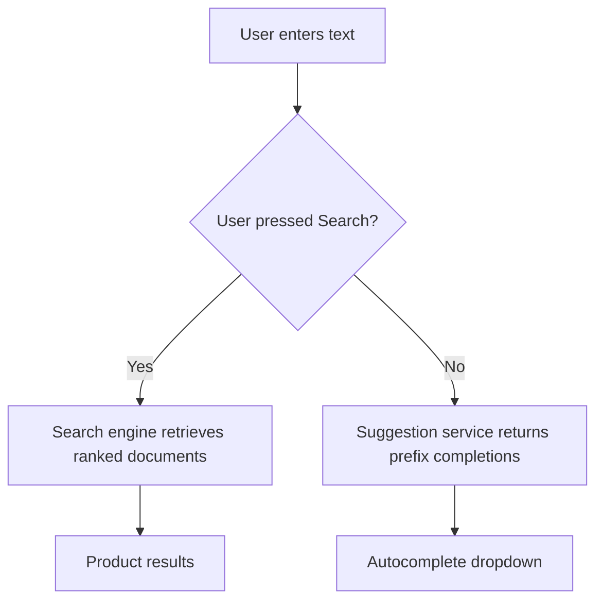

**Memory trick:** **Search finds documents. Type-ahead predicts what the user may want to search for.**

---

## 2. Requirements to clarify in a system-design interview

Search for a shop, a social feed, a workplace chat and nearby restaurants have different requirements.

| Product | Main search requirement |
|---|---|
| E-commerce | Keyword relevance plus price, brand, stock and rating filters |
| Local business directory | Matching category plus distance and opening hours |
| Team chat | Search only messages the user is allowed to view |
| Social content | Fresh posts, often ranked by recency and relevance |
| Autocomplete | Very quick suggestions while typing |

Ask about number of documents, query volume, peak traffic, freshness targets, filter types, permissions, supported languages and whether personalized suggestions are needed.

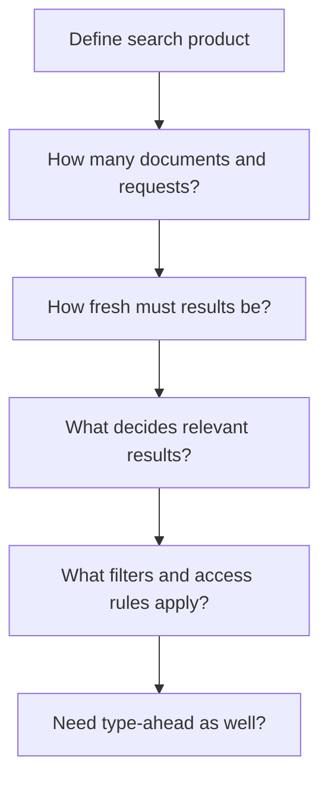

Start with an understandable **keyword search design**; introduce semantic/vector search only if the product requires it.

---

## 3. Why a basic SQL LIKE search eventually struggles

A small application might start with:

```sql
SELECT id, title
FROM products
WHERE LOWER(title) LIKE '%running shoes%';
```

This is easy to write, but matching an arbitrary substring across millions of records can be expensive with an ordinary B-tree index. It also does not automatically understand word order variations, typos or relevance.

For example, **running shoes**, **shoes for running**, and **runing shoes** should often return overlapping results.

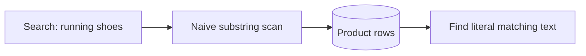

**Nuance:** Databases offer full-text search, trigram indexes and specialized indexing options. `LIKE` is not *always* slow, and a dedicated search cluster is not necessary for every product.

The central concept to understand is the **inverted index**.

---

## 4. What is an inverted index?

A traditional table stores a document and its words. An **inverted index** maps each searchable term **back to the documents containing it**.

Suppose our product catalog has these items:

| ID | Product title |
|---|---|
| P1 | Red running shoes |
| P2 | Blue running jacket |
| P3 | Red leather shoes |

An index might contain:

| Term | Document IDs |
|---|---|
| red | P1, P3 |
| running | P1, P2 |
| shoes | P1, P3 |
| jacket | P2 |
| leather | P3 |

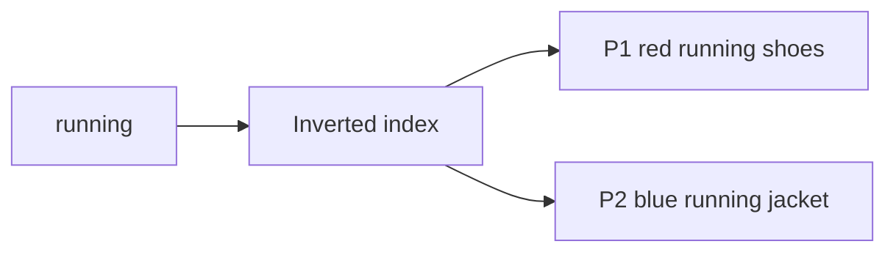

The lists attached to each term are called **posting lists**. Search checks a few relevant lists instead of repeatedly inspecting every entire document.

---

## 5. How a multi-word query works

A user searches for **running shoes**.

From our index:

```text
running → [P1, P2]
shoes   → [P1, P3]
AND match (intersection) → [P1]
OR match (union)         → [P1, P2, P3]
```

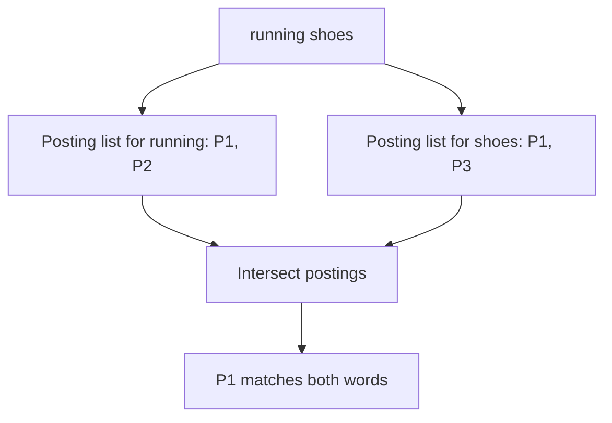

A real engine can choose whether all words are required, whether partial matches are allowed and how to score each result.

Posting lists can also store **term frequency** and **term positions**, helping with phrase matching and ranking.

The time to process a query depends on indexes, posting-list sizes, filtering and scoring. Avoid claiming search speed is independent of data size.

---

## 6. Text analysis: turn sentences into searchable terms

Before adding text to an index, the engine typically runs an **analyzer** that transforms text into tokens.

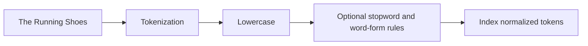

Common stages:

1. **Tokenization:** Split input into tokens or meaningful language units.
2. **Case normalization:** Treat `Running` and `running` consistently.
3. **Stopword rules:** Optionally remove extremely common words.
4. **Stemming or lemmatization:** Normalize related word forms when appropriate.
5. **Synonyms:** Map or expand related terms, such as sneakers and athletic shoes.

Use compatible analysis for indexing and searching. But not every field should use the same analyzer: product identifiers, exact brand names and legal phrases may require precise matching.

**Important:** English tokenization rules cannot simply be copied to every language.

---

## 7. Typos, synonyms and exact phrases

Users rarely type perfectly. They may search **runing shoes** instead of **running shoes**.

Search engines may use **fuzzy matching** based on edit distance to find near-matching terms. Synonym rules improve concept coverage, and indexed positions help with exact phrases.

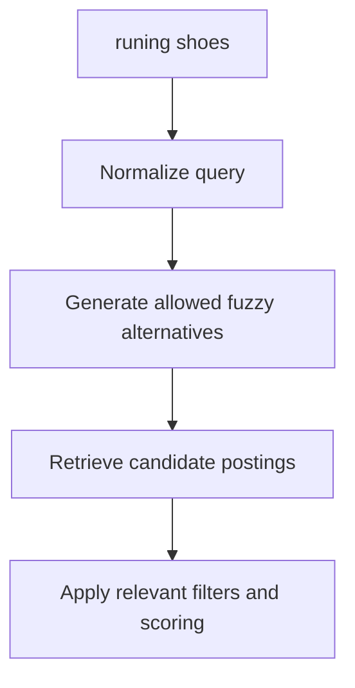

Trade-offs matter:

- Too much fuzziness returns unrelated items.
- Broad synonyms can confuse product categories.
- Exact names, SKU codes and IDs often require strict matching.
- Phrase search may use term order and positions.

Choose matching rules by field and query intent rather than enabling fuzzy search everywhere.

---

## 8. Ranking: why the first page matters

A broad query such as **shoes** could match thousands of products, so merely finding matches is not enough.

One common keyword relevance function is **BM25**, which considers term occurrence, how rare the terms are across documents, and document-length effects.

Other business signals may include popularity, freshness, rating, availability and geographical distance.

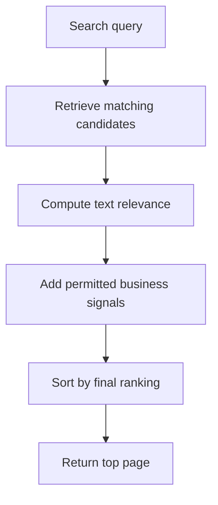

**Simple example:** A result matching a rare brand name in the title may outrank a generic product description mentioning that brand once.

Be careful with ranking objectives: paid promotions, safety policies and diversity rules should be explicit, not hidden in an unexplained score.

---

## 9. Two-stage ranking: retrieve first, rerank second

Calculating an expensive scoring model for every document in a large index would be slow.

A common architecture has **candidate retrieval** followed by **reranking**:

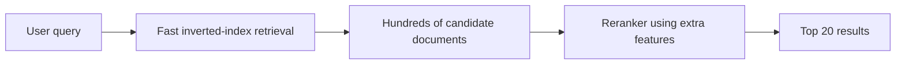

The first stage narrows the candidate set using efficient text matching. The second may combine richer relevance, recent engagement, stock status or location.

**Trade-off:** Reranking can improve quality, but it cannot recover a perfect document that the candidate-generation stage never retrieved.

Measure both search latency and actual result quality.

---

## 10. Distributed search: shards and replicas

For large datasets, search engines such as Elasticsearch or OpenSearch may split documents across **shards**. Each shard builds an inverted index for its own documents.

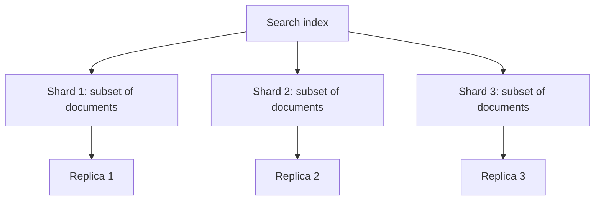

**Shards** divide index data and processing. **Replicas** can improve availability and distribute eligible read requests.

Adding shards is not free: excessive shards increase metadata, coordination and merge overhead. Adding replicas increases storage and replication work.

Choose the layout based on actual index size, query traffic, update rate and failure tolerance.

---

## 11. Scatter-gather: query many shards at once

A coordinating search node can query several shards concurrently. Each shard returns local matches, which the coordinator merges into one result page.

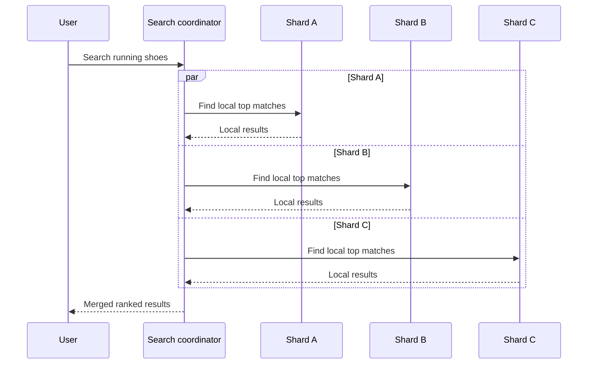

This pattern is called **scatter-gather**.

**Cost:** A slow shard can delay the whole query; this is a *tail-latency* challenge. Replicas, caching, selective routing and appropriate timeouts may help.

The transcript describes broad fan-out to shards as a typical design. Real search products may optimize shard selection depending on routing and query constraints.

---

## 12. Keep the search index synchronized with the database

A product's official price generally belongs to the product database, not to the search index.

Updating the database and Elasticsearch with two unrelated writes is unsafe: the application can crash between them, or changes can reach the index out of order.

A durable synchronization path might look like this:

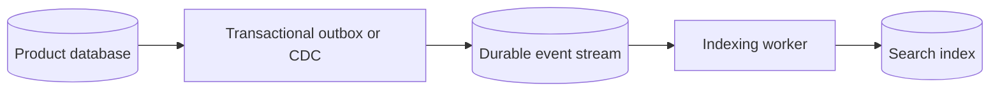

A worker should handle **duplicate events** and **older versions** safely, rather than overwriting newer indexed data.

Related guide: [Data Synchronization, CDC and Reconciliation](Data_Synchronization_CDC_and_Reconciliation.md).

**Key trade-off:** A derived search index is often **eventually consistent**: a successful DB update does not mean the search index is current immediately.

---

## 13. Fresh indexing, refresh delays and read consistency

When a new social post is created, the product may want it to appear in search quickly.

The indexer must consume the change, write it to the search system, and then wait for it to become **search-visible**. In systems such as Elasticsearch this can involve a refresh step; refresh behavior is configurable and depends on index state.

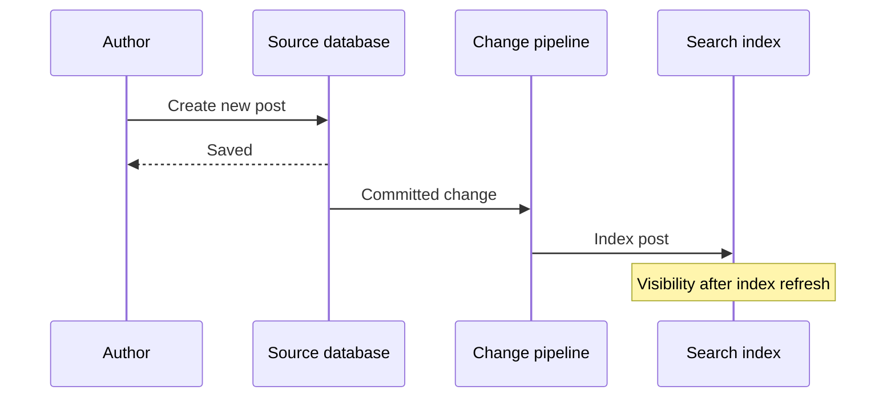

For freshness-sensitive products, teams may use additional techniques such as a separate small index for recent posts, or combining recent authoritative data with indexed results.

**Do not promise “searchable in exactly one second.”** Queue lag, refresh settings and indexing load all matter. Monitor time from source commit to search visibility.

---

## 14. Search filters, geo queries and access permissions

Some searches need more than text matches.

For a restaurant finder, a request might be **pizza, within 5 km, currently open, highly rated**. For a workplace chat application, results must be restricted to messages the caller is authorized to see.

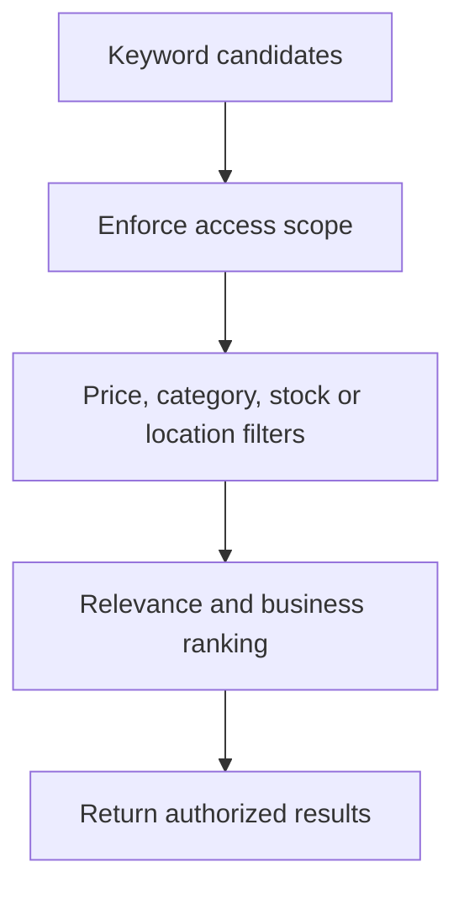

Geographic filtering may use spatial indexes and distance calculations. “Open now” requires trustworthy opening-hours data and time-zone handling.

**Security:** Never trust a client-supplied filter alone to enforce authorization. The server must restrict searchable data to the caller's permitted scope and avoid leaking private information through snippets, counts or suggestions.

---

## 15. What is type-ahead (autocomplete)?

Type-ahead answers a different question: **“What complete query might this prefix mean?”**

For example:

```text
Typed prefix: "how to t"
Possible suggestions:
- how to tie a tie
- how to take screenshots
- how to train a puppy
```

Those are **illustrative sample suggestions**, not live search-trend data.

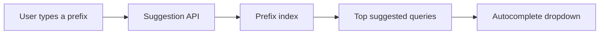

Type-ahead usually has a stricter latency budget than a full search page because results need to appear between keystrokes. A target around 100 ms may be useful as a design example, but the actual SLO depends on device, network and product.

Suggestions may be built from anonymized query statistics, curated phrases, product names or a mixture.

---

## 16. Tries: prefix trees explained with a small example

A **trie** is a tree where each edge represents a character or token. A path from the root spells out a prefix.

Consider the words **cat**, **car**, and **cart**.

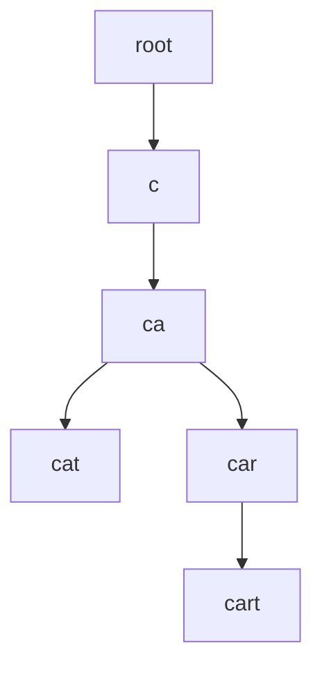

Finding the node for `car` takes work proportional to the prefix length in a simple character trie. After reaching that node, all `car...` completions live beneath it.

**Challenge:** A popular prefix could have millions of matching phrases. Walking the entire subtree on every keystroke is too slow.

A scalable suggestion system therefore frequently **precomputes the best few suggestions at each prefix**, or stores a prefix-to-suggestions lookup table.

---

## 17. Precompute top suggestions per prefix

Suppose the prefix `how to t` has thousands of possible continuations. Rather than sorting them on each request, store only the **top K** candidates for that prefix.

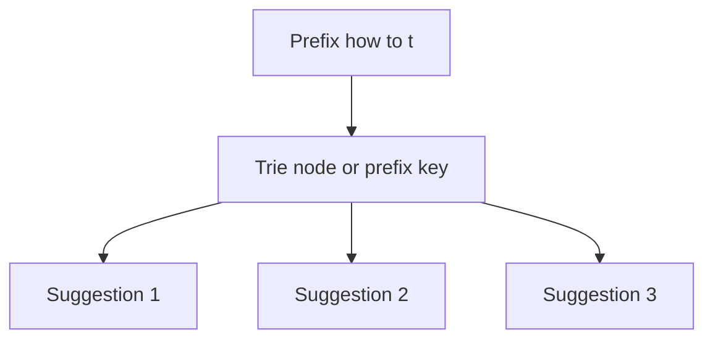

For example:

```text
key: "how to t"
value: ["how to tie a tie", "how to take screenshots", "how to train a puppy"]
```

**Benefit:** A request can retrieve the stored list quickly.

**Trade-off:** The same popular suggestion may be repeated at many prefixes, increasing memory or storage use. Keep lists short, exclude very rare suggestions, compress representations and distribute hot prefixes appropriately.

A trie is not mandatory. A **key-value store of prefix → top suggestions** can offer similar lookup behavior and be easier to partition.

---

## 18. Build suggestion data from search logs

Query logs provide signals about which phrases users search for. A background pipeline can aggregate frequencies over a selected time window and build a new suggestion dataset.

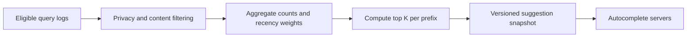

**Key design choices:**

- How much should recent searches outweigh older ones?
- Should only queries with sufficient frequency become suggestions?
- How are abusive, sensitive or personally identifiable queries filtered?
- How does the system roll out a new suggestion version without partial updates?

Typically, **read-optimized serving data is rebuilt periodically**, rather than mutating every trie node after each search. A separate fast-moving trend pipeline may contribute timely suggestions between full rebuilds.

**Privacy:** Avoid exposing rare or identifying queries through autocomplete.

---

## 19. Client debouncing and multi-layer caching

Typing eight characters does not need to trigger eight expensive backend requests.

**Debouncing** means the client waits briefly after the last keystroke before making a request. It can also cancel requests for prefixes that are no longer relevant.

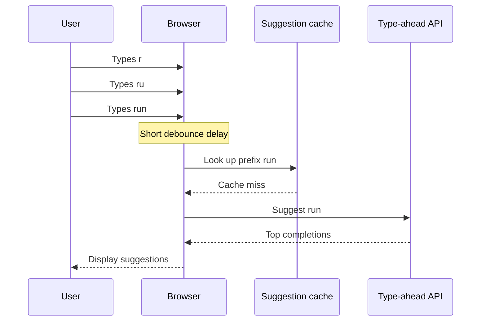

Cache layers may include the browser, CDN for public nonpersonalized responses, and server-side in-memory or distributed caches.

**Caution:** Personalized or tenant-private suggestions should not be served from a public shared cache without correct isolation. Cache keys must reflect language, location, policy and personalization where those materially affect the response.

---

## 20. Scale type-ahead with hot-prefix routing

Autocomplete gets disproportionate traffic on short common prefixes such as `a`, `the` or `how`.

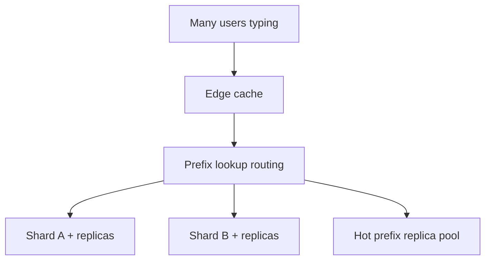

One scaling method assigns groups of prefixes to servers, but alphabetical ranges are not evenly popular. Partition by **observed load** and replicate unusually hot prefix data.

Monitor **request rate, p95/p99 suggestion latency, cache hit rate, hot keys, rebuild duration and suggestion quality**.

A separate source of personalized recent searches can be merged with general suggestions on the client or via an authorized backend.

---

## 21. Full architecture: search and autocomplete together

The complete design contains **two request paths** and **two kinds of data preparation**:

```mermaid
flowchart TD
 USERS["User interface"] --> SEARCHAPI["Search API"]
 USERS --> SUGAPI["Type-ahead API"]
 SOURCE[("Authoritative database")] --> CHANGE["Outbox / CDC"]
 CHANGE --> INDEXER["Search indexing workers"]
 INDEXER --> INDEX[("Sharded search index")]
 SEARCHAPI --> INDEX
 QUERYLOG["Eligible search queries"] --> AGG["Aggregate and filter suggestions"]
 AGG --> PREFIX[("Versioned prefix lookup")]
 SUGAPI --> PREFIX
```

The Search API fetches ranked document matches and enforces filters or access scope. The Type-ahead API serves quick prefix completions from a precomputed dataset.

The same product may share monitoring and query understanding, but **they need not use the same physical index or serving infrastructure**.

**Related topics:** [Data Synchronization](Data_Synchronization_CDC_and_Reconciliation.md) and [Handling Long-Running Tasks](Handling_Long_Running_Tasks_System_Design.md).

---

## 22. Capacity estimates and practical trade-offs

Suppose **100,000 users** each perform ten searches per day. That's one million searches daily.

```text
Average search requests per second
= 1,000,000 / 86,400
≈ 11.6 RPS
```

That average hides peak bursts. If every query causes five type-ahead requests before submission, autocomplete could receive **five million calls per day** before debouncing and caching.

```mermaid
flowchart TD
 USERS["Search demand"] --> FULL["Full search RPS"]
 USERS --> PREFIX["Autocomplete RPS"]
 PREFIX --> DEBOUNCE["Client debounce"]
 DEBOUNCE --> CACHE["Cache common prefixes"]
 FULL --> SHARDS["Shard / replica capacity"]
 CACHE --> SERVE["Type-ahead replica capacity"]
```

These figures illustrate estimation, not production guarantees. For real planning, measure **peak QPS, index size, indexing rate, cache efficiency, read/write contention and shard-tail latency**.

Do not estimate performance using only the count of indexed documents: query complexity and postings distribution matter.

---

## 23. System design interview walkthrough

A strong search-system answer can follow this sequence:

1. **Clarify:** Data type, size, query rate, freshness, filters, permissions and type-ahead.
2. **Retrieve:** Explain inverted indexes and postings.
3. **Analyze:** Tokenization, normalization, stemming, synonyms and typo handling.
4. **Rank:** BM25 or similar text relevance; add suitable signals and reranking.
5. **Scale:** Shards, replicas, scatter-gather and caching.
6. **Synchronize:** Durable database-to-index changes with CDC/outbox and safe replay.
7. **Type-ahead:** Trie or prefix map with precomputed top suggestions.
8. **Build suggestions:** Aggregate eligible query logs, filter and publish snapshots.
9. **Operate:** Debounce, cache, measure freshness and tail latency.

```mermaid
flowchart TD
 REQ["Requirements"] --> INVERT["Inverted index"]
 INVERT --> RANK["Rank and filter"]
 RANK --> SCALE["Sharding and replication"]
 SCALE --> SYNC["Index updates"]
 SYNC --> PREFIX["Autocomplete lookup"]
 PREFIX --> OPS["Caching and observability"]
```

### Interview-ready explanation

**“For product search, I would keep products in the main database and maintain a derived inverted index in a search service. Queries would tokenize text, retrieve postings, combine relevance with product filters, then scatter-gather results across shards. A CDC or outbox pipeline would keep the index fresh. For type-ahead, I would serve precomputed top queries by prefix, rebuilt from privacy-filtered search statistics, with client debouncing and caching.”**

---

## 24. Practice questions and quick revision

### Interview questions

1. How does search differ from type-ahead?
2. Why may `LIKE '%term%'` be unsuitable for millions of records?
3. What is an inverted index?
4. What is a posting list, and how do two posting lists intersect?
5. Why are tokenization and normalization important?
6. Compare stemming, synonyms, fuzzy matching and phrase matching.
7. What does BM25 broadly measure?
8. Why separate candidate retrieval and reranking?
9. What is the difference between a shard and a replica?
10. How does scatter-gather work, and what causes tail latency?
11. How can the search index be kept current with the primary DB?
12. Why are newly indexed documents not always immediately searchable?
13. What is a trie, and why store top-K candidates at prefix nodes?
14. How can type-ahead use query logs without exposing private information?
15. What does debouncing accomplish?
16. How do you scale unevenly popular prefixes?
17. How would you enforce access permissions during search?
18. How would you monitor search quality and freshness?

### One-minute revision table

| Term | Meaning |
|---|---|
| Full-text search | Find documents matching terms and relevance rules |
| Inverted index | Term → document posting list |
| Posting list | Documents containing a token, often with extra metadata |
| Analyzer | Transforms text into searchable tokens |
| Fuzzy query | Permits controlled near-matches |
| BM25 | Keyword relevance scoring family |
| Reranker | Applies more detailed scoring to candidate matches |
| Shard | Subset of indexed documents |
| Replica | Additional copy of a shard for resilience/read load |
| Scatter-gather | Query shards in parallel, then merge results |
| CDC / outbox | Reliable source-to-index change propagation |
| Trie | Prefix tree |
| Top K | Best few suggestions stored for a prefix |
| Debounce | Wait briefly after typing before requesting |
| Origin of suggestions | Filtered and aggregated query statistics |

**Final takeaway:** **Search retrieves and ranks documents efficiently with an inverted index. Type-ahead serves likely completions from a prefix index.** Both require careful data preparation, scaling, synchronization and measurement.

---
