# System Design Series 2 — Request Journey, APIs, Communication & Distributed Databases

> Study notes adapted from **System Design series -2**, by Jayesh Sharma (45-slide presentation). Wording is organized for reading on GitHub. Mermaid diagrams are explanatory redraws of the presentation concepts, not pixel-for-pixel reproductions of slide artwork.

## Contents

1. [How a web request travels](#1-how-a-web-request-travels)
2. [IP addresses and DNS](#2-ip-addresses-and-dns)
3. [TCP vs UDP](#3-tcp-vs-udp)
4. [HTTP vs HTTPS](#4-http-vs-https)
5. [APIs, methods and status codes](#5-apis-methods-and-status-codes)
6. [REST API design](#6-rest-api-design)
7. [Idempotency](#7-idempotency)
8. [Communication patterns](#8-communication-patterns)
9. [SQL vs NoSQL](#9-sql-vs-nosql)
10. [Distributed databases and CAP theorem](#10-distributed-databases-and-cap-theorem)
11. [Design exercise: notification system](#11-design-exercise-notification-system)
12. [Revision checklist](#12-revision-checklist)

---

## 1. How a web request travels

**Scenario:** You type `www.amazon.com` into your browser and press Enter. What happens next?

At a high level:

1. The browser interprets the URL: **scheme** (`https`), **domain** (`www.amazon.com`), and **path** (for example `/products/123`).
2. The browser obtains the server's IP address using **DNS**, unless it already has a suitable cached result.
3. A connection is established. In the TCP-based HTTPS example in the slides, that means **TCP**, followed by **TLS** security negotiation.
4. The browser sends an **HTTPS request**.
5. The request reaches application infrastructure; the relevant service processes it.
6. The server sends an **HTTP response**, and the browser displays the result.

### End-to-end request journey

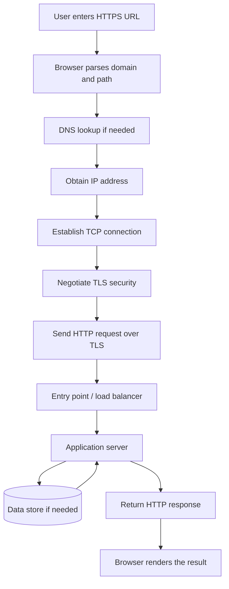

**Note:** The load balancer and data store are illustrative components; a real request may use more, fewer, or different services. Modern HTTP/3 can use QUIC over UDP instead of TCP.

### Reading a URL

For `https://example.com/products/123`:

| Part | Value | Meaning |
|---|---|---|
| Scheme | `https` | Use secured HTTP communication |
| Domain | `example.com` | Which site or service |
| Path | `/products/123` | Which resource |

**Analogy:** The domain is a company's address; the path tells the company what you are looking for.

---

## 2. IP addresses and DNS

An **IP address** is a numerical address used by networks to locate and communicate with a device. A domain name is easier for people to remember.

- **Domain name:** human-friendly name, such as `example.com`.
- **IP address:** address used by Internet routing, such as `192.0.2.10` (documentation example).
- **DNS:** Domain Name System, which helps resolve the name to an address.

### DNS lookup

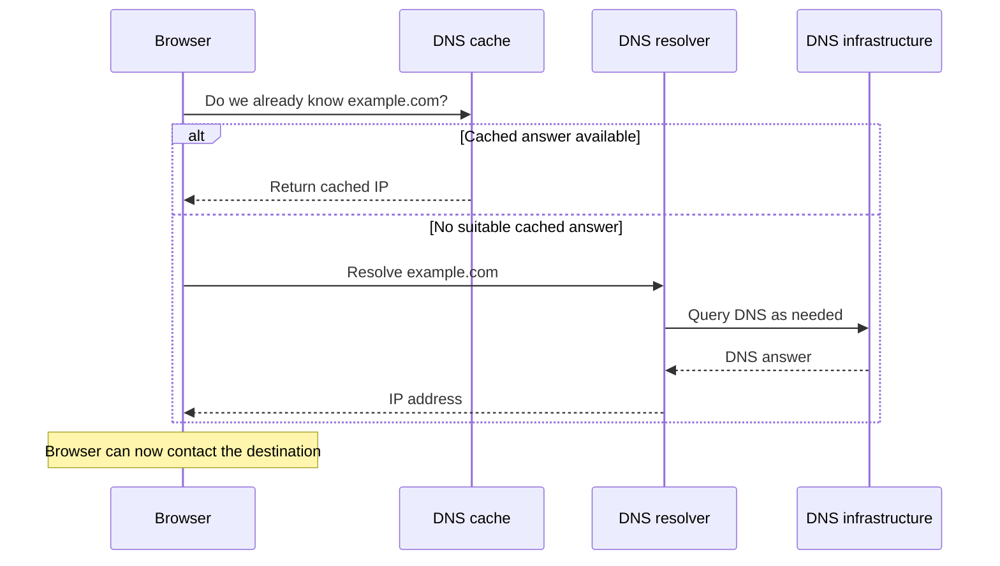

**Analogy:** DNS is like the Internet's phonebook. Knowing a person's name is not the same as knowing where to deliver a parcel.

---

## 3. TCP vs UDP

TCP and UDP both transport data between applications, but they make different trade-offs.

| Property | TCP | UDP |
|---|---|---|
| Connection | Connection-oriented | Connectionless |
| Built-in reliable delivery | Yes, using acknowledgements and retransmission | No |
| Ordering | Preserves byte-stream order | No built-in ordering |
| Typical examples | HTTP/1.1 and HTTP/2 over TCP | Real-time media, DNS, QUIC transport |
| Simple analogy | Courier with tracking and confirmation | Live announcement |

**TCP:** “Did you receive my package?” If not, the sender can retransmit.

**UDP:** “Keep broadcasting.” The transport does not automatically recover a missed message.

**Choose TCP** when correct, ordered delivery is important. **Choose UDP** when the application benefits from lower transport overhead or needs to implement its own delivery behavior.

> UDP is not automatically faster in every application: it simply offers fewer built-in reliability mechanisms.

---

## 4. HTTP vs HTTPS

- **HTTP** defines how clients and servers exchange requests and responses.
- **HTTPS** is HTTP protected with TLS.

TLS provides three important protections:

1. **Encryption:** others cannot easily read traffic in transit.
2. **Integrity:** changes made to traffic in transit can be detected.
3. **Authentication:** certificates help the client verify the intended server.

### HTTPS request flow (simplified)

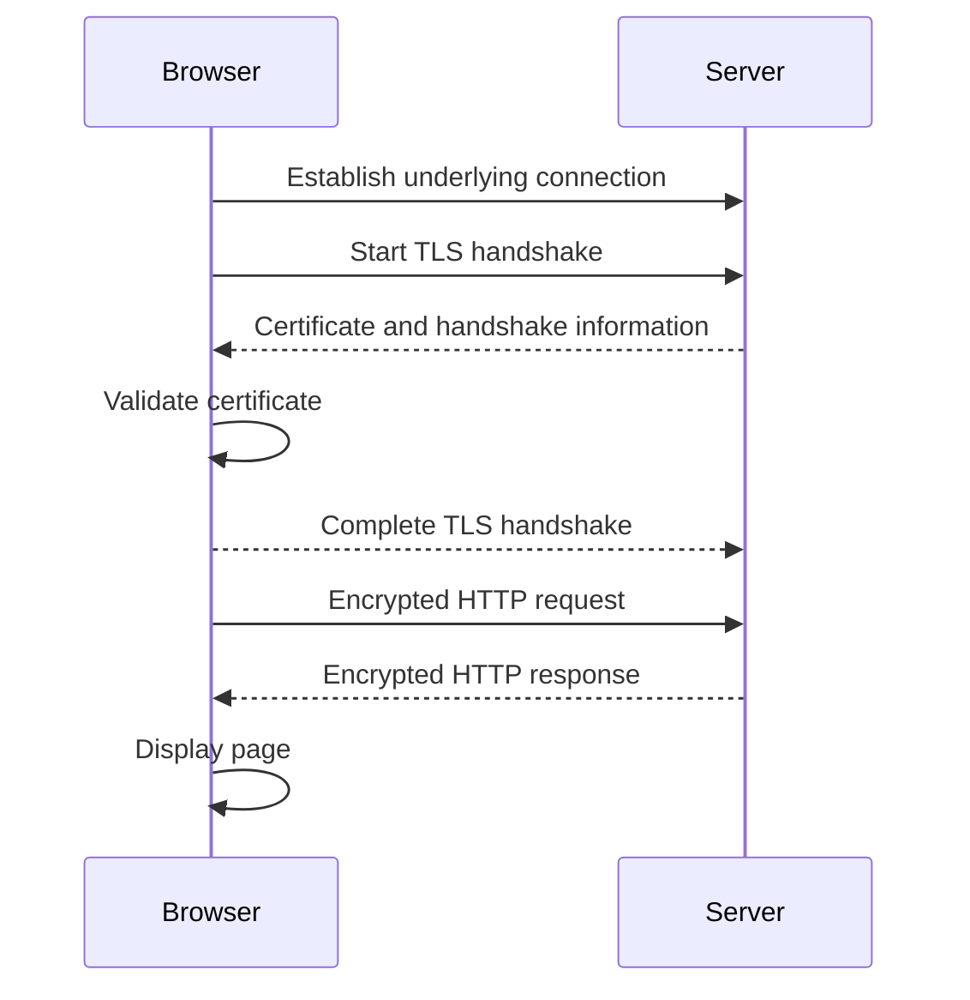

This simplified diagram omits cryptographic details. HTTPS is important for logins, payments, APIs and ordinary modern web traffic.

---

## 5. APIs, methods and status codes

An **API (Application Programming Interface)** is a contract that lets software applications communicate. It defines which requests are supported, which inputs to send, and which responses to expect.

### Request-response API

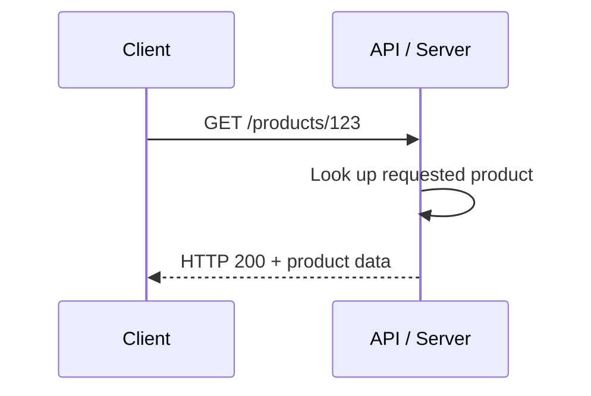

### HTTP methods

| Method | Purpose | Example |
|---|---|---|
| `GET` | Read a resource | Get product details |
| `POST` | Submit data / commonly create a resource | Create a product |
| `PUT` | Replace a resource's representation | Replace product |
| `PATCH` | Apply a partial modification | Change product price |
| `DELETE` | Remove a resource | Delete product |

**Methods tell the server what action is requested; status codes tell the client what happened.**

### Common HTTP status codes

| Code | Meaning | Typical situation |
|---|---|---|
| `200 OK` | Request succeeded | Product fetched |
| `201 Created` | Resource created | Product added |
| `204 No Content` | Success without response body | Delete succeeded |
| `400 Bad Request` | Invalid request | Invalid input |
| `401 Unauthorized` | Authentication required or invalid | Missing/invalid credentials |
| `403 Forbidden` | Access denied | User lacks permission |
| `404 Not Found` | Resource unavailable | Unknown product ID |
| `409 Conflict` | Conflicting operation | Resource state conflict |
| `429 Too Many Requests` | Rate limit exceeded | Too many API calls |
| `500 Internal Server Error` | Server error | Unexpected failure |
| `503 Service Unavailable` | Service temporarily unavailable | Overload or maintenance |

The slide deck introduces status codes; the table supplies commonly used examples for reference.

---

## 6. REST API design

**REST** is a common way to design HTTP APIs around resources.

- **URL = Which resource?**
- **HTTP method = Which action?**

| Request | Meaning |
|---|---|
| `GET /products` | List products |
| `GET /products/123` | Fetch product 123 |
| `POST /products` | Create a product |
| `PATCH /products/123` | Modify product 123 |
| `DELETE /products/123` | Remove product 123 |

### Good API design practices

**1. Use nouns for resources.** Prefer `/products/123` to action-oriented URL names such as `/getProduct/123`.

**2. Return meaningful HTTP status codes.** A successful creation commonly uses `201`; missing resources commonly use `404`.

**3. Use query parameters for filtering and pagination.** Example: `GET /products?category=books&page=2&limit=20`.

**4. Return consistent response shapes.** Clients should not have to guess how success or failure is represented.

Illustrative success response:

```json
{
  "id": 123,
  "name": "Wireless Mouse",
  "price": 999
}
```

Illustrative error response:

```json
{
  "error": {
    "code": "PRODUCT_NOT_FOUND",
    "message": "Product 123 was not found"
  }
}
```

These JSON shapes are examples; the slide deck gives the design principles, not a mandatory response schema.

---

## 7. Idempotency

**Idempotency** means repeating the same operation does not produce additional unintended effects.

Why it matters: a payment may succeed, but the client might lose the response and retry. The system must avoid charging twice.

### Without an idempotency key (risk)

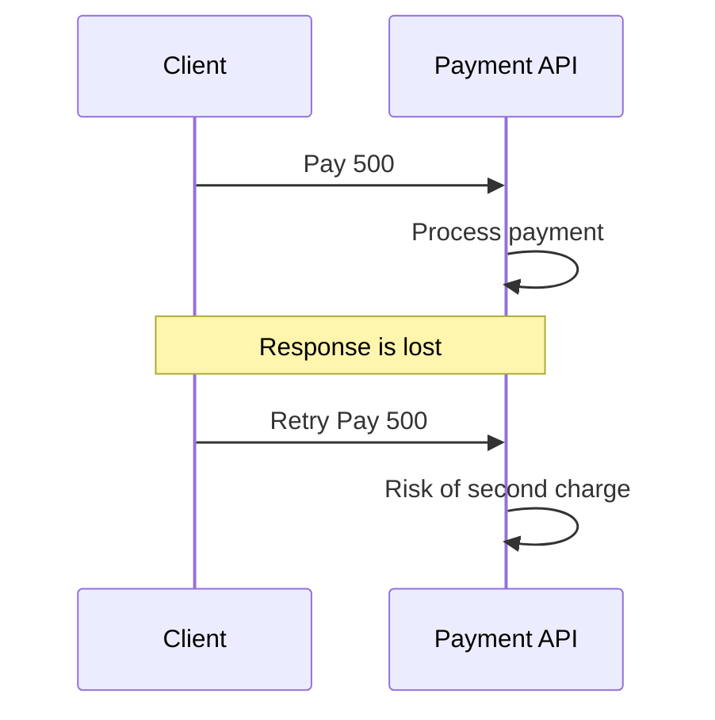

### With an idempotency key

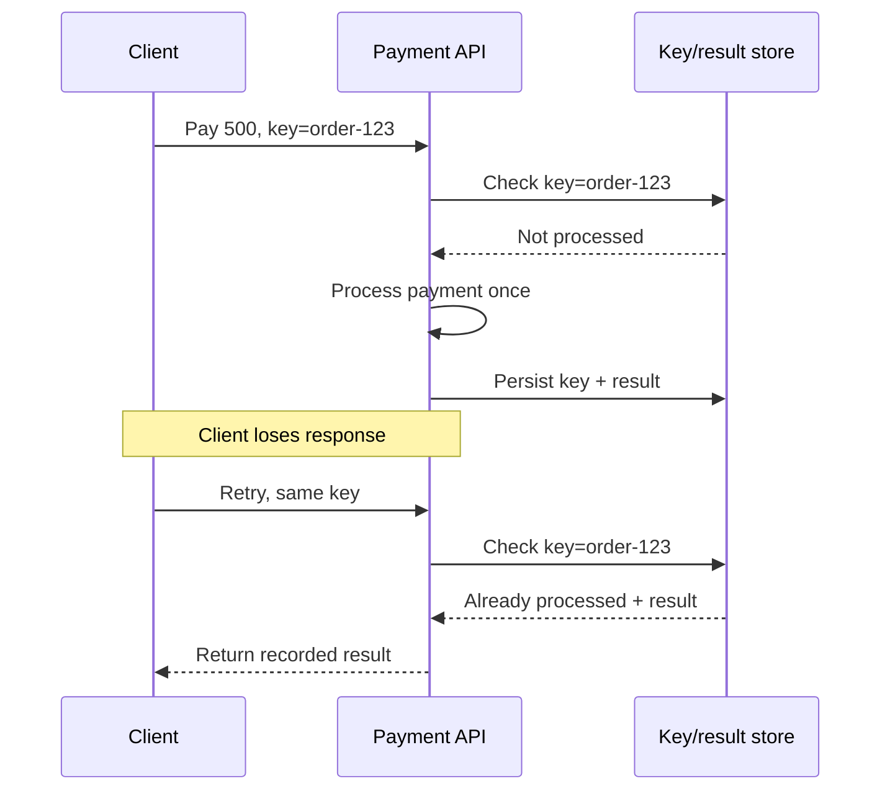

In production, the key check and state change need safe concurrency handling; a key alone does not prevent simultaneous duplicates.

---

## 8. Communication patterns

Communication patterns describe how services exchange information.

### Synchronous communication

The caller waits for a reply. Common examples: HTTP/REST and gRPC.

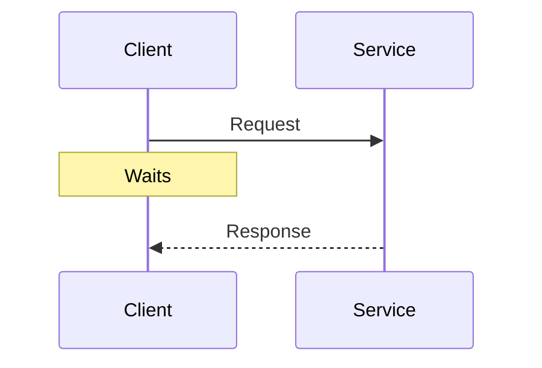

**Analogy:** A phone call. You wait for an answer.

Good for login, search, getting product details, and checking account information.

### Asynchronous communication

The caller does not wait for all processing to finish.

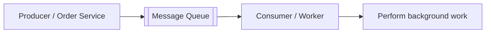

**Analogy:** A text message. Send it and continue.

Good for emails/SMS, image processing, reports, order-processing steps, and analytics.

### Request-response vs queue vs publish/subscribe

**Request-response:** one caller asks for an answer.

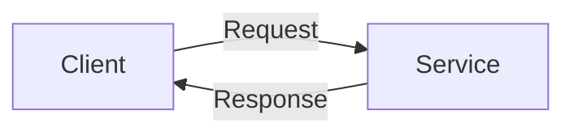

**Message queue:** a producer sends a task; a consumer processes it.

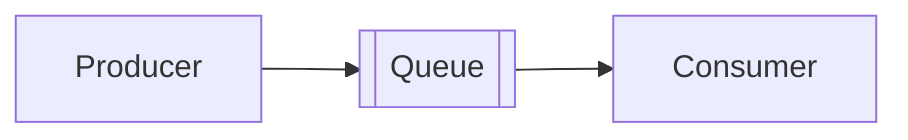

**Publish/subscribe:** one event is delivered to multiple interested subscribers.

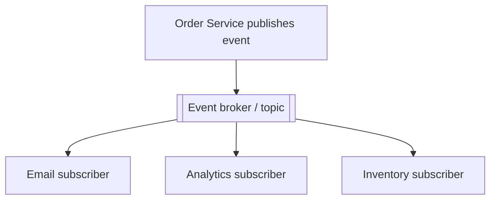

| Pattern | Use when | Key trade-off |
|---|---|---|
| Request-response | The caller needs an immediate answer | Caller waits and depends on availability |
| Message queue | Work can be processed later | Requires delivery, retry and duplicate-handling decisions |
| Publish/subscribe | Multiple systems react to one event | Event delivery and consumer independence require careful design |

**Rule of thumb:** There is no universally best communication pattern. Choose based on whether you need an immediate answer, queued work, or independent reactions to the same event.

---

## 9. SQL vs NoSQL

Both store data. The major differences concern data organization, access patterns, relationships, consistency and scale requirements.

### SQL — relational

Data is commonly structured into tables with relationships.

Examples: **PostgreSQL, MySQL, SQL Server**.

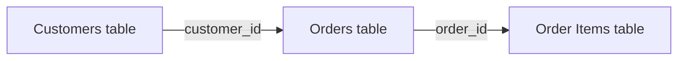

### NoSQL — non-relational

NoSQL describes several data models, not one database architecture.

| Data model | Example | Common shape |
|---|---|---|
| Document | MongoDB | JSON-like documents |
| Key-value | Redis | Key mapped to value |
| Wide-column | Cassandra | Rows organized for specific access patterns |

### Choosing a database

Ask:

1. What is the data model?
2. How will applications query the data?
3. Do operations need strong transactional guarantees?
4. What are the expected read/write volumes and scaling constraints?

**Important:** SQL vs NoSQL is not simply “small vs large” or “slow vs fast.” Choose based on requirements.

---

## 10. Distributed databases and CAP theorem

A distributed database stores data across multiple machines. Replication introduces a challenge: two nodes can temporarily disagree about the latest data, especially during network failures.

### The stale data problem

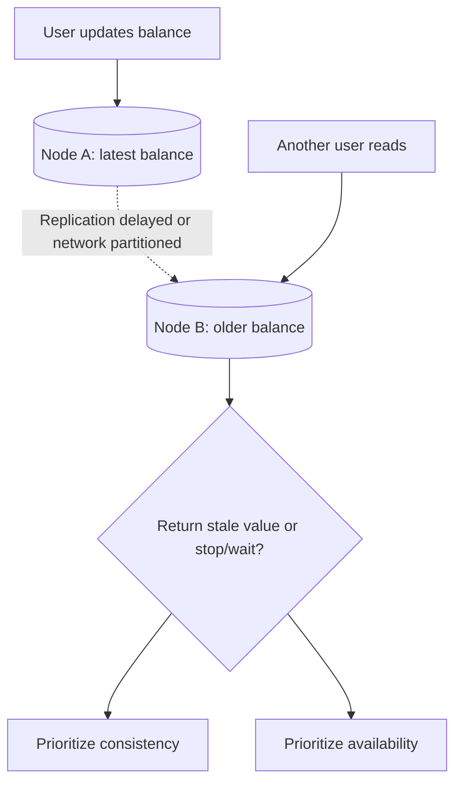

### CAP theorem

CAP describes a trade-off when network communication between nodes fails:

- **C — Consistency:** Every read sees the latest successful write, or fails rather than returning an older value.
- **A — Availability:** Every request to a non-failing node receives a response, even if it is not the latest data.
- **P — Partition tolerance:** The system continues operating despite communication failures between groups of nodes.

**During a network partition, you cannot guarantee both strong consistency and availability.**

### CP approach: prioritize consistency

A node that cannot verify the latest balance may reject or delay the request rather than return stale data.

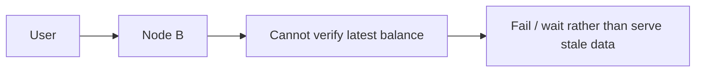

### AP approach: prioritize availability

A node may return its available (possibly outdated) value and reconcile after connectivity recovers.

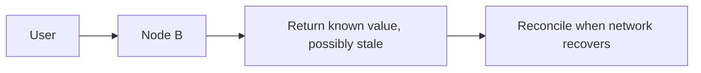

**Example from the slides:** Node B may respond with **₹10,000** even while the latest value cannot be confirmed.

| During a partition | CP-oriented behavior | AP-oriented behavior |
|---|---|---|
| Node cannot confirm newest state | Fail or wait | Respond with locally known data |
| Main priority | Avoid stale reads | Keep serving requests |
| Trade-off | Some requests unavailable | Some responses may be stale |

**Clarification:** The slides' “P approach” label in one summary is best understood as **AP**, not partition tolerance alone. Partition tolerance is the setting in which the C/A trade-off arises.

---

## 11. Design exercise: notification system

### Problem statement from the presentation

An e-commerce application needs a notification system that:

- Supports **email, SMS and push notifications**.
- Handles a large number of notifications.
- Does **not slow down the main application**.
- Handles temporary email/SMS/push-provider failures.
- Retries failed notifications.
- Avoids duplicate notifications.
- Tracks status such as **PENDING, SENT and FAILED**.

**Scenario:** A customer places an order. The Order Service must trigger an order confirmation by email, SMS and push. How can this happen without forcing the customer to wait for all three deliveries?

### Illustrative architecture (proposed solution)

The presentation ends with this design challenge. The diagram below is a suggested answer, **not an architecture explicitly supplied by the slides**.

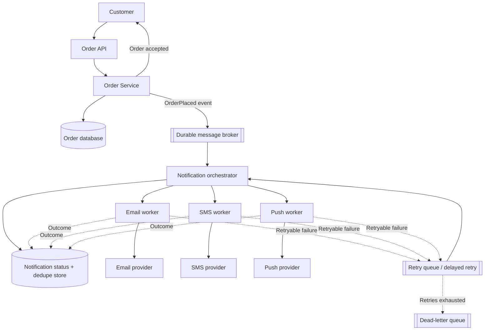

### Suggested processing sequence

1. The Order Service saves an order and emits an `OrderPlaced` event.
2. A durable broker buffers the event while the API responds to the customer.
3. A notification orchestrator creates channel-specific tasks and records them as **PENDING**.
4. Email, SMS and push workers call their providers independently.
5. Success updates status to **SENT**; failed attempts may retry with backoff.
6. Exhausted retries move to a dead-letter workflow and status becomes **FAILED**.
7. Use a deduplication key such as `orderId + notificationType + channel` to avoid creating the same logical task twice.

### Important design decisions

| Concern | Suggested mechanism |
|---|---|
| Keep checkout responsive | Publish events and process asynchronously |
| Reliable event publishing | Transactional outbox or equivalent |
| Temporary provider outages | Retry with exponential backoff |
| Repeated event deliveries | Idempotent task processing and deduplication |
| Failed messages | Dead-letter queue and operational alerts |
| Status visibility | Persist PENDING / SENT / FAILED |
| High throughput | Scale consumers and partition workloads |

**Caution:** True exactly-once delivery through an external notification provider may not be achievable. An idempotency key and provider-side support reduce duplicates; they do not universally eliminate them.

---

## 12. Revision checklist

- Can you explain what happens after entering an HTTPS URL?
- What is the difference between a domain name and an IP address?
- Why does DNS exist, and when can caching avoid a lookup?
- How do TCP and UDP differ?
- What protection does TLS add to HTTP?
- What is an API contract?
- When do you use GET, POST, PUT, PATCH and DELETE?
- What do 200, 201, 400, 401, 403, 404 and 500 mean?
- How should a REST resource URL be designed?
- What makes an operation idempotent, and why does it matter for payments?
- How do synchronous requests, queues and pub/sub differ?
- What factors guide SQL vs NoSQL selection?
- What does a network partition change in a distributed database?
- How are CP and AP approaches different?
- How would you implement retry, deduplication and status tracking in a notification service?

---

**Source:** *System Design series -2* PowerPoint presentation by Jayesh Sharma, 45 slides. The notification architecture and additional practical API examples are clearly marked as explanatory extensions.
