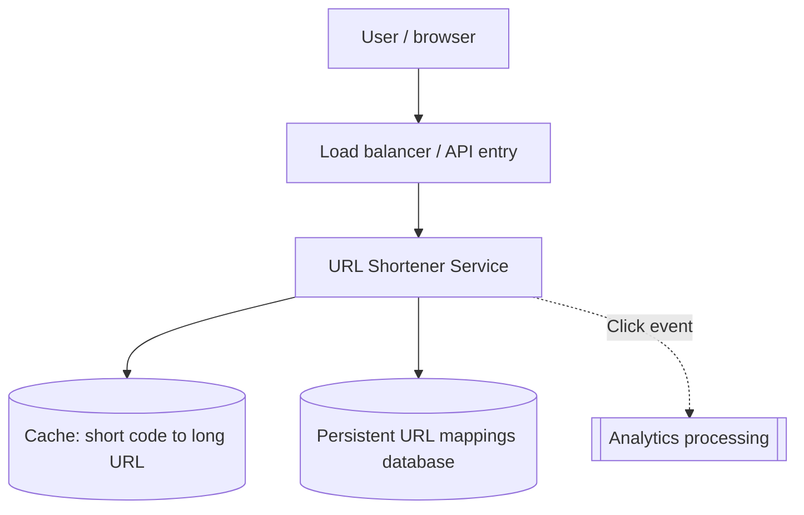
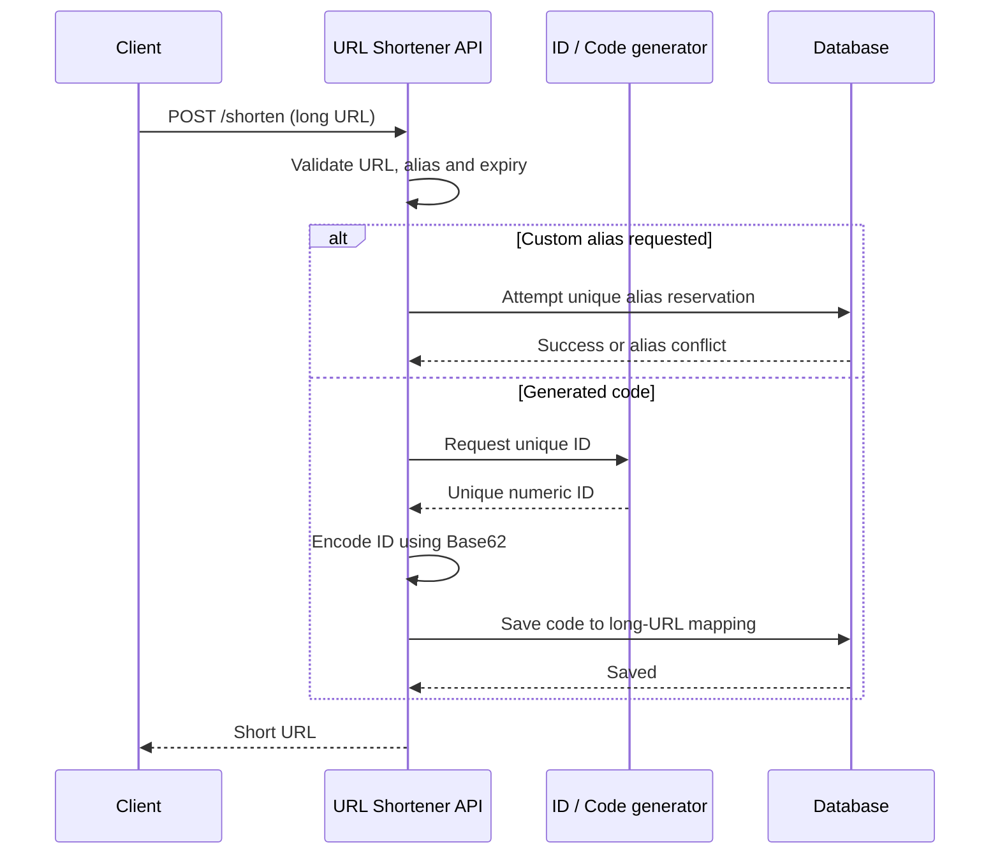
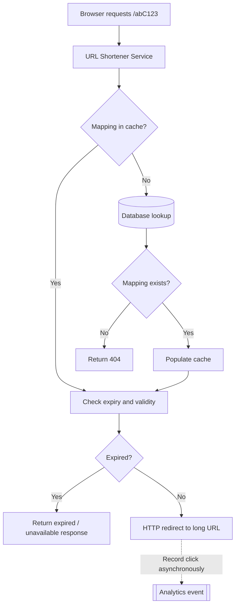
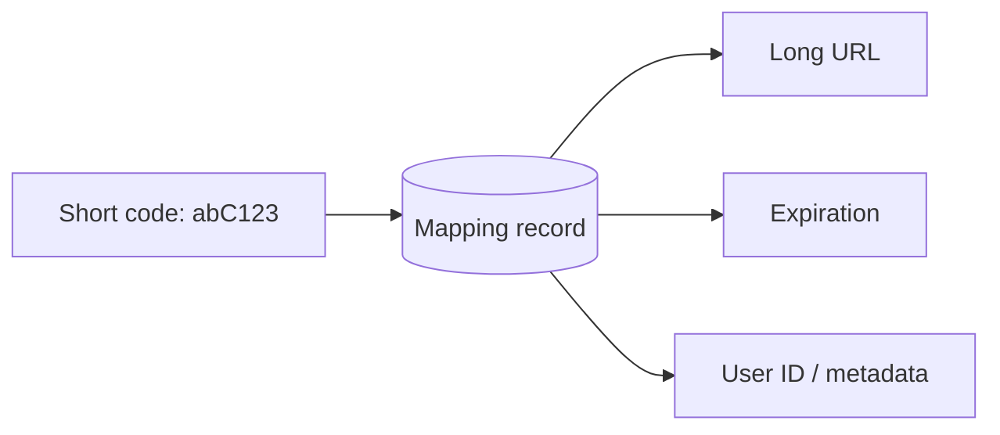
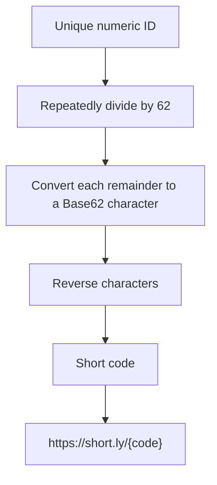
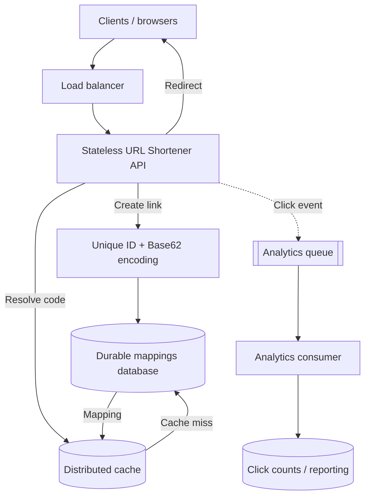

# URL Shortener — System Design Exercise

*Distributed Systems Study Library · Author: Jayesh Sharma*


## Contents
- [1. Problem statement](#1-problem-statement)
- [2. Functional requirements](#2-functional-requirements)
- [3. Non-functional requirements](#3-non-functional-requirements)
- [4. Back-of-the-envelope estimation](#4-back-of-the-envelope-estimation)
- [5. API design](#5-api-design)
- [6. High-level architecture](#6-high-level-architecture)
- [7. Write flow](#7-write-flow)
- [8. Redirect flow](#8-redirect-flow)
- [9. Database design](#9-database-design)
- [10. Short code generation with Base62](#10-short-code-generation-with-base62)
- [11. Final design and discussion](#11-final-design-and-discussion)

## 1. Problem statement

A URL shortener converts a long URL into a compact link. When someone opens the short link, the service redirects them to the original destination.

**Example:**

- Long URL: `https://example.com/very/long/url/that/needs/shortening`
- Short URL: `https://short.ly/3d1`

A short link must map to the correct long URL, be available quickly, and remain durable.

## 2. Functional requirements

| Requirement | Description |
|---|---|
| Shorten URL | Given a long URL, create a unique short URL |
| Redirect | Opening the short URL redirects to the original URL |
| Custom alias | Allow a caller to request a custom code, if available |
| Expiration | Support default and custom TTLs / expiry dates |
| Analytics | Track basic click counts |

## 3. Non-functional requirements

| Requirement | Target from the slides |
|---|---|
| High availability | Example target: **99.99%** |
| Low latency | Redirect in **under 50 ms** |
| Uniqueness | Each short code maps to one long URL; no collisions |
| Scalability | Read-to-write ratio of **100:1** |
| Durability | Once created, the mapping must not be lost |

The availability and latency numbers are **design targets**, not measured performance.

## 4. Back-of-the-envelope estimation

### Traffic assumptions

- **10 million** new links per day
- **100:1** redirects-to-creates ratio
- Therefore approximately **1 billion** redirects per day
- Peak traffic assumed to be **3×** average

| Metric | Calculation | Approximate result |
|---|---|---|
| Average write QPS | 10,000,000 / 86,400 | **115 writes/s** |
| Peak write QPS | 115 × 3 | **350 writes/s** |
| Average read QPS | 1,000,000,000 / 86,400 | **11,500 reads/s** |
| Peak read QPS | 11,500 × 3 | **35,000 reads/s** |

### Storage estimate

The slides assume approximately:

| Field | Size |
|---|---:|
| Short code (7 characters) | 7 bytes |
| Long URL (average 200 characters) | 200 bytes |
| User ID (UUID text) | 36 bytes |
| Timestamps and metadata | 50 bytes |
| **Approximate record size** | **300 bytes** |

- New URLs/year = 10 million × 365 = **3.65 billion**
- Annual raw record storage ≈ 3.65 billion × 300 bytes = **1.1 TB**
- Five years ≈ **5.5 TB**

This is a rough **raw-record estimate** from the presentation. Real capacity planning would additionally consider indexes, replication, backups, database overhead and other storage.

### Base62 capacity

The slides use Base62 characters `0–9`, `a–z`, `A–Z`.

| Length | Number of possible codes |
|---|---:|
| 6 characters | 62⁶ = **56.8 billion** |
| 7 characters | 62⁷ = **3.52 trillion** |

Seven characters offer considerable headroom for the estimated number of links. Actual capacity also depends on reserved codes, generation rules and other constraints.

## 5. API design

### Create a short URL

```http
POST /shorten
Content-Type: application/json
```

Example request adapted from the slides:

```json
{
  "long_url": "https://example.com/very/long/url/that/needs/shortening",
  "custom_alias": "",
  "expires_at": "2024-12-31T23:59:59Z",
  "user_id": "user123"
}
```

The expiry timestamp above is an **illustrative value from the presentation**, not a recommended future expiry.

Example creation response:

```json
{
  "short_url": "https://short.ly/abC123",
  "short_code": "abC123"
}
```

### Open a short URL

```http
GET /abC123
```

The normal public redirect endpoint returns an HTTP redirect to the original URL (for example, a `302 Found` response with a `Location` header):

```http
HTTP/1.1 302 Found
Location: https://example.com/very/long/url/that/needs/shortening
```

The slides also show the following **mapping data** alongside `GET /{short_code}`:

```json
{
  "short_url": "http://short.url/abC123",
  "long_url": "https://example.com/very/long/url/that/needs/shortening",
  "expires_at": "2024-12-31T23:59:59Z",
  "created_at": "2024-08-10T10:30:00Z"
}
```

That JSON is useful as an internal lookup or metadata representation; a browser-facing redirect would ordinarily return an HTTP redirect rather than this JSON. The response examples and `302` explanation are implementation clarifications.

## 6. High-level architecture

A readable view of the main components:



**Why these components?**

- The entry point distributes incoming requests.
- The URL Shortener Service creates and resolves codes.
- The cache accelerates frequent redirects.
- The database durably stores mappings.
- Analytics tracks click counts without making the redirect path depend on a slow analytics operation.

Caching and asynchronous analytics are design extensions to make the high-read workload practical.

## 7. Write flow

When a user submits a long URL, the service creates a unique short code and stores its mapping.



**Key points:**
1. Validate the request.
2. Generate or reserve a unique code.
3. Save the mapping durably.
4. Return the short link.

For custom aliases, enforce uniqueness at the database or equivalent authoritative store; checking first and inserting later without protection can race.

## 8. Redirect flow

A short code is used to look up the original URL and redirect the browser.



The exact response for an expired link is an API design choice. Caching needs expiry/invalidation rules so expired links are not incorrectly served.

## 9. Database design

The presentation emphasizes:

- **Billions of records**
- Mostly **simple key-value lookups**
- Far more reads than writes
- No requirement for complex joins
- Need for high scalability and availability

A logical mapping record might contain:

| Field | Meaning |
|---|---|
| `short_code` | Unique lookup key |
| `long_url` | Original destination |
| `user_id` | Owner, if applicable |
| `created_at` | Creation timestamp |
| `expires_at` | Optional expiry |
| `click_count` | Basic analytics count |



**Database selection:** The presentation's requirements favor a scalable key-value lookup pattern. A key-value database is one possible choice; a relational database with an indexed unique short-code column can also support this pattern. The slides do not mandate a particular database product.

## 10. Short code generation with Base62

### What is Base62?

Base62 uses **62 symbols**:

- Digits `0–9`: 10
- Lowercase `a–z`: 26
- Uppercase `A–Z`: 26

Total = **62** characters per position.

### How conversion works

The slides' example:

```text
Numeric ID: 12345
Base62:     3d1
Short URL:  https://short.ly/3d1
```

This result uses the digit ordering `0123456789abcdefghijklmnopqrstuvwxyzABCDEFGHIJKLMNOPQRSTUVWXYZ`.

To convert a nonnegative integer, repeatedly divide by 62 and map the remainder to a character. Read the remainders in reverse order.

| Division | Quotient | Remainder | Character |
|---|---:|---:|---|
| 12345 ÷ 62 | 199 | 7 | `7` |
| 199 ÷ 62 | 3 | 13 | `d` |
| 3 ÷ 62 | 0 | 3 | `3` |

**Important correction to the slide example:** With the alphabet above, **12345 encodes to `3d7`**, not `3d1`. The presentation states `3d1`, but that would decode to 12339 using this alphabet. This note preserves the source claim while showing the arithmetic and its correction.



### Why use Base62?

- A large numeric ID can be represented with fewer characters.
- The code uses URL-friendly alphanumeric symbols.
- The code is compact, but **Base62 is encoding, not encryption**.
- If IDs are sequential, users may be able to guess nearby codes.

## 11. Final design and discussion



### What to explain in an interview

1. Start with the functional and non-functional requirements.
2. Estimate writes, redirects, storage and code space.
3. Design create and redirect APIs.
4. Explain unique code generation, including Base62.
5. Explain persistent mappings and the high read-to-write ratio.
6. Add caching to keep redirect latency low.
7. Explain expiration, collisions and custom aliases.
8. Keep click analytics off the critical redirect path.
9. Discuss availability, durability and failure handling.

### Further design considerations

The following are discussion extensions beyond the slide requirements, not claims about a deployed system:

- Avoid open-redirect abuse, malicious destination URLs and unsafe schemes.
- Rate-limit URL creation to reduce abuse.
- Decide whether codes can ever be reused after expiration.
- Define how expired entries are purged from cache and storage.
- Consider retry-safe create operations and uniqueness under concurrency.
- Monitor redirect latency, cache hit ratio, errors and queue lag.

---
