# Video and Audio Streaming at Scale — System Design Explained Simply

*Distributed Systems Study Library · Author: Jayesh Sharma*

**A beginner-friendly guide to transcoding, codecs, bitrate ladders, HLS, DASH, adaptive bitrate playback, CDNs, live streaming, DRM and video performance.**

> Independent educational explanations and original architecture diagrams based on the user-supplied streaming transcript. Added engineering clarifications are included where useful; specific throughput numbers are illustrative, not universal benchmarks.

## Contents

- [1. What problem does media streaming solve?](#1-what-problem-does-media-streaming-solve)
- [2. Streaming use cases and key requirements](#2-streaming-use-cases-and-key-requirements)
- [3. Why one MP4 quality is not enough](#3-why-one-mp4-quality-is-not-enough)
- [4. Transcoding and the bitrate ladder](#4-transcoding-and-the-bitrate-ladder)
- [5. Video codecs and device compatibility](#5-video-codecs-and-device-compatibility)
- [6. Divide each rendition into segments](#6-divide-each-rendition-into-segments)
- [7. What is a manifest? HLS versus DASH](#7-what-is-a-manifest-hls-versus-dash)
- [8. Adaptive bitrate (ABR) playback](#8-adaptive-bitrate-abr-playback)
- [9. A practical buffer and bitrate example](#9-a-practical-buffer-and-bitrate-example)
- [10. Fast startup, preloading and seeking](#10-fast-startup-preloading-and-seeking)
- [11. Why CDNs make streaming scalable](#11-why-cdns-make-streaming-scalable)
- [12. Cache misses, long-tail videos and origin shielding](#12-cache-misses-long-tail-videos-and-origin-shielding)
- [13. Control media storage and encoding costs](#13-control-media-storage-and-encoding-costs)
- [14. Live streaming architecture](#14-live-streaming-architecture)
- [15. Live latency: standard HLS, low-latency HLS and WebRTC](#15-live-latency-standard-hls-low-latency-hls-and-webrtc)
- [16. Protect media with signed access and DRM](#16-protect-media-with-signed-access-and-drm)
- [17. Playback position, quality metrics and observability](#17-playback-position-quality-metrics-and-observability)
- [18. End-to-end video-on-demand architecture](#18-end-to-end-video-on-demand-architecture)
- [19. How to answer a streaming system-design interview](#19-how-to-answer-a-streaming-system-design-interview)
- [20. Questions and one-minute cheat sheet](#20-questions-and-one-minute-cheat-sheet)

---

## 1. What problem does media streaming solve?

Imagine watching a lecture on a train. Your connection changes from strong Wi-Fi to a weak mobile signal, but you still want the video to keep playing.

A simple website can offer one large video file. That is not enough for a platform with millions of viewers, different screens, changing bandwidth, seeking and live broadcasts.

A well-designed streaming system aims for **quick startup, few pauses, appropriate picture or sound quality and affordable delivery**.

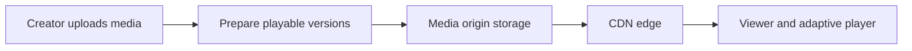

**Memory trick:** A streaming platform does not send everyone the same complete file. It serves **small, playable pieces at a quality suited to the viewer**.

---

## 2. Streaming use cases and key requirements

| Example | Viewer expectation | Design challenge |
|---|---|---|
| Movies and long videos | Smooth playback and seeking | Adaptive quality and global delivery |
| Music streaming | Fast start and uninterrupted audio | Small buffers and efficient encoding |
| Short-video feed | Instant next clip | Smart preloading without waste |
| Live creator broadcast | Small delay from real life | Real-time encoding and distribution |
| Online courses | Resume from yesterday's position | Playback state across devices |

Before picking technologies, ask whether the content is **on demand or live**, how many people may watch simultaneously, which devices are supported, whether paid content requires DRM and what latency is acceptable.

An important distinction: **streaming playback** can be real-time *to the viewer* without being *low-latency relative to the original event*. A recorded movie and a live video call have very different timing constraints.

---

## 3. Why one MP4 quality is not enough

Suppose you provide only a 1080p video. It may look excellent on home broadband but stall on a slow network. A very low-quality version might start everywhere, yet look poor on large screens.

With one fixed representation, the client cannot easily trade some visual detail for fewer rebuffering interruptions as conditions change.

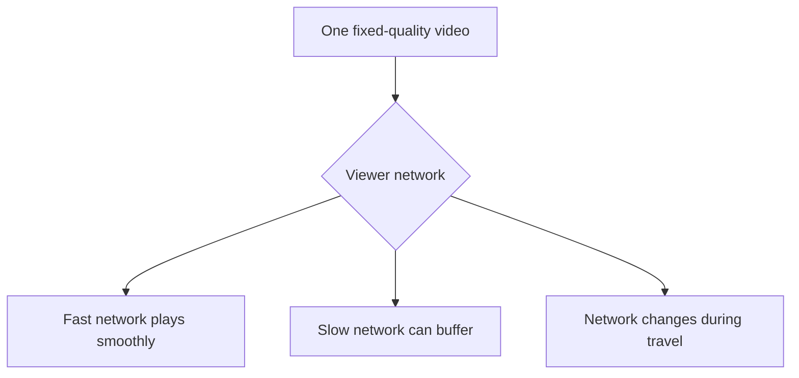

A better design makes several **representations** available and lets the player switch between them.

**Terminology:** A **resolution** describes image dimensions such as 720p. A **bitrate** describes how many bits per second are used to encode the audio/video. The two are related but not interchangeable.

---

## 4. Transcoding and the bitrate ladder

After a creator uploads a source video, processing workers encode it into several playable versions. A collection of representations at different qualities is often called a **bitrate ladder**.

For example:

| Representation | Illustrative role |
|---|---|
| 240p | Very constrained mobile network |
| 360p | Low bandwidth |
| 480p | Moderate bandwidth |
| 720p | Better clarity |
| 1080p | High-resolution playback |
| 4K | Supported devices and strong connections |

The bitrate for a given resolution depends on content complexity, frame rate, codec and desired quality. These are **quality choices**, not fixed bandwidth promises.

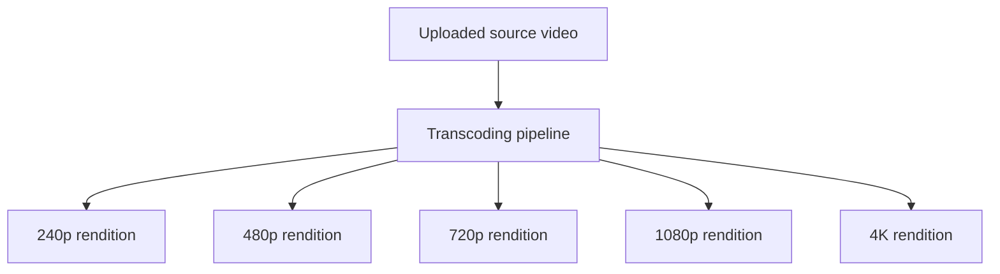

**Simple analogy:** A store offers the same movie in several sizes of package. The player can choose a package it can fetch in time.

Some pipelines build ladders tailored to the **particular title** instead of relying on one predefined ladder for all content.

---

## 5. Video codecs and device compatibility

A **codec** is the method used to encode and decode media. Different codecs can produce different file sizes for comparable quality, but not every device has support or enough computing power for every option.

| Codec | Common consideration |
|---|---|
| H.264 / AVC | Broad device and browser compatibility |
| H.265 / HEVC | More efficient compression in many settings; licensing and support vary |
| AV1 | Modern compression efficiency; encode cost and hardware/browser support should be checked |

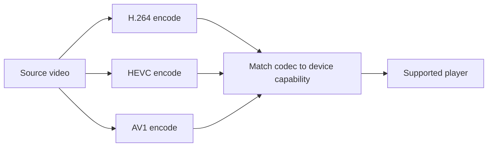

**Cost trade-off:** Extra renditions and codecs use more encoding CPU and storage, but can lower bandwidth used during playback.

Audio has its own encoding choices and can be delivered through the same manifest-and-segment architecture.

---

## 6. Divide each rendition into segments

Modern adaptive streaming does not need to download a full two-hour movie before it can start. Each rendition is divided into **short media segments**, often a few seconds long.

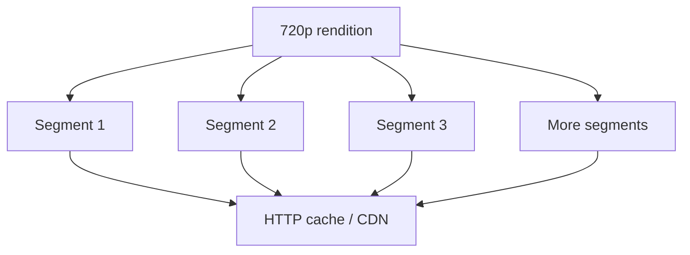

A one-hour video divided into six-second segments has **600 segments per rendition** (3,600 seconds ÷ 6). Another rendition follows corresponding playback times so the player can switch quality near segment boundaries.

**Why this helps:** The player downloads only the next needed segments. Skipping to the middle requests later segments directly.

**Nuance:** Modern formats may also use smaller **chunks or partial segments** for lower-latency streaming. Segments must be packaged and timed correctly for seamless switches.

---

## 7. What is a manifest? HLS versus DASH

How does the player know which renditions and segments exist? It reads a small file called a **manifest** or playlist.

A manifest describes available streams, codecs, bitrates, timing and where to request the media.

| Format | Common manifest | Idea |
|---|---|---|
| HLS (HTTP Live Streaming) | `.m3u8` playlist | HTTP-based adaptive streaming |
| MPEG-DASH | `.mpd` manifest | Standards-based adaptive streaming over HTTP |

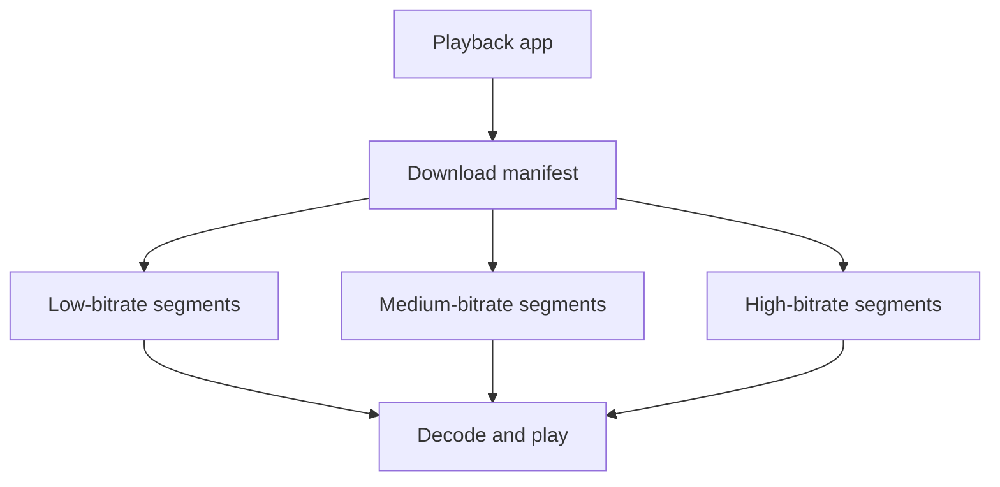

### Simplified HLS playlist example

```text
#EXTM3U
#EXT-X-TARGETDURATION:6
#EXTINF:6.0,
part001.ts
#EXTINF:6.0,
part002.ts
#EXT-X-ENDLIST
```

This illustrative snippet is a **media playlist for one rendition**. In a multi-quality HLS design, a **master playlist** points to different rendition playlists. DASH uses its own MPD structure.

Manifests and segments can be served as regular HTTP objects, making them suitable for caching at the CDN.

---

## 8. Adaptive bitrate (ABR) playback

**ABR** means that the player selects a suitable quality while playback is running.

1. Fetch the manifest.
2. Choose an initial rendition, often conservative to start quickly.
3. Download a segment and estimate effective throughput.
4. Track **buffer health**, meaning how many seconds of playable media are ready.
5. Pick the next segment's quality based on throughput, buffer and player policy.
6. Repeat for the next segments.

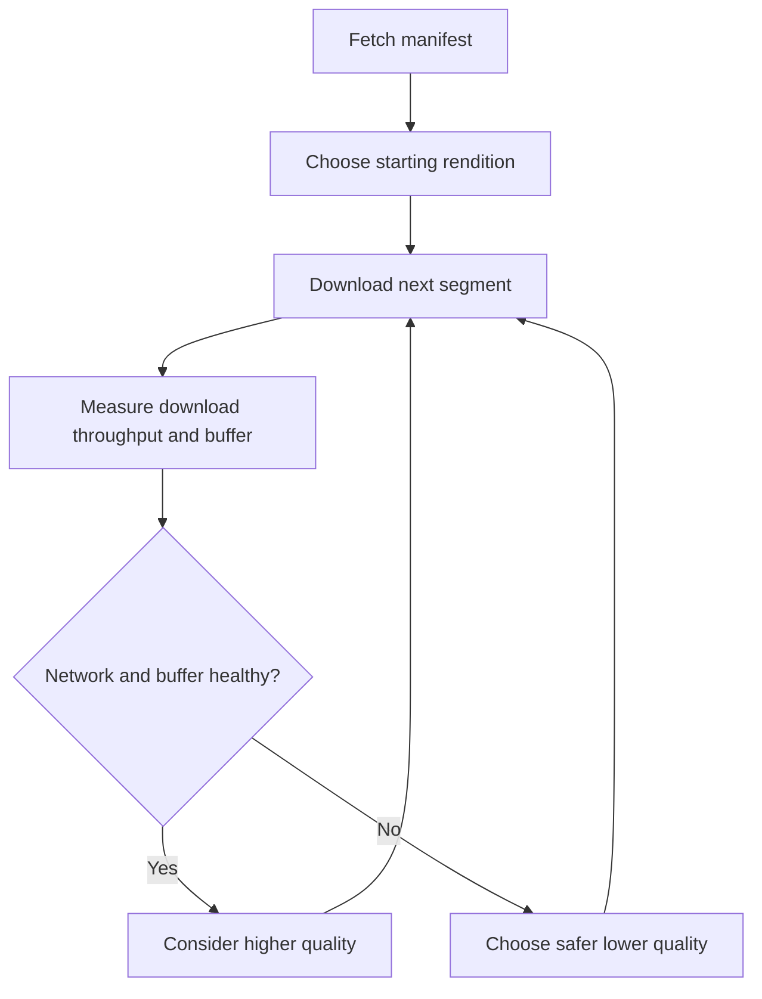

A viewer might see **480p → 1080p → 360p** as they move between networks. A momentary reduction in visual detail is often preferable to playback stopping.

**Important:** ABR algorithms use more than a simple speed threshold. They may include buffer risk, recent measurements, device limitations and rebuffer probability.

---

## 9. A practical buffer and bitrate example

A video player keeps some media **buffered ahead** of the current playback position.

Suppose a six-second segment is downloaded in two seconds. Under stable conditions, the player may gain roughly **four seconds of extra playable buffer** while downloading it, ignoring overhead and playback-specific behavior.

If the same segment takes nine seconds, the player may consume about **three seconds more buffer than it adds**. Repeating that pattern risks a stall.

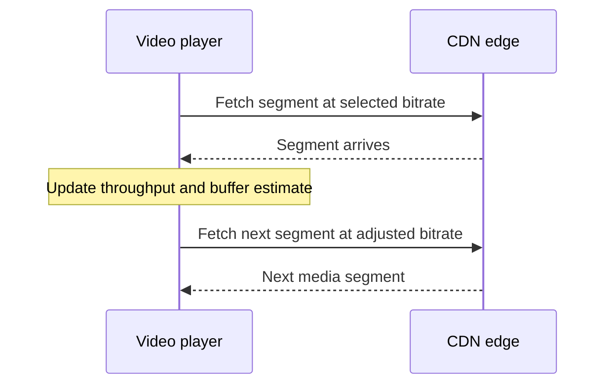

The player should not aggressively jump to the highest rendition just because one segment was fast. Sudden oscillations between qualities can also harm viewing experience.

**Interview takeaway:** ABR manages the trade-off among **startup delay**, **picture quality**, and **rebuffering risk**.

---

## 10. Fast startup, preloading and seeking

People are likely to leave a short-video application if every swipe takes several seconds to start.

Common optimizations include:

- Starting with a conservative rendition so the first segment is fetched quickly.
- Caching popular manifests and early segments near viewers.
- Preloading a *limited* amount of upcoming content in a short-video feed.
- Serving seek requests by retrieving segments around the requested timestamp.
- Providing a separate thumbnail preview track or sprite sheet for scrubbing.

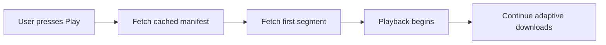

**Trade-off:** Aggressive preloading increases cellular data usage and CDN traffic when users never watch the prefetched videos.

Seeking typically requires appropriate keyframe and segment alignment; simply asking for an arbitrary byte offset is not always sufficient for decoding a video stream.

---

## 11. Why CDNs make streaming scalable

A CDN caches media near viewers, avoiding repeated downloads from the primary origin for every request.

Suppose an illustrative 1080p stream consumes **5 megabits per second (Mb/s)**. With one million simultaneous viewers:

```text
5 Mb/s × 1,000,000 viewers
= 5,000,000 Mb/s
= 5 terabits per second (Tb/s)
```

This is simplified average outbound media bandwidth, not a precise billing or capacity forecast. Different renditions, audio, protocol overhead and viewing behavior change real usage.

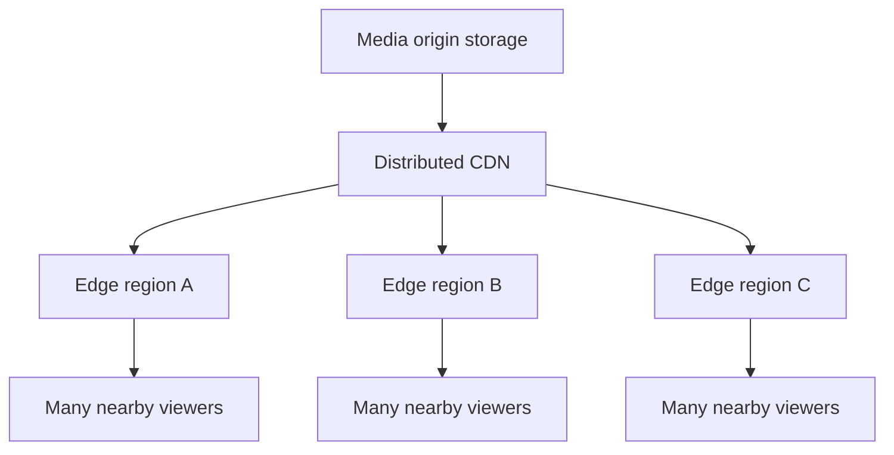

One popular segment fetched from the origin can then be reused by many regional viewers. CDN caching helps control origin traffic, latency and cost.

**Remember:** Segment URLs and cache policies should allow safe reuse without exposing private content.

---

## 12. Cache misses, long-tail videos and origin shielding

Popular videos may already be present in nearby CDN caches. A rarely requested video may be missing.

Without protection, thousands of edge servers experiencing misses can overwhelm the origin during a traffic spike.

An **origin shield** is an intermediate caching layer that consolidates requests before they reach primary storage.

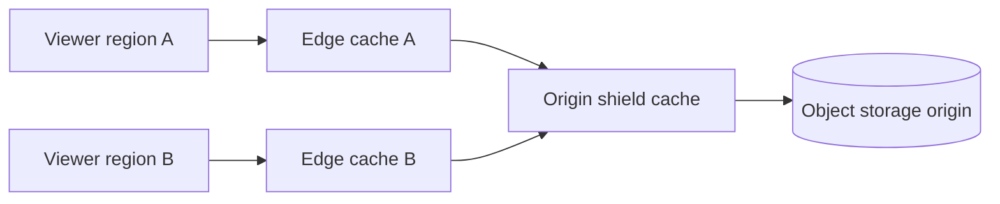

**Hot content:** Prewarming or proactively distributing content to selected caches can improve startup during a predictable release.

**Long-tail content:** Store it at the origin and allow on-demand fetching. Avoid copying every rarely watched rendition to every edge.

The exact origin-shield and request-collapsing behavior depends on the CDN provider and configuration.

---

## 13. Control media storage and encoding costs

One uploaded master video may generate multiple resolutions, codecs, audio tracks and segment files. The stored output can be much larger than the original single-upload count suggests.

A cost-aware strategy might:

1. Create broadly compatible baseline renditions for all videos.
2. Create more efficient codecs or high-resolution renditions for frequently watched titles.
3. Defer optional encodes when demand is low.
4. Place old or rarely accessed source media in suitable storage tiers.
5. Retain metadata and processing recipes so assets can be regenerated if needed.

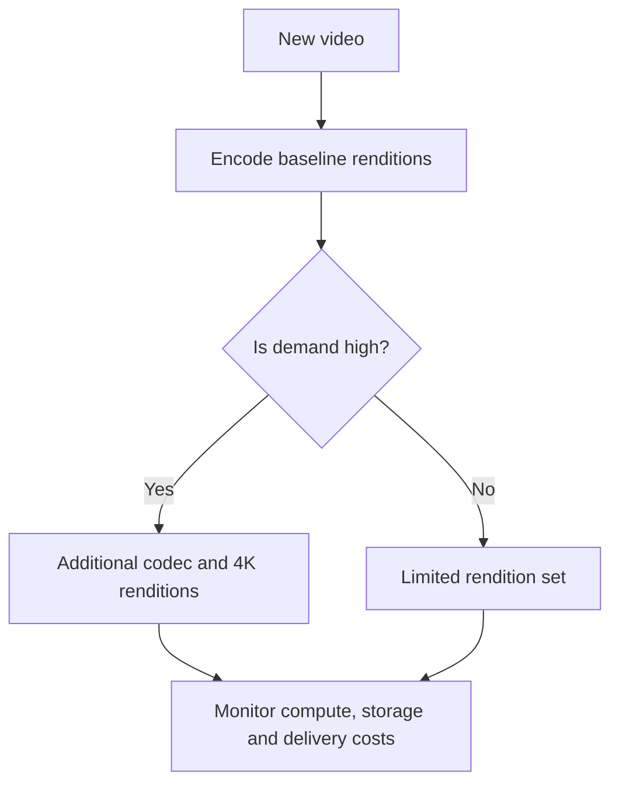

**Trade-off:** On-demand encoding saves storage but may delay first playback of a requested quality. Cold storage reduces storage cost but can add retrieval delay and fees.

A content-aware bitrate ladder can use fewer bits for simple animation than for complex action scenes at similar perceived quality.

---

## 14. Live streaming architecture

Live streaming uses the same rendition, segment, manifest and CDN ideas, except new video arrives continuously.

A common architecture:

1. A broadcaster sends live media to an **ingest service**, often using a suitable transport such as RTMP or SRT.
2. Real-time encoding creates the chosen renditions.
3. Packaging generates segments and continually updated playlists or manifests.
4. CDNs deliver newly available segments.
5. Viewers' players refresh stream metadata or otherwise discover new parts.

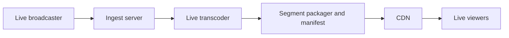

**Difference from video-on-demand:** The next segment **does not exist yet** until the broadcaster has produced the content.

Many live systems prioritize stability over absolute minimum latency because a small playback buffer absorbs network jitter.

---

## 15. Live latency: standard HLS, low-latency HLS and WebRTC

Why can someone watching a live event be noticeably behind reality? Media must be captured, encoded, packaged, transferred, downloaded and buffered before playback.

A simplified example: if media is packaged into **six-second segments** and the player maintains **three segments** of live buffer, the buffer alone could be around **18 seconds** behind the live point. The actual glass-to-glass latency depends on many additional delays.

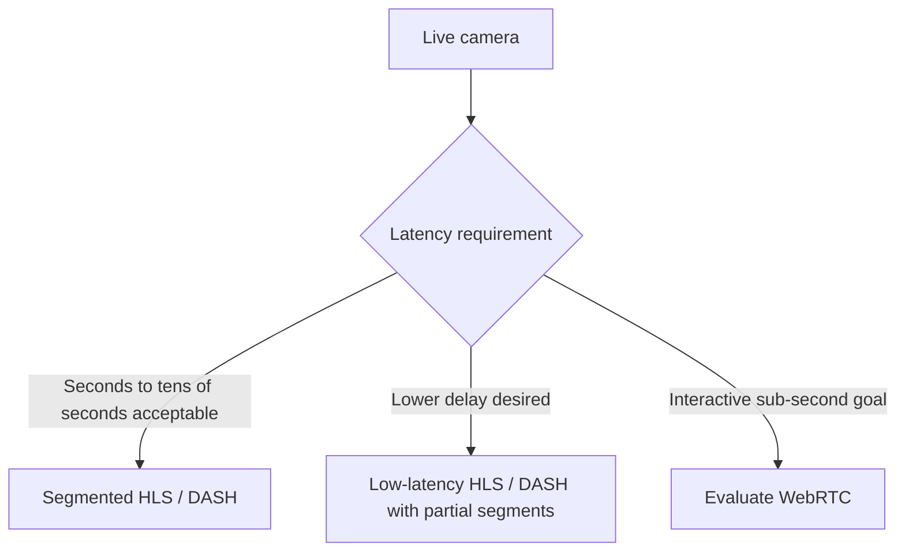

Low-latency streaming techniques use smaller independently transferable parts and tuned player buffers. They can reduce delay, but may be more sensitive to jitter and cache behavior.

**Caution:** WebRTC can target very low interactive latency, but its scaling and delivery economics are different. It is not a universal replacement for CDN-friendly HLS or DASH.

---

## 16. Protect media with signed access and DRM

A streaming platform may need to verify that a viewer is authorized to watch a private course or paid movie.

There are two different layers:

- **Signed URL, token or cookie:** Controls whether requests for manifests or segments are allowed for a period.
- **Digital Rights Management (DRM):** Uses encryption and a platform-specific license system to manage playback of protected content.

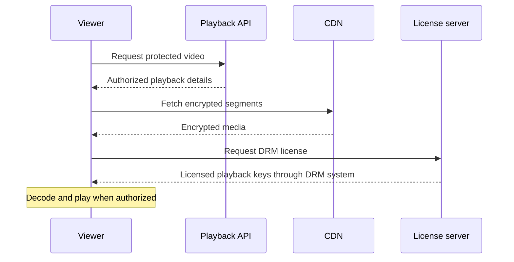

Common commercial DRM systems include Widevine, FairPlay and PlayReady, with different device and browser support.

**Important:** A signed URL is not a substitute for DRM. Conversely, DRM does not remove the need for account-level authorization, secure playback APIs or abuse controls.

---

## 17. Playback position, quality metrics and observability

Streaming quality cannot be judged by server CPU alone. The player can send small telemetry events describing actual viewing conditions.

**Playback state**, such as current position and completed episodes, enables **Continue Watching** across devices. The latest valid position may be stored in a user-content record and updated periodically or when pausing.

**Quality of Experience (QoE)** signals include:

| Measurement | Why it matters |
|---|---|
| Video startup time | Whether playback begins promptly |
| Rebuffer count and duration | How often viewers experience stalls |
| Selected bitrate/resolution | Delivered quality |
| Bitrate switches | Adaptation stability |
| Segment download latency | CDN and network performance |
| Playback errors | Codec, authorization or media issues |

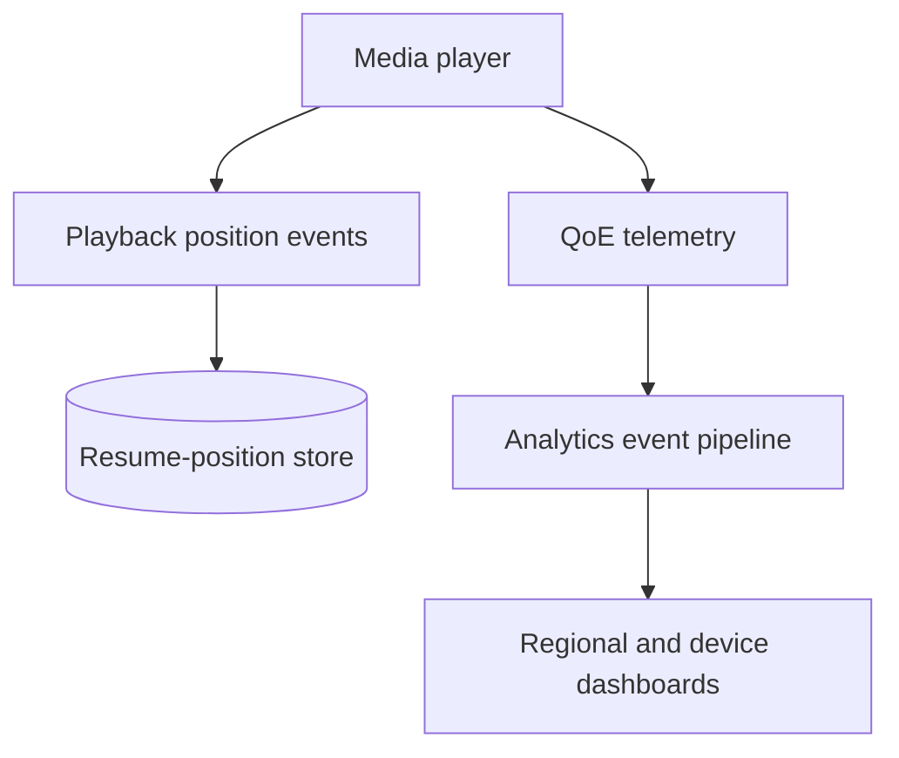

Production monitoring should break metrics down by device, CDN region, codec, network class and content type. Avoid excessive telemetry frequency and respect user privacy.

---

## 18. End-to-end video-on-demand architecture

Put the pieces together by distinguishing the **upload and preparation path** from the **playback path**.

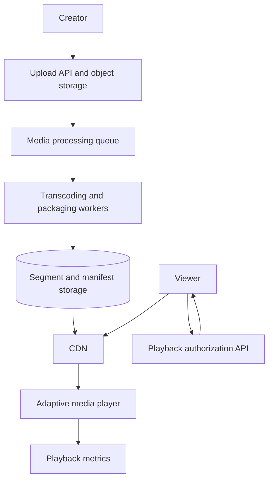

**Upload path:** Persist source files, queue processing, encode multiple quality renditions, package segments, and publish assets.

**Playback path:** Authenticate the viewer, return authorized media information, let the player request manifest/segments from the CDN, and collect QoE data.

This avoids routing all video bytes through the application's ordinary request handlers.

For related upload mechanics, see [Large File Uploads and Downloads](Large_File_Uploads_and_Downloads_System_Design.md).

---

## 19. How to answer a streaming system-design interview

Use a structured explanation instead of jumping straight into cloud-service names.

1. **Clarify:** On-demand or live? Max concurrent viewers? Resolution, devices, regions, and paid/private content?
2. **Ingest:** Where are source videos uploaded or live streams received?
3. **Prepare:** Which renditions and codecs will be generated?
4. **Package:** How will segments and HLS/DASH manifests be produced?
5. **Play:** How will adaptive quality, buffering and seeking work?
6. **Distribute:** How will CDNs and origin shielding reduce origin traffic?
7. **Protect:** What signed access and DRM controls apply?
8. **Operate:** How will you track startup, stalls, errors and cost?

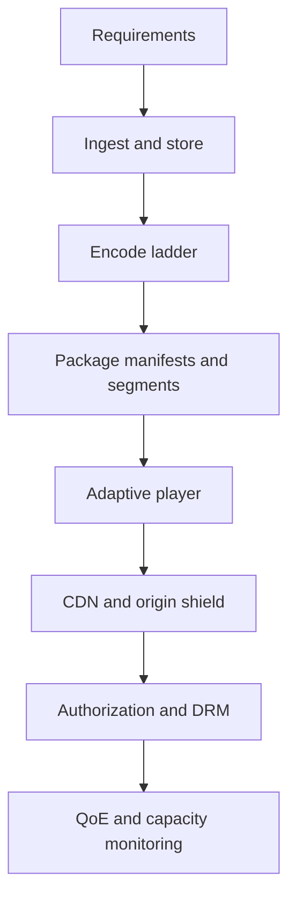

### Worked interview statement

**“I would upload the source media into object storage, transcode into device-compatible quality levels and package it for HLS or DASH. The player would choose segments based on network throughput and buffer health. CDNs would serve most traffic, with origin shielding for cache misses. For live viewing I would add ingest, real-time encoding and a latency-specific playback path. I would measure startup delay, rebuffering and bitrate delivered.”**

This communicates architectural choices and their rationale.

---

## 20. Questions and one-minute cheat sheet

### Interview questions

1. Why is downloading a single large MP4 insufficient for a large streaming service?
2. What are a bitrate ladder and transcoding?
3. How do codecs affect storage, bandwidth and compatibility?
4. Why segment media into smaller pieces?
5. What do HLS `.m3u8` and DASH `.mpd` files describe?
6. How does an adaptive bitrate player select the next rendition?
7. Why does buffering matter as much as throughput?
8. How do segment boundaries enable quality switching?
9. What techniques reduce startup time and seek delay?
10. Why do streaming platforms use CDNs and origin shields?
11. Estimate bandwidth for a million viewers at 5 Mb/s each.
12. How would you avoid encoding every rarely watched title in all formats?
13. How is live ingestion different from on-demand upload?
14. What is the trade-off between low latency and stable playback?
15. When might you choose WebRTC rather than HLS?
16. Why do streaming services use signed URLs and DRM?
17. What telemetry helps improve video Quality of Experience?

### Quick revision table

| Concept | Remember |
|---|---|
| Transcoding | Produce device-appropriate encoded versions |
| Bitrate ladder | Quality levels with different bandwidth needs |
| Segment | Small playable piece of a rendition |
| Manifest | Description of representations and their segments |
| HLS | HTTP Live Streaming, often using M3U8 playlists |
| DASH | Adaptive HTTP streaming using an MPD |
| ABR | Player adjusts quality based on conditions |
| Playback buffer | Downloaded media ready to play |
| CDN edge | Caches segments close to viewers |
| Origin shield | Intermediate cache protecting the origin |
| Live ingest | Accept ongoing media from a broadcaster |
| Low-latency streaming | Smaller parts and tuned buffers |
| DRM | Protected decryption through licensed playback |
| QoE | Viewer-experienced playback quality |

**Final takeaway:** **Encode several suitable versions, deliver small segments over CDNs, and let the player adapt quality to changing networks.** Add live processing, access controls and playback telemetry according to the product's requirements.

---
