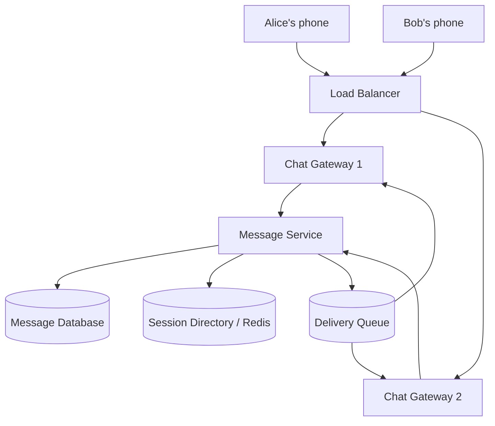
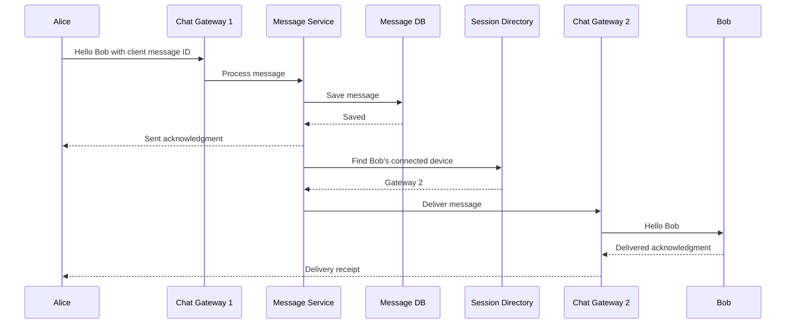
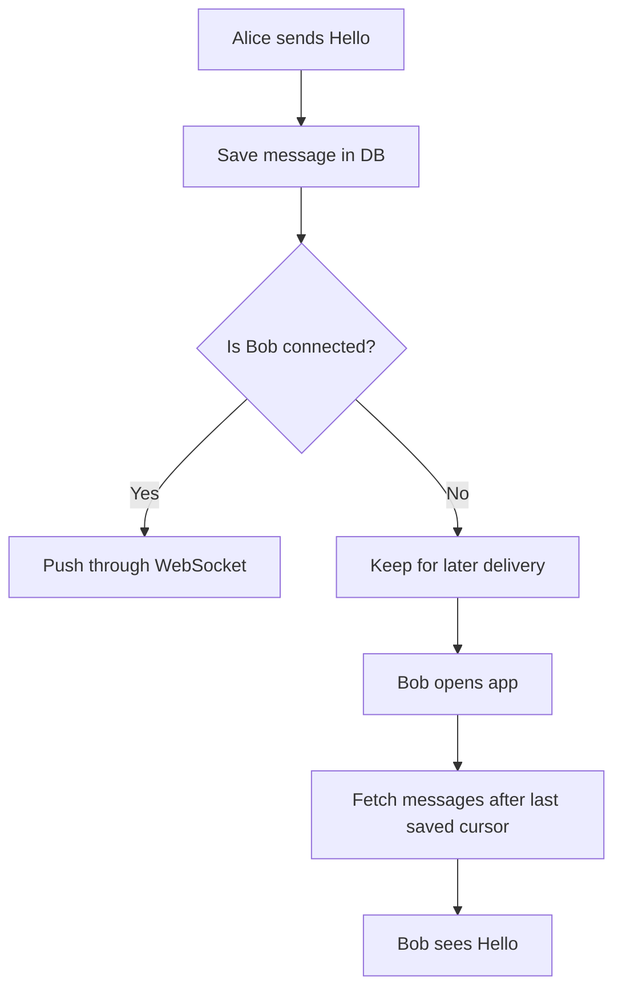
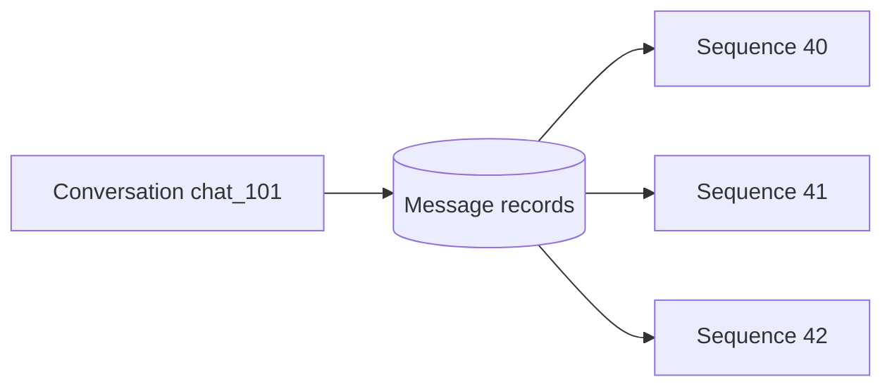
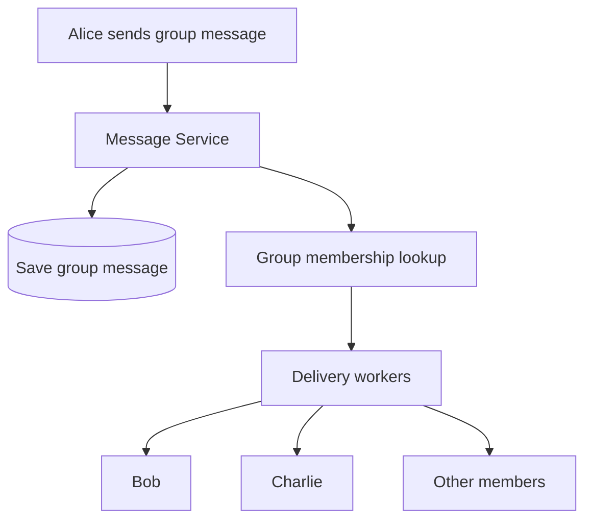
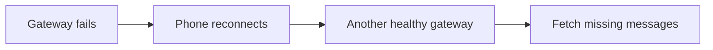
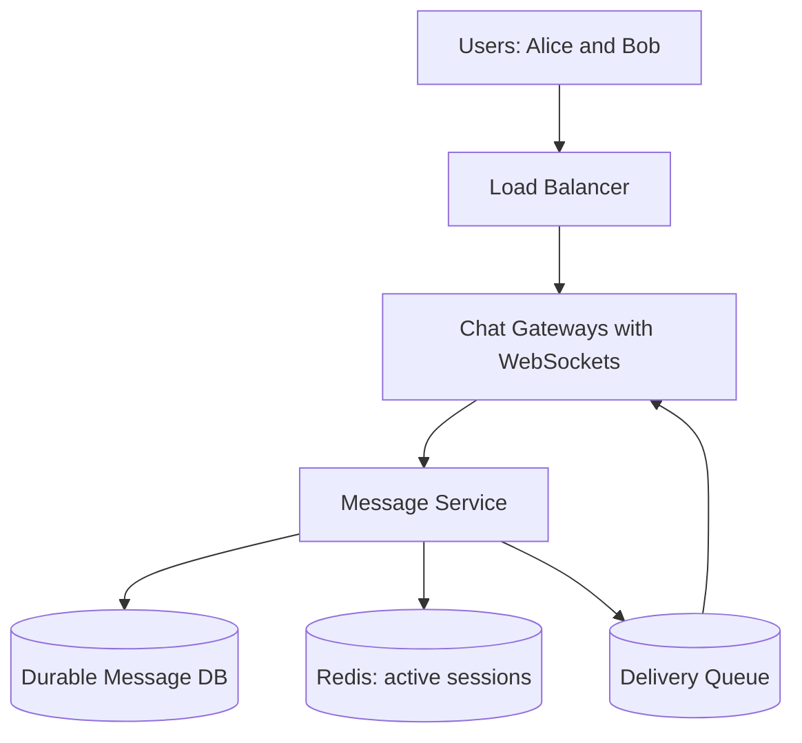

# WhatsApp — System Design Exercise

*Distributed Systems Study Library · Author: Jayesh Sharma*

## Contents
- [1. Problem statement](#1-problem-statement)
- [2. Functional requirements](#2-functional-requirements)
- [3. Non-functional requirements](#3-non-functional-requirements)
- [4. Back-of-the-envelope estimation](#4-back-of-the-envelope-estimation)
- [5. API design](#5-api-design)
- [6. High-level architecture](#6-high-level-architecture)
- [7. Send message flow](#7-send-message-flow)
- [8. Offline message flow](#8-offline-message-flow)
- [9. Database design](#9-database-design)
- [10. Group chat, scaling and failure handling](#10-group-chat-scaling-and-failure-handling)
- [11. Final design and discussion](#11-final-design-and-discussion)

## 1. Problem statement

Design a messaging application where **Alice can send “Hello” to Bob**. Bob should receive it quickly when online and receive it later if offline.

Think of a **post office**: accept the letter, store it safely, find the recipient and deliver it. A WhatsApp-like system does the same with messages.

**Example:**

```text
Alice: Hello Bob!
Bob:   Hi Alice!
```

We are designing a **simplified interview architecture**, not claiming to describe WhatsApp's private production infrastructure.

## 2. Functional requirements

| Requirement | Simple meaning |
|---|---|
| One-to-one chat | Alice sends messages to Bob |
| Group chat | One message reaches many members |
| Offline messages | Bob receives missed messages after reconnecting |
| Delivery status | Show sent, delivered and read |
| Message order | Show messages in the intended conversation order |
| Online status | Show presence if privacy settings permit |
| Multiple devices | Phone and laptop can receive the same conversation |
| Media | Send photos, audio and videos |

**Interview focus:** First solve **one-to-one chat**, then offline delivery, then groups. Add media, encryption and presence after the main design is clear.

## 3. Non-functional requirements

| Requirement | What we want |
|---|---|
| Low latency | New messages reach online users quickly |
| High availability | A server failure should not stop all chats |
| Durability | A message acknowledged as saved should survive the agreed failures |
| Scalability | Add servers when more users join |
| Ordering | Maintain a clear order within each conversation |
| Security | Authenticate users and protect message content |
| Retry safety | Repeated sends must not create duplicate messages |

**Important:** “Message sent” and “message received by Bob” are **different events**. The system records them separately.

## 4. Back-of-the-envelope estimation

These are **made-up interview assumptions**, not actual WhatsApp figures.

- Daily active users: **100 million**
- Messages per active user per day: **50**
- Average stored message size: **200 bytes** including assumed metadata
- Concurrent users at a given time: **10 million**
- Illustrative peak traffic: **3 times the average**

### Messages per second

```text
Messages/day = 100 million × 50
             = 5 billion

Average messages/second = 5,000,000,000 / 86,400
                        ≈ 57,870 per second

Peak messages/second = 57,870 × 3
                     ≈ 174,000 per second
```

### Storage

```text
Storage/day = 5 billion × 200 bytes
            = 1 TB/day (raw decimal units)

Storage/year ≈ 365 TB/year
```

Actual storage is larger with replication, indexes, attachments and metadata.

### WebSocket gateway estimate

If one gateway can safely hold **50,000 connections**:

```text
10,000,000 connected users / 50,000
= 200 gateway servers (idealized baseline)
```

Real deployments need more servers for spare capacity, regional distribution and failure recovery.

## 5. API design

A mobile application can submit a message over its **WebSocket** connection. We show JSON-like messages to make the interface easy to understand.

### Send a message

```json
{
  "type": "send_message",
  "conversationId": "chat_101",
  "clientMessageId": "alice_9001",
  "toUserId": "bob",
  "encryptedPayload": "encrypted_hello"
}
```

The server responds after the message is safely accepted:

```json
{
  "type": "message_accepted",
  "clientMessageId": "alice_9001",
  "messageId": "msg_5001",
  "sequenceNo": 42,
  "status": "SENT"
}
```

### Get missing messages after reconnect

```http
GET /conversations/chat_101/messages?after=41
```

This asks: **“Give me messages after sequence 41.”**

### Update delivery status

```json
{
  "type": "delivery_ack",
  "messageId": "msg_5001",
  "deviceId": "bob_phone"
}
```

**Why include `clientMessageId`?** If Alice retries the same message after a network problem, the server recognizes it and avoids creating a duplicate.

## 6. High-level architecture

Start with just these main components.



**What does each component do?**

| Component | Simple explanation |
|---|---|
| Load Balancer | Sends a connection to a healthy gateway |
| Chat Gateway | Maintains users' WebSocket connections |
| Message Service | Validates, saves and manages messages |
| Message Database | Stores accepted messages |
| Session Directory | Finds which gateway has Bob's connected device |
| Delivery Queue | Helps deliver and retry messages asynchronously |

A **WebSocket** is like keeping a phone call open: the client and server can exchange messages without starting a new HTTP request every time.

**Important:** Redis session information is temporary. It is **not** the main message database.

## 7. Send message flow

Alice writes: **“Hello Bob”**.



**Step by step:**

1. Alice sends a message through her WebSocket.
2. The Message Service checks Alice's permission to send it.
3. The database stores the message and its conversation sequence.
4. Alice gets a **sent** acknowledgment.
5. The Session Directory finds Bob's gateway.
6. Bob receives the message through his WebSocket.
7. Bob's device acknowledges delivery.

The actual delivery work should be **durably retryable**. The diagram simplifies queue routing to keep the story readable.

### What do the ticks mean?

| Tick | Meaning |
|---|---|
| ✓ | Server accepted the message |
| ✓✓ grey | Recipient's device received the message |
| ✓✓ blue | Recipient generated a read receipt, if enabled |

## 8. Offline message flow

Suppose Bob's phone is switched off.

**The message must not disappear.** It stays in durable storage until Bob reconnects or the retention policy expires.



**Simple timeline:**

- 10:00 — Alice sends Hello.
- 10:01 — Bob is offline.
- 11:00 — Bob reconnects.
- 11:00 — The app requests messages it missed.
- 11:00 — Bob sees Hello.

**Interview point:** The queue is useful for delivery attempts, but **the database is the durable source for missing-message recovery**.

If a delivery is repeated, Bob's app can use the stable message ID to avoid displaying the same message twice.

## 9. Database design

Most users want to read **the latest messages in one conversation**, so design storage around this query:

> “Show the latest 50 messages between Alice and Bob.”

A simple logical record:

| Field | Example |
|---|---|
| conversation_id | chat_101 |
| message_id | msg_5001 |
| sequence_no | 42 |
| sender_id | alice |
| encrypted_payload | encrypted_hello |
| created_at | timestamp |
| status | delivery state stored separately as needed |



**Why sequence numbers?** A network can deliver message 42 before 41. Sequence numbers help a device detect missing messages and display them in the proper conversation order.

**Database choice:** Sharded SQL, Cassandra or DynamoDB could work depending on volume and access patterns. A separate relational database is useful for users, groups and membership.

Very large histories may need **bounded partitions**, for example by conversation and time range. Redis is appropriate for fast session and presence information, not as the sole durable message store.

## 10. Group chat, scaling and failure handling

### Group chat

Alice sends “Good morning” to a group of 100 people.

The system can store **one logical group message**, look up eligible members and schedule delivery to their devices. This is called **fanout**.



For small groups, fanout-on-write can prepare deliveries eagerly. Large groups may benefit from shared history and fanout-on-read or a hybrid approach.

### How do we scale?

**Horizontal scaling:** Add more chat gateways for more WebSocket connections. Add delivery workers for more pending messages. Partition the message database for large histories.

### What happens if a gateway crashes?



### What if Alice sends the same message twice?

Use a stable client message ID and server-side deduplication. A retry should return the existing saved message instead of making another copy.

### What about encryption?

In a WhatsApp-like **end-to-end encrypted** design, Alice encrypts on her device, the server routes ciphertext, and Bob decrypts on his authorized device. Real key management is more involved; the core interview diagram can show only this high-level behavior.

## 11. Final design and discussion

### What to explain in an interview

**Start with the basic story:**

> “Alice is connected to Chat Gateway 1 and Bob is connected to Chat Gateway 2. Alice sends a message through WebSocket. The Message Service validates and saves it, acknowledges Alice, finds Bob's gateway through the Session Directory and delivers the message. If Bob is offline, he receives missed messages from durable storage after reconnecting.”

Then answer the usual follow-ups:

| Interview question | Simple answer |
|---|---|
| Why WebSockets? | Server can push messages immediately over a persistent connection |
| How do we find Bob? | Session Directory maps Bob's device to its connected gateway |
| What if Bob is offline? | Store messages and synchronize later |
| How do we keep message order? | Assign per-conversation sequence numbers |
| How do we avoid duplicates? | Stable message IDs and idempotent processing |
| What if one server fails? | Reconnect to another gateway and fetch missed messages |
| How do groups work? | Store one logical message and fan out delivery |
| Why use Redis? | Fast-changing session and presence lookups |
| How do we scale? | Add gateways, workers and database partitions |

### Final picture



### One-minute revision

- **WebSocket** → Real-time two-way communication
- **Chat Gateway** → Holds the user's connection
- **Message Service** → Processes and saves messages
- **Message DB** → Stores messages durably
- **Session Directory** → Finds Bob's connected gateway
- **Delivery Queue** → Delivers messages and handles retries
- **Sequence number** → Maintains conversation ordering
- **Idempotency** → Prevents duplicate messages
- **Group fanout** → Distributes one message to many members

**Final takeaway:** A WhatsApp-like system is mostly about **storing messages safely and delivering them to the right connected or reconnecting device**. Once you understand Alice-to-Bob messaging, the rest of the design builds on that flow.
