# WhatsApp System Design — Explained Simply

*Distributed Systems Study Library · Author: Jayesh Sharma*

**Beginner-friendly, independently written notes on real-time chat, WebSockets, online/offline delivery, presence, group fan-out, media, service discovery and failure recovery.**

> Based on the publicly accessible Part 1 of the article “System Design Interview: Design WhatsApp” by Neo Kim and Hayk ([source](https://newsletter.systemdesign.one/p/whatsapp-system-design), December 8, 2025). The article's later sections are behind a subscription. This guide uses original explanations and diagrams. The sections explicitly marked **Additional design context** are independent extensions, not summaries of the paywalled text.

## Contents

- [1. What are we designing?](#1-what-are-we-designing)
- [2. Functional versus nonfunctional requirements](#2-functional-versus-nonfunctional-requirements)
- [3. Estimate scale with simple numbers](#3-estimate-scale-with-simple-numbers)
- [4. High-level chat architecture](#4-high-level-chat-architecture)
- [5. Why WebSockets fit real-time messaging](#5-why-websockets-fit-real-time-messaging)
- [6. The connection registry: where is Bob?](#6-the-connection-registry-where-is-bob)
- [7. Service discovery: chat servers come and go](#7-service-discovery-chat-servers-come-and-go)
- [8. Message IDs and three important acknowledgements](#8-message-ids-and-three-important-acknowledgements)
- [9. A complete one-to-one message journey](#9-a-complete-one-to-one-message-journey)
- [10. Offline delivery: disconnects must not lose messages](#10-offline-delivery-disconnects-must-not-lose-messages)
- [11. Ordering and duplicates under unreliable networks](#11-ordering-and-duplicates-under-unreliable-networks)
- [12. Message storage and access patterns](#12-message-storage-and-access-patterns)
- [13. Group chat: send once, deliver to many](#13-group-chat-send-once-deliver-to-many)
- [14. Presence: online, offline and last seen](#14-presence-online-offline-and-last-seen)
- [15. Media messages without overwhelming chat servers](#15-media-messages-without-overwhelming-chat-servers)
- [16. Multi-device synchronization: an extra design explanation](#16-multi-device-synchronization-an-extra-design-explanation)
- [17. Crash scenarios every interviewer should ask about](#17-crash-scenarios-every-interviewer-should-ask-about)
- [18. Security and end-to-end encryption boundaries](#18-security-and-end-to-end-encryption-boundaries)
- [19. The system design interview answer](#19-the-system-design-interview-answer)
- [20. Key questions and revision sheet](#20-key-questions-and-revision-sheet)

---

## 1. What are we designing?

Imagine Alice sends Bob a message while Bob is on a train with poor internet. Alice expects the app to say the message was accepted. When Bob reconnects, the message should appear without Alice sending it again.

That simple experience requires several systems to cooperate.

The publicly accessible article focuses on **one-to-one messages, groups, offline delivery, media, read receipts and presence**, together with scale and server discovery. The article's **100-member group**, **30-day offline retention**, and **under-500-ms online latency** are **exercise assumptions**, not universal product guarantees.

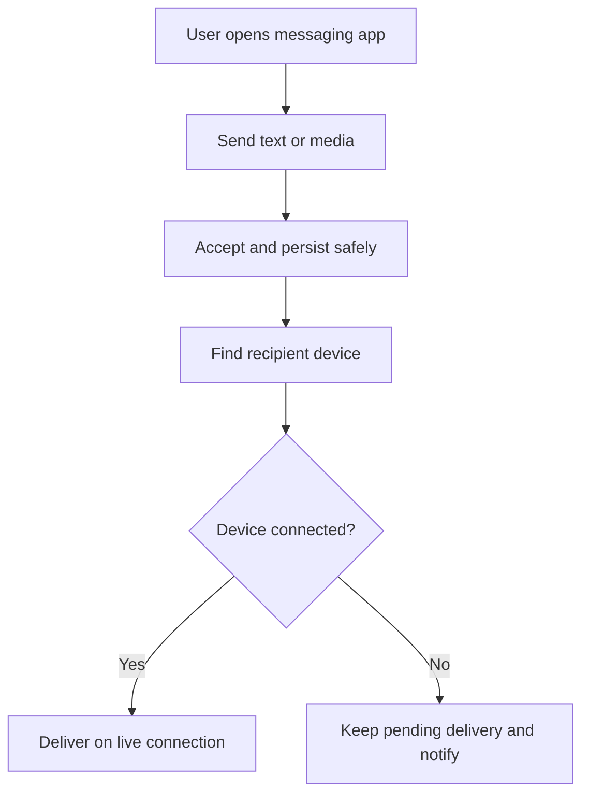

**Memory trick:** A chat system must **accept**, **store**, **route**, and **confirm** each message. These are separate responsibilities.

---

## 2. Functional versus nonfunctional requirements

**Functional requirements** say what the app can do. **Nonfunctional requirements** say how reliably and quickly it must work.

| Functional | Nonfunctional |
|---|---|
| Send and receive direct messages | Low online delivery latency |
| Create group conversations | High concurrent connection capacity |
| Send photos, audio and video | Reliable recovery after crashes |
| Show sent/delivered/read states | Protect private conversations |
| Support offline recipients | Operate across unreliable mobile networks |
| Show online and last-seen information | Handle high message throughput |

Start an interview with these two groups. Do not immediately announce “Kafka + Cassandra + Redis” before defining what the system actually promises.

**Additional design context:** Privacy and end-to-end encryption should be explicit requirements when designing a WhatsApp-like product. The accessible article lists messaging basics but does not explain a full encryption protocol.

---

## 3. Estimate scale with simple numbers

The source uses these **illustrative planning assumptions**:

- **1 billion** registered users
- **500 million** daily active users
- **50 million** simultaneous connections at peak
- **20 messages per active user per day**

Calculate the average message rate:

```text
Daily messages = 500,000,000 × 20
               = 10,000,000,000 messages/day

Average rate   = 10,000,000,000 / 86,400
               ≈ 115,741 messages/second
```

If a message and metadata average **1 KB**, gross creation volume is about **10 TB/day** before replication, indexes and retention rules.

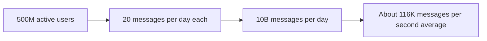

**Important:** These are the article's interview assumptions, **not verified current WhatsApp operating statistics**. A peak multiplier is an estimate, and bandwidth depends on actual active traffic—not simply every idle socket transferring at a fixed rate.

---

## 4. High-level chat architecture

Split the system into a **real-time connection path** and a **durable message path**.

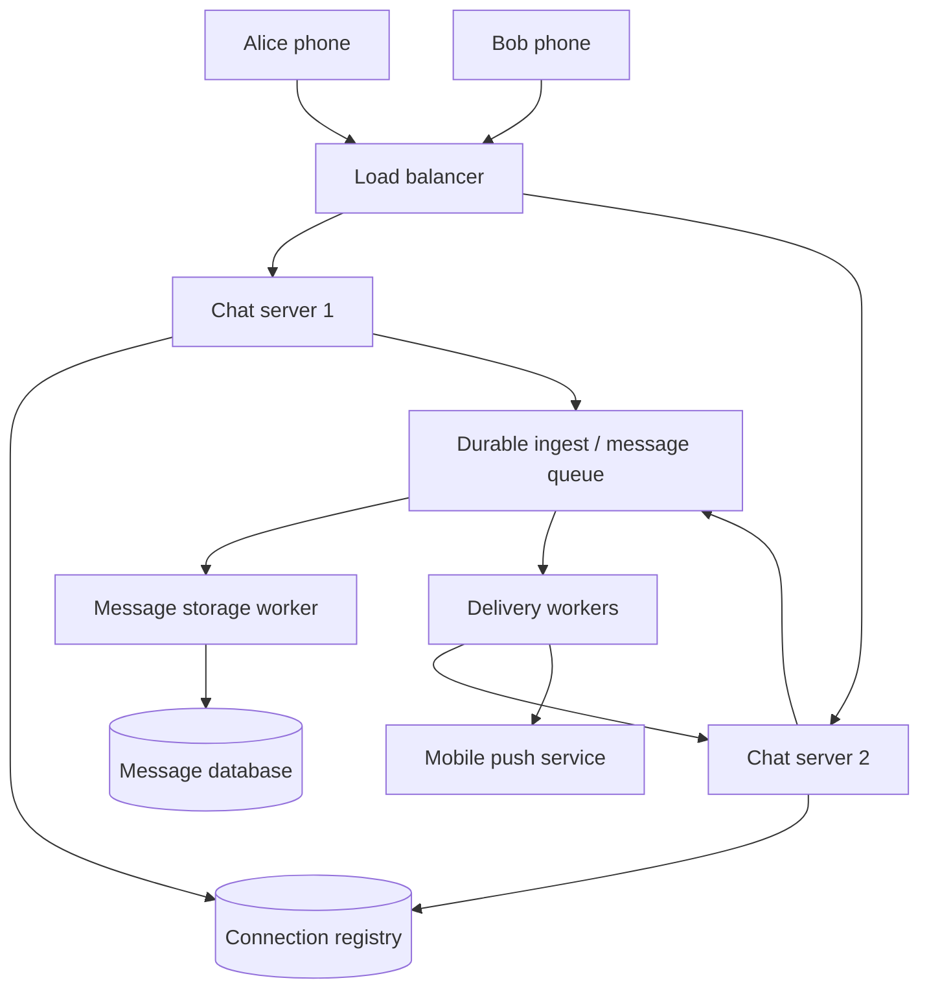

**Components in plain English:**

| Component | Job |
|---|---|
| Load balancer | Distribute new connections |
| Chat server | Maintain live connections, receive/send messages |
| Connection registry | Map user/device to the connected chat server |
| Durable queue or log | Keep accepted work while processors fail/restart |
| Message store | Persist messages and delivery state |
| Delivery worker | Route messages to online or reconnecting devices |
| Push gateway | Alert disconnected devices |
| Presence service | Track last activity and approximate availability |

An actual system may combine some components, but separating their roles makes the failure cases easier to reason about.

---

## 5. Why WebSockets fit real-time messaging

A messaging app needs data to flow **in both directions**:

- Alice sends a message to the server.
- The server pushes the message to Bob.
- Bob sends a delivery acknowledgement back.
- The server pushes the updated status to Alice.

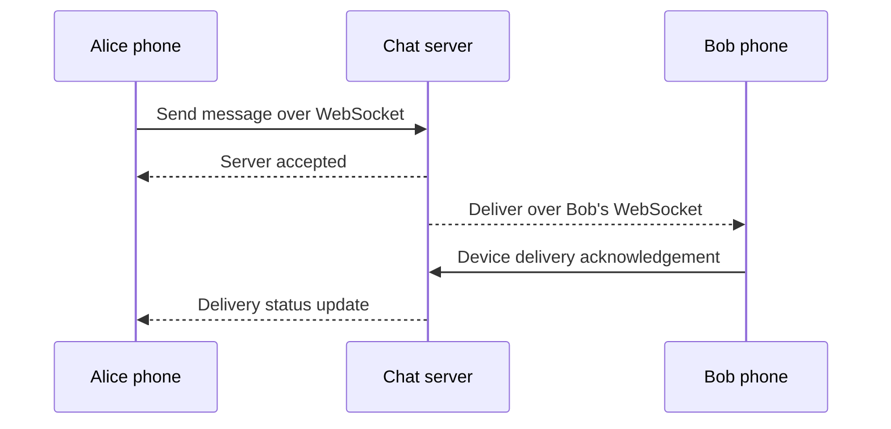

**Polling** checks repeatedly and adds delay and empty requests. **Long polling** waits longer for new data, but still repeats request cycles. **WebSockets** maintain a two-way connection suitable for frequent low-latency events.

**Clarification:** WebSockets can work through appropriately configured **Layer 7 or Layer 4 load balancers**; they do not universally require Layer 4 only. Mobile background behavior, proxy timeouts and reconnects still require care.

---

## 6. The connection registry: where is Bob?

Alice might be connected to Chat Server A, while Bob is connected to Chat Server C. How does A find C?

Keep a short-lived registry such as:

```text
user_id: bob
device_id: phone_1
server_id: chat_C
session_id: session_381
last_seen_at: 2026-11-01T11:00:00Z
```

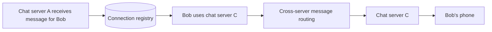

A fast store such as Redis can provide these lookups. But **presence entries can become stale** when phones disconnect abruptly.

Use leases, heartbeats and session IDs. If the target server no longer owns the session, route via the normal offline/retry path instead of silently discarding the message.

**Additional design context:** One user may have **multiple active devices**, so a robust mapping is often user → several device sessions.

---

## 7. Service discovery: chat servers come and go

A load balancer and other services need a current list of **healthy chat server instances**. Hardcoded addresses are brittle when deployments replace servers.

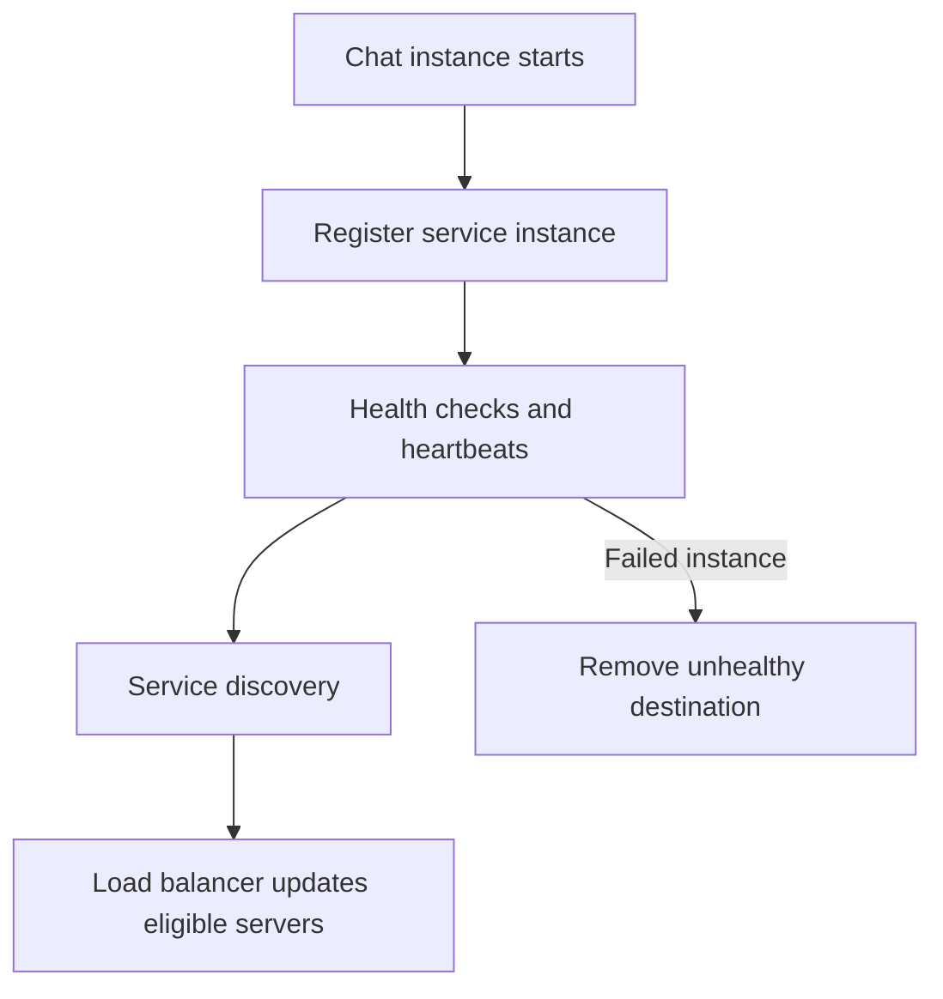

The article gives **Consul** and **AWS Cloud Map** as examples of service discovery systems.

**Distinction:** A service registry answers **“which chat servers are healthy?”** The user connection registry answers **“which particular server holds Bob's session?”** They should not be confused.

A disconnected client typically reconnects and may reach a *different* healthy server, then re-establishes its session mapping.

---

## 8. Message IDs and three important acknowledgements

Suppose Alice taps Send. You might see three stages:

1. **Accepted/sent:** The system has accepted responsibility for the message.
2. **Delivered:** The recipient device acknowledges receipt under your defined semantics.
3. **Read:** A recipient client reports that the conversation/message was viewed.

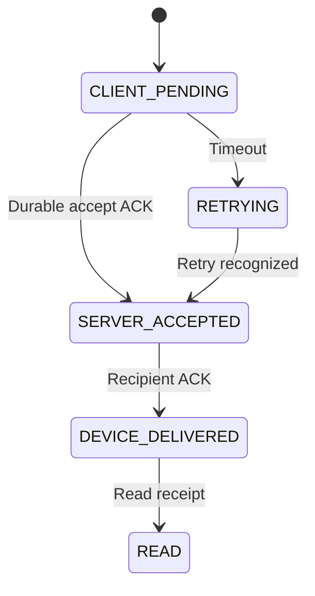

Use a **client-generated message ID** as an idempotency key, plus a stable **server message ID**.

**Important improvement to the source's simplified flow:** The server should not promise reliable acceptance merely because it put data in process memory. A “sent” ACK with a durability promise should follow an appropriately durable commit or reliable log append.

Read receipts are product semantics, not proof a human cognitively read every word.

---

## 9. A complete one-to-one message journey

Walk through Alice sending “Hi Bob”:

1. Alice's device generates `client_message_id = c42`.
2. It sends an authenticated event over WebSocket.
3. The chat server checks conversation permissions and message format.
4. The system durably records or logs the message.
5. Alice receives an acceptance ACK.
6. Delivery logic checks Bob's registered device sessions.
7. Online sessions receive the message; offline devices remain pending under the retention policy.
8. Recipient acknowledgements update delivery state.

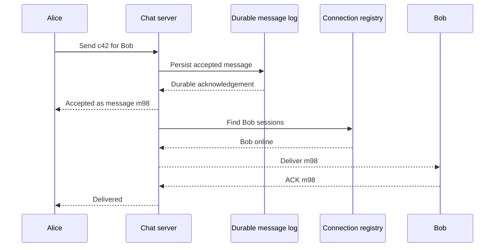

**Why separate IDs?** Retries of `c42` should return the existing logical result, not create another message.

---

## 10. Offline delivery: disconnects must not lose messages

Bob is travelling and has no mobile signal. Alice still sends a message.

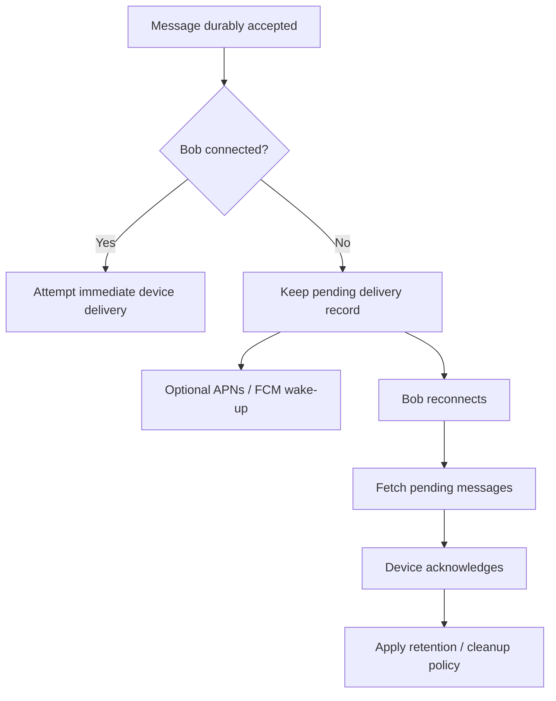

The article's **30-day offline queue** is a proposed exercise retention setting. It is not evidence that every real WhatsApp message is stored for exactly that period.

**Additional design context:** An acknowledgement may be lost after the message reached Bob. Re-delivery is therefore normal. Bob's device should deduplicate by stable message ID.

A push notification is a **wake-up hint**, not proof of successful message delivery.

---

## 11. Ordering and duplicates under unreliable networks

Imagine Alice sends messages M1 and M2. Network delay makes M2 reach a client first. A resend also causes M1 to arrive twice.

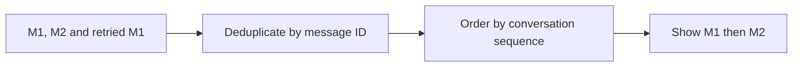

A common design assigns **per-conversation sequence numbers** or an equivalent ordering rule at an authoritative point.

**Do not confuse uniqueness with ordering.** Snowflake-like IDs may be approximately ordered by creation time but do not automatically guarantee strict chat order across independent writers.

**Additional design context:** For multi-region or group chat, define whether strict global ordering is necessary; per-conversation ordering is more common and practical.

---

## 12. Message storage and access patterns

A large messaging service usually needs efficient writes and fast fetches for **one conversation's recent messages**.

One possible record shape:

```json
{
  "conversationId": "conv_19",
  "messageId": "msg_98",
  "senderId": "alice",
  "ciphertext": "...",
  "createdAt": "2026-11-01T11:15:00Z",
  "conversationSequence": 803
}
```

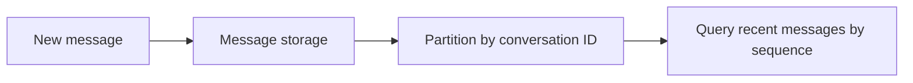

The accessible article lists **PostgreSQL for user/group metadata**, **Cassandra or DynamoDB for messages**, and **Redis for current connections / inbox tracking**.

Those technologies are examples, not mandatory choices. Partition keys, retention, replica configuration and read patterns matter more than the database brand.

**Security context:** A WhatsApp-like end-to-end encrypted app should generally store encrypted message payloads on servers. Server-side search or inspection of plaintext has very different privacy implications.

---

## 13. Group chat: send once, deliver to many

The source includes groups of up to **100 participants as an interview requirement**. One user sends a group message, and the system must deliver it to eligible members.

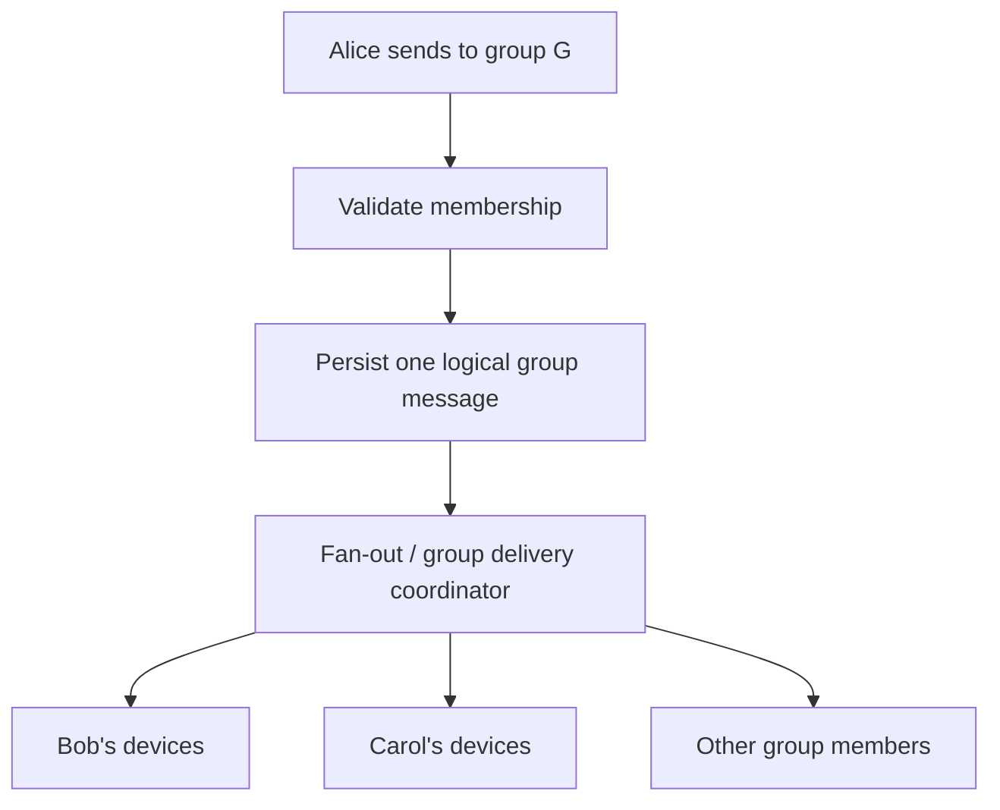

**Simple example:** With Alice plus 99 other group members, one logical message may require delivery work for up to 99 recipients, and potentially more recipient devices.

**Additional design context:** You can store one group message and track delivery per member/device, or materialize recipient inbox entries. This is a trade-off between write amplification and read complexity.

Members must not receive messages they are unauthorized to access under the group membership rules.

---

## 14. Presence: online, offline and last seen

An app may show that Bob is online. But his device can lose connectivity without sending an explicit logout.

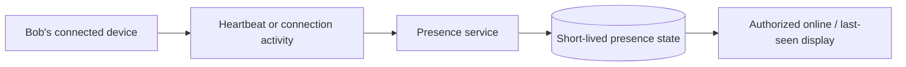

The accessible article explains heartbeat-based health checking and describes a presence service.

**Important:** An online badge is an **approximate signal**, not a strong guarantee that Bob will receive a message at that exact instant.

Presence updates should be limited to users permitted to see them. Maintain a distinction between **connected**, **actively using the app**, and **last observed online**.

Presence does not replace delivery acknowledgements.

---

## 15. Media messages without overwhelming chat servers

Photos and videos are much larger than short text messages. Routing every uploaded file through chat servers can waste their memory and network capacity.

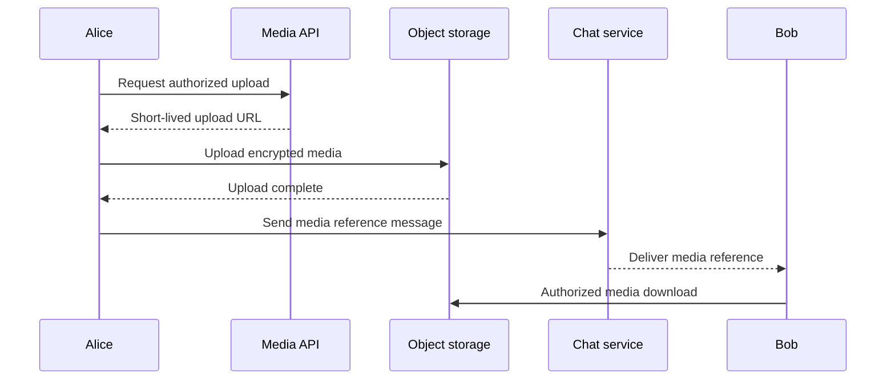

The accessible article recommends **object storage**, **CDNs**, and direct upload/download paths using short-lived URLs.

**Additional design context:** End-to-end media encryption generally occurs before upload. Signed URLs must be scoped, expire appropriately, and not be treated as permanent public links.

Store message metadata and file contents separately, with cleanup rules for abandoned uploads.

---

## 16. Multi-device synchronization: an extra design explanation

The article's introduction lists **multi-device synchronization** as a topic, but its detailed discussion is behind the paywall. The following is an independent extension.

One account may have a phone and laptop. Both can be connected, offline at different times, or receive the same message after reconnecting.

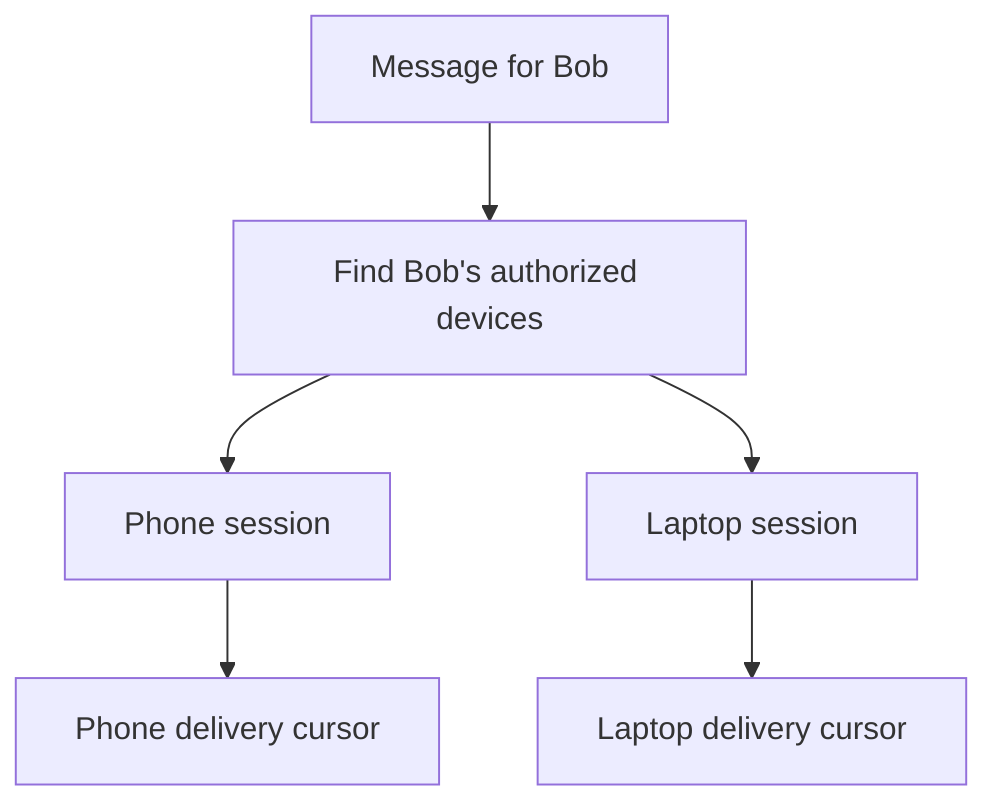

A robust design tracks a **per-device synchronization cursor or acknowledgement**, not only a single user-level delivered flag.

Device registration, removal, key management, reconnect catch-up and deduplication require explicit design. A newly linked device should not automatically gain unauthorized plaintext history.

---

## 17. Crash scenarios every interviewer should ask about

A messaging system becomes reliable when it treats unclear outcomes as normal.

| Failure | Recovery principle |
|---|---|
| Sender times out after server committed | Retry using same client message ID |
| Chat server crashes after ACK | Durable log/storage still holds accepted message |
| Recipient loses connection before delivery | Keep pending and deliver on reconnect |
| Delivery ACK is lost | Redeliver safely; client deduplicates |
| Connection registry is stale | Detect invalid session and retry lookup/delivery |
| Message storage worker restarts | Resume from durable queue/checkpoint |
| Push notification fails | Message is still available in durable inbox |
| One device is lost or revoked | Revalidate sessions and access |

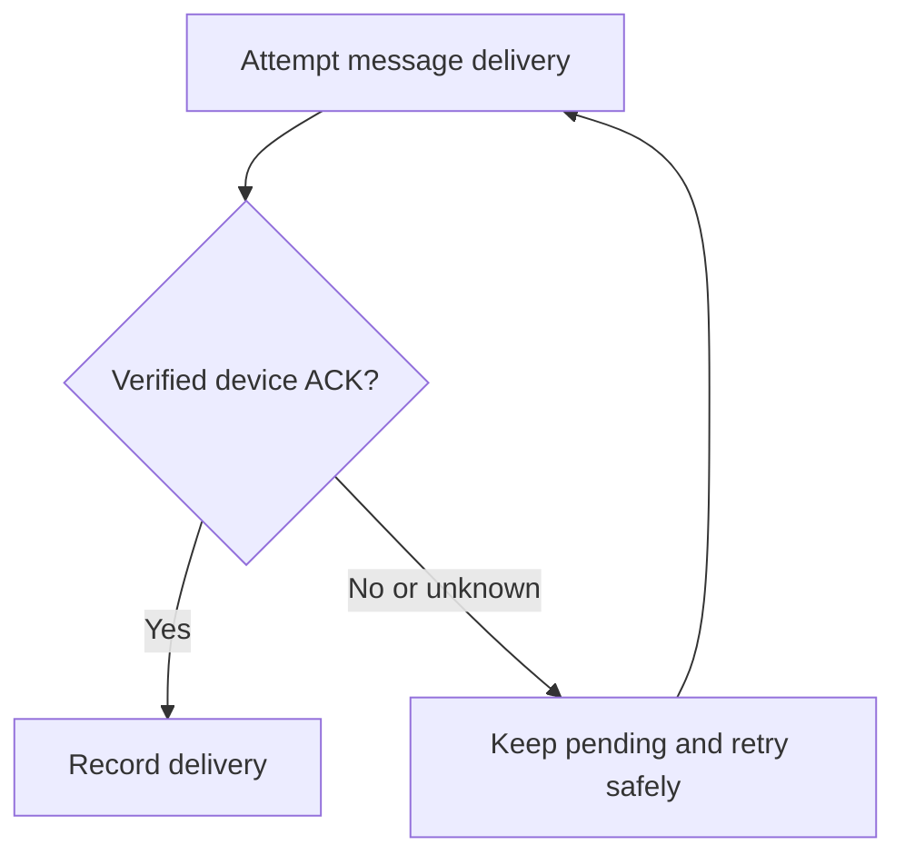

**Additional engineering detail:** Define the durable acceptance boundary, retry policy, deduplication window and retention limits together. A promise of “guaranteed delivery” needs a precise definition when the recipient never reconnects.

---

## 18. Security and end-to-end encryption boundaries

This section adds design context beyond the publicly accessible article.

For a WhatsApp-like private messenger, an end-to-end encryption (E2EE) model means message content is encrypted on the sender's device and decrypted on authorized receiving devices.

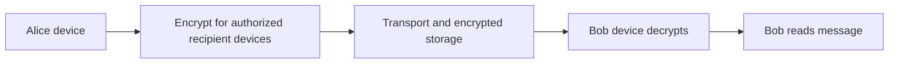

**Important distinctions:**

- A chat server may need routing metadata without seeing message plaintext.
- Group membership, multi-device keys and device revocation complicate encryption.
- End-to-end encryption does not automatically hide all metadata.
- Push notifications should avoid exposing sensitive plaintext.
- Access control must still protect accounts, conversations and media.

A full cryptographic protocol design requires much more detail than the article's visible Part 1 content.

---

## 19. The system design interview answer

A practical order for answering **Design WhatsApp**:

1. Clarify direct/group messages, media, offline delivery, presence and receipts.
2. Estimate daily messages, peak throughput and concurrent connections.
3. Draw WebSocket clients, load balancing and chat servers.
4. Separate **durable accept** from asynchronous delivery.
5. Explain recipient session lookup through a connection registry.
6. Walk through online and offline messages.
7. Define message IDs, deduplication and per-conversation ordering.
8. Choose storage based on conversation-history reads and retention.
9. Explain group fan-out and multi-device sessions.
10. Add media uploads, service discovery, monitoring and privacy.

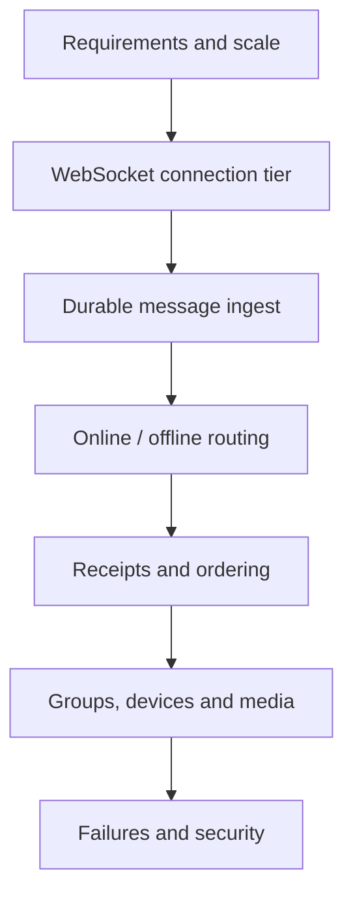

**Interview-ready explanation:**

“I would maintain persistent connections through a load-balanced WebSocket tier. Messages get a stable client ID and cross a durable acceptance boundary before the sender sees a success ACK. A delivery layer locates recipient devices through a connection registry and routes messages across chat servers. Offline recipients catch up from pending delivery state, with idempotency and acknowledgements protecting against duplicate delivery. Media moves through object storage, while separate services track presence and device sessions.”

---

## 20. Key questions and revision sheet

### Interview questions

1. Why use WebSockets instead of frequent polling?
2. What is the difference between a service registry and a user connection registry?
3. Why should a sender ACK follow a durability boundary?
4. What happens if a chat server crashes just after acknowledging?
5. How do we handle Bob being offline?
6. Why is a push notification not proof of delivery?
7. How do client and server message IDs prevent duplicate messages?
8. Why is a Snowflake timestamp not necessarily strict conversation order?
9. What changes when one user has multiple devices?
10. Why do media uploads bypass chat servers?
11. How does group fan-out affect delivery traffic?
12. What does an online presence badge actually prove?
13. Which databases serve user metadata versus message history?
14. How does E2EE affect server-side message storage and search?
15. How do we scale 50 million simultaneous WebSocket connections?
16. What failure modes would you simulate before launch?

### One-minute cheat sheet

| Concept | Simple meaning |
|---|---|
| WebSocket | Persistent two-way chat connection |
| Load balancer | Assign incoming connections to healthy servers |
| Service discovery | Find healthy server instances |
| Connection registry | Find which server/device session belongs to a user |
| Durable accept | Message is recoverable before success ACK |
| Delivery ACK | Recipient device confirms its receipt |
| Read receipt | Client reports the content was viewed |
| Offline queue | Pending delivery for disconnected devices |
| Idempotent send | Retry safely with the same logical message ID |
| Group fan-out | Deliver one logical message to many members |
| Object storage | Hold uploaded encrypted media |
| Presence | Approximate online / last-seen state |
| Multi-device cursor | Track synchronization progress per device |
| E2EE | Authorized endpoints decrypt message content |

**Final takeaway:** **WhatsApp-like messaging is not just WebSockets.** It is a durable messaging workflow that must survive mobile disconnections, retries, server failures and concurrent devices.

---

### Source and scope

- Original inspiration: [System Design Interview: Design WhatsApp, Part 1](https://newsletter.systemdesign.one/p/whatsapp-system-design), by Neo Kim and Hayk, published December 8, 2025.
- The publicly accessible article discusses requirements, capacity, core components, WebSockets, discovery, data model headings and sample message APIs.
- Detailed offline delivery, full multi-device synchronization and related topics appear beyond the visible paywall; sections labeled **Additional design context** are original engineering extensions, not claims about that hidden text.

---
